# Daniel Bourke《PyTorch 深度学习｜PyTorch 101 Crash Course For Beginners in 2025》中英字幕 - P61：061_03_025 全流程整合（第四部分）：训练模型预测.zh_en - GPT中英字幕课程资源 - BV1kTSKB1E9m

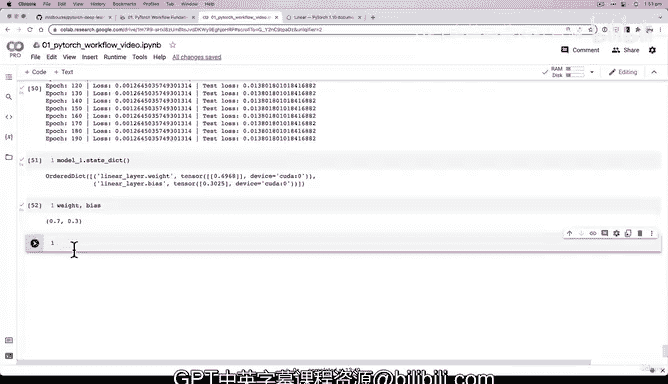

In the last video， we did something very， very exciting。

 We worked through training an entire neural network。

 Some of these steps took us an hour or so worth of videos to go back through before。

 but we coded that in one video。 So you ready listen the song just to remind ourselves of what's going on for an epoch in arrange。

 Commod or dot train。 Do the forwardd， pass， calculateulate the loss， Opimr 0 grad， La backward。

 Opr step。 step， step。 Let's test， Commar or do of vow with H inference mode。 do the forwardd pass。

 calculateulate the loss， print out what ha， naan。😊。

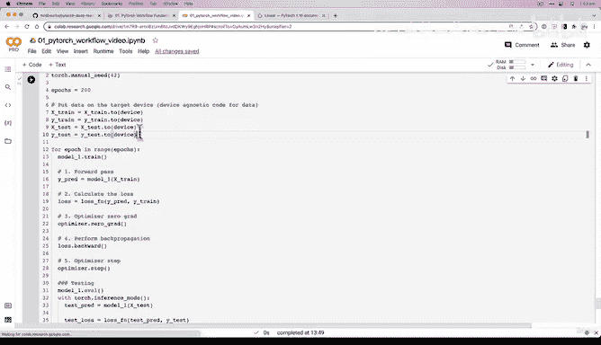

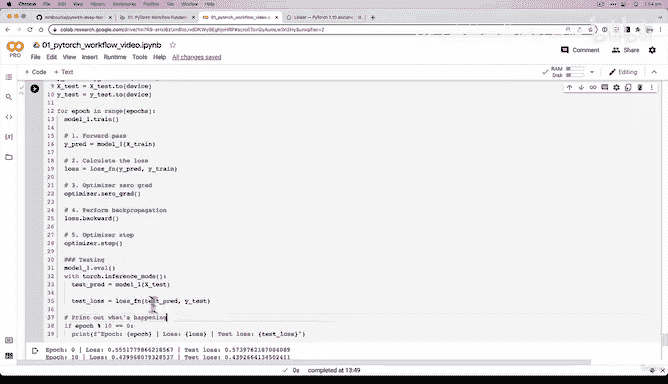

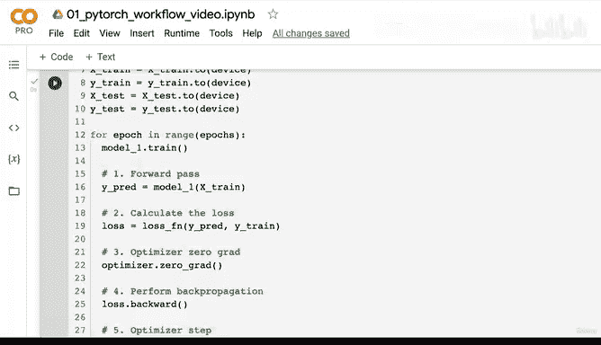

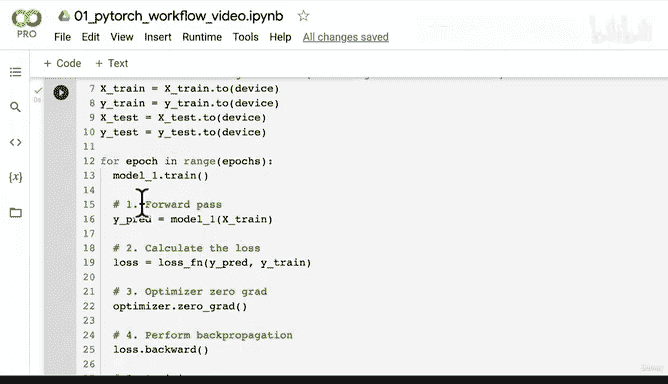

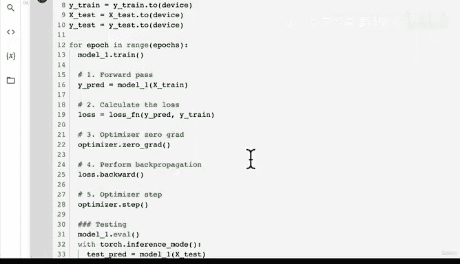

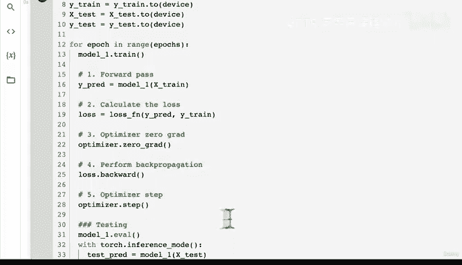

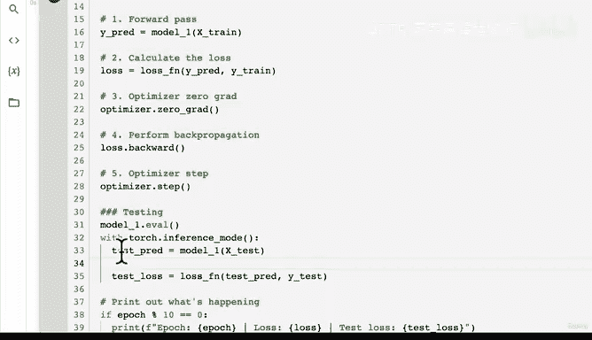

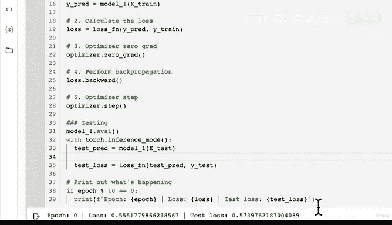

And then we do it again， again， again， for another repo in a range。 Now， I'm kidding。

 We'll just leave it there。 We'll just leave it there。

 But that's the unofficial pieytorrch optimization loop song。

 We created some device agnostic code so that we could make the calculations on the same device as what our model is because the models also using device agnostic code。

😊。

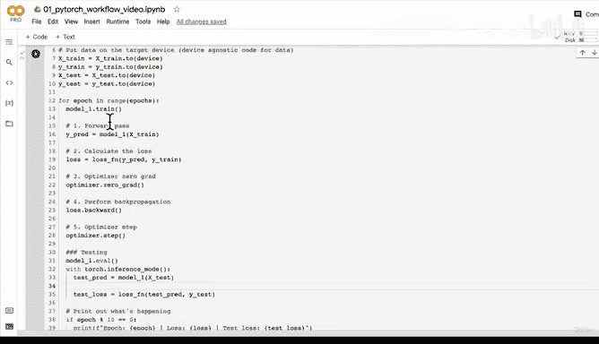

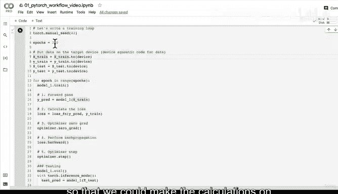

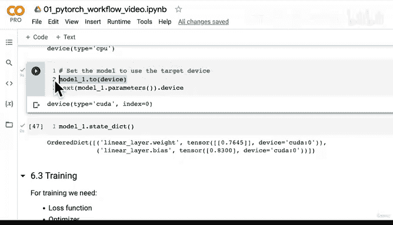

And so now we've got to evaluate our models。 So we've looked at the loss and the test lost here。

 and we know that our model's loss is going down。 But what does this actually equate to when it makes predictions。

 That's what we're most interested in， right， And we've looked at the parameters。

 They're pretty close to the ideal parameters。 So at the end of last video。

 I issued you the challenge to making。

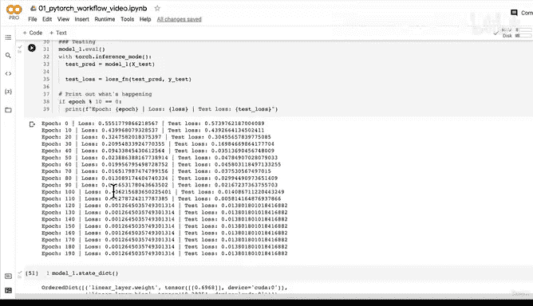

And evaluating predictions to make some predictions and plot them， I hope you gave it a shot。

Let's see what it looks like together， hey， so turn the model into evaluation mode， why。

 because every time we're making predictions or inference we want our model to be in a Valel mode and every time we're training。

 we want our model to be in training mode。And then we're going to。

Make predictions on the test data because we train on the train data and we evaluate our model on the test data data that our model has never actually seen。

 except for when it makes predictions。With torch inference mode。

 we turn on inference mode whenever we make inference or predictions。

 So we're going to set y pres equal to model 1， and the test data goes in here。

 Let's have a look at what the Y pres look like。

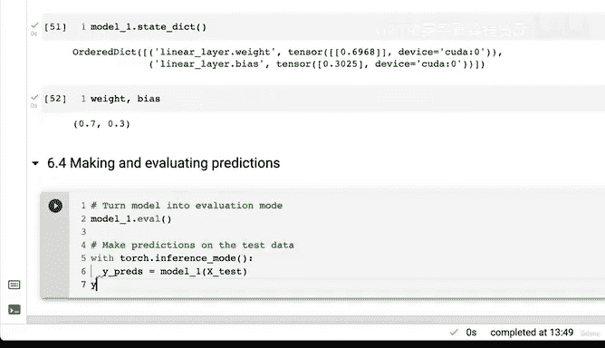

Wonderful， so we've got a tensor here。 It shows us that they're still on the device Coer。

 Why is that， Well， that's because previously， we set the Model 1 to the device， the target device。

 the same with the test data， so。😊，Subsequently， our predictions are also on the coer device。 Now。

 let's bring in the plot predictions function here。 So check out our model predictions。Visually。

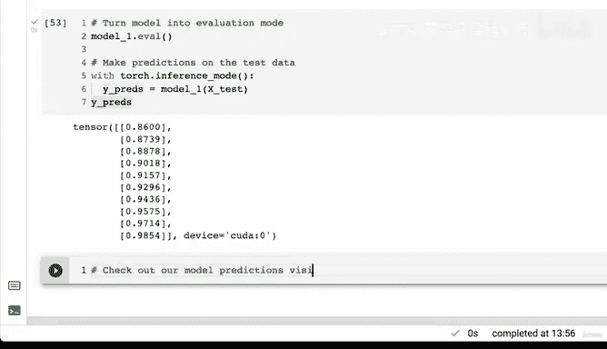

We're going to adhere to the data explorelorer's motto or visualize， visualize， visualize。

 plot predictions。And predictions。Are going to be set to。E callss why pres。 And let's have a look。

 How good do these look。 Oh， no。

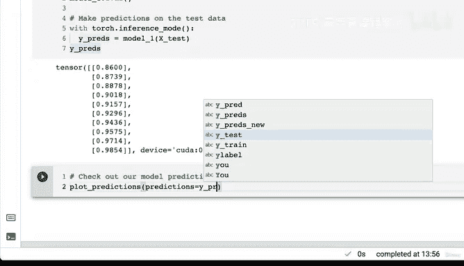

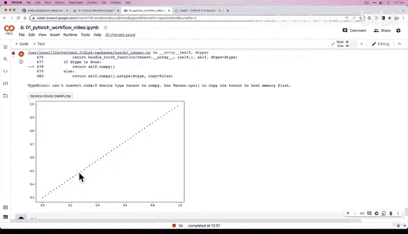

，We've got another error。 type error。 Can't convert kuder device type tensor to nuy。 of course。

 Look what we've done。 So our plot predictions function。 If we go back up， where did we define that。

😊，What does our plot predictions function use， It uses map plot Lib， Of course。

 and mappl Lib works with numpy， not pitorrch， and nupy is CPU based。 So， of course。

 we're running into another error down here。 because we just said that our predictions are on the couda device。

 They're not on the CPU。 They're on a GP。 So it's giving us this helpful information here。

 use tensor dot CPU to copy the tensor to hope memory first。 So this is our tensor。

 Let's call dot CPU and see what happens then。 I that going to go to。😊。

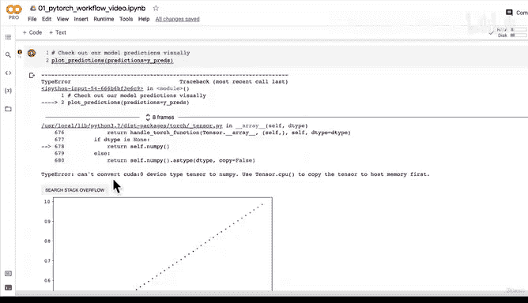

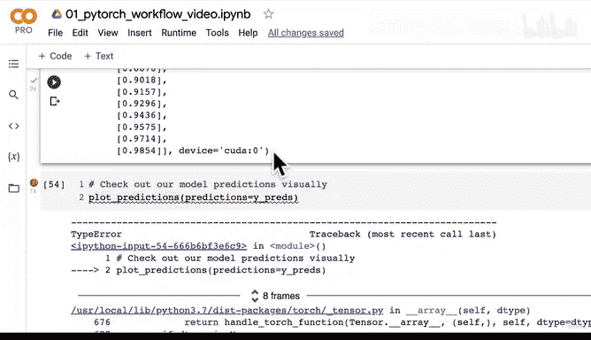

CPU but oh my goodness。 Look at that。

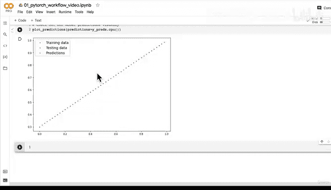

Look at that。 Go the linear layer。The red dots， the predictions are basically on top of the testing data。

 that is very exciting。 Now again， you may not get the exact same numbers here。

 and that is perfectly fine。 but the direction should be quite similar。

 So your red dots should be basically on top of the green dots。 If not very slightly off。

 but that's okay。 That's okay。 We just want to focus on the direction here。

 So thanks to the power of back propagation。😊。

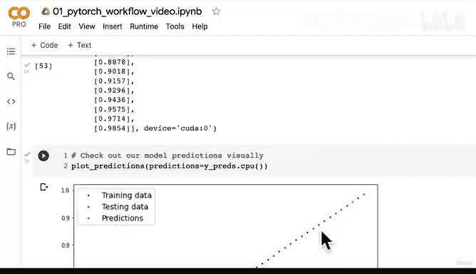

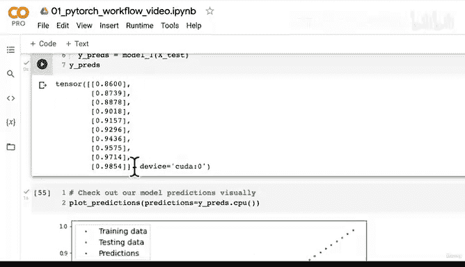

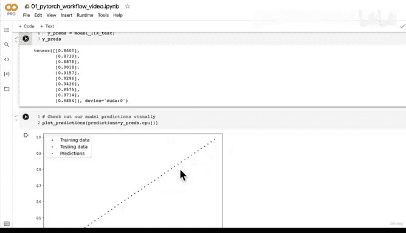

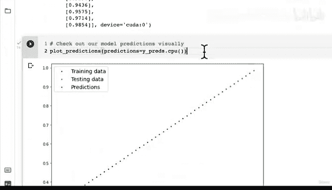

Here and gradient descent， our models's random parameters have updated themselves to be as close as possible to the ideal parameters。

 And now the predictions are looking pretty darn good for what we're trying to predict。

 But we're not finished there。 We've just finished training this model。

 What would happen if our notebook disconnected right now。 Well， that wouldn't be ideal wooded。

 So in the next part， we're going move on 26。5 saving and loading a trained model。😊。

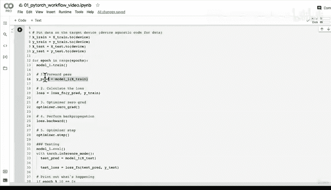

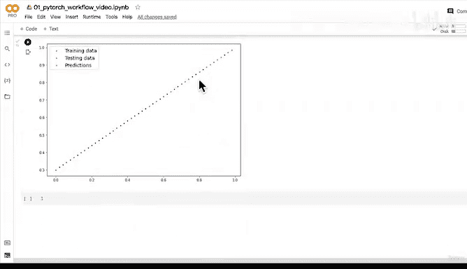

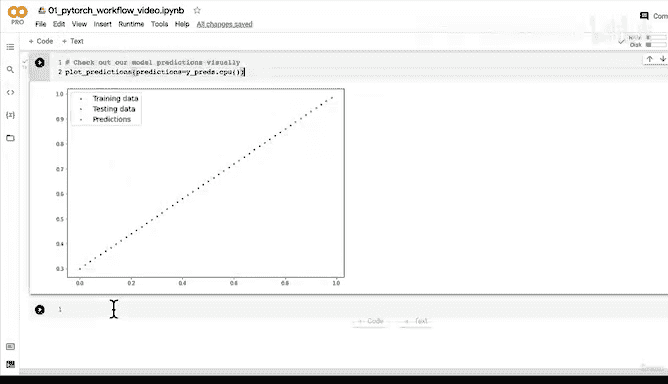

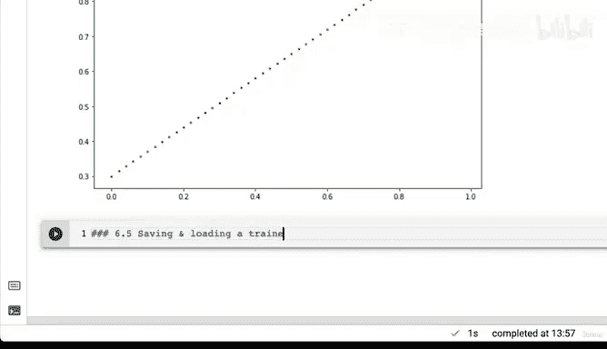

So。I'm going to give you a challenge here as well， is to go ahead。

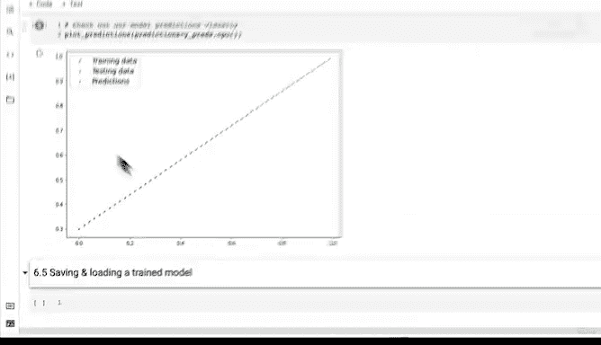

And go back and refer to this， this code here， saving model in Pi torch。

 loading a Pi torch model and see if you can save Model 1。

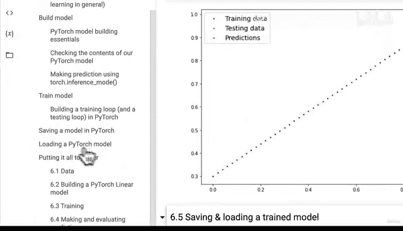

The state dictionary of Model 1 and load it back in and get something similar to this。

 Give that a shot， and I'll see you in the next video。

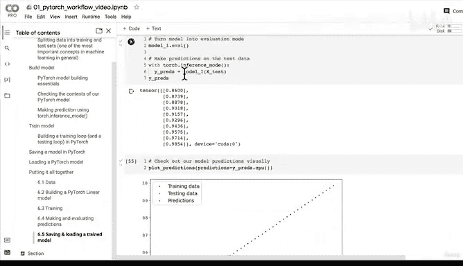

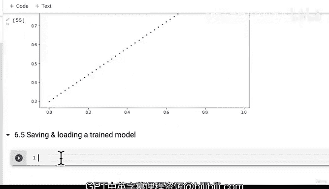