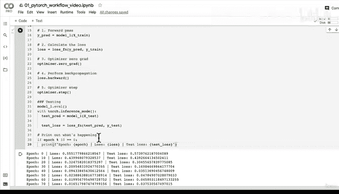
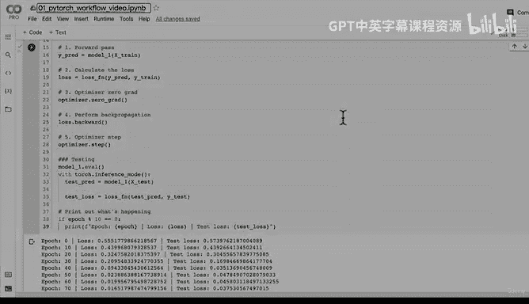

# Daniel Bourke《PyTorch 深度学习｜PyTorch 101 Crash Course For Beginners in 2025》中英字幕 - P62：062_03_026 全流程整合（第五部分）：模型保存与加载.zh_en - GPT中英字幕课程资源 - BV1kTSKB1E9m

Welcome back。 In the last video， we saw the power of the torch dot N N dot linear layer and back propagation and gradient descent。

 And we got some pretty darn good predictions out of our model。 So that's very exciting。

 Congratulations。 You've now trained two machine learning models。 but it's not over yet。

 We've got to save and load our trained model。 So I issued you the challenge in the last video to try and save and load the model yourself。

 I hope you gave that a go。 But we're going do that together in this video。

 So we're gonna start by importing path because we would like a file path to save our model， too。😊。

And the first step we're going to do is create models directory。

 We don't have to recreate this because I believe we already have one。

 but I'm going to put the code here just for completeness。

 And this is just so if you didn't have a models directory， this would create one。 So model path is。

Going to go to path。Models。And then， we'd like to。Model path dot makedo。

 We're going to call makedo for make directory。 We'll set parents equal to true。 And if it exists。

 okay， that'll also be true。 So we won't get an error。 Oh my gosh， Google Colab。 I didn't want that。

 We won't get an error if it already exists。 And2， we're going to create a model save path。

 So if you recall that Pytorch objects in general have the extension of what。

This is a little pop quiz before we get to the end of this sentence。

 So this is going to be pietorch workflow for this module that we're going through。 this one here。

 Chapter 01。Pinetorch workflow Model1， and they usually have the extension dot PT for Ptorch or PTH for Pytorch as well。

 I like PT H。But just remember， sometimes you might come across slightly different versions of that P or P H。

 And we're going to create the model save name or the save path。 It's probably a better way to do it。

Is going to be model path。 And then we can use because we're using the path Lib module from Python。

 we can save it under model name。 And so if we look at this， what do we get model save path。

We should get， oh。Path is not defined。 Oh， too many capitals here， Daniel。

 The reason why I'm doing these in capitals is because oftentimes hyperpara such as epochs and machine learning are set as hyperparameter。

 L R could be learning rate。 and then you could have as well， model name equals ya ya， ya。

 But that's just a little bit of nomenature trivia for later on。And model save path， we've done that。

 Now we're going to save the model state dictionary rather than the whole model。

 saveve the model state diic。Which you will find the pros and cons of in where。

In the Pytoch documentation for saving and loading a model。

 which was a little bit of extracur for a previous video。

 but let's have a look at our model save pipe printed out and we'll go torch save。

 We'll set the object that we're trying to save to equal model1 dot state di。

 which is going to contain our trained model parameters。We can inspect what's going on in here。

 state decked。They'll show us our model parameters。

 remember because we're only using a single linear layer， we only have two parameters。

 but in practice， when you use a model with maybe hundreds of layers or tens of millions of parameters viewing the state di explicitly like we are now might not be too viable of an option。

 but the principle still remains a state dt contains all of the models trained or associated parameters。

And what state they're in？And the final path we're going to use is， of course， the model save path。

 which we've seen here is apossix path。 Let's save our model。

Wonderful saving model to this file path here。 And if we have a look at our folder。

 we should have two saved models now。 beautiful， two saved models。

 This one for us from the workflow we did before up here， saving a model in Ptorrch。

 loading a pytorch model and now the one we've got， of course。

 Model 1 is the one that we've just saved beautiful。 So now let's load a model。

 we're going to do both of these in one video。 load a pytorch model， you know what。

 because we've got a little bit of practice so far。 And we're gonna pick up the pace。

 So let's go loaded， let's call it， we create a new instance。 of loaded model 1， which is of course。

 our linear regression model V2， which is the version 2 of our linear regression model class。

 which subclasss what subclasss and end dot module。

 So if we go back here up here to where we created it。

 So linear regression model V2 uses a linear layer rather than the previous iteration of linear regression model。

 which we created。😊，up here啊。If we go up to here， which explicitly defined the parameters and then implemented a linear regression formula in the forwardd method。

 the difference between what we've got now is we use ptorch's pre builtilt linear layer。

 and then we call that linear layer in the forwardd method。

 which is probably the far more popular way of building pi toch models is stacking together pre builtilt Nn layers and then calling them in some way in the forwardd method。

So let's load it in。So we'll create a new instance of linear regression model V2。

And now what do we do？We've created a new instance， which' are going get out of this。

 Make some space for us。We want to load the model state di， the saved Model 1 state di， which is。

The state diict that we just saved beforehand。 So we can do this by going loaded Model 1。

 calling the load state diict method， and then passing it torch dot load。

 and then the file path of where we save that high torch object before。

 But the reason why we use the pathlib is so that we can just call model save path in here。Wonderful。

 and then let's check out what's going on。Or actually。

 we need to put the target model or the loaded model。To the device。

 the reason being is because we're doing all of our computing with device agnostic code。

 so let's send it to the device and I think that'll be about it。Let's see if this works。 All。

 there we go。 Linear regression Model V2 in features 1 out features 1 bias equals true。

 wonderfulnder。 Let's check those parameters。 Hey， next， loaded Model 1 dot parameters。

 Are they on the right device。 Let's have a look。😊，Beautiful。

 and let's just check the loaded state dictionary of loaded Model 1。

 Do we have the same values as we had previously， Yes， we do。 Okay。

 so to conclusively make sure what's going on， let's evaluate the loaded model。😊。

Evaluate loaded model。Loaded Model 1， What do we do for making predictions or what do we do to evaluate。

 We call dot aval。 And then if we're going to make some predictions。

 we use torch inference mode with torch inference mode。 And then let's create loaded Model 1 pres。

Equals loaded model。1， and we'll pass it the test data。

 And now let's check for a equality between Y pres。

 which is our previous Model 1 pres that we made up here， Y pres。

And we're going to compare them to the fresh loaded Model1 pres， and should they be the same？Yes。

 they are beautiful。 And we can see that they're both on the device。 Couda。 How amazing is that， so。

😊，I want to give you a big congratulations because you've come such a long way。

 We've gone through the entire pitorrch workflow from making data。

 preparing and loading it to building a model， all of the steps that come in building a model there's a whole bunch there making predictions。

 training a model。 we spent a lot of time going through the training steps。 But trust me。

 it's worth it because we're gonna be using these exact steps all throughout the course。 And in fact。

 you're gonna be using these exact steps when you build pitorrch models after this course。

 And then we looked at how to save a model so we don't lose all our work。

 We looked at loading a model and then we put it all together using the exact same problem。

 But in far less time。 And as you'll see later on， we can actually make this even quicker by functionizing some of the code we've already written。

 But I'm gonna save that for later。 I'll see you in the next video where I'm just gonna to show you where you can find some exercises and all of the extra curriculum I've been talking about throughout this section01 pitorrch workflow。

😊。

我是以为。😊。

