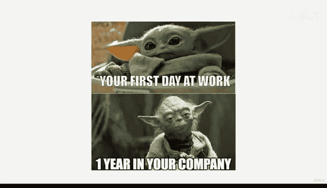
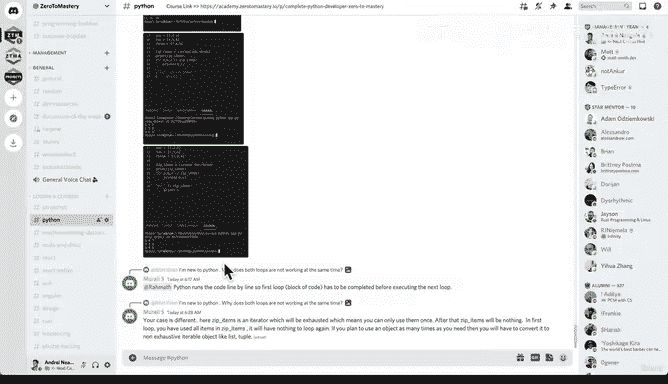
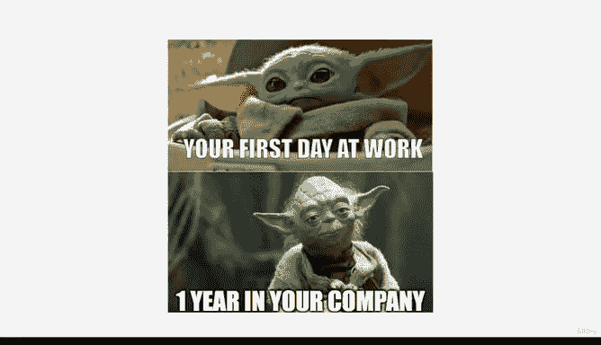

# Daniel Bourke《PyTorch 深度学习｜PyTorch 101 Crash Course For Beginners in 2025》中英字幕 - P63：063_03_027 冒名顶替综合征应对.zh_en - GPT中英字幕课程资源 - BV1kTSKB1E9m

Hey， everybody， I want to take a quick break here。 Go grab a coffee， grab a tea。

 Just take a break from all the learning that you just did。

 And I want to talk to you quickly about imposter syndrome。

 It's this idea that you're not good enough that things are too complicated for you to ever achieve what you want to achieve。

 You look at other people at other industry experts， and you say， I will never get there。But。

It's just a symptom of learning。 This idea of you not being good enough simply means that， well。

 you're just not there yet。 things take time。 If you want to learn a valuable skill， Well。

 it's hard work。 That's why it's valuable。

Remember how you felt on the first day of going to school， first day on a job。

 it's the same experience。But over time， with repetition， with practice， you get comfortable。

 you get experience， and you slowly start to lose that imposter syndrome。Now。

 this idea of an imposter syndrome is great。 It means you're doing something worthwhile。

 So don't use it as a negative。 use it as an encouragement that you're doing something good。

 that you're learning and you're stretching your limits。 So with this break。

 I want to propose that we do a quick exercise。 I want to stop the lectures again， grab a coffee。

 grab a tea and head on over to our discord。 Now， in our Discord server。

 if you've used it up up until now， that's great。 If you haven't head on over to this server。

 And I want you to do something that I think it's super important to learning。

 And that is using what you've learned up until now to actually teach someone or help someone。

 So you can go all the way to， let's say the coding and courses section。

 and pick a topic that you want to help somebody in。 So let's say you go to the Python channel。

 And in here， you'll have other students that are asking Python related questions。 Now。

 you can scroll through here and see if you're able to help someone。😊。

Even though you may not have the experience or the knowledge yet。

 this idea of practicing and explaining what you've just learned to other people。

 even if you're not 100% certain， actually is beneficial to your learning because if you're never teaching if you're never explaining and vocalizing and showing what you've learned you'll always be a beginner。

 This idea of teaching what you learn is a very important concept。

 So moving forward as you go through the lectures， anytime you feel like taking a break。

 hop on over to Discord and help somebody。 our motto here is that we're always kind。

 we don't judge anybody。 We're all just beginners here。

 We're all learning So don't be afraid to answer things because you got to remember nobody's perfect except for Yoda。

 Yoda is pretty perfect。

All right， I'll see you in the next one， bye bye。