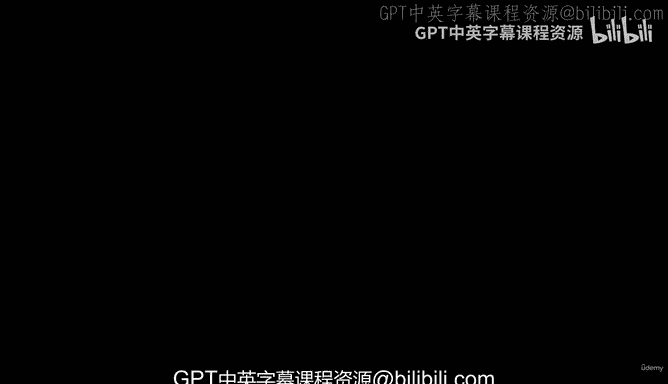
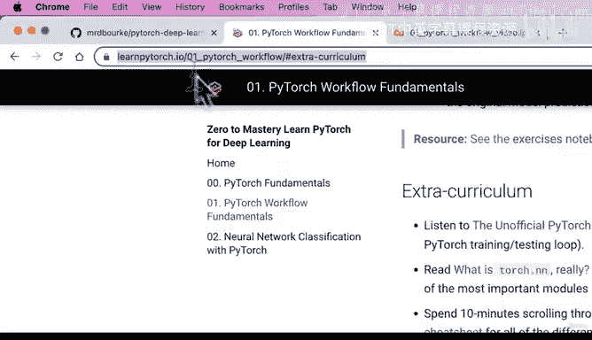
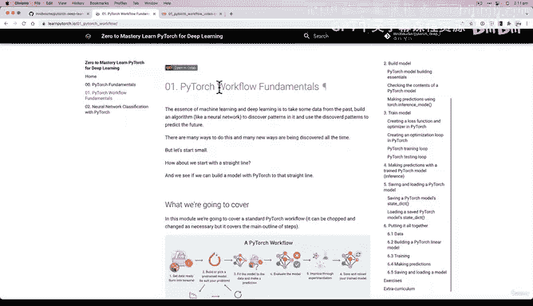
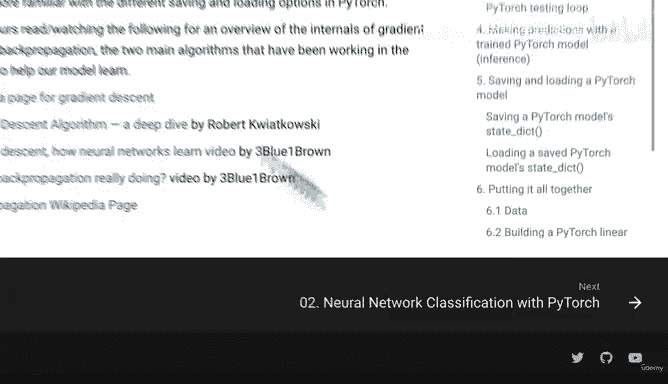
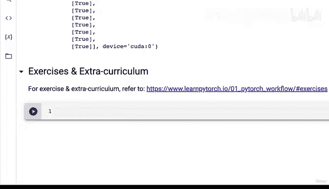

# Daniel Bourke《PyTorch 深度学习｜PyTorch 101 Crash Course For Beginners in 2025》中英字幕 - P64：064_03_028 PyTorch工作流练习与拓展.zh_en - GPT中英字幕课程资源 - BV1kTSKB1E9m

Welcome back。 In the last video， we finished up putting things together。😊。

By saving and loading our trained model， which is super exciting because let's come to the end of the Pytorch workflow section。

 So now this section is going to be exercises and extra curriculum。

 albeit better yet where you can find them。 So I'm going to turn this into markdown。

 And I'm going to write here for exercises。😊，And extra curriculum。Refer to。

So within the book version of the course materials， which is at learn Pytorrch doo。

 where in the01 section Pytorrch workflow fundamentals。

 there'll be more here by the time you watch this video likely。

 And then if we go down here at the end of each of these sections。

 We've got the table of contents over here。 We've got exercises and extra curriculum。

 I listed a bunch of things throughout this series of01 videos。 Like what's gradient descent。

 and what's back propagation。 So I've got plenty of resources to learn more on that there's the loading and saving pytorrch documentation there's a pytorrch cheat sheet。

 there's a great article by Jeremy Howard or a deeper understanding of what's going on in torch do N N。

 And there's， of course， the unofficial pytorrch optimization Lo song by yours truly。

 which is a bit of fun and here's some exercises。 So the exercises here are all based on the code that we wrote throughout section01。

 So there's nothing in the exercises that we。😊。

Haven't exactly covered。 And if so， I'll be sure to put a note in the exercise itself。

 But we've got create a straight line data set using the linear regression formula。

And then build a model by subclassing and end dot module。 So for these exercises。

 there's an exercise notebook template， which is， of course， linked here。

 And in the Pytorch deep learning Gitthub， if we go into here， and then if we go into extras。

 and if we go into exercises， you'll find all of these templates here。

 they're numbered by the same section that we're in， this is pytorch workflow exercises。

So if you wanted to complete these exercises， you could click this notebook here。

 open in Google Co Lab。I'll just wait for this to load。😊，There we go。

 And you can start to write some code here。 You could save a copy of this in your own Google Drive and go through this。

 It's got some notes here on what you should be doing。 You can， of course。

 refer to the textbased version of them They're all here。

 And then if you want an example of what some solutions look like now， please。

 I can't stress enough that I would highly highly recommend trying the exercises yourself。

 You can use the book that we've got here， this is just all the code from the videos。

 you can use this you can use I've got so many notebooks here。

 Now you can use all of the code that we've written here to try and complete the exercises。

 but please give them a go yourself。 And then if you go back into the extras folder。

 you'll also find solutions。 and this is just one example solutions for section 01。

 but I'm going get out of that so you can't cheat and look at the solutions first。

 but there's a whole bunch of extra resources all contained within the Pytor deep learning repo extras exercises solutions。

😊，And they're also in the book version of the course。 So I'm just going to link this in here。

I'm going to put this right at the bottom here。Wonderful， but that is it。

 That is the end of the section。01 pi torch workflow。😊。

So exciting。 we went through basically all of the steps in a high torch workflow， getting data ready。

 turning into tensors， build or pick a model， Pick a loss function on optr。 We built a training link。

 We fit the model to the data。 We made a prediction。 We evaluated our model。

 We improved through experimentation by training for more epochs。 We'll do more of this later on。

 And we saved and reload our trained model。 But let's going finish one。

 I will see you in the next section。😊。