# Daniel Bourke《PyTorch 深度学习｜PyTorch 101 Crash Course For Beginners in 2025》中英字幕 - P67：067_04_003 分类神经网络典型架构概览.zh_en - GPT中英字幕课程资源 - BV1kTSKB1E9m

Welcome back。 In the last video， we saw some example classification inputs and outputs。

 The main takeaway that the inputs to a classification model， particularly a neural network。

 want to be some form of numerical representation， and the outputs are often some form of prediction probability。

😊，So let's discuss the typical architecture Javava classification model and hey。

 this is just going to be text on a page， but we're going to be building a fair few of these。😊。

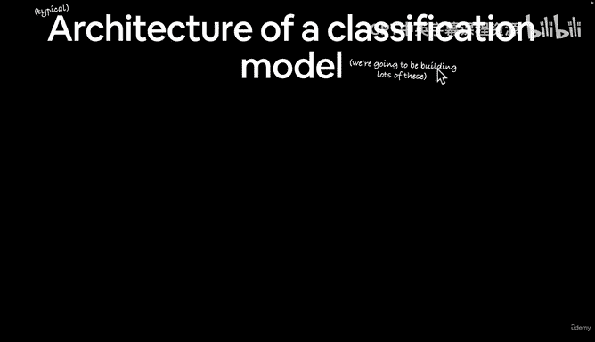

So we've got some hyperparameter over here。 we've got binary classification and we've got multiclass classification。

 Now there are some similarities between the two in terms of what problem we're working with。

 but there also are some differences here and by the way。

 this has all come from if we go to the book version of the course。

 we've got what is a classification problem and we've got architecture of a classification neuralural network。

 So all of this text is available at learnptorge。io and in section 2。😊。

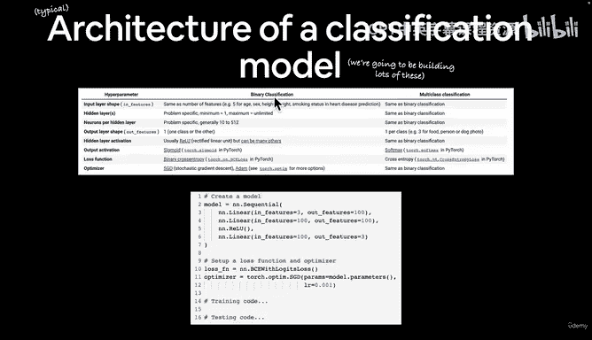

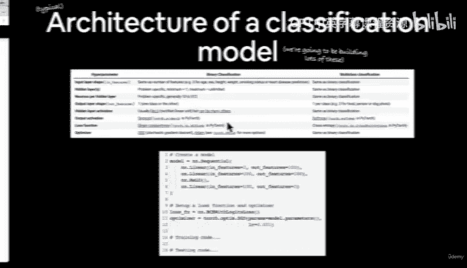

So we come back。

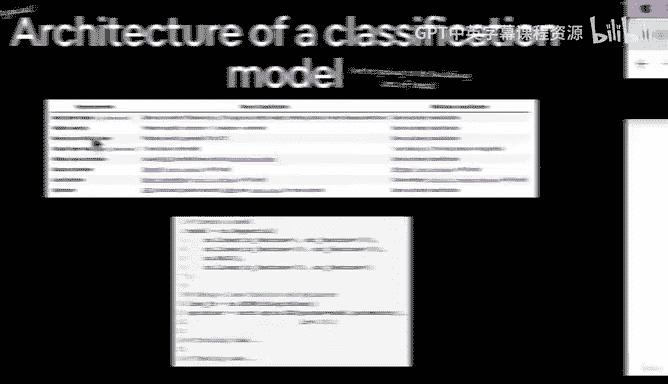

So the input layer shape， which is typically decided by the parameter in features。

 as you can see here。Is the same of number of features。

 So if we were working on a problem such as we wanteded to predict whether someone had heart disease or not。

 we might have five input features， such as one for age， a number for age。

 It might be in my case 28 sex could be male height，180 cime。 If I've been growing overnight。

 It's really closer to 177 weight。 Well， it depends on how much of eaten。

 but it's around about 75 kilos and smoking status， which is 0， So it could be 0 or1 because we。

 we want numerical representation。 So for sex， it could be0 for males。

 one for female height could be its number。 weight could be its number as well。

 All of these numbers could be more could be less as well。 So this is really flexible。

 And it's a hyperparameter。 Y because we decide the values for each of these。

 So in the case of our image prediction problem。 We could have in features equals 3 for number of color channels。

 And then we go。Hidden layers。 So there's the blue circle here。

 I forgot that this was all timed and colorfulful， but let's just discuss hidden layers。

Each of these is a layer， an N dot linear， an N dot linear， and N dot relu， and N dot linear。

 So that's the kind of the syntax you'll see in pi torch for a layer is N N dot something。 Now。

 there are many different types of layers in this in pi torch。 if we go torch and N。

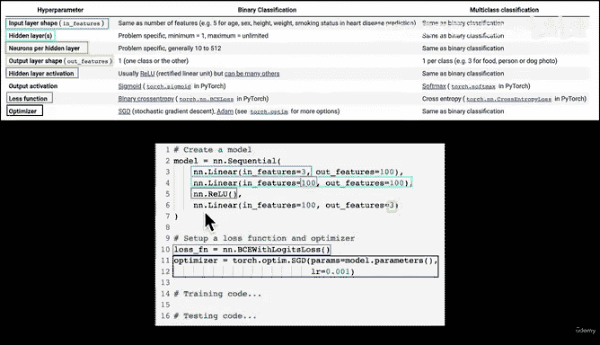

Basically， everything in here is a layer in a neural network。

 And then if we look at what a neural network looks like。

Noural network。Recall that。All of these are different layers of some kind of mathematical operation。

 input layer， hidden layer。 You could have as many hidden layers as you want。Do we have resnet。

Architecture。The resnet architecture， some of them have 50 layers。 Look at this。

 Each one of these is a layer。And this is only the 34 layer version。 I mean， there's resnet 152。

 which is 152 layers。 We're not at that yet。But we're working up the tools to get to that stage。

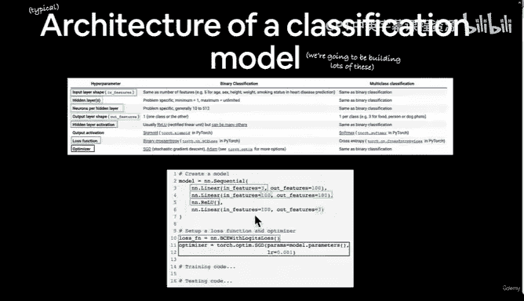

Let's come back to here。 the neurons per hidden layer。 So we've got these out features。

 the green circle， the green square。 Now this is， if we go back to our neural network picture。

This is these。 Each one of these little things is a neuron， some sort of parameter。 So if we had 100。

What would that look like？Well， we'd have a fairly big graphic。

 So this is why I like to teach with code， because you could customize this as flexible as you want。

 So behind the scenes， Pi torch is going to create。😊。

1 hundred of these little circles for us and within each circle is what some sort of mathematical operation。

So if we come back， what do we got next， output layer shape。

 So this is how many output features we have。 So in the case of binary classification is one one class or the other。

 we're going to see this later on。 Multiclass classification is you might have three output features。

 one per class， E G， one for food， person or dog if you are building a food， person or dog。

 image classification model。Hidden layer activation， which is， we haven't seen these yet。 Relu。

 which is a rectified linear unit， but can be many others， because Pytorch， of course。

 has what has a lot of non nonlinear activations。 We're going to see this later on。

 I'm kind of planting the seed here。 We've seen what a linear line is。

 but I want you to imagine what a nonlinear line is。

 It's going to be a bit of a superpower for our classification problem。😊。

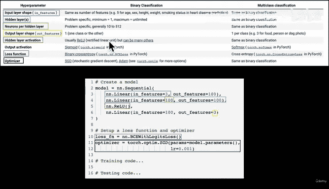

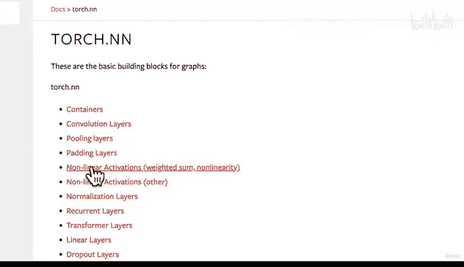

What else do we have， output activation， We haven't got that here， but we'll also see this later on。

 which could be sigmoid for which is generally sigmoid for binary classification。

 but softms for multiclass classification。 a lot of these things are just names on a page。

 We haven't seen them yet。 I like to teach them as we see them。

 but this is just a general overview of what we're going to cover loss function。

 What loss function or what does a loss function do。

 It measures how wrong our models predictions are compared to what the ideal predictions are。

 So for binary classification， we might use binary cross entropy loss in Ptorch and for multiclass classification we might just use cross entropy rather than binary cross entropy。

 Get it。 binary classification binary cross entropy and then optimizer SgD's stochastic gradient descent。

 We've seen that one before。 Another common option is the atom optimizer and of course。

 the torch dot optim package has plenty more options。😊。

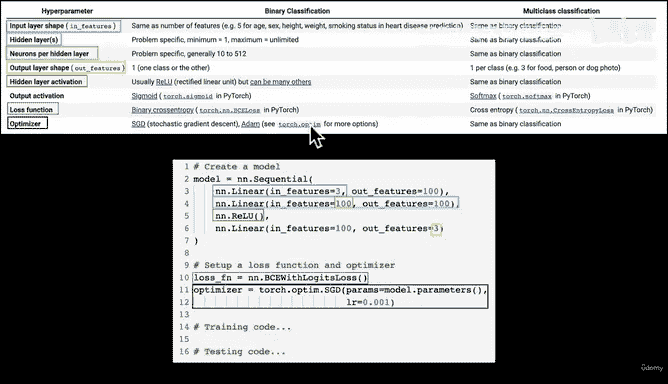

So。This is an example multiclass classification problem。 This network here。 Why is that。

 And we haven't actually seen N end do sequential， But as you could imagine。

 sequential stands for it just goes through each of these steps。 So multiclass classification。

 because it has three output features， more than one thing or another。

 So three for food person or dog。 But going back to our food vision problem。

 we could have the input as sushi steak。

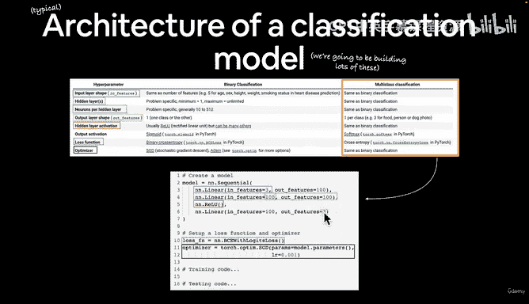

Or pizza。 So we've got three output features， which would be one prediction probability per class of image。

 We have three classes， sushi， steak or pizza。 Now。

 I think we've done enough talking here and enough just pointing to text on slides。

 How about in the next video。Let's code， I'll see you in Google Coabb。

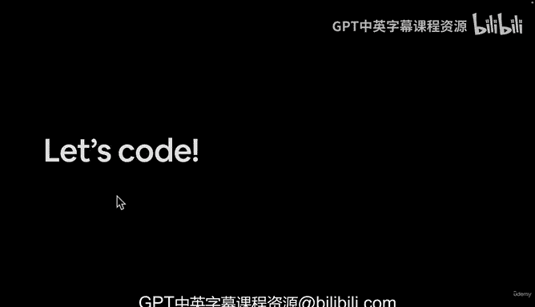