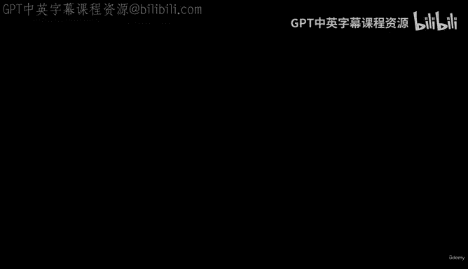
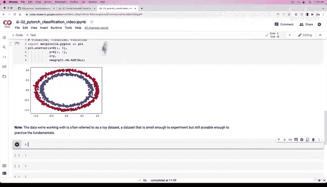
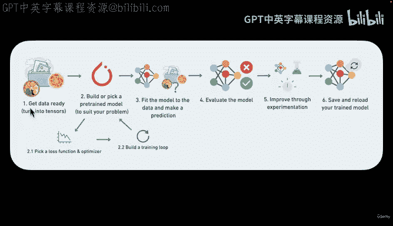
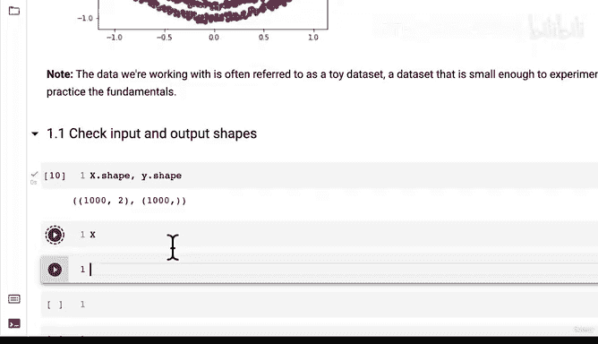
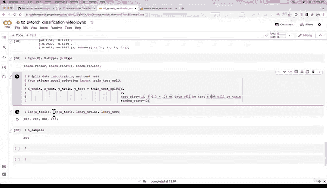
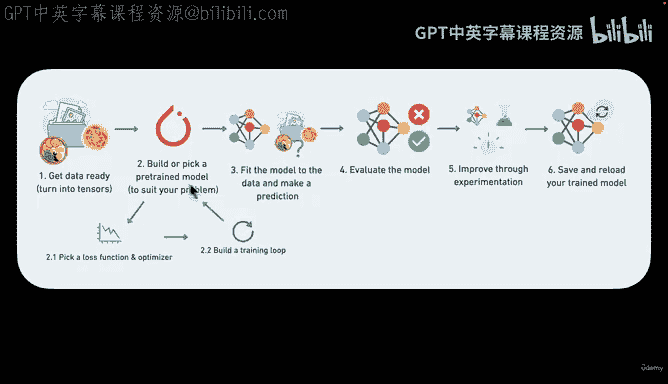
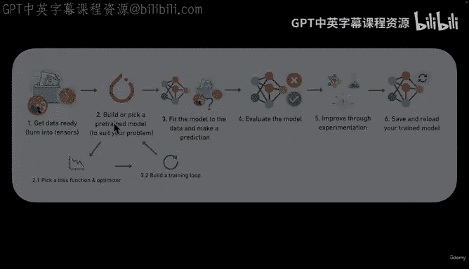

# Daniel Bourke《PyTorch 深度学习｜PyTorch 101 Crash Course For Beginners in 2025》中英字幕 - P69：069_04_005 数据张量化与训练测试集划分.zh_en - GPT中英字幕课程资源 - BV1kTSKB1E9m

Welcome back in the last video we made some classification data so that we can practice building a neural network in Ptorch to separate the blue dots from the red dots。

 so let's keep pushing forward on that and I'll just clean up here a little bit but where are we in our workflow？

😊。

What have we done so far？ Well， we've got our data ready a little bit。

 We haven't turned it into tensess。 So let's do that in this video。

 and then we'll keep pushing through all of these。

So in here， I'm going make this heading。1。1， check input and output Shas。

The reason we're focused a lot on input and output shapes is why because machine learning deals a lot with numerical representations as tensors and input and output shapes are some of the most common errors like if you have a mismatch between your input and output shapes of a certain layer of an output layer you're going to run into a lot of errors there So that's why it's good to get acquainted with whatever data you're using what are the input shapes and what are the output shapes you'd like So In our case we can go X。

Dot shape and why dot shape。So we're working with nupy arrays here if we just look at x。

 That's what the make circles function has created for us。 we've got an array。

 But as our workflow says， we'd like it in tenses。 if we're working with pitorch。

 we want our data to be represented as pitorch tensesors of that data type。

 And so we've got a shape here。 we've got 1000 samples and x has two features and y has no features。

 it's just a single number。 It's a scalar so it doesn't have a shape here。

 so there's a000 samples of y，0 samples of x， two samples of x equals one y label。

 Now if you're working with a larger problem， you might have100 samples of x。

 but x is represented by 128 different numbers or 200 numbers or as high as you want or just 10 or something like that。

 So just keep in mind that this number is quite flexible of how many features represent a label。😊。

Why is the libel here。But let's keep going。So， view the first。Example of features and labels。

So let's make it explicit with what we've just been discussing。 We'll write some code to do so。

 We'll get the first sample of x， which is the zeroth index， and we'll get the first sample of y。

 which is also the zeroth index。 We could get really anyone because they're all of the same shape。

But print。Values for one sample of x。 What does this equal X sample？And the same for Y。

 which is y sample。 And then we want to go print F。String for one sample of X。

 we'll get the shape here。Examp dot shape。And the same for why。

And then we'll get why sample dot shape。Beautiful， what's this going to do。Well。

 we've got one sample of x。 So this sample here of these numbers， we've got a lot going on here，7，5。

4，2，4，6，2，5， and 0，2，3，1，4，8，0，7，4。 I mean， you can try to find some patterns in those。

 if you do all the best here and the same for Y。 So this is we have the y sample this correlates to a number one。

 a label of one。😊，And then we have shapes for one sample of x， which is2。

 So we have two features for Y。 it's a little bit confusing here because y is a scalar。

 which doesn't actually have a shape， It's just one value。 So for me， in terms of speaking this。

 teaching it out loud will be two features of x， trying to predict one number for y。

 And so let's now。Create another heading， which is 1。2。 Let's get our data into tensets。

Turn data into tensesors， We have to convert them from nupi。

 and we also want to create train and test splits。 Now。

 even though we're working with a toy data set here。

 the principle of turning data into tensesors and creating train and test splits will stay around for almost any data set that you're working with。

So let's see how we can do that。 So we want to turn data。Inter tensess， and。For this。

 where you need to import torch。 We'll get pi torch， and we'll check the torch version。

 It has to be at least 1。10。And I might just put this down in the next cell。

Just make sure we can import Pytorrch。 There we go，1。10 plus Kuda 111。

 If your version is higher than that， that is okay。 The code below should still work。

 And if it doesn't， let me know。So x equals torch dot。From Numpy， why are we doing this。

 while it's because x is a nuy array？And if we go X dot， does it have a D type attribute？Float 64。

 can we just go type。Or maybe。Type oh， there we go。 Ny and D array。 can we just go type X。

Numpy and D array。 So we want it in a torch tensor。 So we're going to go from Numpy。

 We saw this in the fundamental section， and then we're going to change it into type torch dot float。

 Float is an alias for floatat 32。 We could type the same thing。These two are equivalent。

 I'm just going to type torch floatat for writing less code。

And then we're going to go the same with Y torch from Numpy。 Now。

 why do we turn it into a torch float。 Well， that's because if you recall the default type of nuumpy arrays is。

If we go， might just put out this in a comma X dot D type is float 64。 There we go。 However。

 Pi torch， the default type is float 32。 So we're changing it into pi torchs default type。 Otherwise。

 if we didn't have this little section of code here。 dot type torch dot float。

 our tensors would be of float 64 as well。 And that may cause errors later on。

 So we're just going for the default data type within pi torch。

 And so now let's have a look at the first。F values of x and the first five values of Y。

 What do we have？Beautiful， we have tensor data types here。

 And now if we check the data type of x and we check the data type of y， what do we have。

 And then one more， I'm just go type。😊，X。So we have our data into tensors。 wonderful。 But now。

 so it's torch dot Tensor， beautiful。 But now we would like training and test sets。

 So let's go split。😊，Data into。Training and test sets and a very。

 very popular way to split data is a random split。 So before I issued the challenge of how you would split this into a training and test set。

So because these data points are kind of scattered all over the plagues。

 we could split them randomly。So let's see what that looks like。To do so。

 I'm going to use our faithful psyit learn again。 Remember how I said psyit learn has a lot of beautiful methods and functions for a whole bunch of different machine learning purposes。

 Well， one of them is for a trained test split。😊，Oh my goodness， P To。

 I didn't want auto correct there。Train test split。 Now you might be able to guess what this does。

 These videos are going to be a battle between me and Coat Las auto， correct。 Sometimes it's good。

 Other times it's not。So we're going to set this code up。

 I'm going to write it or we're going to write it together so we've got Xtrain for our training features and X test for our testing features and then we also want our training labels and our testing labels That order is the order that train test split works in and then we have train test。

Split Now， if we wrote this function and we wanted to find out more， I can press command shift space。

 which is what I just did to have this。 but truly I don't have a great time reading all of this。

 You might， but for me， I just like going train test split。

 and possibly one of the first functions that appears。 Yes， is psyt learn。 How good is that。

 So psyt learn dot model selection dot train test split。 Now。

 split arraysal matrices into random train and test subset beautifuli。

 We've got a code example of what's going on here。 You can read what the different parameters do。

 but we're gonna see them in action。 This is just another example of where machine learning library such as psyt learn。

 We've used mappllib。 we've used pandas。 They all interact together to serve a great purpose。

 But now let's pass in our features and our labels。😊，This is the order that they come in， by the way。

 and we have the returns splitting。 So the order here I've got the order goes X train， X test。

 Y train Y test took me a little while to remember this order。

 But once you've created enough train and test splits with this function。

 you kind of know this off by hard。 So just remember features first， train first and then labels。

Let me jump back in here。So I'm going to put in the test size parameter of 0。2。

 This is percentage wise。 So let me just right here， 0。2 equals 20% of data will be test。And。

80% will be trained。 If we wanted to do a 5050 split。 That kind of split doesn't usually happen。

 but you could go 0。5。 but the test size says， hey。

 how big in percentage Ys do you want your test data to be。

 And so behind the scenes train test split will calculate， what's 20% of our X and Y samples。

 So we'll see how many there is in a second， But let's also put a random state in here。

 Because if you recall back in the documentation。 train test split splits data randomly into random train and test subsets。

 and random state， What does that do for us， Well， this is a random C equivalent of It's very similar to。

Torch dot manualual seed。However， because we are using Psyt Learn。

 setting Torch dot manualual seed will only affect Pytorrch code rather than Pst learn code。

So we do this so that we get similar random splits。

 as in I get a similar random split to what your random split is。 And， in fact。

 they should be exactly the same。 So let's run this and then we'll check the length of X train。

And length of X test。 So if we have 1000 total samples。

 and I know that because above in our make circles function， we said we want 1000 samples。

 That could be 10000。 That could be 100。That's the beauty of creating your own dataset set。

And we have length Y train if we have 20% testing values。

How many samples are going to be dedicated to the test sample，20% of 1000 is。280%。

 which is because training is going to be。Training here。 So 100 minus-20% is 80%。

 So 80% of 1000 ears。 let's find out。Run all beautiful。 So we have 800 training samples。

200 testing samples。 This is going to be the data set that we're going to be working with。

 So in the next video， we've now got training in test sets。

 We've started to move through our beautiful Pytorch workflow here。 We've got our data ready。

 We've turned it into tensess。 We've created a training in test split。

 Now it's time to build or pick a model。 So I think we're still in the building phase。

 Let's do that in the next video。😊。

