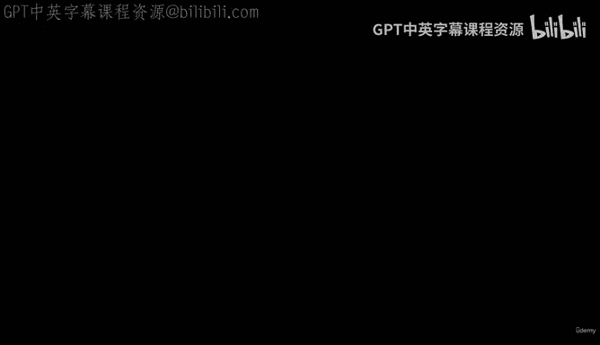
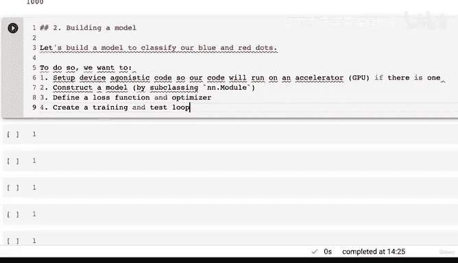
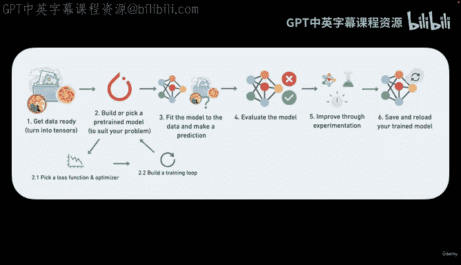
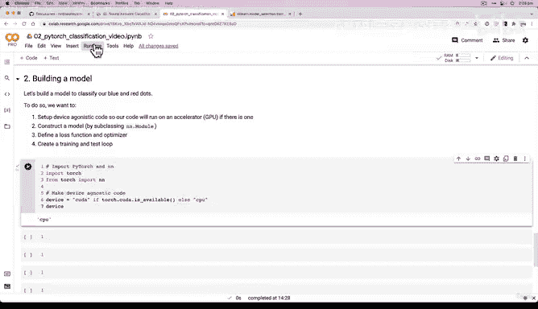
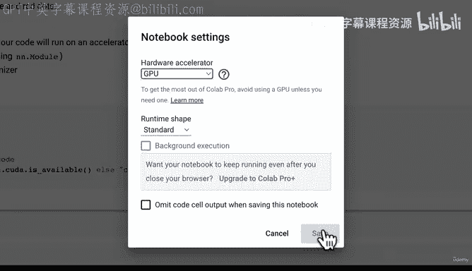
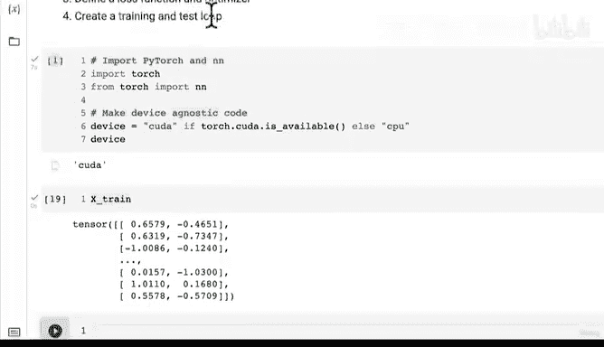

# Daniel Bourke《PyTorch 深度学习｜PyTorch 101 Crash Course For Beginners in 2025》中英字幕 - P70：070_04_006 建模步骤规划与设备无关代码配置.zh_en - GPT中英字幕课程资源 - BV1kTSKB1E9m

Welcome back In the last video， we split our data into training and test sets and because we did an 80-20 split。

 we've got about 800 samples to train on and 200 samples to test on remember the training set is so that the model can learn patterns patterns that represent this data here。

 the circles data red dots or blue dots and the test data set is so that we can evaluate those patterns and I took a little break before but you can tell that because my notebook is disconnected。

 but if I wanted to reconnect it， what could I do， we can go here run time run before that's going run all of the cells before。

 it shouldn't take too long because we haven't done any large computations。

 but this is good timing because we're up to part 2。😊，Building。A model。

 And so there's a fair few steps here， but nothing that we haven't covered before。

 We're going to break it down。 So let's build a model。To classify。Our blue and red dots。And。To do so。

We want to。Tensers， I want two。 not tenss。 That's al right。So let me just make some space here。

 There we go。 So number one， let's set up device agnostic code。

 So we get in the habit of creating that。So our code will run on an accelerator。

I can't even spell accelerator。 Doesn't matter you know what I mean。GPU。If there is one。2。

What should we do next。Well， we should construct a model because if we want to build a model。

 we need a model， construct a model。 And we're going to go by subclassing。And then dot module。Now。

 we saw this in the previous section with subclass N N dot module。 In fact。

 all models imp to subclass N N dot module。 And let's go define。Los function。And optimizer。

And finally， oh， good collabs auto correctr is。Not ideal。 And then we'll create a training。

And test loop， though， this will probably be in the next section。

 We'll focus on building a model here。 And， of course。

 all of these steps are in line with what they're in line with this。

 So we don't have device agnostic code here。 but we're just going do it now so that we have a habit。

 These are the main steps。 Pick or build a pretrain model， suit your problem。

 Pick a loss function and optimizer。 Build a training loop。 So let's have a look。

 How can we start this off。 So we'll import pie torch。😊。

And then we've already done this， but we're going to do it anyway for completeness。

 just in case you wanted to。Run your code from here， import NN。

 and we're going to make device agnostic code。So we'll set the device equal to Kuda。

If torch dot kuda。Is available。Else CPUU， which will be the default。

 the CPU is the default if there's no GPU， which means that Couda is available all of our Pytoch code will default to using the CPU。

Devicice now we haven't set up a GPU yet so far。 You may have。 But as you see。

 my target device is currently CPU。 How about we set up a GPU， we can go into here runtime。

 change runtime type GPU。 And I'm going to click save。 Now。

 this is going to restart the runtime and reconnect。

So once it reconnects。Beautiful， we could actually just run this code cell here。

This' is going to set up the GPU device。 But because we're only running this cell。

 if we were to just set up Xtrain， we've not been defined。 So because weve restarted our runtime。

 let's run all or we can just run before。So this is going to rerun all of these cells here。

And do we have X train now， Let's have a look。Wonderful， yes， we do。 Okay， beautiful。

 So we've got device agnostic code。 In the next video， let's get on to constructing a model。

 I'll see you there。😊。

