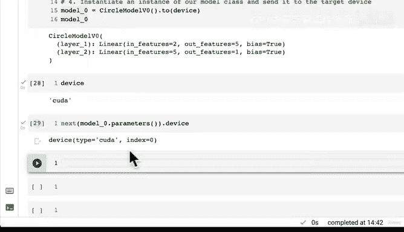

# Daniel Bourke《PyTorch 深度学习｜PyTorch 101 Crash Course For Beginners in 2025》中英字幕 - P71：071_04_007 编写处理分类数据的小型神经网络.zh_en - GPT中英字幕课程资源 - BV1kTSKB1E9m

Welcome back in the last video we set up some device agnostic code this is going to come in later on when we send our model to the target device and also our data to the target device。

 this is an important step because that way if someone else were to run your code or you were to run your code in the future because we've set it up to be device agnostic by default it will run on the CPU。

 but if there's an accelerator present。😊，Well， that means that it might go faster because it's using a GP rather than just using a CPU。

 So we're up to step 2 here， construct a model by subclassing and then module。

 I think we're going to write a little bit of text here just to plan out the steps that we're doing。

 Now we've。Set up。Device， agnostic code。Let's create a model。That so we're going to break it down。

 We've got some sub steps up here， but we're going break it down。

 even this one down into some sub sub stepss。 So number one is we're going to subclass。

And then got module。And am a reminder here。I want to make some space just so where we're coding in about the middle of the page。

 So almost all models。And P torch， subclass。And then that module。

 because there's some great things that it does for us behind the scenes。

And step two is we're going to create2 andN。dot linear。Lars。

And we want these that are capable to handle our data。

 so that are capable of handling the shapes of our data。Step 3。

 we want to define or defines a forward method。 Why do we want to define a For method， Well。

 because we're subclassing N N dot module， right。And so the Ford method defines a Ford method。

That outlines the For pass or For computation。Of the model。And number 4， we want to。Instiate， well。

 this， this doesn't really have to be the part of creating it， but we're going to do anyway。

 instantiate an instance of our model class。And send it。To the target。Device。So。

Goon to be a couple of little different steps here。

 but nothing too dramatic that we haven't really covered before。 So let's go number one。

Construct a model that subclasses an enddot module。So I'm gonna code this all out。

 while we're gonna to code this all out together， and then we'll go back through and discuss it and then maybe draw a few pictures or something to check out what's actually happening。

 So circle model。V1， because we're going to try and split some circles， red and blue circles。

 This is our data up here。This is why it's called circle model because we're trying to separate the blue and red circle。

Using a neural network。 So we've subclassed N N dot module。 And when we create a class in Python。

 we'll create a constructor here， and it and then put in super dot underscore a it。

And then inside the constructor， we're going to create our layers。 So this is number two。

 create two NN linear layers capable of handling the shapes of our data。

 So I'm going to write this down here。2， create two。To NN dot linear layers。Capable of handling。

The shapes of our data。 And so if we have a look at X train。What are the shapes here。

 What's the input shape because Xtrain is our features right now。

 features are going to go into our model。So we have 800 training samples。

 This is the first number here of size 2 each。 So 800 of these and inside each is two numbers。 Again。

 depending on the data set you're working with， your features may be 100 in length， a vector of 100。

 or it may be a different size tensor altogether。 or there may be millions。

 It really depends on what data set you're working with because we're working with a simple data set。

 we're going to focus on that， but the principle still the same。

 You need to define a neural network layer that is capable of handling your input features。

 So we're going to make layer 1 equals an n dot linear。

And then if we wanted to find out what's going on in an end dot linear。

 we could run shift command space on my computer because it's a Mac， maybe shift control space。

 if you're on Windows。 So we're going to define the end features。 What would in features be here。

Well， we just decided that our X has two features。 So our in features is going to be2。

 And now what is the out features， This one is a little bit tricky。So in our case。

 we could have out features equal to one if we wanted to just pass a single linear layer。

 but we want to create two linear layers here。 So why would out features be one。Well。

 that's because if we have a look at the first sample of why train。We would want。U to input。

 or maybe we'll look at the first five。We want to map。

One sample of x to one sample of y and y has a shape of one， or well。

 really it's nothing because it's a scalar， but we would still put one here so that it outputs just one number。

But we're going change this up。 We're going put it into5。 and we're going create a second layer。

 Now this is an important point of joining together neural networks in features here。

 What do you think the in features of our second layer is going to be。

 If we have produced an out feature of 5 here。 Now， this number is arbitrary。 We could do 128。

 We could do 256。 General， it's multiples of 8，64。 We're just doing five now because we're keeping it nice and simple。

 We could do 8。 Multiless of 8 is because of the efficiency of computing。

 I don't know enough about computer hardware to know exactly why that's the case。

 But that's just a rule of thumb in machine learning。

 So the in features here has to match up with the out features of a previous layer。 Otherwise。

 we'll get shape mismatch errors。 And so let's go here out features。

 So we're going to treat this as the output layer。 So this is the out features equals1 so。😊。

Takes in two features。And upscales to five features。 So five numbers。 So what this does。

 what this layer is going to do is take in these two numbers of x， perform an n dot linear。

 Let's have a look at what equation it does。And end dot linear is going to perform this function here。

On the inputs。And it's going to upscale it to five features。 Now， why would we do that， Well。

 the rule of thumb here， because this is denoted as a hidden unit or how many hidden neurons there are。

The rule of thumb is that the more hidden features there are。

 the more opportunity our model has to learn patterns in the data。

 So to begin with it only has two numbers to learn patterns on。 But if when we upscale it to 5。

 it has five numbers to learn patterns on。 Now， you might think。

 why don't we just go straight to like 10000 or something。

 But there is like an upper limit here to sort of where the benefits start to trail off。

 We're just using 5 because it keeps it nice and simple And then the in features of the next layer is 5 so that these two line up。

 We're gonna map this out visually in a moment。 but let's keep coding， we've got n features 2 for x。

 And now this is the output layer。 So takes in 5 features。😊。

From previous layer and outputs a single feature。 And now this is same shape。Same shape as Y。

So what is our next step， We want to define a forward method， A For computation， a For pass。

 So the forward method is going to define the forward computation。 And as an input。

 it's going to take X， which is some form of data。 And now here's where we can use。

Layer one and layer two。 So now let's just go return。Or we'll put a note here of what we're doing，3。

 we're going to go define a forward method。That outlines the Ford pass。

So forward and we're going to return and here's some notation we haven't quite seen yet。

 and then we're going to go self layer2 and inside the brackets we'll have self layer 1 inside those brackets we're going to have X。

So the way this goes is x goes into layer1。And then the output of layer one goes into layer 2。

So whatever data we have， So our training data， X train goes into layer1 performs the linear calculation here。

 and then it goes into layer 2 and then layer 2。Is going to。Output go to the output。 So X the input。

 layer 1， computation， layer 2 output。 So we've done that。 Now， let's do step 4， which is。

Instantiate an instance of our model class。And send it to the target device。

 So this is our model class。Circle model v0。We're just going to create a model because it's the first model we've created of this section。

 Let's call it model 0。 And we're going to go circle model。V1。And then we're going to go dot 2。

 and we're going need to pass in device because that's our target device。

 Let's now have a look at model 0， and then。哦。Typo， yep， classic。What did we get wrong here， Oh。

 do we not pass in self， Se up， There we go。Little typo， classic， but。

The beautiful thing about creating a class here is that we could put this into a Python file。

 such as modeled block P。 and then we wouldn't necessarily have to rewrite this all the time。

 We could just call it。😊，And so let's just check what device it's on。

 So target device is Kuda because we've got a GPU。 Thank you， Google Coab。 And then if we wanted to。

 let's go。Next， Model 0 dot parameters。 We'll call the parameters， and then we'll go device。

Couda， beautiful。 So that means our models parameters are on the couder device。 Now。

 we've covered enough code in here for this video。 So if you want to understand it a little bit more。

 go back through it。 But we're going to come back in the next video and make it a little bit more visual。

 So I'll see you there。😊。