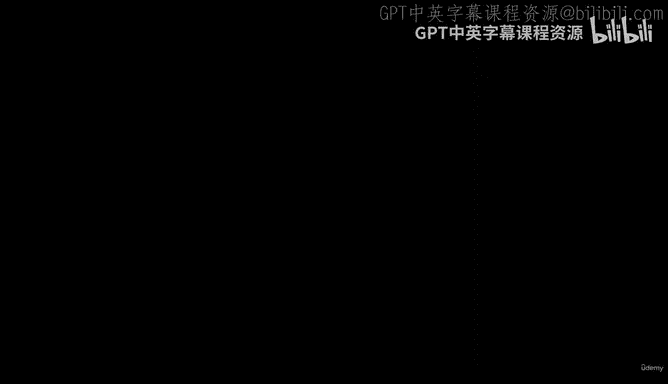
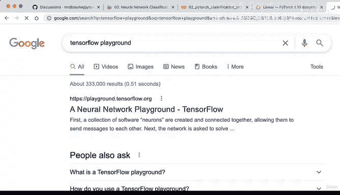
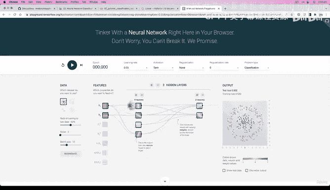
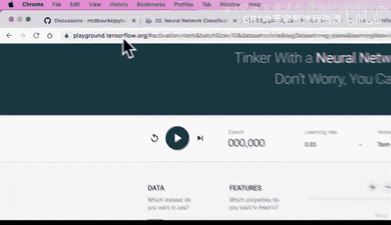
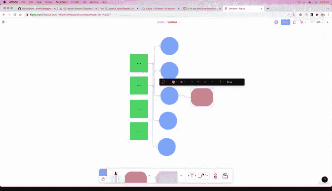

# Daniel Bourke《PyTorch 深度学习｜PyTorch 101 Crash Course For Beginners in 2025》中英字幕 - P72：072_04_008 神经网络可视化.zh_en - GPT中英字幕课程资源 - BV1kTSKB1E9m

Welcome back In the last video， we did something very， very exciting。

 We created our first multilayer neural network， but right now this is just code on a page。

 but truly this is what the majority of building machine learning models in pytorrch is going to look like you're going to create some layers or as simple or as complex as you like。

 and then you're going to use those layers in some form of forwardd computation。😊。

To create the forward pass。 So let's make this a little bit more visual。

 If we go over to the Tensorflow playground and now Tensorflowlow is another deep learning framework。

 similar to Pi torch。 It just allows you to write codes such as this。😊。

To build neural networks， fit them to some sort of data to find patterns in data and then use those machine learning models in your applications。

But， let's create this。Oh， by the way， this is playground。 Tensorflow。org。

 This is a neural network that we can train in the browser if we really wanted to。

 So that's pretty darn cool。 but we've got a data set here。

 which is kind of similar to the data that we're working with。😊。

If we have a look at our circles 1， let's just say it's close enough。

 It's circular that's what we're after。 But if we increase this， we've got five neurons now。

 we've got two features here， X1 and x2。 where is this reminding you of what's happening。

 There's a lot of things going on here that we haven't covered yet， but don't worry too much。

 We're just focused on this neural network here。 So we've got some features as the input。

 We've got five hitting units。 This is exactly what's going on with the model that we just built。

 we pass in x 1 and x 2。 our values， So if we go back to our data set。😊，These are x1 and x2。

We pass those in， so we've got two input features， and then we pass them to a hidden layer。

 a single hidden layer with five neurons。 What have we just built。

If we come down into here to our model。We've got in features 2 out features 5。

 and then that feeds into another layer， which has in features 5 and out features 1。

 So this is the exact same model that we've built here。 Now。

 if we just turn this back to linear activation because we're sticking with linear for now。

 We'll have a look at different forms of activation functions later on。

 and maybe we've put the learning rate， we've seen the learning rate to 0。01， we've got epochs here。

 got classification and we're going to try and fit this neural network to this data。

 Let's see what happens。😊，哦。The test loss。It's sitting about halfway，0。5。 so about 50% loss。

So if we only have two classes and we've got a loss of 50%， what does that mean？

Well the perfect loss was0 and the worst loss was one。 then we just divide one by 2 and get 50%。

 but we've only got two classes。 So that means if our model was just randomly guessing。

It would get a loss of about 0。5， because you could just randomly guess whatever data point belongs to blue or orange in this case。

 So in a binary classification problem， if you have the same number of samples in each class in this case。

 Blue dots and orange dots。 randomly guessing will get you about 50%， just like tossing a coin。

 toss a coin 100 times。 and you get about 50，50， might be a little bit different。

 but it's around about that over the long term。 So we've just fit for 3000 epochs。

 And we're still not getting any better loss。 I wonder if that's going to be the case for our neural network。

 And so to draw this in a different way。I'm going to come to a little tool called Figjam。

 which is just a whiteboard that we can put shapes on and it's based in the browser。

 so this is going to be nothing fancy。 It's going to be a simple diagram， say this is our input。😊。

And I'm going to make this green because my favourite colour is green。And then we're going to have。

 let's make some different coloured dots。 I want a blue dot here。 So this can be dot  one。And dot 2。

I'll put another dot here。I'll zoom out a little so we have a bit more space。

 and maybe that was too much。50% looks all right。So let me just move this around。

 might move these up a little。 So we're building a neural network here。

 This is exactly what we've just built。And so let me go here。Or maybe we'll put this as input X1。

 so this will make a little bit more sense。And then well， maybe we can copy this。Now this is x2。

And then we have some form of。Output， let's make this one。And we're gonna color this orange。

So output。Right， so you can imagine have we got connected dots here。 They will connect these。

 So our inputs are going to go through all of these。 I wonder if I can draw here。Okay。

 this is going to be a little bit more complex， but that's all right。 So this is what we've done。

 We've got two input features here。 And if we wanted to keep drawing these， we could。

All of these input features are going to go through all of these hidden units that we have are just drew the same arrow twice。

 That's okay。 but this is what's happening in the Ford computation method。😊。

It can be a little bit confusing for when we coded it out。 Why is that。Well， from here。

 it looks like we've only got an input layer into a single hidden layer in the blue。

And an output layer。 But truly， this is the same exact shape。You get the point。

 and then all of these go to the output。 but we're going to see this computationally later on so。

Whatever data set you're working with， you're going to have to manufacture some form of input layer。

 Now， this may be you might have 10 of these if you have 10 features。All four of them。

 if you have four features。And then if you wanted to adjust these， well。

 you could increase the number of hidden units or the number of out features of a layer。

 What just has to match up is that the layer it's going into has to have a similar shape as the what's coming out of here。

 So just keep that in mind as you're going on。 And in our case。

 we only have one output So we have the output here， which is why。

So this is a visual version。 We've got the Tensorflow playground。 You could play around with that。

 You can change this to increase。 Maybe you want5 hidden layers with five neurons in each。

 This is a fun way to explore。😊，This is a challenge， actually， Go to playground。tensorflow。org。

 replicate this network and see if it fits on this type of data。 What do you think， will it。Well。

 we're going to have to find out in the next few videos。

 So I'm going to show you in the next video another way to create the network that we just created。😊。

This one here with even less code than what we've done before。 I'll see you there。

