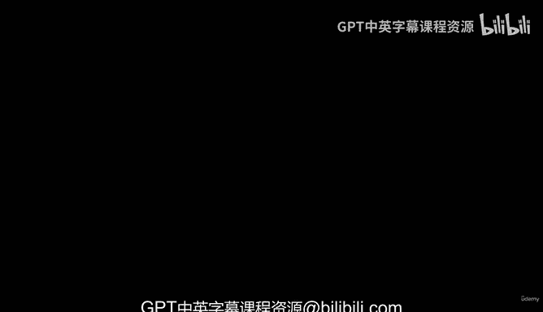
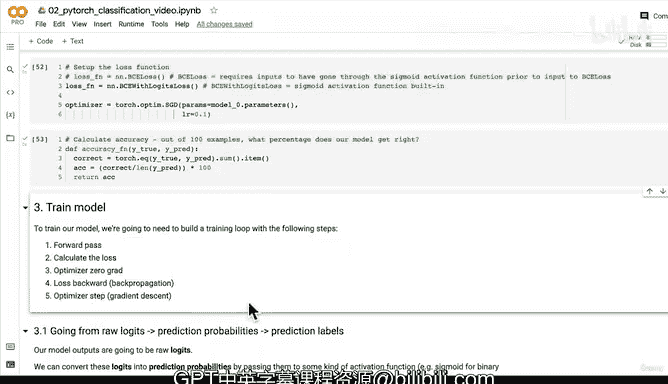

# Daniel Bourke《PyTorch 深度学习｜PyTorch 101 Crash Course For Beginners in 2025》中英字幕 - P75：075_04_011 从模型逻辑值到预测概率与标签.zh_en - GPT中英字幕课程资源 - BV1kTSKB1E9m

Welcome back。 In the last video， we discussed some different loss function options for our classification models。

 So we learned that if we're working with binary cross entropy or binary classification problems。

 we want to use binary cross entropy。 and pytorch has two different types of binary cross entropy。

 except one is a bit more numerically stable。 That's the B with Loit loss because it has a sigmoid and activation function built in。

 So that's straight from the pytor documentation。 and that for optimizer wise。

 we have a few different choices as well。 So if we check out this section here the pytorch book。

 we have a few different loss functions and optimizes for different problems and the p toch code that we can implement。

 But the premise is still the same across the board of different problems。 The loss function。😊。

Measures how wrong our model is， and the goal of the optimizer is to optimize the model parameters in such a way that the loss function goes down。

 and we also implemented our own accuracy function metric。

 which is going to evaluate our models predictions using accuracy as an evaluation metric rather than just loss。

So， let's now。Work on training a model。So what should we do first。Well。

 do you remember the steps in a Pi torch training loop？So to train our model。We're going to。

Need to build a training loop。So if you watch the video on the pie torch。

 So if you can Google unofficial pie torch song， you should find my。There we go。

 the unofficial pietorch optimization loop song。 We're not gonna watch that。

 That's gonna be a little tidbit for the steps that we're going to code out。

 but that's just a fun little jingle to remember these steps here。 So if we go into the book section。

 this is number three train model， exactly where we're up to here。😊。

But we have p towards training loop steps。 Remember， for an epoch in arrange， do the forwardd pass。

 calculateulate the loss， Opimise 0 grad， loss backward， Opise a step， step， step。

We keep singing this all day， you could keep reading those steps all day。

 but it's better to code them， but let's write this out so For pass。😊，to。Calculate the loss。Three。

 optimize a zero grad。4。What do we doing。Loss backward， so back propagation。

 I'll just write that up in here， back propagation。

We've linked to some extra resources if you'd like to find out what's going on in back propagation。

 we're focused on code here and then gradient descent。So or optimize a step。

So a build a training loop。With the following steps， however。

I've kind of mentioned a few things that need to be taken care of before we talked about the forward pass。

 So we've talked about logits。 We looked up what the hell is a logit。

 So if we go into this stack overflow answer， we saw machine learning。 What is it logits。

 How about we see that。 We need to do a few steps。 So I'm going write this down。

 let's get a bit of clarity about us。 Daniel， We're kind of all over the place at the moment。

 But that's all right。 That's the exciting part of machine learning。 So。😊。

Let's go from going from raw logits to prediction probabilities to prediction labels。

 That's what we want because to truly evaluate our model， we want to。 So let's write in here。

 our model outputs going to be。Raw Loit。 So that's the definition of a logit in machine learning and deep learning。

 You might read some few other definitions， but for us， the raw outputs of our model。

 Model 0 are going to be referred to as Loits。So then Model zero。

 so whatever comes out of here arelogits。So。We can convert these logits into prediction probabilities。

By passing them。To some kind of activation function。A J。Sigmoid。For binary cross entropy。

And softm for。Multiclass。Classification。I've got binary class eification。

 have to sound it out every time I spell it for binary classification， so class eification。😊。

So we're going to see multiclass classification later on， but we want some prediction probabilities。

 We're going to see what they look like in a minute。

So we want to go from logits to prediction probabilities to prediction labels。Then， we can。

Convert our models prediction probabilities to。Prediction。

Labels by either rounding them or taking the ag max。So。Round is for binary classification。

 and argmax will be for the outputs of the softmax activation function。

 But let's see it in action first。 So I've called the logits are the raw outputs of our model with no activation function。

 So view the first。😊，5 outputs of the forwardd pass。On the test data。 So， of course。

 our model is still instantiated with random values。 So we're going to set up a variable here。

 Y logitts and Model 0， we're going to pass it the test data。 So X test not text to device。

 because our model is currently on our coa device。 and we need our test data on the same device or target device。

 Remember， that's why we're writing device agnostic code。 So this would work。

 regardless of whether there's a GPU active or not。 Let's have a look at the logitts。😊，Oh， okay。

 right now we've got some positive values here and we can see that they're on the coa device and we can see that they tracking gradient。

 Now， ideally， we would have run torch do inference mode here。😊。

Because we're making predictions and the rule of thumbmi is whenever you make predictions with your model。

 you turn it into a vowel mode。We just have to remember to turn it back to train when we want to train and you run torch。

 inference mode。So we get a very similar setup here。

 We just don't have the gradients being tracked anymore。 Okay， so these are called logits。

 The logitts are the raw outputs of our model without being passed to any activation function。

 So an activation function is something a little separate from a layer。 So if we come up here。

 we've used layer。So the neural networks that we start to build and the ones that you'll subsequently build are comprised of layers and activation functions。

 We're going to make the concept of an activation function a little bit more clear later on。

 but for now， just treat it all as some form of mathematical operation。

 So if we were to pass data through this model， what is happening。

While it's going through the linear layer。 now， recall， we've seen this a few times now。

 Torch and then linear。 If we pass data through a linear layer， it's applying the。

Linear transformation on the incoming data， so it's performing this mathematical operation behind the scenes。

So y the output equals the input X multiplied by a weight tensor A， This could really be W。

 which is transpoposed so that this is doing a dot product plus a bias term here。

And then if we jump into our model state di， we've got weight and we've got bias。

 So that's the formula that's happening in these two layers。

 It will be different depending on the layer that we choose。 But for now we're sticking with linear。

 And so that the raw output of our data going through our two layers， the logits is going to be this。

Information here。 however， it's not in the same format as our。Test。Data。

 And so if we want to make a comparison to how good our model is performing。

 we need apples to apples。 So we need this in the same format as this， which is not， of course。

 So we need to go to a next step。Let's use the sigmoid， so use the sigmoid。

Actation function on our model Loit。So why are we using sigmoid well recall in a binary classification architecture。

 the output activation is the sigmoid function here。

 so now let's jump back into here and we're going to create some pre pros and what this stands for on our modellogits to turn them into prediction probabilities。

Probabilities， so wire pre pros equals torch， sigmoid。Why Loit。

 And now let's have a look at why pre probs。 What do we get from this。Oh。

 well we still get numbers on a page。 Goodness， gracious me。

 But the important point now is that they've gone through the sigmoid activation function。

 which is now we can pass these。😊，To a torch dot round function。

 let's have a look at this Torch dot round and what do we get Pre probs？Oh。

 the same format as what we've got here。 Now， you might be asking， like。

 why don't we just put torch dot round here， Well， that's a little， this step is required to。

 we can't just do it on the raw logits。 We need to use the sigmoid activation function here to turn it into prediction probabilities。

 And now what is a prediction probability。 Well， that's a value usually between 0 and1 for how likely our model thinks it's a certain class。

 And in the case of binary cross entropy， these prediction probability values。

 Let me just write this out in text。So for our prediction， probability values。We need。To perform。

Arrange。Style rounding on them。So this is a decision boundary。

 So this will make more sense when we go why pre pros， if it's equal to 0。5 or greater than 0。5。

 we set y equal to1。So y equal1。 So class1， whatever that is， a red dot or a blue dot。

 and then y pre probs。 If it is less than 0。5， we set y equal to 0。 So this is class 0。

You can also adjust this decision boundary， So say if you wanted to。Increase this value。

 So anything over 0。7 is one。 and below that is 0， but generally， most commonly。

 you'll find it split at 0。5。So let's keep going。 Let's actually see this in action。 So how about we。

😊，Recode this。So find the predicted probabilities。And。So we want no。

 sorry we want the predicted labels， that's what we want So when we're evaluating our model。

 we want to convert the outputs of our model， the outputs of our model are here， the logitts。

 the raw outputs of our model are logits and then we can convert those logits to prediction probabilities using the sigmoid function on the logits and then we want to find the predicted labels so we go。

Raw logits output of our model， prediction probabilities after passing them through an activation function and then prediction labels。

 This is the steps we want to take with the outputs of our model。 So find the predicted labels。

 Let's go in here。 a little bit different to our regression problem previously。

 but nothing we can't handle。 Torch round。 We're going to go Why pre pros。😊。

So I like to name it Ypre pros for prediction probabilities and Ypres for prediction labels Now let's go in full if we wanted to。

 so ypre labels equals torch。 round， torch。sigmoid。

 so sigmoid activation function for binary cross entropy and Model0 x test。

2 device truly this should be within inference mode code but for now we'll just leave it like this to have a single example。

Of what's going on here。 Now， I just need to count 1，2 there we want。 That's where we want The index。

 We just wanted on five examples。 So check for equality。And we want print torch equal。

 we're going to check ypres。seze。Is equal to y pre labels。 So just we're doing the exact same thing。

 And we need squeeze here to get rid of the extra dimension that comes out。

 You can try doing this without squeeze。 So get rid of extra dimension once again。We want y pres。

Dot squs。Fair bit of code there， but this is what's happened here， we create why pres。😊。

So we turn the wire pros into wirepre。 And then we just do the full step over again。

 So we make predictions with our model。 We get the raw logits。 So this is logs to。Ped probs to。

Ped labels。So the raw outputs of our model are logits。

 we turn the logits into prediction probabilities using torch sigmoid and we turn the prediction probabilities into prediction labels using torch dot round and we fulfill this criteria here。

 So everything above 0。5。 This is what torch dot round does turns it into a one。 Everything below 0。

5 turns it into a0 The predictions right now are going to be quite terrible because our model is using random numbers。

 but ypres found with the steps above is the same as ypre labels doing them all than one hit thanks to this check for a equality using torch equal Ypres do squeeze and we just do this squeeze to get rid of the extra dimensions and we have out here some labels that look like our actual Y test labels。

 they're in the same format， but of course they're not the same values because this model is using random weights to make predictions so。

We've done a fair few steps here， but I believe we are now in the right space to start building a training a test loop。

 So let's write that down here，3。2。Building a training and testing loop。

 you might want to have a go at this yourself。So we've got all the steps that we need to do the forward pass。

 but the reason we've done this step here。The logits than the pre pros and the pre labels is because。

The inputs to our loss function up here。This requires， so BCE with Loit its loss requires what？Well。

 we're going to see that in the next video， but I'd encourage you to give it a go at implementing these steps here。

 Remember the jingle for an epoch in arranged。 Do the forward pass， calculateulate the loss。

 which is PC with load its loss。 Opimr 0 grad， which is。😊，This one here， loss backward。

 Opimise a step， step， step。Let's do that together in the next video。

