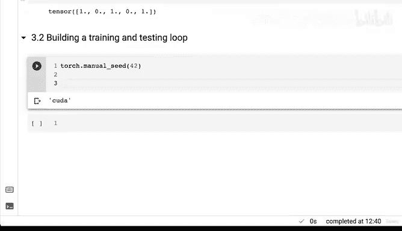
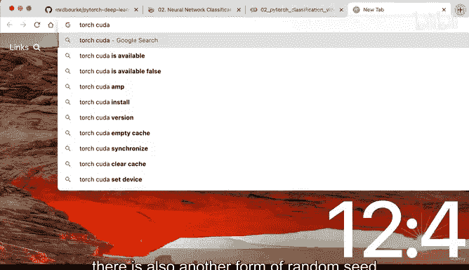
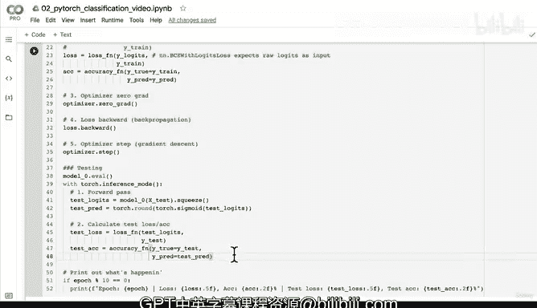

# Daniel Bourke《PyTorch 深度学习｜PyTorch 101 Crash Course For Beginners in 2025》中英字幕 - P76：076_04_012 编写分类模型训练测试优化循环.zh_en - GPT中英字幕课程资源 - BV1kTSKB1E9m

Welcome back in the last few videos we've been working through creating a model for a classification problem and now we're up to training a model and we've got some steps here。

 but we started off by discussing the concept of logitts Loitts are the raw output of the model。

 whatever comes out of the forward functions of the layers in our model。

 and then we discussed how we can turn those logits into prediction probabilities using an activation function such as sigmoid for binary classification and softms for multiclass classification。

 we haven't seen softmax yet， but we're going to stick with sigmoid for now because we have binary classification data。

 and then we can convert that from prediction probabilities to prediction labels because remember when we want to evaluate our model。

 we want to compare apples to apples， we want our models predictions to be in the same format as our test labels and so I took a little break after the previous video So my coabab notebook has once again disconnected。

😊，So I'm just going to run all of the cells before here， it's going to reconnect up here。

 We should still have a GPU present。 That's a good thing about Google coab is that if you change the runtime type to GPU。

 it'll save that wherever it saves。😊，The Google Co La notebook so that when you restart it。

 it should still have a GPU present。 And how can we check that， of course， Well。

 we can type in device。 We can run that cell， and we can also check。And Vdia， S I。

 it'll tell us if we have an NviDdia GPU with Coudr enabled ready to go。 So what's our device。Kuda。

 wonderful。And NviDdia SI， excellent。 I have a Tesla P 100 GPU ready to go。 So with that being said。

 let's start to write a training loop。 Now， we've done this before， and we've got the steps up here。

😊，Do the forward pass， calculate the loss。 We've spent enough on this。

 So we're just going to start jumping into right code。 There is a little tidbit in this one， though。

 but we'll conquer that when we get to it。So I'm going to set a manual seed。Toch dot manual seed。

And I'm going to use my favorite number 42。 This is just to ensure reproducibility if possible。 Now。

 I also want you to be aware of there is also another form of random seed manual seed。

 which is a couda random seed。

Do we have the pie torch。Yeah， reproducibility。So Torch。 couda。Dot manual seed dot seed。Hm。😊。

There is a couda seed somewhere。Let's try and find out。Kuda。

I think Pyto have just had an upgrade to their documentation。Sed。Yeah， there we go。 Okay。

 I knew it was there。 So Torchdo kuda dot manual seed。 So if we're using kuda。

 we have a couda manual seed as well。 So let's see what happens if we put that tochdo kuda dot manual seed。

😊，42， we don't necessarily have to put these。 It's just to try and get as reproducible as numbers as possible on your screen and my screen。

 Again， what is more important is not necessarily the numbers exactly being the same lining up between our screens。

 It's more the direction of which way they're going。 So let's set the number of epochs。

We're going to train for 100 epochs。 Epoch equals 100。But again， as you might have guess。

 the couder manual seed is for if you're doing operations on a couder device。

 which in our case we are， well then perhaps we'd want them to be as reproducible as possible。

 So speaking of couda devices， let's put the data to the target device because we're working with or we're writing data agnostic code here。

 So I'm going to write xtrain Ytrain equals xtrain 2 device comma Ytrain dot2 device that'll take care of the training data。

😊，And I'm going to do the same for the testing data equals X test 2 device。

Because if we're going to run our model。On the coer device， we want our data to be there， too。

 And the way we're writing our code， our code is going to be device agnostic。

 Have I said that enough yet， So let's also build our training and evaluation loop Because we've covered the steps in here before。

 we're gonna start working a little bit faster through here。 And don't worry。

 I think you're up to it。 So for an epoch in a range of epochs。 What do we do。

 We start with training。😊，So let me just write this。Training。Model 0 dot train。

 that's the model we're working with。 we call the train， which is the default。

 but we're going to do that anyway， and as you might have guessed。

 the code that we're writing here is you can functionise this。 So we're going to do this later on。

 but just for now the next couple of videos， the next module or two。

 we're going to keep writing out the training loop in full。So this is the part。

 the forwardd pass where there's a little bit of a tidbit here compared to what we've done previously。

 And that is because we're outputting raw logitts here。

 if we just pass our data straight to the model。 So model 0 x train and we're going to squeeze them here to get rid of an extra dimension you can try to see what the output sizes look like without squeeze but I're just going to call squeeze here。

 remember squeeze removes an extra one dimension from a tensor and then to convert it into prediction labels。

 we go torch dot round， and torch dot sigmoid because torch dot sigmoid is an activation function。

 which is going to convert logits into what convert the logits into prediction probabilities。

 So y logitts， and I'm just going to put a note here。

 So this is going to go turn logitts into pre pros into。😊，Ped。Libels。So we've done the forwardd pass。

 so that's a little tidbit there we could have done all of this in one step。

 but I'll show you why we broke this apart。So now we're going to calculate loss slash accuracy。

 We don't necessarily have to calculate the accuracy， but we did make an accuracy function up here。

So that we can calculate the accuracy during training。

 we could just stick with only calculating the loss but sometimes it's cool to visualize different metrics。

 loss plus a few others while your model is training。😊，So let's write some code to do that here。

So we'll start off by going loss equals loss Fn and Y logits。

 here's the difference of what we've done before previously in the notebook 01， up to 02 now。

 we passed in the prediction right here， but because what's our loss function。

Let's have a look at our loss function。Let's just call that， see what it returns。

 BE with Loitts loss， So the BCE with Loits expects loggiits as input。So as you might have guessed。

 loss function without。Logits， if we had NN dot BCceE loss， notice how we haven't got with Logits。

 and then we called loss FN。FN sensoror function， by the way， without logits， what do we get？

So BCE loss so this loss expects prediction probabilities as input。

 so let's write some code to differentiate between these two。 As I said。

 we're going to be sticking with this one。 Why is that Because if we look up torch BCE with Loits loss The documentation states that it's more numerically stable So this loss combines a sigmoid layer and the BCE loss into one single class and is more numerically stable So let's come back here we'll keep writing some code。

And the accuracy is going to be accuracy FN。 So our accuracy function there's a little bit of a difference here is y true equals Y trained for the training data。

So this will be the training accuracy， and then we have y pre equals y pre。So。

This is our own custom accuracy function that we wrote ourselves。

 This is a testament to the pythonic nature of Pytorch as well。

 we've just got a pure Python function that we've slotted into our training loop。😊。

Which is essentially what the loss function is behind the scenes。Now。Let's write here。

 Nn dot BCceE with Loits loss。Expects raw logitts So the raw output of our model as input。 Now。

 what if we were using a B loss on its own here， Well， let's just write some code for that。

 So let's call loss function。 and then we want to pass in Y pre or we can just go why or torch sigmoid。

 So why would we pass in torch sigmoid on the logits here。 Because remember。

 calling torch dot sigmoid on our logits turns our logits into prediction probabilities。

 and then we would pass in Y train here。 So if this was B loss expects this expects prediction。

Probabilities as input。So does that make sense， That's the difference between with logits。

 So our loss function requires logits as input， whereas if we just did straight up B E loss。

 we need to call torch dot sigmoid on the logits because it expects prediction probabilities as input。

 Now I'm going to。Comment that out because our loss function is BC with Lots loss。

 but just keep that in mind for some reason， you stumble across some pi torch code that's using B loss。

 not BC with Loitts loss， and you find that torch dot sigmoid is calling here or you come across some errors because your inputs to your loss function are not what it expects。

 So with that being said we can keep going with our other steps。 So we're up to optimizer0 grad。

 So optimizer0 grad。This is step 3， by the way。And what's after this？

Once we've zero graed the optimizer， we do。Number four was his loss backward。We can go last backward。

And then we go， what's next， Opimise a step， step， step。

So Opr dot step and I'm singing the unofficial Pytor optimization loop song there。

This is that propagation。Calculate the gradients with respect to all of the parameters in the model。

 and the optimizer step is update the parameters to reduce the gradients。So gradient descent。

 hence the descent。 Now， if we want to do testing， well。We know what to do here now。We go model 0。

 What do we do， We call model do ofval when we're testing。 And if we're making predictions。

 That's what we do when we test， we make predictions on the test data set using the patterns that our model has learned on the training data set。

 We turn on inference mode because we're doing inference。 We want to do the forward pass。😊。

And of course， we're going to compute the test logits because logits are the raw output of our model with no modifications。

 X test dot squeeze。 We're going to get rid of an extra one dimension there。

Then we create the test pre， which is we have to do a similar calculation to what we've done here for the test pre。

 which is torch dot round for our binary classification。

 we want prediction probabilities which we're going to create by calling the sigmoid function on the testlogits prediction probabilities that are 0。

5 or above to go to one and prediction probabilities under 0。5 to go to label 0。

 so two is calculate the test loss。😊，Test， loss， slash accuracy。How would we do this？ Well。

 just have we done before。And we're going to go Los FN testlogitts because our loss function we're using what we're using BCE with Loitts loss expects Loitts's input。

 where we find that out in the documentation of course。

 and we come back here testlogitts we're going to compare that to the Y test labels and then for the test accuracy what are we going to do。

We're going to call accuracy FN on Y true equals Y test and Y pre equals test Prena。

 You might be thinking， why did I switch up the order here for these。 Oh， and by the way。

 this is important to know with Loitt's loss。So with these loss functions。

 the order here matters of which way you put in your parameters。

 So predictions come first and then true labels for our loss function。

 You might be wondering why I've done it the reverse for our accuracy function。 why true and why pre。

 That's just because I like to be confusing。 Well， not really。 It's because if we go to psyt learn。

 I base a lot of my structured code of how psyitt learn。

Structures Ss the psyit learn metrics accuracy score。Goes why true why pre。

 So I base it off that order because thesyit learn metrics package is very helpful。

 So I've based our metric evaluation metric function of this one。 whereasas Pytorrch's loss function。

 does it in the reverse order， and it's important to get these in the right order exactly why they do it in that order。

 I couldn't tell you why。And we've got one final step， which is to print out what it's happened and。

Yeah。Happening。So how about we go， We're doing a lot of epochs here，100 epochs。

 So we'll divide the epoch by 10 to print out every epoch or every 10th epoch。 sorry。

 And we have a couple of different。Metrics that we can print out this time。

 so we're going to print out the epoch number。apoch。And then we're going to。Print out the loss。

 So loss。 How many decimal points。 We'll go 0。5 here。 This is going to be the training loss。

 We'll also do the accuracy， which will be the training accuracy。

 We could write train a here for our variable to be a little bit。

 Make them a little bit more understandable。 And then we go here。

 But we're just gonna leave it as loss and accuracy for now， because we've got test loss over here。

 Test loss。And we're going to do the same five decimal points here。

 And then we're going to go test accuracy as well。Test a dot。We'll go2 for the accuracy。

 And because it's accuracy。 we want a percentage。 This is the percent out of 100 guesses。

 What's the percentage that our model gets right on the training data and the testing data。

 As long as we've coded all the functions correctly。 Now， we've got a fair few steps here。

 My challenge to you is to run this。 And if there are any errors。 try to fix them。

 No doubt there's probably one or two or maybe more that we're going to have to fix in the next video。

 But speaking of next videos， I'll see you there， let's train our first。Classification model。

 this is very exciting。I'll see you soon。

