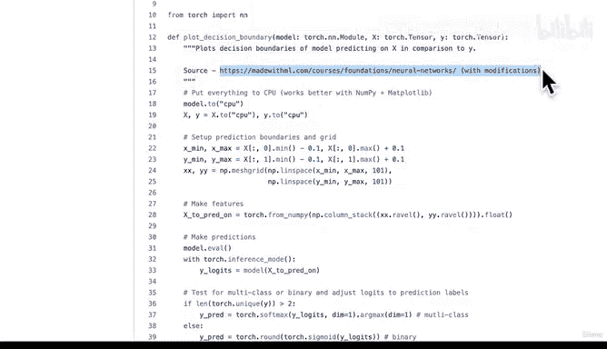
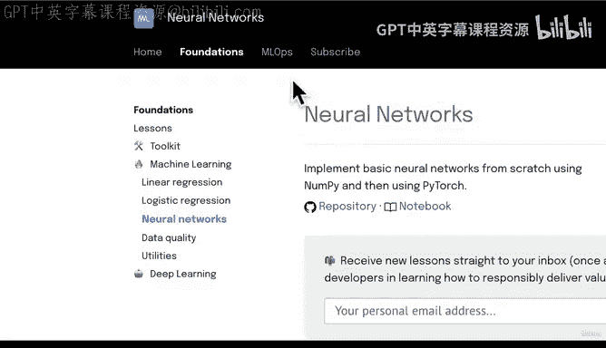
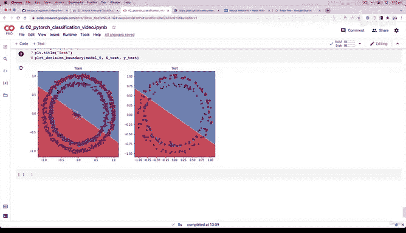

# Daniel Bourke《PyTorch 深度学习｜PyTorch 101 Crash Course For Beginners in 2025》中英字幕 - P77：077_04_013 下载可视化模型预测的辅助函数.zh_en - GPT中英字幕课程资源 - BV1kTSKB1E9m

Welcome back。 in the last video， we wrote a mammoth amount of code， but nothing that we can't handle。

 we've been through a lot of these steps。 We did have to talk about a few tidbits between using different loss functions。

 namely the B loss， which is binary cross entropy loss and the B with logitts loss。

 We discussed that the B lost in pitorrch expects prediction probabilities as input。

 So we have to convert our models logitts， logits of the raw output of the model。

 to prediction probabilities using the torch do sigmoid activation function。

 And if we're using B with logits loss， it expects raw logits as input as sort of the name hints at。

 And so we just pass it straight away。 the raw loadits。

 whereas our own custom accuracy function compares labels to labels。

 And that's kind of what we've been stepping through over the last few videos。

 is going from logits to pre pros to pre labels because that's the ideal output of our model is some kind of label。

😊，That we as humans can interpret。And so let's keep pushing forward。

 You may have already tried to run this training loop。 I don't know if it works。

 We wrote all this code together in the last video， and it's probably an error somewhere。

 So you're ready。 We're going to train our first classification model together for 100 epochs If it all goes to plan in 3。

2，1， let's run。😊，Oh my gosh， it actually worked the first time。😊。

I promise you I didn't change anything in here from the last video。 So let's inspect what's going on。

 It trains pretty fast。 Why， well， because we're using a GPU。

 So it's going to be accelerated as much as it can anyway。 And our data set is quite small。

 and our network is quite small。 So you won't always get networks training this fast。

 They did 100 epochs in like a second。😊，So， the loss，699，7，3。It doesn't go down very much。

 The accuracy even starts high， and then goes down。What's going on here。

 Our model doesn't seem to be learning anything。 So what would an ideal accuracy be。

 An ideal accuracy is 100。 And what's an ideal loss value。 Well，0， because lare is better for loss。

 This is confusing。 And now if we go。Have a look at our blue and red dots。 Where's our data。

So I reckon， do we still have a data frame here。How many samples do we have of each， Let's inspect。

 Let's do some data analysis。Where do we create a data frame here？Now， circles。

 do we still have this instantiated circles dot label dot。 We're going to call on pandas here。

 value counts。 Is this going to output how many of each okay。Wellow。

 we've got 500 of class 1 and 500 of class 0。 So we have 500 red dots and blue dots。

 which means we have a balanced data set。 So if we're getting。

 we're basically trying to predict heads or tails here。

 So if we're getting an accuracy of under 50% or about 50%。 if you rounded it up。

Our model is basically doing as well as guessing。 or what gives。 Well。

 I think we should get visual with this。 So let's make some predictions with our model because these are just numbers on the page。

 It's hard to interpret what's going on。 But our intuition now is because we have 500 samples of each or in the case of the training dataset set。

 We have 400 of each because we have 800 samples in the training data set。

 And we have in the testing data set。 We have 200 total samples。 So we have 100 of each。

 We're basically doing a coin flip here。 Our model is as good as guessing。 So。😊。

Time to investigate why our model is not learning。 And one of the ways we can do that is by visualizing our predictions。

 So let's write down here from the metrics。 It looks like our model isn't learning anything。

So to inspect it。Let's make some。Predictions。And make them visual。And we'll right down here。

 in other words。Visualize， visualize， visualize。All right， so we've trained a model。

 We've at least got the structure for the training code here。 Like， this is the right training code。

 We've written this code before。 So do you know that this set up for training code does allow a model to train。

 So there must be something wrong with either how we've built our model， the data said。

 but let's keep going and investigate together。 So to do so I've got a function that I've prebuil earlier。

 Did I mention that we're learning side by side of a machine learning cooking show。

 So this is an ingredient I prepared earlier。 a part of a dish。 So to do so。😊。

We're going to import a function called plot decision。

Or maybe I'll turn this into code plot decision boundary。Welcome to the Cook Show。

Cooking with machine learning。 What model will we cook up today。

 So if we go to Pytorrch deep learning。Well it's already over here。

 but this is the home repo for the course， the link for this will be scattered everywhere。😊。

But there's a little function here called helper functions。 Pi。

 which I'm going to fill up with helper functions throughout the course。

 And this is the one I'm talking about here。 plot decision boundary。

 Now we could just copy this into our notebook， or I'm going to write some code to import this programmatically so we can use other functions from in here。

 Here's our plot predictions function that we made in the last section01。

 but this plot decision boundary is a function that Ive got inspired by to create from made with Ml do co。

😊。

Now， this is another resource， a little bit of an aside。

 I highly recommend going through this by Goku Mahandas。

 It gives you the foundations of neural networks and also M L ops， which is a field。

 which is based on getting your neural networks and machine learning models into applications that other people can use。

 So I can't recommend this。😊。

Resource enough， so please， please， please check that out。

If you want another resource for machine learning， but this is where this helper function came from。

 So thank you， Goku Mahandez。 I've made a little bit of modifications for this course。

 but not too many， so we could either copy that。😊，Paste it in here， Or we could write some code to。

Import it for us magically or using the power of the Internet， right， because that's what we are。

 We're programmers。 We're machine learning engineers。 We're data scientists。 So from Partthlib。

 So the request module in Python is a module that allows you to make request。

 a request is like going to our website。 Hey， I'd like to get this code from you or this information from you。

 Can you please send it to me。 So that's what that allows us to do。

 And Partlib we've seen Partlib before， but it allows us to create file parts。 because why， well。

 we want to save this helper function dot pi script to our Google coabab files。

 And so we can do this with a little bit of code。 So download helper functions。😊。

From learn Pytorrch Repo。If it's not already downloaded。So。Let's see how we can do that。

 Ca So we're gonna write some if else code to check to see if the path of helper functions。

Dot pi already exists。 We don't want to download it again， so。At the moment， it doesn't exist。

 So this if statement is going to return false。 So let's just print out what it does if it returns true。

 Helper functions dot pi already exists。 We might。 We could even probably do a try and accept loop here。

 But if else will help us out for now。So if it exists else。Print。Downloading。Helper functions dot pi。

 So ours doesn't exist。 So it's going to make a request。 or let's set up our request requests。

Dot get。 And here's where we can。Put in a URL。 But we need the raw version of it。

 So this is the raw version， if we go back。This is just Pythology deep learning。

 the repo for this course slash helper functions。 If I click raw， I'm going to copy that。

 Oh don't want to go in there。 want to go into request get， type that in。

 This has to be in a string format。 So we get the raw URL。 and then we're going to go with open。

 We're going to open。A fire called helper functions dot pi。

And we're going to set the context to be right binary。

 which is WB as file F is a common short version of writing file because we're going to call file dot right and then request dot content so this code is basically saying hey request get the information that's at this link here which is of course all of this code here which is a Python script and then we're going to create a file called helpber function。

 pi， which gives us write permissions， we're going to name it F which is short for file。

 and then we're going to call on it file dot right the content。Of the request。

 So instead of talking through it， how about we see it in action， We'll know if it works。

 if we can from helper functions， import plot predictions。

 We're going to use plot predictions later on， as well as plot decision boundary。

 So plot predictions we wrote in the last section。Wonderful。I'm going to right here。

 downloading helper functions。pi， did it work？We have helper functions stop high。 Look at that。

 We've done it programmatically。 Can we view this in Google column。 Oh my goodness， Yes， we can。

 Look at that。 So this may evolve by the time you do the course。

 But these are just some general helper functions rather than writing all of this out。

 If you would like to know what's going on in plot decision boundary。

 I encourage you to read through here。 and what's going on。 You can step by step it yourself。

 There is nothing here that you can't tackle yourself。 It's all just python code。 No secrets。

 just Python code。 we've got， we're making predictions with a Pytor model。

 And then we're testing for multiclass or binary。 So we're gonna get out of that。

 But now let's see the ultimate test is if the plot decision boundary function works。😊，So again。

 we could discuss。Ploot decision boundary of the model。

We could discuss what it does behind the scenes。To the cows come home。

 but we're going to see it in real life here。I like to get visual。So fig size 126。

 we're going to create a plot here because we are adhering to the data。Explers motto of visualize。

 visualualize， visualize， and we want to subplot because we're going to compare our training and test sets here。

Train。And then I'm going to go PLT， or actually we'll plot the first one， plot decision boundary。

Now because we're doing a training plot here， we're going to pass in Model0 and X train and Y train。

 Now this is the order that the parameters go in if we press command shift space。

I believe Google Coab， if it's working with me， will。Put up a dock string。 There we go。

 Pot decision boundary。 Look at the inputs that it takes model， which is torch and n dot module。

 And we've got x， which is our X value， which is a torch tensor， and y。

 which is our torch tensor value here。 So that's for the training data。 Now。

 let's do the same for the testing data。 plot dot subplot。 This is going to be 1，2，2 for the index。

 This is just number of rows of the plot number of columns。 And this is the index。

 So this plot will appear on the first slot。 We're going to see this anyway。

 Anything below this code will appear on the second slot。😊，PLT dot title。

 and we're going to call this one test。 Then we're going to call plot decision boundary。

 If this works， this is going to be some serious magic。

 I love visualization functions in machine learning。😊，Okay， you ready？Three，2， one。

 let's check it out。 How's our model doing。Look at that。 now it's clear。 So behind the scenes。

 this is the plots that plot decision boundary is making。 Of course， this is the training data。

 This is the testing data。 Not as many dot points here， but the same sort of line of what's going on。

 So this is the line that our model is trying to draw through the data。

 No wonder it's getting about 50 per cent accuracy And the loss isn't going down。

 It's just trying to split the data straight through the middle。 It's drawing a straight line。

 but our data is circular。 Why do you think it's drawing a straight line。😊，Well。

 do you think it has anything to do with the fact that our model is just made using pure linear layers。

 Let's go back to our model。 What's it comprised on just a couple of linear layers。

 What's a linear line。 If we look up linear line， I this going to work with me。

 I don't actually think It might。 There we go。 linear line。 All straight lines。

 So I want you to have a think about this， even if you're completely new to deep learning， Can we。

 you can answer this question， Can we ever separate this circular data with straight lines。

I mean， maybe we could if we like drew straight lines here， but then trying to curve them around。

 but there's an easier way we're going to see that later on for now。

 how about we try to improve our model？So the model that we built。We've got 100 epochs。

 I wonder if our model will improve if we trained it for longer。

 So that's a little bit of a challenge before the next video。

See if you can train the model for 1000 epochs。 Does that improve the results here。

 And if it doesn't improve the results here， have a think about why that might be。

I'll see you in the next video。