# Daniel Bourke《PyTorch 深度学习｜PyTorch 101 Crash Course For Beginners in 2025》中英字幕 - P78：078_04_014 模型改进方案探讨.zh_en - GPT中英字幕课程资源 - BV1kTSKB1E9m

Welcome back。 In the last video， we wrote some code to download a series of helper functions from our helper functions do pi。

 and later on， you'll see why this is quite standard practice as you write more and more code is to write some code。

 store them somewhere such as a Python script like this。

 And then instead of us rewriting everything that we have in helper functions we just import them and then use them later on。

 This is similar to what we've been doing with pytorrch。

 Pytorrch is essentially just a collection of Python scripts that we're using to build neural networks。

 Well， there's a lot more than what we've just done。 I mean， we've got one here。

 but Pytorrch is a collection of probably hundreds of different Python scripts。

 but that's beside the point we're trying to train a model here to separate blue and red dots。😊。

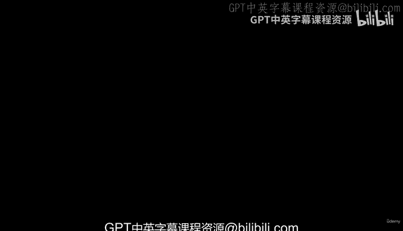

But our current model is only drawing straight lines。

 And I got you to have a think about whether our straight line model， our linear model。

 could ever separate this data。 Maybe it could。And I issued the challenge to see if it could if you trained for 1000 epochs。

So did it improve it anything， Is the accuracy any higher？Well。Speaking of training for more epochs。

 we're up to section number5， improving a model。This is from a model perspective。 So now。

 let's discuss some ways if。You were getting results after you train a machine learning model or a deep learning model。

 whatever kind of model you're working with。 And you weren't happy with those results。

 So how could you go about improving them？ So this is going to be a little bit of an overview of what we're going to get into。

 So one way is to add more layers。 So give the model more chances to learn about。

Pattterns in the data， why would that help， Because if our model currently has two layers。Model 0。

Dot state died。Well， we've got。However， many numbers here，20 or so。 So this is zeroth layer。

 This is the first layer。 If we had 10 of these while we'd have 10 times the amount of parameters to try and learn。

The patterns in this data are representation of this data。 Another way is to add more hidden units。

So what I mean by that is we created this model here， and each of these layers has five hidden units。

The first one outputs， out features equals 5， and this one takes n features equals 5。

 So we could go from。Go from five hidden units to 10 hidden units。

The same principle as above applies here is that the more parameters our model has to represent our data that potentially now。

 I say potentially here because some of these things might necessarily work。

 So our data set is quite simple。 So maybe if we added too many layers。

 our models is trying to learn things that are too complex。

 It's trying to adjust too many numbers for the data set that we have The same thing for more hidden units。

 What other options do we have。 Well， we could。Fit for longer。

 Give the model more of a chance to learn because every epoch is one pass through the data。

 So maybe 100 times looking at this dataset set wasn't enough。

 So maybe you could fit for1 thousand times， which was the challenge。

 then there's changing the activation functions， which we're using sigmoid at the moment。

 which is generally the activation function you use for a binary classification problem。

 but there are also activation functions you can put within your model。 there's a little hint。

 we'll get to that later。 then there's change the learning rate。

 So the learning rate is the amount the optimizer will adjust these every epoch。

 and if it's too small， our model might not learn anything because it's taking forever to change these numbers。

 But if also on the other side of things， if the learning rate is too high。

 these updates might be too large。 and our model might just explode。

 There's an actual problem in machine learning called exploding。😊，Graient problem。

Where the numbers just get too large on the other side。

 there's also a vanishing gradient problem where the gradients just go basically to 0 too quickly。

And then there's also change the loss function， but I feel like for now sigmoid and binary cross entropy pretty good。

 pretty standard。 So we're going to have a look at some options here。

 add more layers and fit for longer。 maybe changing the learning rate。

 but let's just add a little bit of color to what we've been talking about right now we've fit the model to the data and made a prediction I'm just going to step through this。

😊。

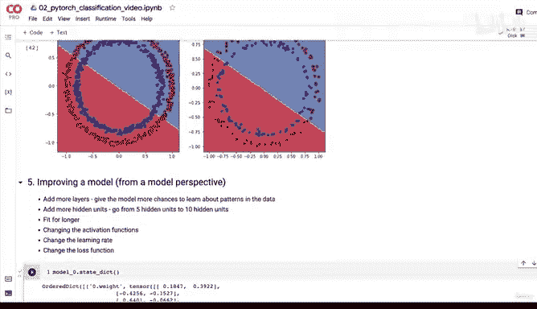

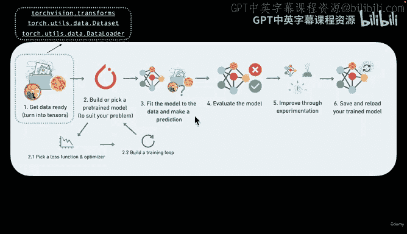

Where are we up to， We've done this， We've done this。 We've done this， too。

 We've built a training loop。 We've fit the model to the data， made a prediction。

 We've evaluated our model visually， and we're not happy with that。 So we're up to number 5。

 We're going to improve through experimentation。 We don't need to use Tensor board just yet。

 We're going to talk about this as a high level。 Tensor board is a tool or a utility from Plytorch。

 which helps you to monitor experiments。 We'll see that later on。 And then we'll get to this。

 We won't save our model until we've got one that we're happy with。😊。

And so if we look at what we've just talked about， improving a model from a model's perspective。

 Let's talk about the things we've talked about with some color this time。

 So say we've got a model here。 This isn't the exact model that we're working with。

 but it's similar structure。 We've got 1，2，3，4 layers。 We've got a loss function。

 B C with loadit loss。 we've got an optimizer， optimize a stochastic gradient descent。

 And if we did write some training code， this is 100pos。 And then the testing code here。

 I've just cut it out because it wouldn't fit on the slide。

 Then if we wanted to go to a larger model， let's add some color here so we can highlight what's happening。

 adding layers。 Okay， so this one's got 1，2，3，4，5，6 layers。 And we've got another。😊。

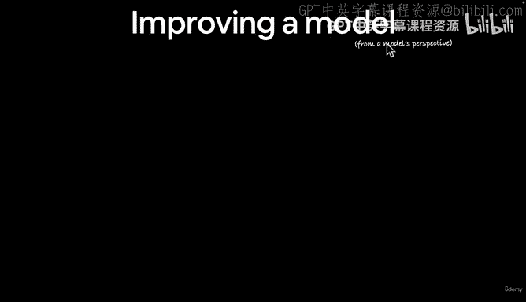

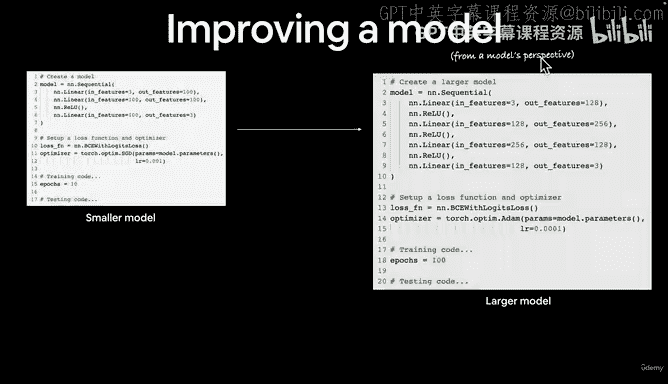

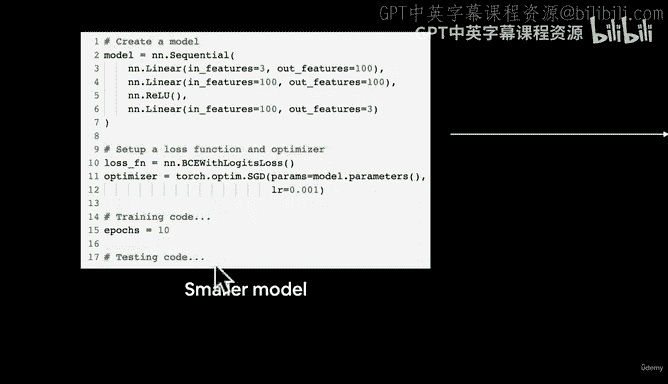

Coolour here， which is， I'd say this is like a little bit of a greeny blue。

 increasenc the number of hidden units。 Okay， so the hidden units are these features here。

 We've gone from 100 to 128 to 128。 Remember， the out features of a previous layer have to line up with the in features of a next layer。

Then we've gone to 256。 Wow， so remember how I said multiples of8 are pretty good。

 generally in deep learning。 Well， this is where these numbers come from。😊。

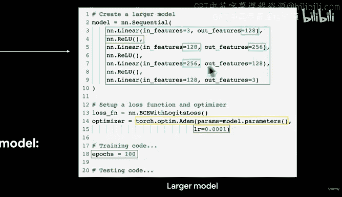

And then what else do we have Change slice add activation functions。 We haven't seen this before。

 N N dot Reello。 If you want to jump ahead and have a look at what N N dot Reello is。

 how would you find out about it。😊。

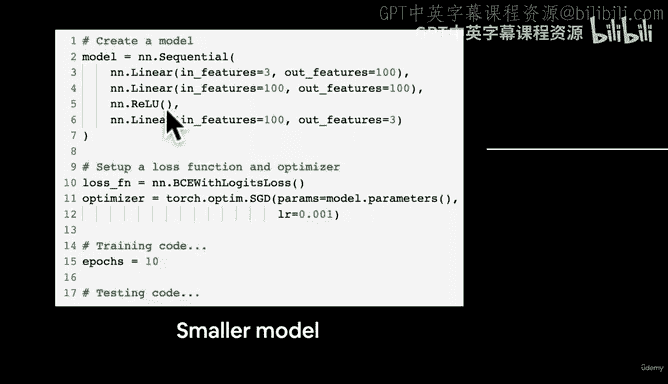

Well， I just Google N。reou。But we're going to have a look at what this is later on。😊。

We can see here that this one's got one， but this larger model has some relos scattered between the linear layers。

😊，Maybe that's a hint。 If we combine a linear layer with。A relu。 What's a re layer。

 I'm not gonna spoil this。 We're gonna find out later on。 Change the optimization function。 I。

 So we've got S G D。 Do you recall how I said atom is another popular one that works fairly well across a lot of problems as well。

 So Adam might be a better option for us here。 The learning rate as well。

 So maybe this learning rate was a little too high。 And so we've divided it by 10。 And then finally。

 fitting for longer。 So instead of 10 epos， we've gone to 100。

 So how about we try to implement some of these with our own model to see。😊。

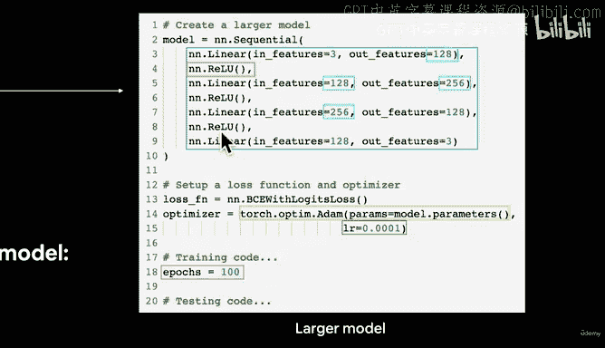

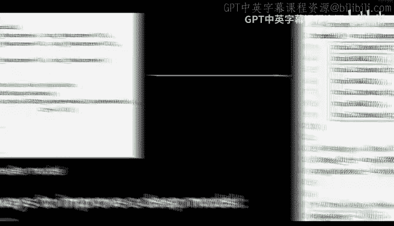

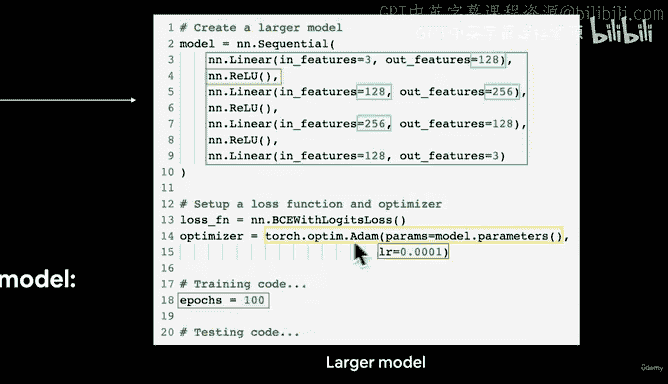

If it improves what we've got going on here， because， frankly， like this isn't satisfactory。

 we're trying to build a neural network here。 neural networks are supposed to be these models that can learn almost anything。

 And we can't even separate some blue dots from some red dots。 So in the next video。

 how about we run through writing some code to do some of these steps here。 In fact。

 if you want to try yourself， I'd highly encourage that。

 So I'd start with trying to add some more layers and add some more hitting units and fitting for longer。

 You can keep all of the other settings the same for now。😊，But I'll see you in the next video。

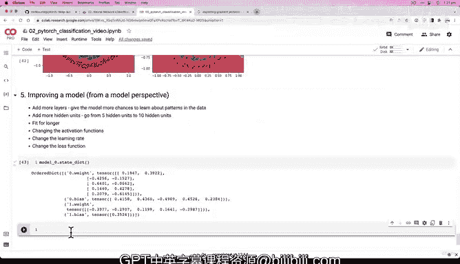