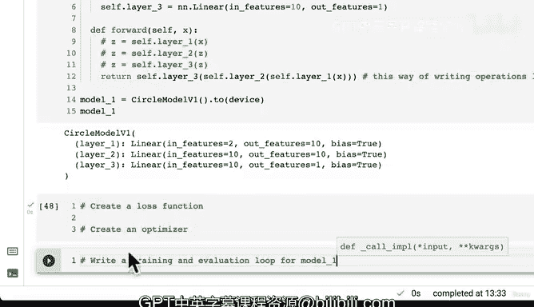

# Daniel Bourke《PyTorch 深度学习｜PyTorch 101 Crash Course For Beginners in 2025》中英字幕 - P79：079_04_015 创建含更多层与隐藏单元的增强模型.zh_en - GPT中英字幕课程资源 - BV1kTSKB1E9m

Welcome back。 In the last video， we discussed some options to improve our model from a model perspective。

 and namely， we're trying to improve it so that the predictions are better so that the patterns it learns better represent the data so we can separate blue dots from red dots。

 And you might be wondering why we said from a model perspective here。

 So let me just write these down。😊，These options。re all from our models perspective。

Because they deal directly with the model。Rather than the data。

 So there's another way to improve a model's results is if the model was sound already in machine learning and deep learning。

 you may be aware that generally if you have more data samples。

 the model learns or gets better results because it has more opportunity to learn。

 So's a few other ways to improve a model from a data perspective。

 but we're going to focus on improving a model from a model's perspective。So。

And because these options are all values， we as。Machine learning。Engineers and data scientists。

Can change。They are。Referred to。As hyperparameters。So a little bit of an important distinction here。

 parameters are the numbers within a model， the parameters here， like these values。

 the weights and biases are parameters are the values a model updates by itself。

 hyperparameter are what we as machine learning engineers and data scientists such as adding more layers。

 more hidden new notes fitting for longer number of epochs， activation functions， learning rate。

 loss functions。Are hyperparameters because they're values that we can change。

 So let's change some of the hyperparameter of our model。

So we'll create circle model V1 we're going to import from NN dot module as well。

 we could write this model using NN dot sequential。

 but we're going to subclass NN dot module for practice。

Why would we use NN dot sequential well because as you'll see， our model is not too complicated。

 but with subclass NN dot module。In fact， N N dot sequential。 So if we write here。

 N N dot sequential。It's also a version of NN dot module。But we subclass and end up module here。

For one， for practice and for later on， if we wanted to or if you wanted to make more complex models。

 you're gonna to see a subclass of N N dot module a lot in the wild。

 So the first change we're going to update is。The number of hidden units， so out features。

 I might write this down before we do it。Let's try and improve our model by。Adding more hidden units。

So， this will go from。5， and we'll increase it to 10。And we want to。Increase the number of layers。

 So we want to go from 2 to 3。 We'll add an extra layer and then increase the number of epochs。

So we're going to go from 100 to 1000。 Now， what can you。

We're going to put on our scientist hats for a second。

 What would be the problem with the way we're running this experiment。

If we're doing all three things in one hit。Why might that be problematic？Well。

 because we might not know which one offered the improvement if there is any improvement or degradation。

 so just to keep in mind going forward it， I'm just doing this as an example of how we can change all of these。

 but generally when you're doing machine learning experiments。

 you'd only like to change one value at a time and track the results so that's called experiment tracking in machine learning。

 We're going to have a look at experiment tracking a little later on in the course。

 but just keep that in mind。 a scientist likes to change one variable of what's going on so that they can control what's happening。

But we're going to create this next layer here， layer2， and of course， it takes the same number。

Of out features as in features as the previous layer。This is two， because Y our X train has。

Let's look at just the first five samples has two features。So now we're going to create self layer 3。

 which equals anN dot linear。The in features here is going to be 10 y because the layer above has out features equals 10。

 so what we've changed here so far is we've got hidden units previously in V0 of this model was5 and now we've got a third layer which previously before was2。

So these are two of our main changes here and out features equals one because y let's have a look at speaking of Y。

Our y is just one number。 So remember， the shapes， the input and output shapes of our model is one of the most important things in deep learning。

 We're going to see different values for these shapes later on。

 But because we're working with this data set， we're focused on two in features and one out feature。

So now that we've got our layers prepared， what's next？Well， we have to override the For method。

 because every subclass of N end dot module has to implement a Ford method。

 So what are we going to do here。Well， we could， let me just show you one option。 We could go Z。

 which would be Z for Loitts。 Loitts is actually represented by Z Fun fact。

 but you could actually put any variable here So this could be x1 or you could reset X if you wanted to。

 I just look putting a different one because it's a little less confusing for me and then we could go update Z by going。

😊，Self layer 2。 And then the because Z above is the output of layer1， it now goes into here。

 And then if we go Z。Again， equals self layer 3。What's this going to take。

 It's going to take Z from above。 So this is saying， hey， give me X， put it through layer 1。

 assign it to Z， and then create a new variable Z or override Z with self layer 2 with Z from before as the input。

 And then we've got Z again， the output of layer 2 as the input for layer 3。

 And then we could return Z。So that's just passing our data through each one of these layers here。

 But a way that you can leverage speed ups in pietorrch is to。Call them all at once。 So layer 3。

 and we're going to put self。Dot。Layer 2， and this is generally how I'm going to write them。

 but it also behind the scenes， because it's performing all the operations at once。

 you leverage whatever speed ups you can get。Ope this should be La 1。So it goes in order here。

 So what's happening。 Well， it's computing the inside of the brackets first。

 So layer 1 x is going through layer 1。 and then the output of。X into layer 1 is going into2 layer 2。

 and then the same again for layer 3。 So this way。This way of writing operations， leverages。

 speed ups。Where possible。Behind the scenes。And so we've done our forward method there。

 we're just passing our data through layers with it extra hidden units and an extra layer overall。

 so now let's create an instance of circle model V1 which we're going to set to Model1 and we're going to write circle model V1 and we're going to send it to the target device because we like writing device agnostic code。

And then we're going to check out Model one。So let's have a look at what's going on there。 Beaiful。

 So now we have a three layered model with more hidden units。

 So I wonder if we trained this model for longer， are we going to get improvements here。

 So my challenge to you is we've already done these steps before。

 We're going to do them over the next couple of videos for completeness。😊，But we need two one。

Create a loss function。So I'll give you a hint。 It's very similar to the one we've already used。

 and we need to create an optimizer。And then once we've done that， we need to write a training。

And evaluation loop for Model one。So give that a shot。Otherwise。

 I'll see you in the next video we'll do this all。

