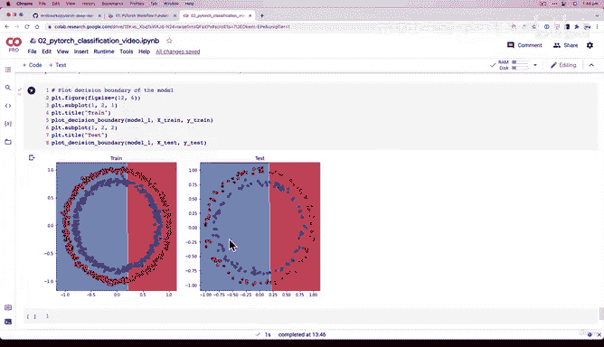
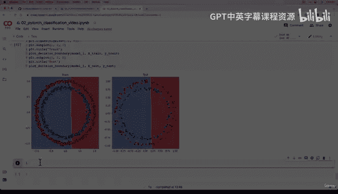

# Daniel Bourke《PyTorch 深度学习｜PyTorch 101 Crash Course For Beginners in 2025》中英字幕 - P80：080_04_016 编写训练测试代码验证模型性能提升.zh_en - GPT中英字幕课程资源 - BV1kTSKB1E9m

Welcome back in the last video we subclassed NN dot module to create circle model V1。

 which is an upgrade on circle model v0 in the fact that we added more hidden units。

 so from 5 to 10 and we added a whole extra layer and we've got an instance of it ready to go So we're up to in the workflow。

😊。

We've got our data。 Well， we haven't changed the data。 So we've built our new model。

 We now need to pick a loss function， and I hinted out before that we're going to use the same loss function as before。

 the same optimizer。 You might have already done all of these steps。

 So you may know whether this model works on our dataset or not。

 But that's what we're gonna to work towards finding out in this video。 So we've built our new model。

 Now， let's pick a loss function and optimizer。 We could almost do all of this with our eyes closed Now。

 build a training loop， fit the model to the data， make a prediction and evaluate the model。

 We'll come back here。 And let's set up a loss function。😊，And by the way， if you're wondering， like。

 why would adding more features here， we've kind of hinted at this before and why would an extra layer improve our model。

 Well， again， it's back to the fact that if we add more neurons。

 if we add more hidden units and if we add more layers， it just gives our model more numbers。

To adjust， so look at what's going on here， layer one， layer2。Look how many more we have。Compared to。

Model  zero。Dot state di。We have all of these， this is Model0， and we just upgraded it。

 look how many more we have from just adding an extra layer and more hidden units。😊。

So now we have our optimizer can change these values to， hopefully。

Create a better representation of the data we're trying to fit。

So we just have more opportunity to learn patterns in our target data set。

 So that's the theory behind it。 So let's get rid of these。 Let's create a loss function。😊。

What are we going to use Well we're going to use Nn。bce with Loit's loss。

And our optimizer is going to be what we're going to keep that as the same as before。

 Torch dot optim dot S GD。 But we have to be aware that because we're using a new model。

 we have to pass in parameterss of model 1。These are the parameters we want to optimize and the Lr is going to be 0。

1。 I that the same LR we used before learning rate 0。1。

 hold potentially that our learning rate may be too big 0。1。Wherehy do we create our optimizer。

 so we've written a lot of code here。Optimer， there we go。0。1。 That's a run。 So we'll keep it at 0。

1 just to keep as many things the same as possible。So we're going to set up torch dot manual seed。

42 to make training as reproducible as possible， torch。kua。manualsed。42 now， as I said before。

 don't worry too much if your numbers aren't exactly the same as mine。

 The direction is more important， whether it's good or bad direction。So now let's set up epochs。

 We want to train for longer this time as well。 So 1000 epochs。

 This is one of our three improvements that we're trying to do， adding more hidden units。

 increase the number of layers and increase the number of epochs。

 So we're going to give our model 100 looks at the data to try and improve its patterns。

 So put data on the target device。We want to write device agnostic code and yes。

 we've already done this， but we're going to write it out again for practice because even though we could functionise a lot of this。

 it's good while we're in still the foundation stages to practice what's going on here because I want you to be able to do this with your eyes closed before we start to functionise it So put the training data and the testing data to the target device。

 whatever it is CPU or GPU and then we're going to well what's our song。For an epo the range。

Let's loop through the epos We're going to start off with training What do we do for training while we set Model1 to train and then what's our first step Well we have to forward pass What's our outputs of the model Well the raw outputs of a model are Loitts so model one we're going to pass it the training data and we're going to squeeze it so that we get rid of an extra one dimension if you don't believe me that we would like to get rid of that one dimension try running the code without that dot squeeze and why pred equals torch dot round。

😊，And torch dot sigmoid Y， we're calling sigmoid on our logits to go from logits to prediction probabilities。

To prediction。Libels。And then what do we do next， Well， we calculate the loss。Slash accuracy。To here。

 And remember， accuracy is optional， but loss is not optional。 So we're going to pass in here。

 Our loss function is going to take in。 I wonder if it'll work with just straight up wide pre。

I don't think it will because we're using， we need logitts in here。 why logitts and why train。

 Because why。Google car La correcting the wrong thing。

We have Y Loits because we're using BCE with logitts loss here。So let's keep pushing forward。

 We want our accuracy now， which is our accuracy function。 And we're going to pass in the order here。

 which is the reverse of above little confusing。 But I've kept the evaluation function in the same order as psychet loan。

 Y pre equals Y pre。😊，Three， we're going to zero the gradients of the optimizer。Optimer 0 grad。

 And you might notice that we've started to pick up the pace a little。 That is perfectly fine。

 If I'm typing too fast， you can always slow down the video or you could just watch what we're doing and then code it out yourself afterwards。

 The code resources will always be available。 We're going to take the loss backward。😊。

And perform back propagation。The only reason we're going faster is because we've covered these steps。

 So anything that we sort of spend time here， we've covered in a previous video， optimize a step。

 And this is where the adjustments to all of our models parameters are going to take place。

 to hopefully create a better representation of the data。 And then we've got testing。

 What's the first step that we do in testing。 Well。

 we call model 1 do a vow to put it in evaluation mode。

 And because we're making predictions we're going to turn on torch inference mode， predictions。

 I call them predictions， Some other places call it inference。😊，Remember。

 machine learning has a lot of different names for the same thing For pass。

 so we're going to create the test logitts here。Equals Model 1 X test。

 And we're going to squeeze them because we won don't want the extra one dimension。

 Just gonna add some code cells here so that we have more space。

 And I'm typing in the middle of the screen。Then I'm going to put in test pre here。

 how do we get from logits to predictions well we go torch。 round and then we go torch。

sigmoid y sigmoid because we're working with a binary classification problem and to convert logits from a binary classification problem to prediction probabilities。

 we use the sigmoid activation function。And then we're going to calculate the loss。

So how wrong is our model on the test data， So test lost equals loss function。

 We're going to pass it in the test logits。And then we're going to pass it in why test for the ideal labels。

 and then we're going to also calculate test accuracy and test accuracy is going to take in Y true equals y test or the test labels and y pre equals test pre。

 so the test predictions。Test predictions here。 And our final step is to print out what's happening。

 so。Brint out what's happening。 every tutorial needs a song。 If I could。

 I'd teach everything with song。😊，Song and dance。 So because we're training for 1000 epochs。

 how about every 100 epochs we print out something So print F string and we're going to write epoch in here。

 So we know what epoch our models on and then we're going print out the loss。 Of course。

 this is going to be the training loss because the test loss has test at the front of it and then the accuracy here now。

 of course this is going to be the training accuracy。😊，Let me go here。And then we're going to pipe。

 and we're going to print out the test loss。And we want the test loss here。

 we're going to take this to five decimal places again when we see the printouts of the different values。

 do not worry too much about the exact numbers on my screen appearing on your screen because that is inherent to the randomness of machine learning。

So have we got the direction is more important？Have we got， We need a percentage sign here。

 because that's going to be a bit more complete for accuracy， Have we got any errors here。

 I don't know。 I've just， we've just all coded this free hand。 Right。

 There's a lot of code going on here。So we're about to train our next model。

 which is the biggest model we've built so far in this course， three layers。

 10 hidden units on each layer。 Let's see what we've got3，2， one run。Oh， what。😮，What1000 epochs。

 an extra hidden layer， more hidden units。 And we still， our model is still basically a coint toss。

50 per cent。 Now， this can't be for real。 Let's plot the decision boundary。

Ploot the decision boundary。To find out， let's get a bit visual。Pt figure。Actually。

 to prevent us from writing out all of the plot code。 let's just go up here and we'll copy this。 Now。

 you know， I'm not the biggest fan of copying code。 but for this case， we've already written it。

 So there's nothing really new here to cover。 And we're going to just change this from model 0 to model 1。

 because why it's our new model that we just trained。 And so behind the scenes。

 plot decision boundary is going to make predictions with the target model on the target data set and put it into a nice visual representation for us。

 I said nice visual representation。 What is this look like。

 We've just got a coin toss on our data set。 Our model is just， again。

 it's trying to draw a straight line to separate？ Ccular data Now， why is this。

 Our model is based on linear is our data No nonlinear。😊，maybe I've revealed a few of my tricks。

I've done a couple of reveals over the past few videos， but。😊，This is still quite annoying。

 and it can be fairly annoying when you're training models and they're not working， so。

How about we verify that this model can learn anything， Because right now。

 it's just basically guessing for our data set。 So this model looks a lot like the model we built in Section 0。

1。 Let's go back to this。 This is the learn Pytoch dot I O book， Pytoch workflow fundamentals。

 Where did we create a model， model buildingEssentials。Where did we build a model？

Linear regression model。Yeah， here。 and end do linear。But we built this model down here。

 So all we've changed。From 0，1 to here， as we've added a couple of layers。

 the forward computation is quite similar。 If this model can learn something on a straight line。

Can this model learn something on a straight line， So that's my challenge to you is。

Grab the data that we created in this previous notebook。 So data。

 you could just reproduce this exact data set and see if you can write some code to fit the model that we built here。

This one here。On the data set that we created in here。

 because I want to verify that this model can learn anything because right now。

 it seems like it's not learning anything at all。 And that's quite frustrating。 So give that a shot。

 and I'll see you in the next video。

