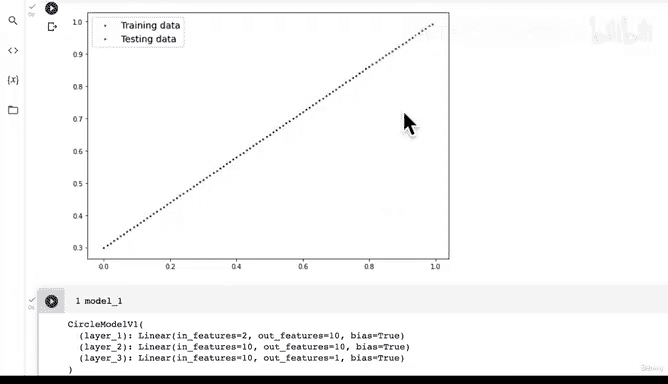

# Daniel Bourke《PyTorch 深度学习｜PyTorch 101 Crash Course For Beginners in 2025》中英字幕 - P81：081_04_017 创建直线数据集检验模型学习能力.zh_en - GPT中英字幕课程资源 - BV1kTSKB1E9m

Welcome back。 In the past few videos， we've tried to build a model to separate the blue from red dots yet。

 Our previous efforts have proven futile， but don't worry， we're going to get there。

 I promise you we're going to get there。 And I may have a little bit of inside information here。

 but we're going build a model to separate these blue dots from red dots。

 A fundamental classification model。 And we tried a few things in the last couple of videos such as training for longer。

 So more epochs。 We added another layer。 We increase the hidden units。

 because we learned of a few methods to improve a model from a model perspectives。

 such as upgrading the hyperparameter， such as number of layers， more hidden units。

 fitting for longer， changing the activation functions， changing the learning rate。

 We haven't quite done that one yet。 and changing the loss function。😊。

One way that I like to troubleshoot problems is。We're going to put a subheading here， 5。1。

 we're going to prepare or preparing data to see if our model can fit a straight line。So。

One way to troubleshoot。This is my trick for troubleshooting problems， especially neural networks。

 but just machine learning in general to troubleshoot a larger problem。Is to test out。

A smaller problem。And so why is this， Well， because we know that we had something working in a previous section。

 So 0，1 Pytorch workflow fundamentals， we built a model here that worked。 And if we go right down。

We know that this linear model can fit a straight line。

 So we're going to replicate a data set to fit a straight line to see if the model that we're building here。

Can learn anything at all， because right now， it seems like it can't。

It's just tossing a coin to split between our data here， which is not ideal。 So let's make some data。

But yeah， this is the let's create a smaller problem。

 one that we know that works and then add more complexity to try and solve our larger problem。

 So create some data。 This is going to be the same as notebook O1。

And I'm going set up weight equals 0。7 Bas equals 0。3。

 We're gonna to move quite quickly through this because we've seen this in。Module1。

 but the the overall takeaway from this is we're going to see if our model works on any kind of problem at all or do we have something fundamentally wrong？

Create data。I'm going to call it x regression because it's a straight line and we want it to predict a number rather than a class。

 so you might be thinking， oh， we might have to change a few things of our model architecture。 Well。

 we'll see that in a second。😊，Dot unsqueze。 And we're going go on the first dimension here or dems  one。

 And why regression。We're going to use the linear regression formula as well。

 weight times x X regression。 That is because we're working with a new data set here plus the bias。

 So this is linear regression。Formula。Without epsilon。

 So it's a simplified version of linear regression。

 but the same formula that we've seen in a previous section。 So now let's check the data。

 Nothing we really haven't covered here， but we're going to do a sanity check on it to make sure that we're dealing with what we're dealing with is not just a load of garbage。

Cause it's all about the data and machine learning。 I can't stress to you enough。

 That's the data Explorer's motto is to。Visualize， visualize， visualize。 Oh。

 what did we get wrong here， unsqueezed。 Did you notice that typo。Why didn't you say something。

I'm kidding。 There we go。 Okay， so we've got 100 samples of X。 We've got a different step size here。

 But that's all right。 Let's have a little bit of fun with this。

 And we've got one x value per y value。 This is a very similar data set to what we use before。 Now。

 what do we do once we have a data set。😊，Well， if we haven't already got training in test splits。

 we better make them。So create train and test splits。And then we're going to go train split。

We're going to use 80% equals int。0。8 times the length of。Or we could just put 100 in there。

 but we're gonna。Be specific here。 And then we're going to go X train regression， Y。

 train regression。Equals what do these equal Well we're going to go on X regression and we're going to index up to the train split。

On the X， and then for the Y Y regression， we're going to index up to the train split。Wonderful。

 and then we can do the same on the test or creating the test data。😊。

Nothing really new here that we need to discuss withre creating training in test sets。

 what do they do for each of them？Well， the model is going to hopefully learn patterns in the training data set that is able to model the testing data set。

 And we're going see that in a second。 So if we check the length。😊，Of each， what do we have， length。

 X train regression。 We might just check。X train， X test。Reggression。What do we have here。

 and then we're going to go length。Why train regression？Long variable names here， excuse me for that。

 but we want to keep it separate from our already existing X and Y data。What values do we have here。

80，2080，20 beautiful。 So 80 training samples to 100 testing samples。 that should be enough。 Now。

 because we've got our helper functions。😊，File here And if you don't have this。

 remember we wrote some code up here before to where is it？To download it from the course Gitthub。

 and we imported plot predictions from it。 Now， if we have a look at helpber functions dot pi。

 it contains the plot predictions function that we created in。The last section， section 0。1。

 There we go。 P predictions。 So we're just running this exact same function here。

 or we're about to run it。 It's going to save us from retyping out all of this。

 That's the beauty of having a helper functions dot pi file。 So if we come down here。

 let's plot our data to visually inspect it right now， it's just numbers on a page。

 And we're not going to plot really any predictions。😊，Because we don't have any predictions yet。

 but we'll pass in the train data。Is equal to x train regression。

 and then the next one is the train labels， which is equal to Y train。Regression。

And then we have the test data， which is equal to X test。Regression， and then we have the test。Lbels。

Now I think this should be labels too。 Yeah， there we go。 Why test progression。

It might be proven wrong as we try to run this function。 Okay， there we go。

 So we have some training data and we have some testing data。 Now， do you think that our model。

Model 1。If we have a look， what's Model one？Could fit this data。

Does it have the right amount of in and out features， We may have to adjust these slightly。

 So I'd like you to think about that。 Do we have to change the input features to our model for this data set and do we have to change the out features of our model for this data set。

We'll find out in the next video。