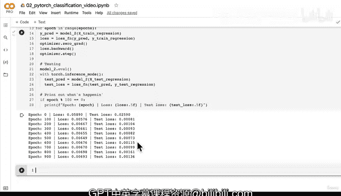

# Daniel Bourke《PyTorch 深度学习｜PyTorch 101 Crash Course For Beginners in 2025》中英字幕 - P82：082_04_018 构建训练拟合直线数据的模型.zh_en - GPT中英字幕课程资源 - BV1kTSKB1E9m

Welcome back。 We're currently working through a little side project here。

 but really the philosophy of what we're doing。 we just created a straight line data because we know that we've built a model in the past back in section 01 to fit a straight line data and why are we doing this Well。

 because the model that we've built so far is not fitting or not working on our circular data here on our classification data。

 And so one way to troubleshoot a larger problem is to test out a smaller problem first。

 So later on if you're working with a big machine learning data。

 you probably start with a smaller portion of that data first。 Likewise。

 with a larger machine learning model instead of starting with a huge model。

 you'll start with a small model。 So we're taking a step back here to see if our model is going to learn anything at all on a straight line dataset so that we can improve it for a non-s line data and there's another hint。

😊，Oh， we're going to cover it in a second。 I promise you， but let's see how now we can adjust。😊。

Model1 to fit a straight line。 And I issued you the question at the end of last video。

 Do we have to adjust the parameters of model1 in any way shape or form to fit this straight line data。

 and you may have realized or you may not have that our model 1 is set up for our classification data。

 which has two x input features， whereas this data。If we go x。Tra and regression。

How many input features do we have， We just get the first sample。There's only one value。

 or maybe we get the first 10。There's only one value per。Let's remind ourselves。

 This is input and output shapes， One of the most fundamental things in machine learning and deep learning。

 And trust me， I still get this wrong all the time。 So that's why I'm harping on about it。

 We have one feature per one label。 So we have to adjust our model slightly。

 We have to change the in features to be one instead of two。

 The out features can stay the same because we want one number to come out。😊。

So what we're going to do is code up a little bit different version of Model one。

 So same architecture。As Model 1。But using Nn dot sequential。

 we're going to do the faster way of coding a model here。 Let's create model 2 and Nn dot sequential。

 The only thing that's going to change is the number of input features。

 So this will be the exact same code as model1。 and the only difference， as I said。

 will be features or in features is one and then we'll go out features equals 10。

 So 10 hidden units in the first layer。 And of course， the second layer。😊。

The number of features here has to line up with the out features of the previous layer。

 This one's going to output 10 features as well。 So we're scaling things up from one feature to 10 to try and give our model as much of a chance or as many parameters as possible。

 Of course， we could make this number quite large。 We could make it 1000 features if we want。

 But there is an upper bound on these things。 And I'm going to let you find those in your experience as a machine learning engineer and a data scientist。

 But for now， we're keeping it nice and small。 So we can run as many experiments as possible。

 beautiful， look at that。 We've created as a sequential model。

 What happens with N N dot sequential data goes in here， passes through this layer。

 Then it passes through this layer。 Then it passes through this layer and what happens when it goes through the layer。

 It triggers the layerss forwardd method， the internal forwardd method。

 In the case of N dot linear we've seen it。 It's got。😊，The linear regression formula。

 So if we go Nn dot linear。It performs。This mathematical operation， the linear transformation。

But we've seen that before。 Let's keep pushing forward。 Let's create a loss， and an optimizer。Loss。

And optimize， we're going to work through our workflow。 So loss function。

 we have to adjust this slightly。 We're going to use the L1 loss because why we're dealing with a regression problem here rather than a classification problem。

And our optimr， What can we use for our optimizer， How about we bring in just the exact same optr S GD that we've been using for our classification data。

 So model 2 dot parameters or parameters always get a little bit confused。

And we'll give it an L of 0。1， because that's what we've been using so far。

 This is the parameters here。 So we want to our optimizer to optimize our Model 2 parameters here with a learning rate of 0。

1。 The learning rate is what。The amount each parameter will be or the multiplier that will be applied to each parameter。

H epoch。So now let's train the model， do you think we could do that？In this video， I think we can。

 So we might just train it on the training data set。

 and then we can evaluate it on the test data set separately。 So we'll set up both manual seeds。

 couda and。Because we've set our model to the device up here。

 so it should be on the GPU or whatever device you have active。So said the number of epochs。

 How many epochs should we set。Well， we said 1000 before。 So we'll keep it at that。

 Epochx equals 1000。 And now we're getting really good at this sort of stuff here。

 Let's put our data。😊，Put the data on the target device。

And I know we've done a lot of the similar steps before， but there's a reason for that。

 I've kept all these in here because I'd like you to by the end of this course is to sort of know all of this stuff off by heart。

 and even if you don't know it all off by heart because trust me I don't， you know where to look。

So X train regression， we're going to send this to device。

And then we're going go why train regression， just a reminder or something to get you to think while we're writing this code。

What would happen if we didn't put our data on the same device as a model？

We've seen that arrow come up before。But what happens。Well。

 I've just kind of given away haven't you Daniel， wow， that was a great question。

 our code will error。😊，Oh。Well don't worry， there's plenty of questions I've been given you that I haven't given the answer to you。

😊，Device are beautiful。 We've got a device， agnostic code for the model and for the data。

 And now let's loop through epochs。 So train。😊，We're gonna for epoch in range epochs for an epoch in range。

 do the forward pass。Calculate the last。 So y pre equals model 2。This is the Ford pass。X train。

Reggression， it's all going to work out hunky Dory because our model and our data are on the same device。

 Los equals what We're going bring in our loss function。

 We're going compare the predictions to why train。Regression。To the Y labels。What do we do next。

 Optim a zero grad。Optimizer dot 0 grad。 We're doing all of this with our comments。 Look at us， go。

 Los backward And what's next。 Optimr step， step， step。 And， of course。

 we could do some testing here。😊，Testing， we'll go Model 2 dotval。

 and then we'll go with torch dot inference mode。We'll do the forward pass。

 we'll create the test predictions equals Model 2 do x test regression。

And then we'll go the test loss equals。Loss FN on the test predictions and versus the Y test labels。

Beautiful。Look at that。We've just done an optimization loop。

 something we've spent a whole hour on before， maybe even longer in about 10 lines of code。 And。

 of course， we could shorten this by making these a function。 But we're going to see that later on。

 I'd rather give a little bit of practice while this is still a bit fresh。😊。

Print out what's happening。Let's print out what's happening。

 what should we do so because we're training for a thousand epochs。

 I like the idea of printing out something every100 epochs that should be about enough of a step。

Epoch， what do we got？We'll put in the epo here with the F string， and then we'll call the loss。

 which will be loss。 And maybe we'll get the first5。Of those five decimal places。

 that is we don't have an accuracy， do we。Because we're working with regression。

And we'll get the test loss out here。 And that's going to be 05 F as well。 beautiful。

 Have we got any mistakes， I don't think we do。 We didn't even run this code cell before。

 We'll just run these three again。 See if we got look at that。 Oh my goodness。 Is our loss。

 Our loss is going down。😊，So that means our model must be learning something。Now。

 what if we adjusted the learning rate here， I think if we went 0。01 or something。

 will that do anything。Oh yes。 look how low our loss gets on the test data set。

 but let's confirm that we've got to make some predictions。😊。

Or maybe we should do that in the next video。 Yeah， this one's getting too long。

 but how good that we created a straight line data set and we created a model to fit it。

 we set up a loss in an optimizer already and we put the data on the target device we trained and we tested so our model must be learning something but I'd like you to give a shot at confirming that by using our plot predictions function So make some predictions with our trained model。

 don't forget to turn on inference mode and we should see some red dots here fairly close to the green dots on the next plot。

😊，Give that a shot， and I'll see you in the next video。

