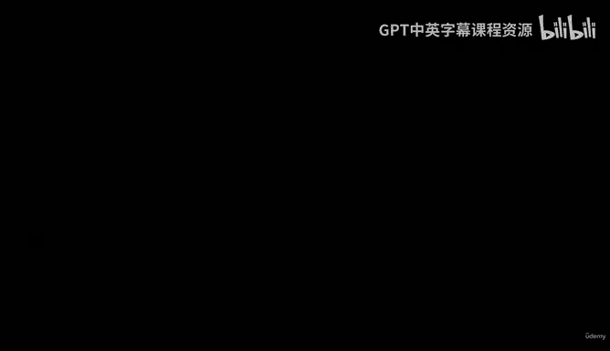
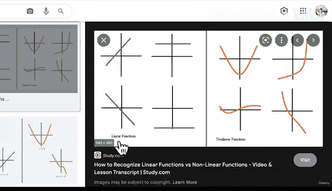
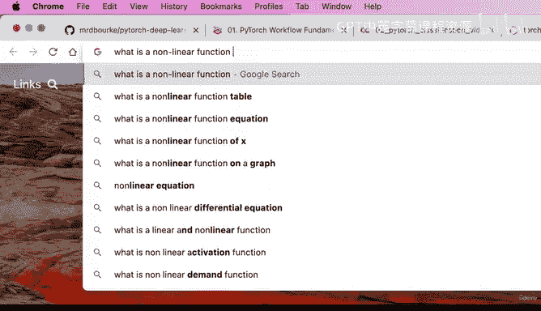

# Daniel Bourke《PyTorch 深度学习｜PyTorch 101 Crash Course For Beginners in 2025》中英字幕 - P84：084_04_020 引入分类模型缺失环节：非线性.zh_en - GPT中英字幕课程资源 - BV1kTSKB1E9m

Welcome back。 In the last video， we saw that the model that we've been building has some potential to learn。

 I mean， look at these predictions。 You could get a little bit better， of course。

 get the red dots on top of the green dots。 But we're just going to leave that the trend is what we're after。

 our model has some capacity to learn， except this is straight line data and we've been hinting at it a fair bit is that we're using linear functions。

 And if we look up linear data。😊。

What does it look like？Well， it has a quite a straight line。 If we go linear and just search linear。

 What does this give us， Line means straight， There we go straight。

 And then what happens if we search for non linear， I kinda hinted at this as well。 No nonlinear。 Oh。

 we get some curves。 We get curved lines。

So linear functions， straight， non linear functions。Now。

 this is one of the beautiful things about machine learning and I'm not sure about you。

 but when I was in high school， I kind of learned a concept called line of best fit or y equals M X plus C or y equals M X plus B and it looks something like this。

 And then if you wanted to go over these， you use quadratic functions and a whole bunch of other stuff。

😊，But one of the most most fundamental things about machine learning is that we build neural networks and deep down neural networks are just a combination。

 It could be a large combination of linear functions and nonlinear functions。

 So that's why in Torch do Nn， we have nonlinear activations and we have all these other different types of layers。

 but essentially what they're doing deep down is combining straight lines with if we go back up to our data。

😊。

Non straight lines。 So， of course， our model didn't work before。

 because we've only given it the power to use linear lines。

 We've only given it the power to use straight lines， but our data is what It's curved。

 although it's simple， we need non linearity to be able to model this data set。 And now。

 let's say we are building a pizza detection model。 So let's look up some images of pizza。

 one of my favorite foods， images。😊，Pizza， right？ So could you model pizza with just straight lines。

 Are you're thinking， Daniel， you can't be serious。

 a computer vision model doesn't look for just straight lines in this。 And I'd argue that， yes。

 it does， except we also add some curved lines in here。 That's the beauty of machine learning。

 Could you imagine trying to write the rules of an algorithm to detect that this is a pizza。

 maybe you could put in。 oh， it's a curve here。 And if you see red and no， no， no， no no。

 imagine if you're trying to do 100 different foods。 your program would get really large。 Instead。

 we give our machine learning models if we come down to the model that we created。

 We give our deep learning models。 The capacity to use linear。 and nonlinear functions。

 We haven't seen any nonlinear layers just yet。 or maybe we've hinted at some。 But that's all right。

 So we stack these on top of each other。 these layers。 And then the model figures out。

 what patterns in the data it should use what lines it to draw to draw patterns through not only pizza。

 but another food such as sushi。😊，If we wanted to build a food image classification model。

 it would do this。 The principle remains the same。 So the question I'm going to pose to you。

 we'll get out of this。Is。We'll come down here。We've unlocked the missing piece， or we're about to。

 We're going to cover it over the next couple of videos。 The missing piece of our model。

And this is a big one。This is going to follow you throughout all of machine learning and deep learning。

 non linearity。 So the question here is。What patterns could you draw if you were given。An infinite。

Amount of straight and non straight lines。Or in machine learning terms。An infinite amount。

 But really， it's， but really。It。Is finite by infinite in machine learning terms。

 This is a technicality。 It could be a million parameters。 It could be。

 as we've got probably 100 parameters in our model。

 So just imagine a large amount of straight and not in straight lines， an infinite amount of。

Linear and non nonlinear functions。You could draw some pretty intricate patents， couldn't you。

 And that's what gives machine learning and especially neural networks the capacity to not only fit a straight line here。

 but to separate two different circles， but also to do crazy things like drive a self-div car。😊。

Or at least power the vision system of a self driving car。

 of course after that you need some programming to plan what to actually do with what you see in an image。

😊，But we're getting ahead of ourselves here。 Let's now start diving into linearity。

 And the whole idea here is combining the power of linear and nonlinear functions。

Straight lines and non straight lines。 Our classification data is not comprised of just straight lines。

 Its circles。 So we need non linearity here。 So recreating non linear data， red and blue circles。

 We don't need to recreate this， but we're going to do it anyway for completeness。

So let's get a little bit of a practice， make and plot data。

 This is so that you can practice the use of non nonlineararity on your own that plot Lib bit dot pi plot as PLt。

 we're going to go a bit faster here because we've covered this code above So import， make circles。

 which are going to recreate the exact same circle data set that we've created above number of samples we' create1 thousand00 and we're going to create x and y equals what make circles。

 pass it in number of samples beautiful。Coabab， please。

 I wonder if I can turn off auto correctrect on coabab。 I'm happy to just see all of my errors。😊。

In the flesh， they look at that。 don't want that。 I't want noise like that。

 Maybe I'll do that in the next video。We're not going to spend time here looking around how to do it。

We can work that out on the fly later for now。 I'm too excited to share with you the power of non nonlinearity。

 So here， X， we're just gonna plot what's going on。

 We've got two X features and we're going color it with the flavor of Y because we're doing a binary classification。

 and we're going to use my one of my favorite C maps， which is colour map。

 and we're going go P LT dot C for C map and red。😊，Blue。What do we get？Okay， red， circle。

 blue circle。 Hey， is it the same color as what's above。I like this colour better。

Did we get that right up here？Oh my goodness。 Look how much code we've written。 Yeah。

 I like the other blue。 I'm going bring this down here。😊。

It's all about aesthetics and machine learning。 It's not just numbers on a page。 Daniel。

 how could you be so crass？Let's go there。Okay， that's a better colour red and blue。

 That's small lively， isn't it， So now let's convert to train and test。

 and then we can start to build a model with non linearity。 Oh， this is so。Okay， convert。

Data to tenses and then to train and test splits。 Nothing we haven't covered here before。So。

 import torch。But it never hurts to practice code， right。Import torch from SkLarn。t model selection。

Import。Train test Splint so that we can split our red and blue dots randomly。

And we're going to turn data into tensesors。And we'll go x equals torch from nuy。

 and we'll pass in X here。And then we'll change it into type torch dot float。 Why do we do this。

 Well， because。Oh my godness， auto correct。 It's getting the best of me here。

You watch it me livecode this stuff and battle with auto correct。 That's what this whole course is。

 when I really teaching pieytorch am I just battling with Google co Las auto correct。😊。

We are turning it into torch dot float with a type here because whyumpy's default。

 which is what makes circles users behind the scenes。

 Numpy is actually used in a lot of other machine learning libraries。

 pandas built on Numpy psychic learn does a lot of nuy Mapllibb Numpy that's just showing the what's the word is it ubiquitous ubiquity I'm not sure maybe if not you can correct me the ubiquity of Numpy and test sets。

 but we're using Py torch to leverage the power of autograd。

 which is what powers our gradient descent and the fact that it can use GPUus。

So we're creating train and test splits here with train test split。X， y。

And we're going to go test size equals 0。2， and we're going to set random。Random state equals 42。

 And then we'll view our first。5 samples， are these going to be。Tenses。Fingers crossed。

 We have got an era。 beautiful。 We have tensesors here。 Okay， now we're up to the exciting part。

 We've got our data set back。😊，I think it's time to build a model with linearity。

 So if you'd like to peek ahead， check out torch N N again。 This is a little bit of a spoiler。

 Go into the linear activations。 See if you can find the one that we've already used。

 That's your challenge。Can you find the one we've already used and go into here and search what is a linear function？

So give that a go and see what comes up。

I'll see you in the next video。