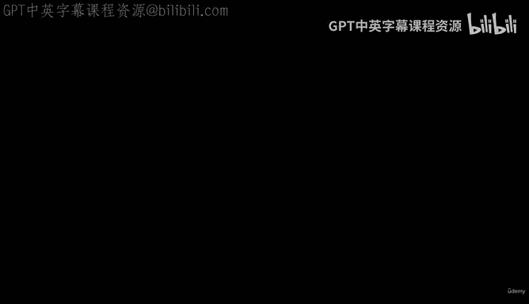
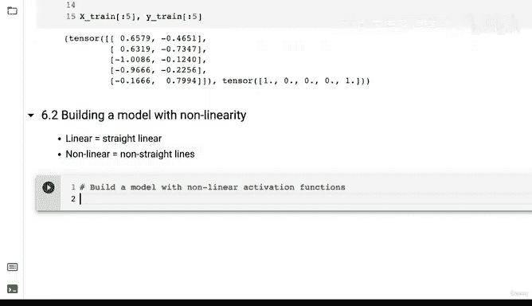
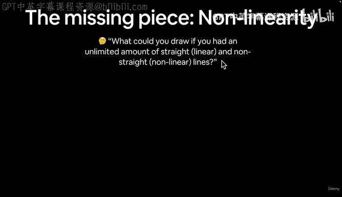
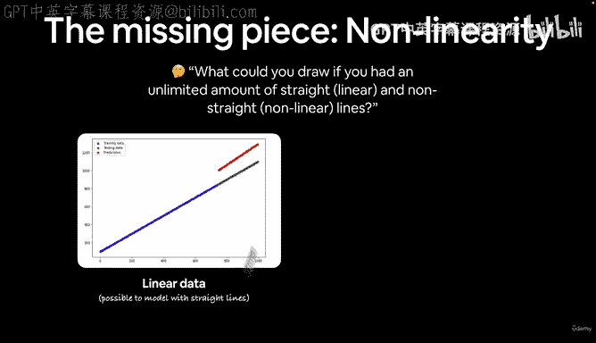
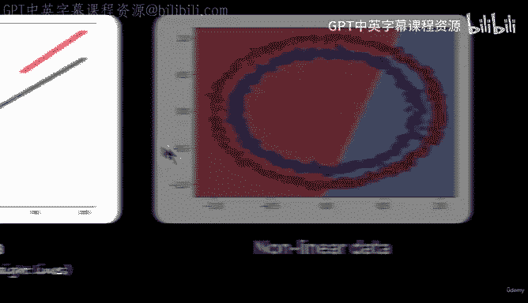
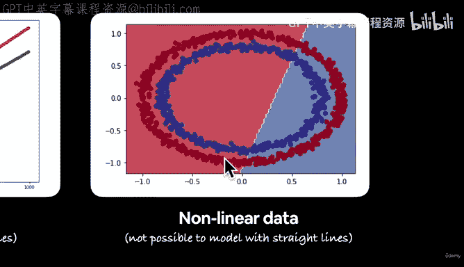
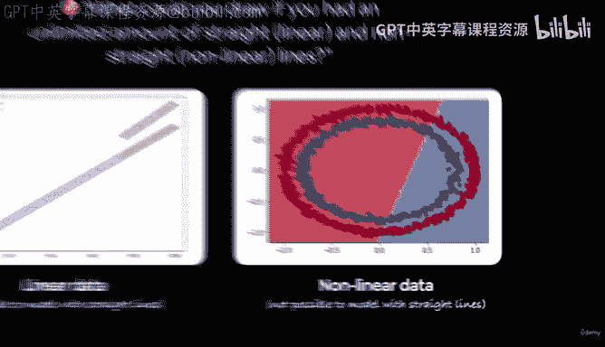
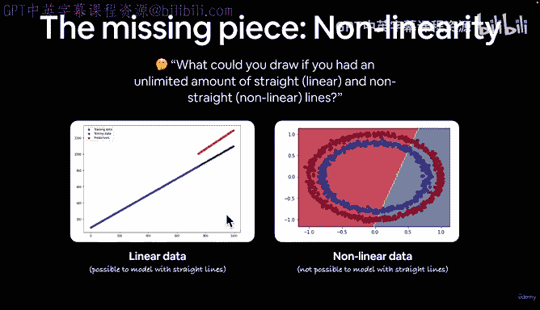
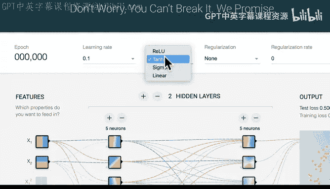

# Daniel Bourke《PyTorch 深度学习｜PyTorch 101 Crash Course For Beginners in 2025》中英字幕 - P85：085_04_021 构建首个非线性神经网络.zh_en - GPT中英字幕课程资源 - BV1kTSKB1E9m

Welcome back Now put your hand up if you're ready to learn about non linearity。😡。

And I know I can't see your hands up， but I better see some hands up or I better feel some hands up because my hands up because non linearity is a magic piece of the puzzle that we're about to learn about。

 So let's title this section，Build a model with non linearity。😊，So just to reemphase。

 linear equals straight lines。And。In turn， non nonlinear。Equals non straight。Lines。

And I left off the end of the last video giving you the challenge of checking out the torch dot Nn module。

 looking for the nonlinear function that we've already used。 Now。

 where would you go to find such a thing And oh， what are we have in here， No nonlinear activations。

 And there's going to be a fair few things here， But essentially all of the modules within torch do N are either some form of layer in a neural network if we recall。

😊，Let's go to a neural network， we've seen the anatomy of a neural network。Generally。

 you'll have an input layer and then multiple hidden layers and some form of output layer。 Well。

 these multiple hidden layers can be almost any combination of what's in torch。 M。 and in fact。

 they can almost be any combination of function you could imagine whether they work or not。

Is another question， but Pytorch implements some of the most common layers that you would have as hidden layers。

 and they might be pooling layers， padding layers， activation functions。

 and they all have the same premise。 They perform some sort of mathematical operation on an input。

And so if we look into the non linear activation functions， you might have find an N dot sigmoid。

 Where have we used this before， There's a sigmoid activation function in math terminology and takes some input X performs this operation on it。

 And here's what it looks like if we did it on a straight line， but。

I think we should put this in practice。 and if you want an example， well there's an example there。

 all of the other nonlinear activations have examples as well。

 but I'll let you go through all of these in your own time。

 otherwise we're going to be here forever and N dot Relu is another common function we saw that when we looked at the architecture of a classification network So with that being said。

 how about we start to code a classification model with nonlinearity and of course， if you wanted to。

 you could look up what is alinear function。😊，If you wanted to learn more。

 nonlinear means the graph is not a straight line。 Oh， beautiful。

 So that's how I'd learn about nonlinear functions。 But while we're here together。

 how about we write some code。😊，So let's go build a model with non linear。Actation。Functions。

 and just one more thing before， just to reemphase what we're doing here。 Before we write this code。

 I've got， I just remembered， I've got a nice slide。

 which is the question we posed in the previous video， the missing piece， non linearity。

But the question I want you to think about is what could you draw if you had an unlimited amount of straight？

In other words， linear and non straight non nonlinear lines。

 So we've seen previously that we can build a model。

 a linear model to fit some data that's in a straight line， Line data。

 But when we're working with nonlinear data， Well， we need the power of nonlinear functions。

 So this is circular data。 And now this is only a 2D plot， keep in mind there。

 whereas neural networks and machine learning models can work with numbers that are in hundreds of dimensions。

 impossible for us， humans to visualize。 But since computers love numbers。

It's a piece of cake to them so。From torch import N N。

 we're going to create our first neural network with nonlinear activations。 This is so exciting。

 So let's create a class here。 We'll create circle model。 We've got circle model V1 already。

 We're going to create circle model V2。😊，And we'll inherit from an end dot module。

 and then we'll write the constructor， which is the init function， and we'll pass in self here。

And then we'll go self or super sorry， too many S words， dot underscore， underscore and knit。

 underscore。 there we go。 So we've got the constructor here。

 and now let's create a layer1 self dot layer 1 equals just the same as what we've used before and then dot linear。

We're going to create this quite similar to the model that we've built before。

 except with one added feature。And we're going to create in features。

 which is akin to the number of X features that we have here。 Again， if this was different。

 if we had three x features， we might change this to3。 But because we're working with two。

 we'll leave it as that。 We'll keep out features as 10 so that we have 10 hidden units。

And then we'll go layer 2 and then dot linear again。

 these values here are very customizable because why， because they're hyper parameters。

 So let's line up the out features of layer 2 and we'll do the same with layer 3。

Because layer 3 is going to take the outputs of layer 2， So it needs in features of 10。

 and we want out layer 3 to be the output layer， and we want one number as output。

 So we'll set one here。 Now， here's the fun part。 We're going to introduce a non nonlinear function。

 We're going to introduce the Relu function。 Now we've seen sigmoid Re is another very common one。

 It's actually quite simple。 But let's write it out first。 And then dot Re。😊，So， remember。

Torch dot N N stores a lot of existing nonlinearar activation functions so that we don't necessarily have to code them ourselves。

 However， if we did want to code a relu function， let me show you， it's actually quite simple。

 If we dive into N N do re or Relu， however， you want to say it。

 I usually say Reello applies the rectified linear unit function element wise。

 So that means element wise on every element in our input tensor。

 And so it standss for rectified linear unit。 And here's what it does。 Basically， it takes an input。

 If the input is negative。 it。Turns the input to 0， and it leaves the positive inputs how they are。

 And so this line is not straight。NowYou could argue， yeah， well。

 it's straight here and then straight there。 But this is a form of a non nonlinear activation function。

 So it goes zoo boom， if it was linear， it would just stay straight there like that。

 But let's see it in practice。 Do you think this is going to improve our model， Well。

 let's find out together， Ford， we need to implement the forward method。

And here's what we're going to do。 Where should we put。Where should。

We put our nonlinear activation functions。So I'm just going to put a node here。

Reello is a non nonlinear。Actation function。And remember， wherever I say function。

 it's just performing some sort of operation on a numerical input。

 So we're going to put a nonlinear activation function in between each of our layers。

 So let me show you what this looks like。 Se dot layer 3。😊，We're going to start from the outside in。

Self dot Reello。 and then we're going to go self dot layer 2。

And then we're going to go self dot Reello。 And then there's a fair bit going on here。

 but nothing we can't handle。 layer 1。 And then here's the X。

 So what happens is our data goes into layer 1， performs a linear。Operation with N N dot linear。

 Then we pass the output of layer 1 to a re function。 So we。Wheres Ra up here。

 we turn all of the negative outputs of our model of our of layer 1 to 0。

 and we keep the positives how they are。And then we do the same here with layer 2。And then finally。

 the outputs of layer 3 stay as they are。 We've got out features there。

 We don't have a re on the end here because we're going to pass the outputs to the sigmoid function later on。

 And if we really wanted to， we could put self dot sigmoid here。😊，Its Nn dot sigmoid。

But I'm going to， that's just one way of constructing it。

We're just going to apply the sigmoid function to the logits of our model because what are the logits。

 the raw output of our model？And so let's instantiate our model， this is going to be called Model 3。

 which is a little bit confusing， but we're up to Model3。

 which is circle model V2 and we're going to send that to the target device。

And then let's check Model 3， What does this look like？Wonderful。

 so it doesn't actually show us where the res appear。

 but it just shows us what are the parameters of our circle model V2 now。😊。

I'd like you to have a think about this。 And my challenge to you is to go ahead and see if this model is capable of working on our data。

 on our circular data。 So we've got the data sets ready。 You need to set up some training code。

My challenge to you is write that training code and see if this model works。

 but we're going to go through that over the next few videos and also my other challenge to you is to go to the Tensorflow playground。

And recreate our neural network here。 You can have two hidden layers。 Does this go to 10。 Well。

 it only goes to 8。 Well'll keep this at 5。So build something like this So we've got two layers with five。

 It's a little bit different to ours because we've got two layers with 10 and then put the learning rate to 0。

01 or what do we have 0。1 with stochastic gradient descent。We've been using 0。1， so we'll leave that。

 So this is the Tensorflowlow playground and then change the activation here。

Instead of linear， which we've used before， change it to Relu， which is what we're using。

And press play here and see what happens。I'll see you in the next video。

