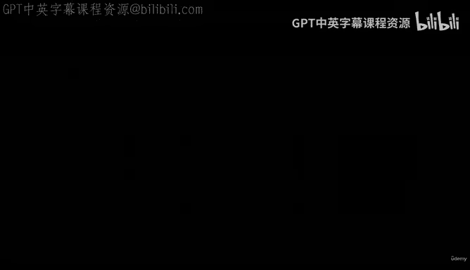
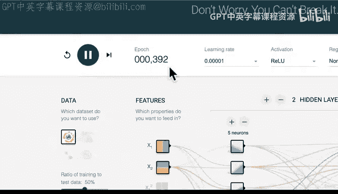
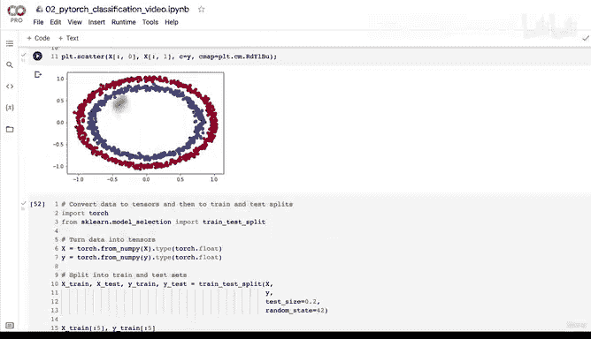

# Daniel Bourke《PyTorch 深度学习｜PyTorch 101 Crash Course For Beginners in 2025》中英字幕 - P86：086_04_022 编写首个非线性模型训练测试代码.zh_en - GPT中英字幕课程资源 - BV1kTSKB1E9m

Welcome back。 In the last video I left off leaving the challenge of recreating this model here。

 It's not too difficult to do。 We've got two hidden layers and five neurons。 We've got our data set。

 which looks kind of like ours。 But the main points here I have to learning rate of 0。1。

 which is what we've been using， but to change it from we've previously used a linear activation to change it from linear to re。

 which is what we've got set up here in the code。 Now。

 remember Reello is a popular and effective nonlinearar activation function。

 And we've been discussing that we need nonlineararity to model nonlinear data。

 And so that's the crux to what neural networks are。

 Art neural networks not to get confused with the brain neural networks。

 But who knows this might be how they work too， I don't know neurosurgeon or a neuroscientist。

 Art neural networks。😊，A lo。Combination of linear。 So this is straight and non straight non linear。

Functions。Which are potentially able to find patterns in data。 And so for our data set。

 it's quite small。 It's just a blue and a red circle。

 But this same principle applies for larger data sets and larger models。

 combined linear and nonlinear functions， So we've got a few tabs going on here。

 Let's get rid of some， Let's come back to here。 Did you try this out， Does it work。

 Do you think it'll work。 I don't know。 Let's find out together already，3，2，1， Look at that。😊。

Almost instantly， the training loss goes down to 0， and the test loss is basically 0 as well。

 Look at that。 That's amazing。 We can stop that there。 And if we change the learning rate。

 maybe a little lower， let's see what happens。😊，It takes a little bit longer to get to where it wants to go to。

 So that's the power of changing the learning rate。 Let's make it really small。 What happens here。

So that was about 300 epochs the law started to go down。If we change it to be really small， oh。

 we're getting a little bit of a trend。Is it starting to go down。

We're already surpass the epochs that we had。 So see how the learning rate is much smaller。

 That means our model is learning much slower。 So this is just a beautiful visual way of demonstrating different values of the learning rate。

😊。

We could sit here all day， and that might not get to lower， but let's increase it by 10 x。

That was over 1 thousand00 epochs。 and it's still at about 0。5， let's say。Oh， we got a better。 Oh。

 we're going faster already。 So not even at。500 or so epochs， where about 0。4。

 That's the power of the learning rate will increase it by another 10 x。 We'll reset， start again。

 Oh， would you look at that much faster this time， That is beautiful。

 There is nothing better than watching a loss curve go down。😊，In the world of machine learning。

 that is。 And then we reset that again。 And let's change it right back to what we had。

 And we get to 0 in basically under 100 epochs。 So that's the power of the learning rate。

 little visual representation。 Spea of learning rates。 It's time for us to build an optimizer。

And a loss function。 So let's right here。 We've got our nonlinear model set up loss and optimizer。

 You might have already done this because of the code， this is code that we've written before。

 but we're going to redo it for completeness and practice。 So we want a loss function。

 We're working with logts here， and we're working with binary cross entropy。

 So what loss do we use binary cross entropy。 Sorry。

 we're working with a binary classification problem， Blue dots or red dots， torch dot optim。😊。

What are some other binary classification problems that you can think of？We want Model three。

Dot parameters。 they're the parameters that we want to optimize this model here。

 and we're going to set our Lr to 0。1， just like we had in the Tensorflow playground。Beautiful。

 so some other binary。Classification poems I can think of would be email。

 spam or not spam credit cards。So equals fraud。Or not fraud。What else he might have insurance claims？

Equs who's at fault or not at fault。 If someone puts in a claim speaking about a car crash。

 whose fault was it was the person submitting the claim。

 were they at fault or was the person who was also mentioned in the claim， Are they not at fault。

 So there's many more。 but therere just some I can think of up the top of my head。

 But now let's train our model with non nonlineararity。 Hu ho。Oh， we're on a roll here。😊。

Training a model with non linearity。 So we've seen that if we introduce a linear activation function within a model。

 Remember， this is a linear activation function。 And if we train this。The loss doesn't go down。

 but if we just adjust this to add a reello in here。We get the loss going down。

 So hopefully this replicates with our pure Pi torch code。😊，So let's do it。 Hey。

 so we're going to create random seeds。Because we're working with Kuda we'll introduce the Kuda random seed as well。

 Torchd manual seed again， don't worry too much if your numbers on your screen aren't exactly what mine are。

 That's due to the inherent randomness of machine learning， In fact， stochastic gradientdi descent。

 stochastic again stands for random， we're just setting up the seeds here so that they can be as close as possible。

 but the direction is more important。So if my loss goes down， your loss should also go down。

On target device。And then we're going to go X train。So this is setting up device agnostic code。

 We've done this before， but we're going to do it again for completeness just to practice every step of the puzzle。

 That's what we want to do。We want to have experience。 That's what this course is。

 It's a momentum builder so that when you go to other repos and machine learning projects that use Pytorrch。

 you can go， does this code set device， agnostic code。

What problem are we working on is it binary or multiclass classification。

 so let's go loop through data。😊，Again， we've done this before， but we're going to set up the epochs。

 Let's do 10 epochs。 Why not。So we can go for epoch in range epochs。 What do we do here。

 Well we want to train。 So this is training code。 We set our model， model 3 dot train。

And I want you to start to think about how could we functionise this training code。

 We're going to start to move towards that in a future video。 So one is Ford pass。

 We've got the logits。 Why the logitts， Well， because the raw output of our model without any activation functions towards the final layer。

Classified as Loitts or called Loitts， and then we create Y pre as in prediction labels by rounding the output。

Of torch dot sigmoid of the Loits。So this is going to take us from logits to prediction。

Probabilities to prediction。Labels。And then we can go two， which is calculate the loss。

That's from my unofficial pieytorch song。 Calulate the last。Go loss equals loss FN Y logits。

 because remember。We've got B C E with logits loss and takes in。Loits as first input。

 And that's going to calculate the loss between our models， Loits and the Y training labels。

And we will go here。 We'll calculate accuracy using our accuracy function。

 And this one is a little bit backwards compared to pitorrch。

 But we pass in the Y training labels first， but it's constructed this way because it's in the same style as psychic loan。

3， we go。😊，Optimer 0 grad。 we zero the gradients of the optimizer。So that it can start from fresh。

 calculating the ideal gradients every epoch。So it's going to reset every epoch， which is fine。

 Then we're going to perform back propagation。 Pytorch is going to take care of that for us by calling loss backwards。

 and then we will perform gradient descent。 So step the optimizer to see how we should improve our model parameters。

 So optimizer dot step。😊，Oh， and I want to show you speaking of model parameters。

 let's check our Model 3 dot state deck。 So the Reello activation function actually doesn't have any parameters。

So you'll notice here， we've got weight。 we've got bias of layer 1， layer 2 and a layer 3。

 So the Reello function here doesn't have any parameters to optimize If we go N N dot Reello。

Does it say what it implements the There we go。 So it's just the maximum of 0 or x。

 So it takes the input and takes the max of 0 or x。 And so when it takes the max of 0 or x。

 if it's a negative number。0 is going to be higher than a negative number。

 So that's why it zeros all of the negative inputs。

 And then it leaves the positive inputs how they are。

 because the max of a positive input versus 0 is。The positive input。

So this has no parameters to optimize。 That's why it's so effective， because。You think about it。

 Every parameter in our model needs some little bit of computation to adjust。

 And so the more parameters we add to our model， the more compute that is required。 So generally。

 the kind of trade off in machine learning is that， yes， more parameters。

Have more of an ability to learn， but you need more compute。 So let's go Model 3 do aval。

 and we're going to go with torch dot inference mode。

 if I could spell inference that'd be fantastic We're going to do what we're going to do the forwardd pass。

 So test logits equals model3 on the test data And then we're going to calculate the test pre labels by calling torch dot round on torch do sigmoid on the test logitts。

And then we can calculate the test loss。 How do we do that equals loss F N on。

Test logits versus Y test。And then we can also calculate the test accuracy。

I'm just going to give myself some more space here。So I can code in the middle of this screen。

Equals accuracy function on what we're going to pass in Y true equals Y test。

And then we will pass in why pre equals test pre。 beautifuliful。

 A final step here is to print out what's happening。 Now， this will be very important because。1。

 it's fun to know what your model's doing。 And two， if our model does actually learn。

 I'd like to see the loss values go down and the accuracy values go up。 As I said。

 there's nothing much more beautiful in the world of machine learning than watching a loss function go down or a loss value go down and watching a loss curve go down。

 So let's print out the current epoch and we'll print out the loss。

 which will just be the training loss and we'll take that to four decimal places。😊。

And then we'll go accuracy here。 and this will be A。 and we'll take this to two decimal places。

 and we'll put a little percentage sign there， and then we'll break it up by putting in the test loss here。

And we'll put in the test loss。Because remember our model learns patterns on the training data and then evaluates those patterns on the test data。

So， and we'll pass in test act here。 And no doubt there might be an error or two within all of this code。

 but we're going to try and run this because we've seen this code before， but I think we're ready。

 We're training our first model here with non linearities built into the model。😊，You ready，3， two。

 one， let's go。Well， of course。Module torch Kuda has no attribute manuals R， just a typo。

Standard man U L。There we go。 Had to sound that out。 Another one。 What do we get wrong here。 Oh。

 target size must be same as input size。 Where did it mess up here。What do we get wrong， test loss。

 testlogits on why test？嗯。😊，So these two aren't matching up。😡，Model 3 X test。And why test。

 what's the size of。So let's do some troubleshooting on the fly。 Hey。

 not everything always works out as you want。 So length of X test， we've got a shape issue here。

 remember how I said one of the most common issues in deep learning is a shape issue。

 So I've got the same shape here。Let's check testlogs dot shape and why test dot shape。

We'll print this out。So 200， oh， here's what we have to do。 that's what we missed dot squeeze。

 see how I've been hinting at the fact that we needed to call dot squeeze。

 So this is where the discrepancy is。 our test logits dot shape。 We've got an extra dimension here。

 And what are we getting here。 A value error on the target size， which is a shape mismat。

 So we've got target size200 must be the same input size as torch size 201。 So did we squeeze this。

 that's why the training worked。 Okay， so we've missed this。 Let's just get rid of this。

 So we're getting rid of the extra one dimension by using squeeze， which is the one dimension here。

 We should have everything lined up。 There we go。 Okay， Look at that。😊，Yes。Our accuracy has gone up。

 albeit， not by too much， it's still not perfect。 ideally we'd like this to be towards 100% and the loss to be lower。

😊，But I feel like we've got a better performing model， don't you？ Now。

 that is the power of non linearity。 All we did was we added in a reello layer， or just two of them。

 Reo here， Re here。 But what did we do， We gave our model the power of straight lines， oh。

 straight linear of straight lines and non straight lines， so。😊。

It can potentially draw a line to separate these circles， so in the next video， let's draw a line。

 plot our model decision boundary using our function， and see if it really did learn anything。😊。

I'll see you there。