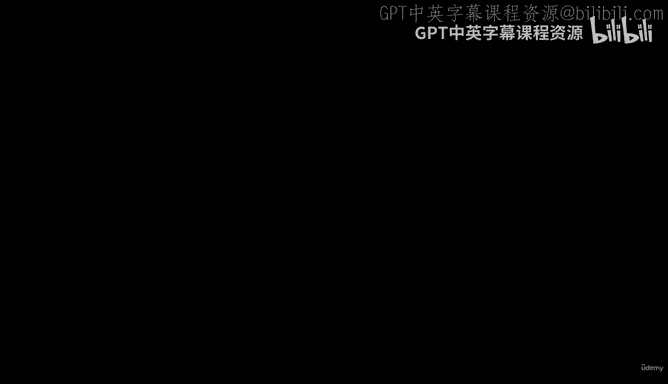
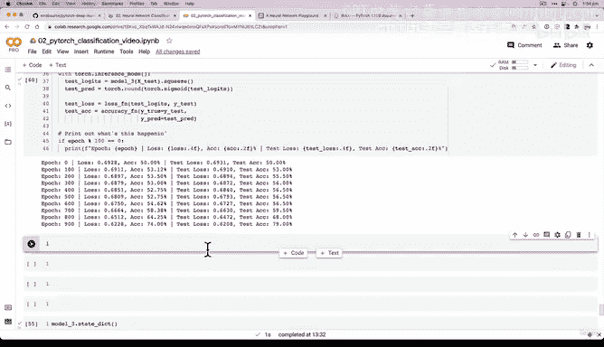
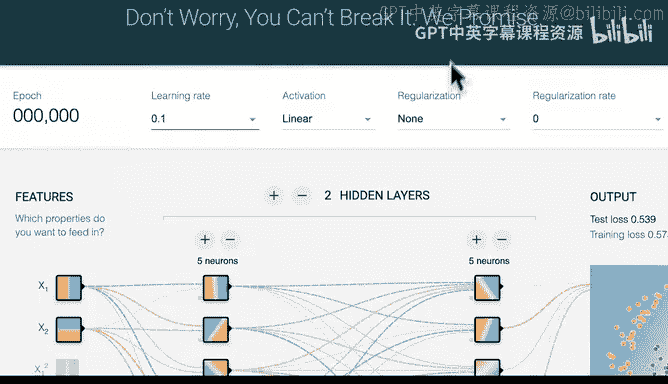
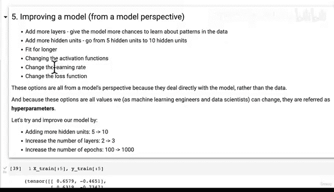

# Daniel Bourke《PyTorch 深度学习｜PyTorch 101 Crash Course For Beginners in 2025》中英字幕 - P87：087_04_023 首个非线性模型预测与评估.zh_en - GPT中英字幕课程资源 - BV1kTSKB1E9m

Welcome back in the last video， we trained our first model and as you can tell we're the bigger small interfaceF。

 but we trained our first model that harnesses both the power of straight lines and nons straightight lines or linear functions andline functions and by the thousand thepoch we look like we're getting a bit better results than just pure guessing which is 50% because we have 500 samples of red dots and 500 samples of blue dots。

 So we have evenly balanced classes。😊。

Now we've seen that if we added a re activation function。

With the data set similar to ours with a Tensorflow playground， the model starts to fit。

 but it doesn't work with just linear。 There's a few other activation functions that you could play around with here。

 You could play around with the learning rate， Regization If you're not sure what that is。

 I'll leave that as extra curriculum to look up。 But we're gonna retire the Tensorflow playground for now。

 because we're gonna go back to writing code。 So let's get out of that。 and let's get out of that。

 We now have to evaluate our model because right now， it's just numbers on a page。

 So let's write down here。😊。

6。4， what do we like to do to evaluate things， It's visualize， visualize， visualize。

 So evaluating a model trained with non linear activation functions。

And we also discussed the point that neural networks are really just a big combination of linear and nonlinear functions。

 trying to draw patterns in data。 So with that being said。

 let's make some predictions with our Model 3， our most recently trained model。

 we'll put it into a vowel mode， and then we'll set up inference mode。Pri mode， beautiful。

 And then we'll go Y pres equals torch dot round。 and then torch dot sigmoid。

 We could functionize this。 Of course， Model 3， and then pass in X test。 And you know what。

 we're gonna squeeze these here because we ran into some troubles in the previous video。

 I actually really liked that we did because then we got to troubleshoot a shape error on the fly。

 because that's one of the most common issues you're going to come across in deep learning。

 So Y pres。😊，Let's check them out and then let's check out why test。 We want Y test 10。So remember。

 when we're evaluating predictions， we want them to be in the same format as our original labels。

 We want to compare apples to apples。 And if we compare the format here。

 do these two things look the same。 Yes， they do。 They're both on kuda and they' both floats。

 We can see that it's got this one wrong。 whereas the other ones look pretty good。

 This might look pretty good。 if we visualize it。 So now let's you might have already done this because I issued the challenge of plotting the decision boundaries。

😊，plot decision boundaries and let's go to PLT dot figure and we're going to set up the fig size to equal 126 because again。

 one of the advantages of hosting a machine learning cooking show is that you can code ahead of time and then we can go PLT dot title。

Is train。 And then we're going to call our plot decision boundary function， which we've seen before。

 plot decision boundary。 And we're going to pass this one in。 We could do Model 3。

 but we could also pass it in our older models 2。 Model 1。 that doesn't use an non nonlinearity。

 In fact， I reckon that'll be a great comparison。 So。😊。

We'll also create another plot here for the test data， And this will be on index number 2。

 So remember， subplot is。ANumb of rows， number of columns index where the plot appears。

 We'll give this one a title。Plock dot title。 this a big test， and。Google Coab， I didn't want that。

 As I said， this course is also a battle between me and Google Coabs Auto correct。

So we're going to model  three and we'll pass in the test data here。And behind the scenes。

 our plot decision boundary function will create a beautiful graphic for us。

 perform some predictions on the X， the features input。

 and then we'll compare them with the Y values。 Let's see what's going on here。😊，Look at that。 Yes。

 our first nonlinear model。Okay， it's not perfect， but it is certainly much better than the models that we had before。

 Look at this。 Model1 has no linearity。😊，Model 1 equals no non linearity。

 I've got a double negative there。Whereas Model 3 equals has non linearity。

So do you see the power of non linearity or better yet the power of linearity or linear straight lines with non straight lines。

 So I feel like we could do better than this， though。Here's your challenge is to， can you improve。

Model 3 to do better。 What did we get。79% accuracy to do better than 80% accuracy。On the test data。

I think you can。So that's the challenge。 And if you're looking for hints on how to do so。

 where can you look。 Well， we've covered this I a model。 So maybe you add some more layers。

 Maybe you add more hidden units。 Maybe you fit for longer。 Maybe you if you add more layers。

 you put a re activation function on top of those as well。

 Maybe you lower the learning rate because right now， we've got 0。1。 So give this a shot。

 try and improve it。 I think you can do it。

But we're going to push forward。 That's going to be your challenge for some extra curriculum。

I think in the next section， we've seen our nonlinear activation functions in action。

 Let's write some code to replicate them。😊，I'll see you there。

