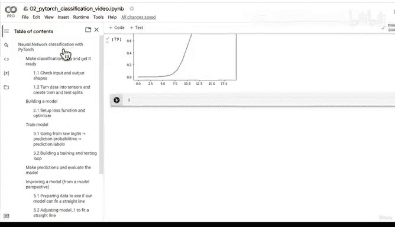

# Daniel Bourke《PyTorch 深度学习｜PyTorch 101 Crash Course For Beginners in 2025》中英字幕 - P88：088_04_024 使用纯PyTorch复现非线性激活函数.zh_en - GPT中英字幕课程资源 - BV1kTSKB1E9m

Welcome back In the last video I left off with the challenge of improving Model 3 to do better than 80% accuracy on the test data。

 I hope you gave it a shot， but here are some of the things I would have done as I potentially add more layers and maybe increase the number of hidden units and then if we needed to fit for longer and maybe lower the learning rate to 0。

01， but I'll leave that for you to explore because that's the motto of the data scientist right is to experiment experiment experiment。

😊，So let's go in here。We've seen our nonlinear activation functions in practice。

 Let's replicate them。 So replicating nonlinear activation functions。 And remember， neural networks。

Rather than us。Telling the model what to learn。We give it the tools to discover patterns in data。

And it。Tries to figure out the best patterns on its own。And what are these tools？

That's right down here， we've seen this in action。 and these tools are linear and non linear。

Functions。So a neural network is a big stack of linear and nonlinear functions for us。

 We've only got about four layers or so four or five layers， but as I said。

 other networks can get much larger， but the premise remains some form of linear and nonlinear manipulation of the data。

 So let's get out of this。 Let's make our workspace a little bit more cleaner。

Replicating linear activation function。 So let's create a tensor to start with。

 Everything starts from the tensor。And we'll go A equals torch。A range。

 and we're going to create a range from negative 10 to 10 with a step of one。

 and we can set the D type here to equal torch。Dot F 32， but we don't actually need to。

 That's going to be the default。So if we set a here， A dot D type。Then we've got torch Flo 32。

 and I'm pretty sure if we got rid of that。 Oh， we've got torch in 64。

Why is that happening Well let's check out A。😊，Oh， it's because we've got integers as our values because we have a step as one。

 if we turn this into a float， what's going to happen？We get floatloat 32， but we'll keep it。

 Otherwise this is going to be one， about 100 numbers。 Yeah， no， there's too many。

 Let's keep it at negative 10 to 10， and we'll set the D type here to torch Fat 32。Beautiful。

 so it looks like Pitorrch's default data type for integers is in 64。

 but we're going to work with Fat 32 because Float 32。

 if our data wasn't Fat 32 with the functions we're about to create， we might run into some errors。

So let's visualize this data。I want you to guess， is this a straight line or non straight line？

You've got three seconds， one， two， three。Straight lawn。There we go。

 we've got negative 10 to positive 10 up here all nine close enough。😊。

And so how would we time this straight line， if it's a straight line， It's linear。

 How would we perform the reo activation function on this？ Now， we could， of course， call torch Relu。

On a。Actually， let's in fact just plot this PLT dot plot on Torch Reello。What does this look like。

Boom， there we go。 But we want to replicate the Reou function。 So let's go N N dot Reou。

What does it do。You've seen this before。So we need the max。 We need to return based on an input。

 We need the max of 0 and x。So let's give it a shot。我看不平啊。Again， we need more space。

 can never be enough code phase here。I like riding lots of code。 I don't know about you。

 but let's go Relu。 we'll take an input X， which will be some form of tensor and we'll go return torch dot maximum。

 I think you could just do torch dot max， but we'll try maximum。😊，A torch。Dot tensor0。

 So the maximum is going to return the max between whatever this is。

 one option and whatever the other option is， so。Inputs must be tensesors。

So maybe we could just give a type hint here that this is torch dot tensor。

 and this should return a tensor to return torch dot tensor。 Bea。 You're ready to try it out。

 Let's see what our Re function does。😊，Ru a wonderful。

 It looks like we got quite a similar output to before。 Here's our original a。😊。

So you've got negative numbers。 There we go。 So recall that the Reou activation function turns all negative numbers into 0 because it takes the maximum between 0 and the input。

 And if the inputs negative， well then0 is bigger than it。

 And it leaves all of the positive values as they are。 So that's the beauty of Relu， quite simple。

 but very effective。😊，So let's plot Reou。Activation function， our custom one。We will go plt。pl。

We'll call our reello function on a。Let's see what this looks like。Oh， look at us。 Go Well done。

 just the exact same as the torch re function。 Easy z。

 And what's another nonlinear activation function that we've used before。😊，Well。

 I believe one of them is if we go down to here， what did we say before。Sigmoid， where is that？

 Where are you， Sigmoid， Here we go。Hello， sigmoid， Oh， this has got a little bit more going on here。

 One over one plus exponential of negative x。 So sigmoid or this little symbol for sigmoid of X。

 which is an input。We get this， so let's try and replicate this。 I might just bring this one in here。

Right now， let's do the same for sigmoid。So what do we have here？Well。

 we want to create a custom sigmoid， and we want to have some sort of input X。

 and we want to return one divided by。 Do we have the。The function in sigmoid。

 one divided by one plus exponential。1 plus torch dot EP for exponential on negative X。

 And we might put the bottom side in brackets so that it does that operation。

I reckon that looks all right to me。😊，So， one divided by one。Plus， torch exponential of negative X。

 Do we have that， Yes， we do。 Well， there's only one real way to find out。 Well。

 let's plot the torch version of sigmoid。Tunch dot sigmine， and we'll pass in X。

See what happens and then。Oh， we have a， my bad。 A is our tensor。 What do we get。

 We get a curved line wonderful。 And then we go P Lt dot plot。

 And we're going to use our sigmoid function on a。😊，Did we replicate torch' sigmoid function？ Yes。

 we did。 now。See， this is what's happening behind the scenes with our neural networks。 Of course。

 you could do more complicated。Acttiation functions or layers。 and whatnot。

 you can try to replicate them。 In fact， that's a great exercise to try and do。

 But we've essentially across the videos and the sections that we've done。

 we've replicated our linear layer and we've replicated the relu。

 So we've actually built this model from scratch。 or we could if we really wanted to。

 but it's a lot easier to use pitorrchs layers because we're building neural networks here like Lego bricks stacking together these layers in some way。

 shape or form。 And because they're a part of pitorrch。

 We know that they've been error tested and they compute as fast as possible behind the scenes and used GPU and we get a whole bunch of benefits。

😊，Pytororch offers a lot of benefits by using these layers rather than writing them ourselves。

And so this is what our model is doing。 It's literally like to learn these values and decrease the loss function and increase the accuracy。

 It's combining。Linear layers and non nonlinear layers or nonlinear functions。

 Where's our reello function here， A reello function like this behind the scenes。

 So just combining linear and nonlinear functions to fit a data set。 And that premise remains。

 even on our small data set and on very large data sets and very large models。

So with that being said， I think it's time for us to push on。 We've covered a fair bit of code here。

But we've worked on a binary classification problem。

Have we worked on a multi class classification problem yet。

Do we have that here was my fun graphic。We have。Multi class classification。

 I think that's what we cover next。 We're going to put together all of the steps in our workflow that we've covered for binary classification。

 But now let's move on to a multi class classification problem。😊，If you with me。

I'll see you in the next video。