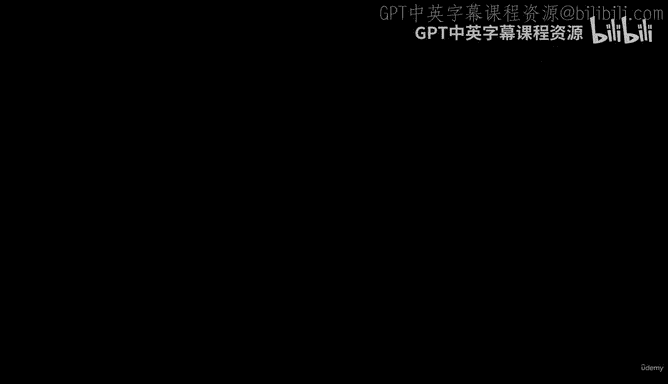
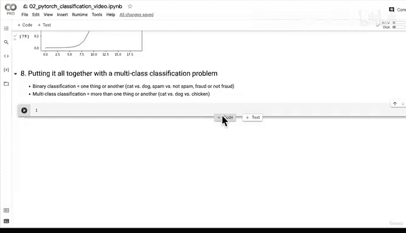
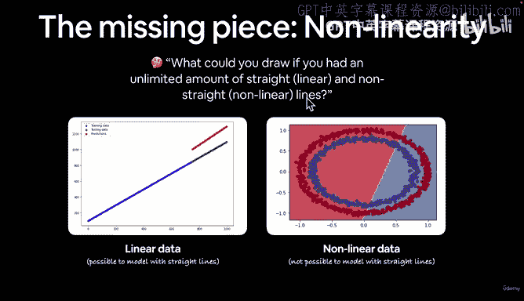
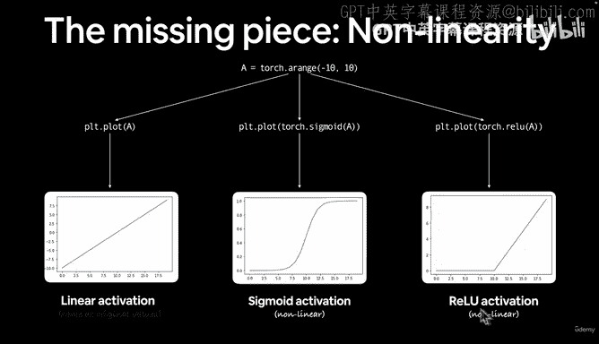
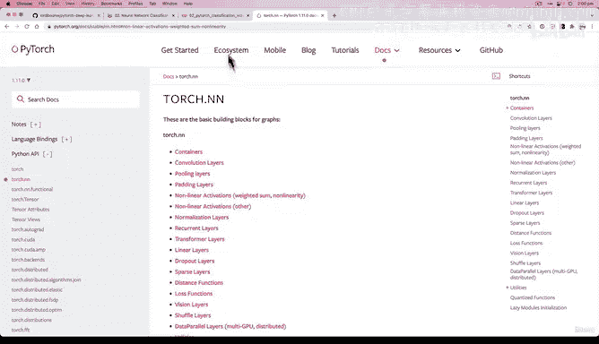
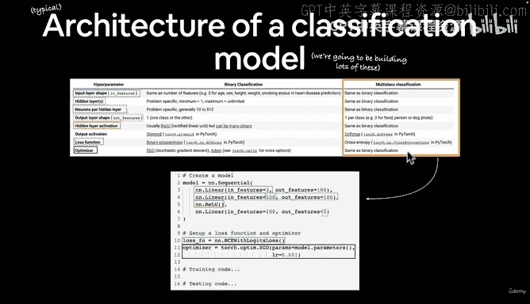
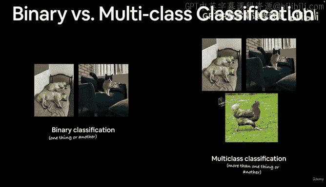
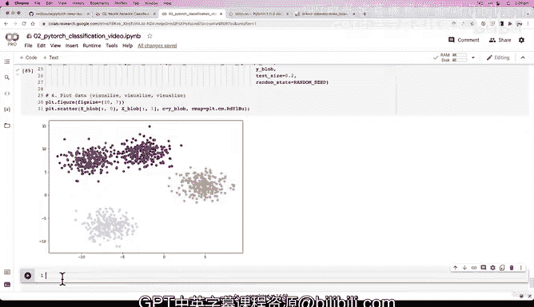

# Daniel Bourke《PyTorch 深度学习｜PyTorch 101 Crash Course For Beginners in 2025》中英字幕 - P89：089_04_025 全流程整合（第一部分）：构建多分类数据集.zh_en - GPT中英字幕课程资源 - BV1kTSKB1E9m

Welcome back。 In the last few videos， we've been harnessing the power of non nonlineararity。

 specifically nons straight line functions， and we replicated some here。

 and we learned that a neural network combines linear and nonlinear functions to find patterns in data。

 and for our simple red verse blue dots。 once we added a little bit of nonlinearity we found the secret source of to start separating our blue and red dots。

 And I also issued you the challenge to try and improve this。 And I think you can do it。

 So hopefully you've given that ago。 But now let's keep pushing forward。

 we're going to reiterate over basically everything that we've done。

 except this time from the point of view of a multiclass classification problem。

 So I believe we're up to section 8， putting it all together。😊，With。

A multi class classification problem。 beautiful。 And recall the difference between binary classification equals one thing or another。

 such as cat verse dog。 If you are building a cat verse dog image classifier， spam verse。

 not spam for。Say emails that were spam or not spam or even internet posts on Facebook or Twitter or one of the other Internet services。

And then fraud or not fraud for credit card transactions。And then， multi class classification。

Is more than one thing or another， So we could have cat versus dog verse chicken。

So I think we've got all the skills to do this。 Our architecture might be a little bit different from a multiclass classification problem。

 but we've got so many building blocks now。 it's not funny。 Let's clean up this。

 And we'll add some more code cells and just to reiterate。 So we've gone over nonlineararity。

 The question is， what could you draw if you had an unlimited amount of straight linear and nons straight nonlinear lines。

 I believe you could draw some pretty intricate patterns。

 And that is what our neural networks are doing behind the scenes。

 And so we also learned that if we wanted to just replicate some of these nonlinear functions。

 Some of the ones that we've used before。 We could create a range。

 Line activation is just the line itself。 And then if we wanted to do sigmoid。😊。

We get this curl here。And then if we wanted to do Reello。Well。

 we saw Hadoo replicate the re function as one。 These both are nonlinear and， of course。

Torch dot N N has far more nonlinear activations where they came from just as it has far more different layers。

 And you'll get used to these with practice。 And that's what we're doing here。

 So let's go back to the keynote。 So this is what we're going to be working on。

 Multiclass classification。 So there's one of the big differences here。

 We use the soft max activation function versus sigmoid。 So there's another big difference here。

 instead of binary cross entropy。 We use just cross entropy。

 But I think most of it's going to stay the same。 So We're going to see this in action in a second。

 But let's just describe our problem space。😊。

Just to go visual。We've covered a fair bit here。 Well done， everyone。

 So binary versus multi class classification， binary， one thing or another，0 or one。

 multi class could be three things， could be 1000 things， could be 5000 things could be 25 things。

 So more than one thing or another。😊。

But that's the basic premise we're going to go with。 Let's create some data， hey。8。1。

Creating a2 multiclass data set。And so to create our data set。

 we're going to import our dependencies。We're going to reimport torch even though we already have it just for a little bit of completeness and we're going to go mappllib。

😊，So we can plot， as always， we like to get visual where we can visualize， visualize， visualize。

 We're going to import from psitlen dot data sets。 Let's get make blobs。 Now。

 where would I get this from。 So S K learn dot data sets。 What do we get。Toy data sets。

Do we have classification。To0 data sets， do we have blobs？If we just go make pst learn。

Classification。Data sets。What do we get？Here's one option。There's also make blobs beautiful。

Make blobs。 This is the code for that。 So let's just copy this in here。And make blobs。

 we're going to see this in action anyway， make blobs， as you might have guessed。

 its make some blobs for us。😊，I like blobs， it's a fun word to say blobs。😊。

So we want train test split because we want to make a data set。

 and then we want to split it into train and test。 Let's set the number of hyperpar。

 So set the hyper。For data creation Now I got these from the documentation here， number of samples。

 how many blobs do we want， how many features do we want， So say for example。

 we wanted two different classes that would be binary classification say for example you wanted 10 classes you could set this to 10 and we're going to see what the others are in practice。

 but if you want to read through them you can well and truly do that。So let's set up。

 we want nu classes。 Let's double what we've been working with。 We've been working with two classes。

 red dots or blue dots。 Let's step it up a notch。 We'll go to four classes。

 watch out everyone and we're going go number of features will be 2 so we have the same number of features and then the random seed is going to be 42 you might be wondering why these are capitalized Well。

 generally if we do have some hyperparameter that we say set at the start of a notebook。

You'll find it's quite common for people to write them as capital letters just to say that， hey。

 these are some settings that you can change。You don't have to。

 but I'm just going to introduce that anyway because you might stumble upon it yourself。

So create multiclass data。We're going to use the。Make blobs function here。

 so we're going to create some X blobs， some feature blobs and some label blobs。

 We'll see what these look like in a second。😊，I know I'm just saying blobs a lot。But we pass in here。

 none samples。 How many do we want， Let's create 1000 as well。 That could really be a hyperpar。

 but we'll just leave that how it is for now。 numberumber of features is going to be nu features。

Centers equals numb。Classesses。So we're going to create four classes because we've set up number classes equal to4。

 and then we're going to go centre standard deviation。

 We'll give them a little shake up add a little bit of。Randomness in here。Give the clusters。

A little shake up， we'll mix them up a bit， make it a bit hard for our model。

 but we'll see what this does in a second。Random state equals random seed。

 which is our favorite random seed 42。 Of course， you can set it whatever number you want。

 But I like 42。 Oh and we need a comm here， of course。😊，Beautiful， now， what do we have to do here。

 Well， because we're using psyt loan and psychete loan leverages nuly。

 So let's turn our data into tenseors。 Turn data into tensess。

 And how do we do that while we grab Xblob。😊，And we call torch from Numpy from Nmy， if I could type。

 that would be fantastic。That's al right。 We're doing pretty well today。 Have't made too many typos。

 We did make a few and a couple videos before， but hey。I'm only human。So we're go torch from Numppy。

 and we're going to pass in the Y blob。 and we'll turn it into torch dot float because remember Numpy defaults as float 64。

 whereas Py torch likes floatat 32。So， split into。Training and test， and。

We're going to create X blob train Y or X test， X blob test。 We'll keep the blob namenclature here。

 Y blob train and Y blob test。 And here's again where we're going to leverage the train test split function from p Psyit learn。

 So thank you for that psycht learn。X blob， and we're going to pass the Y blob。 So features， labels。

 X is the features， Y are the labels and a test size we've been using a test size of 20%。

 That means 80% of the data will be for the training data。

 That's a fair enough split with our data set。And we're going to set the random seed to random seed because generally normally train test split is random。

 but because we want some reproducibility here， we're passing random seeds。Finally。

 we need to get visual， so let's plot the data right now we've got a whole bunch of code and a whole bunch of talking。

 but not too much visuals going on。 So we'll right down here， visualize， visualize， visualize。😊。

And we can call in plot dot figure。 What size do we want， I'm going to use my favorite hand in poker。

 which is 10，7， because its generally worked out to be a good plot size for in my experiments anyway。

 we'll go X blob。And we want the zeros index here， and then we'll grab Xblob as well。

 And you might notice that we're visualizing the whole data set here。 That's perfectly fine。

We could visualize train and test separately if we really wanted to。

 but I'll leave that as a little challenge to you and we're going to go red， yellow， blue。Wonderful。

What do we get wrong， Oh， Of course， we got something wrong。 Centre SD， did we spell centre wrong。

Cluster STD。 That's what I missed。So cluster STD。Standard deviation。 What do we get wrong， Rand seed。

 Oh， this needs to be random state。 Oh， another typo。 You know what just as I said。

 I wasn't getting too many typos I get three。 There we go。 Look at that。

 Our first multiclass classification data set。 So if we set this to 0。

 What does it do to our clusters。 Just take note of what's going on here。

 particularly the space between all of the dots。😊，Now， if we set this cluster STD to0， what happens？

We get dots that are really just look at that。 That's too easy。 Let's mix it up。 right。 All right。

 now you can pick whatever value you want here。 I'm going to use 1。

5 because now we need to build a model that's going to draw some lines between these four colours。

 two axes， four different classes。😊，But it's not going to be perfect because we've got some red dots that are basically in the blue dots。

 And so what's our next step。 Well， we've got some data ready。It's now time to build a model。

So I'll see in the next video， let's build our first multiclass classification model。

