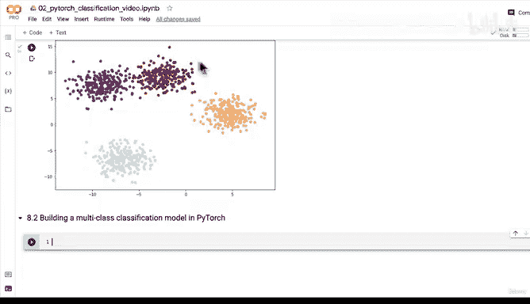
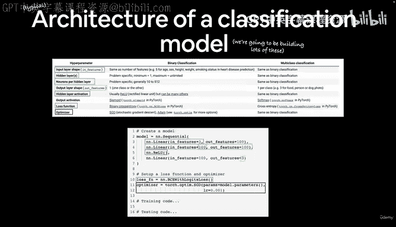
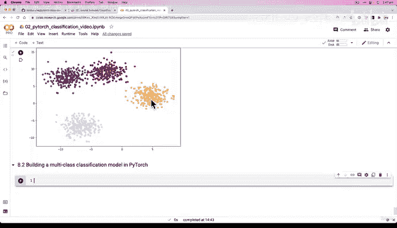
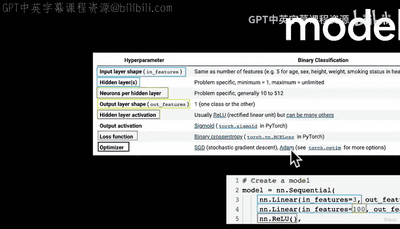
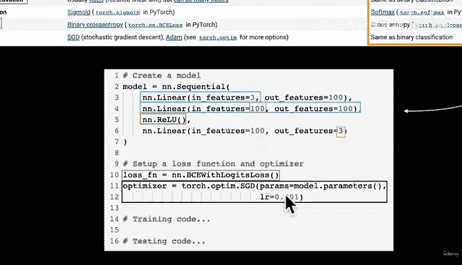
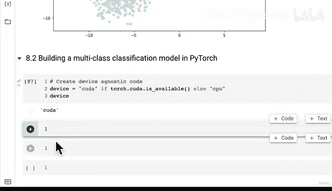
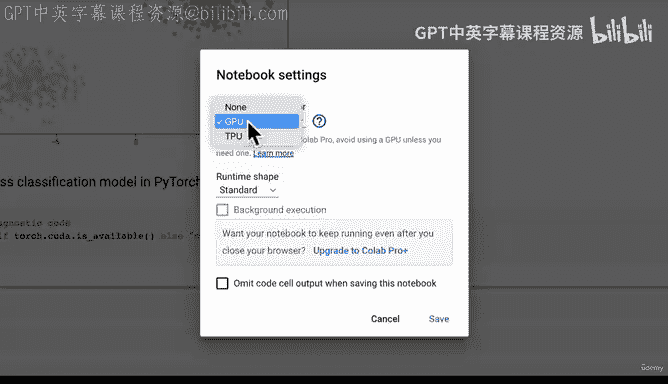
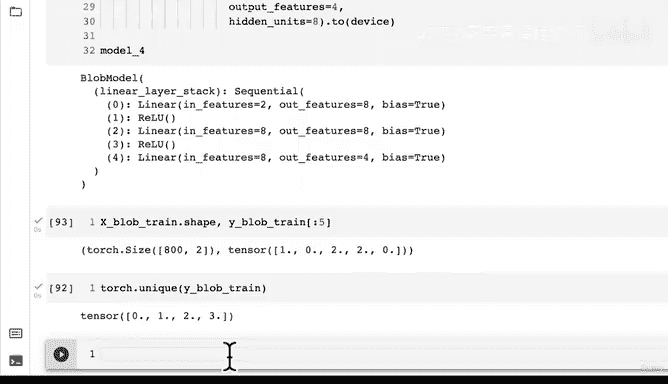

# Daniel Bourke《PyTorch 深度学习｜PyTorch 101 Crash Course For Beginners in 2025》中英字幕 - P90：090_04_026 创建PyTorch多分类模型.zh_en - GPT中英字幕课程资源 - BV1kTSKB1E9m

Welcome back。 In the last video， we created our multiclass classification data set usingsit Learns Make blobs function。

 And now why are we doing this？ Well， because we're going to put all of what we've covered so far together。

 But instead of using binary classification or working with binary classification data。

 we're going to do it with multiclass classification data。 So with that been said。

 let's get into building our multiclass classification model。😊，So we'll create a little heading here。

Building a multi class。Classification model in Pytorch。And now I want you to have a think about this。

We spent the last few videos covering non linearity。 Does this data set need non linearity。

 As in could we separate this data set with pure straight lines。

 or do we need some non straight lines as well。Have a think about that， It's okay。

 If you're not sure we're going to be building a model to fit this data anyway。

 or draw patterns in this data anyway。 And now before we get into coding a model。

 So for multi class classification， we've got this for the input layer shape。

 we need to define the in features。 So how many in features do we have for the hidden layers well。

We could set this to whatever we want， but we're going to keep it nice and simple for now。

For the number of neurons per hidden layer。Again， this could be almost whatever we want。

 But because we're working with a relatively small data set， we've only got four different classes。

 We've only got 1000 data points。 We'll keep it small as well。 but you could change this。 Remember。

 you can change any of these because they're hyper parameters for the output layer shape。 Well。

 how many。Output features do we want？We need one per class。 How many classes do we have？

We have four clusters of different dots here， so we'll need。

4 output features。 And then if we go back， we have an output activation of softmax。

 We haven't seen that yet。 and then we have a loss function rather than binary cross entropy。

 We have cross entropy。And then optimizer as well is the same as binary classification。

 two of the most common SGD stochastic gradient descent or the atom Opr。 But of course。

 the Torcht Opdm package has many different options as well。

 So let's push forward and create our first multiclass classification model。😊。

First， we're going to create。Or we're going to get into the habit of creating device， agnostic code。

 and we'll set the device here。Equals kuda。Nothing we haven't seen before。But again。

 we're doing this to put it all together so that we have a lot of practice。Is available。Else CPU。

And let's go device。So we should have a GPU available。 Beaful Kuda。 Now， of course， if you don't。

 you can go change runtime type， select GPU here。 that will restart the runtime。

 you'll have to run all of the code that's before this cell as well。 but I'm going to be using a GPU。

 You don't necessarily need one because our data sets's quite small and our models aren't going to be very large。

 but we set this up so we have device agnostic code。

And so let's build a multi class classification model。 Look at us go。

 just covering all of the foundations of classification in general here and。😊。

We now know that we can combine linear and nonlinear functions to create。

Neural networks that can find patterns in almost any kind of data。

 so I'm going to call my class here blogb model and it's going to of course。

 inherit from an end dot module， and we're going to upgrade our class here。

 We're going to take some inputs here and I'll show you how to do this if you're familiar with Python classes you would have already done stuff like this but we're going to set some parameters for our models because as you write more and more complex classes you'll want to take inputs here and I'm going to pre build the or preet the hidden units parameter to8。

Cause I've decided， you know what， I'm going to start off with 8 hidden units。

 And if I wanted to change this to 128， I could。 But in the constructor here， we've got some options。

 So we have input features。 We're going to set these programmatically as inputs to our class when we instantiate it。

 The same with output features as well。 And so here we're going to call self。I know super， sorry。

 I always get this mixed up dot in it。And underscore underscore， beautiful。

 so we could do a dock string here as well。So let's write in this。Initializes。Multiclass。

Classification。If I could spell class eification model。Oh， this is great。

 And then we have some as here。😊，This is just a standard way of writing Dock strings。

 If you want to find out this is Google Python Docstring guide。There we go。

 Google Python style guide。 This is where I get mine from。 You can scroll through this。

 This is just a way to write Python code。 Yeah， there we go。😊。

So we've got a little sentence saying what's going on， We've got as， we've got returns。

 and we've got errors if something is going on。So I highly recommend checking that out。

 just a little tidbit。 So this is if someone was to use our class later on。

 they know what the input features are。😊，Input features， which is an int， which is number。

Of input features to the model。 And then， of course， we've got output features， which is also an int。

Which is number。Of output features of the model。 And we've got the red line here is telling us we've got something wrong。

 but that's okay。 And then the hidden features are， well。

 this is number of output classes for the case of multi class classification。

And then the hidden units。En and then number of hidden units。Between layers。

 and then the default is 8 beautiful。 And then under that， we'll just do that。

Is that gonna fix itself。 Yeah， there we go。 We could put in what it returns。Returns。

 whatever it returns， and then an example use case， but I'll leave that for you to fill out。

If you like， so let's instantiate some things here。

 What we might do is write self dot linear layer stack。Self dot linear layer stack。

 And we will set this as Nn dot sequential。 Oh， we haven't seen this before。

 but we're just going to look at a different way of writing a model here previously。

 when we created a model， what did we do。Well， we instantiated each layer as its own。Prameter here。

And then we called on them one by one。 But we did it in a straightforward fashion。

 So that's why we're going to use sequential here to just step through our layers。

 We're not doing anything too fancy。 So we'll just set up a sequential stack of layers here。

 and recall that sequential， just steps through， passes the data through each one of these layers1 by one。

 And because we've set up the parameters up here。 input features can equal to input features。

And output features。What is this going to be， is this going to be output features or is this going to be hidden units？

It's going to be hidden units because it's not the final layer。

 We want the final layer to output our output features。So input features。

 this will be hidden units because remember the subsequent layer needs to line up with the previous layer。

Output features we're going to create another one that outputs hidden units。

And then we'll go N N dot linear。In features。Eals hidden units because it takes the output features of the previous layer。

 So as you see here， the output features of this feeds into here。

 The output features of this feeds into here。 And then finally， this is going to be our final layer。

 We'll do three layers。Output features equals， output features。Wonderful。

 so how do we know the values of each of these？ Well。

 let's have a look at x train dot shape and Y train dot shape。So in the case of X。

 we have two input features and in the case of Y， well this is a little confusing as well because y is a scalar。

But what do you think the values for Y are going to be。Well， let's go N。

 or is there torch not unique， I'm not sure。 Let's find out together， heh。Torch unique 0 on1。

 Y train。 Oh， we need why blob train。 That's right， Blog。

I'm too used to writing blog blob and we need blob train， but I believe it's the same here。😊。

And then， blob。There we go， so we have four。Classes， so we need an output features value of 4。

 And now， if we wanted to add non linearity here。We could put it in between our layers here like this。

But I asked the question before， do you think that this data set needs non linearity？Well。

 let's leave it in there to begin with。 And one of the challenges for you， Oh， do we need comm here。

 I think we need comm here。One of the challenges for you will be to test the model with non linearity and without non linearity。

 So let's just leave it in there for the time being what's missing from this。Well。

 we need a forwardd method。 So D Ford self X， what can we do here？ Well。

 because we've created this as a linear layer stack using Nn dot sequential。

 we can just go return linear layer stack and pass it X and what's going to happen。

 whatever input goes into the forward method is just going to go through these layers sequentially。

Oh， we need to put Soie。Because we've initialized it in the constructor。 beautifuliful。

 And now let's create an instance。Of blood model。And send it to the target device。

We'll go Model four equals。Blood model。And then we can use our input features parameter。

 which is this one here。 And we're going to pass at a value of what。2， and then output features， Y。

 because we have two x features。 Now the output features is going to be the same as the number of classes that we have for。

 if we had 10 classes， we'd set it to 10， So we' go 4 and then the hidden units is going to be 8 by default。

 so we don't have to put this here， but we're going to put it there anyway。And then， of course。

 we're going send this to device。And。Then we're going to go model4。What do we get wrong here。

Unexpected。Keyword argument， output features。 Do we spell something wrong。

 No doubt we've got a spelling mistake。Output features。Output features。Oh， out features。

That's what we needed。 out features， not。Output， I got a little confused there， okay。There we go。

 Okay， beautiful。 So just recall that the parameter here for an endt linear。

 did you pick up on that is output features， not output features。 Out features。

 a little confusing here is our final layer。 output layers， number of features there。😊。

So we've now got a multiclass classification model that lines up with the data that we're using。

 so the shapes line up beautiful。 Well what's next Well。

 we have to create a loss function and of course a training loop。

 So I'll see you in the next few videos and let's do that together。😊。

