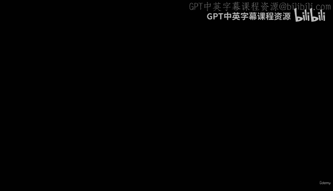
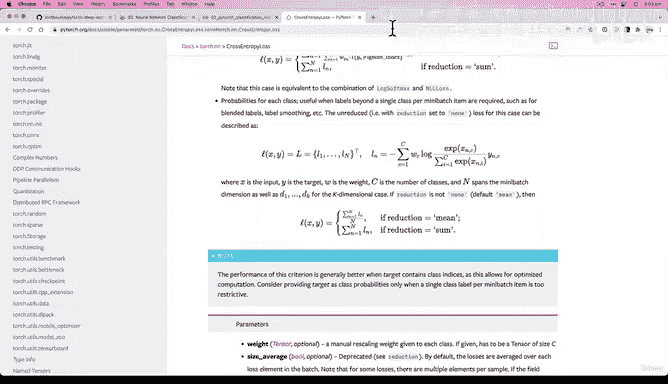
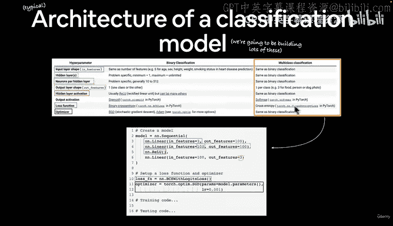
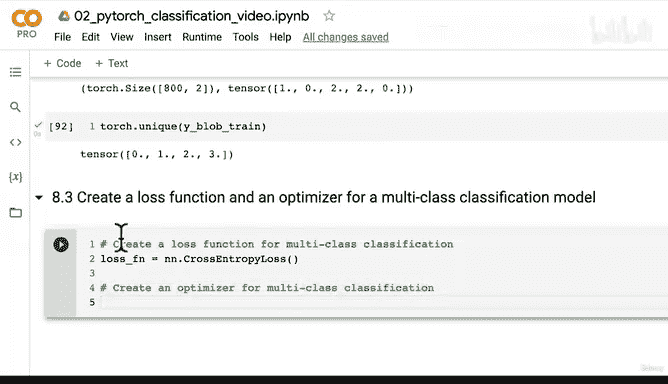
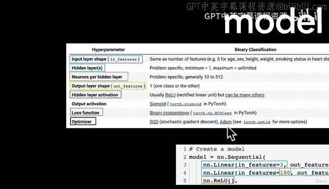
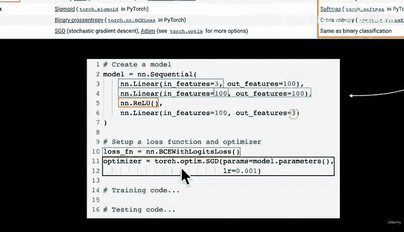
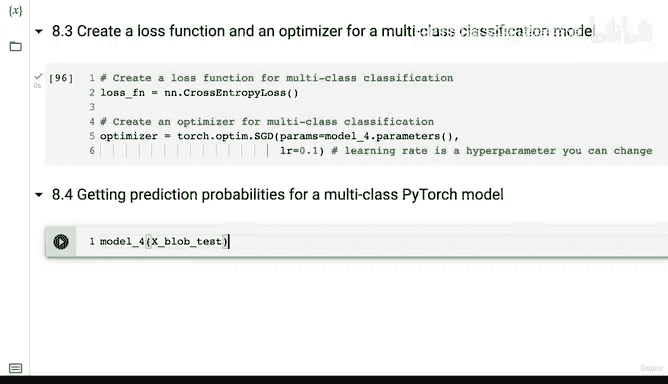

# Daniel Bourke《PyTorch 深度学习｜PyTorch 101 Crash Course For Beginners in 2025》中英字幕 - P91：091_04_027 配置多分类模型损失函数与优化器.zh_en - GPT中英字幕课程资源 - BV1kTSKB1E9m

Welcome back。 In the last video， we created our multiclass classification model and we did so by subclassing an enddot module。

 and we' set up a few parameters for our class constructor here。

 so that when we made an instance of the blog model， we could customize the input features。

 the output features， remember this lines up with how many features X has and the output features here lines up with how many classes are in out datata。

 So if we had 10 classes we could change this to 10 and it would line up。

 And then if we wanted128 hidden units， well we could change that。

 So we're getting a little bit more programmatic with how we create models here。

 and as you'll see later on， a lot of the things that we've built in here can also be functionized in a similar matter。

 But let's keep pushing forward， what's our next step， if we build a model。

 if we refer to the workflow you'd see that we have to。😊。

Create a loss function and an optimizer for a multi class。Classification。Moel。

And so what's our option here for creating a loss function。

 Where do we find loss functions in Piytorrch。 I'm just going to get out of this and I'll make a new tab here。

 And if we search torch。 nn。😊，Because Tor to an N is the basic building blocks for graphs。

 In other words， neural networks。 Where do we find loss functions。 Here we go， beautiful。

 So we've seen that L1 loss or MSE loss could be used for regression predicting a number。

 And I'm here to tell you as well that。😊，For classification。

 we're going to be looking at cross entropy loss。 Now， this is for multi class classification。

 for binary classification。 we work with BE loss。 And， of course， there's a few more here。

 but I'm going to leave that as something that you can explore on your own。

 Let's jump in to cross entropy loss。😊，So what do we have here， This criterion computes。 Remember。

 a lost function in pytorrch is also referred to as a criterion。

 you might also see loss function referred to as cost function， COT。But I call them loss functions。

 so this criterion computes the cross entropy loss between input and target。 Okay。

 so the input is something and the target is our target labels。

It is useful when training a classification problem with C classes。 There we go。

 So that's what we're doing。 Where' training a classification problem with C classes C is a number of classes。

 if provided the optional argument weight should be a 1 D tensor assigning a weight to each of the classes So we don't have to apply a weight here。

 But why would you apply a weight， Well， it says if we look out weight here。😊。

This is particularly useful when you have an unbalanced training set。

 So just keep this in mind as you're going forward。

 if you wanted to train a data that has imbalanced samples in our case。

 we have the same number of samples for each class。

 but sometimes you might come across a data with maybe you only have 10 yellow dots and maybe you have 500 blue dots and only 100 red and 100 light blue dots So you have an imbalanced data set So that's where you can come in and have a look at the weight parameter here。

 But for now we're just going to keep things simple we have a balanced data set and we're going to focus on using this loss function。

 If you'd like to read more， please you can read on here and if you wanted to find out more。

 you could go what is cross entropy loss。And I'm sure you'll find a whole bunch of loss functions。

 There we go。 There's the M L cheat sheet。 I love that。 The M L glossary。

 That's one of my favorite websites towards data science。 you'll find that website。 Wikipedia。

 Machine learning mastery is also another fantastic website。

 But you can do that all in your own time。 Let's code together， hey。😊。

We'll set up a loss function。 Oh， and one more resource before we get into code is that we've got the architecture。

 Well the typical architecture of a classification model。

 the loss function for multi class classification is cross entropy or torch dot N N dot cross entropy loss。

 Let's code it out。 if in doubt， code it out。 So。😊。

Create a loss function。For multi class classification。

And then we go loss FN equals N then dot cross entropy loss， beautiful。

 And then we want to create an optimizer。Create an optimizer。For multi class classification。

AndNow the beautiful thing about optimizers is they're quite flexible。

 They can go across a wide range of different problems。 So the optimizer。 So two of the most common。

 and I say most common because they work quite well across a wide range of problems。

 So that's why I've only listed two here。 but of course， within the torch dot opttim module。

 you will find a lot more different optimizers。 But let's stick with SGD for now。

 and we'll go back go。😊。

Optimizer equals torch dot Opim for Opr， S G D for stochastic gradient descent。

 The parameters we want our optimizer to optimize Model 4。 We're up to our fourth model already。

 Oh my goodness。Model 4 dot parameters， and we'll set the learning rate to 0。1。 Of course。

 you could change the learning rate if you wanted to。 In fact。

 I'd encourage you to see what happens if you do， because why the learning rate。Is a hyperparameter。

Hyperparameter。I'm better at writing code than I am at spelling。You can change。Wonderful。

 so we've now got a loss function and an optimizer for a multi class classification problem。

 What's next。😊，Well， we could start to build。Building a training loop。We could start to do that。

 but I think we have a look at what the outputs of our model are。 So more specifically。

 so getting prediction probabilities for a multi class。Pie torch。Model。

 so my challenge to you before the next video is to have a look at what happens if you pass X blob test through a model。

 And remember， what is a model's raw outputs， What is that referred to as。

Oh， I'll let you have a think about that before the next video。 I'll see you there。😊。

