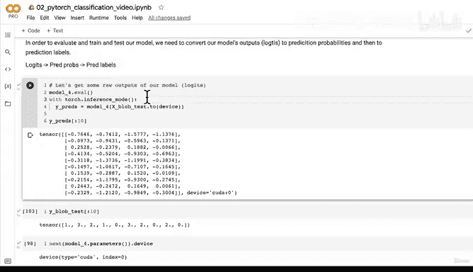
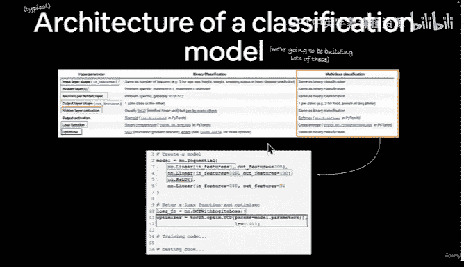
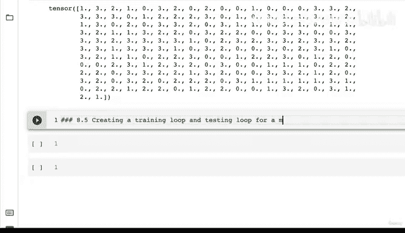

# Daniel Bourke《PyTorch 深度学习｜PyTorch 101 Crash Course For Beginners in 2025》中英字幕 - P92：092_04_028 多分类模型：逻辑值→预测概率→预测标签.zh_en - GPT中英字幕课程资源 - BV1kTSKB1E9m

Welcome back。 In the last video， we created a loss function and an optimizer for our multiclass classification model and recall the loss function。

😊，Measures how wrong our model's predictions are。And the optimizer。

Optimizer update our model parameters。To try and reduce。The loss。So that's what that does。

 And I also issued the challenge of doing a forward pass with Model 4。

 which is the most recent model that we created。And， oh。

Did I just give you some code that wouldn't work？Did I do that on purpose， Maybe， maybe not。

 you'll never know。 So if this did work， what are the raw outputs of our model。

 Let's get some raw outputs of our model。 And if you recall。

 the raw outputs of a model are called Loitts。So we got a runtime error expected all tensors to be on the same device are。

 of course。 why did this come up？ Well， because if we go next model 4。Dot parameters。

 And if we check device， what happens here。 Oh， we need to bring this in。 Our model is on。

The couda device， whereas our data is on the CPU。 still， Can we go X is our data Ater。

 Can we check the device parameter of that， I think we can。I might be proven wrong here。Oh。

 it's on the CPU。 Of course， we're getting a runtime error。 Did you catch that one if you did。😊。

Well done。 So let's see what happens。 But before we do a For pass。

 how about we turn our model into a vowel mode to make some predictions with torch dot inference mode or make some predictions。

 We don't necessarily have to do this because it's just test， but it's a good habit。Oh。Why friends。

He callss， what do we get？Why pres and maybe we'll just view the first 10。What do we get here。

 Oh my goodness。 How bunch of numbers on a page I this the same format as our data or our test labels。

 Let's have a look。😊，No， it's not。 Okay， Oh， we need why blob test， excusecus me。

We're going make that mistake a fair few times here。 So we need to get this into the format of this。

 how can we do that Now， I want you to notice one thing as well， is that we have one value here。

Per one value， except that this is actually four values。 Now， why is that？ We have 1，2，3，4。

While that is because we set the out features up here， our model outputs， four features。Per sample。

 So each sample right now has four numbers associated with it。 And what are these called。

 These are the logs。 Now， what we have to do here。 So let's just write this down in order to evaluate。

And train and test our model。We need to convert our models outputs。Outputs。

 which are loggit to prediction。Probabilities and then to prediction labels。

So we've done this before， but for binary classification。

 So we have to go from logitts to bread pros to pre。Labels， allright， I think we can do this。

 So we've got some logits here。 Now， how do we convert these logits to prediction probabilities。

Well， we use an activation function。 And if we go back to our architecture。

 What's our output activation here for a binary classification， we use sigmoid。

 But for multiclass classification。 This is the two main differences between multiclass classification and binary classification。

 One uses softmax， One uses cross entropy。 And it's going take a little bit of practice to know this off by heart。

 It took me a while。 but that's why we have nice tables like this。

 And that's why we write a lot of code together。 So we're going to use a softmax function here to convert our logits。

 our models's raw outputs， which is this here。 Two prediction probabilities。 And let's see that。😊。

So。Convert our model's lowit outputs to prediction probabilities。So let's create why pre probs。

 So I like to call prediction probabilities preed pros for short。So torch dot softmax。

 and then we go Y Loits， and we want it across the first dimension。

So let's have a look if we print why Loits we'll get the first five values there and then look at the conversion here。

 Y logs or Y pre pros。 That's what we want to compare。Ped。Probs。5。Let's check this out。Oh。

 what did we get wrong here。Why logitts， do we have Ylogts。 Oh， no。

 We should change this to Ylogitts， because really， that's the raw output of our model here。

Why Logiits， Let's rerun that。 Check that。 We know that these are different to these。

 but we ideally want these to be in the same format as these。 our test labels。

 These are our models predictions。 And now we should be able to convert。There we go。 Okay， beautiful。

 What's happening here。 Let's just get out of this。And we will add a few code cells here。

 So we have some space。Now， if you wanted to find out what's happening with torch dot softftm。

 what could you do， We could go torch softm， see what's happening， softm。Okay。

 so here's the function that's happening。 We replicated some nonlinear activation functions before。

 So if you wanted to replicate this， what could you do？ Well， if and doubt， code it out。

 You could code this out。 You've got the tools to do。

 So we've got softmax to sum X input takes the exponential of X。

 So torch exponential over the sum of torch exponential of X。

 So I think you could code that out if you wanted to。

 But let's for now just stick with what we've got。 We've got some logits。😊，Here。

 and we've got some softm， some logitts that have been passed through the softm function。

 So that's what's happened here。 We've passed our logitts as the input here。

 and it's gone through this activation function。😊，These are prediction probabilities。

And you might be like， Daniel， these are still just numbers on a page。

 but you'll also notice that none of them are negative。Okay。

 and there's another little tidbit about what's going on here。 If we sum one of them up。

 let's get the first one。Will this work。And if we go torch。t sum。What happens？Oh。

 they all sum up to one。 So that's one of the effects of the softm function。

 And then if we go torch dot max of Y pre pros。So this is a prediction probability for multiclass。

 you'll find that for this particular sample here， the zeroth sample， this is the maximum number。

 And so our model， what this is saying is our model is saying this is the prediction probability。

 This is how much I think it is class 0。 This number here。 It's in order。

 This is how much I think it is class 1。 This is how much I think it is class2。

 This is how much I think it is class 3。 And so we have one value for each of our four classes a little bit confusing because it's zeroth indexed。

 But the maximum value here is this index。 And so how would we get the particular index value of whatever the maximum number is across these values。

😊，Well， we can take the Ag max。And we get tensor  one。 So for this particular sample， this one here。

Our model。And these guesses or these predictions aren't very good。 Why is that， Well。

 because our model is still just predicting with random numbers， we haven't trained it yet。

 So this is just random output here， basically， But for now。

 the premise still remains that our model thinks that for this sample using random numbers。

 it thinks that index 1 is the right class or class number one for this particular sample。

 And then for this next one， What's the maximum number here。 I think it would be the zeroth index。

 And the same for the next one， What's the maximum number here。

 Well it would be the zeroth index as well。 But of course。

 these numbers are going to change once we've trained our model。

So how do we get the maximum index value of all of these， So this is where we can go。

 convert our models。Prediction probabilities。To prediction。Prediction labels。So let's do that。

 We can go Ypres equals torch。 argmax on Ypre pros。And if we go across the first dimension as well。

 So now let's have a look at why reds。Do we have prediction labels in the same format？As。

Out Y Lob test。Beautiful， yes， we do， although many of them are wrong， as you can see。😊，Ideally。

 they would line up with each other。 But because our model is predicting or making predictions with random numbers。

 So there haven't been。 our model hasn't been trained。 All of these are basically random outputs。

 So hopefully， once we train our model， it's going to line up the values of the predictions are going to line up with the values of the test labels。

 But that is how we go from。Our models raw outputs to prediction probabilities。

 to prediction labels for a multi class classification problem。So let's just add the steps here。

 logits。Raw output of the model。Pread pros to get the prediction probabilities use torch dot softmax or the softmax activation function。

 Pre labels take the arg max of the prediction probabilities。

So we're going to see this in action later on when we evaluate our model。

 but I feel like now that we know how to go from logits to prediction probabilities to pre labels。

We can write a training loop， so let's set that up。8ight。5。Create a training loop。And testing loop。

For a multi class。

Pie torch model， This is so exciting。I'll see you in the next video。

 Let's build our first training and testing loop for a multiclass pytorch model。

 and I'll give you a little hint。 It's quite similar to the training and testing loops we've built before。

 So you might want to give it a shot。 I think you can。😊，Otherwise。

 we'll do it together in the next video。😊。