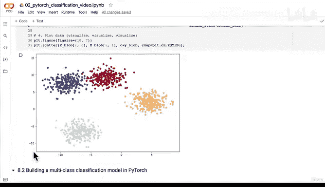

# Daniel Bourke《PyTorch 深度学习｜PyTorch 101 Crash Course For Beginners in 2025》中英字幕 - P93：093_04_029 多分类模型训练与实时代码调试.zh_en - GPT中英字幕课程资源 - BV1kTSKB1E9m

Welcome back。 In the last video， we covered how to go from。Raw logits。

 which is the output of the model， the raw output of the model for a multiclass pi torch model。

 Then we turned our logits into prediction probabilities using torch dot softmax。

 and then we turned those prediction probabilities into prediction labels by taking the arg max which returns the index of where the maximum value occurs in the prediction probability。

 So for this particular sample with these four values because it outputs four values because were working with four classes If we were working with 10 classes。

 it would have 10 values， the principle of these steps would still be the same。😊。

So for this particular sample， this is the value that's the maximum。 So we would take that index。

 which is one for this one。 the index 0 has the maximum value for this sample same again and then same again。

 I mean， these prediction labels are just random。 right， So they're quite terrible。

 But now we're going to change that。 because we're going to build a training and testing loop for our multiclass model。

 Let's do that。So fit the multi class。Model to the data。Let's go set up some manual seeds。

Torch dot manual seed again， don't worry too much if our numbers on the page are not exactly the same。

 that's inherent to the randomness of machine learning。

 We're setting up the manual seeds to try and get them as close as possible。

 but these do not guarantee complete determinism， which means the same output。

 but we're going to try。 The direction is more important。Sep number of epochs。

We're going to go epochs。 How about we just do 100。 I reckon we'll start with that。

 We can bump it up to 1000 if we really wanted to。Let's put the data to the target device。

What's our target device。 Well， doesn't really matter because we've set device agnostic code。

 So whether we're working with a CPU or a GPU， our code will use whatever device is available。

 I'm typing blog again。 So we've got X blob train Y bb train。

 This is going to go where It's going to go to the device。And why blob？Train to device。

And we're going to go X blob test and then Y blob test equals X blob test to device。Otherwise。

 we'll get device issues later on， and we'll send this to device as well。 Beaut。 Now。

 what do we do now， Well， we loop through data。Lo through data。 So for an epoch in。

Range epochs for an epoch in a range。Epochs， I don't want that order correct。 Come on Google Coab。

 work with me here。We're training our first multi class classification model。

 This is serious business。 Now， I'm joking。 It's actually quite fun。 So model 4 dot train。😊。

And let's do the forward pass。 I'm not going to put much commentary here because we've been through this before。

 but what are the logitts， Thelogitts are raw outputs of our models。 So we'll just go X blob train。

And。X test。 I didn't want that。 X blob train。 Why did that do that。

 I need to turn off auto correct in Googleco。 I've been saying it for a long time。

 Y pre equals torch dot softm。 So what are we doing here。

 We're going from Loits to prediction probabilities here。 So torch softm。😊，Why Los？

Across the first dimension。And then we can take the arg max of this and dim equals1。 In fact。

 I'm going to show you a little bit of， oh， I've written blog here。

 Maybe autocorrect would have been helpful for that。 A little trick。

 You don't actually have to do the torch soft max。 The Loitts。

 If you just took the arg max of the logts is a little test for you。

 Just take the arg max of the logitts And see， do you get the same similar outputs as what you get here。

😊，So I've seen that done before， but for completeness。

 we're going to use the Somax activation function because you'll often see this in practice。

And now what do we do， We calculate the loss。 So the loss F M。

 where you're going to use categorical cross entropy here or just cross entropy loss。

 So if we check our loss function， what do we have。We have cross entropy loss。

 We're going to compare our models logits to Y blob。Train。And then what are we going to do。

 We're going to calculate the accuracy。Because we're working with a classification problem。

 It'd be nice if we had accuracy， as well as loss。Accuracy is one of the main classification evaluation metrics。

Why pre equals y pre。Why pray。And now what do we do， Well， we have to 0 grab the optimizer。

 Opimr 0 grad。 and we go last backward， and then we step the optimizer。 Opr step， step， step。

So none of these steps we haven't covered before。We do the forward pass。

 we calculate the loss and any evaluation metric we choose to do so， we zero the optimizer。

 we perform back publication on the loss and we step the optimizer the optimizer will hopefully behind the scenes update the parameters of our model to better represent the patterns in our training data。

And so we're going to go testing code here。 What do we do for testing code Well， or inference code。

We set our model to a Valel mode。That's going to turn off a few things behind the scenes that our model doesn't need。

 such as dropout layers， which we haven't covered。 but you're more than welcome to check them out if you go torch N N。

Dropout layers。 Do we have dropout？Dropout layers， beautiful。

 and another one that it turns off is Mat Nor。Beautiful， and also， you could search this。

 What does model dot aval do， And you might come across。Stuck Overflow question。

 one of my favorite resources， so there's a little bit of extracur。😊。

But I prefer to see things in action。So with torch inference mode， again。

 this turns off things like gradient tracking and a few more things。

 So we get as fast as code as possible because we don't need to track gradients when we're making predictions。

 We just need to use the parameters that our model has learned We want X blob test to go to our model here for the testlogitts。

 And then for the test pres， we're going to do the same step as what we've done here。

We're going to go torch dot softmax on the test Loits。Across the first dimension。

 and we're going to call the arg max on that to get the index value of where the maximum prediction probability value occurs。

We're going to calculate the test loss。Or loss function。

 We're going to pass in what the test logits here。 Then we're going to pass in Y blob test compare the test logits behind the scenes。

 Our loss function is going to do some things that convert the test logitts into the same format as our test labels。

 and then return us a value for that。 Then we'll also calculate the test accuracy here by passing in the y true as y blob test。

And we have the Y pre equals Y pre。Wonderful， and then what's our final step。 Well。

 we want to print out what's happening， because I love seeing metrics as our model trains。

 It's one of my favorite things to watch。😊，If we go， if epoch。

 let's do it every 10 epochs because we've got 100 so far equals 0。

Let's print out a nice F string with epoch。And then we're going to go loss。 What are we put in here。

 We'll get our loss value， but we'll take it to four decimal places。

 and we'll get the training accuracy， which will be AC， and we'll take this to two decimal places。

And we'll get a nice percentage sign there。 and we'll go test loss equals test loss and。

We'll go there and finally， we'll go test a at the end here。 Test act。 Now。

 I'm sure by now we've written a fair few of these。

 you're either getting sick of them or you're like， wow， I can actually do the steps through here。

 And so don't worry， we're going be functionising all of this later on。

 But I thought I'm going to include them as much as possible so that we can practice as much as possible together。

 So you're ready。 We're about to train our first multiclass classification model in three，2，1。

 let's go No typos Of course。 What did we get wrong here。😊，Oh， this is a fun error。 Runtime error。

 N L L Los Ford reduce coer kernel 2D index， not implemented for float。 Okay。

 that's a pretty full on bunch of words there， I don't really know how to describe that。

 but here's a little hint。 We've got float there。 So we know that floatat is what Float is a form of data。

 It's a data type。 So potentially because that's our hint。 We said not implemented for float。

 So maybe we've got something wrong up here。 Our data is of the wrong type。😊。

Can you see anywhere where our data might be the wrong type？Well， let's print it out。

 Where's our issue here， Why Loits， Why blob train， okay。Why blob train and why Los。

 What does why blob train look like， Why blob train。Okay， and what's the D type here？Float， okay。

 so it's not implemented for float。HMaybe we have to turn them into a different data type。

What if we went type。Torch。Long tensa。What happens here。Expected all tenses to be on the same device。

 but found at least two devices。 Oh my goodness。 What do we got wrong here。Type torch， long tensor。

Friends， guess what。 I found it。 And so it was to do with this pesky little data type issue here。

 So if we run this again。 And now this one took me a while to find。

 And I want you to know that that behind the scenes， even though again。

 this is a machine learning and cooking show， It still takes a while to troubleshoot code And you're gonna to come across this。

 But I thought rather than spend 10 minutes doing it in a video， I'll show you what I did。

 So we went through this。 And we found that there's something going on here。

 I don't quite know what this is。 And that seems quite like a long string of words not implemented for float。

 And then we looked back at the line where it went wrong。

 And so that we know that maybe the float is hinting at that one of these two tensesors is of the wrong data type。

 Now， why would we think that it's the wrong data type。 Well。

 because any time you see float or int or something like that。

 It generally hints at one of your data types being wrong。

 And so the error is actually right back up here， where we。😊，created our tensor data。

So we turned our labels here into floats， which generally is okay in P torch。 However。

 this one should be of type torch dot long tensor， which we haven't seen before。

 But if we go into torch long tensor。Let's have a look。Tch shot tensor。Do we have long tensor。

Here we go。64 bit integer signed。 So why do we need torch dot long tensor And again。

 this took me a while to find。 So I want to express this that in your own code。

 you probably will but you head up against some issues and errors that do take you a while to find and data types is one of the main ones。

 But if we look in the documentation for cross entropy lost。

 the way I kind of found this out was this little hint here。

 the performance of the criterion is generally better when the target contains class indices as this allows for optimized computation but I read this and it says target contains class indices。

 and I'm like alser indices already， but maybe they should be integers and not floats。

 But then if you actually just look at the sample code。

 you would find that they use D type es torch dot long。

 Now that's the thing with a lot of code around the internet is that sometimes the answer。

You're looking for is a little bit buried， but if and doubt。

 run the code and but your head up against a wall for a bit and keep going。

 So let's just rerun all of this and see， do we have an error here。

 Let's train our first multiclass classification model together。 No errors， fingers crossed。

 what did we get wrong here。 Okay， so we've got different size。

 we're slowly working through all of the errors in deep learning here。 Value error。

 input batch size 200 to match target size 200。 So this is telling me maybe our test data。

 which is of size 200 is getting mixed up with our training data， which is of size 800。😊，So。

 we've got test loss。The testlogits。Model 4， what's the size Let's print out。Print。

Test logot dot shape and wine blob test。So troubleshooting on the fly here， everyone。What are we got。

Toch size，800。Where are our test labels coming from。Why blob test equal goes， oh， there we go。

 did you catch that before， Maybe you did， Maybe you didn't， But I think we should be right here。

 Now， if we just comment out this line。 So we've had a data type issue and we've had a shape issue。

 Two of the main in machine learning。 Oh， and again， we've had some issues。 Why blob test。

 What's going on here。 I thought we' just change the shape。Oh， no。

 we have to go up and reassign it again， because。Now， this is definitely why blob， yes。

Let's rerun all of this， reassign our data。We are running into every single error here。

 but I'm glad we're doing this because otherwise you might not see how to troubleshoot these type of things。

😊，So the size of a tent so much matched the size。 Oh， we're getting the issue here。 test pres。

 Oh my goodness。 We have written so much code here。Test spread。 So instead of why bread。

This should be test spreads。Fingers crossed。 Are we training our first model yet or what。

 There we go。 Okay， I'm gonna printing out some stuff。 I don't really want to print out that stuff。

 And I want to see the loss go down。 So I'm going to。So， friends。

I hope you know that we've just been through some of the most fundamental troubleshooting steps。

 And you might say， oh， Daniel， let's a cop outca you're just coding wrong。 And in fact。

 I code wrong all the time。But we've now worked out how to troubleshoot them。

 shape errors and data type errors。 But look at this。 After all of that。 Thank goodness。

 Our loss and accuracy。 go in the directions that we want them to go。 So our loss goes down。

 and our accuracy goes up beautiful。 So it looks like that our model is working on a multiclass classification data set。

 So how do we check that。 Well， we're going evaluate it in the next step。 by visualize， visualize。

 visualize。 So you might want to give that a shot。 See if you can use our plot decision boundary function。

😊，We'll use our model to separate the data here， So it's going to be much the same as what we did for binary classification。

 but this time we're using a different model and a different data set。

I'll see you there。