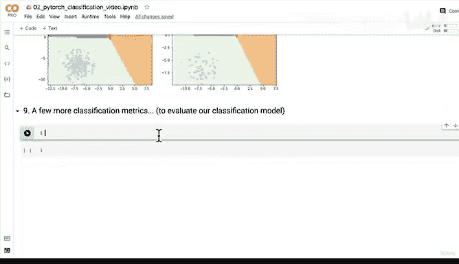

# Daniel Bourke《PyTorch 深度学习｜PyTorch 101 Crash Course For Beginners in 2025》中英字幕 - P94：094_04_030 多分类模型预测与评估.zh_en - GPT中英字幕课程资源 - BV1kTSKB1E9m

Welcome back。 In the last video， we went through some of the steps that we've been through before in terms of training and testing a model。

 but we also butted our heads up against two of the most common issues in machine learning and deep learning in general。

 And that is data type issues and shape issues。 But luckily。

 we were able to resolve them and trust me， you're going to run across many of them in your own deep learning and machine learning endeavors。

 So I'm glad that we' got to have a look at them and sort of I could show you what I do to troubleshoot them。

 But in reality， it's a lot of experimentation。 run the code， see what errors come out。

 Google the errors， read the documentation。 Try again。 But with that being said。

 it looks like that our model。😊，Our multi class classification model has learned something。

 The loss is going down。 The accuracy is going up， but we can further evaluate this by。😊。

Making and evaluating。Predictions with a pie torch。Multiclass。Model， so how do we make predictions？

 We've seen this step before， But let's reiterate。 make predictions。

 We're going to set our model to what mode， a vowel mode。

 And then we're going to turn on what context manager。Inference mode。Cause we want to make inference。

 We want to make predictions。 Now， what do we make predictions on or what are the predictions they're going to be lowits Because why they are the raw outputs of our model。

 So we'll take Model 4， which we just trained and we'll pass it the test data。 Well。

 it needs to be blob test， by the way。 I keep getting that variable mixed up。

 We just had enough problems with the data to Daniel。 We don't need any more。

 You're completely right。 I agree with you。But we're probably gonna come across some more problems in the future。

 Don't you worry about that， So let's view the first 10 predictions。Why Loits。

 what do they look like？Alright， just numbers on the page。 They're raw logits。 Now。

 how do we go from， go from logitts。To。Prediction probabilities。

How do we do that with a multi class model， we go Y preed probs equals。

 torch dot softm on the Y Loitts。 And we want to do it across the first dimension。

 And what do we have when we go Preed probs。Let's go up to the first 10。Are we apples to apples yet？

What does our Y blob test look like？We're not apples to apples yet， but we're close。

 So these are prediction probabilities。 You'll notice that we get some fairly different values here。

 And remember the one closest to one here， the value closest to one， which looks like it's this。

The index of the maximum value is going to be our models predicted class。 So this index is index 1。

 And does it correlate here， Yes， one beautiful。 Then we have index 3。

 which is the maximum value here。3 beautiful。 And then we have what do we have here。 In 2。 Yes， okay。

 wonderful， But let's not step through that。 We're programmers。 We can do this with code。

 So now let's go from pre pros。😊，To pre labels。 So why。Pres equals。 How do we do that？ Well。

 we can do torch dot arg max on the y pre probs。 And then we can pass de equals 1。

 We could also do it this way。 Y pre probs called dot arg max。

 There's no real difference between these two。 But we're just going to do it this way called torch dot arg max。

 Y pres， Let's view the first 10。 Are we now comparing apples to apples when we go Y blob test。Yes。

 we are。 Have a go at that。 Look 1，3，2，1，0，3，1，3，2，1，0，3。 beautiful。

 Now we could line these up and look at and compare them all day。 I mean， that would be fun。

 But I know what something that would be even more fun。 Let's get visual。 So plot don't figure。😊。

And we're going to go fig size equals 126， just because the beauty of this being a cooking show is。

 I kinda know what ingredients work from ahead of time。

 despite what you saw in the last video with all of that troubleshooting。

 But I'm actually glad that we did that， because seriously。😊，Shape issues and data type issues。

 You're going to come across a lot of them。 mid two of the main issues I troubleshoot。

 A from device issues。 So let's go X blob train and Y blob train。

And we're going to do another plot here。 We're going to get subplot 1，2，2。

 and we're going to do this for the test data。Test and then plot decision boundary。Ploot。

Decision boundary with Model 4。On X blob test and Y blob test as well。 Let's see this。

 Did we train a multi class。 Oh my goodness， Yes， we did。 Our code worked faster than I can speak。

 Look at that beautiful looking plot。 We've separated our data almost as best as what we could。 Like。

 there's some here that are quite inconspicuous。 And now what's the thing about these lines。😊。

With this model have worked， I posed the question a fair few videos ago whenever we created our multiclass model that could we separate this data without nonlinear functions。

So how about we just test that since we've got the code ready， Let's go back up。

 We've got nonlinear functions here。 We've got re here。

 So I'm just going to recreate our model there。 So I just took Reou out。 That's all I did。

 commented about。 This code will still all work。 and all fingers crossed it Well。

 Don't count your chickens with what they hatch。 Daniel you'll come on。

 We're just gonna rerun all of these cells。😊，All the code's going to stay the same。

 all we did was we took the non linearity out of our model。Is it still going to work？Oh my goodness。

 it still works。Now， why is that。Well， you'll notice that the lines are a lot more straighter here。

 Did we get different metrics， I'll leave that for you to compare。

 Maybe these will be a little bit different。 I don't think they're too far different。

But that is because our data is linearly separable。

 so we can draw straight lines only to separate our data。 However。

 a lot of the data that you deal with in practice will require linear and nonlinear。

 hence why we spent a lot of time on that。 Like the circle data that we covered before。

 And let's look up an image of a pizza。If you are building a food vision model to take photos of food and separate different classes of food。

 could you do this with just straight lines。You might be able to。

 but I personally don't think that I could build a model to do such a thing。 And， in fact。

 Pytoch makes it so easy to add nonlinearities to our model。

 We might as well have them in so that our model can use it if it needs it。

 And if it doesn't need it。 Well， hey， it's going to build a pretty good model as we saw before。

 if we included the nonlinearities in our model。 So we could uncom these and our model is still going to perform quite well。

 That is the beauty of neural networks。 I that they decide the numbers that should represent our data the best。

😊，And so with that being said， we've evaluated our model。

 We've trained our multiclass classification model。 We've put everything together。

 We've gone from binary classification to multiclass classification。

 I think there's just one more thing that we should cover。 And that is， let's go here。😊。

Section number nine， a few more classification metrics。So。As I said before， evaluating a model。

 let's just put it here to evaluate our model。Our classification models， that is。

Evaluating a model is just as important as training a model。So I'll see you in the next video。

 let's cover a few more classification metrics。

