# Daniel Bourke《PyTorch 深度学习｜PyTorch 101 Crash Course For Beginners in 2025》中英字幕 - P95：095_04_031 其他分类指标探讨.zh_en - GPT中英字幕课程资源 - BV1kTSKB1E9m

Welcome back。 In the last video， we evaluated our multiclass classification model visually and we saw that it did pretty darn well because our data turned out to be linearly separable。

 So our model， even without nonlinear functions could separate the data here。 however。

 as I said before， most of the data that you deal with。

 will require some form of linear and nonlinear function。

 So just keep that in mind and the beauty of Pytorch is that it allows us to create models with linear and nonlinear functions quite flexibly。

 So let's write down here。 if we wanted to further evaluate our classification models。

 We've seen accuracy。😊，So accuracy is one of the main methods of evaluating classification models。

 So this is like saying out of 100 samples， how many does our model get right？And so。

We've seen our model right now is that testing accuracy of nearly 100 per cent。

 So it's nearly perfect。 But， of course， there were a few tough samples， which， I mean。

 a little bit hard。 Some of them are even within the other samples。

 So you can forgive it a little bit here for not being exactly perfect。

What are some other metrics here， Well， we've also got precision。And we've also got recall。

Both of these will be pretty important when you have classes with different amounts of values in them。

 So precision and recall accuracy is pretty good to use when you have balance classes。

So this is just text on a page for now， F1 score， which combines precision and recall。

 There's also a confusion matrix。And there is also a classification report。 So I'm going to show you。

A few code examples of where you can access these。 And I'm going to leave it to you as extra curriculum to try each one of these out。

 So let's go into the keynote。 And by the way， you should paint yourself on the back here because we've just gone through all of the pytorch workflow for a classification problem。

 not only just binary classification。 We've done multiclass classification as well。

 So let's not stop there， though。

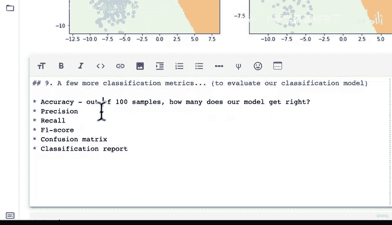

Remember， building a model， evaluating a model is just as important as building a model。

 So we've been through linearity。

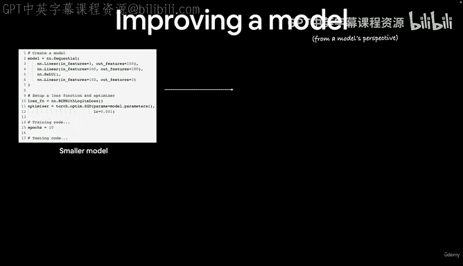

We've seen how we could replicate nonlinear functions。

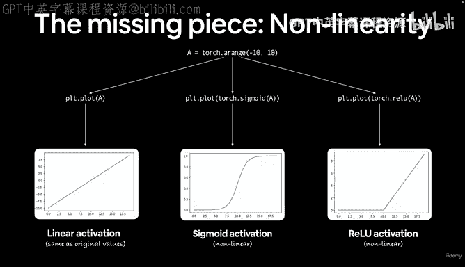

We've talked about the machine learning Explorer's motto， visualize， visualize， visualize。

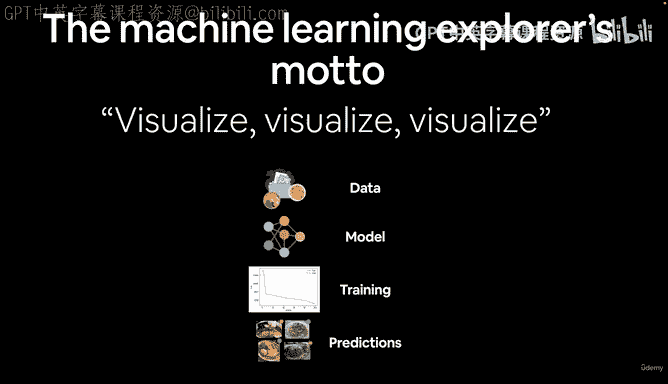

Machine learning practitioner's motto is experiment， experiment experiment。

 I think I called that in machine learning or data scientist motto。 Same thing， you know。

 and steps in modelling with Pyth。 we've seen this in practice。

 So we don't need to look at these slides。 I mean， they'll be available on the Github if you want them。

 But here we are。 Some common classification evaluation methods。😊，So we have accuracy。

 There's the formal formula if you want， but there's also code， which is what we've been focusing on。

 So we wrote our own accuracy function， which replicates this。 By the way。

 TP stands for not toilet paper and stands for true positive T N is true negative false positive F P false negative F N。

 And so the code， we could do torch metrics。 Oh， what's that， But when should you use it。

 the default metric for classification problems。 note， it is not the best for imbalance classes。

 So if you had， for example，1000 samples of one class。 So number one label number one。

 but you had only 10 samples of class0。 So accuracy might not be the best to use for then。 for。😊。

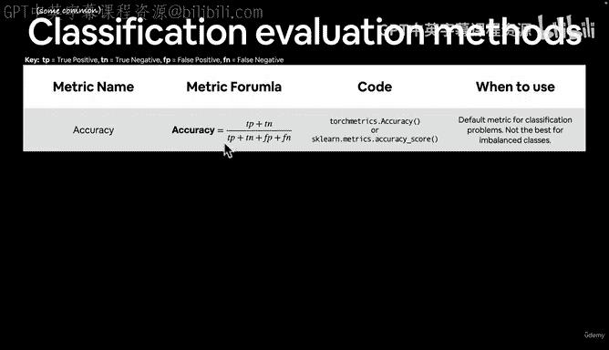

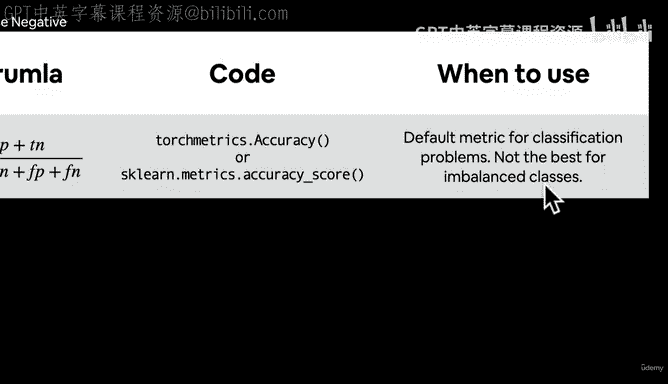

In balanceance data sets， you might want to look into precision and recall。

 So there's a great article called， I think it's beyond accuracy。

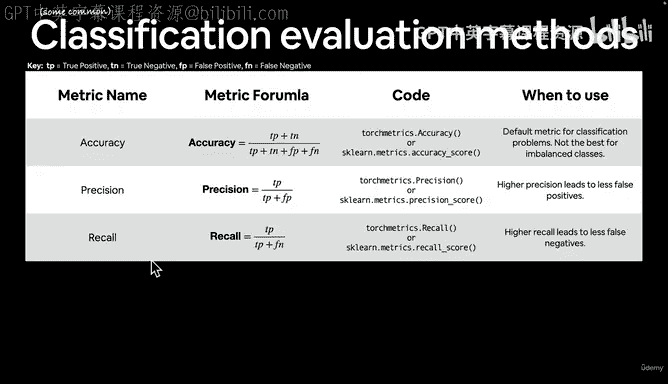

Precision and recall， which gives a fantastic overview of there we go。 This is what I'd recommend。

 There we go by Will Coerin。😊，So I'd highly recommend this article as。Some extra curriculum here。

See this article for when to use precision recall。

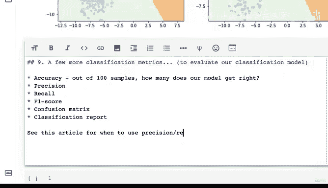

We'll go there。Now， if we look back， there is the formal formula for precision。

 true positive over true positive plus false positive。

 So higher precision leads to less false positives。 So if false positives are not ideal。

 you probably want to increase precision if false negatives not ideal。

 you want to increase your recall metric。 However， you should be aware that there is such thing as a precision recall trade off and you're going to find this in your experimentation。

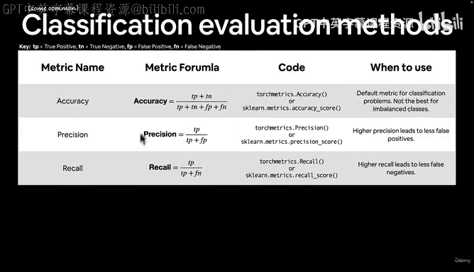

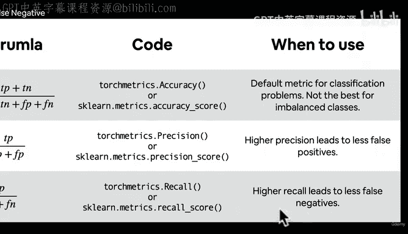

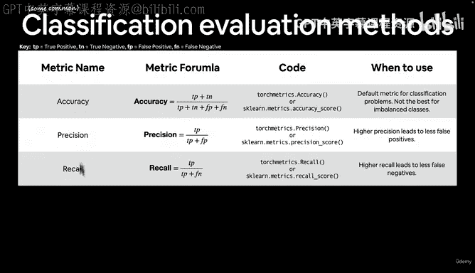

Precision， recall， trade off。So that means that generally if you increase precision you lower recall and inversely if you increase precision。

 you lower recall So check out that just to be aware of that， but again。

 you're going to learn this through practice of evaluating your models。

 If you'd like some code to do precision and recall。

 you've got torch metrics precision or torchmetric recall as well as psyt learn So psyt learn has implementations for many different classification metrics。

 torch metrics is a pitorrch like library。

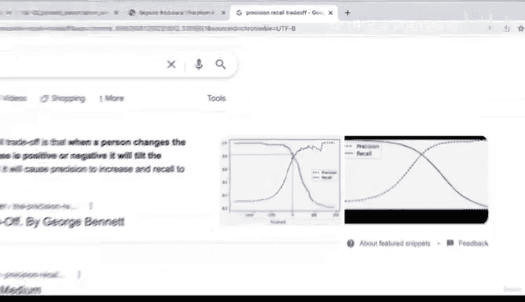

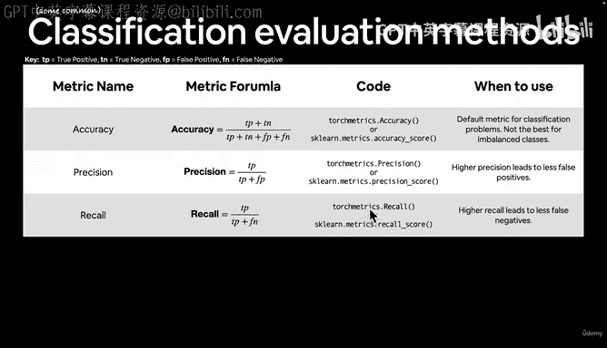

And then we have F1 score which combines precision and recall。

 so it's a good combination if you want something in between these two。

 and then finally there's a confusion matrix I haven't listed here， classification report。

 but I've listed it up here and we can see a classification report insK learn classification report。

 classification report kind of just puts together all of the metrics that we've talked about。😊。

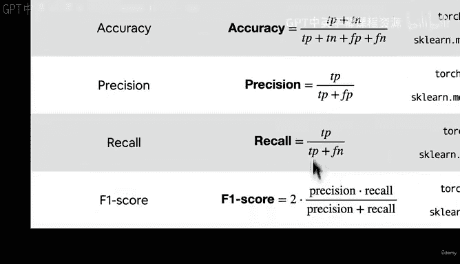

And we can go there。But I've been talking a lot about torch metrics。

 So let's look up torch metrics accuracy。Torch metrics。 So this is a library。

 I don't think it comes with Google coabb at the moment。

 but you can import torch metrics and you can initialize a metric。

 So we've built our own accuracy function。 But the beauty of using torch metrics is that it uses pi torch like code。

 So we've got metric pres and target。 and then we can find out what the value of the accuracy is。

 And if you wanted to implement your own metrics， you could subclass the metric。😊，Class here。

 But let's just practice this， so。Let's check to see if I'm going to grab this and copy this in here。

If you want。Access to a lot of pieytorrch metrics， C。Torch metrics。So can we import torch metrics。

 maybe it's already in Google Co Lab？No， not here。 but that's all right。 We'll go Pip install。

Torch metrics。 So Google Col Lab has access to torch metrics。

And that's going to download from torch metrics。 It shouldn't take too long。

 It's quite a small package， beautiful。 And now we're going to go from torch metrics。😊，Import。

Accuracy。Wonderful， and let's see how we can use this。 So set up metric。

So we're going to go torch metric， underscore accuracy。 We could call it whatever we want， really。

 but we need accuracy here。 I's just going to set up the class。

 and then we're going to calculate the accuracy of our multiclass model by calling it torch metric。

Accuracy， and we're going to pass it Y Pres and why blob test。Let's see what happens here。Oh。

 what did we get wrong。Runtime error expected all tensors to be on the same device。

 but found at least two devices Oh， of course。Now， remember how I said torch metrics implements pi torch like code。

 Well let's check what device this is on。It's on the CPU。

 So something to be aware of that if you use torch metrics。

 you have to make sure your metrics are on the same device by using device agnostic code as your data。

 So if we run this， what do we get。Beautiful， we get an accuracy of 99。5%。

 which is in line with the accuracy function that we coded ourselves。

 So if you'd like a lot of prebuilt metrics functions。

 be sure to see either psyt loan for any of these or torch metrics for any pytorch like metrics。

 but just be aware if you use the pytorrch version， they have to be on the same device。

 And if you'd like to install it， What do we have， Wheres the metrics module metrics。😊。

Do we have classification。 There we go。 So look how many different types of classification metrics there are from torch metrics。

 So I'll leave that for you to explore The resources for this will be here。

 This is an extra curriculum article for when to use precision recall and another。

Extracur would be to go through the torch metrics module for 10 minutes and have a look at the different metrics for classification。

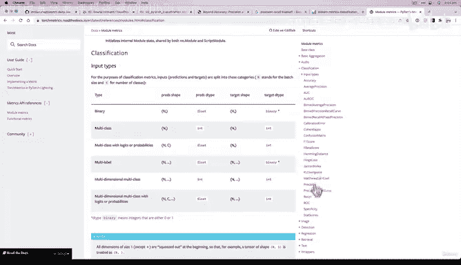

So with that being said。I think we've covered a fair bit。

But I think it's also time for you to practice what you've learned。

 So let's cover some exercises in the next video。I'll see you there。

