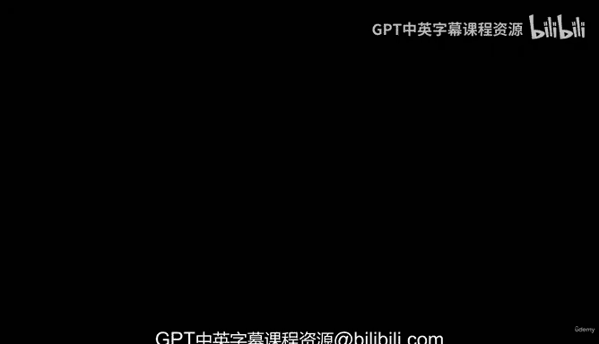
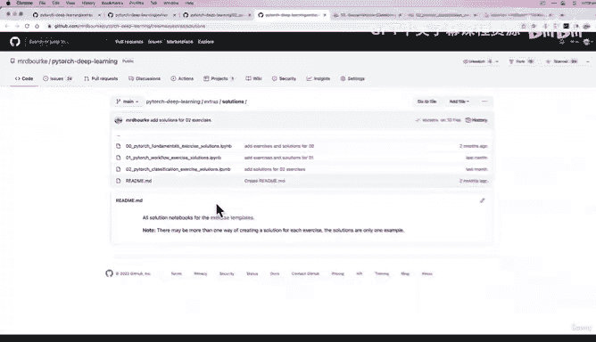

# Daniel Bourke《PyTorch 深度学习｜PyTorch 101 Crash Course For Beginners in 2025》中英字幕 - P96：096_04_032 PyTorch分类练习与拓展.zh_en - GPT中英字幕课程资源 - BV1kTSKB1E9m

Welcome back。 And the last video， we looked at a few more classification metrics。

 a little bit of a high level overview for some more ways to evaluate your classification models。

 And I link some extra curriculum here that you might want to look into as well。

 But we have covered a whole bunch of code together。

 But now it's time for you to practice some of this stuff on your own。

 And so I have some exercises prepared。 Now， where do you go for the exercises。 Well， remember。

 on the learn Pitorch do I book。 for each one of these chapters。 There's a section。 Now。

 just have a look at how much we've covered。 If I scroll， just keep scrolling， look at that。

 we've covered all of that in this module。 That's a fair bit of stuff。

 But down the bottom of each one is an exercises section。

 So all exercises are focusing on practicing the code in the sections above all of these sections here。

 I've got number 1，2，3，4，5，6，7。😊，Yes，7 exercises， nice， writing plenty of code， and then， of course。

 extra curriculum。 So these are some challenges that。😊。

I've mentioned throughout the entire section 02。But I'm going to link this in here。😊，Exercises。But。

 of course， you can just find it on the Learnpytouch。 book。

 So if we come in here and we just create another heading exercises。And extra curriculum。

And then we just write in here。See exercises and extra curriculum。Here有。

And so if you'd like a template of the exercise code， you can go to the Pytoch deep learning repo。

 and then within the extras folder， we have exercises and solutions you might be able to guess what's in each of these。

Exercises， we have O2 pytorrch classification exercises。 This is going to be some skeleton code。

 And then， of course， we have the solutions as well。 Now， this is just one form of solutions。

 but I'm not going to look at those because I would recommend you looking at the exercises first before you go into the solutions。

 So we have things like import torch。 Se up device agnostic code。 C a data set。

Turn data into a data frame and then， et cetera， et cea。

 for the things that we've done throughout this section。 So give that a go， try it on your own。

 And if you get stuck， you can refer to the notebook that we've coded together。

 All of this code here。 You can refer to the documentation， of course。

And then you can refer to as a last resort， the solutions notebooks。

 So give that a shot and congratulations on finishing。😊。

Section 0，2， Pi torch classification。Now， if you're still there， you're still with me。

Let's move on to the next section。 We're going to cover a few more things of deep learning with Pytorch。

我是以的。