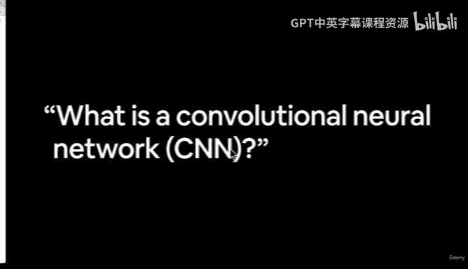
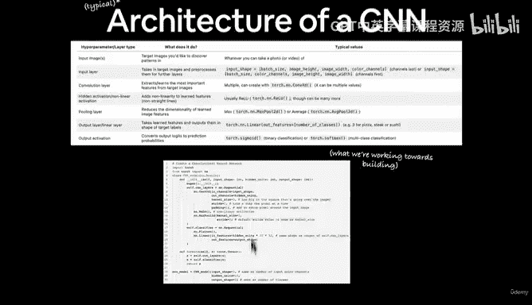
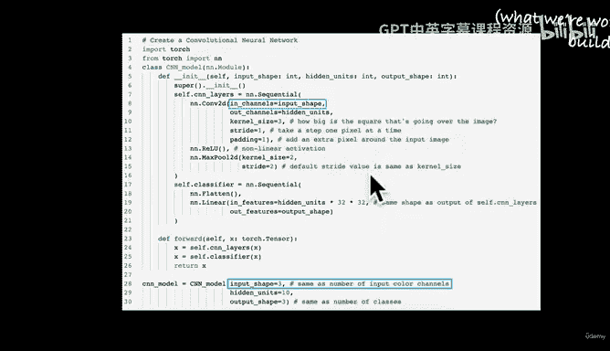
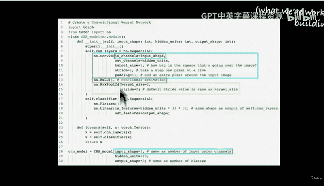
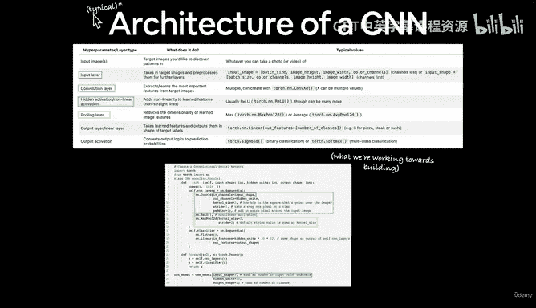
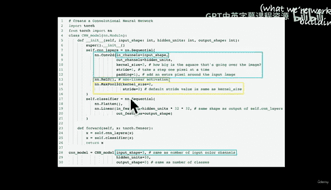

# Daniel Bourke《PyTorch 深度学习｜PyTorch 101 Crash Course For Beginners in 2025》中英字幕 - P99：099_05_003 卷积神经网络概念解析.zh_en - GPT中英字幕课程资源 - BV1kTSKB1E9m

Welcome back。 In the last video， we saw examples of computer vision input and output shapes。

 and we kind of hinted at the fact that convolutional neural networks are deep learning models or CNNs that are quite good at recognizing patterns in images。

 So we left off the last video with the question， What is a convolutional neural network。

 And where could you find out about that。 What is a convolutional。😊。

Neural network。Here's one way to find out。😊，And I'm sure， as you've seen。

There's a lot of resources for such things， a comprehensive guide to convolution on neural networks。

 Which one of these are the best。 Well， it doesn't really matter。

The best one is the one that you understand the best。 So there we go。

 There's a great video from code basics。 I've seen that one before。

 Simple explanation of convolution or neural network。

 I'll leave you to research these things on your own。 And if you wanted to look at images。😊。

There's a whole bunch of images。 I prefer to learn things by writing code because remember this course is code first as a machine learning engineer。

 99% of my time is spent writing code。 So that's what we're going to focus on。😊，But anyway。

 here's the typical architecture of a CNN。 In other words， a convolutional neural network。

 If you hear me say CNN， I'm not talking about the news website in this course。

 I'm talking about the architecture convolutional neural network。

 So this is some pytoch code that we're going to be working towards building。😊。

But we have some hyperparameter slash layer types here。 We have an input layer。

 so we have an input layer which takes some input channels and an input shape， because remember。

 it's very important in machine learning and deep learning to line up your input and output shapes of whatever model you're using。

 whatever problem you're working with。

Then we have some sort of convolutional layer。 Now， what might happen in a convolutional layer。Well。

 as you might have guessed， as what happens in many neural networks is that the layers perform some sort of mathematical operation。

Now， convolutional layers perform convolving window operation across an image or across a tensor and discover patterns using。

 let's have a look。 Actually。 Let's go N N dot com 2D。

。There we go。This is what happens。 So the output of our network equals a bias plus the sum of the weight tensor over the convolutional channel out times input Now if you want to dig deeper into what is actually going on here you're more than welcome to do that but we're going to be writing code that leverages the torch N N comm 2D and we're going to fix up all of these type of parameters here so that it works with our problem。

 Now what you need to know here is that this is a bias term we've seen this before。

 and this is a weight matrix。 So bias vector typically and a weight matrix and they operate over the inputs but we'll see these later on with code So just keep that in mind。

 This is what's happening as with every layer in a neural network some form of operation is happening on our input data and those operations happen layer by layer until eventually hopefully they can be turned into some usable output。

😊，So let's jump back in here。Then we have an hidden activation slash nonlinear activation because why do we use nonlinear activations？

Well， it's because if our data was non nonlinear， non straight lines。

We need the help of straight and non straight lines to model it to draw patterns in it。

Then we typically have a pooling layer。 And I want you to take this architecture I've said typical here for a reason。

 because these type of architectures are changing all the time。

 So this is just one typical example of a CNN。 It's about as basic as a CNN as you can get。

 So over time， you will start to learn to build more complex models。

 you will not only start to learn to build them。 you will just start to learn to use them。

 As we'll see later on in the transfer learning section of the course。

And then we have an output layer。 So do you notice the trend here， We have an input layer。

 and then we have multiple hidden layers that perform some sort of mathematical operation on our data。

 and then we have an output slash linear layer that converts our output into the ideal shape that we'd like。

 So we have an output shape here。😊，And then how does this look in process while we put in some images。

 I go through all of these layers here because we've used NN dot sequential。

 and then hopefully this forward method returns X in a usable status or usable state that we can convert into class names。

 and then we could integrate this into our computer vision app in some way shape or form。😊。

And heres the asterisk here。 Note， there are almost an unlimited amount of ways you could stack together a convolutional neural network。

 This slide only demonstrates one。 So just keep that in mind。 only demonstrates one。

But the best way to practice this sort of stuff is not to stare at a page。 It's to。If and doubt。

 code it out。 So let's code， I'll see you in Google Coab。

