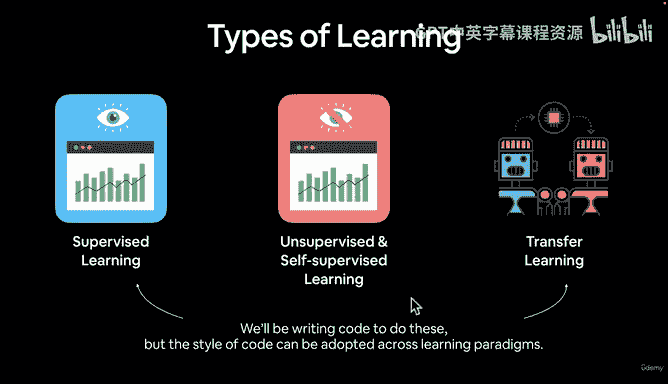
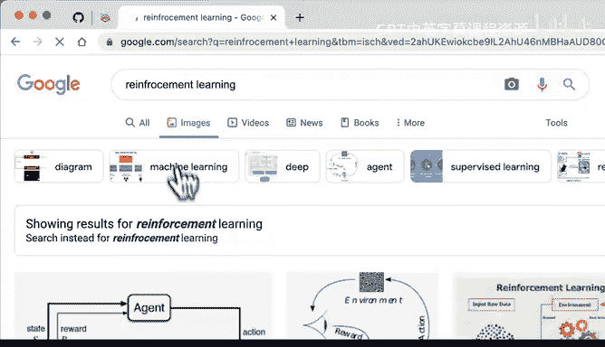
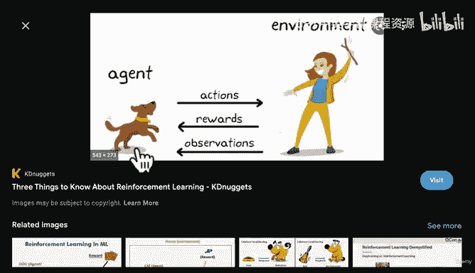
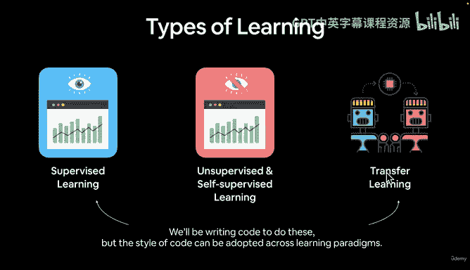
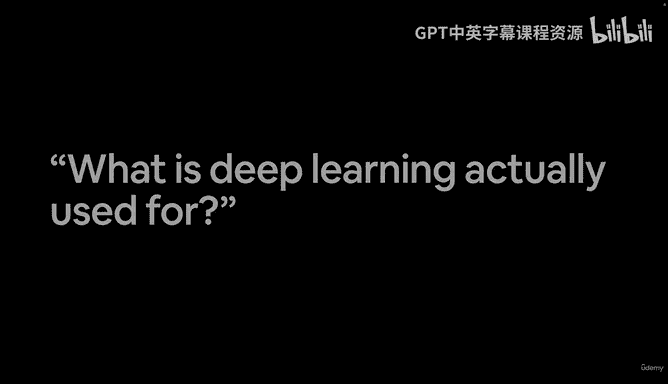

# Daniel Bourke《PyTorch 深度学习｜PyTorch 101 Crash Course For Beginners in 2025》中英字幕 - P9：009_02_005 不同类型的学习范式.zh_en - GPT中英字幕课程资源 - BV1kTSKB1E9m

Welcome back。 We've discussed a brief overview of an anatomy of what a neural network is。

But let's now discuss some learning paradigms， So the first one is supervised learning。

And then we have unsupervised and self supervised learning and transfer learning。Now。

 superupvised learning is when you have data and labels， such as in the example we gave at the start。

 which was how you would build a neural network or a machine learning algorithm to figure out the rules to cook your Sicilian grandmother's famous roast chicken dish。

 So in the case of supervised learning， you'd have a lot of data So inputs such as raw ingredients as vegetables and chicken and a lot of examples of what that inputs should ideally look like。

 or in the case of discerning photos between a cat and a dog。

 you might have1000 photos of a cat and 1000 photos of a dog that you know which photos are cat and which photos are dog and you pass those photos to a machine learning algorithm to discern。

 So in that case you have data， the photos and labels aka cat and dog for each of those photos。

 So that's supervised learning data and labels unsupervised and selfsupervised learning is you just have the。

Itself， you don't have any labels。 So in the case of cat and dog photos， you only have the photos。

 You don't have the labels of cat and dog。 So in the case of。Self supervised learning。

 you could get a machine learning algorithm to learn an inherent representation of what。

 And when I say representation， I mean patterns and numbers， I mean， weights， I mean。

 features a whole bunch of different names describing the same thing。

 you could get a self supervised learning algorithm to figure out the fundamental patterns between a dog and a cat image。

 but。It wouldn't necessarily know the difference between the two。

 That's where you could come in later and go show me the patterns you've learned。

 And it might show you the patterns。 And you could go， okay。

 the patterns that look like this a dog and the patterns that look like that are cat。

 So self supervised and unsupervised learning learn solely on the data itself。And then finally。

 transfer learning is a very， very important paradigm in deep learning。

 It's taking the patterns that one model has learned。😊。

Of a data and transferring it to another model， such in the case of if we were trying to build a supervised learning algorithm for discerning between cat and dog photos。

 we might start with a model that has already learned patterns and images and transfer those foundational patterns to our own model so that our model gets a head start。

 This is transfer learning is a very， very powerful technique。 But as for this course。

 we're going to be writing code to focus on these two supervised learning and transfer learning。

 which are two of the most common paradigms or common types of learning in machine learning and deep learning。

 However， this style of code， though， can be adapted across different learning paradigms。

 Now I just want to let you know， there is one that I haven't mentioned here。

 which is kind of in its own bucket。 and that is reinforcement learning so。😊。

I'll leave this as an extension if you wanted to look it up。

But essentially， this is a good one。That's a good photo actually， so shout up to Katie Nuggets。😊。

The whole idea of reinforcement learning is that you have some kind of environment and an agent that does actions in that environment。

 And you give rewards and observations back to that agent。 So say， for example。

 you wanted to teach your dog to。Uraninate outside well you would reward its actions of urinating outside and possibly not reward its actions of urinating all over your couch。

 So reinforcement learning is again， it's kind of in its own paradigm。

 This picture has a good explanation between unsupervised learning supervised learning to separate two different things and then reinforcement learning is kind of like that。

But again， I will let you research the different learning paradigms a little bit more in your own time。

As I said， we're going to be focused on writing code to do supervised learning and transfer learning。

 specifically Pytorrch code。Now， with that covered。

Let's get a few examples of what is deep learning actually used for and before we get into the next video。

 I'm going to issue you a challenge to search this question yourself and come up with some of your own ideas for what deep learning is currently used for。

 So give that a shot and I'll see you in the next video。😊。

