# Daniel Bourke《本地RAG｜Local Retrieval Augmented Generation (RAG) from Scratch》中英字幕 - P1 - GPT中英字幕课程资源 - BV14i421e7BS

Hello， everyone， Daniel here。 in this video tutorial。

 we're going to start from a blank notebook and end with a full retrieval augmented generation pipeline or rag pipeline from scratch。

 And best of all， it's going to run on our local machines。 Or to showcase the power of AI on RtX。

 have a look at that GPU And Vdia have been so kind to send me an Rt X 490 GPU。 So shout out to Mark。

 Thank you so much for that。😊，Now what this means is that if you have a PC with an Nvidia GPU。

 you've got a gym no no I'm joking it means you've got a machine that's incredibly capable of AI workflows。

 So I've got all the code here on GiHub we're going to write this line by line together in this video Check the link in the description for that but it's also to celebrate the upcoming。

😊，NVDdia GTC conference， which is happening from March 18 to 21。

 but if you're watching this in the future and it's already happened。

 there's a heap of sessions that are going to be virtual， so it's happening in San Jose， California。

 I live in Australia so I'm going to be attending virtually。

I've got three sessions lined up that I'm looking forward to。 This is retrieval augmented generation。

 an overview of design systems。 So this is similar to the pipeline that we're going to be building in this video。

 There's some Nvidia software in here， Tensor Rt Llm， we don't explicitly cover that。

 but that's what I want to learn more potentially for a future video。

 So let me know if you want to see that。 And then I also have saving trees in forest all over the world using AI。

 a really cool application to identify 600 different species of trees on a mobile phone with a macro lens。

 That's so cool to me。 And then we have here building a deep learning foundation model via selfsupvised learning。

 which is a really powerful technique that what large language models used to learn。

 They use self-supervised learning to learn from large corps of text。

 but this is bringing it to computer vision。 So once again， all the codes on Github。

 the links will be in the description。 follow along if you'd like to build your own very own。😊。

Rag pipeline from scratch running on your own PC I might have to move this to the floor because it is quite loud running here If you have any questions leave a discussion on the Github page or a comment below and。

😊，Let's build。Hello hello， welcomelcom to the simple local rag tutorial。

 Now we're gonna rebuild this workflow。 and we're going have it run all locally on our own GPU。

 And if you want the materials for this on the Github。

 So I'll put that link in the description And if you want to run it in Google coab。

 maybe you don't have a local GPU available you can click on the link here it's on the Github this same workflow that we're going go through we'll all run in Google coabab。

 So let me just jump into what we're going to do。 you can use this notebook here as a reference。

 but we're gonna code this whole thing up from scratch。 there's some information here。

 what is rag why rag， if you never heard it we're be saying rag a lot during this video。

 what kinds of problems can rag re used for Why local key terms。

 what we're going to build all that sort of stuff， All the code and explanations are in this notebook。

 a lot of vector outputs there。 So that's where all those numbers come from there from our embeddings。

 But we're going get to that。 I'm just giving you this。😊。

You can use it as a reference because we're going to code all of this up from scratch。

 So let's jump into。An example， workflow。And by the way， we're going to take this quite slow。

 we're going to write every line ourselves， so if you have any questions or issues。

 leave a comment on the video or a discussion on GitHub or an issue if there's something wrong。

 if you want to get set up all the instructions are here。

 but we're just going to go through this step by step。😊，So what is RaG Well。

 RaG stands for Retrieval augmented generation， and I've stolen this image or this flow chart from Navidia's blog。

 so they have a great blog post， which is demystifying Ra 101 and that's kind of what I've based this workflow off except we're not using a framework We're going to be writing all of it ourselves we're not using Lama index or Lang chain。

 which are two great frameworks and they can help to process these workflows。

 but we're going to see what it looks like just to do with Python and Pytorch and transformers and whatnot。

 and then in that way in the future if you'd like to use Lang chain or Lama index well then you know how to do it yourself。

😊，So that's sort of what we're gonna be building。 If you want to read more。

 The link to that is available。 I'll link this little whiteboard that I'm using as well。

 But let's dive into it。 So what are we going to build。 Well。

 we're going break it down into two major parts。 The first part is document preprocess and embedding creation。

 Then the next part is search and answer。 But before I jump into this flow chart。

 we most break down what rag is。 And so I've set up my computer So already go through the setup steps。

 So if you go to the Github I've gone through these steps， Git clone And now I'm using Python 3。

11 on a Windows 11 machine with an Nvidia Rtx 490。 So。😊。

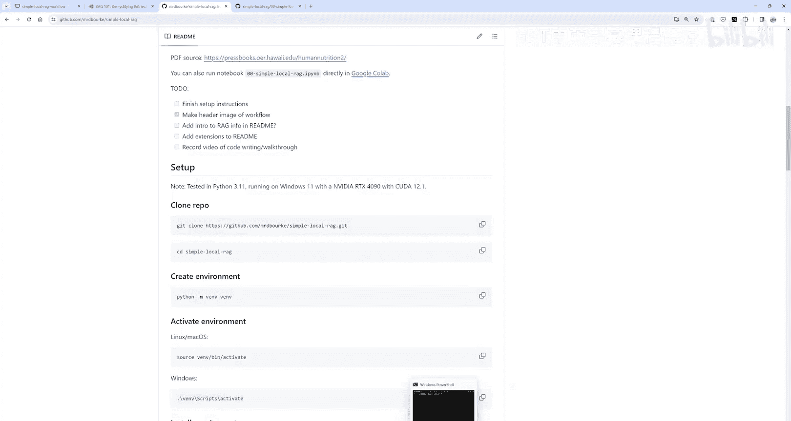

That Navidia have so kindly given me to create。This video in partnership。 So there we go。

 There's an Nvidia Gfor Rtx， but this should work on almost any local NviDdia GPU。 So of course。

 the Rtx 490 at the time recording is one of the best ones you can buy from a consumer level。

 but it should work on most modern N video GPUus。 And we've put some code in there。

 So if you've got an older GPU with less memory。 It should still work。

 And we'll discuss that later on。 We get into model usage。 So I've gone through these setup steps。

 and that's what I've got here。😊。

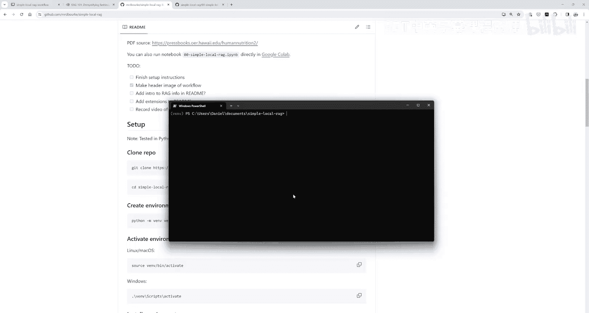

Excuse me。 I'm still getting used to Windows。 I've created an environment。 I've activated it。

 I've installed the requirements。 And if you run into any issues setting up the requirements。

 I put some notes here， but we can。2 things that we can do if we want to run locally。

 We can use V S code。 And so I can just type in code dot。

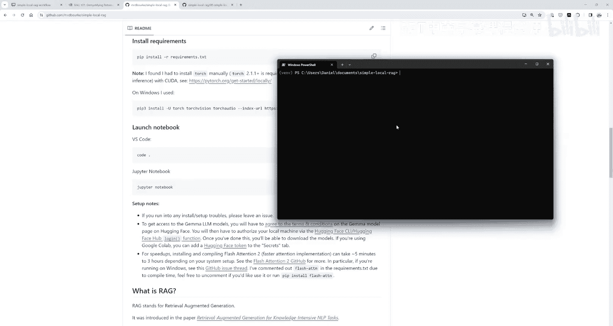

And that'll bring us up here。 This is the same repo just running on my local computer。

 And then if you want to start a new notebook here， we can just go， O， O， simple。Local rag。

 and I'm going to call it dot video ipyython notebook， and then we can just start from here。

 import torch， shift and enter， we'll select our Python environment。We can run it there。

 So import torch。 So there we go。 However， I personally have found。

 and maybe I'm doing something wrongca I I'm， I'm not used to using Windows that V S code kind of lags a little bit for me when I have a large notebook。

 Maybe I'm doing something wrong。 If you know about this， please let me know。

 So what I'm going to do instead of pressing code dot， I'm going to start with a Jupyterter notebook。

So dot a notebook。

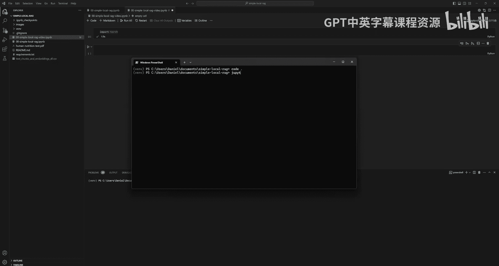

But the same process will run whether you're using a V S code notebook。

 which should technically be the same as using Jupyter。 So now I'm using a Jupyter server。

 which has the same files that my Vs code setup has。

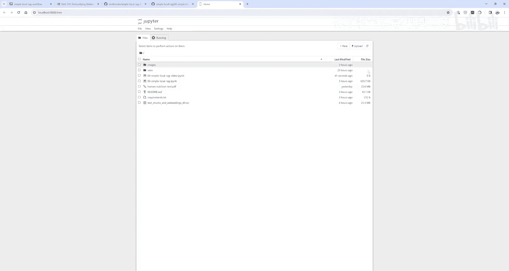

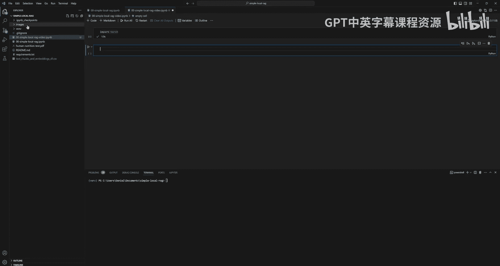

But I'm just going to use Jupyter。 If you want to use V S code， you can do that as well。

 So let's jump into this。

Thisma， oh， what's going on here。

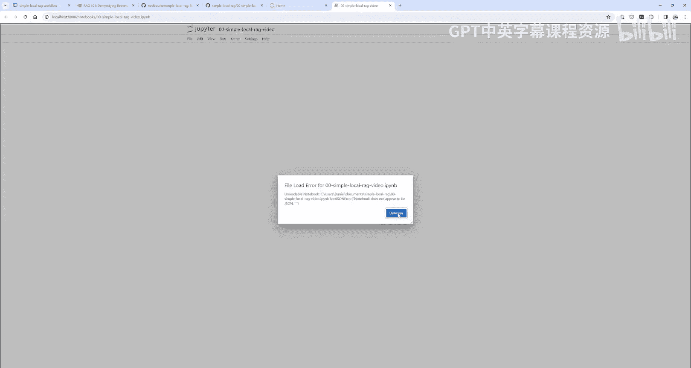

Oh。Oh， I haven't saved it here， Of course。That's an interesting error。 See。

 I'm gonna leave some of the errors in here。 you know。

 so let's see if it opens up now that I've saved it。 Okay， there we go。 We get torch。

 and I'm gonna zoom in a little bit there。 That should be good。😊，Okay， so let's。

 I know that was a bit of an intro， but again， all I've done here is I've gone through the setup steps。

 I've just done this in the terminal Git clone C D into simple local rag， created an environment。

 launched it and then installed the requirements in that environment。😊，Done here。

 If you'd like to see a dedicated setup video to this， please let me know。

 and I can make one of those。 But now I'm at this stage。 I've just gone Jupiter notebook。

 and we are in。😊，Like the kid in the tree。 Alright， So let's create a title for this。

 So we want to create and run a local rag pipeline。😊，From scratch。Now， of course。

 it won't be 100% from scratch。 We won't be training any embedding or L LM models here。

 but we will be using them。 So let's define what is Rag。What is RaG so RaG stands for？Retrieval。

Augmented generation， you may have been seeing this。

Quite regularly in the world of L L Ms and generative AI。Essential， the goal of rag is to。Take。

Information and pass it to an LLM so it can generate outputs based on that information。 Now。

 that's a pretty broad statement， but that's on purpose because Ray can really be that broad。Oh。

 let me turn this into markdown， E an M， by the way。So that's what we want to do。

 We have information in one place， and we want to pass it to an L O M so it can generate information。

 Now， why would， based on that information that we pass it， that， that could be the prompt。

 So let's break each of these steps down。So we want retrieval。

So retrieval is another word for search， so find relevant information。Give a query。EG。

 in this project， we're going to be building Nutri chat。Which is chat with a PDF。Now。

 we'll break this down a bit more， but we have a nutrition textbook that's 1200 pages long。

 And we want to chat with that textbook。 So we might ask a question of what are the macronutrients and what do they do。

 So E G， what are。The macronutrients and what do they do？Right， so find。Relevan information。

 So we'll turn that into retrieves passages of text。Related to。The macronutrients。From a textbook。

A nutrition textbook， by the way。And then we have augmentation。Or augmented。So augmented is。😡。

We want to。Take the relevant information。To take the relevant information that we got from retrieval。

And augmentment。😡，Our input。Prompt， so often the input to an LLM is called a prompt。

 our input prompt to an LLM with that relevant。Information。

 now we'll discuss why we'd want to do that in a second。 and then we have。Generation。So， take the。

First two steps。And pass them to。And L LM for。Generative outputs。Beautiful， so retrieval。

 augmented generation。So if you've ever used an LLM。Chat GT is a great example。

 so what are the macronutrients？And what do they do？So， this is。A sense。

 this is not actually using retrieval augmented generation。 This is， as far as I know。

 ChatGBT is just generating this based off what it's learned in its training data。

 So why this is still helpful， But why might we want to use retrieval and then augment our prompt。

 So this is my prompt here。 Why might we want to augment that with relevant information。

So let's discuss why RaG。Why rack？So。The main goal。Of RAG is to improve the generation outputs。

Of LOMs。So if we go back to chat GT。Weve got a pretty good output here。Now， I've studied nutrition。

 and I would say this is a pretty good high level answer。

 Maccronutrients are the nutrient nutrientents that our bodies need in large amounts to function correctly。

 They can be divided into three main categories， carbohydrates， proteins and fats。

 And then we've got a little breakdown。 So that'， that's a good answer。 They're right。 However。

 this is quite a general question。 Like you might find a lot of information on this on the Internet。

 And that's what most large language models are trained on。

 They're trained on Internet corpuses of tech。 So。😊，Tterabytes of text data。 However。

 what if you have private information or what if you have factual information that an LLM won't have access to。

 That's where Rag can come in。 So number one would be to prevent hallucinations。

So let's say LLMs are incredibly。Good。At generating。诶。Good looking。Text。However。

 this text doesn't mean that it's factual。Right， so let's say you're a business and you have a customer support page。

 Let's go to chaty B T。My。So Telstra is a telephone company in Australia。

 So let me just go to Telstra。陈述这。Customer support。

And I know this is an actual project because one of my friends is working on this so。Call us。

 message us， Weiz search。 So say I wanted to search Telstra。

 So this is a phone provider in Australia。 So I want to search my bill was too much last month。Right。

 there's very natural language there。But what if we could get。See this website is giving me grief。

 What if we could get an answer rather than just this list of。Links here。Make a complaint。

 Do I want to make a complaint？Not sure what's going on here。Anyway。

 we get a lot of support documents。 So what if you。

 what if you're Telstra or any other company that has a lot of customer support problems。

 And I asked Chaty BT the same question。 So my Telstra bill was too much last month。

If your Tsha bill was unexpectedly high last month。

 there are several ways you can do review your bill。 So this is gonna be generic information， right。

But what if we had a chat ET that was linked or a similar language model， because Cha ET after all。

 is a large language model that was linked with all of Telstra's customer support documents。

 and we could talk to it when we have a problem。 So see how this is just like generic information。

 That's what you expect with anything。 But we want a specific。 we've got a specific problem。

 We want our question to be answered with Telstra's customer support。

So that is where rag can come in handy is what you would do in this case is。For example。Now。

 this is not necessarily a hallucination。Or actually， let's go into the number two， hallucination。

Rag can help LLMs。Generate information based on relevant。Passageers that are。Factual。So there we go。

 We've got number one。 Now， number two is what I just talked about。

 So hallucinations is all of this text looks good， but it doesn't necessarily promise you that it's going to be correct。

 If that makes sense， it could look good and read well， but it doesn't mean it's factually accurate。

 So that's what we want to do with number one with rags。 We want to provide our L L Ms with。😊。

Factual information。 So information that we have stored somewhere。 And then we want to go， hey。

 can you process this information to answer my query。And then number two is work with custom data。

Right， so many base LLMs are trained with internet。Scall data。This means they have。

A fairly good understanding。Of。Language in general。Right。

So if I ask a query of ChatyBT I've got a problem with my Telstra bill。

 it's going to give me some pretty good answers， but it's not Telstra specific whereas I typed this into Telstra's website in an ideal world。

 they'd take all their customer support documents and put it into a system a ragg pipeline and then I would get an answer back in similar style to ChatyBT but based on Telstra's actual documents。

😊，That's the whole premise of rag is to use your actual documents and process them and deliver them with in a generative way。

 So retrieval， find the relevant tstra documents that are related to my problem。

Augmentation would be to my bill was too much last month， that's my query there。

 so augmentation would be to take passages from these documents。

 put them into my query here and then have generation an LLM like ChaGBT would be to take those documents and return them or options for me in a legible readable way。

😊，That's the whole premise of rag。So， and of course， there's many more aspects to this， but this is。

 this is an actual problem that one of my friends in Australia was works with quite a large tech company is helping Telsha to work on right now。

 So that's just a concept of where RaG gets used in the workplace。😊。

So this means to have a fairly good understanding of language in general。However。It also does mean。

A lot of their responses。Can be generic in nature。So， rag helps to。Create。Specific responses。

Based on specific。Documents。AG。Your own companies。Customer support documents。

 And I want you do start thinking about documents has been a very broad term。

 So documents could be just like thousands of Pdfs， hundredunds of customer support documents。

 heaps of text files， your emails。 Let's get into some use cases， right。

 So we've already discussed one。 So。What we want to do is what can rag？Be used form。

So that's one very helpful use case。 We've all been to a customer support website and just had。

Absolutely no fun trying to get some help like I just had here the。😊，Yeah。

 won't even let me type anymore。 Okay， so Telstra， I love you， but you're an Australian company。

 you need a little bit of help on your search options here。😊，So let's go what can Ra helpful for。

 so number one would be customer support Q&A chat。😊，So。

Treat your existing customer support documents。As a resource。And when a customer asks a question。

You could have。A retrieval system， we're going to build this later on， don't you worry？Rettrive。

Retieve relevant。Documentation， snippets。So pieces of text from the documentation rather than。

 can you imagine having to go through what's an order estimate？😊。

It's an estimate of how much your first bill you monthly charge after that。 No。

 this doesn't help my bills too much。Why have I received a final bill。

 get help on your bills and payments。 Okay， see， look， I just wan to just give me the answer。

 There's too many options here。 Okay， I'm not， not ditching on Telstra。

 This is a lot for a lot of companies。 This is a big problem， right。

 Custom support is a very hard thing to do。 So retrieve relevant documentation snippets and then have an L LM。

Craft those snippets。Into an answer。And so you can think of this。As。啊。Chatbot for your。Documentation。

Now I know there's been a lot of chatbots in the past。

 but over the last couple of years chatbots have actually got really good。

 So this is no longer so much of a gimmick。 It actually really works， for example。

 Klanna LLM customer support Here we go So this is a big example。

 Klarna is quite a big financial company So let's go Klarna market。😊，Cat。So Kna raised， yeah。

 there you go。 It's worth multiple billions of dollars， apparently。

So quite a big company and has used AI assistant to handle two thirds of customer service chats in its first month。

 So big details here。 Yeah， there we go。 So AI has handled 2。3 million conversation。

 So this is where rag pipelines can help out。 So you type a message to Kr。

 It goes through its customer support documents。 I've got this problem。

 and then it gives you an answer。 and it's based on， is it open AI。 Yeah， based on open AI。

 So this is the exact workflow that I was just talking about。

 We have a chat EBT like model plugged into our own documentation right， So we go back to Kner。

 and they strive $40 million US in profit in 2024。 That's incredible。

 So let's keep going with our use case。 We want to learn how to build these systems， right。

 then we have another option， which would be email chain analysis。 so。😊。

There's plenty of options here， so this another thing project that my friend is working on。

 let's say you're a large insurance company。😊，And you have chains and chains of emails。

Of customer claims。Right， so you could search through all of those emails by hand。

 and that would take quite a long time， so。You could use a ragg pipeline。To find relevant。

Information。From those email chains。And then use an LLM to process。That information。

Into structured data。So basically take the unstructured text and turn it into something like JSON or something structured or a spreadsheet or something like that。

 right？And then we have another one which could be company internal。Documentation chat。

That's quite similar to the customer support Q And A。 But if you're a large company。

 you have an internal documentation set or even your own computer。

 I'm still getting used to using Windows， but I'm quite used to using my Mac。

 I'd really love it if the assistant on my Mac。 I'm not going to say it out loud because it might trigger somewhere in the house。

 but it starts with the S and ends in。😊，Erie could search all of my documentation via just chat instead of me having to use keywords。

 And then we have another one， which is what we're going to build textbook， Q And A。 So let's say。

Let's say you're a nutrition student。And you've got a 1200 page textbook to read。

You could build a rag pipeline。To go through。The textbook and find relevant passages。

To the questions you have。So the premise here is all of the same。 So retrieval， augmented generation。

 I like to think of it with all of these use cases， the all the common theme， common theme。

Here is take your relevant documents to a query and process them with an LLM。Right。

 so from this angle。You can consider。An LLm。As a calculator。For words。Quite a different concept here。

 because in the last few years， L L Ms have gotten very good at processing language in general。

 So Rag is from one angle。 Oh Gramlly， goodness， me。 How do I turn that off。😊。

Gemly is inviting everywhere。One second I'm just going to turn off cramly， excuse me for this。😊。

I don't know how to do that Anyway。 I'm gonna ignore it。Right。So。😊。

And L LM as a calculator for words。 Now， one more point to go on is。

 why would we want to run this locally。 What if Cha E BT is already good， Well， locally is like。

 youve got your own car， right， You like to drive that。

So that's what I imagine is why would you run to run these， these systems locally is， well。

 it's fun to drive your own car。 First of all， fun。

 So fun to build your own pipelines and software and run it locally。 And then， of course。

 you've got the practical benefits， which are privacy， speed and cost。 So privacy。😊。

If you're a big company。With private information。 So if you have private documentation。

Maybe you don't want to send that to an API。Maybe you don't want to send your information to open AI or Anthropic with Claude or Google or whatnot。

😊，You want to set up。And LLM。And run it on your own hardware。And then。

Number two is speed so whenever you use an API。You have to send some kind of data across the internet。

This takes time。So you'll notice with Chat UBT is that answer didn't quite help。Can you search。

Telshas。Customer support。Documentation。For me。Let's see if we can do that。Does it have a web browser。

 maybe it does？But see this time， we have to wait for this to happen， so。Maybe it's five seconds。

There we go。 Now it's pretty quick。Yeah， see， we're not getting。Or maybe it did search。 Oh。

 there we go。Okay， that's pretty good。 But we still have to wait for time for that， right。

 So locally is。Running locally。Means we don't have to wait。For transfers of data。 So we don't。

 our data doesn't have to go off onto the Internet。

 It can run on a local machine that I'm running under my desk。On this particular GPU， so Nvidia， SMI。

It's going to run right there on that hardware， so it's going to go quite quick。Then three。

 of course， is cost。 Now， there's more arguments here。

 but these are the three big ones that I picked out。 Of course， fine。

 you like to drive your own car around the place。 You don't always like to just hire a car and drive it。

 So cost is。If you own your hardware。The cost is paid。Right， so buying new hardware may have a cost。

 It may have a large。Cost to begin with。But over time， you don't。Have to keep。

Paying API fees and then probably another important one actually here is no vendor lock in。

If you run your own。Software， slash hardware。 So， for example。

 if I rely on Cha EBT to run my business。If open AI。Slash another。Lge Internet company。

Shut down if they shut down tomorrow。You can still run your business。Right。

 I don't think open AI will shut down tomorrow， but this is just， I mean。

 you've got your own hardware and software。 You're running that。

 It doesn't matter if they shut down tomorrow。 So these are， these are four really big points。

 So that's about enough for the intro of what is Rag， why Rag， what Ra can be used for and why local。

 Now， let's start to just dive into the project that we're going to do。 So I'll。

Just pause a video here。 I'm just going to write pause for myself when I edit this and I'll come back in about a couple of minutes。

 but if you want to take a little break and come back。

 we're going to start going over the project we're going to build and we'll write some code。😊，Okay。

 I'm back。 So we just talked about what is rag， why ragg， what can rag be useful and why local。 Now。

 let's jump into， I'm just gonna。Maybe I'll leave a link here。

 or let's discuss what we're going to build。 actually， what we're going to build。Now。

 I've got two resources。 We've got simple local rag。 That's the Github。 I'm gonna put this。In here。

One， and then。This， I'll share that as well。Covid link， beautiful。

 This is a little nice little whiteboard that I've got。 So I'm gonna put that there as well。

 in case you want these law be in the description as well。 Let me just close。 Oh， we don't need。

We'll keep those just in case。So the reference here is for all the code， by the way。

 Now I've skipped one thing， haven't gone over the key terms， but if you want to read those。

 you can do them here， I'm just going explain them as we go。

 We've got token em bedding and bedding model， similarity search vector search layout。

 large language model， LLM cost LLM context Sorry， I'm talking too fast prompt。

 Now there's some key terms to read， but we'll go through them as we go right。😊，Notebook， beautiful。

So let's just jump into here what we're going to build。I want my little workflow。Document。

There we go。 So let me zoom in。We have two major parts here。

 document pre processingces and embedding creation。And then search and answer。

 I'm going to break these down。And it's all gonna happen on a local Nvidia R T X 4090。

 So let's say you have a data set of。Documents now， again， documents is very broad。

 I'm just saying a large database of P P D Fs。 It could be a large database of customer support。

Articles， it could be internal documentation， it could be email chain。

 It could be almost anything to do with text， and now we're starting to get into the realm of images as well。

 but we're going to focus on text。I have a 1200 page nutrition textbook and if I go to this link in the GiHub。

😊，It's an open source textbook， but this would work with almost any textbook。

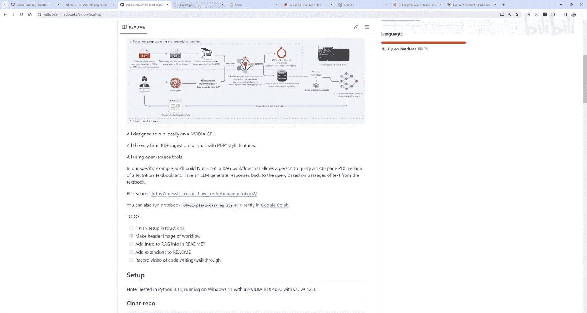

Human nutrition。 I love food。 I love nutrition。 I'd love to learn more about it。 So， frankly。

 I'm building this system for myself。 We could do all of the nutrition articles on Wikipedia as well。

 But we're just going start with the P D F to begin。 So I've downloaded it here。 Digital P D F。😊。

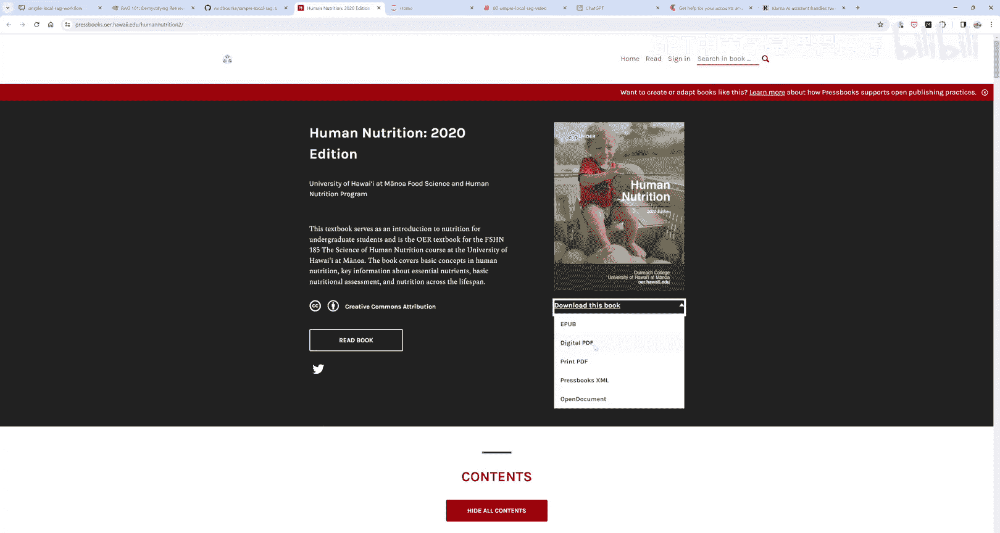

And I've included it there。 Human nutrition text。 I've renamed it。 It's open source。

 So you can check it out。 It might be a bit too big to load in the browser， though。Anyway。

 that's how Pd F。Can I download this here， There we go。Let's have a look at it。

Human nutrition text will open it up。Weve got heaps of pages here。So we could search through this。😊。

So there's the people who have altered it， let's just scroll right to the bottom。

 How many pages do we have？A lot of pages。I might just take this。 This is taken me to them。

 So 1200 pages， of course， a lot of them aren they're right on all text。

 a lot of them are just reference and whatnot。 But what if we were to search for what are the macro。

 Okay， we've already， it's not there。 We can't do a general query like that。

 We can do keyword matching。😊，Macronutrients， there we go。 So what if I。

 instead of searching just like this， I could chat with this document。

 That's what we're going to build。 So what we have to do is we take that P Df。

 and then we pre process that we're going to write code for all of this。

 We pre processces the text into smaller chunks。 So rather than it。

 I'm just gonna to exit out of this。 rather than it being。

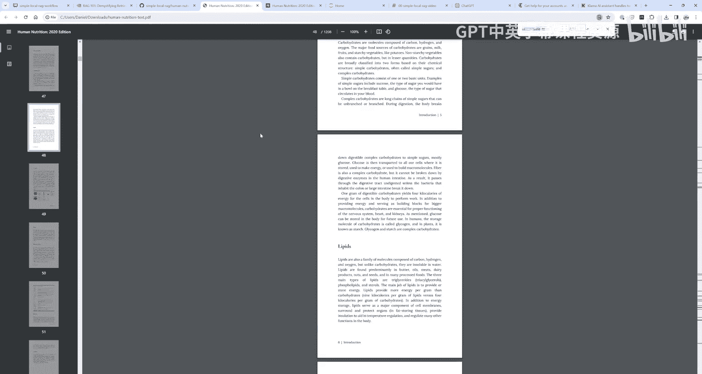

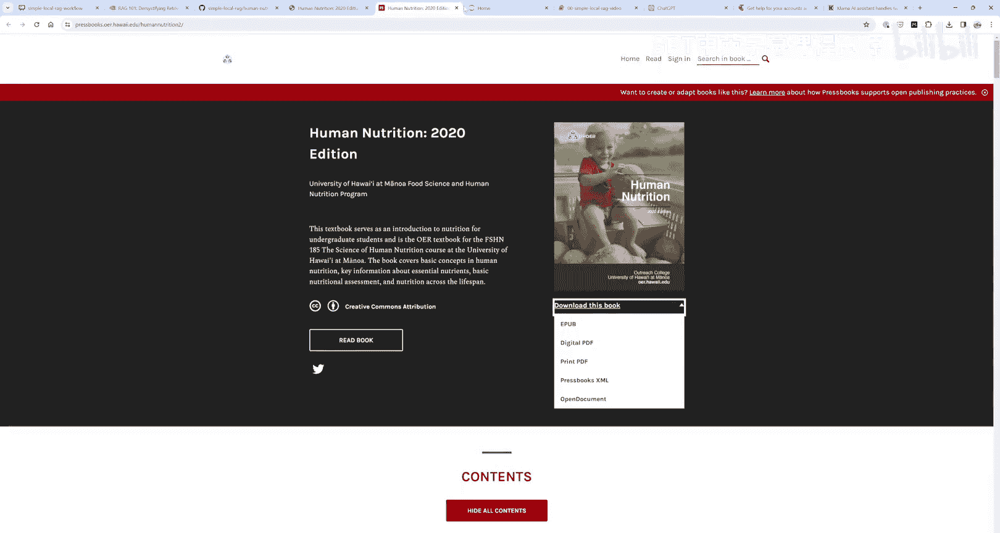

The text in here is actually pretty big on these pages， I'll just zoom into that as well。

Rather than it been a full page， we might break this into something like 10 sentences。

 and I know that because I've already tried and I've already made the material。

 so I know how many sentences we're going to break it into。

 but this is still an active area of research and how to chunkify or make your text smaller。

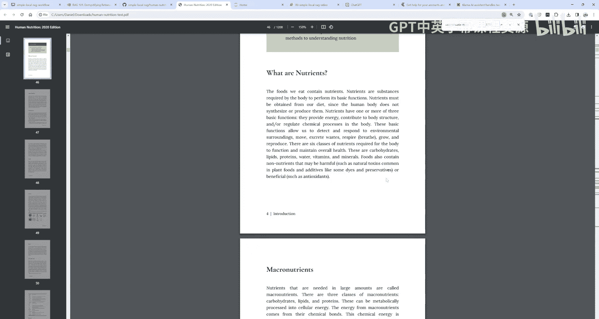

Then we have smaller documents， so these are going to be our context。

 our retrieval passages that we're going to pass to our LLM later on。😊。

And so what we do is we embed these smaller chunks of text。Now。

 what I mean by that is an embedding is a numerical representation that makes data useful。

 That's all we have to know for now。 We're going to see what it looks like hands on。

 and then we store these somewhere and we could store them in Pytorrch Tensor if you're not familiar with Pytorrch。

 I have a great video on Pytorch。 You might want to check that out and we could also store it in a database so that we could use it later。

😊，And then we come to the next step， so that's one step， embedding creation and storage。😊。

Now we have search an answer Now that it starts with a cool person。 Maybe this is you。 I quite laugh。

 Let me just show you something。 If you search for person。

 there's two people here with sunglasses on they're that are like in business attire。 They look like。

😊，Like a spy movie or something like that。😊，But yeah， so cool person， maybe that's you。

 you ask a query of your information here What are the macronutrients and what did they do Now what we do is we embed that query with the same model that we embedded our documents with now again in embedding。

 we just have to think of it as a numerical representation because computers don't deal with text as well as we do it might appear that they do with chatt EBT but behind the scenes Cha GBT is when I ask a question So how much does an elephant way。

😊，It's going to turn that query into a numerical representation。

 and then it's going to quiz its weights of which are also numbers of go， hey。

 have you seen the numbers from this， Show me other numbers that are similar to that of what a response would look like。

 So computers deal with numbers， even though this appears as text behind the scenes。

 And we' we're going to do this ourselves， We're going to turn words into numbers and back again。

So we embed our query。 and this is important with the same embedding model that we used to embed our documentation。

And then we can store that embedding our query if we wanted so we could catch it later。

 but usually it's quite quick just to embed it once at a time and search。

 And then what we do is we find this is the retrieval part of retrieval augmented generational rag We find similar embeddings so these will be numerical representations that match our query。

 I'll show you how to do that later on， We're going to write code to do so。

 and then this is the augmentation part， is we take our question here。 I know that's a bit small。

 but we take our question here。 We append the relevant passages from our text。

 and we pass this to an LLM。😊，So imagine if we're talking to Chat Ept and we've got。My telstra。

Bill is too much。But then we have context item one。And then。Context item 2。哦。Right。And then sorry。

 I'll go context item。 I got a bit trigger happy there。 and then we go， please。Create an answer。

To the problem based on the context。So there's context item 1，2，3。

 and these could be three articles that are relevant somewhere I'm not even sure where I went。

Check your account details。 There we go。 So an article like this， again。

 this is just an example is not the right article， but an article like this that is related to my problem。

 And we can put another one there another one there。

 And then we ask our calculator for words to creating an answer to the problem based on these three contexts rather than just creating a bit of a generic answer here。

 right。

So that's what we're going to do there。 And then this answer comes back to us。

 along with the resources。Now this is an important point。 We can get the answer。

 but as well as where the answer came from。 so then we can go and verify if that answer is actually correct。

 So in the case of nutrition textbook， we could ask what are the macronutrients and what do they do。

 And our LLM could return us a response， but not only that， but go hey。

 this is where I got the information from。 I got it from page 5 macronutrients And then maybe it found another page somewhere later on。

 I'm making this up and it said this is pretty helpful as well。

 And it's like this one's also pretty helpful if you want to learn more wherever it is here。

 that's just an example， I these aren't specifically related。

 I'm just saying that that's the type of system that we could build。😊。

Not only are we getting the answer， we're also getting resources to that。

 And so you can imagine how helpful that is for a customer support system is you get an answer。

 but it's like， hey， read this documentation for more or if you're in a large company and you're like。

 what do I do when I need to lodge an invoice。 And the response says， hey。

 you can lodge an invoice by here。 and this is what you do。 this our process。 All that sort of jazzs。

 But with that being said， we've got our beautiful little diagram here。

 we're going to be coming back to this quite often， But let's just write some steps。 so。😊。

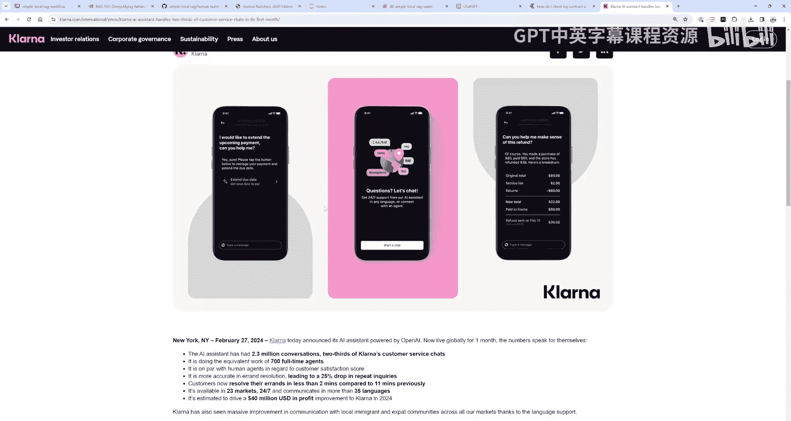

We're going to build， I'm calling the project Nutri Cha。To。Chat with a textbook。Nutrition textbook。

 But again， I want you to keep your mind open to the fact that textbook here could be anything。

 a collection of Pdfs， a collection of text documents， a collection of customer support documents。

 really keep your mind open to this because we're only this is still quite a new workflow， Ra。

 We're only really scratching the surface of this。 Oh， and I forgot one more thing。 up the top here。

 while I've got it in my mind。😊，If you want to read， wear rag。Came from。See the paper。From Facebook。

 AI。So originated out a Facebook AI， a fantastic AI team。 So if we search rag paper。😊。

Is this gonna work。 Oh， there we go。 Google's pretty good。

 So retrieval augmented generation for knowledge intensive task。 So this is a machine learning paper。

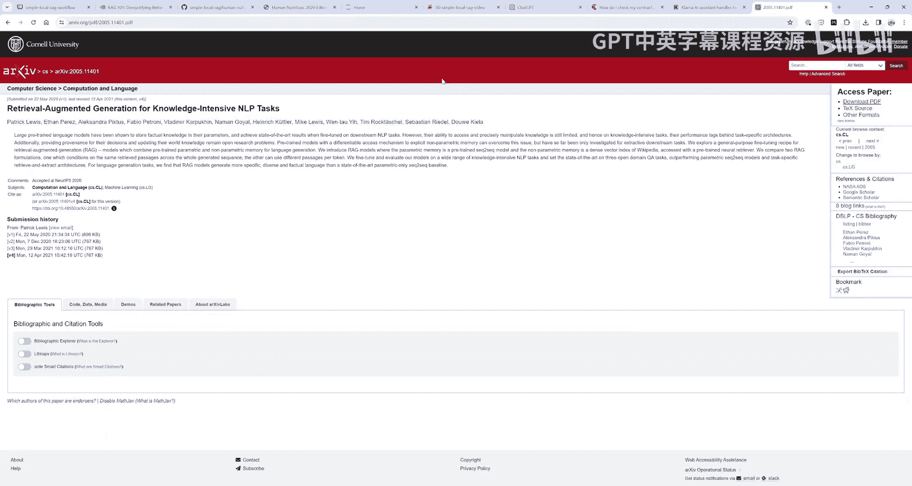

If you've never read one of these before， they can be quite intimidating。

 but essentially what we get to is this is a really technical way of describing what we've just described。

They've got。I really love this last paragraph。

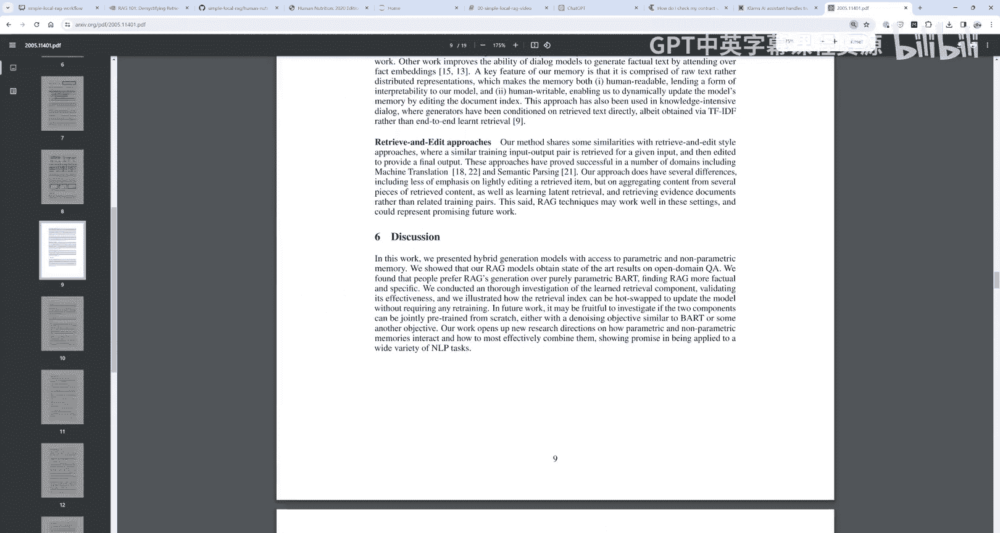

So this is explaining what Ra is。 So the work offers several positive societal benefits over previous work。

 the fact that it is more or less strongly grounded in real factual knowledge， in this case。

 Wikipedia， So they their example was they used a large language model GB2 maybe and they generated outputs based on Wikipedia text。

 So it makes it hallucinate less with generations that are more factual。 So hallucinate less。

 that's really important， and offers more control and interpretability。

 So you know where the generations came from。So Rag could be employed in a wide variety of scenarios with direct benefit society。

 for example， by endowing it with a medical index。 Oh， there we go。

 So you could give it like all of medical journals and that sort of stuff。 And asking it or pububmed。

 that's what I was looking for and asking at open domain questions on that topic or by helping people be more effective at their jobs。

 right， So if you can get information quickly， you can work quickly， right。

 So let's put this in our notebook。😊。

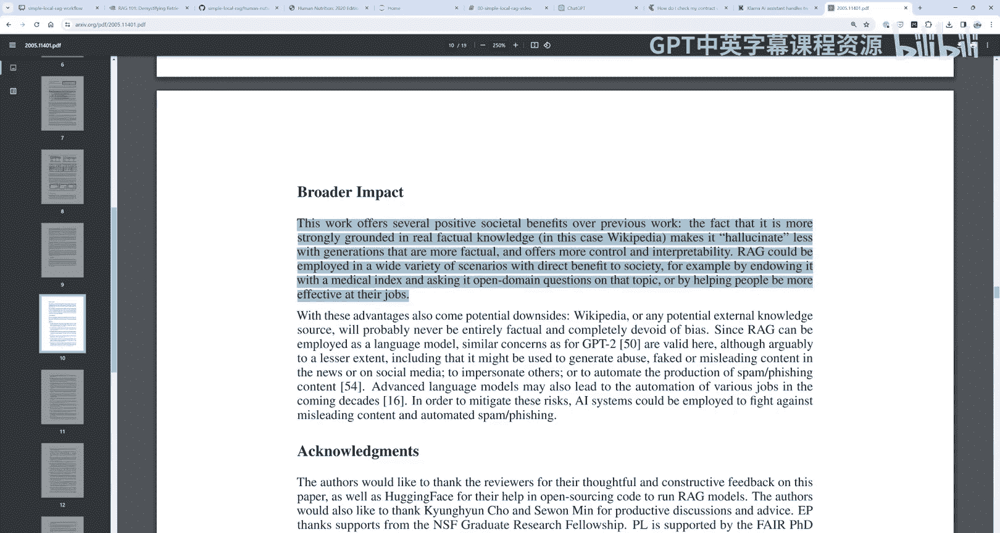

So that's their conclusion there。And I'm just going to put this。 It's a great。Paper to read。

 retrieval， augmented generation for knowledge intensive and LP tasks。 So you see，12 April 2021。

 So it's it's barely， it's under three years ago that this paper was published。

And RaG is taking over many different workflows。 So we're going to learn how to build a system like this for ourselves。

We go there。Wonderful。Now so。Specifically， let's get into what we're gonna code。Step 1。

 and I know we're going a bit over the place， but that's all right。 We're going。

 we're going slow here。 We're gonna write every line of code ourselves。

 And I want to try and explain it as much as I can。 So you could use almost any P D F here。

Or even a collection。Of Pdfs。Two， we're going to format the text of the PDF textbook。

Ready for an embedding model， so we want to turn our text into numbers。With the embedding model。

 so we're going to embed all of the chunks。Of text in the textbook。And turn them into。

Nummerical representations。So when embedding。Which we can store for later。

And I'm just going put this as。And bedding。Oh my goodness， Gmbling。

 I'm gonna get rid of that in the next break。 I'll just make sure I'm nice and zoomed in there。

 and then。Build a retrieval。System that uses vector search。

 We're going to talk about what this is later on。To find relevant or if you're trigger happy。

 you can skip ahead and just go to all the code。Relevant chunks of text based on a query。Now。

 vector search is one of my favorite techniques that I've ever learned in machine learning。

 So I'm really excited to share that with you。 So create a prompt that incorporates。😊。

They're retrieved。This is basically just the text version of our nice image， right。Pieces of text。

Incorrate。Would help if I could spell then Gramly wouldn't be so much of a hindrance。

So generate an answer。To a query。Bed。On the passages。Of the textbook。With an LLM。All locally。

All locally。So。Major step one is steps one to three， we'll call this。

Document pre processing and embedding creation。And major workflow two is steps four to six。

 we'll call this search and answer。Alright， that's beautiful。

 So this is our what we're going to build。 number one。

 document processing and embedding creation and number two， search and answer。😊。

So with that being said， we can， I know I said we were gonna start coding in the last section。

 But how about in the next section， we start off number one。We're going to go number one。Document。

 slash text， processing， and embe creation。And I'm going to write a little note here for pause。

So Fut An， pause and。Let's take a break， and I'll be back in a couple of minutes。 and I'm back。

 Let's start step number one document， text processing and embedding creation。

 So let's treat this like a machine learning cooking show， hey。We you need a couple of ingredients。

mightight just put this in the center of the， there we' got it ingredients。

 we're going to need a PDF document of choice。😊，And I want you to note here。

 note this could be almost any kind of document。I've just chosen。To focus on PDFdfs for now。

So keep your mind open， I'm going to sound like a broken record here to rag can work with if you got text。

 you can probably set up some sort of rag pipeline there。So embedding model of choice。

 Now we're going to get into that。In a second。 So we need a P D F document。

 an embedding model of choice。 We won't necessarily have those ahead of time。

 but we're going to get that later on。 And then the steps。 So number one。

 we want to import our P D F document。Number two。What we're going need to do is process text for embedding。

 so EG split into chunks。Of sentences。Right， number three is embed。Text chunks with embedding model。

And number four will be save embeddings。To file for later use So embeddings。

In terms of a cooking show， embeddings will store on file for many years。

Or until you lose your hard drive。In essence， they don't really have a best before they as long as you have access to the model that you embedded them with。

 because， yeah， if you have embeddings， but not the embedding model， finding a query on them。Anyway。

 they might be a bit hard。 We'll find that on。 We'll see that later on。

 So let's start with importing a P D F document。 Now， of course， like any good cooking show。

 I've prepared ahead of time。 So import P D F document。

 But we want to do things for completeness here。 You may not have the P D F that I have。

 So this is our P D F。 And， of course， I downloaded it from here。 the website。 It's in。😊，Also sorry。

 it's on Github。 If you really want it， there we go。 But how about if your're。

You w to download it programmatically， which I like to do。

 if you don't necessarily have access to it。 So I'm gonna start by importing。 Oh， yes。

 We're finally writing some code。 Thank you for your patience。 If you've made it all way to here。

 But I promise you the rest of the video will mostly be code。😊，Now let's get our PDF document。

 get PDF document。😊，P， so Pf path equals。 Now we're only working with one Pf。

 So if you're working with a folder of PDFfs， you could alter the code a little bit for that。

 but this is a 1200 page Pf。 It's quite a large one。 So we already have the file。 Just keep in mind。

 but I'm writing some code here to So if we didn't have the file we can get it。 So let's download。

 by the way， OS is Python for OS module and request is going to help us download things of the Internet。

 So you can look up the documentation by this Python requests。And we got requests。

 does Python documentation。U are our live request anyway。Let's see how it's used， right。

 And if you want to look up the methods， you can do that。 So download P D F。

 So if the path doesn't exist。 So if not O S path。L S is going to help us deal with our operating system。

 So we're going to look for this path。 And if it doesn't exist， we want to download it， okay。

So PDF path， and then I'm going to print a little info statement here。

You'll find I' like to do a lot of little prints， see what's happening。So file。Doesn't exist。

Downloading。Right， and then we're going to go。Enter the URL of the PDF。

So we could use the URL from the GitHub， but why don't we just go to the actual website？

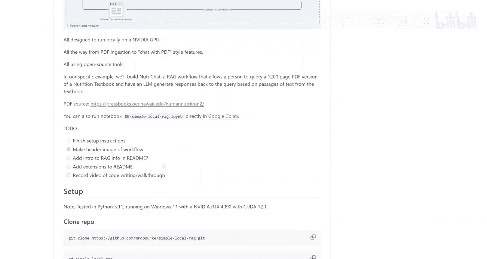

I'll show you how we could do this。So if you have a link somewhere。 So digital P D F。

 I could click on that。 that's going download。 I'll just show you that。 It's downloaded it。

 I think I already have one。And then I can just copy this link address。 So digital PDFf。

 And by the way， if this kind of like overruns their server。

 I might change it to downloading from Github so we can use Github's bandwidth rather than this open textbook。

 But let's just put this in here。

And I might also just come into just in case we need to。😊，Can we get the raw address from here， Yeah。

 for some reason。Anyway， I'll put that in there in a later section if we need to if we get an email from Pressbook saying that we we've overrun their server because a lot of people are downloading this P Df should be too bad so。

😊，The local file name。To save the downloaded file。This is where。Downloaded file。

 I forgot to turn graamly off。 I just realized， oh my goodness。 That's okay。

 So the file name can be P D F path。 We don't actually have to do that again。

 but I like just to be an explicit。 So send a get request， gap， get， send a get request。

 This is where we're going to use the request library。😊，To the URL， So response will be。

Request dot get。 And then we're gonna pass in the URL here。 So we're going， hey。

 we's just sending a message with the request library。 Does it， does something come back from this。

 And then what we're going to do is so。Check if。The request。Was successful。

So if responsese dot status code。So there's a whole bunch of different status codes for requests。

So you can look these up by going request。Status codes。There we go， Mozilla MDN should be good， yeah。

😊，Beautiful， so 200 is okay。 It worked。 That's what we're looking for。 So if the status code is 200。

We want to。Open the file。And save it essentially。 So we can go with open file name。

So the file name is our PDF path。File name， and we want to write binary。

 that stands for right binary as file。 So this is with as a context manager。

 And we go file dot right the response。 So this is the response up here。

 So we get the information from the URL。 we write response dot content。

 So the content that comes down from our URL。 Now， just note， this has to be the download URL。

RightBecause that's what's going to give us the PDF。 It can't just be this。

 It has to be the specific copy link address the download URL。

 Keep that in mind if you're trying to download other things from the internet。

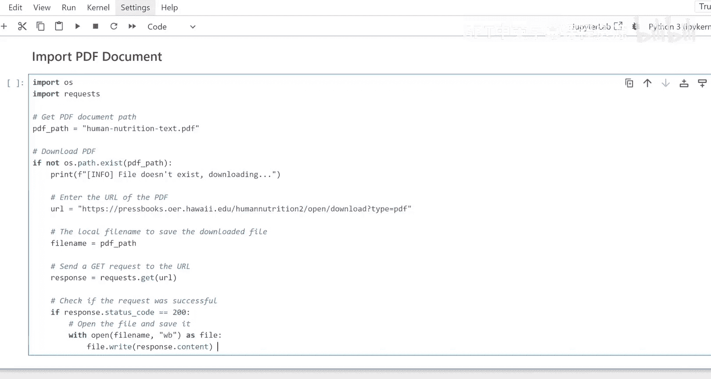

So then we can go。We'll print out a little message。Info， I don't know。

 I don't think I need an F string， actually。I just got in the habit of writing a lot of F strings lately info。

😊，The file has been downloaded and saved。As oh， actually， we didn't need an F string。Fhile name。

 I want the file name in there。Helpful information。Beautiful。

 print is your friend when it comes to debugging。And then we're to going to print。If it doesn't work。

 so if we don't get a status code。Info。We want。Faied to download the file。

And then we can return the status code。And we'll see what happened then。

Right we'll probably get another code， maybe 400 or something， or if we've overloaded this server。

 maybe something else， please let me know if you get an error and I'll write some code to enable the download from directly from GiHub or some other file storage system。

😊，So else file， if the file already exists， we don't want to， we don't have to re download it。

 you know。File exists。So this is what we should get。Ass no， if O， S path。If not OS S part exists。

 Sorry， I missed an S there。 Did you catch that， There we go。 Human nutrition test exists。 However。

 let's say we deleted it。 I want to show you this code working。 Now， this is the ultimate test。

That we were a good cooking show， but we've just deleted one of our ingredients。

 So let's run this file doesn't exist downloading。The file has been downloaded and saved as humannutritextt PDFdf。

 There we go。 We get it back。 wonderful。 Okay， so that's the beauty of writing programmatically importing your files。

😊，So now let's import the PDF。I'll get a new cell here。Oh， I don't want to turn that。I'll press B。

 escape M for markdown。We've got a PDF。Let's open it。So to do this。

 I'm going to use the P Mu P F library。 Now， there's lots of different ways to open a Pf。

 but I found that here we go。 Pi Mu P F， that this library in particular。

 was the best for opening our P D F。I used pi something pi PDFf。KitHub。 Now。

 this is where you'll probably take to do some experimentation。 You know。

 this is also a good P D F library。However， I found that this one returned the best text formatting。

 Now， of course， there are some settings I could play around with。

 But what I like to do is just try out a few different options。

 And if we' working on sort of a basic workflow， take the one that works the best to begin with and then iterate from there。

 So we can install that。 if you've gone through the setup up steps on the Github。

 you should have it available already， I believe it's in the requirements folder。 Yeah， Pu Pd F。

 There we go。 So let's start by。Import fits， so I'll just right here。Requires。Pip。Install。

Pi Mu PDFdf。See， and then I'll just link to the Github here。If you'd like to use it。Well。

 we're going to use it here anyway。Wonderful， so fits。 So that's another thing。

 It's not important as Pi Pdf。 It's fits。 That's just a legacy name for the library itself。

 And then I'm going to use T Q D M。😊，Because I like progress bars。嗯。That is also。

If you've installed T UDM， we'll see how to use that later on。

 and I'm going make a little helper function here。This is probably what you'll notice a lot throughout this notebook is I like to turn things into hell the functions all the time or just in code in general。

 it's very helpful practice。 So this is where we can do now I kind of know what we need to format ahead of time。

 So I'm cheating a little bit here。 but what you'll often have to do is when you import text in some way if it's with the PDFdf text format and Pfs is always quite different right。

 Look at the layout of this。 So importing the text in here won't necessarily be perfect word for word。

 So you will often have to write preprocessing steps。

 And so I'm only doing some basic text formatting here。 So performs minor。😊。

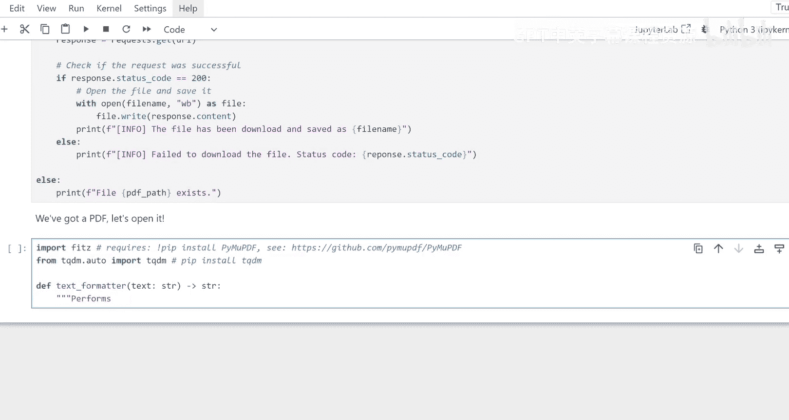

Formatting on text。And what I'm going to do is go cleaned text。

 All I'm going to do is do text replace Oh， excuse me。 I'm going to replace new lines with a space。

 Now， again， I know this ahead of time， and I'm going to strip the white spaces of the end。

 but you can put in anything that you want here。 so。Potentially。More text formatting。

Functions can go here。And return cleaned text because the better text that you use。

 the better formatted text that you pass to an LLM， the better potential your responses will be。

 I'm just gonna close some tabs here。 I've got a fair bit going on。

 Wonderful Now let's open our PDFd Hey， So I'm going to write a helper function for that and I'm going go open and read PDFdf。

This way we could use it somewhere else if we wanted to， so PDFf path is going to be a string。

 and then I'm going to return a list of dictionaries。

So list of dictionaries is one of my favorite kind of data structures because you can turn them into data frames。

 quite easy and explore them， but we'll see what we do here so to create to open a PDF with fits or PM PDF。

 we do fits。😊，t open member， that's our PDF library up there and I'm sorry I haven't off crumled yet。

😊，Come on so Doceaaglesfis。 openpdf par and I'm going to create an empty list here。😊。

And I'm going to call that pages and text because what I want to do here is this is my list， right。

 we're going to return this， but it's got nothing at the moment。

 but we're going to iterate through our doc and create a dictionary of text and page numbers and different information about our pages in the PDFdf。

😊。

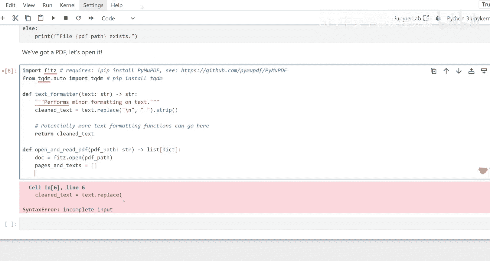

And then append that to that list。 So we'll see this in action rather than just talking about it。

So let's go for page number。Page number。Excuse me，typo galore page in TQDM。

 This is our progress bar enumerate。 So enumerate is going to enumerate an iterator and which just means say this add 100。

Pages page number will start 0， one，2，3，4，5 all the way up to 99 because Python starts at zero。

 right？So text is going to。Well we can get the text by taking the page in our document and using the method get text。

And then this is where we're going to format our text。

So text equals our function above text formatta and text equals text。Wonderful， so that's。Thisapp。

And then we're going to pages and text。 append our information。

 So this is where we want to get the page number。And this will be our page number here。 Now。

 a little tidbit that I've noticed in this textbook。 And again。

 this is kind of going be where you're going have to do some experimentation of your own。

 And depending on what your what data you're working with and our particular textbook。

 Why do we want the page number。 Well， because if we use a specific resource。

 we want the page number so we can jump into the text and find it out。 But if we go right up here。

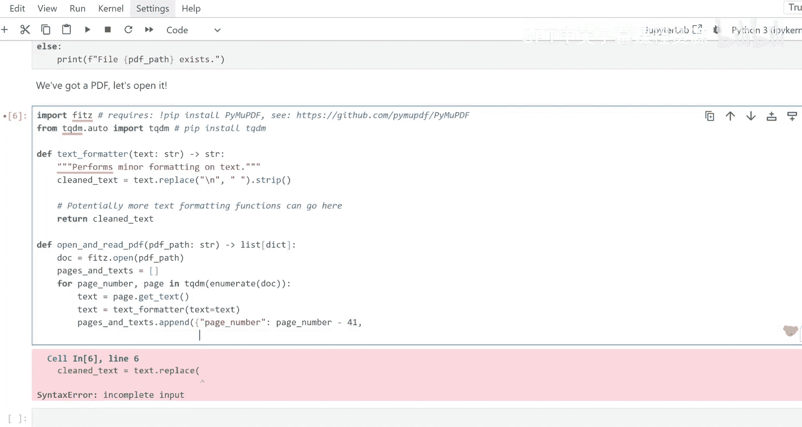

For our textbook。Again， this may be different depending on the data source you're using。

 I found that the page numbers actually start on page 43。So， I minus-41。

And that's just what I found by experimentation。 Now this we might not pay attention to this。

 We pay attention to whether our page numbers actually match the text that's going on。 So again。

 the P reader may not completely match up with page numbers here。

 So just keep that in mind when you're importing your documents。

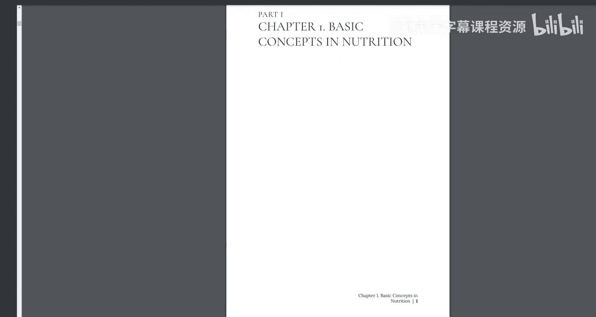

If you want the page number that is you don't necessarily need it， I just like to have it。

So cha count， so this is character count。 So we're just going to get the length of text to go how many characters。

 this is so we can perform exploratory data analysis on our text。

 We want to find out different statistics about them， how many characters are on a page。

 how many words are on a page， etc。😊，Word count。We can get， this is gonna be a rough word count。

 We're just going split it on full stops with space after them。 Oh sorry， No， for words。

 we just count the spaces， split the text on the spaces。And then。For sentence count。

 we split on the full stops so we can go。Page sentence count。

 I'm gonna call this sentence count raw because it's， it's not an official way to split。Sentences。

But it's， it works pretty good。 So we're just splitting it on full stop space。 So if we come in here。

 where's a sentence with a full stop space。

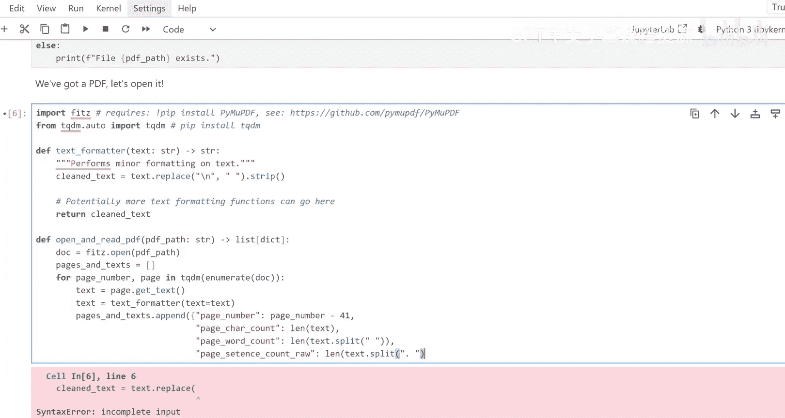

So in this case， there's a full stop space， and there's a full stop space。

 So this would be one sentence。

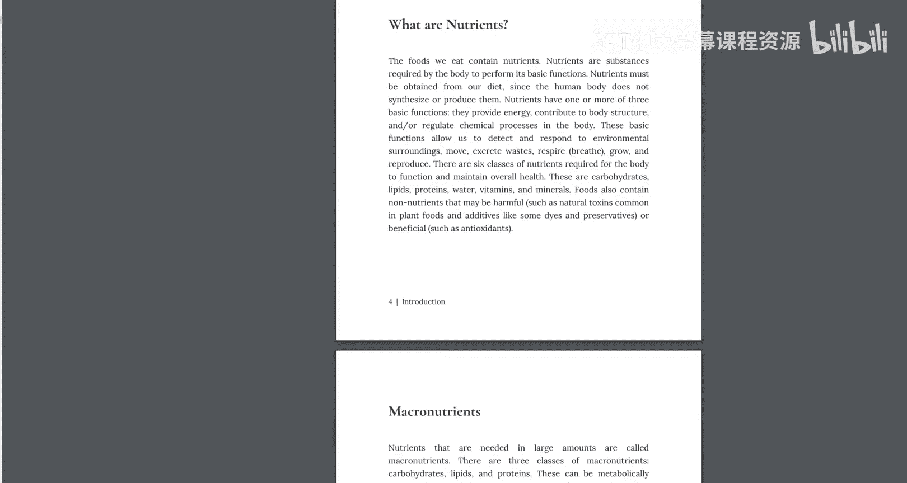

Beautiful， so let's come down into here。😊，And then we're going to go page token count。

 So what is a token。 Oh， we've come across one of our keyword。

 I told you we're going to find something like this。 explainplain the keywords as we go。

 So divided by four。 So one token equals roughly four characters。😊，So how can we find this out Now。

 if we go into there simple local rag， This is the repo we're working out of。

 If we come to our key terms。 There we go。 token， a subword piece of text， for example。

 hello world could be split into hello a comma world and exclamation point。

 a token can be a whole world word part of a word or a group of punctuation characters。

 One token equals roughly four English characters。 So 100 tokens equals roughly 75 words。

 text gets broken into tokens being passed to before being passed to an LLM。 So again。

 I told you we went through at the start， that machines love numbers。 people love words。

 but machines love numbers。 So before words go from。😊，Go to Chay B T。 This gets tokenised。

 So if we go。What is a token？In LLM。What is a token？I believe Open AI have a great。

Explanation of this。Open AI。There we go。 What are tokens and how to count them。

 So tokens can be thought of as pieces of words before the API processes of the request。

 the input is broken down into tokens。 So you'll hear this a lot。 Token count。

 context window all that sort of jazz。So one to two sentences is about 30 tokens。

 one paragraph is 100 tokens， 1500 words is 2248 tokens。

 so this is important to think about when if you had， oh what's a tokenizer tool？😊，Does this work。Oh。

And do some text， Ho， my name is Daniel and I love machine learning。😊。

I'm giving a tutorial on RaG pipelines and would like to explain tokenization。What is tokenization？

There we go。 So we got 33 tokens， beautifulutiful token ideas。 there， wow， this is a great demo。

 Okay， the things you find out management working sporadically。 There we go。 So now we have this is。

😊，The text before it goes to our model， it's going to be tokenized so it gets turned into numbers。

 So we don't necessarily have to understand what these are。

 This is for our machine learning model to understand what they are。

 But I just want to show you that this is what I mean by token。

 We take the words and we break it into subword pieces。 or we turn it into numbers。

 and we pass that to an LM。 And it's going to give us tokens back。

 but then we decode them into words。 But let's keep going。 So there's our token count。

 And one more thing， of course， we're going to need the text， right。😊，And we want to， from here。

 return。Pages and text。And then what I want to do。Let's go pages and text equals open and read。Pdf。

So PDFf path equals。Pdf path， and then we'll get pages and text。

And then we'll get the first two samples because this will be a list， right？There's TQDM working。

 nice and fast。 Oh my goodness。😊，Okay， how cool is that。 So page negative 41。

 How about we get some random， I like getting random samples， you know。

 so import random and then randomly sample。😊，Pages and text， you never know what you're going to get。

K equals 3。O， right， so we've just read in all the pages of our PDFdf。

 and now we have it in a list of dictionaries that we can work with， page number 600。😊。

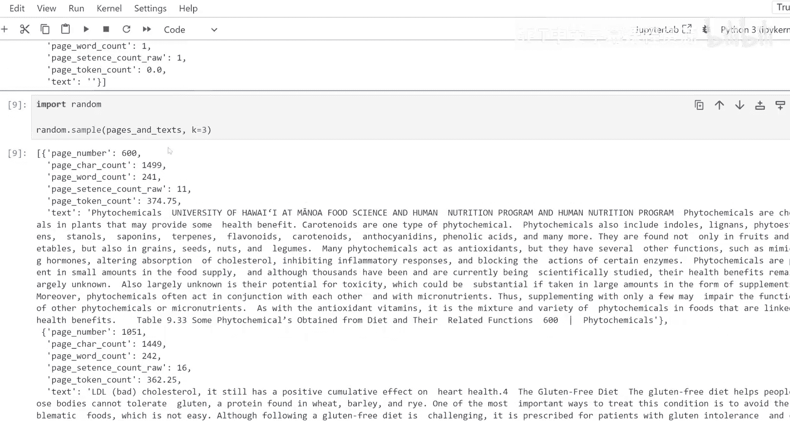

Okay， so this is about phytochemicals， phytochemicals in plants。😊。

Are chemicals and plants that may provide some health benefit。

 caratinoids are one type of phytochemical。 Phytochemicals。 Also。

 let's search this text to see if our page number is correct， right， This is where。

Keyword matching can come in handy。Are we on page 600。 There we go。 Okay。

 so that's with a little bit of experimentation。 So now we've got a way to interact with our text programmatically。

 How cool is that。 So that's page number 600。 beautifuli。

 We couldn't just potentially read it from down here。 But I just decided to enter it manually。

 So our page numbers line up。 Okay， what should we do next。 Well。

 how about we get some stats on the text。 right， now this is where you'll see why I got the token count。

 the character count， All that sort of stuff for。😊。

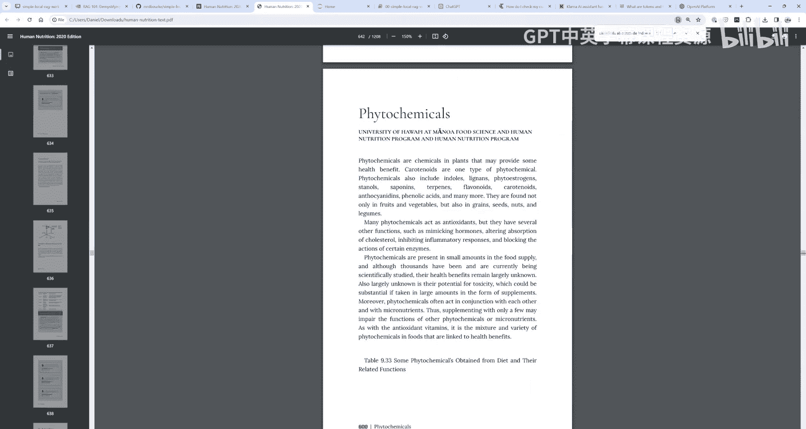

So import pandas as PD。And we can turn， this is why I also turned out。

Pages and text into a list of dictionaries because pandas works great with that data type。😊。

So pages and text and then Df will check the head。There we go。 Okay， beautiful。

 Now we've got a good breakdown over the data that we're working with。 So we've got page number。

 character count， word count， sentence count， raw。 So this is a rough estimation。

 and then token count。 And then， of course， the text。 So this is 200 tokens on page。

 Well we've got negative 37， because it doesn't quite start that。 This's not。

 that's not the best way to do it。 But it works for now。😊，So let's go D F dot describe。

 So this is going give us a little breakdown， and then we'll round it to two decimal places。

 Wonderful， So we have 1200 pages。 That's quite the big textbook。 Now， again。

 maybe minus about 150 in references and all that sort of stuff。

 But that's still over 1000 pages of text。😊，We have an average sentence count per page of 10。

 We have an average token count of 287。 So if we go by this math， where is it L tokens。

 So how many words should that be。H4 chas in English。 So we actually have the word count there。

 don't we？Silly me。 So about 200 words per page。 beautifuliful。 Okay， now。

 why would we care about the token count， Let me just write this down。

 Why would we care about token count。So this is a little teaser for what's to come。 So tokens。

Token count is important。To think about。Because。1。Ebedding models don't deal with。Infinite tokens。

And two， LLMs don't。Deal with infinite。Tokens。Right。

 so we can't just pass all the text in the world to our embedding model and all the text in the world to our LLM in fact。

 that it would be quite computationally wasteful。 so for example。😊，An embedding model。May。

Have been trained to embed sequences。Of 384 tokens into numerical space and I'm not making this up。

 That is the embedding model that we're actually going to use。 So all MP net base V2。

How I know that off by heart。 Don't ask me。 But this is the sentence transformer model that we're gonna use I haven't liked that。

 wow。So it's actually from the sentence transformer library。 So this is hugging face。

 a great resource for many different open source embedding models， as well as Lms。

 We're gonna to be using this for both our models， actually。

 But this is our embedding library sentence transformers。 And I've got this。

 We're gonna get more to embeddings later。 But I've got this linked in our little whiteboard as well。

 But let me just quickly show you what I mean by token limit。

 So we have pretrain models on the side here。 then we have all MP base V 2。 Now， again。

 this may not be the the state of the art latest and greatest embedding model。

 but it is easy for us to use。 So just keep that in mind which embedding model to use is a very experimental choice。

 I've just found that this one works great， pretty much out of the box for many different problems。

 So the max sequence length。 There we go 384。 So that means it can only take in 384 tokens。

 If we put in a sequence that was 500 tokens。 It would get shortened down to。😊，384 anyway。

 so we might be losing some information in that。Then if we go to the M tabab， leaderboard。

 hugging face， massive text embeddings leaderboard。

 so remember an embedding model is something that's going to turn a string of text into a numerical representation that is useful。

So we have a lot of different models here。 I'll let you explore this on your own time。

 But this is the max tokens。 Some models now take up can use 32000 tokens。

 So that's a lot of pages of text。 However， they have quite a big model size。

 Our model size is about 400 MB。 So It's quite small。

 This is something a lot of different things you'll have to take into a consideration when you choose an embedding model。

 So we'll talk about that later。 But this is just where the token count comes in。

 That's why we did our analysis to go the rough token count。

 So we could figure out what's on each page， right。

 So we can embed a whole page of text with our chosen embedding model。 So this is。😊，Sentence。

Transformers。All MP net。Base V 2。 Now we're going to see this hands on in action later on。

So don't worry too much about it。 If you want to read the documentation。

 you're more than welcome to go ahead and do that。 The world of embeddings is quite a deep one。

So and LLMs don't deal with infinite tokens， So that's the embedding model。Gamly。

 I'm turning that off next one。 I promise you， this will be the eternal battle of the video is Daniel versus Grly。

😊，Ebedding model， okay？And then as for LLMs。😊，They can't。Except。Infinite tokens。

In their context window。So this is another key word that I said we've come across。 So oh。

 it's not there。 Oh LLM context window。 there we go。

 So the number of tokens and LLM can accept as input。 for example， as of March 2024。

 G4 as a default context window of 32 k tokens， about 96 pages of text but can go up to 128 k if needed。

 So let's look up G 4。😊，Token limit。4096， where's the documentation here we go。😊，The documentation。

 September 2023。Anyway， let's try Clade 3， that's another model that's come out recently。

 Cla 3 pricing。Claud API。Yeah， well here's another thing to take in mind is that yeah。

 0200 k token context window， so that means it can take in 200 k tokens in this little chat box here。

Right， so that's a lot of tokens in one hit。 But why。

 if we're getting charged per token like we are here。

Why would we want to use for $3 per million token。 So that means we can go。 there we go。

200000 context windows， token context windows。 So well， that's a mouthful。

If we're getting charged per token per million tokens， wouldnn't it be smarter。

 We could use all of them in one hit， but wouldn't it be a lot smarter to use less。Right。

 because a lot more cost effective。 Now this is， again， this is just saying with an API。

 we're not even talking about locally。 if we want our models to run fast， we want to use less tokens。

 or we want them to we want to get more bang for our buck with our tokens。

 We don't just want to pack in as much tokens as we can。 We want to pack in good tokens。

 Remember the saying in machine learning， good data in， Good data out。

 So we've imported a Pdf document and we've got information here。

 So what's our next step in our pipeline。😊，Let's go to O。We've done this step。

 collection of P D F documents。 We've imported that。 So pre processed text into smaller chunks。

 E G groups of 10 sentences。 How about we take a small break And we do that in the next section。

 If you want to try and jump ahead， I'm going to write a little heading here。

 So maybe we call it further。Text processing。嗯。Splitting pages into sentences。

If you want to jump ahead and do that， and maybe we break down each of these into groups of 10 sentences or so。

Give that a try。 And well， we'll tackle that in the next section of the video。 And we're back。 Now。

 let's do some further text processing or preprocess。 So we want to split our pages into sentences。

 We've got a dictionary up here of lists or sorry， a list of dictionaries with all different pages of text。

 But maybe we want to chunk them up， right， And how about we chunk them into groups of about 10 sentences。

 Now， we've already done this in a sense， because each page has on average 10 sentences。

 But what if we had a P Df with much denser text。 So Pdf page with dense text。

 What does this look like。😊，Images。Yeah， what if we had something more like this。Right。

 that's not even as dense as what I was thinking。 maybe something like this。Um。

 or something like this。We want to split it into smaller chunks， One， because it's， I mean。

 more understandable for me。 I don't know if about you。

 but I look at like dense pages of text and sometimes I get scared。

 I like to split it into sentences， so。What we can do here is split our pages into groups of 10 sentences。

 Now， we've done this by splitting on。So。Two ways to do this。

So number one is we've done this by splitting on the full stop and space。 That's a really， sort of。

 I guess， hacky way of doing it， but it kind of works。Split on that。 and then two。

 we can do this with NLP library。NLP stands for Natural Language processing。

 which is what we're doing， processing natural language with code。

And we can use such as Spacey is one of my favourites。

 which is what we're actually going to use and an LTK。 So I'll just show you here。😊。

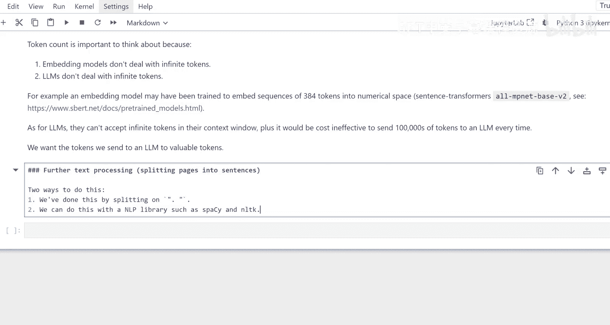

Spacey installs， if you want to get started with Spacey。

 we should have it in our environment already。 thanks to the install， but beautiful NLP library。

 open source as well。 Oh， we've got too many tabs。 So Spacey and NLTK。

 another very helpful one if you'd like to delve into the world of natural language processing。

 that isn't just all about LLms。 you do still need to process preprocess text and prepare it for LLMs。

 So。😊，Let's try that。 Let's use spacey， Hey， so we can start by importing spacey。Dot Lang dot N。

 What we want to do is split our text into sentences。 So we know how many sentences are on each page。

 So we want to support English。 And then we can create an instance of English。With Spacey。

 And then we're going to create a pipeline。 So Spacey， like we're building a rag pipeline。

 Spacey also deals。 I'm just going to close some tabs。 Excuse me。' got a lot going on here。

 Spacey also deals with pipelines。We don't actually need those， those or those beautiful。

 So let's go add a sentenceizer。 and you'll be very happy to know that I turned off graly。😊，Yep。

 I know。Big battle， but it's off。You can now see my typos in their full glory。

 so we're going to add a sentenceizer pipeline here with Spaceies so Spaceys sentenceer。

Let's go into here。 So cent zia， I can't even say it。 Centensizer is basically。

Turning text into sentences。 So pipe。There we go。If you want to read the documentation， I'll。

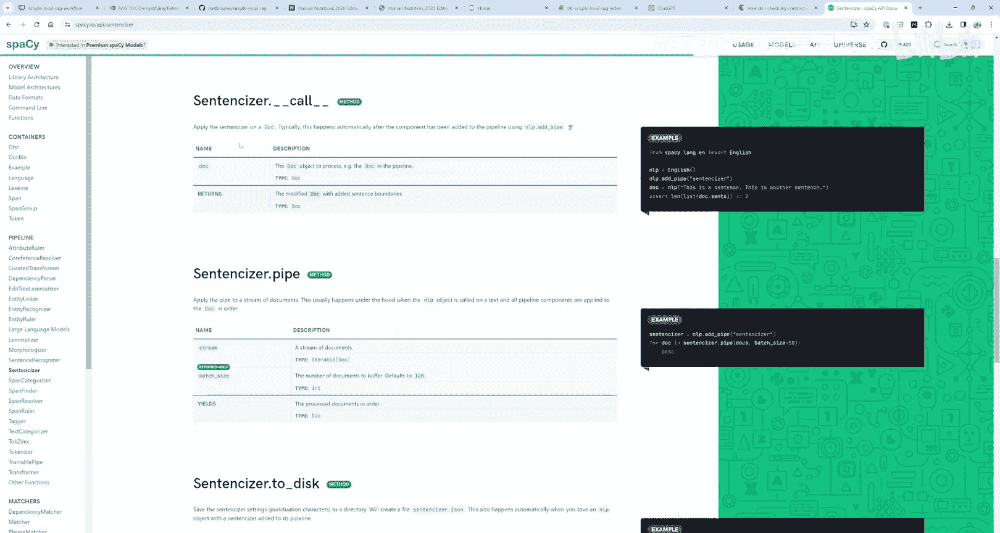

Link that there。Never underestimate reading the docs， so Nlp。adpipe。Sentenizer。

I think I've said it five different ways already。 and now what we're going to do is we're going to create a document instance。

 that's what Spacey calls it。 So a document instance as an example。😊。

So just want to show you how this sentenizer works Doc equals NLP and if we pass in this is a sentence。

 we want to pass in a string with two sentences in there。

 so this is another sentence and if we're feeling really lucky how about I like elephants。😊。

There's three sentences in there。 so let's now assert。This will throw an error if it's not correct。

 list doc。So our document dot sense。So sense as in sentences。And we want this to equal three。

 There should be three sentences and now print。At Al。Sentences split。So list doc scent。

What do we get wrong here？From Spacey dot Lng， import English。Oh， excuse me。 From Had two imports。

 Did you notice that。There we go。 So now we get a list back。 So you might be going， Daniel。

 why do we why do we not just split on dot space？ Well， that's a very good question。

 That would also work for this。 However， Spacey is a library that is sort of it's trained in a way。

 I'm not sure the exact methodology for the sentenceer。 or I know that in practice。

 it works quite well。 for splitting sentences based on rules and other statistics and whatnot rather than just full stop space。

 So you don't necessarily have to use it。 I just find it it's very robust with dealing with， I mean。

 I think their tagline is robust N LP pipelines。😊，But nonetheless， let's use it。 So for item in TQDm。

Pages and text。We want to get a progress bar when we can。 So let's create a sentence。

So remember pages and text is our dictionary， I'm just going to put a cell here。

Pages and text show you what that looks like for the first example。 It's a list of dictionaries。

 So this is the first one。 It's just the title of the books So the text actually isn't that long。

 If we get maybe one at about 600。 There we go。 We get some more text。 beautiful。 So sentences。😊。

We want this to be。Equals a list of NLP dot item。Sorry， pass the item text。 So this field。

Pass that to NLP， which is the pipe up here pipeline for sentenceizer。

 so we want to pass in that text。And then we want to get the sense from that sentences。Oh。

 and I forgot。That， that's a string field。 And that's too many teas。

 Maybe I shouldn't have got rid of graling。 Okay， and now we wantan to。😊，Make sure all。

Sentences are strings， so the default。Type is a。Spacey data type。We don't actually want that。

 We don't need that for now。 we can just turn it all into strings。

 Otherwise we might find that we get some errors later on。So。

Always work in standard data types if you can。Unless you need to。 So for sentence in item。Sentences。

Probably a more efficient way to do that。 Two loops。 if you know a more efficient way。

 please let me know。 So count the sentences。And when we go item， now， this is just a simple way。

Page sentence。Count spacing。We're just gonna get the length of。Item。Sentences。Allright。

 does that make sense， Let's loop through and see what's going on。 sentenceentences is not defined。

Sentence， there we go。Items is not defined。Excuse me。Typo galore。Beautiful， nice and quick。

 There we go。 Okay， so let's now inspect an example with our good friend， Rand。😊，Random sample。

Pages and text and。K equals1。So we've got a random sample here， this is from page 1098。

 there is our raw text。And you notice here that we've split it into sentences， this is beautiful。

 thank you， Spacey sentences。😊，Wonderful， okay， so now we have sentence count with Spacey is 13。

 and the sentence count ro is 13。 So they line up。 and， in fact。

 it's probably going to line up on many different cases。 But for now。

 let's just stick with Spacey's sentence counts，13。 And then we can expect it again， In， sorry。😊。

As a data frame， we've got some new fields here。Maybe you have data frame， pages and text。

And then we're going to add Df describe。And we're going to go round two。Dev。😔，Describe， There we go。

 beautiful。 So looks like a raw sentence count came out quite similar to Spacey。

 Spaceies are slightly less， but we're going to stick with spacey just because it's probably a little bit more robust than splitting on dot space。

 So we'll stick with that as our sentence count。😊，Now， what can we do？ Well。

 we've got our text split into sentences。 This one has 13， which is probably slightly too many。 Well。

 it would all fit in our embedding model。 But you know what we're going to do。

 we're going to group it into groups of 10 sentences。 now， and that number is arbitrary。

 you can find out through experimentation。 What the best way is to group your text together。 In fact。

 this concept of chunking。 So you'll find that said a lot in or text splitting。

 So getting our text into smaller groups is still an active area of research of how to best do that。

 My advice is to experiment， experiment， experiment。 So。😊，The concept of splitting。Larger pieces of。

Text。Into smaller ones is。Often referred to。As tech splitting。Or chunking。There is no 100%。

Correct way to do this。We'll keep it simple。And split into groups of 1 sentences。However。

You could also try。5，7。Five， seven， eight。Whatever you like。 And they could even be overlaps， right。

 So we might get sentences 0 to 9 in one，1 group and then sentences8 to。18， in the next group。

 if you're know what I mean， So there's one overlapping。

 And there are libraries that can help do this。 So if we go Lang chain。Text splitting。Text split。

 There we go。That's for Lang chainang。There we go。But we're。

 we're just going to do this with pure Python， right， so。If we can do it with pure Python， well。

 we can do it with the frameworks later on， so。There are frameworks。Such as。Blank chain。

Which can help with this。However。We'll stick with Python for now。

And there's a whole bunch of different options there。 So let's write some code to split our。

Sentences into groups of 10 or less。 So for this example， we get the first 10。

 which goes to about here。Maybe that's not correct。

 so that'll be a group of 1 sentences and then there'll be another group of one， two， three。😊。

So two groups in that。 So 10 and 3。 but that'll be recursive over every example that we have。

 So first， we're going to define。Oh， and just to remind us why we do this， so before we go。Why。

We do this。One， so our text are。Easier to filter。 So smaller groups of text can be easier to inspect。

Then large。Passages of text。2， so。Our text chunks can fit into our embedding。Model context。Window。

So as we saw before， EG 384 tokens。Has a limit。And three， so our。Context。Past to an。

L L M can be more specific and focused。 So if we have a limited amount of tokens。

 we can pass to an embedding model。 We want to make sure that it fits within that limit。

 So our embedding model is 384 tokens as limit。 Other models may have embedding models may have higher token limits。

 So that's something to keep in mind。We'll see that when we choose a me model and our LLMs also have specific context windows that we may be quite large。

 but we don't necessarily want to use all of that because that's going to one cost us processing time and two cost us money if we decide to use an API so something to keep in mind。

So let's define our split size。To turn groups of sentences into chunks。So， our numb sentence。

Chunk size equals 10。 and let's create a function。To split text。Or split list of text。Recursively。

Into chunk size。So， for example。A G。List of 20。Would go to two list of 10。Does that make sense。

And or so we had。Or so we had 25 sentences。 I don't think we have one without many。

 but it would go 10，10，5。So just continually do 10 until you run out。

So we'll create a function called def split list， and then we go input list。😊。

Take a list of sentences as input。And then we'll go。The slice size will be。An int。

And this is going to return a list of list of strings。

And this is actually an input list of list of strings， or sorry， list of strings。Wonderful。

 so now we can do this in one line of Python， I believe this is the power of list comprehension。

 So we're going to get our list comprehension， and we're going to start at I to I plus split size。

 We'll get I in a second。😊，Right so we're going to index on our list。

And then we can go for I in range。 We'll start it at0， and then we'll get the length。

 So we'll go a range of say our input list was of 25。 So 0 to 25。

 and then we'll go slice size as our step。Right， so that should work。

And we can find out if it does by recursively going over it。

 So let's just create a list of 20 different things and see what happens。 So list。Range 20。5。

Test list。And then we'll go split list。On our test list。Oh， slice size， we can just do this as nu。

Sentence， chunk size。Split size is not defined。A slice size。Excuse me。There we go。 beautiful。

 So we get one list of。0，1，2，3，4，5，6，7，8，9，0，1，2，3，4，5，6，7，8，9。 Oh， we might you to go plus one。

And then it's got 20。 So we get a little bit of an overlap。How would we fix this。Okay。

 so it turns out that the my brain was mud and it didn't work。😊，We don't need the plus one。

 It actually works just like that。 and I was counting wrong because Python is zero indexed。

 So excuse me， I've been tripped up by zero indexing。

 but let's now that we've known that our function works。 Let's run it over our sentences。😊。

Isn't that funny。It's always the simplest errors off by one errors。😊，And text and split。

Sentences into chunks。So we're going to go four item。In TQDM。Pages and text。I love the progress bars。

 so we're going to have a new category in the item， this is going to be sentence chunks。

And then we're going to equal split。I'll function up here。Split list。

And we're going to our input list。😊，Is going to be item sentences。And。哦。Call my notfalls stop。

 And then our slice size is going to be numb。Sentence。Chunk size。 again。

 you can customize that to whatever you'd like。 We're going to use 10。

 and then we're going to count the number of chunks that we have for each one。

 So chunks will be groups of 10 or less sentences。Always getting stats， right， That was pretty quick。

 That's the power of pure Python， right。So now let's randomly sample from our pages and text。

With k equals1。There we go。 Oh， we're getting some rich data here。 You know。

 sentence chunks is's all the same， just slightly manipulated。 We've got sentence chunks。

 and we've got number of chunks is one。😊，So that's just one chunk。

 Let's keep going till we get one with more than one chunk。Number of chunks。 remember， on average。

 we have about 10 sentences per sample，2， there we go。 But the second chunk isn't。

 doesn't have that much， right？ So it has。Yeah， not too much there。

 So that must be a reference group， right， So this is where it comes important。 you'll see later on。

 we can filter out samples like this that don't contain that much information。 So we want to keep。

 so but the first chunk has a lot of helpful text， right？

 critical that parents and caregivers direct children towards healthy choices。 That's。

 that's important， right。So we have one sentence chunk。That has a lot of information。 But this one。

 we could basically filter this out。 So that means that we've improved our data pipeline。

 We've improved a potential input to our model。 We're using better quality data here。

 It's not always about more data。 Often， it's， it's a balance between the two quality and quantity。

 So let's get some stats while we're here。😊，So， Df。Equals pd。U data frame， always getting stats。

Pages and texts， and we're going to go Df not describe on round two。Beautiful， so now we have chunks。

 beautiful。 so we have about 1。5 chunks。 Now， keep in mind that it'll it'll round up closer to two because this is counted as one whole chunk。

 So that was expected。 We have 10 sentences， it's going to be about 1。

5 chunks per per sample because2 it's going to just round up whatever whatever is here。

 even if it's only one sentence。 we'll just round up to two chunks。 So let's keep going。

 What we want to do next is we want to split each chunk into its own item。😊。

So what we've got here is this is getting pretty big the amount of information here。

 But if a sample has two chunks， we want each of those to be its own item in the dictionary。That way。

 we can attach metadata to it and all that sort of different stuff。

 But it's a lot easier to deal with each sample as its own individual sample。 So in our case。

 we have our sentence chunks list。 We would want this。To be one item in our list of dictionaries。

 And we would， we would want this to be one item。 So effectively。

 these become two samples in our data set。 So let's now do that。So I'll create a new heading here。

 so splitting each chunk。Into its own item。And then what we're going to do later on is embed each item or each chunk。

😊，Right， so we'll see this later on。 But let's right here。 we'd like to embed each chunk。

Into or each chunk of sentences。Into its own numerical representation。

 that'll give us a good level of， I'll just write this down。 That'll give us。A good level of。

Grranularity。Meaning。We can dive specifically。Into the text。Sample。That was used in our model。

That's what rags all about。 We want generation with references。 So I'm going to import R E。

 which is rex。 And what we're going to do is split each chunk。Into its own item。So。Pages。And chunks。

Excuse me， fourth time luckytying that。😊，I might need to go for a walk soon。

 and we're going to go for item in TQDm。😊，Pages and text。So I've changed this。

 We're going to create an empty list of pages and chunks。

 and I'm going to take our pages and text and break it into here。 So this will no longer be pages in。

 while it will still be pages in text， but we're going to just put each individual chunk as its own item into this new list。

 And so what I'm going to do is for sentence chunk in item。Sentence chunks。

So we've got a loop inside a loop here。 So what I'm saying is for each item loop through the sentence chunks。

 and then what I'm going to do is create a chunk diict。

So an empty dictionary and then in that chunk dick， I want to enrich it with some information。

So I actually want to put the page number。So I know which page which chunk of text came from。

By the way， when I say chunk， I mean a chunk of texts， so a group of 10 or less sentences。

Now I want to join this is a little important point because our sentences。

 our sentence chunks are going to be lists of sentences， they're actually not a paragraph。

 we want to put these into a paragraph so we're kind of breaking them down into lists and then joining them back into a paragraph。

So join the sentences which may sound like a bit of work， but we're doing it programmatically。

 so it's going to do it for us， so join the sentences together into paragraph like structure。AK。

 join the list of sentences。Into one paragraph。Okay， sound nice and easy。 So what we want to do。

If we want to go joined sentence chunk。Equals and we're going to join just like that。Join。

 you can join a list。And we're gonna pass in the sentence chunk， which should be a list of strings。

 And I'm going to replace the double spaces。 Now， again， I've I've done this ahead of time。

 So I kind of know the preprocessing that we need to do on the text。

 but this is going to be an experimental thing that you'll need to do depending on the data that you're working with。

 And then we need to perform。 we don't necessarily need to。 But you'll see actually。

 we'll perform this step after how about that。 I'll show you where we we bring in the reix。 So chunk。

😊，I want to put in the sentence chunk。And we're going to go joined。Sentence chunk。

And then let's get some stats， hey。Get some stats on our chunks。M。😊。

That just sounds funnier to me to say so chunk。😊，Chart count。

Now it might seem like we're writing a lot of code now。Lnk join sentence chunk。

 and that's on purpose。 I wanted to be as verbose as possible in creating this tutorial because we can functionise a lot of this later on。

 So basically going from import the Pf to preprocessing the text。

 that could be a few functions joined together， you know， but we want to do it from scratch。

 and we're doing it from scratch。 So we'll get the word count as well。

 So join sentence chunk not split。 I'm going just get the crude word count here。😊。

So just splitting on spaces。And chunk di， we'll get the token count。

 which is just the character count or roughly token count。Just the character count divided by4。

Langed， joined。Sentence chunk。Divided by 4。 and then we'll put a note here。

 and then we'll go one token equals。4our。Cles。And then one last step is that we have to append our dictionary。

Pages and chunks。append and we're going to append our chunk di item。Beautiful。

 now let's see how many pages and chunks that we have。Run that joint sentence chunk is not defined。

 Oh， did you catch that little typo there， Oh， wow， that's beautiful。 The power of Python。

 right nice and quick。 So we have 1800 chunks。Wow， 1800 chunks of different sentences。

 so let me show you hopefully it comes up in a random sample why we might need to pre process our texts a little bit more。

😊，And again， we don't necessarily have to do all this pre processing， but the good data in。

 good data out。So when we join our sentences together， where's a full stop？Not too many。

Examples here， let's get another one。Oh， maybe it there we go。 Yeah， so see how they。Yeah。

 there we go。Okay， so we don't have a space there。We don't necessarily need to fix this。

 it should work it itself out later on， but if we want to put in the best quality text out there。

 so because we've joined them， all the sentences， even though there's a capital letter at start。

 has just been pushed right up against the full stop。So we can fix this by using a little bit of rex。

 So what we're going to do is R， so this is R， which stands to rex。

 we're going to substitute and we're going to use this rex pattern。Which is。

/lash dot so I'm going to I'm the best at explaining rex so I'm going to I've just precoded this so what we're going to do is I'm going to write this out and then we can ask ChayBT to explain it for us。

啊。Dot。1。And then joined。Sentence。Chunk。So what this does is it goes from。That。2 for a capital letter。

 So this is any capital letter add a space。 So if there's a pattern that follows this。

 So dot any capital letter， change it to have a space。 and then that capital letter afterwards。

 So it makes sense。 So we want that to turn into。That。And。Willll work for any capital letter。

So if we wanted this explained， we can use our friend Chad。Can you explain。This rejectx。

With an example in Python code。So we'll let that generate， see what happens， but in the meantime。

 let's pre processcess our chunks。 We'll get it out。We get one with a bit more text。 there we go。

 we've got spaces here。There we go， space， space， space looking good， All right。😊。

Nothing gets me more excited than having well pre processcesed data。 So we have space F beautiful。

 Now， what's Cha GBT got to say？😊，This is a sentence。 Here is another one。 there we go。

So Irisan sub pattern Reple string。So explained， looks for a literal pattern， literal period。

 The backs slash is used to escape the period since the special character in rejectjax。

 meaning any single character when escaped。嗯。A is Z captures a group of characters that are uppercase letters from A is Z。

The Rple R 1 explained R dot1 explained， indicates that a period followed by space should be placed in the tanks。

 One refers to the first captured group from the pattern。 In this case， the upper case letter。

 followed by a period， there's a little example。 Bea。 I love that。 Thank you， Chay beautyti。

 So now let's get a little bit more stats about our pages and chunks。😊，So。Df es Pd。Data frame。

 pages and chunks。And then we're going to go Df， describe， and we're going to go round two。Okay。

So chunk token count on average is about 180。 The max is 457。

 So there is one that well have some information cut off in our embedding model。

 Just recall that our embedding model has a max token size of 384。

 So that means that approximately for this one with the max sample。 4，57-384。

 We're going to lose 73 tokens of information。 So ideally。

 all of our chunks would fit into our embedding model。

 So all of our chunks would be below 384 or below。 And the vast majority of them definitely are。

 but there will be a couple that get cut off。 So this is just something that you'll have to keep in mind。

 maybe you do a bit more recursive shortening to make sure that all of your text chunks fit into your embedding model。

 But I'll leave that for you to explore。 For now， we do have a lot of chunks that maybe below some minimum threshold。

 You remember how we saw some that we're only about a sentence。 Yeah， there we go。

 So there's a minimum threshold。 well。😊，Could we set a minimum threshold。

 Because is this really that valid information if we were。

 if we were asking questions about nutrition textbook， such as an actual question。

 like the foods high in fibre， will that。

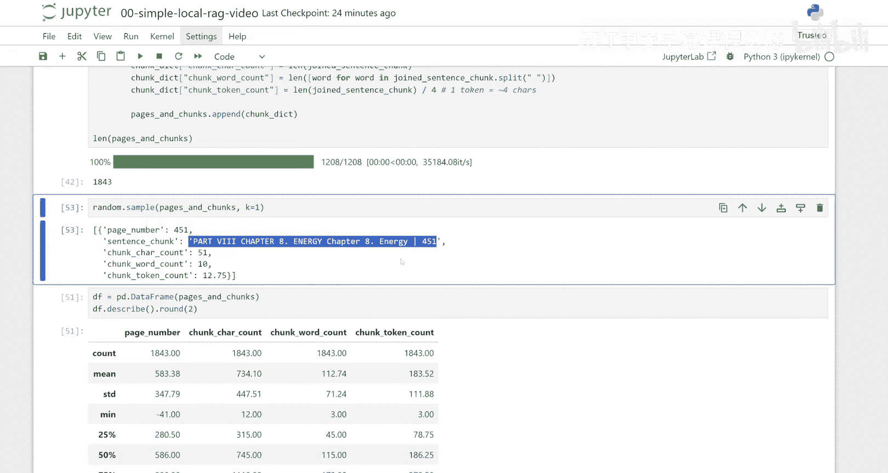

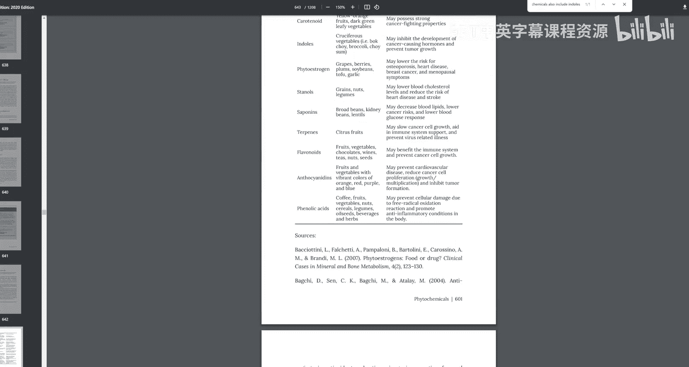

Return anything useful。 Not really。 So it's going to take up some processing power that we don't actually need to use。

 So how about we create a filter for sentences that or chunks that are under 30 tokens。

 Let's get rid of them。So let's just and again， this is a limit that I've experienced experimented with。

 in your case， you may want to experiment with your own limit of a minimum threshold and see what works with your data。

 So show random chunks。With under。30 tokens in length。So I'm just going to write a note here。

And I'll go。Filter， chunks of text。For。Short chunks。These chunks may not。Contain。

Much useful information。So let's set a limit。Mean token length。Equals 30。

And now we're gonna go full row in。 We can use our data frame here， D F， and we'll go。Chunk token。

Count。If that is greater than or sorry， less than or equal2。Min token length。We want to sample。

Let's get five or so， and then we'll iterate through the rows。It arose。

 So this is just basically saying， hey， go to this data frame。Do you have that head？

And find the rows in this data frame， our' chunk data frame with less or find five random rows with so this would be one。

 not necessarily because it's a random sample， but this would be one。

 find the rows with less than now equal to 30 tokens and let's print some out hey。

Print will make a nice F string here， chunk token count。And then we'll go row one。We'll go chunk。

Token count。And then we'll get the text。And we'll get row。1。Sentence chunk。So it kind to work up。

My need a。Different。Inverted commas there。Beautiful， okay。So chunk token count。

 So these are all under 30 or equal to 30。 And look， they're mostly headings， right？ So this to me。

Okay。There's one useful sentence， maybe。Okay。Another useful sentence maybe。 So this is， again。

 where we'll have to sort of do some experimentation of， yeah。

 most of them are just links and references， right。So again， if we wanted to。

 what we could do in our chunking is overlap with sentences， so instead of splitting 10。

10 and under 10， like we did like we did here， we could go  zero to9 and then have 10 up there and then we start this one at  nine。

And then so on and so on。 so on。 So we've got an overlap of the paragraph。 So we。

 we're covering all of our information。 But for now， let's just leave that and go filter out。

Data frame for rows with under。30 tokens。So pages and chunks。So less than a sentence。

 a sentence or less。Over mean at token length。Equals， and I'm gonna go D F， D F chunk。Token account。

And then I'm going to go min。Token length。And then I'm going to go to dictionary Orient。

Equals records， this is going to give us back a list of dictionaries， one of my favorite data types。

Pages and chunks。Over min token length。There we go。Okay， so that's the first two。 Let's， as always。

 get a random sample。I'll copy this down there， so we don't have to type it out。Okay， equals one。

There we go。 Where is your money invested， What college do you attend。

 evidence based approach to nutrition。Beautiful。Okay， so all of these chunks。

Over 30 tokens in length。Some of them may be。Small， some of them may be long。 beautiful。

 That is our data pre processed。 So what we are up to next is。😊，Embbedding our text chunks。

 holy smokes。 this is exciting。 So if we come over to our rag workflow。

 this is where we've gotten so far。 it's take it now I've done this on purpose。

 We could actually do this in a couple of lines of code with a framework。

 But I wanted you to see the kind of steps that it goes in to taking a random piece of data and preprocessing it into smaller document chunks because this is what you'll often have to do。

 your data won't always be in perfect format。 So we've written python code to do this step and we've inspected our data on each step of the way。

 Our next step is to take these smaller document chunks and turn them into a numerical representation。

 we're gonna get an embedding model to do this specifically from the sentence transformers library on hugging face。

 Now I'll cover this in the next section of the video For now， I'm gonna take a little pause。

 take a little break。 go for a walk， move my body around。

 and I'll be back soon and well embed our text chunks into numerical。😊，Space。And we're back。

 It's now time to embed our text chunks。 And what do I mean by this well。Or。

 let me just write this embeddings。A broad but powerful。😡。

Concept and so while humans understand text。Machines understand numbers。And so what we'd like to do。

What we'd like to do is。Turn our text chunks。Chunks into numbers。Specifically， embeddings。

 So my favorite definition of embeddings is a useful。Nummerical representation。

And so the best part about embeddings。Is that they are a learned representation。

 that's the most important part， representation。😊，So that means that instead of just mapping。

I'm just gonna put this in italic。 So it looks nice。 And that's important part。

 Instead of just mapping our words。 So， for example， if we had a dictionary， we might go the。😊。

Very popular word。 We put that as0。 And then we might get a another popular word slash letter as one。

 etc cetera， et cetera。 embeddings learn them in a much higher dimensional space。

 And it can work on a word or it can work on a sentence。

 We're gonna see this live in action in a second。 If you want to quite possibly the best resource or most indth resource on what are embeddings。

 I highly recommend this paper by Vicki Boys。 One of my favorite machine learning engineers。

 Check out her blog， by the way， It's really good。 But this is gonna， yeah， there's a P Df audience。

 You can read that It's a great resource on embeddings。 But we're just gonna see them in action。😊。

For a great resource。On learning。Ebeddings， see here。Alright， now we have to go。

 I have to give you one more thing。 And that's， we want an embedding model。

 So'm gonna go the white board here。We're going to use an embedding model from sentence transformers。

 which is an open source library。 However， there are many different embedding models that you can use available on the hugging spaces massive text embedding leader board。

 Let's just check that out。 Hey， Huging face。M T。Leaderboard now it can get quite addicting to continually revisit here and try and use the best model。

For example， a recent one just got released the other day， yeah。😊，M X bay。Embbeddings， mixed bread。

 AI， what a beautiful name。 They just achieve state of the art results。

 So that might be another model that you want to try。

 but this is a great resource for different types of embedding models here。

 And we see here the different size of the models。 That's something that you have to keep in mind when you want to deploy your system。

 And we have embedding dimensions。 So that's how many we're gonna to see in a second。

 if we put in a string of text， it comes back in 1024 dimensions。 We'll see what that means soon。

 Max tokens。 So that's how many tokens that the embedding model can accept this one can accept 512。

 Our one can do 3 84。 but we could easily just as well use something from here。

 I'll let you inspect this in your own time。 But let's go to sentence transformers。

 which is SBt do net。😊，So this is a great open source library。

 You can use many of the embedding models that are here in sentence transformers。

 We can install it like that。 It should already be in our repository。

 but let's see what happens when we create some embeddings。

 So we'll come back and let's go now from sentence transformers。😊，Import sentence transformer。

 that's going to be the class that's going to transform our sentences。

And we're going to go embedding model equals。Sentence。Transformer。And then model， name or path。

And then we're going to go all MP net base V2。So we're going to use this one because I've found it's a great baseline all around model that works on many different tasks。

 but we could just as well as I've said， go to here， find a pre traineded model。😊。

Use any of these All mini LM L6 V2 is a great sort of balance。

 So this one we're using all MP net based V2 is the best quality While if you want faster。

 we can do all mini LM L 6 V2 It's five times faster and good quality and then again there's more new embeddings coming out all the time like for example。

 this is March 2024 and this model came out。😊，Two days ago， as of recording this。 So there you go。

 new models all the time。 that can be an extension if you want to try out that one and use it。

 So that's our embedding model。 Look how simple that is to create。 And we'll start by putting this。

 We can actually tell it which device we want it to go on。 So if you're familiar with pieytorrch。

You can use CPU or couda。 I'll let you guess as to which device will be faster for creating embeddings。

 So let's create a list of sentences that we want to embed。

 This is just going to be a little demo before we embed our actual data So I'm going write the sentence transformer。

Library。Provides。An easy way。To create embeddings。Lovely。😊，And then we'll go。

 sentences can be embedded。One by one or in a list。So multiple at a time。And then。I like horses。

Alright， now， if you were to just have a look and at these sentences。

Which ones would you expect to be closest in terms of you were to score them as to compare this sentence to this sentence。

 What's a score from 0 to 1。 I would say maybe 0。85。

 And then he compared this sentence to this sentence。They're not that similar at all。 right， They。

 they have different meanings。 So that's what we're trying to do with embedding。

 is we're trying to capture the meaning in a numerical representation。 So sentences are encoded。

Slash embedded。By calling model dot and code， So that's what we want to do。

 Let's create our embeddings。Equs embedding model。Dot encodecode and we're going to encode our sentences。

Lovely， and then we'll create an embedding dictionary， and we'll zip together our sentences。😊。

Sentences and embedding。Beautiful， and then let's see the embeddings。😊。

This is so exciting and beddings are one of my favourite and most powerful machine learning techniques that I've ever come across。

😊，And embeddings diic。t items we're just going to loop through it and then we'll print the sentence。

We'll see what it gets converted into sentence will be the sentence。Of course。

And then we'll print out the embedding。And then we'll just print a little new line thing here。

It's going to download the model if we don't already have it。

 and then it's just going to load it onto our CPU。 It's going to embed this list of sentences。

 Wonderful。 So the first time we run it， it may take a little bit longer。

 but subsequent runs will be quicker because we have to instantiate the model。😊，And there we go。😊。

Wow， do you understand what these numbers are，ca I definitely don't。

 What we've done here is we've taken this sentence and the model here。😊。

We'll have a look at what it's been trained on in a second。

 has converted it into high dimensional embedding space。 Look at this。

 All these numbers is what's supposed to。 I told you we wouldn't understand them anymore。

 unless you want to go through these one by one and see which one computes to which。

 But let's have a look at maybe we look at the first one of our first embeddings and have a look at the shape right embeddings。

 we get a shape 768。 So that means we are now representing each one of our sentences with 768 numbers。

😊，So that's a lot more information。 Now， this number here is similar to this number。

 So this model goes to 1024。 but and again， this is just something you have to think about going forward and experimenting with 768 is quite a bit。

 but more more is generally better。 However， it does take more time to compute and more storage。

 So keep that in mind。768 is a good place to start。😊，Now。I said we were going to look at。

What this model was trained on so we can do that by let's go to Huging case。Hugging face。

 all will Google the name of the model。 There we go。 I've already Googled that。

 This is like a good machine learning cooking show， right， Here we go。

 So this is a model card we can read about it。 I believe here we go。

 This is what it's been trained on。😊，The project aims to train a sentence embedding model on a very large sentence level database。

 So this is how it's got a representation of， of numbers， or sorry， of language。 it can。

It's been fine tuned on 1 billion sentence pairs。 So that means that it's seen 1 billion different sentence pairs。

 whether the pair is related or not。 And so that is why we can start up here and test it out。

 So let's test a sentence out。 How about we go， My favorite animal。Is the cow？Right。

 and we want to compare that sentence to I love machine learning。And we want to compare this to。

 I'd like to raise some farm animals。One day。And we can even add another sentence。😊，嗯。

My favourite colour of tractor。Is yellow。And then we can compute the similarity between these。So。

This is this source sentence。 You could imagine this is our query to in our pipeline。

 So we come back up here。We have a query and we want to compare it to our embedded chunks。

 which one is the most similar。 and that's where we want to return。 We're going to do that later on。

 but my favorite animal is a cow compared to I love machine learning， we get 0。

266 I'd like to raise some farm animalss one day and we compare that to my favorite animals a cow that's got the highest rating and then my favorite color of tractor of yellow is actually pretty close to this as well compared to I love machine learning And then how about we make one that's not related at all。

😊，My。Tell shot， here we go。Testra phone， bill。Is too high。What happens here。 There we go。

 It's not related at all。 It's very small， right， So this is the whole idea of embedding。

 We can capture the meaning， and we're not just matching by word， right？ So you see here。

 there's actually no。Similarities here in terms of there's no words that arere the same。

Isn't that the beautiful thing， So that means that we can just enter in a natural language query and find relevant passages in our textbook that don't necessarily contain the word。

 but match it via meaning。😊。

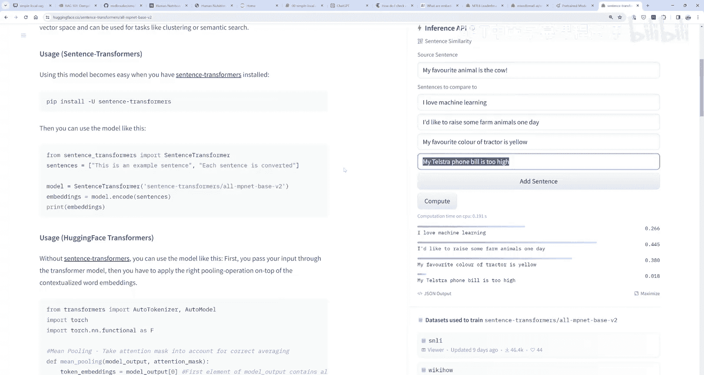

That is the power。 that's called semantic search or vector search。 That is what we're going to do。

 So how about we embed one sentence at a time。 How now， how do you think we might do that。Well。

 we can do it as before so。😊，Ebedding。Eagles model dot encode and。My favorite animal。Is the cow。

And we want to check out the embedding。Oh， excuse me。Ebedding model There we go。

 Look how quick that was。Very quick， even though it's working on CPU。

 So how about we now embed all of our sentence chunks。So we've got this sentence chunk here。

 This is why we've broken it down into chunks。 We want to embed them all one by one。 So we can go。

 let's do time。 So this is the power of running locally。 and specifically on a GPU， right。

 That's what。We want to accelerate our stuff。 I did say before that。😊。

Which one do you think it'll run faster on？I kind of gave it away there， didn't。

So two CPU and let's go embed。😊，H chunk one by one。

So for item in TQDM and we're going to go pages and chunks。

And we need to make sure that they're over the mid length。 while we don't actually need to。

 We're just going to do that anyway to make sure our data set is pretty high quality。

 So item embedding， we're going to create a new field in our dictionary。

 And we're just going to go embedding。Model dot。En code。And then we'll get item。Sentence chunk。Right。

So let's run this。Okay。It's going at about。10 to 12 per second。It's going take a few minutes。 Well。

 I might just go and get a cup of tea and come back。But。No， we're not going to do that， arent we？

We're engineers。 We like to run things fast。 So let's stop that。 I'm going to comment this out。哦。

Didn't comment that out， did I？Stop。Let's run that。So let's try again。

 So what were we getting about 10 to 12 per second。 Let's do embedding model2。

 let's go Couda because I've got I've got a GPU there and we want to use the available compute power that we have right。

 So TQDM， I'm just going to copy this。😊，I can actually copy this whole thing。

Same code just the model is on a different device。Now， how much faster do you think this is going be。

I will tell you that it is faster， but let's guess ready， three， two， one。

It's going to take a little while for the model to go to the device， but once it's there。

 we can start to use it。Oh， there we， oh my goodness。And remember。

 I'm recording at the moment as well。 So it won't necessarily be。We weren't getting all the speed。

 So this， you may even see faster this on your own machine。 But look at that。

 we don't even have to move。We can just let that run。

 But what if I told you there's even another way to get it faster。So GPUs， so that's 32 seconds。

 So if I wasn't recording， that'd probably be about halved。Now。

This is a really powerful thing about GPUus is when not only are they fast at computing。

 crunching numbers， calculating different embedding and whatnot。😊，They can be used in batch mode。

 So this was one by one。 But what if we wanted to batch a fi， and we had。

 we only have a small data set here。 We only have 1600 or 1700 examples。

 What if you had a million So which is not outlandish if you wanted to encode， say。

 all of the English Wikipedia。 you might have well over a million different samples So let's batch it up So we're going make a list of text chunks So that they're all in one big list right。

 pages。😊，And chunks。Over min， token La。Alright， and then we're going to go text chunks and we'll get。

Number。419。Beautiful。So， we have。1800 text chunks so just the same amount as we had before and remember when we first created some embeddings we passed in the list。

 now we can do it as well。😊，With our text chunks， the same thing so。Embed all text in batches， so。

Text chunk。Ebeddings。So embedding model。Dot encode。And we're going to go text chunks。And batch size。

Now， batch size will mean， which means how many chunks do we look at at one time。

 So in our case 32 is a pretty good default。 I think that actually is the default in encode。

 but you can experiment。To find which batch size。Leads to best results。

So batchchelights won't actually influence the embedding that comes out。

 It will just influence how fast the embeddings run。 So if you had a GPU with lots of memory。

 you could probably increase this if you had a smaller GPU that's in terms of VRA。

 So my NviDdia R Tx has 24 GB of V Ram if yours had， say， 12。

 you might reduce this to 16 or something like that。 So just think about that。

 And we want to return them as tensesors watch tensors。 So we can use them later on。

And let's go text chunk embeddings。So what speed up did we get？

So that was 69 or 70 iterations per second。 and we were getting about 10 here。 So we got about a 7 x。

From CPU to GPU。 And now let's see what we can get。By invading them in batches。Oh my goodness。

3 seconds to embed 1600，1700 samples。 So that's pretty darn quick， even though I'm recording。

 that's going to take out some compute power as well， not too much， but just a little bit。

 So we've gone from that took 30 seconds。 So a 10 x improvement。

 So this is a 7 x improvement from CPU to GP。 and then a 10 x improvement from single embedding at a time to batch。

 So we've gone 70 times faster by going from CPU to GP with batches。😊，That is incredible。

 So let's now what， once we've created those embeddings， we're， we're working through our pipeline。

 right。😊，So we've got our， we've just created our embeddings。We embedding model。

 and we want to save them for later because we can just create the embeddings and save them for files。

 So then we don't have to create them again。 So once we've imported our documents， chunked them。

 embedded them， we can save that def file， import it later on。

 And then we can just use it from there。 So I'm just gonna get out of this and this。And this。

And let's save a file。So。Save embeddings to file。 So what we might do is， how can we do this。

 Let's create a data frame， hey。Save embeddings to file and I'm going to create it as text chunks and embeddings。

DF and PD do data frame。We've got our every field in our pages and chunks。Over， mean。

I could probably change that variable right， we'll get 419 from that。😊，So yeah。

 every variable in here or every item in our list has now has an embedding array， which is beautiful。

 And we can just save that to。😊，A data frame and then save it to CS SV。

 We could pick this out or save it to file or something like that。

 But I'll just save it as a data frame or turn it into a data frame so we can inspect it。

 So I might just copy this。Put that downね。And。We can go embeddings。D F， save path equals。

Text chunks and embeddings Df。csv， and then we're going to go text chunks。And embeddings。D F to CSV。

 and we'll save it as the embeddings。Do you have save path？And we don't need an index。

 index equals false。Beautiful。So once we save this。It'll go to file。 There we go。

 We can use that later on。 It's about 15 mega or whatnot。 So smaller than the P D F。

 But remember in here， we've also got multiple instances of the text。

 So we could actually compress this quite a bit if we wanted to it's a bit more。So。Yeah。

 we've got a fair bit of information in here that we don't actually need to store。

 but 21 mebytes isn't too bad。So let's now just make sure that we can import it and check it out。

 see what it looks like。Import。Saaved file。En view。So。Text chunks and。Ebedding。

Df load equals PD read CSv。Ebedding D F save path， and then text chunks and embedding。Df。Load。

 not head。Wonderful， there's our embeddings there and so。😊，By the way， these are。

 if you hear a vector or vector representation or feature vector， that's another word for embedding。

 So this is a vector。 It's a one long sequential sequence of numbers。Now。

 we storing it to a CV isn't necessarily the most efficient way。

 If you have a very large database of embeddings， you may want to look into a vector database。

 So if we go to our little rag workflow here， we can just store it in torch dot tensor for now because our sample quite small because as we'll see in a second。

 that's very fast， even for 100000 plus embeddings。 But if you have， let's say， a million plus。

 you probably want to look into a vector database。 So vector database。Here we go。

 So a vector database is just basically a database that's been specialized to store embeddings and use approximate nearest neighbors to search over them。

 So we're going to do semantic or vector search in a second。

 But if you had say a million plus examples or even 100 million。

 which is not actually that outlandish。 searching over all of them can be quite computationally expensive。

 However， approximately nearest neighbor。 what that does is instead of searching over all 100 million。

 It might go， I'm gonna to search over these million because I know that they're going to be close to your query。

 So you're searching on 100 times less than the whole database。

 But that's an extension you might want to look into there's a fair few vector databases on the market now。

 So I'll just put that in there。诶。Okay。If your。Ebedding database。Is really large EG over 100 k。

To one mil。Samples。You。Might want to look into using a vector。Daabase for storage。But as we'll see。

 we can get away quite well with our smaller size data set without using a database。So。If you want。

 I've got some questions and answers in the notebook version of this， not the video version。

 If you want a little extension， a little something to read， you can go to the embedding section。

And we'll scroll down。Got a little Q And A。 There's a lot of numbers in this notebook saving embeddings to file Here we go。

 Quetion and answers。 So which embedding models should I use， as we discuss is many different there。

 And they sort of been updated all the time。 we've started with all MP nets base V2。

 but mixed bread AI， really cool companying name， just released their embedding model。

 And we can use it with sentence transformers。 So that's an extension you want to try。

 So technically， you generally want to use the best one available。

 But I like to just start with the benchmark mark1 that I've used a lot of times before because I know it works well。

 And then I can， if I get an upgrade well， hey， that's。😊，Really good。 Now。

 what other the forms of text chunking， splitting are there， I' got a guide for that there。

We've just done sentences， we're keeping it simple。

What should I think about when creating my embeddings， Well， how many tokens does it take in。

 What vector size does it go to， So things to think about size of the input。

 So if you have longer sequences， you need to， you probably need to either chunk your sequences。

More specifically or choose a model with a larger input capacity。

 How are you storing your embedding vector。 So a larger embedding vector has so we're using 768。

 So think of it the more numbers， the more chances the computer has to represent your data。

 So if we had double this to 1500 and what's the math on that 1500 plus 18，1536。

 we have twice as much opportunity to represent our data。 However。

 that doesn't necessarily mean that it's always going to be better。

 So just something to keep in mind size of model。 So our model allmpnet base V2 is 420 mebys in size。

 So if you have a larger model， you can generally get better embeddings。

 but it requires more compute power and time to run。 And then， of course， open or close。

 So we're using an open source model because we want to be able to run our systems locally open models allow you to run them on your own hardware。

 whereas closed models， they can be easier to set up。 but they require an。😊。

ApiI call to get embedding。 so you have to send your data externally and then get it back。

 So that take some time。 Where should I store my embeddings。

 if you've got a relatively small data like what we've got100000 examples。

 you can use NPp or torch dot tensor。 So we're gonna to use torch do tensor And we'll see later on when we do search and answer that that's actually very quick for our smaller data。

 even for 100000 embeddings。 But if you have over 100000 up to a million， there's no real limit here。

 just going to take some experimentation you might want to look into a vector database。

 So I've put a link in there for that。 So we're up to the next section we have officially done。😊。

This part of our tutorial。So document pre processing and embedding creation。

 We've taken our time here。 We've coded this from scratch。

 We could really functionise this now to just do this only in one hit。😊，Import document。

 splin it into smaller chunks， embed those chunks。 Save them to file。 So we've done this。

 The next thing to do is rag search and answer。 So retrieval， This is our retrieval part。

 And then we're going to search， sorry。Retrieval part。

 Then we're going to augment our question with valid passages。

 Then we're going to generate a response。 So let's do that。In the next section。

 I will meet you back here and we're going to go rag， search and answer。I'll see you soon。

Welcome back。 So we've done the really fun step of turning all of our text into embeddings。 Now。

 let's use those embeddings。 So what's our goal here， Rag goal is to retrieve relevant。😊，Passages。

Based on a query。 And so what we're going to do here is we're going to embed our query with the same model that we embedded our passages。

Right， and then we're going to perform like just like we， let me go to that model again。

 all MP net base V2。Just like in here。When we go， I love dogs and we have， I love cats。😊。

My favourite car is a Tesla。Right， just like we have， this is our query。

We want to find which one of the passages in our embedding vectors is most similar to our query。

 We want to retrieve those。 So just in this case， which one is going to be the most similar。

The model is loing。 We should have had this cooking show， ready。There we go。Beautiful， I love cats。

 So that's the most similar one。 But we want to do that for our nutrition textbook。

 or we could do that if we were in Telstra。 We could search my billers too much。

 and we want relative passages from here。 That's our whole goal。

 retrieveve relevant passages based on a query and use those passages。😊，To augment an input。

To an LLM so it can generate。An output。Based on outpit。Based on。😊，Those relevant passages。

 Oh my goodness。 Okay， and so to do this， we're going to。

 let's break it down into we want similarity。Search。And so。

This is something you'll get very familiar with as you get into the world of embeddings。

 and embeddings， actually， as a concept， is not only just for text， by the way。

 So embeddings can be used for almost any。Timeype of data。For example。You can turn。Images。

Into embeddings。Sound into embeddings。Text into。Ebeddings。Et cetera。 right。

 all we're trying to do here。 The main takeaway is that we want a numerical representation of our data because computers work best with numbers。

 And so when we want to compare embeddings， that's known as。We'll go comparing embeddings。

Is known as similarity。Search。Or vector search， because all of our embeddings are vectors or semantic search。

 which is what we're going to be probably mostly referring to semantic search。In our case。We want。

To query our nutrition。Textbook passages。Based on semantics or what I like to call it vibe， right。

 so if。I search for。Macronutrient nutrition。I should get relevant。Passages。To that text， right？

Or macronutrients。Functions。That's my example。Whereas。With keyword search。嗯。If I search。Apple。

I get back。Passages with， specifically。Apple。Now， in this case， this one。Relevant to that text。

But may not contain exactly。The words。Macronutrient。Functions。Right， so let's just try this example。

Mecronutrient functions。

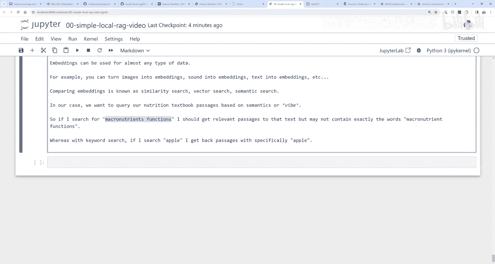

🎼So nutrition， which's just going to go command F， type in macronutrient function。

 We get nothing there。Right， what else could we get， So we wan to type in。Infant。

🎼Breastfeeding that an important topic in nutrition。OhWe get nothing back。

 And I think how I'm not sure I'm not used to using Windows。

 I think it was saying we're not getting result back。 I think。

 or there's notifications going off that I haven't turned on。 So excuse me for that。

 So let's see how we can do this。 First， we're gonna do， to do similarity search or semantic search。

 Let's now read back in our file。 we already have this as a variable。

 But if we wanted to just start our notebooks from here。😊。

We could go import random because we want to randomly locate at examples。

 we want to get torch for pie torch because we're going to use some methods in torch we'll see those later on。

Import nus N P and we want to get。Import。Paandndas。As PD。And then let's also get。Deeve es， Coer。

If torch。cootup is available。Else， CPU。Right， we'll set the device。 Now we want to import。

Text and embedding Df。So text chunks。And。Ebedding Df equals。PD。

readcsv and we'll pass in our text chunks and embedding df。 csv。And then what we're going to do。Is。

We want to convert。Text and。Embbedding Df2 list of Ds。I'm going to go pages and chunks。And embedding。

D F2 dt。Now again， we don't need to do this step completely because we've already got the variable here。

 but just in case we wanted to just randomly start the notebook from here so we could work on again。

 we're working on this part of the workflow now。So if we just wanted to start on that。

 once we've already created our own beddings。This is why we're writing this code。

So let's have a look at， yeah， let's just see what this looks like。Text， chunks and embedding。Df。Oh。

No such file or directory。 Did we get that file name， correct。

 Tex chunks and embeddings D F I that what we called it。Ebedding staff。There we go。 Now。

 let's have a look at the embedding column。Wonderful。Now let's keep going。Why don't we look at， yeah。

 one of them or we create， Why don't we create embeddings on its own。 Yeah， good idea。So。Ebeddings。

Equals text， chunks， and。Ebedding Df。We'll get the embedding column。To list。And biddings。

Oh my goodness。That。You know why this has happened？Because we've stored it as a CSV。

 it's converted into string。 So what we might have to do is let's write some code as we import it。

 We want to convert this column into a nuy array， okay。So convert embedding column。

Back to NP array and we'll this， we'll do this together because a lot of the time you'll spend preprocessing data and getting it ready to be used in an embedding pipeline or a RA pipeline。

 right？So right here， it got converted。To string when it's saved to CSv。

 So we can go text chunks and embedding。DF， we'll get the embedding column。

Now I think there's a method in Ny。Text chunks and embedding Df。We're going to go。Ebedding。

And we can do an apply function here。 Maybe we go Lambda X N array， or no MP from string。

 and then we'll do X。Will this work。From string， what's wrong here。From string。Use from buffer。Oh。

What do we get wrong here？A bite spe object is。Aquired。From string。Troublesshooting on the fly here。

Okay， I think that looks okay。 Let's have a look。There we go。 So we've got an array， beautiful。😊。

An array of arrays。 So maybe we go embeddings NP array。We just turned that into a single array。Oh。

Let's， let's look this up。 Hey， embeddings。 How do we turn， This is a problem I have quite often。

 How to turn list of arrays into。Single array。Into a single array， There we go。Concatenite， O stack。

Beautiful， okay， let's try that out。NP stack。Access equals 0。All input arise。

 Do we not have the same shape。To list。 this is troubleshooting on the fly。 This is fun。 Okay。

 we want MP。Stack。Are they not all that same shape， Holen。 Let me， let's do a， okay， embeddings， es。

Or we'll go here。How to turn。Numpie turn string into array。From string。啊S。Deprecated。

 the default is deprecated。That's what we need。 I think we just solved our problem。

So from string and the separator is going to be a space。Oh， no。

Let's just see what we get if we don't do this line。What's the space。Two separations。Yeah。

We're troubleshooting this on the fly。 I told you we're going to take this slow。😊，Oh no。

 you know what。 I've already worked this out before。 So let's go into yeah。Have we got。AhThere we go。

 we need to do something there。Let's just copy this line and see what I did before。See。

 troubleshooting on the fly， right？😊，We need to strip。That makes sense， okay。So。😊，Excuse me。

I should have been more prepared in that case， but we got to see how to create aumpy array from a string。

Let's run that。 Where did I never close that。Lambda X， do we need an extra bracket？

And now we're still getting something wrong here。Now brackets a mist。From string。靠吗？There we go。

 ladies and gentlemen。 We have now raise here and then we got that。 and then we got two list。

 and then we got MP MP stack。😊，And we want to go axis equals 0 embeddings。 There we go。 Okay。

 now let's turn that into a torch tensor。 How about we do that。 We're going to copy this line。

Isn't it fun。See， that's what real codings actually like is you've got to troubleshoot things。

 you don't know what's going on。 You look up the documentation。 In fact。

 if I didn't have that already prepared， I probably would have spent it quite a long time looking for a solution for that。

 So let's go。Convert our。Ebedding into a torch dot tensor。

Ebeddings and then we want torch dot tensor。Wonderful， now we should have。Ebeddings don't shape。

We have a torch tensor there we go of we have 1600 em beddings all of size 768。

 So what would we like to do next？😊，Well， let's create our sentence transformer model。

 So create model， So our embedding model。We don't have to recreate it。

 but we're going to anyway because again， if we wanted to just start the notebook from a few cells above。

 so we'll get the uTs， we'll see what they do in a second sentence transformer。

Then we're going to go embedding model equals sentence。Transformer。Model， name or。Plf equals。

 all MP net。 Now， this is important。 We want to embed our query with the same model that we embedded our passages of text。

We're going to send it to the device， which is Couda。What if I got wrong here， sentence transformer。

Oh， S， sends transformers。We create a model。 beautiful。 So now we've got an embedding model。

 What we want to do is。😊，Say that we have an embedding model ready。And we want to。

Let's create a small semantic search pipeline。In essence。We want to search。For a query。A G。

Micronutrient functions。And get back。Relevant。Passages from our textbook。

So that's right what we can do。We can do so。With the following steps。I'm to go one。

Define a query string。2。So that'll be what we want to search。Two， what can we do next。

 so we want to turn the query string。Into and embedding。Three， we want to perform。😡，A dot product。

Or cosine。Similarity， if you're not sure what those are， we're going to go through those in a second。

 don't worry。Cosine similarity function。Between the text embeddings。And the query embedding。

And then four is sort the results。From3。In descending。オーラ。So just like we did a search before。

What this is essentially doing there is turning that into an embedding and then performing cosine similarity or dot product on the embeddings of these two sentences。

 So behind the scenes。 and that's what the score is here。

So I believe our output of sentence transformers is normalized。

So we can do dot product instead of cosine similarity， but if you're not sure what those two are。

 I'm going to go through a small example in that in a second。

 let's see what this workflow looks like， though， this is our first time of doing semantic search or maybe your first time。

 but I really love it。 So define the query。 So let's go query es just what I've said before。

 macronutrient functions， but we could do almost anything that was related to our。😊，A textexbook。

In fact， we could do anything at all， but since we're focusing on textbook。

 our nutrition textbook will keep it aligned with that similar to if Telstra was to embed all their documentation。

 you could put in a function that makes make sure it's actually related to the documentation before it starts to search So rather than I guess I don't know searching for the price of apples on Telstra's documentation you're actually searching for their documentation So embed the query So this is where。

😊，We go query andbedding and it's important to I want to just stress this again note。😊。

It's important to embed your query with the same model you embedded your passages。

So that might not be an obvious point， right？So if we've got our pipeline and we use an embedding model for our documents。

 we want to use the same embedding model for our query。

 so just beware of that if a new model comes out on the leaderboard and you decide to use that model。

 you will have to re embed all of your passages with that new model before you can start to query it。

Because the numerical representation from model to model may be a little bit similar。

 but it will likely be quite different。😊，So embeddingmodel。 encodecode。

 we're going to encode our query and we're going to convert it to a tensor。Py toch tensor， that is。

 even though it's going to be a vector。And then we want to go number three。

 we want to go get similarity scores。😊，With the dot product。And we can go use cosine similarity。

If outputs of model aren't normalized。Again， we'll see。

 we're going to see this in action before we discuss dot product and cosine similarity。

 and then we're going， I'm going to time this for fun。 I just want to show you how fast。😊。

Similarity search can be your vector search so from time import Perf counter as timer I like to just。

Use timer， start time equals timer。 And then we're going to go dot scores。

 So we'll get the dot product between our query embedding and our embeddings。Tor。

Which is a tensor of all of ourenbeddings。So we're going to go through basically compare all the numbers in our query embedding to all the numbers in embeddings and then we're going to go u。

This is from sentence transformers， by the way， U。I know it can get a little bit confusing when we use a lot of different functions。

 but U is just going to prefer what dot product。Dot score and we want to go a equals query and bedding。

And B between two tensesors， that is equals embeddings。

And then we'll just get the zero index of that and the end time is going to be timer。

And then let's just print out a little fun。Info string， info time taken to get scores on。

How many embeddings do we have？Len embeddings， about 1，700。

Embbeddings and this is going to be end time。This will be in seconds end time， minus start time。

And we'll get it to five decimal places， why not？05 F。Seconds。Okay。Beautiful。

 how long do you think this is going to take to search to compare？😊。

This worked pretty quick on this example， but this is only comparing it to two sentences， right。

 and on CPU took under a 10th of a second。How much on our end when we're running on a GPU and an NviDdia GPU will it take？

😊，But we're still going to do step number four， right？So step number4。

 because we're going to have scores， dot score So the dot product between。1600 different embeddings。

 We're gonna have 1600 scores or 1700 scores。 What I would like to get is I want to get the top K。

Result。So we'll keep this to。Top five。 So we want to get 1700 scores。

 but I only want to return the top five results。Okay。

So top results of the dot product equals torch top K。So if we wanted to look that up， torch top K。

Returns the K largest elements of a given input tensor along given dimensions。In our case。

 we want to go， hey， give us the five different the five top scores。Let's see it in action， he？

You go， top K。Dot scores K equals 5。 and then we'll go top results。Dot product。And 3，2， one。

 Al first， vector search， similarity， semantic search， go。Didn't work。

 expected all tenses to be on the same device。 what do we get wrong。Our query， our query is not on。

The same device is our embeddings， so we'll send it to the device。 We'll send it to Kuta now ready。

 round 2，3，2，1。Oh。Our embeddings are not on the right device。 Of course。 Oh no。

 our embedding model is， is it on the right device？Devicice， it's on Kuda。 Okay。

 I think our beddings aren't on the right device in beddings。 Now， let's send that to device。

There we go， Okay， now we should be fish on。😊，Ready， it's running。 No， we got something wrong。

But got float equals double Oh no， okay， so we're running into more errors。

 So if we look at our query embedding， this is a。😊，Eage we're going to have all the time。

 so this is in torch。Can we get the D type of this， please？Torch floatat 32。 And now let's check。

 excuse me。 I'm scrolling all over the place。 embeddings D type。This is a great lesson。

 so why is this torch float 32， Well it's because that we've saved our embeddings originally in a nuy array。

 or we've converted them here NP array。😊，Right， either way， it's， it's， we've interfaced with nuie。

 Could we just do。Torch dot stack here。Expected 0， but got nuie of ray。And pay stack。Okay。

It's because Numpy defaults to F 30 Float 64， sorry。As we see down here。

But we can convert our embeddings。 So this is where we've run into this issue。

 Float does not equal double。 So we can convert our embeddings to Fat 32。 So this is a little note。

 I want to put a note here。Note to。Use dot product。For comparison。Ensure。Vectctor sizes。Of same。

Shape， E G768 and。Tenses。Slash vectors are in the same data type EG。Both are in torch， not Fat 32。

One of the major errors you'll run into in machine learning in general is shape mismatches and data type mismatches。

 So Torch dot Tensar， let's put in here D type equals Torch dot float 32。And we'll see if this works。

 hey？Boom， there we go。 So now we're on beddings a torch Flo 32。 And look how fast that was。😊，On GPU。

Query is macronutrient functions， time taking to get scores on 1680 embeddings。😊，0。00313 seconds。

 Now， that is quick。 And even though I'm recording。 So it's going be slightly slower。

 I've seen it faster than this in my own experience。 So what if we changed to something else， right。

 breastfeeding。Infant。Timeline， how long should you breastfeed an infant for？Wow， okay。

 so this is incredibly fast。 Now we're in the using torch dot Tensor as our database here。

 So let's change this back to macronutrient functions。😊，Right， now torch top K。

 this is our top results Doc product。 returns back the scores。 So these are the values。

 the scores of each passage。 And these are the indexes in our embeddings array。

 So if we went embeddings。42。What do we get？We get well that's just all numbers right。

 well that's because our query has been turned into numbers and then it's been turned into compared to the embeddings。

 which are also numbers。😊，So we want to take these indexes and where can we index on？Well， luckily。

 we've got our data frame here。 So why don't we get our text chunks and。Pages and chunks。

 That's what we want。 Let's look up number 42 on that。Right。

 because that's the indices with the highest score。42。Okay， what does the tech say， macronutrients。

 nutrientents that are needed in large amounts are called macronutrients。

 There are three classes of macronutrients。 What did we get，42 has the highest score。Isn't that cool。

42。 I love that number。 And that was our search， macronutrient functions。

 We get a passage that is directly related to our query that doesn't necessarily contain the exact words。

 Macnutrient functions。 That is so cool。 semantic search。 All right， What about， yeah， well。

 let's try our other one。😊，Breast， feeding timeline for infants。Right， we search， okay， top K。

 let's see what the first one is。1，1，5，1。Milk is the best sources to fill nutrition requirements。

 and exclusively best fed infant does not even need extra water， including in hot climates。

 A newborn infant birth to 28 days requires feeding 8 to 12。 That is perfect， right， That's。

 that's some information。 And we have not only that， we have the page number。 So if we go to。

 let's search page 8，16。

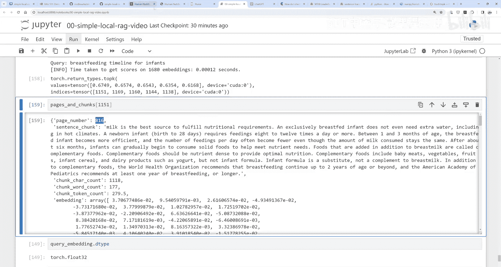

Is that even gonna come up infancy。Oh my goodness。 We get the page number。Oh。

 that is the power of semantic search。 I love that。 That is so cool。

 And now we have the relevant resource。 If we wanted to study more， we could read through here。

 So we could actually type in almost anything we want in here， right。

 Let's keep it back to our original example。 macronutrient functions。

 And let's make this a little bit prettier， right， We want to automatically see what's going on here。

😊。

But before we do， let's see how this was quick。 Now， that's only on 1700 embeddings。

 What if we were to increase the size of this by 100 x。 So then we'd have 168000 embeddings。

 Is that still going be fast， right， Because you'll see a lot of information about which vector database to use。

 But if you have。GPPU， you can actually operate on a lot of data in just torch tensor。

 So larger embeddings equals torch dot R n。Right， let's replicate well。

 let's simulate what it would be。😊，So embedding dot shape。

 even if we had  a00 times the amount of data that we have。Two device。Right， letm me go print。

Ebedding shape。We're going to go larger。Ebs shape。And then we'll go perform。Dot product across 168。

000 embeddings。Ho ho， and let's time it， Hey， we can grab this。😊，And grab that。And we'll grab this。

And we'll go there。And I just need to change this one to larger embeddings。

 So this is the same query， but this is just going to be random numbers。

 so it won't actually return anything meaningful。 This is just we want to see how fast this operation is and ready。

3，2，1。Oh my goodness。So in about three times a second，3， sorry， three times as much time。

 we performed the same operation on 1 hundred and 68000 embeddings。 Now， let's。

 let's step this up a notch。 let's say instead of just 100 textbooks。

 we had a library of textbooks that we wanted to search over。 So this is no small amount， right。

 This is going to be 1000 times。1。6 million。So we have 1。6 million passages of text。Right。

 how many groups of 10 sentences would that be？So let's try that。

 let's say a sentence is 10 sentences， the average number of words in that is let's go 200 or 180 right。

 180 words in 10 sentences， not that bad or even 150 right So we're searching over。What's that，0，0，0。

252 million words。Okay， let's go how many words are in the Bible。I had a pretty large book。

780000 words in the Bible。So we have probably 300 plus。400 plus Bibles that were searching over。

 Or is that correct，252 million。Yeah。Right， so 400 plus Bibles worth of text。

Let's see how fast this goes。1。7 million embeddings。This might take a while to just even load。

Look at that。 So the， the longest part of that was creating that and sending it to the GPO。

 But once we've done it， once we've created it。We just searched it over in a hundredth of a second。

Right using the dot score。 Isn't that incredible， So even if we had 400 Bibles worth of text。

Let's do at，400。Times 750，000 words thereabouts。Oh wow。 are we off by。Oh， sorry。Right，300 million。

Words。In 1。7 million embeddings， we can search it over in 10th of a second。 Now， let's。

 let's say you had even more than that。 You had 100 times that。

 So you have an incredibly huge database。 That's where you want to probably look into using a vector database。

 right？ Let's just decrease this back，268000。And that's where you wanna do something like。

Let me write this down。We can see that。Searching over embeddings。Is very fast。

Right so this is not prohibiting us。 the prohibitive time is probably the generation step， right。

 we're going to see that later on。But。But if you had。Let's go even 10ml plus。Andbeddings。

You likely want to create。An index。An index。Is like。Letters。In the dictionary。

So if you wanted to search， for example。If you wanted to search。Doc。😡，In the dictionary。

You'd start at D。Then find words close to D。Et cetera， right。

 You're not going to search what we're doing here。 Let me just。嗯。Even if we do exhaustive search。

 So that's what we're doing。 Exhausive search is the term that you're probably here。

 We're searching on， we're comparing our query embedding to every embedding。And so that's exhaustive。

 right， But that could be， it's quite computationally wasteful。

 It's very precise because we're searching across every embedding。

 But if we had 10 plus mill embeddings and we're continually doing that。 Were。

 we're kind of wasting a lot of compute power。 So like a dictionary。

 we're not searching over every word in the dictionary to find the word duck。 We start at D。

 then we go to D U， then we etc cetera。 We find it。 We narrow it down。 So。😊，An index。

Helps to narrow it down。Right， and then go。If we want to do a popular。

Indexing library for vector search。Is face。 Now， there's a fair few libraries that do this。

 but I just want to show you probably one of the most popular ones， face by Facebook。

 So Facebook AI similarity search。Face， its open source very fast。

Efficient similarity search and clustering of dense vectors， right？

So that's where you're going to start to perform nearest neighbor search。Approxximate。

Nearest neighbor search。I'll let you read more on that。

So two things I'm going to leave as extra curriculum。谁 here呢。

That's going to be nearest neighbor search。One technique。That the library provides is。Approximate。

Nearest neighbor search this is an extension， right， A& N。If you've heard of KNN， K nearest neighbor。

 similar to that。And then face， however， but with really large data sets。

 you've got to get a bit more sophisticated， so imagine you're like Spotify and you have billions or millions of songs and you want to search over them all the time to find similar examples you're going to use something like face and approximate nearest Nes search。

😊，To to find those different embeddings so。We've seen it now with our example。

 Let's pretify this little search thing here。 Okay， we want to see what it looks like。

We always want to see what it looks like。I'm going to ride here。

Let's make our vector search results pretty。I'm going to over write a little helper function called Texrap。

Or print wrapped。 sorry， and I'm going to use the Python textrap library because when we print out passages of text。

Like this， I don't want it to be just one line。 You'll see what I mean when I print wrapped and don't print wrapped。

So I want to take in some text。And let's make a wrap length of。

80 sounds like we're making a rap song， you know， rap text eagles。Textrap dot fill。Text。Rat length。

 and then we want to go print rat text。We'll see what this does in a minute。Now let's get our query。

So we want to print our query。And I hope you don't mind me going instead of just writing straight code。

 I like to take a little aside here and there like I just showed you face and nearest Nes search leave a comment below if you're a fan of that style or if you just want me to stick to code because I like to include little bits of information that that will probably be helpful as you want to learn more right so loop through zip together。

Scores and indices。From Torch。topk。So what we want to do is go4， score IDX。

 because that's what torch top K returns。 We go here。Outputs。Does it say where its outputs are。

Output is a tuple， there we go out。Top all of tents so long that can be optional given to users output buffers。

 That's actually a little bit confusing。 Yeah， there we go。 We just get to output values and indices。

 All right， I like to call these scores and index。So four score index。And we're going to zip。

Top results。Dot product。0ero。Top results dot product。1。And then we go print F。Score。

And then we want to go， maybe we go to four decimal places for the score， hey。

 and then let's go print。😊，Text。Let me see the output and then I' I'll just print the text to show you what I mean。

 pages and chunks without our print wrapped。Little helpful function。Above。

And we want the sentence chunk related to the top score。And so， this is why we。

Pturn it into a list of dictionaries right， because then we can just use the index returned by our bedding vector because ouren beddings up here are going to have the same index as our data frame。

Ebeddings， they're all going to have the same index。 So that's why we make sure we keep the order。

 Okay， Otherwise， we'll sort of get messed up if we don't have that order。

So we get the index of our pages and chunks list of dictionaries and then we get this is the power of rag right。

 we want the relevant resources， we want to go if I want to learn more please show me some links Okay don't just give me the answer I want to research myself and find out what else is going on。

IDX。Page number。Actually， we're going to need to use other little inversions here。Inverter commas。

Oh we need to end squiggly。There we go and then we'll print a new line for fun。

Make things look pretty right。Okay， youre ready。 Let's get some relevant passages based on our query。

And we query， we can set a query here so we can try it on a different couple of different things。

 macronuent functions。Run。What do we get， unterinated string， literal。Page number， oh。

 we didn't end our string。Do you notice that？Boom， look how quick that is。😊，I love that。

So macronutrient functions， this is our first result。 So yeah。

 see how the text is kind of all over the shop。 Let's just print wrapped， hey。😊，Boom。

 now weve got passages of text。 That's lovely。 Okay， so macronutrient functions。😊，Text。

Micronutrients that are needed in large amounts are called macronutrients。

 There are three classes of macronutrients， carbohydrates， lipidards and proteins。 beautiful。

 These can be metallically processed into cellular energy。 Now， if we go to the next one。😊。

There is one other nutrient that we must have in large quantities， water。

 water does not contain carbon but is composed of two hydrogens of one oxygen。

 more than 60% of your total body weight is water。Beautiful， we keep going macronutrients。

 carbohydrates， protein and water， protein， amino acid。Food sources of protein。 That's very good。

 Pro。 Okay， so we get things that are quite related to our query。

 But even better we get the page number。 So let's check it here。 page number。

 Let's go to our nutrition textbook。 Let's go to page 5， which I believe will be 48。

 due to our page numbering scheme on the right here on the left， sorry。😊。

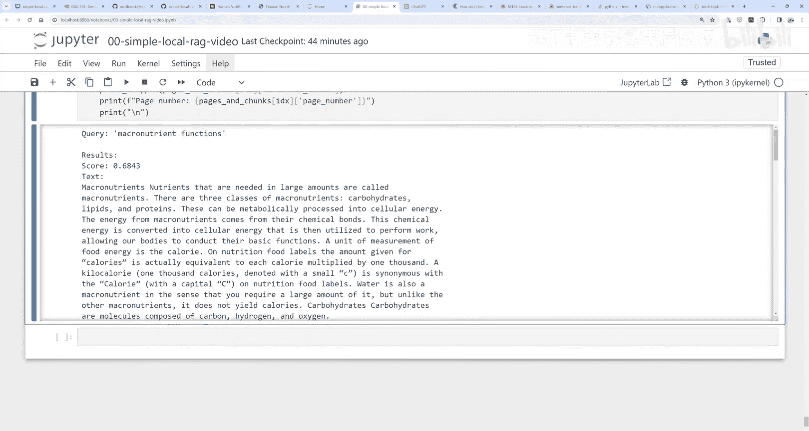

48。Nope， one off。Macronutrients there we go。 We can start to read here。

 So we've just got an advanced search function on a semantic search。

 Now we could actually tee this up with keyword search as well。

 so we could write a function that does not only semantic search， but it also does keyword search。

 And then there's a I just want to give you another little tidbit as a potential extension later on。

 We had relevant passages here， but there's a concept of called reranking So we could take the top five here and the score。

 but then we could use another model that is specifically been trained to rerank top results。

 So we've narrowed the results down right to the top5， we could even narrow it down to the top 25。

 and then we have our query here。 We could use a model to rerank and go， hey。

 these are the top 25 resources。 Can you rerank them specifically for the query。

 So they'll be pretty good to begin with， but they might be able to be better if we rerank them。

 So I'm gonna to just write a note here。😊。

Note。We could。Potentially。Potentially improve the order of these results with a re。Brank King model。

A model that has been trained specifically。To take。Search results。EG， the top 25 semantic results。

This is our， these are our semantic results， by the way， and rank them in order from。Um。

Let's say most。Likely top one。To least likely right So rerank them just like you get 10 results when you search on Google。

 that's what a reraker does。 So you get so you get one model to narrow it down from the 1600 1700 passages of a text in our textbook and then you get another model to rerank this smaller order because it's been specifically trained for that Now if you wanted to do that mixed bread AI reraer。

 This has just been released as well。 it's a just an open source version on Huging face。

 So boost your search with the crispy mixed breadread rerank models。 So。

This is a sort of setup of reranking document store。 That's what we've done。 So search system。

 we've done that first stage search results。 That's where we're at。 you want to rerank right。

 So rerank pass that to the reraer， and then it's going to rerank them in order。

 So these are also open source。So I'll let you explore that and try it yourself on a hugging face。

There we go， So query。We can use sentence transformers。

 This is a little extension that you might want to try out。

 and then you can rerank them there with our model dot rank。 so I'll just link that in here。

See here for an open source。Reranking model。Okay， so we've got a way to semantically search our。😊。

Data set， How beautiful is that。 I'm just going close a few different things。There we go。Okay。

 so what should we do next， Well， where are we in our pipeline， How about we， I， you know what。

 I'm going to write some code that we can check because evaluating our results is just as important as getting the results。

 you know， So let's say we wanted to build this into a more robust pipeline。 Let's go。

 What if we wanted to。To check our results。What if we wanted to automatically？Surface。

The page of text。Related to our。

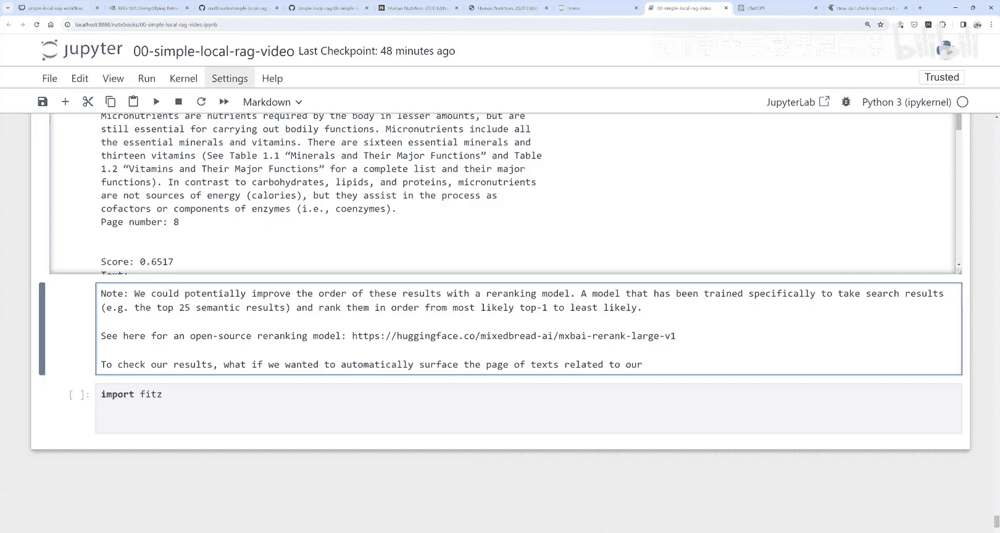

Query。Right， so instead of going manually through our document and searching for page5。

 we could just automatically return those right because we're programmers so let's open the PDFf and we'll load the target page。

😊。

ItBecause we've got the page number， that's the power of rag， right， Retrieval。

 we have the source of where the information came from。 So we're going to open our PDF document。

Which we already downloaded。So here we go。And then let's go Doc equals fits。Dot open。

And I'm just going to bring this up a bit higher， F do open。

Pdf path and then we want to get our page so page equals doc。

 load page and it's going to be 5 plus 41 so note page numbers of our PDF start 41 plus just keep that in mind for your own documents。

 they may not the page numbers may not exactly line up with the index。

So let's get the image of the page and we can do that with fits or the Pi M。

I just want to write this fits is。Pi M PDF library。Has an option to get an image of the page。

 so get Pix map。And then we're going to go DPI equals 300， so that's pixels。

 how dense the pixels are， so the higher the value there， the better quality of the image。

And then we want to go。Save image。Now this is optional， so I'm going to comment this out。

 you can do this if you like。We go image dot save， and then we'll go output file name。Don't PNG。

Just want to show you that if you want to to save the image。

 like get all the resources relevant to a certain query and save it to a certain file。😊，Doop。

 dot close。 We'll close the document。 We don't need it anymore。 And then we want to convert。

The Pix map because that's the sort of the special image type to a nuy array。

All we want to do is go image array because we want to just plot it our notebook so I'm going convert it to an MP array with MP from buffer。

 we kind of saw that a little bit before。 I dot samples underscore Mv we'll get that and then we'll go D type equals MP We want to turn it into U int8 because mappllib likes U in8 values and then we get it in a different shape so we want to image height。

 reshape it to image width and image dot n。😊，Right。

 so that's going to give us an image array of values。Beautiful。

 most of them are going to be white pixels。 Why， Because most of our P D F is white pixels。 Now。

 there might be a better way to do this If you have a better way to do this to print the page of a P D F in a notebook。

 please let me know。

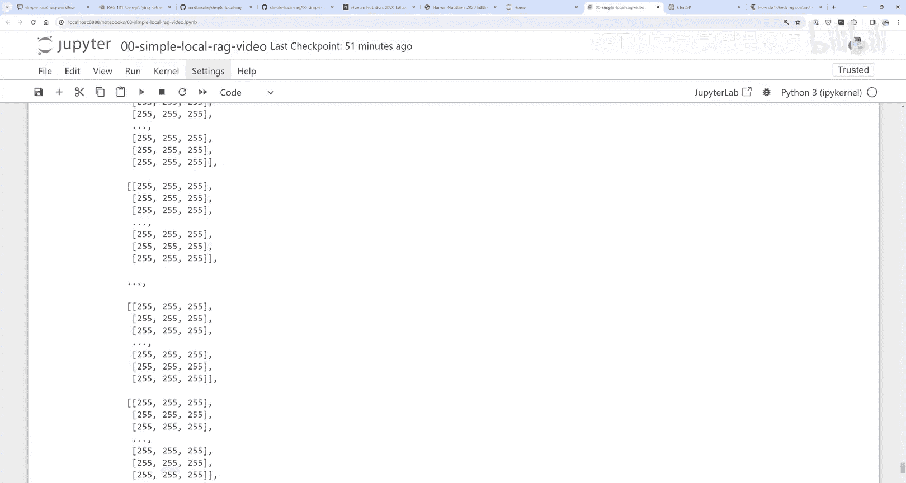

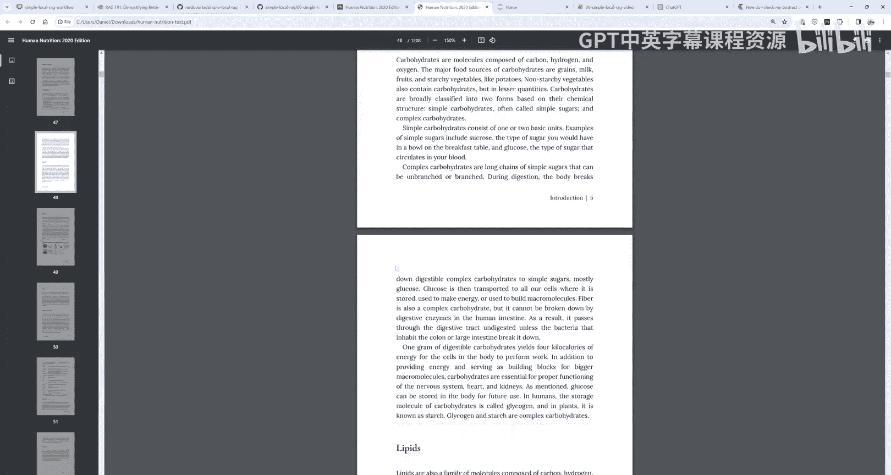

Using Matplot Libb。And we want to go。Import mappl Lib。Dot pie plot。As PLt。

 and then we go PLt do figure。We'll give it a fig size。Equals 13，10。PLT I show。Image array。

 and then PLt dot title。 and then we're going to go F。 we'll get the query。

 So we know what we we search for。 So this is just as so we can check what what's actually going on。

Query， and then we're going to go most relevant page of our Pdf document。 Oh， excuse me。

 haven't quite finished there。 I got a bit trigger happy on the shift enter。

PLT access we turn that off。Because we like things to look pretty。And there we go。 Let's show it。

 There we go。 The most relevant page for our query， macronurient functions。😊，Now， how about we？

Do another query。Let's go。I want to search good foods。For protein， I'm trying to build some muscle。

 right， What do we get， Good foods for protein。😊，3 classes of protein。 Oh， that's actually。

 I think it's。The first page， page 5 as well。 Do we have。

It was one of the nutrient must have in large qualities。 did that。Oh， sorry。

 so we're actually searching through the top results from before， so we have to update this。

So let's go good。Foods for protein。What do we get？Good foods for protein。 Most relevant page， Do we。

 Did't that just update。Oh， page number here。 So we want to get。4，11。Good foods for protein。

 Most relevant page。 What do we get。Dietory sources of protein。

 The protein food group consists of foods made from meat， seafood， poultry， eggs， Soy， dry beans。

 peas and seeds。 Wow， okay， beautiful。 you want more proteins。 There's some。

 there's some foods that you could try and eat。 Now， what do we want to do。😊，Well。

 we've done some similarity measures。 We could go over that。But， but we have now done our。

Our' step here。 we've got。 this is our cool person。 That's us。 We've asked a query。

 We've embedded that query， and then we've used the dot product to search over our embeddings。😊。

Now I might just take a quick aside in the next section to show you the different forms of similarity search because we've got this。

 if you want to go ahead and skip ahead to the notebook， feel free to see how we can generate stuff。

 But we just want to show you vector search we'll build that from scratch So that what you know what's going on when you're matching different vectors and then we're going next thing we're going to do。

 we're going take our query and our relevant passages。 and we're going to pass that to our LLM。

 but we haven't got an LLM yet。😊，We've got some resources here if you want to jump ahead and look at Huging F and Jamer and Mitial AI and Lama2。

But let's in the next section， I will go here and。We'll go similarity。Medsures。

Dot product and cosine。Similarity。Similarity。Right。

 so we're going to go over that in the next section and then we'll start to build our generation section of our RAG workflow。

😊，I'll see you soon。 Welcome back。 Let's talk similarity measures。 So two of the most common ones。

Two of the most common。Similarity measures。And specifically between vectors。Between vectors。

 doc product。And cosine。Similarity。Right。So in essence。Closer。Vectctors will have highest scores。

Further away， vectors will have lower scores。So let's just go and have a look at one of our embeddings。

 So our embedding has。Or our embeddings have 768 dimensions， right。

 which is inconceivable to the human brain。 right， We only operate in 3， maybe4 dimensions。

 Or maybe if you're really smart， you can do more so。What is a vector， Well。

 they have magnitude and direction。Let's have a look。Most of these will probably be in。Yeah。

2D or 3D space。So， there we go。They going this vector is going that way。

 and it has a magnitude of its length。 So that's the direction， the arrow here。

 and then the length is 8。And so， we have。Magnitude。Where's one with， There we go。 Nice and simple。

 right， That's a 2D vector。 However， we have 768 dimension vectors， but the principle still stands。

So。Vectctorors have direction and magnitude。How long is it？And direction is。Which。

Which way is it going？And now。But we don't decide on these values。 That's for our model to decide。

 These are learned values。 That's the power of machine learning。

 The whole idea is for these values to be learned without explicitly programming them。

 So if you want a further breakdown， I've got a little comparison here of similarity measures。

 So the dot product measures the magnitude， let me just zoom in here。

Measure of magnitude and direction between two vectors。 We're going to see this in code an example。

 So vectors that are aligned in direction and magnitude have a higher positive value。

 vectors that are opposite in direction of magnitude have a higher negative value。

RightNow this doesn't make much sense。 It's just text on a page。

 If you're familiar with linear algebra， well you might already know this stuff。 we have Torch dot。

 N dot and sentence transformformers u dot score。 This is the one that we've used So many different ways to do dot product。

And I've got some links there if you want to check it out。😊，Cosine similarity is slightly different。

 so they get normalized by their magnitude。The vectors get normalized by the magnitude。

 so they all have the same size， if you will。Right and in our case。

 our vectors already have all have the same size， they're all 768 in size。😊。

So if we go back to cosine similarity， it focus more on direction。

So vectors that are aligned in direction have a value close to one vectors that are opposite in direction have a value close to negative one。

 and I know this can sound a little bit confusing because we're like， hey。

 we' just turn text into vectors but it's actually also still fascinating to me that this works。😊。

So for text similarity， you generally want to use cosine similarity because what are we trying to compare。

 we want to compare semantic measurements so the direction the text is going。

Now I know that sounds confusing， but just if you imagine all of Wikipedia。

 all of the different topics on Wikipedia， imagine them all as being slightly different directions on a plot。

😊，Right， so our semantic measurements direction， we want to figure out where a passage of text。

 Which direction， Which topic does that trend towards， rather than its magnitude。 And so in our case。

 our embedding model， all MPnet base V2 outputs normalized output。

 So if we look at the hugging face model card。We know this because we've got the normalized embeddings so that's to replicate this function。

 all this code here replicates the encode function right we could dive into that we know that the output of this is already normalized so in our case let's just code up cosine similarity and dot product from scratch so that we can inspect the differences between the two because cosine similarity with values that have already been normalized is just the dot product。

So let's have a look。Cosine similarity and normalized by the L2 norm， by the way。Similarity。

Let's go function， hey？What do we get？Images。There we go。 Now， if you're not familiar with math。

 this might look a little bit intimidating， but we've got， we see there is a doc product。 We can。

 we can replicate this with code in a second。 And this is the L2 norm or the Euclidean norm。

 So Euclidean norm。Which is the square of the magnitudes of each of the values。 So what do we have。

 Euclidean norm， There we go。When you see those two lines。That's what we want。 L2。 Do we have L2。

 Yeah， there we go。 L2 norm。 So it's let's just write it up in code， hey。

 much easier to understand for me， that is。I know about you， but I。

 I seem to understand Python code a bit better than I do。 mathematical symbols。 So import torch。

 let's just create dot product。 We'll see this with two simple vectors。Vectctor 1， vector 2。

 we want to compare vectors， and then we want to go return torch dot and vector 1， vector 2。

Once you know these similarity functions， your powers of dealing with embeddings are going to be。

Hugely increased。So cosine similarity。Because embedding search is not just with text。

 it's with anything that you can represent as a vector。Which is in the modern world。

 many pieces of data can be replicated。 So for cosine。 Oh sorry， that's an M cosine similarity。

 What we want to do is do we have the function。 Yeah， dot product divided by the Euclidean norm。

 Okay， so let's go in here。Dot product， so we could just do our function above。

 but I'm just going to use torch dot。Toorch dot。Vectctor1， factor 2。Beautiful。And we want to go。Get。

And if you're not familiar with dot product， well， I'll leave that as another extension to look at what the dot product is。

 So we'll go Eucuclidean slash L 2。Norm。So we want to go the norm of vector 1 equals torch dot square root。

Torch dot sum， the square of all the elements in vector 1。 Allright。

 so that is what this is saying here。Square root of the sum of the square of all of the vector vector values in a。

So our a is vector 1。And then we want to do the same for vector 2。

I believe torch actually has a function that does this already， but we're doing this from scratch。

So vector 2， right， and so if we looked up torch Lyn Alge and normm。Yeah， there we go。

 That's gonna do exactly what we just said。 it's got a fair few different options here。 Do we have。

L 2。Min some max some。Oh vector norm。 Here we go。 right， There's a vector norm。Beautiful。

 so we could use that， or we could just code it from scratch。

 So let's now do return for cosine similarity。 We need what the dot product divided by the norm vector 1。

😊，And oh， sorry， times norm。Vectctor 2。Beautiful， so let's create some example tensesors now or example vectors。

😊，Vectctors slash tenses they won't be anywhere near as complicated as these or as sorry large because we're just trying to illustrate a point here vector 1 equals torch do tensor and this is what I like to do with many different problems right I'll just simplify it as much as I can to try and wrap my head around it。

So if there's something I don't really understand， I try and replicate it from scratch。 So float 32。

 right， And then I'm just going to copy this。 Let's create four vectors。 Maybe we do that one。Okay。

 so vector to2。Vctor 4 we'll keep these are the same one and two are the exact same vector。

 and then this one can be 4，56。😊，Right， we'll just continue on。 So 1，2，3，4，5，6。

 And then this can be the negative version of them。 Okay， And so what we're going to do is now。

 let's do the dot product。Calculate dot product。 So we'll go。We want to compare。

 Let's go vector 1 is our main vector， and we'll compare it to each of the three。

 So what do you think These are the exact same vector， This is double it。

 And then this is the negative version of it。 What do you think the results are going to be out of all of our。

Products here。So。Let's go print。Dot product。Between， oh， excuse me。Between vector1。And vector 2。

And we'll use out。Dot product function。We don't actually we didn't actually need to write a function like that。

 we could just choose Torch dot， but why not？Right， so there's dot vector 1 and vector 2。

Now we'll repeat that for every other vector that we have one versus vector 3，1 versus vector 4。

And we'll change these as well， three，4。嗯m。There we go， Okay， so。😊，What values do we get？

 So between one and 2， they're the exact same vector。 So we get 14， a large positive value。

 So what did we say over here。Vects that are aligned in direction of magnitude will have a higher positive value。

 Okay， and then between vector 1 and 3。 we get another higher positive value。

 So these have the same direction， But also this one has a higher magnitude。 So overall。

 the value is higher。 Now， recall with cosine similarity。 we normalize by the magnitude。

So that vector is going to be， we'll see what happens when we do cosine similarity on this。

And then vector 1 and4 because this is the negative version of it。

 it's the inverse of the positive version right， so this is going in the opposite direction。

 but it's got the same value。😊，So if we wanted to relate that back to text similarity in our case。

It's kind of saying that this vector here is doubly as similar as this one to our original sample。

 so this could be our query vector， right？But is that something that we really want when we're working with text。

 So this， this shouldn't be necessarily double what 1，2，3 is。 We want 1，2，3 to be the highest value。

RightBecause that's the exact same text， essentially。But we're dealing with numbers。

 so this is where we bring in cosine similarity。We want to normalize for the magnitude。

So let's go print。Cosine similarity。Between vector 1。And vector 2。So cosine similarity。And。Again。

 this is a very simple example， but that's the point。 We just want to make it as simple as possible。

It actually scales up quite well to our。Thousands of vectors， so。Vectctor 1。

 we want to do vector 3 here， vector 4。 And then we just need to change this vector 3， vector 4。

 So when we get cosine similarity， there we go。 right， So we normalize by the magnitude。

 This is the beauty of simple examples。 right， I love it when it works out。😊，So we have 1。

0 for comparing vector 1， our query with our vector 2， that''re exact same thing。

 That's exactly what we want， right， And then we have vector 1 and vector 3。

 which is they have the same direction， but slightly different magnitude。 So it's still a high value。

 One is the highest here， by the way， with cosine similarity。

 and that's the same that we've been using so far to find the scores。😊。

A score of one here is the highest， but it could also go negative。

One would mean they're the exact saying。 And then we have negative one for a vector that's in the opposite direction。

 So it it's dissimilar right So that's the power of similarity messages。

 We've just replicated dot product and cosine similarity two are the most popular ones that you'll see and in fact。

 cosine similarity is generally favored when we're doing semantic search on text and just just so you know。

 cosine similarity as we we've replicated here is dot product。

 but the vectors get normalized by the Euclidean slash L2 norm right So it removes magnitude from the equation It just focuses solely on direction。

😊，And I know that's a bit of a hard concept to understand when you first start。

 But once you start to practice with it， you can start to really go， okay， well。

 this is semantic search。 I just want to search。 I've got this embedding。

 find me similar embeddings right， and cosine similarity is what we're gonna use because actually。

 sorry， we could use dot product because the outputs of our model when we go。Embbedding model。

 encode。Yo， yo， yo。These are already normalized。So just keep that in mind if your outputs from your model aren't normalized by the L2 norm。

 you should use cosine similarity if they are already normalized。

 you should use dot product because you could use cosine similarity that'd come out with the same results because they're already normalized However。

 you're doing extra computing steps here so it would slightly increase the time。

 So that's why we're going to stick with dot product。Now。

 we've covered semantic search quite briefly there or similarity measures。

 How about in the next section， we go functionising。Functionizing our semantic。

Semantic search pipeline。So we've got a few steps that we've done up here， so we enter a query。

 let's go to our workflow， we enter a query and we find similar passages。

 I want to turn this into a function because I don't want to have to write all that code all the time so I want to just basically have a function I can input a query and I get this is my response So let's do that in the next section if you want to go ahead and try that to do that yourself。

 Please do otherwise I'll see you in the next section。😊，Alrighty。

 so we've got some code that can do semantic search， but let's functionise it to make it repeatable。

 So let's put all of the steps from above。😊，For semantic search into a function or two。

So we can repeat。The workflow。Right because ideally， if we didn't have this notebook。

 we'd like to create a Python file that we could just have some helper functions in there。

 we can input a PDF， and then it just does all the text chunking and embedding creation and semantic search all step by step right that's the ultimate extension to this project so。

😊，And in fact， I'm going to leave that as an extension to you to do at the end of this tutorial。

Is to turn it all into an app。😊，And if you'd like to see a video on that， please let me know。

 So query would be。This is going to retrieve relevant resources。嗯。If that doesn't make sense already。

 So what we want to do is input a query。 We want to embed that query and then get relevant indexes back from a list of embedding。

 So we're going to need embeddings。 and this is going to be torch dot tensor。😊。

Could be a nuy where a， but we're going to use torch because we want to stick with the GPU。

 nuumpy can't use a GPU pi torch can， so sentence transformer equals embedding model。AP nuumpie。

 that is， there is kuda Ny， but that's another extension。So end resources。

To return let's this is going to be how many passages we want。 And by the way。

 these are all type hints right so this is saying that the query is a string torch tensor embeddings and then we have sentence transformer that we want our model。

 There's the embedding model because we want to embed our query with the same model that we embedded our passages and let's say we just want five resources。

We could turn this into 10 that would give us 10 paragraphs back。 We could feed that to the LLM。

 That number is not set in stone。 That's just something。You should feel free to experiment with。

So we want to print the time because I love always getting the time back from doing search。

 It's like when you do a Google search， right， and you get， it took X amount of seconds to。😊。

Return all those results。 So embeds a query with model and returns。top k。Scores and indices。

From embeddings。Lovely。😊，And then going to go。Inbed the query。So query embedding。

Equals model dot and code and query， and then convert。To tensa equals true。

So that's our query string。 We create the query embedding。 beautiful， and we've done all this before。

 So it's not not going to spend too much time on it。 We're just going to focus on functionising it。😊。

So get dot product scores on embeddings。So our embeddings are up here。

 we've saved them as a torch tensor。Again， we can save them to file ahead of time so we don't have to create the embeddings。

 we could just have a function that imports them。So start time。Dot scores equals u。Dot score。

 we can get the dot scores rather than cosine similarity because our embeddings are already normalized。

Ebeddings and we'll get the zeroth index of that。Wonderful， we'll end the timer there。😊，And then。

If print time， let's print。Info。Time taken to get scores on。And。

I also love showing how many embeddings we went over， Le embeddings。

Embbeddings and we'll do the end time minus start time。Oh， excuse me。No， come on。

 You got this Daniel and time minus start time and 5 F。😊，And we'll go second。Beautiful。

 so we'll set that to default to print out true。 We could turn that off if we don't want it。

And then let's get scores。And the indices equals torch top K。On input equals our dot scores。

From above， and then the number of k that we want， K can equal to n resources。2。To return。Beautiful。

And then， of course， we want to。Return。Scores。Indices。Excellent。

 now we've got a function to get relevant resources from our embeddings， given a query。

 So let's try it out。😊，Retriieve relevant resources。 So our query is going to be， what can we do。

 Let's go foods high in fiberre。And is everything else prefil， Oh no。

 we need our embeddings in there， that's something we could probably optimizeise somewhere。

There we go。 boom。 We've now got a function that just easily gets very quickly。

 gets the scores from 1600，1700 embeddings。 How cool is that， Now， what about we use this to。

 because this is going to be helpful for our pipeline later on。

 But it's not really that helpful at the moment if we wanted to just quickly glance at some passages ourselves and read them。

 So let's make it helpful for us。😊，By creating a function de， print top results。And scores function。

 hey？Query string， this is just for our inspection， we could actually probably build this into here。

 but I'm just going to make it a new function， why not？Torch。

tensor and then we go pages and chunks because we're going to need our list of dictionaries for this one。

And that can be pages and chunks。Right depending on where you've stored your text and all that sort of stuff and then so the end resources to return。

 we need that and we're kind of doubling up on a few parameters here which makes me start to think we could potentially turn this into a class or we could yeah put this functionality into there。

 but let's for now just keep them separate。So finds relevant。Passages。Give a query。

And print them out。Along with their scores。And this is going to replicate。

 We might actually be able to cheat a little bit here。 So let's get our scores， indices。

 eagles retrieve。Relevant resources。And then our query is the query that we pass in。

And then the embeddings， of course。Ebeddings equals embeddings that we have above。 Well。

 that's spelt wrong。I want to come right along here。Then we go。Resources to return。

Equs and resources to return。Beautiful from scratch。 Now。

 what we want to do is maybe we instead of rewriting the print statement。 we just get our。😊。

Helpful print statement from up here。I know。We like to。Right， things from scratch but。

Because we're writing the basically the exact same code。So， for。

Let's just make sure it all lines up for score IDX。And we're going to need zip。

This needs to change scores， and this also needs to change。This will be indices。And do we get that？

That should work。I hope let's find out so。We've got that one there。

 Let's make a query where it's the same thing。 So query， I'm just going to copy this out here。

Its that。Beautiful。And then we're gonna to print it out print top results and scores。

 So the first one just gets the scores。 and then the second one。Printnce them out。

Print top results in scores。D I know there we go。 beautiful。 Oh， I like that one。

 Let's just hide that。😊，So printing it out， that just gets the relevant resources。 Here we go。

 Change it up a bit and experience the taste and satisfaction of other whole foods， such as barley。

quila and Bgar。 It snacks high in fibre， such as almonds， pistachios。

 raisins and air poppedpped popcorn。 Lovely。 Look at that。 We've now got a semantic search pipeline。

 readyy to go。 We can just run it with one line of code。 How cool is that， Now。

 we could save these functions to adopt pie file。 and import them later on。4 when we want to。😊。

Feed relevant resources to our LLM。 And speaking of LLMs， how about in the next section we get。

And LLM， and we're going to run it locally。 This is super exciting。😊。

So I'm just going to write here a heading。Getting。And LLM for local generation。

So if you want to jump ahead to the source notebook and try it out yourself， feel free to。

 but otherwise I'll see in the next section， let's get our local LLM up and running and stop generating some text。

 Alrighty， now comes one of the most fun parts of a rag pipeline。

 and that's getting an LLM for local generation。 Now， of course。😊。

We want to focus on local generation because that is a simple local Ra tutorial。However。

 this process will also work with an LLM API。Right， so。What is an LLM？Well。

 if you ever used Cha GBT before， you go， yo chat GBT。😊，How are you？

Right we put in some text and we get some text back。😊，Really good。I'm about to build。A local。

Rag pipeline。Right that's what we want to do that sounds exciting and knows what rag is。😊。

Which LLM should you use Now， this is quite the changing question right now。

 but two of the main things。 I mean， because LLMs， I mean， they're constantly being updated。

 So we're just going to pick one and try it out， But I encourage you to always be experimenting with different ones。

 So two of the main questions you should ask from this is do I want to run it locally in our case。

 yes， Now， if yes， one of the main things is going to depend on whether you can run it locally or not or on your own hardware is how much compute power could I dedicate。

I say that because LMs are not exactly small files。 for example， a 7 bill size1。

 which is basically entry level these days。 And this is， again， this may change in the future。

 I'm recording this in March 2024 requires 28 GB of GPU memory in Fat 32。

 but that's actually quite rare to load a model in。Float 32 these days。

 So floatat 16 by default to load one of the common 7 billion size，7 billion parameter models。 Now。

 a parameter is like a model weight。 Just think of it as a small number that can learn a pattern in data。

 So the more parameters。 So we go up to 175 billion maybe even higher the more opportunity a model has to learn。

 So generally the higher parameters means a better performing model。 However。

 you do need as you see here， even in4 B。 So I'm kind of jumping ahead of things here。

 but just one float 32 value， E G0。69420 requires 4 B of memory。 and1 gig is approximately1 billion。

By， so that's where I get these numbers from these are rough calculations。And so as we decrease。

 this is numeric precision in computing， so if you want to look that up。😊。

Psson precision computer science。 I'll fix that link。 So we have single precision， half precision。

 What this means is how many numbers are used to calculate a number。

 So if we go or represent a number。 So if we go torch tensor。1。Deult data type for this tensor。Is。

In 64 if we go 1。0 float 32 so that's a default data type。

 but when we halve that we get half precision， so we take up less storage。 Le bytes So 32 is4 bys。

 We havealve that。 We go to float 16 less bytes。 We have 16 again to 8， we get less again。

 we go even lower4 bit。 Now what happens with the decreasing precision is you often get a slight degrade in performance。

 It's not going to be too dramatic because there are a lot of techniques these days that make even four bit numbers work quite well and because there's so many parameters when you remove some of the bits that represent them over such a large scale。

 the degradations aren't that bad， but they are noticeable sometimes So again。

 the size of the model is something the model that you use LLM will be very experimental。

 The amount of data will it takes up on your hardware will be depending。On the size。

 the number of parameters and the precision you loaded in and then of course。

 the performance of the model will also be dependent on the number of parameters it has as well as the precision that it computes in。

 So models are very rarely loaded in float 32 these days I would say float 16 is the entry And then now we're starting to get into 8 bit and4 bit。

 that's a lot more common So as a big overview of models to use。

 but essentially experiment experiment experiment to find open source models one of the great places of course。

 hugging face。 three of the main again， this is March 2024。 So this may change in the future。

 but three of the leading open source models around the 7 billion parameter size Gema。😊，By Google。

 that's actually recent release， so。Google Jenner。Jemma， here we go。

 You can read all about that large language model。There's two versions of that。

 7 billion and 2 billion。Prameters。So thank you to Google for open sourcing that。

 And then we also have， oh， we go back here， Mistrel。😊，So menstrual7 bill。

So thank you to Mistrel for open sourcing that Apache 2。0。

 which means that we can use it for whatever we'd like almost。

So performs really well and these are all available on Huging face。 and then of course。

 there's Lama 2 by Facebook。You might have heard of that one， Lama 2。Okay。

 so Gema is the most recent one of these and by Google's benchmarks outperforms the other two。

 so that's what we're going to focus on。So if we go back to here。

 if we wanted to find the best performing open source LLM。

 we could go to the Hugingface Open LLM leaderboard and there's also an account called the bloke on Huging F。

 which provides quantized versions of different models so quantized means made smaller essentially so you take a model in F 16。

 you quantize it it might be now in fourbid。So that's how I understand it essentially take take a big model。

 make it smaller and accept the small performance degradation that you're going to get so a lot of different models here again as you see yeah nearly 4000 models so a lot to go through so that's why I just advise narrow your search base check out the leaderboard try out some popular ones that you see and just see how they work on your own use case。

So for us， I have。We're going check our local GPU memory because that's going to influence what kind of model that we can use So let's say we pick a 7B because this is actually really popular sort of size model that you're going to be running locally at the moment again。

 this is subject to change A lot of GPUus have around 8 to 24 gig local GPUus that is8 gigab Ram up to about 2024。

 which is what the Nvidia NviDdia Rtx 490 has， I have 24 So I should be able to run if this table is correct a 7 B model in floatlo 16 but if you have less say for example。

 you only have I think 12 gigs is another popular one of RA you might want to go the 8 bit or the4 bit version of the 7b model。

 but let's see this in action。 That's a lot of talking。So what is an LLM？Goes from text input to。

Generate text output。 Well， sorry， this is we're focusing on generative LLMs for now。

What is a generative LLM？Beautiful。So which LLM should I use？How much hardware。V Ram， do you have。

Available。And then。two。Well， that's it。Do you wanna run it locally， That's probably。

 if you run it locally， that's probably the main question you have。

How much hardware VM do you have available。 So with that being said， let's now check our。

Local GPU memory， checking our local GPU memory availability。

So there are a lot of tools now these days which will sort of automate and do this for you。However。

 we're going from scratch on this， so we're writing out all of the code ourselves to check。

So import torch GPU， we can get the memory in bytes by using we have a torch method for that。

So get memory and bys， we're going to go torch， Couda， get device properties。On 0。Dot total memory。

And then we can go GPU。Memory bite。Equals， I'm gonna get， sorry， I want this in gigabytes。

 So this is gonna return it in bytes， but I want in gigabytes。 so we can get that by GPU memory。Bs。

Divided by2 to the power of 30。 And you can look up different conversion values here。

 I just kind of know this one off the top of my head for by stick gigabytes。

And then we're going to go available。And we can also check that。

 check this number with NviDdia SMI in a second。We're going to print out our available memory。GB。

Available memory， beautiful，24 GB， right， but that won't necessarily be the amount of free space that we have。

 Yes， so we already using quite a bit of memory here。

 That may be because we've instantiated a fair few embedding models。

 So we may run into a coer out of memory issue in a second。

 but we'll face that when we come across it， right。 So there's my Nvidia Gfor R T X。😊。

I have a total of about 25 gigytes of memory， but only I've used just over 10 or just under 11 gigys so。

I should by the table above。 Oh that's in the source notebook， be able to run。Gmma 7 B。

 So we're going to try and use Gema because that's the newest version of all of these 7 B。

 There might be a new one out by the time you watch this。 So if there is， please let me know。

 I'd love to see what your results look like。😊，We've gone through this。😊，Gemma 7 B IT。

 let's look that up。Gmma 7b IT。There we go。 We've already liked it。

 So this is on Huging face Google's page。 Now I've got access to this model。

 If you haven't got a hugging face account， you will need to make one and you will need to accept the terms and conditions to use this model before you can load it。

 So I've already been through that step。 So just go to just go to this website If you Google this hugging face。

 there'll be a form here or just you have to basically just click accept once you click accept you should be able to start to use it。

😊，So let me just put a note here， note to use。ja吗。7 B， I or other。Gemmer models。You have to。Except。

Terms and conditions。On。Hugging face。And then， of course， to load it as well。

 I'm just going to write two notes here。This is all in the source notebook as well to download。

Models and run locally from hugging things。You may need to sign in to the hugging face。CLI。

So hugging face。Sign into I've already done this， sign into CLI。There we go。

So I've gone through this， I'll leave this。To you as well。It's a few steps。

 install the CI and then you can go hugging face CI log in。

 so that's two steps you'll have to do before you can start to download models。

 just keep it in mind I've already done those two steps。Turn that into notes。 Now。

 I've also got a little piece of helper code as two。

 So I've already gone through and done some testing。On the two versions of Gema。

 the 2 billion and the 7 billion。And there's two versions of Gemer actually that have I and one doesn't have I。

 So 2 bill，2 Bill I 7 Bill，7 Bill I I stands for instruction tune。

 which means that the base language model has been fine tune to follow instructions。 So if we go。

 please create a markdown table of。Apple nutrition values。RightThat's an instruction。

 not just generate text， so will this follow it？There we go。

 So it's an instruction to do instead of just chat with me， here's an instruction。

 follow these instructions。 that's typically for a lot of workflows if you want to command or enter things of like an LLM to do something。

 you want the instruction tuned version。So。I've already done some testing here of to load it in different precision。

 Of course， this will depend on which GPU you're running。

 So there's a min memory value that you need。 We're going calculate this in a second for a language model to run locally in the way that we're doing it。

 downloading directly from hugging phase。 But you actually need more than the minimum amount because you have to do some calculations and that's going to take more GPU memory。

 so for。 Gema 7b float 16， We need about 19 gig of GPU memory。

 So that should fit in a Nvidia Rtx 4090， but for smaller GPUus such as 4080。

 it doesn't have 19 gig of Vra and then subsequently for other GPUus that don't reach the requirements here。

 You should probably just see which one matches it。Luckiily， I've got a little。

Snippet of code that we can test。If we have this value here， GPU memory gigabytes。

It tells us what we should do。If GPU memory is above 19 gig， we have used quantization config。

 I'm going to show you what that is in a second。 we set that to false and the Model ID set to Gema 7 B IT。

 which is the model ID is just here， Google slash Gema 7 BIT。A lot of steps there。

 but it also works in Google CoLab。I know we're running locally。

 but not everyone has a GPU available locally。 You can run this whole notebook in Google Coabab。

 I've actually got a link here。 You might already be doing that。 Google Co Laab。

 So I just want to show you that it works。

If I take this code here。Let me get a GPU on Google CoLab。

水面。Runtime type V100。 So that I think has 16 gig of V Ram。

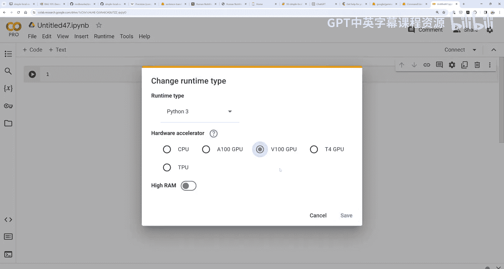

We're just going to run that。And then。Well also run that。

So a little less VRA available here than my local machine。But again。

 this is something you'll just have to experiment with。

 depending on what hardware you have available。So， there we go。We have。16 gigabytes on a V100。

So should use Gema 2 B I。Because you need quite a lot of space to run the 7B version。

Depending on what precision you loaded in。So with that being said， how about we load a gemma model。

So。Let's go， Local。Loading and LLM locally。I didn't want to rush straight into loading the Gema 7B model。

 specifically because I didn't want you to run into errors if you can't actually load that model on your available hardware。

 So that's why we went through that sort of explanatory phase of which LLM should you use Well first and foremost you want it to be open source or run locally Well then you've got a few options available。

Got some open source LLMs here， but then it's going to be highly dependent on what hardware you have available as to which model that you can run。

So。Let's write this down。We can load an LLM locally。Using。Hugging face。Transformers。

So transformformers is a beautiful open source library。

 I'm just going to get out of these because I don't need them。😊。

And this is on the Gema 7b IT model page， there's some beautiful helper code here of how to get started。

 the transformers。😊，And we can do this。 This is a similar workflow for many different LLMs。

 So we're going to do a modified version of this of all this sort of stuff， use4 bit precision。

And we should have transformers installed because we installed that with requirements TXT。

So import transformers， if you don't have transformers， you can also go Pip install transformers。

And it should be there， I believe， Transformers comes on Google Co Laab now too。So let's。Go here。

I'm just gonna write down here the model I'm going to use on my。And Vdia RTX。490。

Is Gema 7 B now again。Adjust this。 This is a step you're going to have to adjust if you don't have 24 gig of V Ramber allow。

 you should use， you should run this code that I've got from the helper notebook。Simple local rag。

And run this to find out which model that you should use， because if you try to load 7 B on a。

GPU that doesn't have enough memory， you're probably going to run into issues like I'm about two and a second。

 but we'll go through that together。😊，So to get a model。Running locally。

We're going to need a few things。So number one is aization。Config。Now， this is actually optional。

But this will say it is a config。On what precision。To load the model in。E G8 bit。4 bit， etc cea。

 So the less bits， the less space the model is gonna take up。 we we could。

 if you have unlimited GPU memory available， Of course， you don't need the quantization config。

 But if you don't， which is most of us， it's， you can create a quantization config。

 and that'll tell your model what。Presion to load in。So a model ID。This will tell transformers。

 so H page transformers， which model slash tokenizer。To load and three， we need a tokenizer。

 so this turns text into。Numbers ready for the LLM Now the tokenizer is different from the L embedding model that is。

So。Note， a tokenizer。Is different。From an embedding model。

A tokenizer is going to be specific to your LLM， so the good thing is that the model ID hugging face makes it easy with transformers to pair together the tokenizer and the model that you use so we use the same LLM model。

😊，We use the same model I for our tokenizer and for our LLM model so。This will be。

What we use to generate text based on an input。Wonderful， so let's load some things。

 And I want to put maybe a little extension here， as well。😊，I'm going to leave these。

Extensions down the bottom as well， but note。Once you get into the world of LLMs。

 you'll notice that there are many tips and tricks。Onloading。/lash making LLMs work faster。

One of the best ones。Hes flash。Attention。Or flash attention。

 I believe that's the Gitthub flash attention too。So because LLMs are often based on the transformer architecture and the transformer architecture has an attention module。

 flash attention2。😊，Is a faster implementation of attention。 However。

 it can be a little bit tricky to install on Windows。 So if you're running on Windows。

 just keep that in mind。 I've got some notes in the setup steps so you can build it from source。

 you can install it from here。Essential what flash attention does is it speeds up the token generation of your large language models。

 And anywhere we can get speed ups。 That's really helpful so。

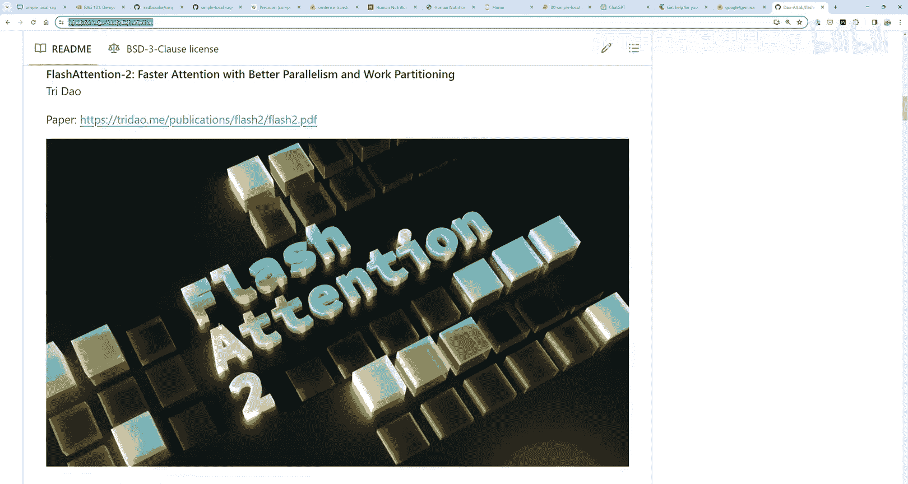

See the Github。父母。However， there is another thing to think of or to remember， is that。

A lot of the speed ups are only available for now on newer GPus。 So ampire， Aer， Hopper GPus。

 But the good thing is we can programmatically find out whether our GPU is capable or not。

 So let's do that。So I've personally got an RTX 4090 so I can use Flash attention too。😊。

So wherever you can find speed ups for increasing LOms and using less compute。

 that is one of the best things you can do。 Again， I'll have some extensions down the bottom of this notebook of where you can find potential ways to speed up your LOms running locally。

 And again， if you'd like to see a video on speeding up LOms locally， please let me know。 Yeah。

 I'd love to make something like that。 So we've got some code here。

 But we're going to write this out step by step to load a model How about we do that。😊，So， we need。

We're going to use torch。And we're going to use from Transformers， this is so exciting。 actually。

 this is groundbreaking stuff like this gemma model only came out about two weeks ago from making this video。

😊，So we're some of the first people in the world to actually use it for rag pipelines。

It depends when you're watching this video， of course， there might be a better model out by now。😊。

But the workflow should still remain the same， you know。

 as as long as it's available on hugging face so we can check。😊，By the way。

 I just skipped a few things， auto tokenizer。😊，So this is going to create our tokener automatically given a model ID and auto oh typo that auto model for causal LM。

 So a causal LM is a causal language model， which is another way of saying a generative language model。

 So based on the input， it's going to causally or casually or causally。

 causally generate a new output。😊，Okay， so flash attention2 available。

 this a little helper function from transformers， so this is going to see whether flash attention is installed or not。

 which will help speed up our inference times。😊，So number one is create a quantization config。

I'm just going through these steps up here。So this， I'm just going to put a note here。Note。

Requires Pip install bits and bys。And accelerate， which is another hugging face library。

 And if we go to。Bit and bite。Gitithub。By Tim Detmers。

 who also has one of the best guides on which GPUus you should use。

 so I'd highly recommend out that Check that out， but bits and bytes is a library lightweight Python wrapper around couda custom functions in particular。

8 bit optimizes matrix multiplication and8 and4 bit quantization functions。

 If you'd like to read more on that the documentation on hugging face as well So big thank you to the hugging face team as well as Tim Detmers。

So from transformers， let's import bits and。M config。

 this is what's going to help us quantize our model if we wanted to。

Quantization config equals so here's where we're going to just use the class from above and I've got too many A's there。

 don't I？Bit and biked config。And we're going to go load in4 bit equals true so。

This is my default for bit。 I've just read through some of the bits and bytes documentation and I found out that rather than。

 oh excuse me， I thought my table was in this notebook。😊。

So whatever is when you get lots of notebooks going around。

 I thought that the4 bit version or the8 bit version。😊，Might be something that we want to use。

 but I think4 bit has had a bit more development on it for the bits and bytes library now。

 that may change in the future。 but for now， that's just what I' found。

 So I'm just going to use the4 bit version for inference。 If you find something different to that。

 please let me know。 leave a discussion on the。GitHub here。

Discussion or an issue or something like that。But load in four bits。

 So that's going to be the smallest version of the model that we can get loading in this way。

 Otherwise， the bloke may have even smaller versions， quantized versions。So Bn B4 bit。

 this is where we have to say what compute de type we want to use。So torch float 16。So we want。

 so we're going to load the model in a four bit， but it's going to compute in Fat 16。

So a little bit confusing there， but that's just the config that I've found works best with this type of setup。

So now let's do a little bonus。Flash attention two。Equals faster attention mechanism。

 basically just speeds up your transformer operations。Right， if you want to speed up your LLms。

 you should use all the tricks that you should be able to get。 however， flash attention to。Requires。

嗯。A GPU with a。Compute。Com。Compatibility。Or capability， capability score of 8。0 plus。 So essentially。

 the newer architectures of GPU。So I think it's ampre， ate a Lovelace。Hopper and above。

And we can calculate our。In videodia， GPU。Compute。Capability。By running a torch function。

 but we'll just have a look at this。 So this is a developer。

 I'm just going to put this link in our notebook。This is all in the reference notebook， by the way。

So Ker GPUus， this is something to keep in mind， Kuder enabled Quadro and Nvidia RtX。

 So these are the newer GPUus， Rtx 68。9， so that should be able to run flash attention 2。

 but our local one that you'll probably often be running is yeah there's a G force RTx 490 that's a GPU I have we have 8。

9 and then we have 4080470 Ti 8。9 and then we sort of start to drop off yeah。2087。

Doesn't mean you can't run these models on the older GPus。

 It just means that you won't be able to leverage some newer， newer tips and tricks， right。

 like flash attention for now， they may bring them to older GPUus in the future， but for now。

 it will only work on。A GPpU's compute score of 8。0 plus。 and we can check that with。

Let's go to torch， Kuda get。Device， yeah， there we go。 device capability。

So that's going to get our score of our GPO just show you what this looks like on mine。So。

Might just run this in a different cell， torch。 kuda。Get。Deevvicice capability。

And then we can go zero。See what that looks like。 So zero is which device to get it on。

 So I only have one device。 that's going to be the first device。 So 8。9。

 this comes back as a topple so we can just measure if that first score is above 8 or is equal to 8 or above。

 then we can use flash attention。 and if this returns true。 So if。Is flash。Attention to available。

Let's run that function， and。Torch。 coa。Dot get device capability。0。Is above or equal to eight？

Let's go。Attention implementation equals。Flash attention2。Else。Attention implementation。

And we're doing this verboly at the moment。 But once you've got this all set up。

 like you can just load it automatically and you won't have to redo all of this stuff。

 but I thought I'd be as thorough as possible when loading a model because we want them to work as best as possible。

 right， We don't want to leave compute power on the table。So this is scaled dot product attention。

Which will be fast anyway， because in Pi torch， we have， if we go torch 2。2。Pye Toch 2。

2 flash attention V2 integration， there we go。It's coming in。 so scaled dot product attention。

 So this is already fast in in Pytorch。 So there we go。 F now supports flash attention too。

So scale do run attention， that'll be the default。 So if you don't have flash attention too。It will。

Does it say which one it uses implementation？No， oh there we go。Enable flash SDP。 There we go。

 So SDP kernel。So these are the different types of scaled doc product attention。

 If you'd like to learn more and read about that， please see the documentation there。

 So it's not that much of a fallback。 This is still going to be fast。 This is just faster， okay。

So now that's the bonus。 Let's go here， pick a model we'd like to use。

 Now we've already done this where I've decided I'm going to use Gema 7 B， I。Okay。

 yours might be slightly different depending on what hardware you have available。

 and I'm not going to use quantization config。 So my model Id is already。

Set model ID equals model ID， which is we don't necessarily have to do that。

 but or we could just type in the name here。Again， by the time you watch this。

 there may be a better version out， so if there is， please let me know I'd love to try it out myself。

 so Gema 7D IT。Okay。Otherwise， the model I。I's already the model lighting。

So now what do we have to do。 Well， let's go to step 3。

 We need a tokenizer so we can do this with auto tokenizer。 Let's load that in。 So three。

 instantiate。Tokenizer， so tokenizer turns text into tokens。We go tokenizer equals。Auto tokenizer。

From。Pretrained。And then we go pre trained model。Name this is if you had one already saved。

 but we're just going to go it based off the model ID。So if you don't already have。

 I've already downloaded this GeA7b model， so that's just something else to note that if you're downloading it for the first time and remember。

 you just have to accept。The hugging face terms and conditions or the terms and conditions。

 as well as the hugging face CI set that up。 If you're downloading it for the first time。

 it will take quite quite a while to download， but I've already download it so it's going to load it from the cache。

Depending on your internet connection， of course。Instantiate the model。

So this is going to be quite similar to our tokenizer。So we can go LLM model equals。Auto model 4。

Casal Lm。And we go from pre traineded。And then we'll go。Pre trained model name or。P。Equs model ID。

And by the way， there are a lot of different parameters that you can put into these too。

 so please be sure to check out the hugging face documentation for these two classes if you'd like to learn more about that。

 but we're gonna define the D type here， torch D type。😊，Equals torch dot float 16。 of course。

 this will actually change when if we use our quantization config。

 but I like to just put it in there by default anyway。😊。

And then we're going to have quantization config equals quantization。Config。If use。

So this is where our little。If else casement。If else。Cases comes in handy。

 so use quantization config Min is set to false。 Yours might be true。

 depending on how much memory you have available。 So if we don't have much memory available。

 we want to use the quantization config else。 It's going to be none。

And then I'll go low CPU mem usage。Equals false。 So I want to use as much memory as。We can。So again。

 low CPU memory usage to me that is part of quantization config is going to offload if。

 if you load a big model and you don't have enough GP space。

 it's going to offload some of the memory to the CPU。 So we want to use our GPU wherever we can。

So attention implementation。Equals our attention。Implementation oh my goodness。

 so that's a fair bit of code there， but I wanted to be as thorough as possible on purpose so that when you start to work with your own models and load them。

 well you know a little bit about what's going on okay？😊，Or with a lot actually。

 we've gone from0 to loading an LLM model。 This is so cool。 Now we do need one more thing。

 We want to send it to our target device。 So if not use quantization config。

 So if we have set a config here， it will take care of the device placement automatically。

 So that's just part of the bits and bys config as well as hugging face accelerate。

 So if we're not using that。😊，I will send my model to the GPU。Now。In all likelihood。

 I believe this is going to error either from typos or because I don't have enough coa memory available。

 so let's try it out。😊，You are attempting to use Flash Attention 2。

0 with a model not initialized on GPU。But that's where we have this here， we send it to the GPU。

Loading checkpoint shards， is this going to work？Oh， it did work。😮，Were go video SMI。

 How much space do we have。 Okay， we got， we've taken up a fair bit of memory there。

 but we now have an LLM model。 Let's check it out。 LLM model。Boom， look at that。

 our Gema model ready to go 7 billion parameters。 So here we have Gema flash attention too。

 because I'm using flash attention。 So I might just。😊，Print here。They have using。呃。Attention。

Implementation。Because I've installed flash attention。

If you're having trouble installing flash attention。

 please let me know on the GiHub or check out the resources I've got on there as well。😊。

So I might just print this in the next line so we don't have to reload。Flash attention2 beautiful。

 so I've added a little note to the Github here if you're having trouble installing flash attention。

😊，Yeah。So check that out， there's a helpful GiHub issue thread there for installing on Windows I found in coLab it works pretty pretty quickly。

😊，So。We have a model here。 Now， what do we do with this model。

 It's just this big LLM that's sitting in our notebook is waiting to generate some text。

 So how about we calculate the number of parameters。 Hey， for fun。

 So they get model nu parameters and we're gonna go model。😊，Torch。And then module。And return。

Let's go some。And we're going to get Para。t number of elements in the parameter for parameter in model dot parameters。

This is so exciting。 I can't believe we've got a local Llm ready to run。

 and so there's our function and then of course， we can run this so get model。😊。

Numb for Rams and pass it out LLM。L lot of Ls， lot of Ms。 Oh my goodness。

 So Gema 7 B turns out after more inspection， this is the power of doing your own experiments， right。

 is's actually 8 and a half billion parameters。 So I'm not sure about their comparisons to other 7 B models because。

 I mean， they're rounding down quite a bitca this is 8 and a half billion parameters。 But remember。

 the more parameters in a model generally， the more opportunity it has to learn。 And。

 you know what we can actually do as well is we can get the how much memory it takes up。

 So de get model me size。😊，It's another helpba function that feel free to use wherever you'd like to use it。

 So torch。 And then this is how much how I got the memory numbers for the different gemma sizes。

 right so。😊，Get model parameters。And。Buffffer sizes。 So what we want to do here is go memoram， so。

Equals。Some， and then we'll get parameter。An element。Times。

We want to go parameter parameter dot element。Size。For parameter in model dot parameters。Okay。

 beautiful。 And then we can do the same for the buffers。 So memory buffers equals some。😊。

Buff dot n element。Times buff。The element。Size there may be an inbuilt torch function for this already。

 if there is， let me know， but if not， we will just keep doing it。From scratch。Beautiful。

 so now let's calculate。😊，Model sizes。And we want to go， model mem。Bite。Equals me parameterss。

So this is going to give us our models how much memory it's taking up on our device in bytes。

 but then I like to know it in。Megabytes， so we can do model mem bytes and we'll divide that by 1024。

Squared， that's just a conversion to megabytes if we want to divide and then gigabytes is model Mm bytes。

And we'll divide by 124 to the power of three。And then we can return a dictionary of model mam bytes。

我面。Bys。And we can do the same for megaytes and gigabytes。We don't necessarily have to do this。

 this is just a little helper function extension。Again。

 a lot of the time you're going to run into memory issues when you're loading models locally。

 so I find it helpful to be able to figure out。How much memory a model actually takes up？

We'll just round these as well， actually， just full。Pritiness。We're going to generate tech soon。

 don't worry。All locally。So let's see if this works。 So model mem。

Size and we'll pass in our LLM model， What do we get？Round is oh， did you notice that beautiful。

 Okay， there we go。 So megabys， we have 16308 megabys， which is 15。9 gig or basically 16 gig。

 So to load Gemer 7 B I in float 16， we need a bare minimum of 16 gig of V Ram on our GPU right。😊。

So I'm just going to put it a little note there。So。We've got the size of our model。

This means to load。Gemma 7 B IT。In Fat 16。We need a minimum。Of 16 gigabytes。Of V Ramm。Now， however。

 due to the calculations。That take place in the For pass when we pass text to our model， For pass。We。

Actually。Need closer to 19 gig So this is something to keep in mind iss just because you have the minimum amount of memory that can load a model。

 you still have to make calculations in the Ford pass and that's going to take up more memory。

 So if we go or we close coab That means Gema 7 B in F 16 wouldn't fit on a V100 which has exactly or there're about 16 gig of V Ram it would might fit just but we wouldn't be able to do a forwardd pass。

 So in the next video。How about we generate some text with our LLM？All locally。

 so you might want to skip ahead and try to do that yourself。

 but otherwise I'll see you in the next section， we're going to generate some text with an open source LLM on our own computers。

😊，It's going to be so much fun。 I'll see you there。 Alrighty。

 Put your hand up if you're ready to generate text with LLM locally， or if you're running good coab。

 it'll work there， too。 I've got my hand up。 I know you can't see me， but it's in the air。

 You better believe it， so。😊，Let's。Generate text。With our local LOM。So just one thing。

 one more thing to note before we start writing code and that is note。Some models have been。Trained。

 slashed， tuned to generate。Text with specific。Template in mind。So I know when we use。

 or you might know when we use Chay B or something similar， we can just go。

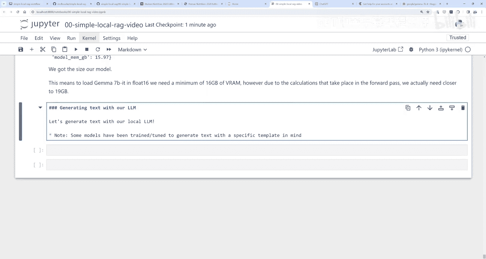

Hey， how are you， We don't have to have format any text。

 That's because there's some nice things happening behind the scene， right？

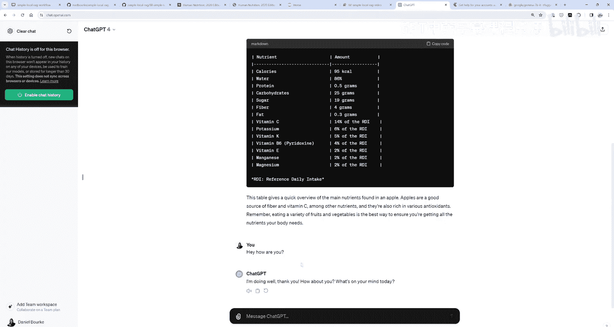

Um， we can。That's and ChaGBT has been trained in a specific way。

 but they pre process the text in a specific way。 So we have to do a similar thing with。

 with our models， so。Because。Gma now actually we don't have to do it， but to get better results。

 we should do it if a model has been trained in a certain way。

 we should follow that when we're using it for inference。So because Gema 7 B I has been trained。

In an instruction。Ted manner， we should follow。The instruction template for the best results。

Now all this information is available in the model card of GeEma 7b。Hi team。 So do we have。Template。

 yeah， chat template， the instruction tuned models use a chat template。

 so template that must be adhered to for conversational use load in the model。

 apply the chat template to a conversation。So there we go chat is Write a hellello world program。

 apply chat template， add generation prompt equals true。

 so let's have a look at what this looks like okay。So that's the sort of chat that we need。

 We need a user， and then it's going to type some things。 and then we get this。

 So beginning of sentence。 So that's a special token。

 beginning of sentence to tell the model where the sentence starts。

 the start of the turn for the user in our case， where the user。 Then there's the prompt。

 the text that goes in。 then that's the end of my turn。 and then we have the start of the turn。

 then we have the model。 And then after that， we're going to have some text。Okay。

Let's see what that looks like in practice。So， oh my gosh， I'm so excited to use it。 LL M。

 You'll never forget the first time you run an LLM locally。😊。

So input text is what are the macronutrients？And then and what roles do they play？In the human body。

 Right， So this is the， the the question that we， we did before。

 but just with a bit more text around it。 And then we want to。

 this is going to be just generation without retrieval。Because our model is capable of that。

 it's trained on internet text and it should have or be able to generate some pretty good text。😊。

If Google's benchmarks are correct。U， so these need to be curly braces， excuse me。Input text。

 wonderful。 There's our input text。 Now we need to create the prompt template。😊，So and by the way。

 another key term， if I haven't mentioned it， is prompt。

So prompt is a common term for describing the input to a generative LLM。

 and the idea of a prompt engineering is to structure a text based or potentially image based as well input to a de generative LLM in a specific way so that the generated output is ideal。

 So we'll see what this looks like a second， but let's create a prompt template。For instruction。

Ted model。 And then we're going to go。Dialogue。Template。Equals that。 And then I'm going to go roll。

Of user。And then I'm going to go content。Is going to be our input text。

And there's going to be a helper method on our tokenizer that will turn this into the correct template for our model automatically。

And many models have this already built in in Huging F as well。So apply the chat template。

 so we're going to go prompt equals。Tokenizer， apply chat template。

 and then we're going to go conversation。Equals dialogueog template。

And then we'll go tokenizer or token I， sorry equals false。

 we don't need to do that just yet I just want to show you。Add generation prompt。Equals true。Now。

 let's see what this looks like。 So Pri， I'm going to go a new line， prompt。

This is going to be formatted。Then we go new line。Prompt。Boom， there we go。

 so there's our input text and then we format it with the chat template。😊。

And we have beginning a sentence start of turn user。

 what are the macronutrients and what roles do they play in the human body end of turn start of turn model that is exactly the format that we need as our input to our Gema model Note it may be slightly different depending on the model that you're using。

 but that's why we use this applied chat template method because if a model has a specific input such as mystral instruct that's another very popular model Mistral instruct。

The template might be slightly different。 So just to pay attention there， there we go。

Pay attention to the model template， apply chat template of whatever model you're using。

And we'll go back here。 And now what can we do。 Well， we can generate some text。 Let's do it。

 So I'm going to time it。 So first， we need to tokenise the input text。😊，And or， actually。Yeah， well。

 we'll tokenise it first。 So turn it。Into numbers。And send it to the GPU。So this is our input text。

 the prompt。So this is， well， this is actually our input text， but we've formatted it to the prompt。

 so we want to tokenize the prompt that is。So let's go input IDs equals tokenizer。

That's the tokenizer that we've already set up。So I'll just show you what that looks like。Beautiful。

😊，So there's the special tokens。0123106109 or sorry 107 pad and a sentence beginning of sentence unknown。

 start of turn end of turn。Okay， that's ourken tokenizer and we're going to pass in here。😊。

The prompt， and we want to return。Tenses。Equals PT for pi torch。

 and then we're going to send this to the GPU。Now let's just see what the input IDs look like。Okay。

 so there's our input Is and there's our attention mask。So we want this to be all be visible。

 So that's why these are all ones。 We could actually mask out some of this input with a different attention mask so set these all to0。

But in our case we want our model to see all of these tokens。

 so this is going to be the input to our model， and then we want our model to generate some tokens based on these。

Now that's one thing to note a model doesn't output， an LLM doesn't actually output。Text。

 it outputs tokens， we have to convert it to text， but let's see that。😊，Generate outputs。

From local LLM。Oh my goodness， This is so exciting。 We may run into a co issue here， though。

 So generate， and I'm going to pass in all of the input Is。

 That little star star means pass in the keys。 So input Is and tension mask。😊。

And then we got a little parameter here， max new tokens equals 256。 So that means given these tokens。

 however many that is。Generate a maximum amount of 250 more。

 So we've limited how many new tokens that we can get， so。Let's print the output。Model output。Tokens。

Outputs， we're going to get zero。Go there。New line。Let's see what happens running locally。

 generating， text or generating tokens using an LLM running on our own GPU。😊，There we go。

 How cool is that， So there is the output， the tokens。😊，So model。

 what does it do It goes tokens in tokens out That's an LLM tokens in tokens out。

 whereas Chay Bt has some some processing on the back end that goes text in。

 text out So we have to convert these tokens back to text but there we go you've just ran your first generative or maybe maybe not your first maybe you've ever done this before。

 but we've just run together our first LLM generation locally so should be pretty proud。😊。

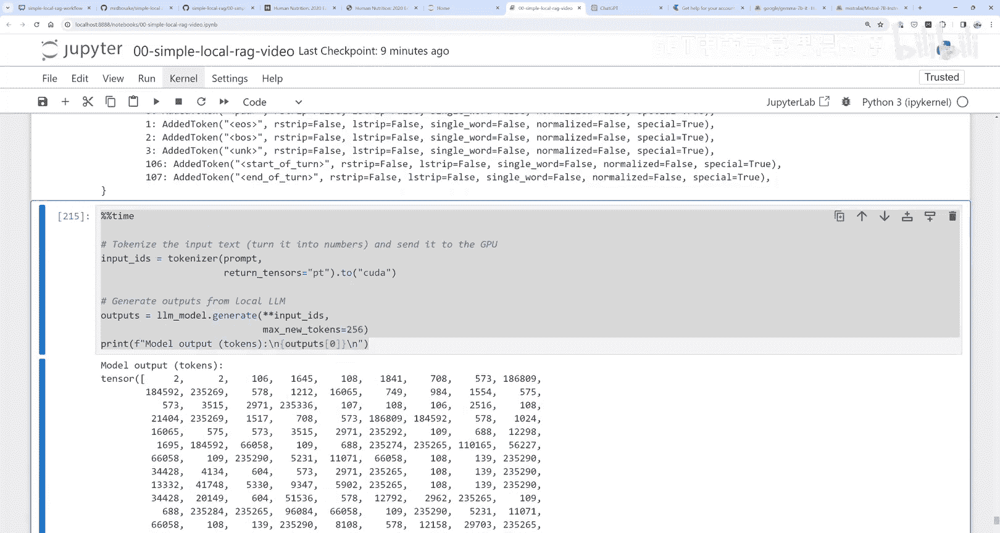

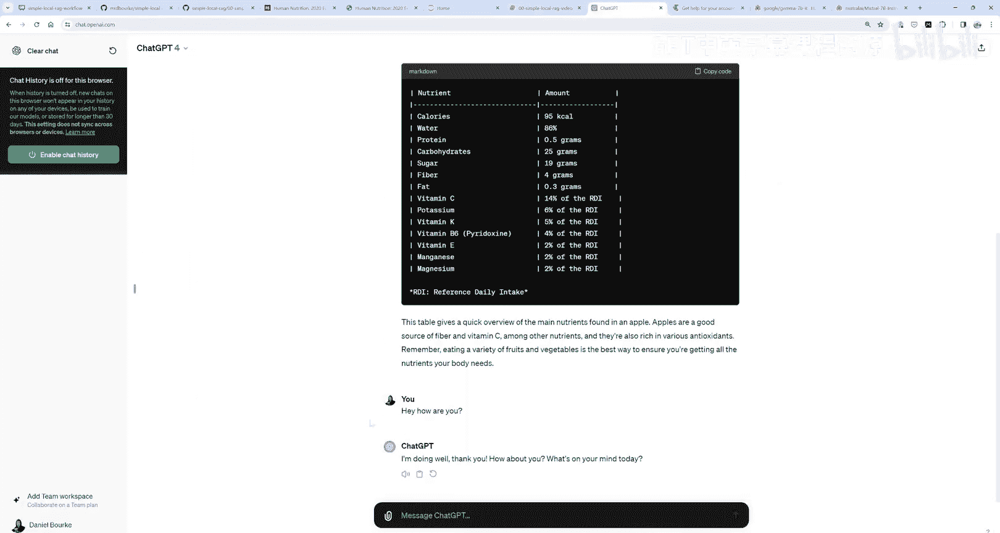

It takes a few seconds。Now， of course， the generation time is going to be dependent on a number of things。

 The compute power we have available I'm recording。 So that's going to take up some processing power。

 the GPU that you have， the type of how many tokens you have to process。

 the compute data type that you're using Float 16 or4 bit or whatnot。

 And then a bunch of different optimization。 So there are a few things that I've left in the extensions that we can see later。

We can cover that in a future video if you'd like。 So let me know if you'd like to see a video of opt There's a lot of videos I could make out of this。

 I mean， this topic is expanding rapidly。 If you'd like to see a video on optimising LLM generation locally for GPUus。

 please let me know as well。 But now let's convert these tokens。😊。

Inter textex to see what our model output。 Okay， so let's go decode。The output。Tokens to text。

So outputs。Decoded。Equals tokenizer。Dot tocode。 And we're going to go outputs0。

 So the outputs from our model。 So that's our tokenizer。 So instead of encoding it， we just de it。

 So we map these tokens back to text。 and then let's go print。Model output。Decoded。And。

And I'm going to go outputs。Decoded。Let's see what textile model generated。Oh my goodness。😊。

There's our model output。 So what you'll notice with the gemma model。

 it returns the prompt as well as。The output text。 So sure。

 here are the macronutrients and their roles in the human body。 macronutrients。

 carbohydrates roll provide energy for the body， help regulate blood sugar levels。

 provide firefo digestion and gut health proteins， roll， build and repair tissues。

 This is pretty good for a small model。 I mean， small in terms of L L M size，7 B。

7 billion parameters， Other functions。 So how about we，😊，Let me get this。

Let's do a little trick here， right？😊，So let's ask ChaTBT。To go。I'm going to say。

Can you rate the output of my LLM of my local LLM。Above。Based on its answer to the question。

And we'll go。Please rate it out of fiveca Chaty BT is a fairly good LLM。

 Well really good LMs basically state of the art， right， but we're rated to four out of five Oh no。

What does it miss out on， clarity。I think it's a pretty good answer for just generating。

Could be enhanced by adding more specific examples， okay？Could be more engaging。

So that's actually a technique that you could use to improve smaller models。

 get a larger model to rate its outputs and then improve the outputs of a smaller model based on the recommendations of a larger model。

😊，So we're getting LLM really meta there。 But let's。

 how about we do another generation because this is fun。 tokener， why don't we go。😊。

How long should we're focusing on。Infants or sorry， nutrition questions。

 but we could ask almost anything here， be breast fed。4our。Okay。That was quick。

 That was a lot quicker this time。 According to the American Academy of Podiatry， Podiatrics。

 the optimal duration for breastfeeding is six months with continued breastfeeding for up to one year and beyond。

 Okay， so these are nutrition focused questions。 But we could this LL M， Gema 7 B is a general model。

 So it's trained on Internet scale tech。 So we could ask it。😊，How do I grow potatoes？

Almost anything right， and see what it comes out with。Choose a suitable location， prepare the soil。

 plant the potatoes， water and fertilise。But I want to grow them organically。😊，Okay。

 let's go back to our macronutrient question， what are the macronutrients？😊。

And what are their functions in the body So we could functionise this much better now that we've got the model loaded。

 and in fact， we might start to move towards that。 But what I've got here is if we go back to our sample notebook。

And we scrolled in。So we've generated some text beautiful。 I've already got some questions preload。

 So I generated some nutrition style questions with G4， basically just said， hey。

 can you generate some beginner nutrition textbook style questions And we're going to see how well our model answers said queries So that way we've got a query list and I've created some of my own。

😊，There's the infants being breastfed。 the reason why this question is popping up a lot is because a couple of my friends have young children and so I' studied nutrition in past and that's just a topic that we've been talking about。

 What are symptoms of Pgra， how does saliva help with digestion， etc。

 So these are sort of nutrition questions that should be answered in a graduate style nutrition textbook。

😊，Query list。There we go。 So we've got 10 or so questions。 So now we can test our model by。

Or we can test our retrieval pipeline and then our generation pipeline by sampling this query。

 So that's instead of having to rewrite one all the time， you know， so import random。

So query equals random do choiceice and again we could make this list a lot bigger。

You can really ask almost anything of these general models， but we want to specifically。

Make our ragG pipeline for our nutrition textbook。So query es。Query。And if we were Telstra。

 we would customize our rag pipeline for our。Customer support documents。

Get just the scores and indices。Of top related results。So we've got our generation step ready。

 but we need our augmentation step。 that's what we're working on next。 So if we go to our workflow。

We've got an LLM。But we've got our query， we need to we need to put some relevant passages into our query before we pass that to our LLM。

 our prompt， so we want scores and indices。Equs retrieve。Relevant。Resources。For query equals query。

And embeddings， eles。Ebeddings。And let's check scores indices。What is the RDI for protein per day。

 There we go。 That's really quick。 So our next step is we can retrieve and we can generate。😊。

Now we need to augment our input to the model， and we can write a function to do so。

 So let's regroup in the next video we'll go through。Our final step of our rag pipeline。

 augmenting our prompt。With context items。 Oh my goodness， this is so exciting。

 I come't believe we running an L I M locally。 This is so cool。 This is really sort of。

 at the moment。😊，Gma 7 B only got released a couple weeks ago， and we're already using it locally。

 So this field is beautiful and exploding。 I'll see you in the next section。

 Let's do the augmentation step of our rag pipeline。😊，Okay， okay。

 Who's ready to augment our prompt with context items。 The final step of our rag pipeline。

 So we've done。Retrieval。We've done。Generation。Time to augment。Let's do it and the concept。

The concept。Of augmenting a prompt。Oh my goodness with context items is also referred to。😊。

As you'll see this a lot， prompt engineering。Alright， it cops a lot of flack。

 but has been called an engineering practice， But if you're just continually modifying and experimenting with something。

 it is a form of engineering。 It is a form of science。 It is a form of art。

 So we're still figuring out the best way to put inputs into an LLM and get ideal outputs。

 But Rag is probably one of the most， I guess， promising and useful techniques for getting the ideal outputs from an LLM。

 So prompt engineering。😊，I'm going to write it here。 Promp engineering is。An active。

Field of research。And many new。Styles and techniques。Being found out。However。

 other Ms have been around for well， in the current field， probably two to three years now there are。

A fair few techniques。That。That work？Quite well。So resources， I got a couple of resources。

 if you'd like to check them out。 and I'd highly recommend these。 So if we go to our。Notebook here。

 we've got Proing guideide do AI one of my favourites。

 Bx's promptmp engineering guide I really love this one it's just in a Github read me So these are all extra curriculum for you to check out。

😊，So prompt design and engineering as well， this is an archive paper that collects many of the useful techniques。

 so we're not going to use all of them， that's something for you to experiment and try with but if you want some references please go and check these out I'll just put a couple of these。

In here， but they are all in the reference notebook。So we go there。Read through those。

 So we're going to use a couple of techniques。We're going to use a couple of。Prompting。Techniques。

So one is give clear instructions I know that doesn't even sound like a technique。

 but you would be surprised at how much better your outputs from agenrative LLM can be if you just specifically ask for what you want and then two is give a few examples of input slash output。

So EG， given this input。I'd like this output so again sounds quite simple but it does really help to improve the outputs of your model it's like hey。

 I've got this example， can you give me an out if I gave you this input I want the output to look like this。

And then。Give room to think。 So E G。Create a scratch pad。Scratch paded。Slash。Show your' working。

Spice， slash。Another common one is let's think step by step。

Right so you know how your teachers often get you to say show you're working when you're working things out turns out that that kind of works with LLMs as well and no I'm still working this out as well but these are three things that I' found really help work for inputs and outputs of LLMs and I believe anthropic。

😊，嗯。Prompting guide for business。Have a great article。 Yeah。

 prompt engineering for business performance。😊，So。Anthropic is one of the creators of is the creative Claude。

 which at the moment， Clade 3 just came out。 It's the， the best performing LLM in the world。

 So few shop prompting。So two step by step yeah think step by step that's what we're using and fu shot prompting we're giving it a couple of examples。

 prompt chaining we're not going to really explore that for now。

 but if you want to have a look at this article for business performance。

 this is by the leading group of LLM creators at the moment， I'll put that here as well。So。

Claud3 now outperforms G4 as of March 2024， which is really cool to see。So let's。

 with that being said， let's create a function。Right here。Let's create。

A function to format a prompt with context items。 Okay。

 so we've got the ability to retrieve some context items using our retrieval function。

 But now we want to get those text text that we get back from that。 And we want to put it into this。

Input up here。We've written a lot of code。 We want to put it into the chat template。😊，Okay。

 let's see what this looks like。😊，So we'll start nice and simple， de prompt format。

 and we'll put in a query string， and we want to just make it as simple as possible context items。

L Nick， we can make this our prompt as complicated as we like。 But you know me。

 I like to start as simple as possible。 So let's return prompt。

And let's just say the prompt is just the context。Okay， so we want to go context equals。

Cont items we want to join。 This is gonna be from our。Pages and chunks So of course。

 how you format your prompt will be dependent oh wow， there's a lot of samples there。

We'll get sample 420 that's going to print out 1，800 samples。😊，Okay。Right。

We want to pass in pages and chunks， We want to get the relevant indexes。

And we want to pass in these sentence chunks to our generative model。 So the context is going to be。

 let's join them。As dot points right， So we want each chunk to。

 I'll show you what this looks like as we printed out。

 We want each chunk to be like an example based on these contexts。

 dot point dot point dot point dot point， generate something like this。 Okay。

 so let me just show you。Prompt example。So based。On the following。Context。So， one。2。th3。For。

F or however many we want to put in。Please answer。The following query。What are the macronutrients？

And what do they do？Anter。So we want something similar to that。

And we can turn this into code as well， right， but of course we want to create these context programmatically。

😊，Oh， knocked down。So what we're going to do is we're going to create this programmatically by putting in our context。

 and we're going to join。New line。This will take some experimenting， by the way。

 with how you want to format your prompt。I've had a bit of practice here。

 so I kind of know where we how we want to format it for item in context items。Okay。

 so we need a way to get some context items into there。And then let's just say prompt。Eless context。

 and we can adjust this in a second。Okay， let's see a bare bones version of what this looks like。

What can we do Well， we want a query。It's going to be equal to random。Choice。From now。

And I might just get rid of this。 We don't need this cell any more， do we。Okay。

 random choice from the query list。Then I'll print out。Now query。And then I'm going to go get。

Relevant。Resources， so scores。Indices。Equs L function， retrieve。Relevant resources。

 So this is where our retrieval function is really coming in handy。

 We don't have to write that whole pipeline again。We're really working towards creating。😊。

A wonderful local rag pipeline， So let's now create。A list of context items。So based on our indices。

 we want to create context items equals， we want to index our pages and chunks。Pages and chunks I。

For I in indices。Okay， wonderful， and then we're going to format our prompt。

With prompt equals prompt。Formatta， I function from above。Formatta。

 and we're going to pass in the query。And then we're going to pass in the context items。Oh。

 and then we'll print out the prompt。Okay。There we go。 So our waterso vitamins。

 Do we have good context items， So that's all we're printing out right now， right。

 So we just take the context。😊，As I'll show you what they look like。

 they're just going to be a list of。Sentence chunks， context items。Oh sorry。

 we get we get the sentence chunks from all those。So。We want。Oh we've already got here。

That's what I want。Okay， so we get a list of sentences related to our query。

And then what we do with this line up here is we join them all together so that they're in dot point form。

Just like if you were asking an exam question and it' sort of the question was based on these four five paragraphs。

 please answer this question Does that make sense？😊。

So recommended that users complete these activities。 So maybe water soluble vitamins， There we go。

 or water soluble vitamins play a different kind of role in energy metabolism。

 So you see how this version or this。This resource maybe isn't the best one to have up the top。

 So that's where a reranking model could come in handy。 As we discussed before。

 So I'll let that leave that as an extension。 So water soluble vitamins， there we go。Now。

 what happens， maybe we just pass this straight to our model and see what happens。Okay。

 we've got no other instructions there， we're just going to pass in a bunch of texts and see what have outputs。

In the name of experimenting， so we need to tokenise。Prompt。

And we haven't actually got chat formatting on here as well。

 so Tensors equals PT and the query isn't even in there， but we're going to try this workflow anyway。

Input Is， and then we can。Genrate。And output。Of tokens， so outputs equals LLM model。

Dot generaterate and then we're going to pass in our input Is。

And then we'll set the temperature of our model temperature where the hell what is the temperature so the temperature basically is one of the most important parameters in an LLM but it goes I think it's from zero to one。

 from zero to one for most cases and it may be how to go negative in some instances。

 but from my experience is zero to1 and the lower the value。The more deterministic。The text。

The higher the value， the more creative。OkaySo it's again a very experimental parameter if you want to have a look at a great guide on different settings for LLMs。

 these are going to be the main ones for most LLMs are here。

 but hugging face also has a lot of different settings in the generate documentation so LLM settings。

 this is prompt engineering to AI temperature。😊，There we go。 In short， the lower the temperature。

 the more deterministic the results in the sense that the highest probable next token is always picked。

 Increasing temperature could lead to more randomness。

 which encourages more diverse or creative outputs。

You are essentially increasing the weights of the other possible tokens。

So we'll keep going with that。 do sample。Equals true。 So if we want to sample。 So if we。

 if we set that to false， which I believe is the default。

 it's just going to choose the most most likely next token all the time。 So true is so that。Weather。

Or not to use sampling Now this is a whole topic on itself for this the sampling to choose a different token to output next because an LLM is taking in。

 say this sequence of tokens and then generating this sequence。Okay。

So that's sampling is going to be like if you if we set it to false。

 it's just going to always pick the next likelyken token， if we want it to sample do sample。

 it uses other forms of choice So my favorite resource for this is chip human text sampling。

So greedy decoding， do we have greedy？There's another guide for temperature， yet， greedy sampling。

 most likely token。So if you want resource on tech sampling， please go and check that out， but again。

 these are all going to be experimental and then max new tokens is equal to 256。

 How many new tokens do we want to generate So let's turn the output。Tokens into text。So output text。

Equals tokenizer。Doctor code， and then we're going to put output0。Boom and print。Query。

And we're going to also。Print our rag answer。So what's our query up here？A water soluble vitamins。

 Were not that's not actually included in the prompt。Our prompt is this no context Oh sorry。

 no question， just a bunch of context information。😊，But that's what we're going to experiment。

 we're going to slowly build up our prompt formatting， our prompt augmentation。😊。

So we don't want the prompt to be returned， so we want to just replace the prompt in the output text with nothing。

We just want to see the generated text。Let's see what happens。

This text includes information about w water soluble vitamins， Okay。

 that's pretty good including their role in energy metabolism and blood function and other bodily functions。

 It also discusses the absorption of fat soluble and water soluble vitamins and the in the importance of choline as an essential nutrient Okay wonderful Now how about we put the query in there as well。

 So prompt equals query context。😊，So I want to take in a query so。Let's just make it simple。

Base prompt。What should we do， Maybe we go equals。We'll go based。Based on the following。

Context items。Please answer。The query。And then we're going to go。We'll go context。Items。

And then we'll go context。And then we'll go query。And then we'll go An。Okay。

So let's see what this looks like。Oh， excuse me。 So we need to go。Base or prompt。Vice prompt。No。

 we've already got the base prompt prompt equals sorry。

 I'm just reading too many versions of prompt here。 prompt equals base prompt dot format。

 and we want to set the context equal to the context。😊，And then the query e to the query。

And let's see what we get back。 There we go。 Okay， beautiful。

 So based on the following context items， please answer the query。

 See how we're slowly augmenting our prompt。 We have now context items。😊。

And we have the different things here。And we have our query。

How often should infants be best breastfed answer。 Okay， let's pass that to our model。

According to the text， infants should be breastfed 8 to 12 times a day or more， wonderful。😊，That's。

 that's answering it from the text Retrieval， augmented generation。 Now， in fact。

 I think this answer could be a bit more detailed。 So how might we improve that。

 Look while we're here， let's try another one。😊，How does saliva help with digestion Okay。

 let's see what what comes from our model。Siva helps with digestion by secreting the Amazon saliva alaase。

 which breaks down the bonds between the monomeric sugar units of dissaccharides。

 oglieraccharides and starches。 saliva amylase breaks down amylloose and ammylopectin in a smaller chain of glucose called Dxts and Maltos。

 We could Now the benefit of this is we could research this answer。 actually we have the resources。

 the context where it came from。 We could read through this or find the pages where it came from。

 But now we've created a rag pipeline。 We're retrieving We augmenting and we're generating。

 and it's all running locally。 How about we improve this base prompt slightly。😊。

So I've got a pre baked prompt that I found works pretty well， so I'm going to bring this in。

Base prompt。And I'll show， let's break it down， hey。So based on the following context items。

 please answer the query， give yourself room to think So this is the step by step technique by extracting relevant passages from the text before answering the query。

 and then I've got down here。Relevant passages extract relevant passages from the context here。

And then don't return the thinking。 Only return the answer。

 Make sure your answers are explanatory as possible。

 Use the following examples as reference for the ideal answer style， So this is giving examples。

 So this is very helpful for LLm。 If you give them examples of exactly what you want。 Now。

 use the following context items to answer the user query。

 Use a query query and we format the context。 So these are examples that I've written myself。

 What are the fat soluble vitamins answer， what are the causes of type 2 diabetes， answer。

 What is the importance of hydration。 So the three steps to take away from here。

 is give clear instructions。 Give a few examples of input output。

 give room to think E G create a scratch pad。 show your working space Let's think step by step。

 So there are three techniques that I've incorporated in here。 Is it the best prompt。

 Probably not could probably be improved。 If you find a better way of doing it， please let me know。

 I'd love to hear your tips and tricks。 but there are lots of tips and tricks in these guides here。😊。

Of how to best prompt models or just try to best prompt models because again。

 this is still an experimental phase。😊，I'll just get out of those and let's just see what happens when we do this。

 We haven't formatted it for conversation yet。So example one， two， three。Context items。

Relevant passages Use a query。 What is the RI for protein per day。 And the answer is。 Okay。

 let's see what happens。Genite。What happened is。We haven't formatted it for conversation style。

 So how about we fix that。Let's go up in here， so we've got our prompt。

 but there's a special dialogue template that we've been using and the model has been trained for。

 so this is something to keep in mind that if your outputs from your generative model aren't as good as you'd like them。

 make sure your inputs to them are in the same way that they've been trained。

So let's create the prompt template。We want。I'm going to say this is。Base prompt。So， base prompt。

I'm going to get rid of that。And base prompt， we update it to format it with the context in the query。

 and then I'm going to create the prompt template for conversation。For instruction tuned model。So。

 we want。Dialogue template equals。This is got to be a list so this is available on the model card I kind of know it almost off by heart now because I've done it a few times content and then we want to put in our base prompt here。

😊，Andd the dictionary。And then we go as a list。😊，Beautiful and now we're going to apply the chat template so we can do this with our tokenizer。

So let's go prompt equals tokenizer。Apply chat template。And conversation。He callss dialogue。Template。

 and then we're going to go tokenize equals false because we're going to do that with our tokenizer later on and then we're going to go add generation prompt equals true。

So you see how we've slowly been augmenting our prompt。 We started with something really basic。

 Then we gave it examples， clear instructions， it giving it room to think step by step， we format it。

 So that's the augmentation step。 Now we're optimizing it for the instruction tuned model。

 which is what we're using Gema 7 B IT App the template， return the prompt， What does this look like。

Explain the concept of energy balance and its importance in weight management。

 so now we've got our formatted prompt here。We've got examples。Now we've got the context。

So what do we have here balancing energy input with energy output to maintain weight beautiful。

 the context should be relevant， explain the concept of energy balance and its importance in weight management return model。

 beautiful， Let's see what happens when we pass this through。😊，This is always fun to wait。

 What's it gonna generate。 Explain the concept of energy balance。

 and it's important in weight management。 Sure， here is the answer to the query。

 Energy balance plays a key role in weight management。

 It is the state in which energy intake is equal to the energy expended by the body。

 when you are in a positive energy balance。 The excess nutrient energy will be stored or used to grow。

 when you are in a negative energy balance， your body will need to use its stores to provide energy。

 weight can be thought of as a whole body estimate of energy balance。 That's pretty cool。 Therefore。

 maintaining energy balance is essential for maintaining a stable body weight。

 when you are in energy balance， your weight remains stable。

 When you are in a negative energy balance， you will lose weight。

 And when you are in a positive energy balance， you will gain weight。

 So I think that's a pretty good answer。 So we've just built a rag pipeline running completely locally based on a nutrition textbook that's 1200 pages long。

 How cool is that But I think we can take it a step further and functionize our。😊。

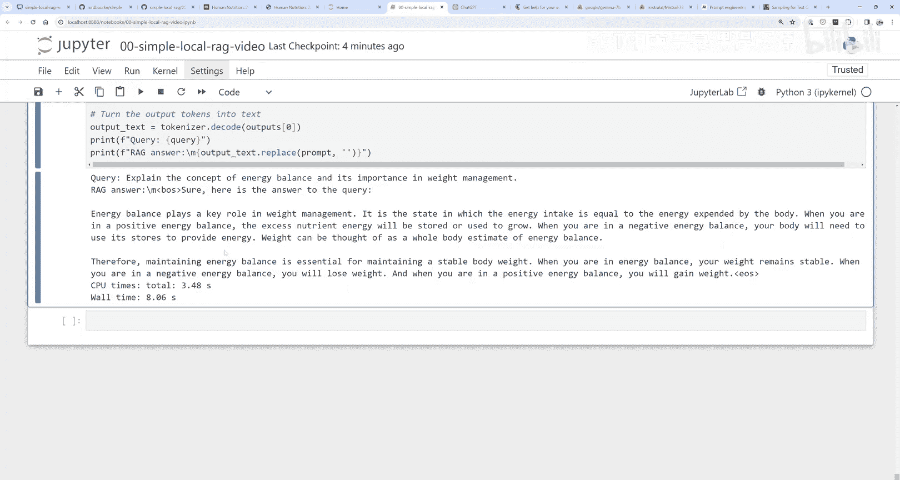

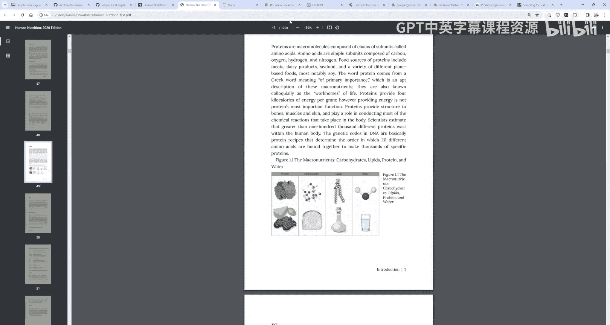

LLM response here。So I want to， I want to boil it down to a single function。 right。

 I want to just go， let's go functionize。L LLM。Answer。Answering feature。Right， can we。

 can we make this， I want to go ask and then a question， what are the fat soluble？Vitamins。

Right I want it to be as simple as that so if you want to jump ahead and try functionize this。

 create a function called ask and then it's going to go through and just repeat this entire pipeline for us。

 format our prompt automatically with relevant context。

 find the relative resources to begin with and then generate an output and return it from the LLM so give that a shot and we'll do it together in the next section。

So we've got our rag pipeline working， but there's still one more step。

 I want to functionise this so it all works in a single function。 Let's do it together， Hey so。😊，文。

It'd be cool if our ragg pipeline。Worked。From a single function。Ohpe， excuse me。Aj。You input a query。

And you get a generated answer。Plus， optionally。Also。Get the source documents。The context。

Where that answer？Was generated from？Right， the whole principle of rag。So let's do it。

Let's make a function。To do it。So I reckon you might have already had a try at this and if you have。

 well， I applaud you。That's what we're all about right we're all about just experimenting and trying it out so ask let's go。

 it's going to take in a query。😊，And we'll put in a couple of LLM parameters here， temperature。

This can be afloat。We'll set it by default to be 0。7 and max new token。

 so the max new tokens that we want it to generate， this can be an int。

 We'll set it by default to be 256。And we'll format the answer text if we want to， true。

 I'll show you what this looks like in a second。And then we'll go return answer only equals true。

So that'll be if we want the context back， we can change these flags。

 So let's just write a little doctoring here。So takes a query。Finds relevant。

Resources slash context and generates。And answer to the query。Based on the relevant。Resources。

 and this is where we've all been leading to。 right。

 all the way through our entire notebook is to just create this function。 Retrieval。

 augmented generation in one hit， so。😊，Get just the scores and indices。Of top related。Results。So。

 scores。Indices equals。Retieve relevant resources。And we're going to go query equals query。

So we've used this function before。So this is where we can leverage all the code that we've written previously。

 embeddings， es， embeddings。Oh and I think that's actually all we need， beautiful。

 create a list of context items。😊，And we're going to go。Context items， equals。Pages and chunks。i。

For I and indices。 So these are the indices of our。Relevant resources。

And pages and chunks is our list of dictionaries with text and resources。

 So add score to context item。 So this is if we want to enrich our context item。

 So it won't actually have。Pages and chunks， the items in here。Let's just go a random number。

575 won't have the score of how relevant that is to the query。

 so we can update that with for eye item in enumerate。Context items。We can go item。Score。

Equals scores。I and will send that to CPU。Because it's going to be on the GPU。

Write the score back to CPU。Now， what should we do next， So we want to format our prompt。

 So this is retrieval。Retrieval。And now we want to go augmentation。Or augment。So let's go。😊。

Create the prompt and format it with context items。So prompt equals prompt format。Now。

 one thing you could do with the prompt formatta is also we've set the base prompt in the function prompt format。

Which we made above。But what you could also do is just save the prompt like to a text file or something like that。

 and then you could edit them that way you could run it experimentalationally like if you had multiple different prompts you wanted to try out and evaluate。

 you could save these to different text files and then just import them programmatically try over a bunch of different prompts。

Experiment， experiment， experiment， and then we want to format it with the context items that we have。

😊，All of our functions are coming into play here。 I you just love it when a pipeline comes together。

 And so now what do we have to do， We want to。😊，Generation。So we want to go。Tokenize the prompt。

So remember that prompt formatta function is going to return our prompt with the conversation dialogue already appended to it。

 so now we just have to turn it into tokens so input IDs。

 this is where our tokenizer is are going to come in handy and we're going to tokenize the prompt and we'll return tenseors。

And Pyt format PT for that and we're going to send that to KUa so because our LLM is on our GPU so we want our tokenized prompt to go to the GPU as well。

So generate。An output of tokens。We're going to go outputs equals LLM model。Don't generate。

And we can pass out our input IDs。And we can put the temperature。We could actually。

Put more settings here if we wanted to tempature。And to work out how to spell that。 do sample。 again。

 we could customise these settings that will take a lot of experimenting。

 I'd highly suggest checking out the generate， specifically hugging face generate。😊，Config。

Generation config。 Yeah， here we go。 There's gonna be a lot of different stuff that you can do with that。

Check that out for more。 But then if we go do sample equals true max new tokens equals max new tokens。

There's our generation done。 And now we have to， we're going to get， that's going to output tokens。

 right， So we want to。Decode the tokens into text。Because we want text to come out。

 output text equals tokenizer。decode。Outputs。Zero， there we go， beautiful。

 and then so format the answer。So our output text again is going to output the prompt itself now that's I think of the jamma model may different for another model。

 but as you see here we replace the prompt with nothing。

 we can also remove things like beginning of sentence and end of sentence to make it look nice to make it look like that it's just outputting text。

So， let's go， if format。Answer text。Let's go。Replace prompt and special tokens。So。Output text equals。

Output text。t replace。And we'll replace the prompt for nothing。And then we'll also replace。

BOS for beginning of sentence。Place that with nothing and then replace end of sentence。

With nothing as well。So you might be able to format your text a little bit better。

 but that's just a simple one that we can do for now and then。Only return。

The answer without context items。 So by default， we'll get it to come back with。

Context items if return， answer only。We'll go return output。Text。Or sorry。

 What have we set this to as。Return answer only equal is true yep。

We only want the answer most of the time， but if that's not set to true， we'll by default。

 set the output text and the context items to come with that。So context items， there we go。Okay。

 now we have one function to perform retrieval。Augmentation and generation。How cool is that。

 Let's try it out。 Hey， our rag pipeline is coming to life。 Oh， invalid syntax。

 perhaps you forgot a comma。嗯，好吗。Relevant。For I and indices， oh。I don't need a come there。

You know what？ This is probably， I've probably forgotten something here。 Pa。

 I'm going to pause this and I'll find the error， and I'll come back。 You know what。

 I found the error。You might have seen it。There was too many eyess and ends here， I， N， I。

 so I forgot the in。😊，It wasn't a comma， it was an in， there we go， okay， beautiful runner。

 you might have caught that far better than I did， but they took a little bit of troubleshooting。😊。

So。Oh， now we have invalid syntax。Let's see what happens， Are you ready to ask a query？So query。

 es random。Choice。From our query list， and then we'll go print the query。

 we're going to try out our'll function here， Retrieval， augmented generation in one hit。😊。

Query is query。 and then。Ask。By default， we are going to just return the answer only。So ask query。

 Eagles query。What do we get？What are the macronutrients and what roles do they play in the human body。

 Here we go。Sure， here is the answer to your user query。

 macronutrients are the nutrients that are needed in large amounts by the human body。

 There are three classes of macronutrients， carbohydrates， lipids and proteins。

 These macronutrients are absorbed， along with fats in the diet and can be stored in the bodies。

 fatty tissue and liver for later use。Is that correct， Maybe， maybe not。

 Proteins are macromolecules comprised of chains of subunits called amino acids。

 They provide structure to bones， muscles in skin and play a role in conducting most of the chemical reactions that take place in the body。

 Carbohydrates are molecules composed of carbon hydrogen oxygen。

 They provide a ready source of energy for the body and provide structural constituents for the formation of cells。

 Fats are stored。A stored energy for the body， h。I think that's a little bit incorrect。 Let's ask。

 let's troubleshoot this， okay。This is so this is really hard to actually troubleshoot。 and look。

 I used Chay Bt to find out where the problem was， Is there an error in this function？😊。

And it showed me that I was missing in。 So that's a really helpful use case for when your eyes are just glazing over your code。

 glazing over your code。 So is this answer correct regarding。The macronutrients。It's mostly correct。

😊，Minor inaccuracy。Rlls of macronutrients。Carbohydrates。Playing a role in cellular structure。

So I think this is from our examples。 So this is something that you'll have to look into。

 It's just because our rag pipeline is generating text with what we call it。

Reference doesn't mean that it's always going to be correct， so let's try lower the temperature。

So what lowering the temperature is going to do is hopefully generate less randomized and creative text and so in theory it's going to go hey LLM。

 just take the context and generate text that's pretty straightforward from that context。😊。

Describe the process of digestion and absorption of nutrients in the human body。Sure。

 here is the answer to the query， we could probably remove that too from the output if we wanted to。

😊，The process of digestion and absorption of nutrients in the human body is a complex and multifaceted process that involves several organs and systems working together。

 It begins with the mouse， where mouth， not mouse， where salivbri amylase breaks down starch into smaller molecules called monosaccharides。

Cells then use these nutrients to build and to generate energy or build new cells。 So this is。

 it's not too bad， right， Like， it could probably be improved。

 but it's working How retrieval or augmented generation pipeline is working locally。 This is so cool。

😊，Name five fiber containing foods Do we get this five fiber containing foods are peas， beans， oats。

 whole grain foods， and flax。😊，Oh my goodness。 Retrieval augmented pipeline running locally。 Yes。

 yes， yes。 So what happens if we wanted to return the context， you know。

 So I'm gonna to set return answer only equals false。😊，Return answer only equals false。

So I want the context now， it's given us the same query as before， but now we have some context。😊。

Okay， beautiful。 So there's a generation。 The search happens really quickly。

 The generation takes a little bit more time。 There are some steps we could take to optimize that。

 But I'm probably going save that for another video。 If you'd like to see that。 please let me know。

 So this is the first relevant。😊，Sentence。Do we have a page for that。Page number 1086。

 I believe we might have already seen that one， so let's try again。

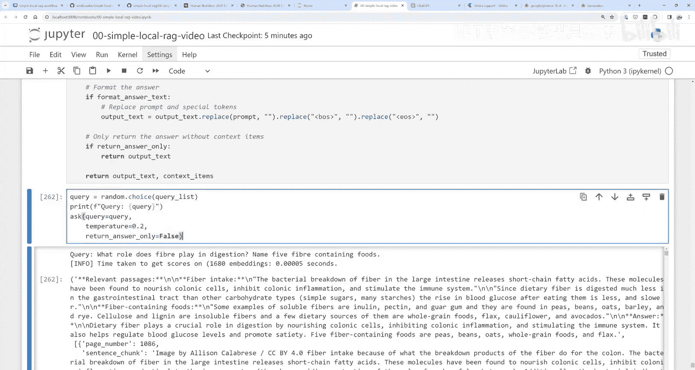

But we'll go to here 1086 anyway。1086。There we go。 Oh， maybe we haven't seen that。

 Do we have fiberbre on this page。I just lost a page number。😊，1086。1086， okay。A multitude of diet。

Fresh fruit tower， modernized influence。 Other ethnic groups have migrated to this diet。

 s carbohydrates。To learn more about the nutrition of that。

 good nutrition equates to receiving enough， but not too much of the macronutrients， proteins。

 carbohydrates and water， and micronutrients。The phrase you are what you eat。Sugy， high fat。

 But where's a fibre on this page。

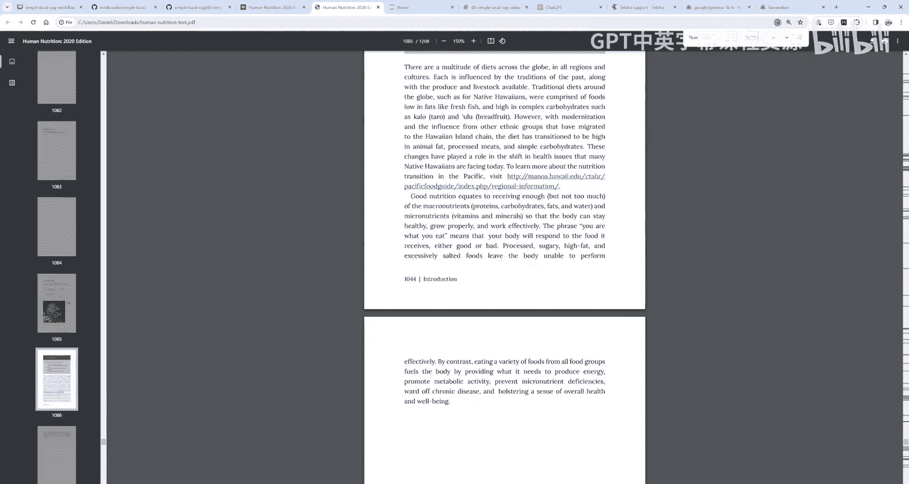

So maybe it didn't work too well， maybe I'm missing something， maybe you can see something I didn't。

 but this is where we'll have to troubleshoot later on。What do we get page 60？Is this relevant。See。

 this is another step， which is going to be probably another extension， is how to evaluate。

Rag pipelines， the digestive system。 There we go。 That's much better when you feel hungry。

 What happens。 So we could make this look a lot prettier。 So that's our local rag pipeline。

 We've now officially built this。System evaluating it would be a whole not thing。 though。

 We've built the system。 It works from a principal standpoint。

 What you would likely do next is refine it a little bit more that we've got the outline structure to sort of make sure that it works a little bit better。

For certain use cases so you could create some good examples and then use those as sort of evaluation metrics and whatnot。

 that space is also still being worked out。 but congratulations。

 We've built a local rag pipeline to just go from scratch Take in a document a 1200 page Pdf nutrition textbook。

 We processed it into smaller chunks。 We embedded those chunks。

 we've stored those and now we have a system that can we can ask a query with just one line of code basically it will find relative resources。

 ask an LLM and then return those resources as well as the original query and the generated answer based on those resources。

 So with that being said a little summary。😊，Let's put a summary here。Rag es， powerful technique。

For generating。Text based on reference。Documents。Maybe we now have to call up Telsher and go， hey。

 I can help out with your system， we could take all of their customer support documents。😊。

We could now embed them。 We could store them in a database such as torch。

 Tensor or e vector database。 And then we could use a model like Gema 7 B to offer。Outputs。

Generated outputs based on those documents so。We can go here。Hardware。Use。So。

We want to go use GPU where possible to accelerate。Ebedding creation。And。LLM generation。And then。

Ohll turn this into markdown。And then we'll go here， keep。😊，In mind， the limitations。On your。

Local hardware。And then we want to go many open source。Ebeddings and LLMs。

Starting our embedding models。To become available。诶。Keep experimenting。To find which is best。So。

There's probably a few more things to go over， but we've covered a lot of material。

 So what I would say is for some practice， I've got some extensions in the base notebook。

 So if we come down right to the very end。 These aren't formatted very well at the moment。

 But if by the time you watch this， they'll probably be a bit more formatted。

 So there are several different things that we could do for the Pdf text。 right now。

 we're just focusing on text。 But there are things like figures and images in there。

 we could probably work out some sort of pipeline to get those out of the Pdf better and encode them embed them in a certain way。

 So a couple of。😊，Exctual resources here for P Df extraction。

 There's a bunch of different prompting techniques that we could try as well。

 I've linked some resources for those。 So what happens when a query comes through that isn't on any context in the textbook。

 That's something that we'd have to think about in a workflow if we wanted to deploy this。

 sayy we we embedded Telstra's support documents and someone starts asking about where they can buy a chainsaw。

Maybe Telstra's support chatbot shouldn't really answer those questions。

Then we have we try another embedding model。 We could also try a reranking model based on our resources。

 So if we had top 10 resources， could we rerank them in a better way。 We could try another LLM。

 try different prompts， of course， text from a PDF。 we've mentioned this。

 evaluate we need a way to evaluate our answers So we could just right now we've only evaluated them by visually going through them。

 but you probably want to start to look into how you could create a good resource of example answers and then compare those to your models's output。

Then we could start to use a vector database s index for a larger setup。

 So if we had we actually saw that it would work for probably a million chunks or more。

 So if you have a lot more than that， you probably want a vector database or index。

 and then there are libraries and frameworks such as Lang chain and Lama index that can help do many of the steps that we've gone through。

 but I wanted to on purpose build a rag pipeline from scratch。

 So now that we know that the steps that go into it。

 We can start to use higher level framework such as Lngcha or Lama index that will do these steps for us。

 we've built a whole rag pipeline from scratch here that runs locally。 and then finally。

 optimizations for speed there are a bunch more of these coming out。😊，Actually， not finally。

 I've got a couple more things after this。😊，But if you wanted to speed up your generation。

 which is likely always going to be the case， the faster generation。

 the better user experience see these。 And if you'd like a video on increasing the speed of generation。

 please let me know and I can look into that and we could also stream the text output that would look a lot prettier right So right now our model if we just。

😊，Run it again。Water soluble vitamins。We have to wait for the output to come out。Right。

 so it comes out eventually。嗯。Oh。😮，Yeah， there we go。 That's， that's actually incorrect。

 So what I think our LLM is doing， that's the fat soluble vitamins。

 So our LL M Gema 7 B is taking too much input from our examples here。 So that would have to be。

Maybe we have to modify this in our prompt。 So I would say give that a try。

 That's another thing that we can improve on， different prompting techniques。But yeah， we want our。

Output here。 let's just go again， to stream。Right so we want to see that token by token this is what Chay Bt does。

 So if we go water soluble vitamins。There we go。 So see how it's streaming。 It's coming out。

 That looks really cool。 So that would be another extension that we could try to get this streaming out。

 And then finally， a really cool one would be to turn the workflow into an app。

 So graio is excellent for this。 So if we go into graio。

 And then we could have an app rather than it running in a notebook。 we could have an interface here。

 So。😊，Hello。Submit， and then we could have our system do retrieval augmented generation。

 and then the generated output would come here。 So let me know if you do any of these extensions。

 I'd love to， or if you have any other questions， I'd love to see them。

 please post them in the discussions or in the YouTube comment And that way we can all learn together。

 And if you'd like to see any more topics on rags such as improve Gene speed or other videos leave a comment below or in the Github discussions and we can talk it out there。

 But otherwise， we've built a ragg pipeline from scratch or running on our local GVU， which is super。

 super exciting， I will see you in the next video。😊。

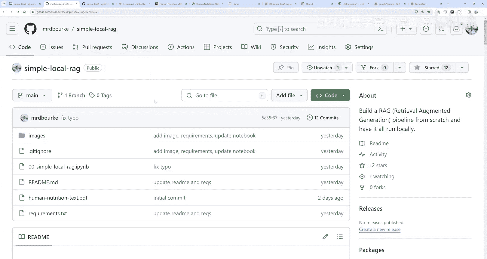

哎哎哎哎哎哎。だよな。Look up。咩。