# Daniel Bourke《机器学习路线图2020（2023持续95%有效）｜machine learning roadmap》中英字幕 - P1 - GPT中英字幕课程资源 - BV19S421c7Gd

If you can't tell， I'm so， so， so excited to be able to share this with you now I'm not going to hold you along。

 I just wanted to to take care of a few things before we get into the roadmap。😊。

But the most important point is to make sure you have a play around with it yourself check it out。

 all the links that you need will be below， there's the mindmap itself or the roadmap itself。

 there's the GitHub repo to go along with it which has the full version image of it the most up to- date link will be the map itself。

😊。

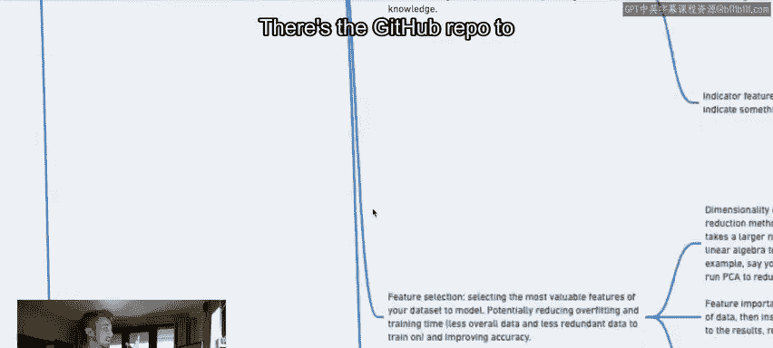

There's also the slides in the GitHub reaper if you want to check them out。

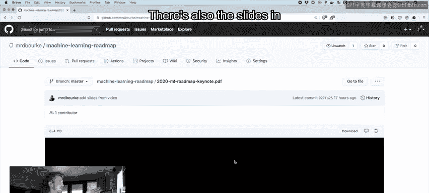

So oh， and there's also timestamps， so feel free to jump around。

 you don't have to watch the whole thing， just jump around to points that suit you best。

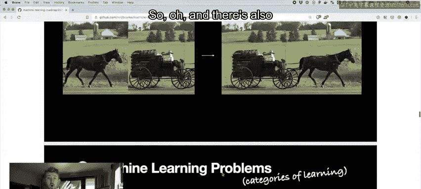

And if there's anything else that's missing， if you have any questions。

 leave a comment below and I'll get back to you。😊，But nonetheless。Enjoy。All right， All right。

 All right。Welcome to Ma Learning Roadmap for 2020。A machine learning flavored visual。

 interactive living mind map slash compass。 Well， that was a bit of a mouthful。

 but let's not spend any more time talking about it。 Let's actually see this thing。😊。

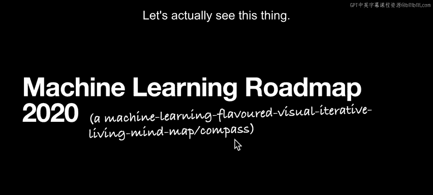

So if we come here， oh this is interesting。 We've got some colours。 We've got some nice icons。

 We've got a little white box with machine learning in it。😊。

so what we're going to do in this video is basically explore the field of machine learning as much as we can in a relatively long shortish video。

 I mean， whole textbooks have been written on machine learning of course。

 but that's not what we're here for。 We're going to go through some of the main topics of machine learning such as machine learning problems。

 the process aka the steps in machine learning project。

 the resources like how you might want to learn machine learning。

 the places you want to visit the tools you can use to get the job done and after all。

 since machine learning is basically mathematics under the hood。

 we'll see what some of the main topics are in terms of what kinds of math runs our machine learning algorithms。

 but how we're going to do this， we're going to be playful and that's what I want you to do with this resource here by the way。

 all the links that I mentioned throughout this entire thing will be in the description below So you'll be able to access this as well go through it。

 come to whimsical。 This is the tool we use by the way。😊，So if we click this little button here。

 whoa， it's going to expand out， look at that。😊，Far out， we're gonna jump through some of these。

 Maybe not all of them because， again， don't want this video getting too long。

 If you do see a little purple button like this， you can see some more commentary because other than filling up this space。

 I've just added some comments there。 And if you want to leave your own comment。

 you can add one here。 So I've got mine here。

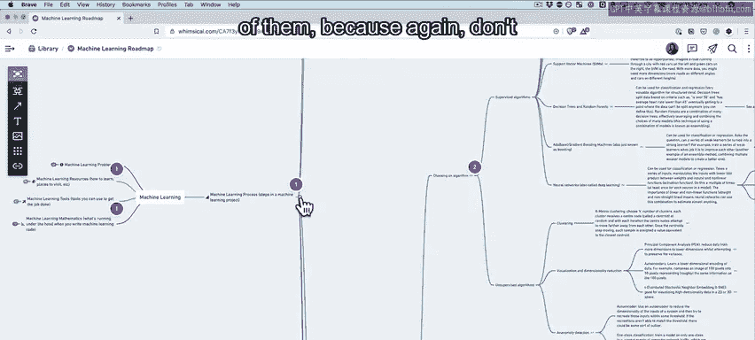

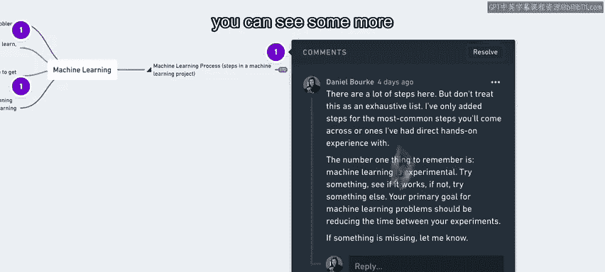

You can probably place your own as well。Now， let's get started。

 What I've got to go along with this is a little presentation。

 So what we're going to start with is a question probably smart to answer。😡。

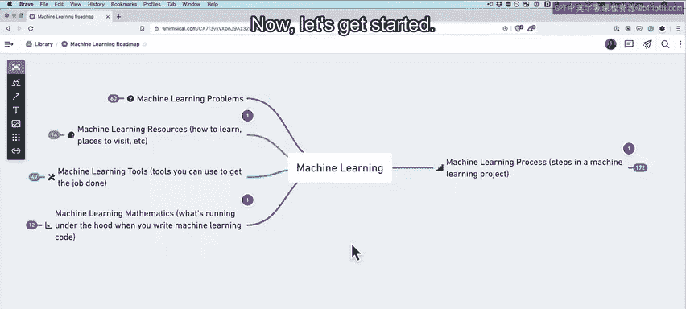

In doing a machine learning roadmap video， and that is。

 what is machine learning you might be asking as a curious internet dwelling user？😊，Maybe you。

 I just kind of said that。 And so for the sake of this video， I mean。

 you could Google machine learning， you could get hundreds of different definitions。

 but for the sake of this video to keep it nice and simple。

 We're going to treat machine learning as turning things。

 Aka A data into numbers and finding patterns in those numbers， You might be wondering， well。

 how do you find those patterns in numbers。😊，Well， the computer does this part。How math。 And again。

 we'll cover a little bit on this later。 Now， if you want another one line a definition of machine learning。

 machine learning is the field of study that gives computers the ability to learn without being explicitly programmed。

 Now， that was by Arthur Samuel。 I think that was almost over 50 years ago now。

So that's a key point there without being explicitly programmed。 So let's jump into。

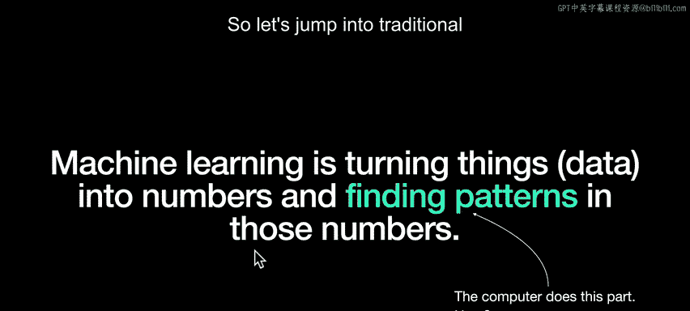

Traditional programming， which you might call software 1。0 versus machine learning， So 2。0。

 Now you might be wondering what's the difference between the two。

 What's the difference between traditional programming， the difference between machine learning？

 Well， before we even get into the difference， I just want to let you know， is that。

Machine learning to put it into practice requires traditional programming to exist。

 whereas traditional programming does not require machine learning。

 so although machine learning is amazing， remember you will need some traditional programming skills to be able to use it。

😡。

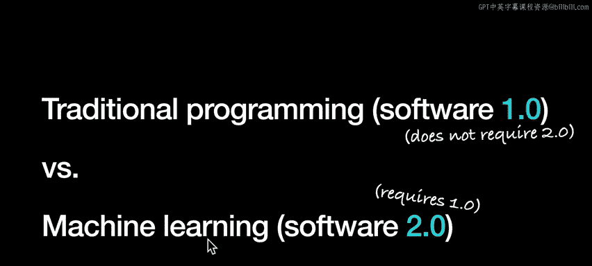

So if we come back here， you might be wondering where did software 2。0 come from。 Well。

 that's when we can go to the roadmap again， if I mention anything， it's probably in the roadmap。

 So if I search software 2。0。There we go。😊，This is what I want you to do as well。

 is once we've had a little bit of exploring again， we'll go through this in a minute。

We're in the intro part just now。 So software 2。0 h， click on the link。We've got a blog post here。

 I sometimes see people refer to neural networks as just another tool in your machine learning toolbox。

Neural networks are not just another classifier。 They represent the beginning of a fundamental shift in how we write software。

 They are software 2。0。 So I'll let you read that。 I'm not going to read through it all。

 But this is the kind of way that you can explore this roadmap。 Is that every little topic here。

 If it requires more information。 I've put a link there。 So be sure to check those out。

 But let's go back to the presentation。

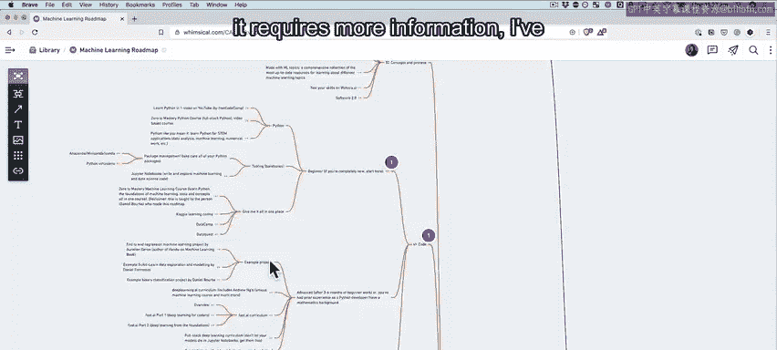

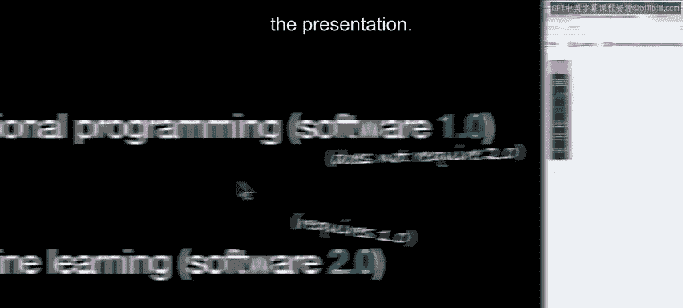

And so let's have a visual demonstration of what traditional programming is compared with a machine learning algorithm。

 So in traditional programming， let's say you wanted to cook your favorite roast chicken dish。

 Look at that。 That's delicious。 I know we're talking about machine learning。

 but it's always a good time to talk about food。😊。

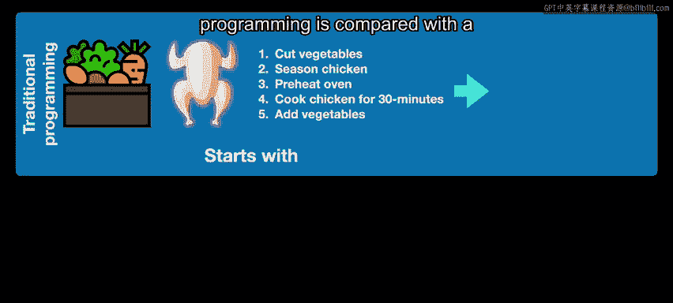

So with traditional programming， you might start with a couple of inputs So say you've got your box of vegetables and the raw chicken。

 you might program these steps。 you might go step1， cut the vegetables， step 2， season the chicken。

 step 3， get the oven preheated， What temperature。 Who knows that's up to you。

 that might be a pass down recipe from your Cicilian grandmother， Cook the chicken for 30 minutes。

 add vegetables， and then if you've done all this correctly。

 if you've started with the right ingredients， you've started with the right rules that you've programmed yourself。

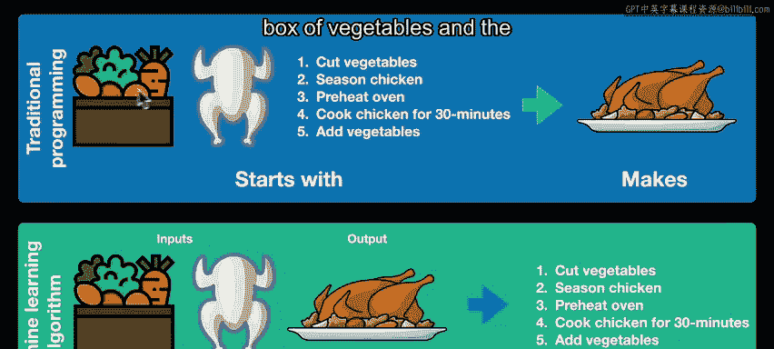

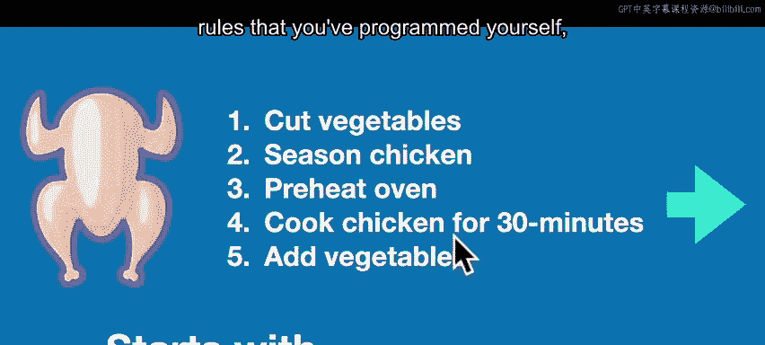

You might end up with this beautiful roast chicken。

 whereas a machine learning algorithm usually starts with a set of inputs and a set of ideal outputs。

 In this case， the ideal output is our Sicilian grandmother's roast chicken recipe。😊。

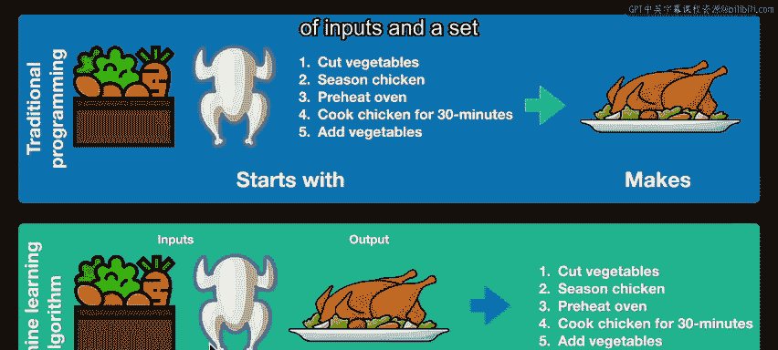

And it might look at 100 or 1 thousand different examples of these inputs and outputs。

 and then it's going to figure out the instructions。

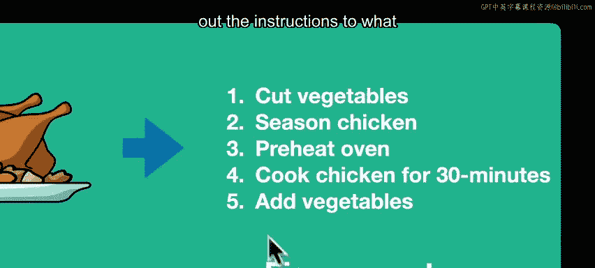

To what the recipe is， so rather than us explicitly writing these instructions。

 this is the machine learning algorithm figuring out patterns in data， actually。

 before it could even figure out these patterns， it would have to figure out some way to translate these inputs and outputs into numbers。

😡，And how you do that is going to depend on what problem you're working on， but。

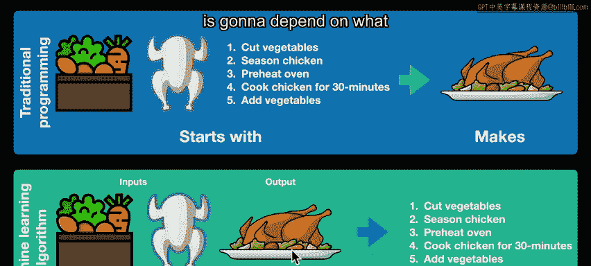

The overarching process remains the same， turn your inputs into numbers and then let a machine learning algorithm figure out the patterns in those numbers。

Now you might be wondering， okay， that sounds pretty cool。 So why would we use machine learning？Now。

 this is a quote from another curious and perhaps even more curious than before Internet dweller。

 It was just also maybe yourself， if you like me， pretty curious about things。

And so the good reason would be why not？😡，But let's cross that out for a second。

 The better reason is， can you think of all the rules。

Now what I mean by that if we think back to our roast chicken example is， of course。

 for that simple actually， it might not be that simple depending on how how complex your Sicilian grandmother's roast chicken recipe is。

 but for a more complex problem。😊，Do you think if you had to write out。

 say a thousand different rules， we'll have a good example of this coming up soon。

 but if you looked at something and thought。If I want to teach a car how to drive。

Do you think you could figure out all the rules by yourself？Well， in my case， I know probably not。

 but if you had enough time， maybe you could。😡。

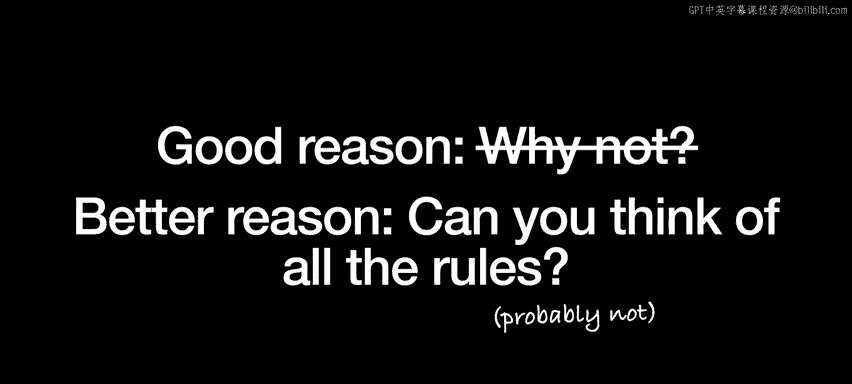

So let's have a look。What's the number one rule of machine learning？

If you can build a simple rule based system that doesn't require machine learning， do that。

 And again， maybe this rule based system is not very simple。

 Maybe you've got 1000 different rules of how a car should approach a driving scenario。

 If it backs out your driveway， maybe that's one rule。 back out driveway， Avo a car。

 drive down the hill。 That's another rule。 Turn right at the stop sign。 That's another rule。

 E cetera， et cetera。 Don't hit people。 That's probably the number one rule there。

 And now this is a quote again from a wide software engineer。

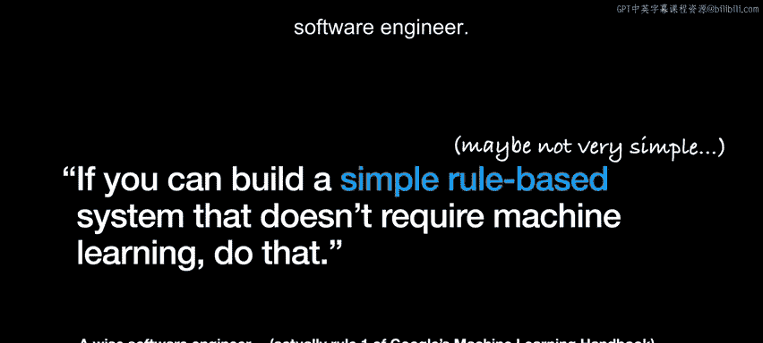

Actually， it's real one of Google's machine learning Handbook， which if we come back to our roadmap。

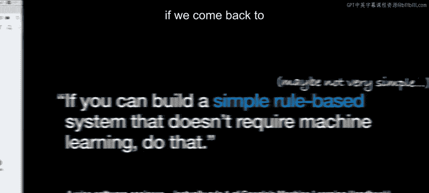

We'll zoom in。 this things a little bit fun to play around with If we go here， machine learning。

 actually， if we just search。😊，Google machine。Boom。Google's machine learning crash course。 Yes。

 excellent， are actually。As something in here， this was to be。Machine learning。Ruleles。

Machine learning 101。 I should have given that something better。 Machine learning 101。

 I'm going to put in brackets here。😊。

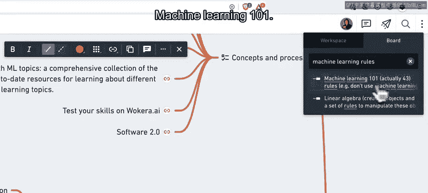

Machine learning rules See this is a search problem， by the way。

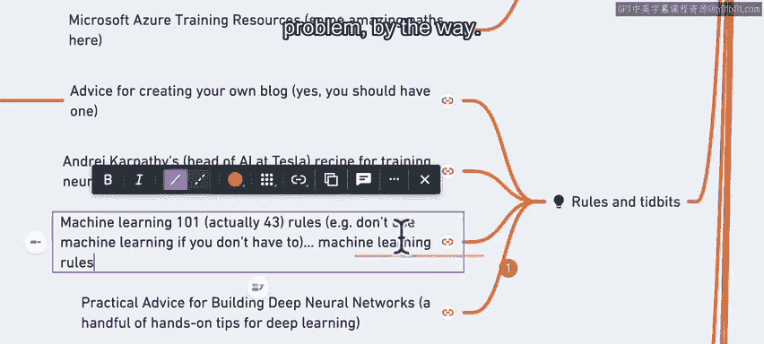

Machine learning 101， actually 43 rules， so if we come here。😊，We look at our link。

Rules of machine learning。 Now， this is by Google。 Some big dogs in the machine learning field。 If。

 if there was probably one company that's using machine learning everywhere， it's Google。

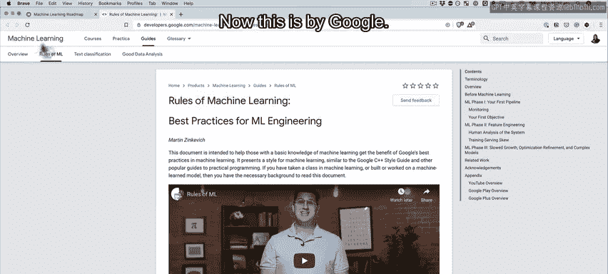

So if we come down here， for some reason， my scroll doesn't want to scroll。 There we go。

 Before machine learning， rule number one， don't be afraid to launch a product without machine learning。

 as we talked about before。

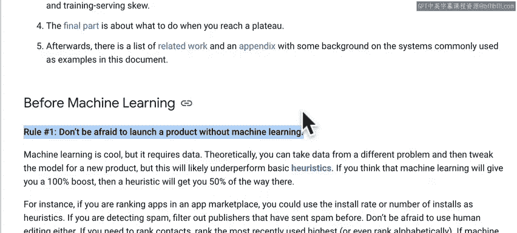

Software 1。0 Aka handcoing everything can exist without machine learning but machine learning can't exist without software 1。

0 so what is machine learning good for and I just realized that that should probably be what is machine learning good for rather than this incorrect grammar。

😊。

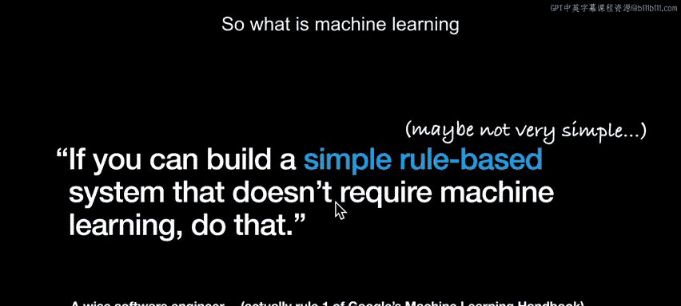

Anyway， it doesn't matter。 So number one， machine learning is good for problems with long list of rules。

 just like we discussed before with the selfd car， if you wanted to code up a selfd car。

 you'd have to code in everything such as stop at stop signs wait for pedestrians across the road avoid hitting that beautiful little dog that's just run out and chasing a ball。

 So when the traditional approach fails， machine learning may help。😊，Number two。

 continually changing environments， So again， with the self-driving car the reason why I use selfdriving car is it's fairly easy to imagine these kind of scenarios if you are driving along in your local suburb。

 you might know how to drive around pretty well so you might be able to code those rules for your local suburb pretty spot on。

 but then if you ventured out into another city are continually changing environment the rules that you made for your suburb of where you live may not work very well。

 so in essence， machine learning is good for problems where it's required to adapt aka learn about new scenarios。

😊。

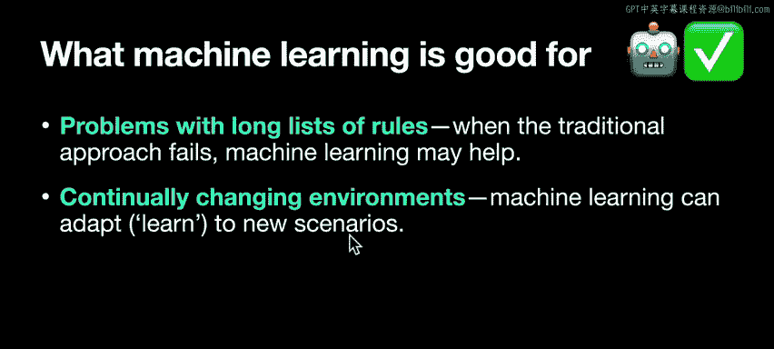

And finally， discovering insights within large collections of data。😊，Now。

 can you imagine trying to go through every transaction of your， let's say。

 large company has ever had by hand， like， say you wanted to group together certain people like what are people purchasing during winter。

 what are people purchasing during summer。 if you're Apple。

 what kind of people are purchasing iPhones and now， I mean。

 that's probably not a good example because Apple's pretty big on privacy and they don't like collecting that sort of data。

 But maybe they will analyze it without having your specific user idea in there。 So again。

 if you tried to discover those insights within let's say you had an imagine an Excel spreadsheet with 10 million plus rows and you're trying to go through all of your customers' purchases。

How long do you think that would take？It' probably they take you a fairly long time。

 but these things， the problems with long lists of rules， continually changing environments。

 discovering insights within large collections of data。

 this where machine learning really flourishes。😊，If we want to see an example of this in practice。

 this is from Tesla's Autonomy Day video。😊。

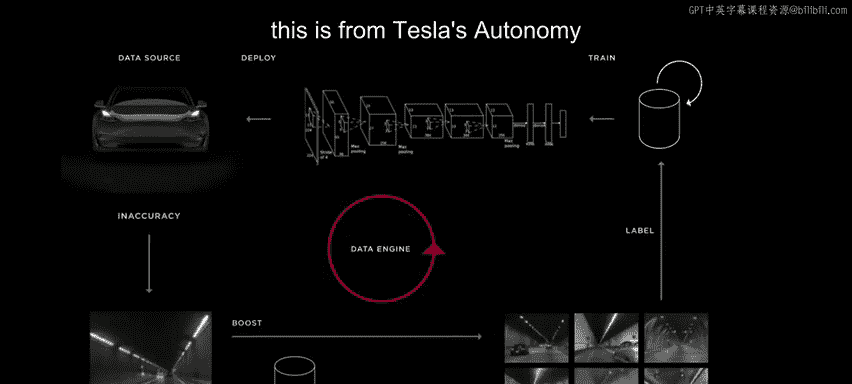

If we go here。

This is actually a really cool video。 You can probably see why I was using the example of the self driving car。

 It shows you how Tesla uses machine learning in production。

 So they're probably another one of the biggest companies that is actually using machine learning extensively in their products。

 So if you imagine， Tesla have a data source。😊。

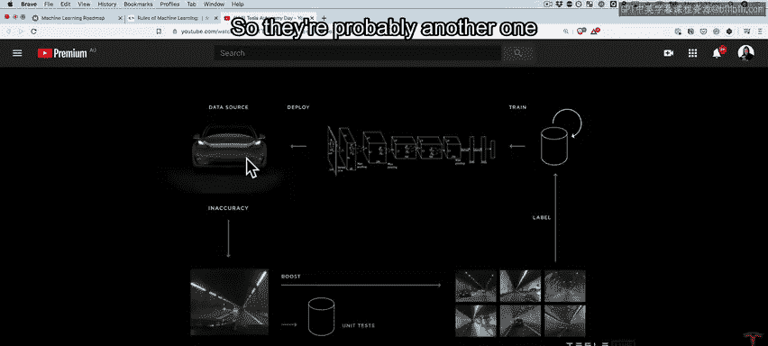

Which is their cars， and they collect data from the environment。 These cars have a series of。

 I think it's eight cameras。 They have a radar。 So all of these cars are collecting information from the environment。

 Now， if you imagine there's a camera on the front here and that camera is taking photos of what the car can see。

 essentially， Now， the job of a machine learning algorithm is to turn these photos here into numbers。

😊，To find patterns in those numbers， maybe it goes through these it uses something like a convolutional neural network。

 which might look like this。 This is a machine learning model drawn out。

It might go through each of these pixels， convert them into numbers and go oh okay。

 I see this little number here。 that resembles a car that resembles something that I've seen before。

 these numbers here along this straight line， okay。

 that looks like a road lane and I've seen these before And over here that's a couple of headlights So we want to avoid that we want to not turn left into those headlights because that's another car and that would be quite disastrous。

😊，So。If you were to try and code up all these rules yourself， that would take a very， very long time。

 So again， where does machine learning come into play， problems with long lists of rules。

 So you might want to use computer vision to go through these and figure out where all the different patterns are。

Now what happens here， Okay， we might collect some data from the environment and find out that scenarios like this are pretty inaccurate。

 so we might do some testing， and then we might go over here and find some more parts where the car isn't doing very well。

 The machine learning algorithm doesn't quite know these scenarios because this looks like it's in a tunnel of some sort。

 You might have treated your machine learning algorithm or your hard set of rules to work for your suburb。

 But as we said before。😊，If it works in your suburb， it won't necessarily work in a tunnel。

 so this is where machine learning comes into play again in continually changing environments such as a road tunnel I mean。

 if I was to code up a self-driving car， I don't drive through tunnels that often so I'd probably forget to put in tunnels and then when my self-driving car approaches a tunnel because it's got a whole bunch of handcoed rules for driving around my streets。

 it would be like I'm not sure what to do with this。😊，So then you might grab these scenarios。

 you might label them。 That means you've got someone looking at this maybe a human annotator or maybe another machine learning model looking at these scenarios it doesn't know very well and go okay I figured out these scenarios。

 this is actually a tunnel， these are the tunnel walls these are quite hard to see but if you look closely there's a truck here there's lights at the top maybe a car a self-driving car gets confused with these lights at the top they kind of look like road lanes so we'd have to label it to tell our machine learning model remember machine learning model starts with inputs and outputs in our case the outputs are the labels so just like our chicken example。

 the inputs maybe the ingredients for your grandmother's famous roast chicken dish。In our case。

 the ingredients might be the images collected from a self driving car and the outputs may be the actions that self driving car should take。

Finally， once you've got those inputs and outputs together。

 you might train a machine learning model which usually looks something like this。😊。

And then deploy it back to the car， so eventually this becomes a loop。😡。

And so you see this is the final thing that machine learning models are really great at is discovering insights within large collections of data。

 So you could imagine if you're continually doing this loop。

 this little data engine here will dive back into this in another section of this video。😊。

But if you imagine this is going to start collecting lots and lots of data。

 lots and lots of information。 And when I say data， that term is very broad。 Now。

 one kind of data could be photos and videos collected from the eight cameras on a Tesla car。

 Another one could be all of the transactions in your company's purchase history。

 Another one could be all of the text on Wikipedia。 regardless of the data source。

 The principal remains。 how do we turn this information into numbers。

 let a model find some patterns in it。 And then us design the software around it。

 This is usually software 1。0 to take the outputs from the machine learning model and translate them into actions and a Tesla car。

 Now if you want to see this in more in depth， I encourage you to check out this autonomy day video。

 It's very， very good。😊。

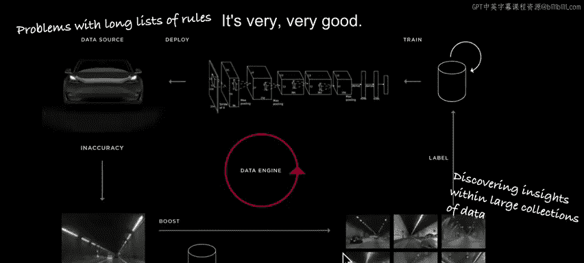

And so。😊，What we're going to cover pretty broadly that was like a longwined bit of an intro into machine learning in general。

 I mean， again， you could look machine learning up and you could find out your own stuff but we've covered enough to understand what we're going to look through in this video。

😊，So number one， we're going to look at machine learning problems， AK。

 what does this machine learning problem look like？😊，How do you diagnose a machine learning problem。

 machine learning process。 So once you found a problem， what steps might you take to solve it。

Number3， machine learning tools。 Now， what tools should you use to build your solution？

 This is growing quite rapidly， actually。And now machine learning mathematics， as we said。

 the computer finds patterns in our data and essentially what it's doing there is a whole bunch of math。

 so what exactly is happening under the hood。😊，Now， machine learning resources。 Okay。

 now all of this is pretty cool。 You might be saying， how can I learn all of this？ Well。

 the good news is， is that a lot of it is available online and you can access it right now。😊。

And how are we going to go through all this？Well， if we had a cook and a chemist style， if a chemist。

 if you imagine， is really， really specific going through all of these things。

We're not going to go through it in chemist style。 We're going to go through it in cook style。

 So if you imagine what a chef does， what a cook does。

 a chef uses their tools such as the controlled use of fire and a knife。

 and then it goes through and solves problems。 So that's how we're going to do this。

 We're going to cover these topics broadly。 We're not going to dive too deep into each of them if I was to go through these and tell you exactly what each one of them is。

 That would be doing you know justice instead， what I will continually emphasize doing is actually on the next slide is how to approach this roadmap。

The number one thing to do is explore。 N two is to comment on this video or on the roadmap itself to give feedback what's missing from it。

 because， of course， machine learning is broad field that chances are。

 I've definitely missed something。 Give advice if you have any。 Sha it if you want。

 followow your curiosity because there is a lot。 So don't expect to get it all。 In fact。

 I actually don't get it all。 I've put a lot of it here。

 And I've kind of put it here for myself as well， so I can come back and research and upgrade my own knowledge。

 And finally， we've got explore again。 And Ive put it there twice on purpose because that's what I want you to do is explore。

 So in fact， you'll probably realize that this is not a road mapap essentially telling you where to go。

 It's more a compass giving you a little nonlinear gentle push。

 That's a little pun there from neural networks as well。😊。

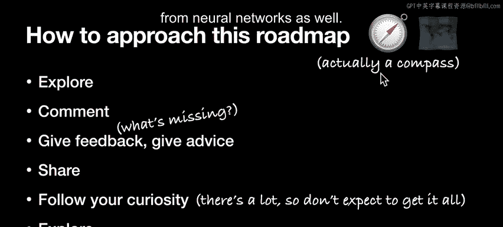

ok。Are you ready。Okay， let's go。 Did you like that little sparkle effect。

 I thought that was pretty cool。 So let's go。 We'll go back。😊。

Boom， let's get out machine learning。Roadmap reset。

And we've got five major branches here that we're going to go through。

And we've got our little counterpart presentation。

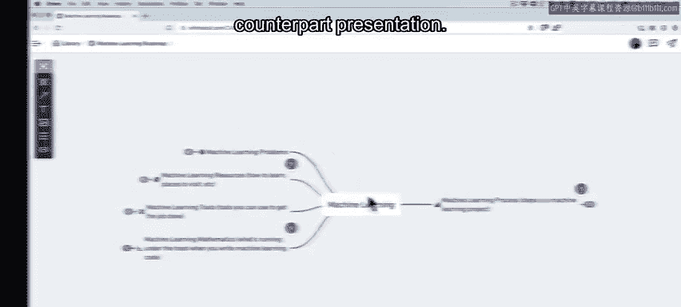

Number one， machine learning problems， as you can see。

 I've kind of created a little subsection in the presentation for each of these little branches here。

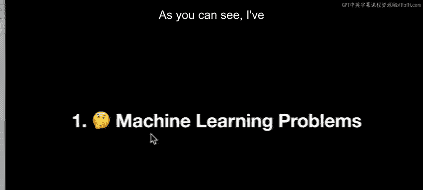

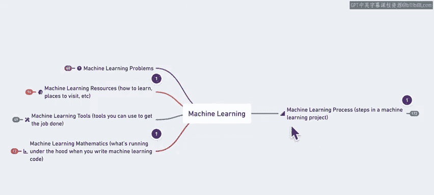

Let's get into the first one。Number one， machine learning problems。 So if we go this。

 what is wrong with this picture？

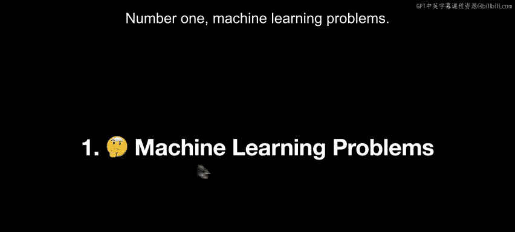

As you can see， this is actually a little bit of a famous metaphor here。

 is putting the cart before the horse。 This is probably the number one skill I can give you throughout this whole video is to make sure when it comes to machine learning in general。

 a machine learning problems。 It can be tempting to jump straight into machine learning and just go。

 boom， Let's just put machine learning in this thing and make it great。

 I can tell you out of my own experience working as a machine learning engineer dealing with a lot of customers and clients that wanted to know about machine learning and see if it could be used。

 This was their problem。 and including it actually is my problem as well。

 because I'm a machine learning engineer。 I look at everything with machine learning as my tool。

 I wanted to use it for everything。 But again， this is coming back to that software 1。0 versus 2。0。

 Mach learning is amazing。 We've seen some of the examples of where it can be used。😊。

But it does require a horse。So what I mean by that is if you keep trying to apply machine learning to everything。

 it's kind of like putting the horse before the cart so the idea of this section is to go from having the horse before the cart to having it in the correct order。

😊。

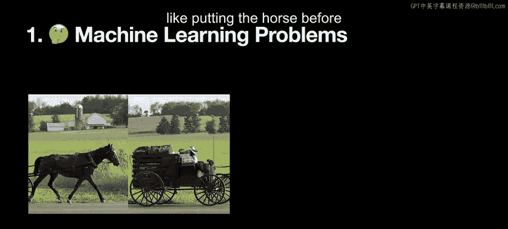

Now。Forgo to machine learning problems。

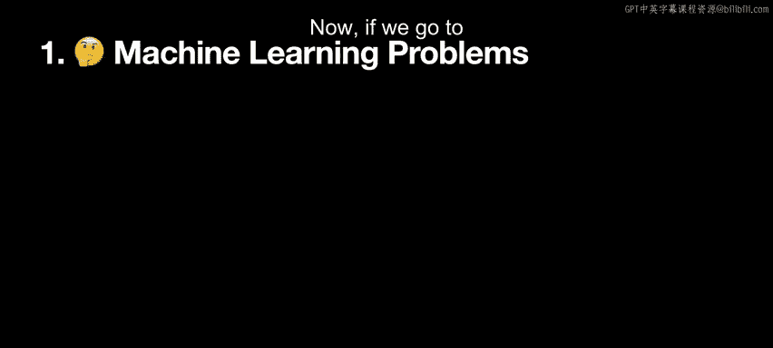

We've got categories of learning。😡，Supervised learning， unsupervised learning and transfer learning。

 reinforcement learning。There's probably some others here。

 but these are the four main ones you're probably likely to encounter most often。

 you can break them into your own subset。 Let's go。

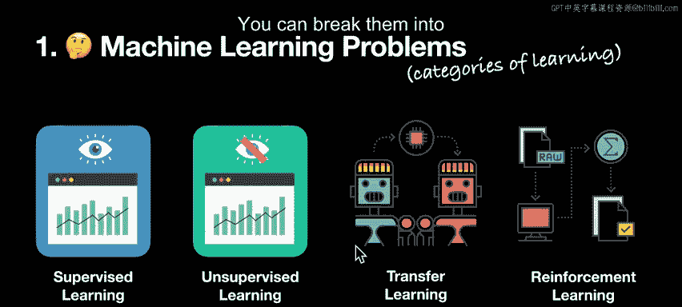

Finally， jump in to the roadmap。😡，Oh， I'm so excited。 You ready。 Let's expand it。 Here we' go。

 Mach learning problems。😊，And what I've done is I've correlated， as I said before， the sections here。

😊，To the sections here。 So if we come in here， this is how I want you to use this roadm。

 We've got machine learning problems。 We break it out。 We come up here。 categories。

 types of learning。 So supervised learning。 What is that。

 You have data and you have labels in our self driving car example。

 our data might be images of tunnels， images of roads。

 images of people crossing the road and the labels might be。 what those things actually are。

 So it's one thing to have just the image。 It's another thing to go， okay。

 I know this is an image of a person crossing the road。 I know this is an image of a stop sign。

 And so what the model does is it tries to learn the relationship between data and labels。 okay。😊。

In our cooking example， it's trying to figure out the recipe。

 So this is the machine learning model finding patterns in numbers。 For example。

 you have 10000 photos of cats and dogs，5000 each。In our case， this would be balance class problem。

 Oftentimes in machine learning， actually， you'll have 9990 photos of cats。

 but only 10 photos of dogs， as you could imagine， a great example would be a self-driving car problem where you've got a dog riding a bike。

 maybe you've got a million photos of a person riding a bike。

 but only one photo of a dog riding a bike and who knows maybe that's actually an alien。

 So that's what you've got to watch out for， but we'll cover that later。

 and the labels for which photo contains which animal photo 1 equals dog photo2 equals cat works for numbers2。

 for example， if you have 10000 houses in the selling price use the information about the houses such as number of bathrooms。

 such as number of garages， such as number of bedrooms and try and predict the selling price of the house。

😊，Wonderful， I'm not going to read out all of these。 This is what I want it to be。

 It's like kind of just a bouncing back and forth。 And Troopy Tod， you could probably tell。

 I haven't scripted this。 I'm kind of just looking this out on the fly as well。😊。

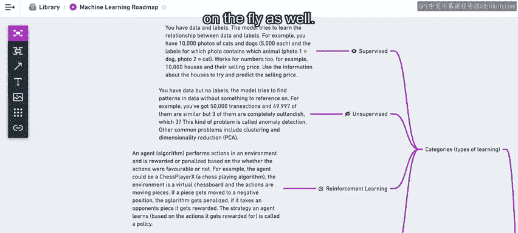

Unsupervised learning is data with no labels。 So the model tries to find patterns in the data without something to reference on。

For example， you might have 50000 transactions and 49997 of them are similar。

 but three of them are completely outlandish。 This kind of problem is called anomaly detection。

Other carbon problems include clustering and dimensionality reduction。

Then you've got reinforcement learning。😡，Actually， I could put a link for all of these。 Can I。

 Maybe I should do that。 Transfer learning is when you take the knowledge from one model and use it in your own。

 For example， take all of the text from Wikipedia， learn the relationships between words and use these underlying relationships to help you build your insurance classifier。

Now， transfer learning is a very valuable skill。So we got here transfer learning。

 because oftentimes in practice training a machine learning model。

 So say you're building a selfd car。 for example， from that Tesla autonomy day video that we talked about。

 that took 70000 hours to train on a GPU cluster or GPU hours。 Now you might not have access to that。

 but the beautiful thing about transfer learning is that you can take what another machine learning model has Aka that patent a machine learning model has learned on a particular data。

 adjust it to your own。😊。

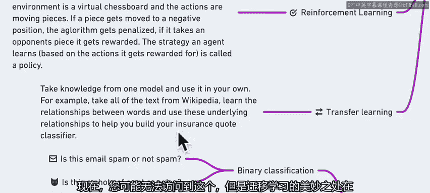

And then use it for your own problem。So if we come back to the PowerPoint。

Now we've got machine learning problems， some problem domains。😊，Now。

 some of the main ones we've kind of hinted on them just before are classification， regression。

 clustering and dimensionality reduction。 Again， you could divert these into more things。

 but chances are if you figure out what actually there could be sequence to sequence here。

 but I haven't covered that。 You could argue that sequence to sequence is actually a form of classification。

 We'll get into that in a second， we're kind of jumping ahead of ourselves here， Daniel， come on。😊。

So classification would be like does someone have heart disease or not based on their medical records。

 regression would be predicting a number， trying to predict the sale price of a house if you were in the real estate business。

 you might be wondering what should I list this house price for so you could build a machine learning model to go through all of the previous sales in your area and figure out what the most ideal price is for your certain house based off the sale price of all of the other houses？

😊，So clustering， you might want to find out what different groups there are， as we said before。

 say you had a whole series of transactions or a whole series of people listening to your songs。

 say for example， your Spotify and you have a million people listening to different songs what kind of songs are they listening to so maybe the people in this group are really into folk music the people in this group are really into rap music the people in this group are into pop music and the people here are really into rock rock and roll then finally there's another one called dimensionality reduction。

😊，Which is。There's a little thing in machine learning called the curse of dimensionality。

 which is when you have so much data that a model can't really even find any patterns in it because there's just too much of it。

 So what dimensionality reduction tries to do is reduce that amount of data you have to only really pull out the most important thing so it might get rid of the weight column this is a table of numbers by the way。

 remember a machine learning algorithm finds patterns in numbers So if we come back weve got our classification problem we might start out by doing some dimensionality reduction because we're finding a machine learning model can't really figure out if a person has heart disease or not。

It might go through this is a simplified table of medical records and go you know what the only real two things that we need to know if someone has heart disease or not。

 again， this is just a made up example。😊，Is their heart rate and their age。

 If their heart rate's too high， they've probably got heart disease。

 And so we actually don't need their weight。 Again。

 this is a made up example just to simplify it and put it on one slide。 And so。

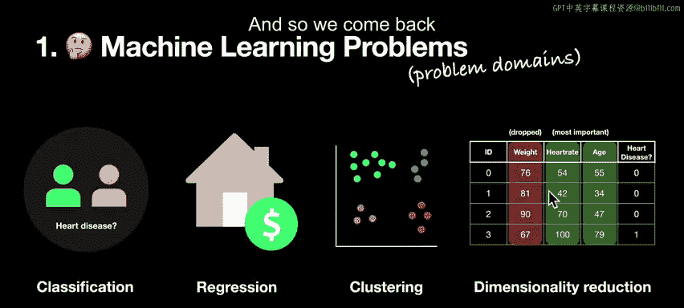

We come back to our roadmap， we've got some example problems。😡，And before we even get to that。

 we've got classification， so let's try clicking on this link。😊，Machine learning mastery。

 This is a great blog。 You should definitely check it out。 That's kind of what I've done。 actually。

 in this road mapap， I've put all of my favorite resources for different things， or just。😊。

Really great resources for different topics。 so you should definitely。

 definitely definitely check out the links。 if you want more information。

 I've kind of given a little blurb about a lot of things that deserve a little blurb。

 but if they need an expansion， this is where the links come in so classification。😊。

We got our binary classification。 I this email that I'm receiving to my inbox。

 My email inbox is this spam or not。 Again， imagine trying to code up all the rules for deciding whether an email is spam or not。

 You would probably use machine learning for that。 Is this photo over a cat or a dog。

 You could probably code in a cat's ear looks like a certain thing。

 a dog's face looks like a certain thing， but I'm too lazy to do that。

 That's one of the reasons I like to get in the machine learning is that the computer figures these things out for you。

 Multiclass classification。 So that was binary。 If something is one thing or not。😊。

Multi class is when you have multiple different options of what a specific thing is。

 if in the case of traffic lights， is it green that would be class1 or class 0 if you started from zero。

Yellow， that would be class 1 or red。 What breed of dog is in this photo， so。

You might have 120 different dog breeds and you want to try and build a machine learning model to classify what type of dog it is in a certain photo。

😊，We actually did that。I teach a machine learning course。

 by the way so this is a little bit of a plug for that， but obviously you don't have to do it。

 I just want to show you an example of what a project in machine learning looks like。😊，We come here。

 load this up。 So we use transfer learning。 Remember what transfer learning is。can晚飞啊。

Taking the knowledge from one model and use it in your own， that's what we did for this project。😡。

So we turned some dog photos into numbers， Aka tensors。 We picked a model from Tensorflow hub。

 we'll see what that is in a moment in another section of this video。 We fit the model。

 So that meant fitting is basically the same as hey model。

 Find the relationship between these dog photos in the labels。 We evaluated。

 Let's see if it was good or not。 Then we improved it through experimentation and saved and reload a train model。

😊，So we come here， this is the kind of thing it looks like。😊，All this is machine learning code。Now。

 we come back。There's also multi label classification is what items does this photo contain。

 What topics is this YouTube video about。 So if we were to build a multila classification machine learning model on this video that you're watching right now。

 what would you like the machine learning model to output？😊，Is it a multi label classification。

 Could you put multiple topics。 Is this video about machine learning on its own or is it about machine learning problems。

 or is it about machine learning resources， It could actually be about all of them。 So therefore。

 it's multi label。Now if we come back to classification。

 remember classification is the type of machine learning problem。😊，And then there's example problems。

 And then we've got evaluation metrics。In other words。

 how do we know how well our machine learning model has learnedt different patterns for different problem sets so then we can evaluate it with a confusion matrix。

 And you might be wondering， what's a confusion matrix？

 I'm a little bit confused about a confusion matrix。Well。

 if we have a look at this beautiful little link and this great guide from datachool do I O。

 another amazing resource， this is a simple guide to confusion matrix terminology， okay。😊，Well。

 if we read through this， Okay， this is a confusion matrix here。 So the number is 165。

 The number of total things。 All right。 And so the actual， no， actual yes predicted。

 So a confusion matrix。Compares the actual labels from our machine learning problem to the predicted of what our machine learning model predicted。

 So ideally， in a confusion matrix， I won't go through it too much here。 I that on the diagonal。

 you will have all the numbers。To their maximum capabilities。 And on these sides here， you'll have 0。

 It predicted no when the actual was yes five times。 So you would say it's confused on these。

Two sets of examples。In other words， it's a comparison between the true positives， true negatives。

 false positives and false negatives， but。I digress， as I said。

 we're just going to touch on these different things rather than me go through each of them。

It's much better for you to follow your own curiosity and figure out what you should do。

 So if you have a classification problem and you build a machine learning model。

 you should be looking at these evaluation metrics to tell how well your model is doing。

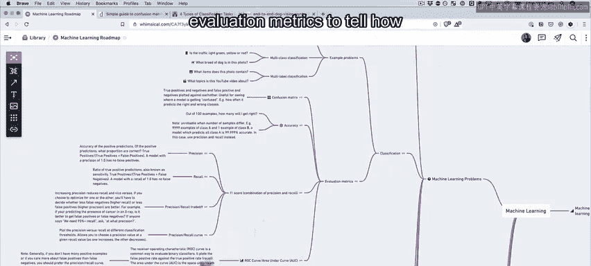

So if we come down to regression， another type of machine learning problem。😊，Come back to our slide。

 remember， regression is if we were trying to predict， say a number。

 say the ideal sale price for our house。

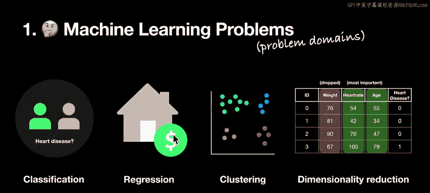

We come back。Example problems， given the number of bedrooms。

 number of bathrooms and house location predict the sale price of a given house or how much will Bitcoin be worth tomorrow。

 So if we look up Bitcoin price。Now， you see what we've got here。All of this is actually information。

 this is data that machine learning model may be able to find patternss in。😊。

And now I'll give you a little bit of a warning for prediction。 It's actually very hard。

 There's actually a lot of companies that do dedicate a lot of time and money to figuring out what the price of Bitcoin is or what the price of stocks are。

But this is just another example of where you can go， okay。

You might look at this and go PayPal deal won't drive Bitcoin price higher。

If you were to base your entire prediction。😡，Of Bitcoinco's price tomorrow， by this headline。

 What would you think， So Paypal deal won't drive Bitcoin price higher。

HYou probably want to read the article for more， but if I was to。

Bas it just off this one heading of the article， I would say Bitcoin price will either not change or will。

 in fact， maybe go down a little bit based off this headline。AndNow again， I may be completely wrong。

 but this is the type of thing that a machine learning model could do。

 It could take in all of these headlines。 It could even read the article。

 turn it into numbers of some sort， and then look at the history。😊，Of Bitcoin's price。

 something like this and see， okay， well， on June 29th， it was 13。

348 Australian and these were the news headlines on that day。😊。

And so if we come back So if we go one week on June 25。

 it was $13552 and the news headlines were saying that Bitcoin was going to go up。

 but actually went down。 So you might be able to figure out these patterns yourself。 But again。

 chances are， could you code all the rules yourself。 I know I probably couldn't。

 So that's where you'd want to probably use machine learning。

 We come back in to evaluate how your machine learning model is going there in a regression problem usually want to use R squared or mean squared error or mean absolute error。

 So mean absolute error is all errors are on the same scale。

 E G if trying to predict 100 predicting 99 is the same error as predicting 1001。

 whereasas squared error， It makes the outliers stand out more。

 That means if being 10% off is more than twice as bad as being 5% off。

 you probably want to pay more attention to mean squared error Again， we've got some links here。😊。

Who。We're blistering through this， aren't we？ Now， another problem that we haven't mentioned here on the machine learning problems is sequence to sequence。

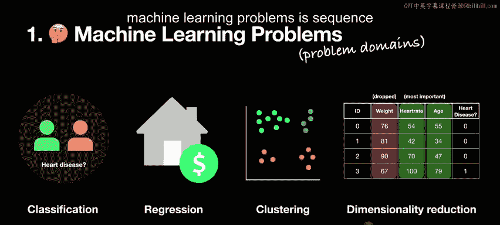

So if we got here， sequence to sequence is taking a sequence of something and turning it into a sequence of something else。

In other words， given a sequence of English text translated into French。 So if we go here， Google。

Translate。This is a sequence to sequence problem。Because we go here。I love。Machine learning so much。

We want to translate it to， let's say Spanish， a more Tal El Prince， Izale， automaticmatical。😊。

Now if you can speak Spanish， you can probably correct my pronunciation or say whether this is actually a correct translation。

 but this is an example of a sequence to sequence problem using machine learning again。

 if you went through the entire English language you could figure out the rules of what it translates into Spanish or you could try to at least but in my case I haven't got time to go through all of the rules from English to Spanish so I'm more than happy for a machine learning model to look at let's say all of English Wikipedia and all of Spanish Wikipedia and see where they line up。

😊，And then figure out the rules and use the patterns in those numbers。

 so turn all of English into numbers， turn all the Spanish into numbers。

 let a machine learning model figure out the patterns， I'm more than happy to use those patterns。😊。

So let's come back。Finally we've got clustering， we talked about that a little bit before。

 then we've also got dimensionality reduction and some common techniques for doing dimensionality reduction is PCA。

 and there's also representation learning or feature learning。😊，And again。

 I've put some notes in here where I'm a little bit torn， so for this one。

 representation learning may be better off on its own branch。😊，Better off， maybe better off。

 Better off on its own branch。Wonderful， okay， so we've gone through a bunch of different machine learning problems。

 Remember， we cooks not chemists at the moment。 So we've got， if we come back supervised learning。

 unsupervised learning， reinforcement learning， transfer learning。😊，Classification， regression。

 sequence to sequence， clustering， dimensionality reduction。

 There's some of our main machine learning problems。 Now， if we come back， we've done one branch。

 that's beautiful。 Let's come back to our little keyote here。 What are we up to next。😊。

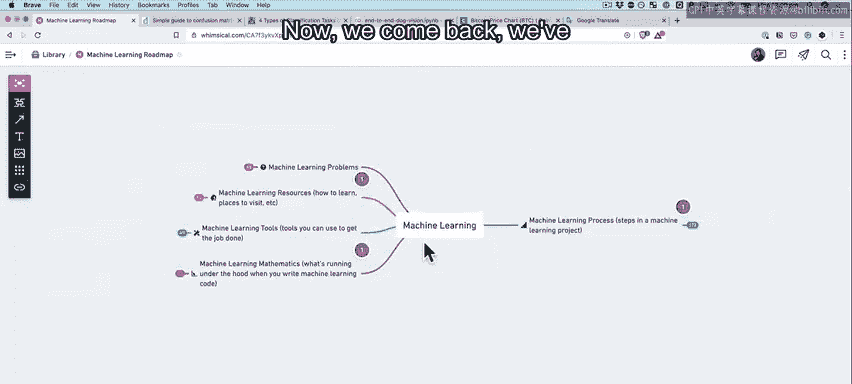

Machine learning process。All right， let's dive in。Now this is probably the biggest part of the entire roadmap。

 and you can probably guess why because the process of doing machine learning is relatively， I mean。

 let's just have a look。😡。

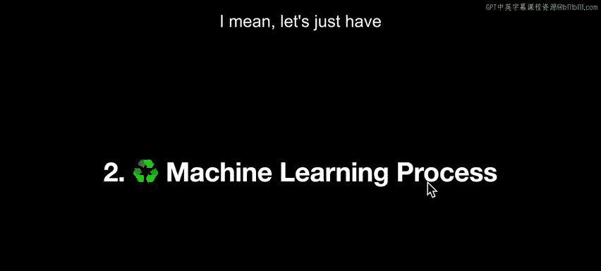

We got here steps in a machine learning project， 172。Well。Look at that。If we zoom right out。

Here we go。We've broken it all down。Now I want to warn you again， is that。😡。

We're going through this as cooks， not chems。 So this might not be exact。

 This is just what I've built out of my own experience。 What I found is most helpful。

It breaks down into a series of subtopics。 we've got data collection。

 So if you want to find patterns and data， how do you collect that data in the first place？

Then you've got data preparation remember， as we said。

 a machine learning model works on finding patterns in numbers。

 so how do you turn that data that you collect into numbers？Then we've got right down here。😡。

Choosing an algorithm。Or actually before that， we've got train model on data。

 which can be broken down into three steps if you think about this。😊。

Choose an algorithm or once you've had a little bit of experience if you're a beginner。

 you're probably never heard of these steps， but usually it goes choose a certain type of machine learning algorithm。

 usually the algorithm is based off what machine learning problem you're facing。

 so there's certain algorithms for certain problems。😊。

Overfi the model overfitting means the model has learnt the patent so well that it's doing too well。

😡，And then reduce overfitting with regularization， which is a technique to hold our models potential for learning patterns and data。

 to hold it back so that it can adjust itself to new data。And then if we come down here。Woo。

 analysis slash evaluation。Serve model。 So once you've trained a machine learning model。

 it's one thing to train it on your local computer。

 It's another thing to have that deployed in production to say a million self driving cars。

 and then finally retrain the model when necessary。 So that's what we're going to go through。

And again， we're not going to cover all these because that'll take way too long。

 but we're just going to bounce back and forth。 So let's go back to the presentation。

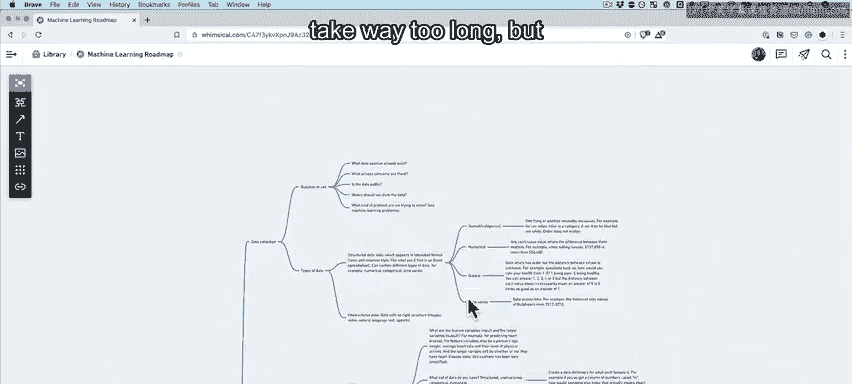

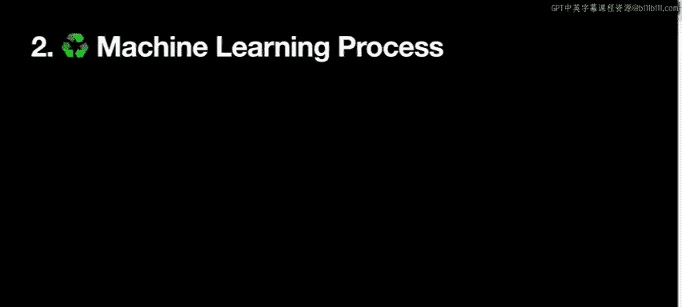

If we have a look at this I've kind of made it into a little colour flow chart too。

 that's what you want to do is like a multi angle attack。😊。

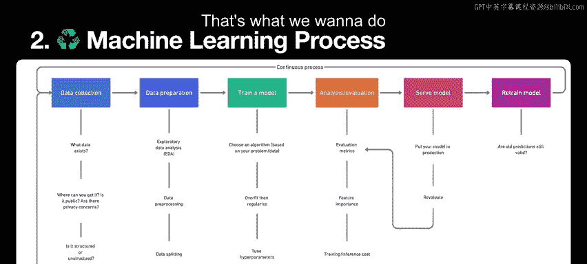

Remember how I said I broke this down into like six different subtopics。 Well。

 that's all in one little beautiful colorful chart here。 Weve got data collection。

 We'll ask questions like what data exists。 Where can you get it。

 Is the data public Are there privacy concerns。 Is it structured or unstructured。

 what I mean by structured or unstructured。 I imagine structured is like an Excel spreadsheet。

 You've got rows and columns unstructured could be like a photo or a video or natural language text like this。

 It has some kind of structure。 I mean， if it didn't have any structure or machine learning model wouldn't be able to find out patterns in it。

 but it's not rows and columns type structure。 Data preparation here。

 you might do steps like exploratory data analysis or data preprocessing。 Remember。

 Turn data into numbers。 Data splitting Turn your data into a training validation and test set willll get into that in a moment。

 Traer model Choose an algorithm Overfit then regular。😊。

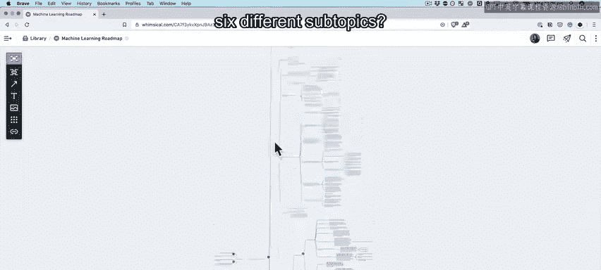

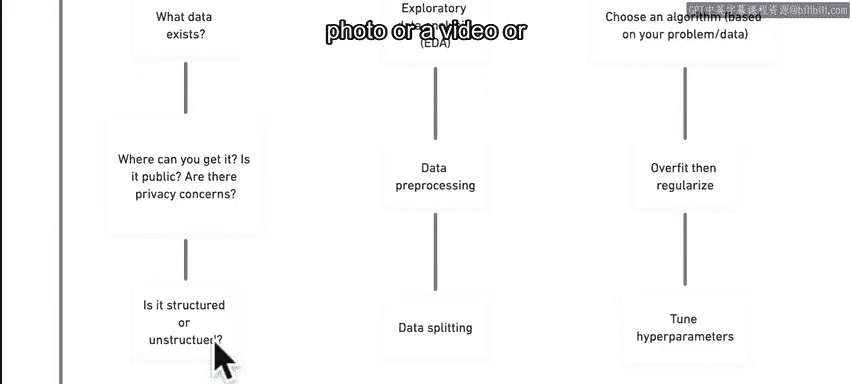

Tune the hyperparameters。Once you've trained a model， analyze the model。

 Once you've analyse a model and go， yes， my model is ready。 You can serve it。

 AK put it into production so that people can actually use it。😊，And then finally。

 retrain a model if your data is continually changing， if you imagine a self driving car problem。😊。

Where a road has been updated due to roadworks， Are your old predictions still valid on that new road。

 And again， here， it's a continuous process。 That's why we've got a big loop here。

 goes back and forth。 So in traditional programming。

 you might just have your code and you have to make sure that your code is up to date。

 whereas in machine learning， you've got code， you've got data and you have to make sure that they're both up to date。

 Otherwise， you'll be predicting the wrong thing。😊。

So if we come back。Let's go through our first little step here。😊，Data collection。

 So you've got some questions to ask here what data sources exist already。

 Now we're going to have an example of what data sources there are If we come down in machine learning resources。

 but we're not up to that yet。If you want to skip ahead， you can definitely skip ahead。

 What privacy concerns are there。 So if you're dealing with health data or medical data。

 it's probably a wise idea to make sure that no personal information can be leaked。

 I the data public。 So in the case of Tesla， we can't necessarily access all of their machine learning data。

 Once you formulated your machine learning problem。

 Aka thought of whether it's a classification task or regression task。

 One of your first steps is to start。Collecting data on that problem to figure out if a machine learning model can find patterns in it。

What kind of problem are we trying to solve？Actually， this should probably be number one。

 There we go。 That can be in some relative order。 Where should you store the data。

 Do you store it on your laptop or do you store it in the cloud。

And then you've got different types of data， as we said before， structured data。

 data which appears in tabulated format， rows and column style。

 like what you'd find in an Excel spreadsheet。😊，Now， even within structured data。

 you have different types of data within that nominal slash categorical data。

 so is something one thing or another， are they mutually exclusive from each other， For example。

 in car sales， colour is a category。A car may be blue， but not white， and the order does not matter。

 Then you've got numerical。 any continuous value where the difference between them matters。

 For example， when selling houses，107850。 that's actually probably a relatively cheap house。

 depending on where you're living in the world。 I mean， if that was Brisbane。

 I'd probably snap that house up in a heartbeat， unless it's a bit of a dump。

Is more than 56400 Then you've got ordinal data， data with order。 Then you've got time series data。

 just like that Bitcoin example。This is a time series data because it goes。Over a time period。

 one week， one month。 There we go。 So that's over a time period。

We come back now we've got another type of data which we touched on before。

 unstructured data So data with no rigid structure， images， video， natural language text， speech。

 what I'm saying to you right now， So if I wanted to build a speech to text system。

 how could it look at the sound waves that are coming out of my mouth and figure out what that sound wave translates to in text。

 Now I want to give you a little quiz， as we're watching this， if I wanted to do that problem。

 turn my voice， my sequence of words there's a little hint for you， sequence of words into text。

 what kind of problem would that be。😊，Well， if we come back。

All the way back down to our machine learning problems。 this is where exploring is so valuable。

 that would be a sequence to sequence problem。Build a device which responds to speech commands。

I'm not going to say that because my smart speaker is going to go off。

 Spch goes in as a sequence of vibrations in the air。 for what I'm making now with my voice。

 and it gets converted to text and interpreted as a command。 That's a sequence to sequence problem。

 Same thing with playing the voice back。 It takes a sequence。

 and then plays a voice back in a sequence of sound way as well。

 I just really confuse myself there with。😊，With my words saying sequence so many times。

 but you get what I mean。 You take one sequence of words， sound wave。

 generate that into text and then two for the speaker to play something back， it will take the text。

😊，Do some sort of command and then reply back with the voice。So if we go here， close that one off。

Then we come back。Now， we've looked at data collection。 Let's have a concrete example， you know。

 because we don't just want to be jumping through all these little tentacles here。

 We come back to our Tesla data collection and model training， little data engine here。 And now。

 how might this fit in。

To this machine learning process， we've got data collection， preparation， trainer model。

 analysis evaluation， Ser model， retrain。

How might this fit in？😡。

So if we put that back on the screen， wonderful。😊，So let's have a look at data collection。

We might have a data source。 Oh， and this is jumping ahead， but that is okay。

We have a data source， so the cars， as I said， these all have。😡，Cameras on them。

 so they'll be collecting data from the environment， taking photos， etctera， etc。😊。

That's going to be stored。In Tesla's server somewhere。 So this is their data collection。

 they have a whole fleet of cars。 It' actually a beautiful。

 probably one of the best examples that you'll find in the real world is Tesla's data engine。

 They're seeing here。 So that's their data collection。😊。

Now， data preparation， we haven't touched on that yet， so let's do that。Whoa。We come here。

 We might close this one off， so we know we've hit that up。 So this is data preparation。

 And so one of the first steps you might do in data preparation is little thing called Exploratory data analysis。

 learning about the data you're working with。 And if we click this little link here。😊。

What do we come to？A general introduction to exploratory data analysis by yours truly。

So this is an 18 minutes article on it。 If you wanted to find out a little bit more。

 it goes through an example problem。But let's just talk about what we've got here on the roadmap。

So questions you might ask in an exploratory data analysis。

 basically what you're trying to do here is before your machine learning algorithm goes through your data。

In the case of Tesla， before a machine learning algorithm even looks at this。 Now， again。

 if you are building a self driving car， you might have some experience driving a car。

 so you kind of know what the data that it's collecting， but。

You don't know how it's going to look when it's being collected from a camera here。

 from a camera here， from a camera here。 And again， I'm making this up。

 maybe they have cameras in different positions。

Things that you'll be asking what you're trying to do is just look at the information that you have and kind of build your own machine learning model in your head before you even build one that uses math。

😡，So what are the feature variables， what are the inputs and what are the target variables。

 the outputs in our case of cooking our favorite Sicilian grandmother roast chicken recipe。

 the feature variables， the inputs might be the organic roast chicken or the organic chicken from Ivy and wood farm up the road and the vegetable source from blue Mountains and all that sort of stuff。

 Or really you could just go buy it from the supermarket。 The target variables。

 So the output might be that beautiful， delicious dish or in the Tesla car problem and might be not to drive head on into the wall。

😊。

For example， if you are predicting heart disease， the feature variables may be a person's age。

 weight， average heart rate and their level of physical activity。

 and the target variable will be whether or not they have heart disease。😊，And again。

 this has been very simplified。 But what kind of problem would that be if we were to take someone's health information and。

Try and figure out whether they had heart disease or not。😡，Is it classification？😊。

Or is it regression trying to predict a number。If you guess classification。

10 points because that's one thing or another。You might also ask。

 what kind of data do you have structured or unstructured， categorical or numerical。

 You might create a data dictionary for what each feature is。 For example。

 if you have a column of numbers called HR。 Now， is that ours。😡。

How would someone else know that it actually means heart rate。

 So these are the things you might line up。 Let's go kggle。

Now Kaiggle is another beautiful website for data sources。

 and actually you can learn a lot from Kagle。 you can look at problems。😊，This is Titanic data。

This is what a data dictionary might look like。 There we go variableable。

 So we've got these inputs here， survival， P class， someone sex， their age。 now， what is Sib SP。

I don't know what CSP is， but if we come to look， the definition is the number of siblings。

 spouses aboard the Titanic。 Okay， now I'm starting to understand what kind of data I have。

So if we come back， are there missing values， Should you remove them or fill them with feature imputation。

 See below。 We'll have a look at that in a second。 feature Iutation is basically just a way of filling missing values。

What are the outliers， How many of them are there。They out by much 3 plus standard deviations。 Now。

 this is just a little heuristic。 You don't have to use that。

 An outlier will really depend on the data that you're working with。

 One way to find outliers is to plot a histogram， plot a distribution of your data。

 If you're not sure what that is。 We'll touch on that in a minute。

Why are the outliers there Are the questions you could ask a domain expert about the data。

 for example， would a heart disease physician remember our problem trying to predict heart disease would a heart disease physician be able to shed some light on your heart disease dataset more than likely yes。

😊，So。We come back data preparation。 We're still going。 That was only one step。

 Exploratory data analysis。 The main idea of that is to become one with your data。

 to build your own machine learning model。 Now data preprocessing， preparing your data to be modeled。

Oh。Now， we've got a few steps here。 Again， I'm probably。

 it's probably wise because we did cover EA a bit。 Let's just jump to the major topics。

 feature imputation， filling missing values。Now， what's important to remember about a machine learning model is that for the time being。

 if you're working with structured data， pretend that your machine learning model can't learn on data that isn't there。

 There is subtopics about machine learning models adjusting to different data sources and that sort of stuff。

 But we're not covering that。 We're covering the stuff that you're going to come across most often。

Machine learninger model can't learn on data that isn't there。

 so what you'll want to do is impute that data， so fill it up。

 So if you want to have a look at this article。Great article here。

 six different ways to compensate for missing values in a data set。😊。

Then you might want to do feature encoding。 So once you filled your missing values in a data set。

You typically do this with structured data， by the way。

 Fe encoding is turning your data set into numbers。

 Now machine learning model requires all values to be numerical。

 no matter what you're trying to model， whether it's text， whether it's sound waves。

 whether it's images， it has to be in some form of numerical form， then you've got one hot encoding。

 then you've got label enr， embedding encoding。Now。

 these are just different types of ways of turning your data into numbers。😡。

Then you might have feature normalization or scaling or standardization。

 So when your numerical variables are on different scales， for example。

 the number of bathrooms is between。Why don't we put is here is between one and five and the size of land。

And size of all Mo win。Maybe we put this so people know that it's a variable and size。Of land。Again。

 this is not scriptive。 This is just us exploring this is between 5000 and 20000 square feet。

 Some machine learning algorithms don't perform very well。 See how this is between1 and 5。

 and the other variable size of land is between 5000 and 20000。 So the scaling is all off。

 What normalization will do is put your variables between 0 and 1。😊。

Scaling and standardization help to fix this， then there's a little bit more in depth of what each of those are。

😊，Feature engineering。 So this is where you input your own knowledge into your data。

 so you might have a collection of data where you've just collected raw form from the environment and now feature engineering is where you take your domain knowledge and encode that into the data。

 So transform the data into potentially more meaningful representations by adding domain knowledge if we click this little article here。

😡，Boom， discover feature engineering， how to engineer features and how to get good at it。

 So I'll let you， you read through that one。 Oh， there's a good one there。 Fe engineering is an art。

 So there is a lot of these topics。 And this is what what's quite hard about machine learning。

 actually， I that a lot of these things that we're covering here。 aren't necessarily exact sciences。

 So again， it's why I put it in the slides twice before。

 the biggest thing that I I can impart on you is a willingness to explore to try and figure out to try different experiments and see what works and what doesn't in feature engineering。

 you've got different things like decomposing turning a date such as Imagine you've got this date here。

😊，It looks like that 20200618 at this time， you could decompose that into the hour of the day。

 the day of the week， what day of week was that， what day of month was that is it a holiday so if you were looking at the Bitcoin price。

😊，And you're wondering， why is it so low there？😡，Okay， that's $12963 on June 15th。

 maybe June 15th was some special holiday or maybe something happened on that day that you could and code into your data set based off this timetamp here now of course I'm making this up June 15th may have no significance whatsoever。

😊，But these are the type of things that you can use your knowledge to enrich your data set。😡，Then。

 you've got。Diecratization。 I had to really think about how to pronounce that。

 turning larger groups into smaller groups。 Got some examples there。

Crossing and interaction features。So combining two or more features， indicator features。

 So using other parts of the data to indicate something potentially significant。 Now， by the way。

 I've kind of put these in relative order that you'll take in a project。 But again。

 because it's so experimental， machine learning is a lot about to just jumping between different things。

 so。😊，Can't stress us enough， read through these things and just see if any of them relate to what you're working on or just you want to learn more in general。

 hit the link。Fatta selection。So selecting the most valuable features of your data set to model。

 Remember before， when we remove those two features from trying to predict heart disease。

 the curse of dimensionality， Let's have a look at that。 actually， curse of dimensionality。

What is this thing， I say， The curse of dimensionality refers to the various phenomena that arise when analyzing and organizing data in high dimensional spaces who。

They do not occur。 So basically， high dimensional spaces just means lots of different data。

 like lots of different features， but do not occur in low dimensional settings。

 such as a three dimensional physical space of everyday experience。

 And that's another thing that you'll see。With machine learning， because it's a lot of math in there。

 which is， and don't get me wrong。 I'm not taking away the importance。

 Machine learning doesn't exist without math。 put it that way。

But you'll see a lot of things that can be quite daunting if you haven't covered math in a while。

 so you'll see Greek symbols， you'll see terms like high dimensionality space。

 but the real best way to go about these things is just through practice Don't worry if you don't get it the first go work through problems。

 work through projects and read different things from different people， different sources with time。

 you will start to understand it more。So with feature selection。

 you could do dimensionality reduction， feature importance。

 You typically do that after modeling wrapper methods such as genetic algorithms。 Whoa。

 a that's a big word there， Daniel Teapot does this。I love teapot。There we go。

Some cool code running there。 I'll let you check that out。😊，Dealing with imbalances。

 remember we talked about this before， we briefly touched on it。

 Does your data have 10000 examples of one class， but only 100 examples of another。

 Now what's a good example for this？ Well， here's some ways that you can deal with that。

 but a good example of this might be in the case of Twitter。

 if you have tweets you might have 10000 of them that are good people being nice because generally people are pretty nice。

 but you might have 100 examples of people just being toxic idiots and you're trying to build a Twitter classifier to go。

 well this tweet is nice or these 100 examples are actually pretty harmful like these are people being really mean to someone else and that's potentially harmful。

😊，So you might not have many examples of these because hopefully people are pretty good。😊。

Now that's data preprocessing in a nutshell。😡。

So if we come back， where were we in the presentation data preparation Now， in the case of Tesla。

 a preparation step might be trying to source different data sources that you don't have very much of。

 So let's say you've got a stop sign I've taken this from the Tesla autonomy day video， by the way。

 There was an example in there。 you've got some stop signs that。Ocluded by trees。

So imagine this is a stop sign。😡，If you're a Tesla car and you see that， what should you do？

So one of Tesla's data preprocessing steps would be to collect more images。 Now。

 this is through an analysis and evaluation。 Remember this is a continuous process。

 Maybe they trained a model， found that their analysis on stop signs was not very good on a certain number of scenarios。

 These scenarios。 So they might want to collect more data for that type scenario and then train their model to be better on that scenario。

 Remember， this is a continuous process。 So let's go back。😊。

Finally， in data preparation， we've got data splitting。Now。

 this involves splitting your data into three sets， the training set。

 which is usually 70 to 8% of the data。 So the model learns on this。

 The validation set typically 10 to 15% of the data， the model hyperparameters are tuned on this。

 Now， if we imagine back to our cooking example at the start。

 hyperpara are the settings on your model that you can use to improve it。

 such as the settings on your oven when you're cooking your grandma's famous Cicilian roast chicken dish。

 if you cook it on 200 degrees， it might burn it。 But if you cook it on 180。😊。

You'll get that perfect dish。And then finally the test set。

 which is usually 10 to 15% of the data you want to keep this separate。

 so this is like the training set is like if you are studying for an exam。

 the training set is your course materials the validation set is your practice exam that your professor sets you and then the test set is the final exam so your model's final performance is evaluated on this and if you've done it right。

 hopefully the results on the test set give a good indication of how the model should perform in the real world。

😊，Do not use this data set to tune the model。 I can't stress that enough。

 Keep these separate from each other。😡，Whoa。So that's data preparation。😡，And let's go here now。

We've got our data ready。 How do we train a model， Remember the three steps， Cho an algorithm。

 Overfit the model， So meaning that it's actually learnt too well， it's learnt the patent too well。

 reduceuce the overfitting with regular Again， if you beginner to machine learning。

 you'll look at something like regular， you'll be like， I've never heard of that word in my life。

 Well， that's okay。 I're going go through what it is。

Or another great。Trick is you just go， I'll show you how to use this。

This is a search bar。We type in what is regular boom。

 you'd be amazed at how far you'll get by just reading the top three links and end， just read them。

 Don't even bother like if you don't understand some terms， just read them。😡。

And then it'll sink into your brain over the space of many months， and then you can come back。

 read it again， oh， the second time you read it， it actually makes a little bit more sense anyway。😊。

Step one， choosing an algorithm。How might we do this， Well，'ll give you one great example。

Choosing the right estimator and you might look at this and go， whoa。😊。

That chart has a lot of stuff on it， but this is probably something you might get a little bit familiar with when you're starting to learn machine learning。

 This is psyt learn。

Oh， let's take a little step back here at the moment。 You might be asking is， okay， Daniel。

 you're saying a whole bunch of stuff about machine learning algorithms。

 Do I have to know how to write all these， Well let me tell you how a machine learning engineer like myself or like many others do work in practice。

 even in the Tesla scenario。😊，This model here。Chrans are in Tesla's case they're probably coding it from scratch。

 but if you watch this video， they're actually using some form of transfer learning and it's not necessarily taking a model from another domain because their model is actually very specific to their cars。

😊，Someone has created a style of model。 In fact， it's called a Resnet model。 So if we go here。Rsnet。

Typical naming。Reizial neural network。 So Tesla's models actually use resnets under the hood。

 but then they just apply。So say for example， you might have this part。

 if someone's already built that， you can access that part right now。😡。

But for Tesla's specific problem， they may build these parts with code。

So if you're starting out on your own problems， chances are the majority of this has been built for you。

 you just have to learn how to diagnose a certain problem。

 get your data ready to fit through this model and the outputs lined up。

 That's a big part of machine learning right there。So we'll come back to this。

 choosing the right estimator in Psyt Learn， which is a machine learning Python library。

 Mach learning model is often referred to as estimator。 So if we go through this。

 let's say for our heart disease classification problem we have start We only have。

 let's say 300 patients So we have yes above 50 samples predicting a category So we're doing classification So that's heart disease or not do you have labeled data。

 Yes， we have under100K samples So we might gonna to go a linear SVC or you can actually try each of these the green boxes are machine learning algorithms if we go here。

😊。

Andsmble classifier， my favourite is the random forest， For of randomized trees。 There we go。😊，Now。

 if you've never coded before， you might look at this and go， well， what's going on here。

 but let me just。Talk you through this。You've got from psyitle do ensemble。

 so psyit Learns ensemble models import random forest classifier。

 So this is a machine learning model here in code already written for us。

Then we're going to define our inputs， which is usually used as X。

 which is this series of numbers here。Then we're going to define our labels。

 which is usually defined as y， so this is inputs and the ideal outputs that we want。😊。

Then we're going to instantiate our machine learning model， which is CF is short for classifier。

 What we want to do here is our random forestest classifier to work out the patterns between00。

 this is associated with this number here because these brackets。

 this is one example and this is one example here。 this is another example。

 and this is another example here。 So clearly the pattern is here is if there's list of zeros。

 the output we want is0 and if there's list of ones， the output we want is one very simple。

 but that's how the understanding starts， it starts from the bottom and then we work it up to more complex scenarios like designing a self- driving car。

😊，So then we go here。We want n estimators， so a random forest classifier is actually a combination of multiple different models。

 so we want 10 different models in our CLF。And then remember what I said before。

 fit is actually part of， hey， machine learning model， find the patterns between this and this。

 That's all we're doing's that's machine learning code right there。😊，Right， how cool is that。

 So if you understand， we'll go through some learning pathways in a minute。

 But psyt learn chances are， if you're using machine learning。

 you're probably going to come across psykt learn。 It's actually a beautiful designed machine learning library。

 And that's just one little part of it。 We come back here。😊，So we choose an algorithm。 Now。

 remember what I said， choosing an algorithm actually depends on what problem you're trying to solve。

 So we've got a series of supervised learning algorithms。 So that means you have data。

 you have labels。 You've got linear regression。 I've got a link for each of these。 Lo regression。

 Ka nearest neighbors support vector machines， decision trees and random forests。

 We just saw one of those。Now。Just knowing this doesn't necessarily mean that you know how the random forest classifier works。

 Do you need to know how the model works under the hood？😡，Now， I would say to begin with。

 don't bother learning how each of these work under the hood。😡，Instead。

 practice applying each one of them。In an experimentation fashion。

 and then when your curiosity gets sparked on a certain type of one because think about this。

 that diagram we used before。It's trying to put the cart before the horse。

 So see if these algorithms work。😡，Or see if you can apply them in some way。

 and then when you've got a little bit of momentum going and you want to figure out how do I improve them or how do I understand this more so I know what's going on behind the scenes。

 then start to dive deeper。😡，So there we go neural networks， this is actually so as you see here。

 if you think that machine learning is just the neural networks that you see or the artificial intelligence also called deep learning。

 there's actually a lot of different machine learning algorithms。😊，And with a little practice。

 you'll start to get better at assigning which one for certain problems。Again。

 it takes a lot of experimentation， So neural networks can be used for a whole bunch of different things。

 classification， regressions， It takes a series of inputs。

 manipulates the inputs with linear oh fancy word dot product between weights and inputs and non nonlinear functions。

 activation function。 what's that。😊，Well， that's where you do some of your research。

 You search out like this。 What is an activation。Function。Actation function， boom。

 you'd be surprised again， Wikipedia， probably full of math。 Look at that。But as I said。

 start by reading， if you're curious about something， just read one post end to end。

And then start to dive deeper when you need to。😡。

So we've got other algorithms such as gradient boosting machines。

 We've got links to those different types of neural networks。

 convolutional neural networks typically used for computer vision， which is something like this。

 convolutional neural network。 Thiss actually a max pooling layer there。

 Now We're not diving too deep into what they are。 This is a high level overview。

 Then you've got other algorithms for unsupervised algorithms。 Actually， this is what we're missing。

 We don't have any reinforcement learning algorithms。😊。

In practice， I haven't come across using reinforcement learning algorithms outside of like a research domain and what I mean by that。

 the idea of research is sort of， of course， to push forward the knowledge of a space。

 but it's not always necessary to put something in a practical use case。😡。

Such as in Tesla's case， their whole game is machine learning on a scale that they can use in their self driving cars。

But anyway， we have unsupervised algorithms such as clustering。

 visualization and dimensionality reduction， anomaly detection。😊，So once you've chosen an algorithm。

There we go。😊，There's a little bit of tidbit， every learning algorithm has a loss function and optimization crion。

 an optimization routine。😊，Once you've chosen an algorithm。😡，Type of learning。Now。

How does the algorithm actually learn on your data we've got batch learning， So in other words。

 all of your data exists in a big static warehouse and you train a model on it。😊。

Or you've got online learning。 your data has constantly been updated and you constantly train new models on it。

 Each learning step is usually fast and cheap opposed to batch learning。

 runs in production and loans continuously。

So let's think about how Tesla might use batch learning or online learning。

Now for online learning they may have a scenario where they need to quickly update a certain thing in the car so they've retrained a smaller part of a model and deployed that to it and so what I mean by that is in our stop sign example。

 they might have found that hey our cars are performing really bad on stop signs like this so we need to upgrade our data so that our machine learning model understands that this is actually a stop sign and this is actually a stop sign and this is actually a stop sign。

😊，So they might want to use online learning for that type scenario。

 whereas batch learning is maybe they've got a new style of car in a prototype and it's got instead of only eight cameras。

 it's got 25 cameras。😊，So they may take their entire data set of all the information from the eight camera cars。

 combine it with their 25 camera cars， and train a completely new machine learning model in one big hit on all of the data that they have。

😊。

Now again， I'm making that example up， but that's just how you can imagine these things。

 batch learning typically everything happens in one big go。

 online learning little by little in a constantly changing environment。😊，Transfer learning。

 This is so important。 I want you to research this， transfer learning。

Take the knowledge of one model， what it's learned and use it with your own。

 So trans learning gives you the ability to leverage Sota。 by the way。

 you're going to see the acronyms Sota a lot in machine learning research。

 It just means state of the art。 So the results， your machine learning model are getting a state of the art on a certain problem。

This is helpful if you don't have much data or vast compute resources。

 so use the following resources for different transfer learning models。

 Tensorflowlow hub Py tochar hugging face transformers to on 2 to name a few active learning。

 So that's where you get a machine learning model to figure out some things of its own。

 And you also correct it with a human in the loop。 So， for example。

 in the Tesla car scenario our human in the loop may be finding the scenarios where the car doesn't perform very well。

😊。

Collecting more data on that and then putting it back into the machine learning model。

 just like that stop sign we talked about， enssembling， not really a form of learning。

 It's more combining different algorithms together。

 A random forest is an example of an ensemble machine learning algorithm。

 So that kind of means you're leveraging the wisdom of the crowd。 So if you ask one person。

Hey， what's the best direction to take left or right？😊，They might say right。

 but then if you ask nine other people， they might say left。

 so should you trust the nine people or should you trust the one person？Now。If we come here。

 we've got underfitting， so underfitting happens when your model doesn't perform as well as you'd like on your data。

 So that means that basically the model hasn't learned as much as your evaluation metric would like it to。

 And remember if we come back up here。We go to our problems。We've got a series of evaluation metrics。

 so we wanted to train a classification model to 99。99% accurate but。😊。

Our model is actually underfitting。Where were we underfitting。

And it's getting only 92% accuracy。In the case。Oh Va Tesla car。

 you need almost 100% accuracy for detecting pedestrians because if it fails to detect a pedestrian。

 well， then that's not going to be very good for that pedestrian， is it so。

That's an example of underfitting， overfitting。😊，Happens when your validation loss。

 how your model is performing on the validation data set， lower is better。Starts to increase。

Or if you don't have a validation set happens when the model performs far better on the training set than on the test set。

 Now， overfitting is usually say， for example， when you're studying for an exam。😊。

And you've learned the course materials too much。 And then it comes time to the final exam。

 and all you know is how to reproduce the course materials。 So your skill set can't generalize。

 That's a machine learning term there as well， generalize to a new set of problems。

 So this in a machine learning sense， it typically happens when your evaluation metric is far higher on the training set。

😡，In other words， the course materials then on the test set。

 so the test set is meant to mimic how your model might perform in a deployed scenario。😡。

You can fix this through the various regularization techniques。Here we go here。

 we've got L1 Lasu and L2 Ridge regular dropout， So dropout is actually really convenient。

 It basically says hey， let's remove just random parts of our model so that the rest of it becomes better。

😊，Pretty cool right， early stopping， so stop your model before the training of validation loss starts to increase much more。

😊，Data augmentation， baization， again， these things， I'm gonna to be saying them to you。

 but I'm kind of just tying them together with what we're doing here。 We're not， as I said before。

 we're not really diving into them。 If you're looking at this and going wholy crap。

 there is a lot here， and there is。What's important is that as you start to have practice in working with different machine learning problems。

 you'll start to go， okay， I know where dropout fits in now， I know where data augmentation fits in。

 I know where batch normalization fits in。All of this comes with practice。

 what we're doing now is just tying things together。And finally， once you've trained a model。

 you might do some hyper parameter tuning， so run a bunch of experiments with different model settings and see which works best。

 So you've got different components with your machine learning models。

 Remember when I said we have the cooking experiment or the cooking example and to get the perfect rose chicken dish。

😊，We might have to preheat the oven to 200。 That would be one setting。

 We might also have to turn it on fan force。 So those would be two settings that we have to chew。

 So with a machine learning model， you typically have parameters such as a learning rate。

 which is often the most important hyperparameter。 There are different ways that you can set this setting。

 such as learning rate scheduling or the cyclic learning rate。

 There's also a different thing such as。Batch size， momentum， weight decay， number of layers。

We we've already said batch size， number of trees， number of iterations， and many more。

 a tip for tuning hyperparameter。😊，As if you're wanting to tune high parameters。

 try just searching for the algorithm name such as random forest hyperparameter tuning。

So if we look at this paper， a disciplined approach to neural network hyperparameters。

Let's click this one。So this is the kind of thing the resources that you'll come across。

 This is archived， by the way， where a lot of machine learning research gets published。

 When you first interact with this， you're going to be like whoa。😊。

A lot of complex stuff going on here。 But again， with practice， you'll start to see the value in it。

 you'll start to understand it more。 You'll start to see how you can use it in your own work。

 This is taking a little while load， isn't it。

A hyper parameterameter may be。 So this is a machine learning model。

 Let's say each of these is a model in itself。

Each of these little boxes。These are often referred to as layers in a machine learning model。Now。

 if we wanted to improve this model， what we might do is add actually another three of these boxes over here。

 so then we've got a total of what there's 1，2，3456789。

 Maybe we add another three boxes over here to find more patterns in data and then we've got 12 boxes so now our machine learning model is actually comprised of 12 smaller models。

Remember ensemble learning now that's using ensemble learning here is actually the wrong way to describe it。

 but。In terms of improving our model， one way might be to increase the number of layers here。

 So increase the complexity of the model。 Another way might be to decrease these。

 So cut this off here and。We only use six layers， so that is a form of hyperparameter tuning。

Any setting that you change in a model by hand is a form of hyperparameter tuning。 So we come here。

 This is what a research paper looks like。

Pretty cool， hey。So a disciplined approach to neural network hyperparameter。

 So if you read through this。Although deep learning has produced dazzling success for applications of image。

 speech and video processing。😊，What it say here， most training。

AWith suboptimal hyperparameter C requiring unnecessarily long training times。

 So in the case of cooking our chicken， an unoptimized hyperparameter setting might be an oven on 100 degrees。

 So that's going to take far too long for our chicken to cook。

 So the ideal setting a machine learning algorithm might have by default100 degrees as it's setting。

 we might actually need 200。 So that's what hyperparameter tuning evolve is finding the right settings for your model。

😡。

Now I will give you a little tidbit as well， usually with a machine learning model hyperparameter tuning doesn't play as much as a part as data collection and data preparationation。

😡，Those two alone will generally， if you have good data collection， if you have good data prep。

 will result in a good machine learning model being trained。Analysis slash evaluation。

 we've gone through a few of these evaluation metrics， but also not only the metric performance。

 how long did training take， how long does inference take and now and what are the costs involved with that。

 for example， with the Tesla example。😊，Wow said example twice。

 but in Tesla's case in that autonomy day talk。😡。

This one here， they said that their model takes 70000 GPU hours to train。 Now。

 let's just have a look at this GPU pricing。

If we were to rent a GPU， now a GPU is a graphical processing unit。

 which is very fast at finding patterns in numbers， which is what a machine learning model does。😊。

If we were to rent a GPU，1 GPU is。There we go US dollars， a Tesla T4。

 which is kind of an entry level GPU。 Why don't we use a V100 that's actually a really fast GPU。😊。

Let's say。There we go， P100$146。 So if we did 146 times if we want to rent that GPU for 70，000 hours。

 that's going to cost us $102000200。

To train one machine learning model now， of course。

 you're probably not training machine learning models yet as big as Tesla。

But these are things you're going to want to take into consideration。

 not just how well the model performs， if the model performs at $99。

9% accuracy but costs a million to train and you've only got a budget of $2 million well you're not going to be able to train in very many models。

😡，An inference is， how long does the model take to make a prediction。 So if our car is on the road。

And a machine learning model， it could be 99。9999999% accurate。😡。

But it takes 10 seconds to make a prediction， do you think that's going to help？😡。

the car' is driving along the road and it's see a person coming up and it's like oh， wait。

 I'm just making a prediction， I'm not sure what it is。

 give me 10 seconds but I can assure you the prediction will be very accurate。😊。

Probably not going to fly。😡，So that's where you have to take training and inference cost into account the what if tool。

 So one of the big things about machine learning is that it's actually very hard to explain what your machine learning model is doing。

 the what if tool helps you with that。😊，Visually probe the behavior of trained machine learning models with minimal coding。

So I let you check out that。 That's a big thing about machine learning is explainability。

 least confident examples， what does the model get wrong。The bias and variance trade off。

 So high bias results in underfitting。 Remember， we talked about underfitting before。

And a lack of generalization to new samples。 high variance results in overfitting due to the model finding patterns in the data。

 which is actually just random noise。 So machine learning models are actually really good at finding patterns in numbers。

 but sometimes they're so good。 they can find patterns in what is just random noise in data。😊。

So that's some analysis slash evaluation。😊，Now finally， we've got Ser model and deploying a model。😡。

After you've been through all of this， you've collected some data， you've prepared it。

 you've trained a model， you've done some analysis and evaluation， you want to get it into the world。

 so if you're a Tesla， you collected data， you prepped it， you trained your model。

 you did some analysis such evaluation， you've even got some new samples here that weren't very good and you've retrained a model。

 now you want to serve it。😊。

So how do you get a model like in Tesla's case， how do you get it to cars。

 but in your case you might want to serve it through some sort of API or a web application or an iPhone application。

Serving a model is referred to， usually referred to as deploying a model。

 so it's put the model into production and see how it goes。ow。

You may have the best evaluation metrics in the world A in a Jupyter notebook， your model gets 99。

9% accuracy on whatever problem it's working。😡，But when you put it into an application。

 everything starts to change because you're gonna to get data sources。

 People are going to use your model differently。 That's the real test of a machine learning model。

 Now， tools that you can use to do this。 Again， this space is rapidly evolving。

 So chances are if you're watching this video in a few months， these might be outdated。

 But right now， Tensorflow serving， is going to be really good。 Pi toch serving。

 Google's AI platform， you can make your model available as a rest API， Sage maker。

 which is Amazon Web services。😊，Machine learning deployment tool。 And then you've got M L Ops。

 which is kind of best thing， which is， if you've heard of software engineering Dev ops。

 M L Ops is devops for machine learning。 So it's basically all the technology required around a machine learning model。

So all of this stuff here is basically Tesla's data engine。😊，From collecting the data from the car。

 that would be one part of the operation to uploading it to a data source that would be another part of the operation and then modeling it that would be another part of the operation。

 this would be another part of the operation testing it， collecting more data。😊，Et cetera。

 etc cetera， all in a loop。

How do you do that？ Well， there's a great blog post here by Chip Huan。

 I'll let you read through that one， especially this part here， this link here。😊，Really good。

A guide to production level deep learning， as you see， the modeling code。

It's actually not as big a part as some of the other things here。 So make sure you check that out。

 and then finally， retraining a model once your model is deployed。

If you find that your model's predictions start to age， not like a fine wine。😡。

Or drift that means that the data sources that your model is making predictions on have usually changed。

 so they might have new hardware in the case of a Tesla car example。

 what if the cameras got an upgrade and suddenly your machine learning model that was trained on lower resolution photos doesn't work as well on higher resolution photos from the new cameras。

😊。

So that's when you'll want to train， retrain your model。Far out， that was a big dog one。

Machine learning process steps in a machine learning project， collect some data， prepare the data。

 train a model on your data， analyze and evaluate it， serve it， and then retrain a model。

 if we come back that's an example of how Tesla would do it。😡。

Now I actually did this in one of my own projects about a month or so ago， I collected some data。😊。

From open images， which is a data source， I pre process it。 I actually， sorry。

 I used a Python script to download it。 I stored it in Google St。

I prepared the data with a Python script。😡，I trained a model using detection 2 with transfer learning。

 by the way， and to analyze and evaluate my model， I used weights and biases。

 Now if you're looking at all these things and go whoa whoa， who， Daniel。

 we haven't covered any tools yet， don't worry we're going to get to tools。😡。

I analyzed and tracked my experiments with weights and biases dashboard。

 I made a user interface with Streamlit， which is a beautiful tool。

 I wrapped all of this in a docker container， pushed the docker container to GCR and deployed my app with app engine。

 So this would be my machine learning ops， machine learning operations for replicating Airbnbs amenity detection with detection 2。

 Now， retraining a model I didn't actually do， But if I was I would find the worst performing classes。

 So this problem was using computer vision to detect amenities in photos。😊。

Amenity detection。This is what happened， This is the problem in a nutshell。😡。

You're Airbnb and you want to find out what amenities。

 aka an oven or a kettle or a sink or a band or air conditioner are in your listings and so one way to do it is to use computer vision and analyze each of the photos as someone uploads them to your platform。

😊，Scan for different things in there and then add it to your list of amenities。

 So if we come back to the presentation， That's what I did。 This was my process that I did。

 If I wanted to retrain a model， I would find the worst performing classes to say my model sucked at finding。

😊。

Chairs， I would get more photos of chairs， feed that back into my Google St for storing all the models。

 little typo there。😊，And retrain a model and then go back through this process。

 If you want to see how this was done， there's a link there， debo dot link slash Airbnb playlist。😊。

Woh， I think。

We might be done。With machine learning process， as I said before。This is not an exhaustive list。

 although we did cover a whole bunch there， this video。

 I don't know actually how long the sections have been going for。😊。

There's probably other stuff I've missed out。 so if there was， let me know。

 but as I will keep saying until I go horse， go through this， explore it yourself。

 see if you want to find out anything more。

Have a look at these cool little graphics and see how you can tie it in。😊。

With the information here。So with that being said， what are we up to？😡。

Boom， we are to number three machine learning tools have a little chill out。

 I'll be back in a second and we'll go through some machine learning tools that we can use to get the job done。

😊，Alrighty， Where were we Ma learning tools， Let's check it out。

They got here machine learning tools， tools you can use to get the job done might have been a better idea to go in like a nice level circle and do mathematics or whatever exp。

We're already here boom， so I've broken this one into some libraries， So these are python flavored。😊。

Might zoom in a little bit there。 libraries Python flavored。 Now， I say Python flavored。

 but you can actually write machine learning code in any programming language that does or allows numerical computing。

 a lot of these libraries here like Psyic learn Pythtorrch Tensorflow and Python itself actually execute C code under the hood So really fast code。

 But when you're first getting started， chances are you're gonna to be interacting with one of these libraries or one or more of these libraries。

 I'd actually argue like if you're getting into deep learning。

 you probably should know some Pytorrch and Tensorflow。 I mean， they have a lot of overlaps。

 but we're getting too deep at the moment， let's get back to the little bit of a presentation。😊。

And we have another very colorfulful。😡，Diagram that has been broken out into some sections。

 We've got libraries code， slash code space， experiment tracking， pretrained models。

 data and model tracking， cloud compute services， hardware。

 in case you wanted to build your own deep learning machine rather than using a cloud compute service autol and hyperparameter tuning explainability in case you wanted to get insights。

 Why did my model do that certain thing。 Mach learning lifecycl A K M L ops。

 That's probably a better name there。 Use interface design at the moment。

 Strelight is probably in a class of its own there。 It's pretty good。😊，Now if we go through these。

 I'm not going to go through each one of these， but this is probably the main stack you'll be using to write machine learning code right here。

 Jupiter notebooks， TensorFlow if you want to do Tensorflowlow for the web。

 you'll use Tensorflow JS if you want to do TensorFlow on mobile device or like a small computer like a Raspberry Pi。

 you'll probably use Senorflow light Pitorrch is very similar Tensorflow Ptorrch lightning is like a raper of Ptorrch。

😊，O N N X is open neuralural network exchange， which basically converts your Tensorflow or Pyt model into another type of machine learning model that can be run across many different types of hardware。

 if you're thinking， well I'm looking at all there and there's a lot here going on。

 I mean I told you to know warn you at the start， there is a lot to go through。

 So don't worry if everything here seems overwhelming rather than trying to learn all of these things in one hit best to start working on your own problems and figure out where do these pieces of the puzzle fit themselves in。

 So if you're writing code and Tensorflow and you need to track your experiments。

 you might use dashboard by weights and biases。 And if you want to pretrain Tensorflow model。

 you might go to Tensorflow hub。 And if you wanted to track the changes you're making to your data。

 you might use weights and biases artifacts。 and if you want to cloud compute service。

 well Google coabab is a free resource。 But if you need a bigger amount of compute。

 you might use Google Cloud or AWS or Microsoft to。😊。

That is if you don't even have your own computing resources now。😊，Truth， be told。

 if you're first getting started， you're probably only going to be using coab to begin with。

 but then it's very helpful。 I will recommend this in the learning resource to learn at least one cloud provider。

 If you're getting really serious， you might want to build your own deep learning computer。

 which is basically just a normal computer with a really big dog GPU。😊。

We're not going dive too much into that。 I've got some links for those Automl and hyperparameter tuning。

 if you want to improve the settings on your model or if you want to build an automatically generated machine learning model。

 there are tools for that out there。 It's very rare these days actually unless you're a hardcore researcher to build your own machine learning model from scratch。

 you would more so use transfer learning or Automl if you just want to prove a concept as a machine learning engineer working as a machine learning engineer consulting to other businesses。

 we would often build small proofs of concept using Automl if they had any data because it was just easier to do that。

 get it off the ground， get something working， show them how it worked and then build out custom features when required。

Machine learning lifecycle， you have tools like Kubflow， Seldon， MLflow。

 truthth be told like this has still being really worked out like this is an evolving process unless you're a giant company who has their own custom machine learning lifecycle these are open source tools here。

😊，I mean， I think seldoms now gone to have paid offering。 But again。

 we're getting ahead of ourselves here。 if you're just starting out。

 you probably won't touch these tools until you're at least a year in。

 at least building your own products or machine learning powered applications。

 And then if you want to build some awesome proof of concepts， use streamlet。

 I'm just gonna say that a web dashboard that someone can use on their own computer， use streamlet。

 deploy it with one of these cloud services。 and。😊。

Bob's your uncle， that was pretty oversimplified， but that's the mainst of it all。

 So let's go back to our little flow chart here or our mind map or our machine learning compass is what we' have been calling it。

 haven't we？ So tool box experiment tracking。Now we've got Tensor board， we've got a link here。

 Let's have a look at what this looks like。😊，Basically， as I said。

 machine learning is going to be training a whole bunch of different models and seeing which one works best TensorFlow。

 I mean Tensor board helps you to figure that out。😊，Now， if we go here。

You could also use dashashboard from weights and biases。

Dashboard experiment tracking for machine learning models。A system of records， a system of record。

 Does that make sense to you anyway。

For your model results。 So here， if you imagine here， you've got runs 210。

We've got all of these different options here and maybe these are all of your different results there。

 so you might go okay， well this model up there， that little one there， they got the best accuracy。

 so I'm going to click on that one and see what hyperparameters got that best accuracy。😊，Neptune AI。

 similar version as this， I've personally had hands on experience with weights and biases。

 I actually love all of their offerings， so this is a big shout out to weights and biases。😊。

Absolutely love what they're making。 So make sure you check that out。

 It's becoming basically a must have in my machine learning workflow。😊。

And this is not sponsored by weights and biases， I just really love the products they're building。

Pretrain models。 So for transfer learning， you might want to go to Tensorflowlow hubub。

Tenssorflow Hub is a library for reusable machine learning modules。 As I said。

 it's getting rare and rarer these days to build a completely new machine learning model from scratch。

 This is how easy。It actually is to incorporate like this one line of code or these two lines of code。

Incorporate a pre trained Tensorflow model from T Fhub dot devv。So you can actually come here。

 find your problem if we want image classification。We go image。Image modules。How cool is that？

Then the same thing is with Pytorrch Hub。 Now， I believe Pytorch Hub。

 it's not as well refined as Tensorflow hubub， but it's still got some pretrained pytorrch models。

 Great offering there。 Huging face transformers。 Now。

 this is Transformer is a natural language processing architecture。😊，Now。

 Huging F is a natural language processing research team。

And they have the biggest open source repository of transformers。😡，So there you go。

 you can read about all of them。Read about what it's got here。😡，Long story short。

 if you're working on text problems， you're probably going to want to look into using transformers of some sort。

Deteron 2 is Facebook's open source software。There we go Facebook AI research for state of the art object detection algorithms So a lot of computer vision gets done with detection on 2 I've had hands on experience with that。

 I am probably missing some things here。 So if you have any more resources for transfer learning type models。

 please let me know and I'll put them in here， but they're some of the main ones like this will take care of almost 80% of your problems if you check in here。

😊，ow。It's one thing to track modelling experiments。

 So what changes have you made to your model and how does that affect performance？

 It's another thing to start tracking data。 So remember in the machine learning process。

 if we expand this big dog here。We had data preparation。

 So preparing your data to be trained for a model。 Now， when you collect data。

 chances are when you prepare it， you're going to make some changes to it so。

You might want to keep track of the changes that you've made to your dataset。 That just makes sense。

 right， Like if you've got the original data that you've collected and then you make a change on it。

 you've got change1 and the model does performance on that you've got Model1， you make change2。

 but then you rerun model one on change2 all of a sudden you do that a couple of times and you're going to get very mixed up But artifacts by weights and biases。

 remember how I said I love weights and biases offering。

Now have a way to version your data， so track the changes that you've made to the data that you're using and then build reproducible machine learning models on those different data sets。

Awesome， awesome， too。Then you've got DVC， which is I think it's open source actually。😊，There we go。

 open source version control system for machine learning projects。

 So this is really like machine learning。 It's hitting the pointy part where it's merging with software engineering。

 Remember at the start of this presentation， we talked about software 1。

0 and machine learning being software 2。0。 Well， they're kind of merging into being one thing。😊。

But data version control， check that out if you need to track your data sets， track your models。Now。

 cloud compute services， you might be wondering why do I need a cloud compute service。

 remember our overarching definition of what machine learning is。

 it's finding patterns in numbers and then doing something with those patterns。

 but to find those patterns in numbers is fairly compute intensive。

 which means it requires a lot of computing power。 But good thing is， GPUus。

 which is a graphical processing unit。 Let's look at this GPU。Graphics processing unit。Here we go。

 Special electronic circuit designed to rapidly manipulate and alter memory to accelerate the creation of images in a frame of oh wow。

 That's a formal definition there。😊，What I want you to think of a GPU is just really fast at processing numbers。

 Now， if you don't have a GPU on your laptop， my MacBook Pro。

 what I'm actually using to record this has a GPU。But it， it's not at an Nvidia GPU。 So there we go。

 Now， Navidia kind of have like， how do you say， monooppoly on machine learning GPUus。

 So that's my MacBook proses GPU。If I wanted to use Tensorflow or Pytorch。

 one of these machine learning libraries， it doesn't work。

Without a lot of hacking very well with my MacBook pro GPU。 So I need a Nvidia GPU。 Now。

 you might be wondering， how do I get one of those？ Well， Google Coab provides one for free。

IfWe go to Coab。I'm just going to show you the dog vision project that we went through。Earlier。

If I wanted to。Set up a GPU here。 I can go change runtime type hardware accelerator。

 I can even use a TP U， which is a tensor processing unit。

 A tensor is just a like a neat package of numbers。 So it's like row columns and also dimensions。

That are going back like the Z dimension。 And then it can actually be an infinite amount of dimensions。

 So a computer is very good at visualizing things or understanding things that has more than three dimensions。

 whereas we humans aren't very good at that。

Now， if coab because it's free， it has some limitations。 If that doesn't suffice your needs。

 you may want to look into。A cloud compute service such as AWS。

 their machine learning offering is SageMaker。😊。

ko name系。

Machine learning for every developer and data scientist。AI platform on GCP。

 which is Google Cloud platform。 It's formerly called machine learning engine or Azure machine learning from Microsoft Azure。

 Now these， okay， they're gonna have different names and fancy different marketing terms。

 They're basically different versions of the same thing， depending on where you work or your own。

 like personally。 I just like Google Cloud platform because that's the one I've got most experience with。

 I've used AWS in the past。 I've worked with companies that have used Microsoft Azure。😊。

It really just depends。 But basically， these three big dogs kind of own the cloud computing game。

 There's probably a few more out there that I haven't listed。 If you do have one。

 you'd like me to recommend。 I think there's。Floyd Hub。

What's another one？Gradient。Paper space， that's another one， Pa space。

Floyd Hub， deep learning platform。Paper space。

乜嘢。You can use these if you want。😡，I'm just。

Putting these there because they're the most common hardware。

 if you wanted to build your own deep learning PC， that means you're doing some。

 maybe you're building a machine learning startup or you want。

 you don't want to pay for cloud services every month。These are the articles you should read。

You're basically going to need a GPU。😡，So read this post by Tim Detters。

And this article by Jeff Chen， which is arguing why you should actually build your own deep learning PC。

I think the math comes out to it if you're using cloud compute for a long time。

You want to build your own deep learning PC。That's the sort of route I'm taking I'm building my own。

 I'm currently in the process of building my own deep learning PC。😊，Now。

Another tool in your toolbox is Auto Ml。 Oh， auto machine learning。

So remember how I said building a machine learning model like a custom machine learning model by hand is becoming more and more less common。

 remember how I said right back at the start how machine learning is like figuring out or calculating the rules or figuring out the patterns in your data。

 why not use machine learning just to build itself。😡，That's the premise of Auto Ml。

 You can also use that for hyperrameter tuning。 So just like we。

 we were turning the dials on on our oven when we're cooking our Ca Sicilian grandmother's beautiful roast chicken dish。

😊，We could actually use machine learning on that to figure out what the best set of hyper parameters are or the best settings on the Anar。

 So we could just end to end machine learning the whole thing。 Now。

 there are a few different libraries that you can do。For psychic learn style。

Machine learning algorithms。 You want to have a look at teapot。 We kind of touched on this before。

Really cool piece of software。 What it does is a nice graphic here。 Here we go。

 Teapot will automate the most tedious part of machine learning by intelligently exploring thousands of possible pipelines and find the best one for your data。

 How good is that。 That's a great sale or spent。😊，Automated by teapot。

So this is what you're going to have to do。 You're going to have to collect the data， clean it。

 get it ready for a machine learning model。Tpot will do all of these steps。

 such as feature processing， selection， construction， model selection。

 It will also do parameter optimization。 Then once it does all that for you。

 you're going to have to validate it。 So teapot takes care of all that。 That's pretty cool，😊。

Google Cloud Auto toml。So you can come up here if you don't have much machine learning expertise of how to write code。

 you can just plug your data into Google Cloud。 youve got Auto Mavision。Video intelligence。

 natural language， translation， even machine learning on tables， automated on structured data。

The downside is that you need to run API calls to Google for inference。

 So if you wanted to deploy your model and have it run locally on a small device。

 that's probably not a great option because you're gonna have to。

 you don't get to keep the machine learning model if you train it on Auto Ml。

 That's kind of a common theme with a lot of Auto Ml services。Maybe that'll be changed in the future。

 Microsoft have an offering weights and biases again， have another offering for。

Scalable， customizable hyperameter tuning。 Now， you just。

 just go to weights and biases and check out their whole offering， I mean。Products。

 amazing resources。 If you want to learn machine learning， check it out。

 documentationcuation could do with a little bit of improving， but。😊。

We're not going to complain， are we， If you build some awesome stuff， you're gonna get popular。

Finally there's Cars tuner， probably a few more options here。

 but these are just some of the main ones Carers is another deep learning library or framework that is now part of TensorF so it's quite confusing but if you go to Carers。

Iio。😊。

You can use Cars on its own。Simple， flexible， powerful。 soundss like me。Except for simple。

 I'm a complex being。You can run it on Tensorflowlow 2， so built on top of Tensorflowlow 2。0。

 there you go， deploy anywhere， see， Tensorflowlow and Carers had a love child。And if we go back。

Where is it Get started。 Oh， There we go。 Introduction Carers tunena is actually in the Tensorflow documentation。

 So this is just going to help you tune your cars model， if we got。

Got some stuff here。We don't have a great。But that's wrong。Now。

Once you've trained a machine learning model， you won't want to explain it We kind of touched on the what if tool before。

 so the what if tool helps you to compare different machine learning models。

 this is really important right like if we're deciding whether or not someone has heart disease。😡。

You might want to know why the machine learning model predicted that。😡，So if we go here， what is it？

Compatible， see。Supported data and task types， binary classification。

 we've touched on that multi class classification， regression， tabular image。😊。

This is the explainability problem。 You'll often hear in in machine learning that it's a black box。

 like you kind of pass a whole bunch of things to an algorithm。

 The algorithm figures out the patterns， and then it just gives you an output。

 but you don't know the patterns。 But the what if tool and Sha values。

 So that's the other explainability tool uses game theory to explain the outputs of your machine learning models。

 Sha is actually。Pretty cool。 There we go。 You get some interesting graphics like this coming out of it。

And it's all to help with explain why your machine learning model made the decision it did。 So again。

 if you're predicting heart disease， your machine learning model goes。

 you have heart disease and the doctor's looking at it like， well。

 I don't really have anything else to offer except that the models is that you have a heart disease。

Well， you probably want some information to go， oh well model notice that your average heart rate is 145 and so your heart has to beat really hard to pump because your veins might be blocked to the brim with cholesterol。

😊，Now again I'm making that up， don't take that as a real explanation。

 the what if tool and chat values actually don't produce that。

 but they can produce different things like why a certain feature contributed how much it to a certain prediction。

😊，All right， now machine learning life cycle， this is probably going to be a little bit further on in your journey。

 When you're first starting out， you're going to go through。I think。Mostly just in this stage。

 like this is how I've actually tried to stage a lot of this roadmap or compass。

 whatever you want to call it is the branches here are in cascading effects so you'll start with the libraries。

 you'll track your experiments， you'll look for pretrain models。

 or maybe you might do that before that。😊，That's probably better。Data and model tracking。

That kind of comes under experiment tracking， cloud compute services。 But yeah。

 once we get into the full blown M L machine learning life cycle。

 you'll want to look at things like M Lflow， Kubflow， seldon， streamamlit。 Also。

 let's just have a look at one of these。 Also that document that we just had a look at before。

Chip human M L ops。 We had a look at this one before， but this is actually。

 this article only came out a couple of days ago。 So it's， it's really worth checking out。

 I enjoyed it。 There's a great resource right at the top here。😊。

This is a guide to production level deep learning。Maybe I'll just put that in there。俾。

And I encourage you， actually。If this roadmap isn't supporting your needs。

 if you think it can be improved， just make your own。 This will actually help you。What is it called。

A guide to production level deep learning。A guide to production level， deep learning。GitHub repo。

If it doesn't suit your needs， create your own， it'll actually even if you just copy out what's on here and make sure you actually read the different things。

It will。Help with your understanding。So ML flow， that's what we're going to look at。

 an open source platform for the machine learning lifecycl。

MLflow tracking projects， models， registry。Built in integrations， these are all other。

Machine learning tools that you can use。 There we go。 Azure machine learning。

 that's Microsoft's Office。 I mean， offering Microsoft Office。 SageMaker。

 we mentioned that Google Cloud Kubernetes。 That's what Kubflow is。

 I imagine Kubflow is just a workflow that's built on top of Kubernetes。

 If you don't know what Kubernetes is。 It's a framework for building containerized applications。 E G。

1 container does one thing such as pre processingcess data。

 another does another thing such as model data。 If we go to Kubflow。😊。

The machine learning toolkit for Kubernetes。This is a lot to take in again。

 this won't be these sort of tools won't be until later stage in your development。

 especially if you're just getting started with machine learning。

 but they're worth knowing about because at the end of the day if you want to build things with machine learning。

 this is where you're going to end up if you want to build things that get into the hands of people this is where you're going to end up。

😡，One of the most beginner friendly points here， actually。

 we'll put it up here is streamlet or beginner friendly tools， sorry。

I've used this to create proof of concepts。😡，So streamlit， the fastest way to build data apps。

 Look at that。😊，So say， for example。You are building a model which detects cars and pedestrians and traffic lights in photos of street photography。

 This is what Tesla could use to test out how their different models are going。 Now， of course。

 I don't know what Tesla actually used， but this is what streamlit is intended for to go you've built a machine learning model Now let's build something that you can actually explore what that machine learning model has learned。

😊，Look how easy it is to get started。 Pe and store streamlet。

 streamlet hello there are two lines of code that you run in a terminal， by the way。There we go。

 So if I just ran， piip install。Streamlin， I'm pretty sure I've already got it。

 I'm not gonna to do that， but that's a little challenge for you。 Try that out。 Try streamlin out。

 High recommend。All right。A， and then I just put this blog post here。

So what I learned from looking at 200 machine learning tools。 Now， we've covered one， maybe 20 here。

Now， again， these are just the 20 that come to my mind or the 20 that I have at least a little bit of experience hands on using。

 So there's going to be many more。 There's definitely many more that I've missed， but。

The tools themselves don't necessarily matter as much as what you do with them。

 so don't be it's a typical problem for an engineer is to get obsessed with the tools rather than what they actually build with the tools So right back to the start we said we were going to explore this roadmap。

😡，As cooks， what does a cook do or a chef， A chef。Users the controlled use of fire and a knife as their two major tools。

 So， in fact， you can actually get majority of what you need done with something like just using pure tensorflow and then build a model with that and then build a proof of concept with streamlet。

 You'd be surprised how far you'll get with just those tools。 I mean。If you use Tensorflowlow。

 you're probably also going to use Tensor board， so that's probably three and maybe weights and biases。

4 The， don't overload yourself。没有。We've gone through tools。 What are we up to next。

 Come back to our keynote。 I'm going to have a little sip of water。

唉。As you might have read by this， this is  point。4 Ma learning and mathematics and this beautiful little abacus emoji。

 There wasn't one for a calculator。😊，But that's all right。

 Let's have a look Now machine learning mathematics。

 these are only some of the main ones and as I said。

 I'm not going to be going into each of these in depth。

 I'm just really basically going to be listing the names because one of the main questions I get people asking questions about machine learning is how do I learn the math and I think it's because math is actually taught pretty poorly in school。

😊。

When I started learning machine learning， I started to like math way more。 I mean。

 I've always been the numbers dude。 I like I like numbers。

 but when I started to learn machine learning and I realized， wow。

 it's actually just applied math and math is really just a language of nature。

 So machine learning is one part linear algebra， One part matrix multiplication manipulation。

 especially if you're using neural networks。 One part multivariate calculus。 One part。

 the chain rule， This is basically the entirety of back propagation。

 which is how many neural networks。😊，Learn basically or improve their errors is through back propagation。

 probability and distributions。And then optimization。 So again。

 when we said finding patterns in numbers， how do you find the optimal pattern in numbers。

 So if you imagine this little top of the hill， that's the maximum usually in machine learning you're trying to find the minimum So you're trying to reduce the loss function。

 which is usually something that measures how wrong your machine learning algorithm's predictions are to what they should be。

So that's an optimization problem， but if you just literally go to the Wikipedia page for each of these。

 read just what they are， if you went through high school you might have covered them。

 do you need to know the ins and outs of all of them to get started with machine learning No my approach is write some machine learning code and then learn these parts when you have to。

😡。

So let's come back。Machine learning mathematics， what's running under the hood。 There we go。

So linear algebra。Creating objects and a set of rules to manipulate these objects。

 E G X squared X is the object and squared is manipulating that object。

 Machine learning is about finding the right set of objects and the right set of rules to model a data set well。

That's a pretty cool explanation， if I do say so myself。😊，Again， you could read through this。

 you're going to get a lot more complex explanation I can only fit， I'm sure。

 as you'll imagine someone will probably get angry at me for describing these in only a couple of sentences。

 I can only fit a couple of sentences here。😊，So if you have a better explanation， please let me know。

 but there we go， linear algebra， if you want to read through that。😊，Look。

 if you haven't done math in a while， you're probably going to be like， wa。

 that's a lot of things I don't understand， but then what you're going to do is you're going to go three blue。

One brand， linear algebra。And you're going to watch all of these。And you probably again。

 still won't understand it。But then you're going to go to。

Ricel Thomas。Computational linear algebra， and then you're going to learn linear algebra with code。😡。

Look at this bad boy。We've got code in here。 think this just might be an intro。There we go。

 We got some code。 So I'm going to。

Where is it。

Come back here。I'm going to copy this。😡，And I'm going to put this in the roadmap， linear algebra。Bom。

Actually， this should probably go in resources， but that's the right。 computational， Line algebra。

 Well， that's how I do it。 You can do whatever you want。 I'm not your boss。

But that's how I go about these certain things。 If I need to know a topic。

 I go to multiple different sources to figure out things。

 I compress the knowledge in my own words into a couple of sentences and then start to build upon that。

Now you might be thinking， Daniel， when should I start learning all of these different math things？

 Well， my biggest thing is， can you solve the problem you're currently working。

This is no shortage amount of content here。 This is a lot of math。They do have overlaps。 Yes。

 you're right。But if you just go and try and learn these Willellly without having something to relate it to。

 at least in my case， I find it very hard， like that's just。

Pushing a boulder uphill when I am working on a problem and I am stuck on something。

 Then I find it really easy to learn something。Like matrix manipulation。And machine learning， data。

 all kinds of it often gets turned into rows， columns and features， Fe is the third dimension。

 It actually is the end dimension。which can actually be many dimensions and numbers。

 actually forgot what I wrote。 These collections of numbers often referred to as matrices or tenseses。

 So then。I go to something like that and then I go to here， I go to Wikipedia page。

 I read through it， I go， yep， yep， y， that's matrix multiplication。 I try it out for myself。😊。

So as I said， I'm not going to really go through。These other than just a high level overview of them。

 you'll probably want to know some multivariate calculus， probability distribution， probability。

 optimizationim， the chain rule。 again， how much can you solve the current problem you're working on。

 You'll probably find that 99% of the time you can with code。 That's in the engineering sense。

 If you do want to be an artificial intelligence researcher。

 chances are you're going to have to know these inside out， So get good at math。

 read this book end to end， the machine learning for mathematics book。

 My favorite resource for learning mathematics for machine learning。 Here you go。

 some of the things we've just talked about mathematical foundations。

You've also got the deep learning book。Fast do AI deep learning from the foundations and various other resources。

 so see the resources branch。😊，That's math in a nutshell。

 The reason why I've gone pretty quickly over that is that I'm not taking away from mathematics。

 but for some reason， the most common question I get is how much math or one of the most common questions I get how much math do I need to know they're scared of learning math because some high school teacher said they were about a math or they didn't teach it very well And they didn't tell them that math is actually the language of nature and it's actually beautiful once you start to get into it。

 they look at the Greek symbols and are're like wow， I can't do all this。 But you actually can。

 So my approach is to start learning code first and then learn math when it's required。

So if we come back to the keynote。These are the topics that you're generally going to touch on If you want to overview again。

 just read the Wikipedia page for each of these， even if you don't understand it over time。

 you'll start to get used to seeing these different terms。

 these different symbols or whatever and you'll go okay。

 I'm reading this machine learning document and suddenly the Greek symbols don't look too out of place because I know that under the hood all of this code that I'm writing all of this machine learning code is actually just executing mathematics。

For me。Wonderful。So let's go into the final step number five。😡。

Everyone's favorite machine learning resources。 So you might be thinking。

Let's come back to the roadmap。We've gone through problems。 We've gone through process。

 We've gone through tools， and we've gone through the mathematics。

 or at least just covered each of these in a high level overview。

 You might be thinking this is great。 Daniel， how do we learn all these things， Well， well。

 let's go through that now。So let's click here。😡，W。Boom， this is a pretty big dog1 as well。 Now。

 again， we've got here。 No， there's a lot here。 My advice is each of the resources are great。

 but you can't use them all。 Choose a couple。 Start with beginner if you're a beginner。 Exp。

 figure out what suits you and doesn't。 That's pretty poetic， right？

 You might like the videos instead of books。 But eventually you will have to learn to love reading。

 because put it this way。 There's only so much videos can cover。 But books。

 you can have a 700 page book like the 1 I'm holding in my hand right now that you can't see that says hands on machine learning with psychic learn in Tensorflow。

 Cars in Tensflow to turn that into a video course of hundreds of hours。 So learn to love reading。😊。

And often， the latest and greatest research is published in text form， not video for。😊。

If you're just getting started， accept their materials here there be plenty enough to keep you content for two to three years。

 being equivalent of an undergraduate degree。😊。

Now I'm being serious with that。 You'll probably see a lot of things online like learn machine learning in six weeks。

 Sure you can。 you can learn the overall concepts， but if you want to get really serious with it。

 you'll probably realize that once you get into it。

 machine learning is not just about learning models。

 The majority of machine learning problems are actually infrastructure problems。

 So software engineering meets machine learning。 And we've covered a few things on software engineering Me machine learning。

 remember that's called MOs So make sure to check out that blog post on MlOs but。😊。

Without any further ado， let's get into。

Machine learning resources。 So if we come back， I've actually made another little cool graphic。

Where to start learning。Ooh， look at that。 That's pretty cool。So if you're an absolute beginner。

 expect this little flow chart here to take three to six months。😊，If you're an advanced learner。

 you've got some familiarity with all of these， go through something like this。

 expect this to take  six to 12 months plus remember there's no rush here right。

 if you're learning something worth while， it's going to take a while。😊。

Now the bonus you can sprinkle in the only limit here on time is how much effort you put in So me personally。

 I can't really study more than four hours a day。 After that。

 I've kind of found out that's just my limit my brain starts to go to mash potato So yeah。

 four hours per day is kind of what I've modeled this off if you can do two hours you're probably looking towards the latter end of this and maybe a bit more if you can do four hours。

 you're probably somewhere a smack bang in the middle of both of these numbers anyway。

 while you're doing that it would be a good idea to start sprinkling in some of these So this is a missing semester。

 the missing part of your computer science degree。 This is going to teach you this little curriculum here。

 We'll teach you a lot of the little parts that machine learning courses tend to miss out on and that's just some computer science things you probably also want to choose one cloud provider that you get familiar with because。

As you might have seen before in my Airbnb project， because I knew how to use Google Cloud。

 I could get that my code out into the world。 That means someone could access what I've done in a web browser Now if you want to learn web development free code camps where one of the best resources online Khan Academy。

 which is great for math when needed。 if you want to figure out or find state of the art research you probably want to visit archive。

 That's all the technical papers of computer science， physics。

 mathematics and all that sort of stuff。 and if you want to version control your code。

 which is where you save the code that you've been writing to multiple versions So if you code on day1 I mean it breaks on day two。

 you can revert back to day one。But。If you want to add a book to this。

 I would highly recommend part one of the hands on machine learning with psykt Learn carers and TensorFlow for this little beginner section。

😊。

And part2， for this advanced section。 So what you might do is let me walk you through this。

 you might go machine learning concepts， get your mind ready。

 We've covered a lot of the concepts in this video。

 and there are plenty of resources linked to the roadmap。 So go through some of the concepts。

 you're going learn these tools Python within Jupiter or Google coabab。

 So Python nupy for numerical Python。 So remember machine learning is turning data into numbers and manipulating those numbers。

 a lot a lot。 And I mean a lot of data processing of numerical processing is based on how nupy processes data。

 So that's why it's worth knowing。 Padas is going to help you manipulate structured data。

 So like tables in Excel spreadsheet type data。 PsyitLear is got a whole bunch of machine learning functionality and machine learning algorithms built in that you can use。

 So this is at least six months worth of work。😊，At the end of this。

 you want to build a milestone project。😡，At least one。 And that's with Stamlit。 Of course。

 it doesn't have to be with streamlit。 I'm just recommending streamamlit what we went through before。

 because it's actually a beautiful tool and just allows you to get some experience writing Python scripts。

 So definitely check out streamrelit。😊，Remember this is like four hours a day。

 so if you can't do that， just extend this timeframe。😡，Now。

Advanced I'd recommend something like this so once you've done all this go through fast AI part1 Tensorflow and practice from deep learningning。

 AI after you've done those two， you can do those two in parallel do these two in parallel then youll want to check out full stacked deep learning which is building a machine learning model and bringing it to production there you go。

Learn production level deep learning from top practitioners。

That's what's up。Then youve got a milestone project too。

 So these are probably the two most important parts。

 Now you don't necessarily have to wait to do these。😡，Until you've learned some of this。

 like you could do these as you're working through these。

 like your whole learning journey could be purely just building projects。

 That's actually what I'd recommend。 And at the same time as why you're going through this。

Read part two and then sprinkle in these。 and reason why I say sprinkle in is because。

It's hard to really know when you're going to need which parts of these。

 You're smart enough to use your own best judgment as to when you might need some more computer science knowledge。

 when you might need a cloud provider。 And again， if I'm saying these things and it sounds like。

 well， Daniel， you're going way too fast。This will start to make more sense once you've gotten hands on。

 there is no way that you're going to know what you'll need from here until you've gotten hands on。😡。

And then if you want to learn this。😡，This is a plug for my machine learning course。

 This is what I teach in Dburg。link/ml course。 Andre teaches the Python part。

 I teach the machine learning part， So the machine learning concepts。

 the machine learning tools and Andre going to teach you the Python part。

 So that's my business partner and if you want to learn this beginner step check this out。

 We designed it specifically for someone who's brand new to machine learning and wants to get started with with all of these tools。

These resources are actually also all here。 So if you want concepts and processes。

 these are all free。Elements of AI is actually really cool。

 All of Google's machine learning course is open source and free。😊，I mean。

 this is what's up if you want to learn these things， the resources are there。😡。

So look at that machine learning crash course with Tensorflow。From Google。

So if you don't even want to take my machine learning course。😡，Just take Google's course。 I mean。

 there you go。 Google's AI for education。 Facebook's field guide to machine learning。

 Facebook also do a massive amounts of machine learning。 Oh， made with Ml topics。

 You also want to check out this。 This is one of my favorite new websites of machine learning。😊。

Made with M。Check this out if you want to learn Python。

It's got a whole bunch of topics where you can learn Python。If you want to learn Tensorflowlow。

It's got a whole bunch of machine learning basics， tutorials， hands on machine learning， algorithms。

 linear algebra， linear regression， decision trees， convolutional neural networks， transformers。

 attention， text classification， like these are all like subsets of machine learning and computer vision。

 natural language processing。 So definitely check this out。

 There is no shortage of resources on all this stuff。 The best way to do it full stack。 There we go。

😊，Boom。Full stack APIs， docker， web scraping， if you wanted to collect your own data。

 you'll probably look into web scraping。😊，I mean。This is phenomenal， like a phenomenal resource。

But as I said， it will require you to choose something。 if you're in doubt of what to choose。

 choose anything and just go with the flow， followllow your own curiosity。

 That's how I always advise people to follow your own curiosity。And then if you've got some skills。

 you can test them on workerra。aiI。😡，Whoa， sounds pretty fun。Standardized test for AI skills。

 so take the test。This is after you've been learning machine learning for a while or AI or whatever you can sign in here。

 I think I have an account。 Anyway， you take some tests。

 It evaluates your skill levels on different things。 And if you want to。

You can check out how to boost your skills， prepare for the machine learning test。

 prepare for the deep learning test， the data science test。

Figure out if you know about machine learning algorithms。

Figure out if you know deep learning algorithms。 Look at this。 amazing。

 So learn some stuff from made with ML。 Go through these topics and then test your skills and work error。

😊，And then the real test of skills is actually not even any type of exam。

 it's actually what you've built。😊，Who。😮，Hm on fire here。 Youre enjoying this。 leave a comment below。

 let me know if you're enjoying this。😡，Because I'm having an absolute blast here。

 and I hope you're finding some value out of this， by the way。😊。

I tried to put as much in here as I could， so it's just like a really just a one stop shot for getting started with machine learning。

Beginner， if you're completely new， start here， there we go。

If you're completely new to machine learning， start by learning some Python code first。 Okay。

 then if you want to learn Python code， you can learn Python in one video on YouTube by freecodecamp。

 You can do the0 to mastery Python course。 So this is full stack Python taught by my business partner Andre from the0 to mastery Academy。

 Look at that。 See0 to mastery Academy is this is a big disclaimer。 I'm part of this， right？ So。😊。

Andre， there we go。 He teaches the Python part of the machine learning course。

 But this is just to show you resources of where you can learn these things。

 You don't even have to use anything by us。 There is so much out there。 You' got Python。

 like you mean it， which is more Python， but for numerical computing。 So like Ste applications。

There we go。 data analysis， machine learning， numerical work。

 If you want to learn Python specifically for these type of things。

 you probably want to go through there。 Anyway， tooling。

 you will need some tooling bare bones to start writing Python code。

 So you might want to look into Ananaconda or Conda or Python virtual M for managing all of your Python code。

 Jupyter notebooks is where you write and explore machine learning code。😊。

If you want to learn it all in one place， the zero to mastering machine learning course。

 if we go here again， massive disclaimer， this is what I made。😊，We've got all these topics in here。

 You'll find that on the Ze to master Academy or on youudemy。

You can also go to the Kagggel Learning Centre。😊，Faster data science education。

 I'm pretty sure this is all free。😊，Datac， data Que。 Now， if you want example projects。

 once you've got three to six months。Plus。Of beginner work。😡。

The next step is to go to the advanced path。 So if we go here， you want to also have done。

 I can't stress this enough a milestone project。 no matter what an instructor。

 including myself or including anyone from another course or whatever。

 no matter how much they tell you about these things， including this video。

 It won't matter until you put it into practice， I was gonna say into project。

 but that didn't really make sense。 Remember when your parents told you that the stove was hot。

 I'm sure how many times mother and dad or mother and father or whoever looked after you when you're growing up。

The stove is hot。 The stove is hot。 Don't touch it。How did you figure out that the stove was hot。

You touched it， right， You touched it， you found out it was hot， didn't touch it again。

 So this is what a project is。These concepts here are the equivalent of your mother and father telling you that the stove is hot。

 the project。Is you touching the stove and figuring out， Okay， you've told me all these things。

 Now it's my turn to touch the stove。So once you've done some beginner stuff， come into the advanced。

 have a look at some end to end projects， what they look like。

 this is probably before you got into the advanced stuff here。😊。

This is probably what you'd want to be working on is some projects like these。

 so here's an example binary classification project that I did。Which is the hot disease one。

If you can like look through this or run the code through all of this。

 going through the beginner path and understand it and write it yourself。

Then you're ready to go on the internet， and now I'm scrolling through this and there's a lot here。😊。

But as I said， remember， this is a three to six month journey to get from zero to going through all of that。

Minimum。But then you'll probably want to go through deep learning do AIs curriculum。

 the fast dot AI curriculum。 remember you can go through these simultaneously After that。

 you want to look at full stack deep learning Aka don't let your models die in Jupiter notebooks。

 get them live into people's hands， see what you can do with machine learning If I had my time again。

 I would go projects first， Don't get obsessed with the latest and greatest tool。

 Just build something that brings value to someone to anyone。😊，And then at the same time。

 I'd probably get proficient with at least one cloud service。So， again。

Choose one of these to get proficient with。Finally， what's missing。😡，From machine learning。

 most machine learning curriculums is general software engineering practices like DoA。

 missing parts of your CS degree， if you wanted to go really， really deep。

 you could teach yourself computer science at teach yourselfselfcs。com。Then we had the mathematics。

So linear algebra， calculus， matrix manipulation， neural networks's probabilitybil your statistics。

 if you wanted to learn something from all of these you could go to the essence of linear algebra page。

😊。

Rachel Thomass。Computational linear algebra。 This is linear algebra with code。 Let me put that here。

Rachel Thomas。Computational， linear algebra。Add link。

There we go and see this is a living and growing document， so if you want anything added。

 let me know。😊，Python， if you want to read some books on it。

 try automate the boring stuff with Python。 Here are some of my favorite data science books。

 Mach learning practices and code cannot recommend this book enough。

 hands on machine learning with psyic Learn in Tensorflow。

 I've literally got that sitting right next to me。 See there we go。

 You last purchased this item on 11 April 2020。😊，Deep learning for coders by the Fast AI。Teachers。

 Jeremy Howard and Sylvian Gugger。 that's coming out in July 2020。

 So this is actually a preview of this book。 Look at that。

 You come to this video and you get all these things that aren't even out yet。

Come on Daniel building machine learning pipelines。

 this is more of a full stacked machine learning stuff that's actually coming out later this year too。

 so stay tuned for that。😊，Interpret all machine learning。

 So that's explaining why your machine learning model is making the decisions that it it's making。

Mathematics Now， the number one book we've already covered this is the mathematics for machine learning。

Read that end to end if you really want to get an overall concept。

 you can also get if you just want the bare bones matrix calculus you need for deep learning。

You've got this book online by Jeremy Howard， who's the Fast AI instructor。

So if you come through here， when you first read this。

 you're probably going to look at these Greek symbols going wa。

 that's a neural network there and going，Wa， what's happening here。😊，What is that， What is that。

But as you start to read through this， you'll start to see， there we go。Power rule， some rule。

 difference rule， product rule， chain rule。 you'll start to see， okay。

 I can start to piece together these different bits and I can start to read these heavy equations and go。

 yeah， okay， the sun to make sense。 Now， truth be told。

 if you are asked me to go through this and read it all， I probably can't。

 what it takes me is instead， I have to revisit these and learn these things as I go as well。 So if。

 if youre， if you're watching this video and thinking that I'm some sort of expert on all of this stuff。

 please don't get too far ahead of yourself。 I'm still learning all of this as well。😊。

If you want to learn a cloud service， a cloud guru is probably one of the best places to go。

 I've done a few courses on there， especially getting certified with Google Cloud。 I recommend that。

😊，And then Google Cloud， if you want to learn that， AWS， Microsoft iszure， remember。

 you only have to really choose one of these。Some rules in tidbits。😡，Oh。

 these are my favourite kind of articles。 actually， Andre Cap Party。

 he actually did that Tesla Autonomy Day talk that we referenced at the start of this video。😊。

A recipe for training neural networks now。Every so often。

 we'll get blessed with the privilege of finding one of these amazing blog posts by a practitioner。😊。

So this is why my advice， look at this， where's number one， become one with the data。

 that's step one in back over here in our machine learning process in data preparation is exploratory data analysis。

 learning about the data you're working with。😡，So coming back to the blog post。Every so often。

 we'll get blog posts like Andre Apath's recipe for training neural networks。

 practical advice of building deep neural neural networks will' get things like these。 and now。

Although you might be thinking， well， this is just blog posts， they're not really like hard rules。

 but what did I say all throughout this video is that machine learning is experimental。

 So it's only really after trying things a lot of times that you start to realize okay this works。

 this doesn't work， this right this doesn't work。 And so every often willll get blessed with a beautiful blog posts like this。

 And my advice is always。😊，Create your own blog。Yes， you should have one。 Now， if we come up。

 have a look。You should read this article by Rachel Thomas， why you should have your own blog。

 but one of the main reasons is that so you can craft these beautiful blog posts and now I'm not asking you to write a blog post like Andre Apathy for training neural networks This took probably 10 years with of experience to write something like this。

 but write something for yourself six months ago。😊，If you've just gone through this beginner pathway。

Rightr the things that you'd learned or what's wrong with this pathway， did I do it wrong。

 if you'd like to have known something when you started learning machine learning。

 write about it because Tro be told there's enough resources out there for learning the code and whatnot。

 what there isn't enough resources out there is for the process around learning these topics for the process around the bits and pieces that aren't just code like just the general how things fit together like this machine learning mind map。

😡，So write things like that， help your previous self and what you'll be surprised to find is that a lot of people probably have the same questions that you do So if you want to create a blog。

 try fast pages or Github pages or medium there's a whole bunch of different reasons that you can try but what writing does is it shows you how poor your thinking is So when you think you understand something。

 try， write about it and teach someone else about it。😡。

That's when you'll really start to understand it。Some bookmarks。Archiived sanity。

 so if you want to look through the latest machine learning research， check out this little tool。

 helps you weed out some of the best stuff， some of the most popular stuff。

Made with ML so this is a community driven resource for your projects we've actually just been through that but if you do make a machine learning project you should definitely post it there whether it's something as simple as a blog post of 10 things I learned in my first machine learning course should put it there or whether it's something phenomenal I'm not saying that 10 things I learned during my first machine learning course isn't phenomenal or whether it's something crazy like I turn my car into a self-driving car you should put whatever you're doing。

 put it there everyone has to start somewhere I cannot stress is enough。😊。

AndSo we come back to the keynote。Where are we up to？

Oh， example curriculums。😡，Before we finish off the tools。

 if you want to figure out or if you want to teach yourself machineachine learning using something like we've covered up here the beginner or the advanced。

 I'd highly recommend you check out these two posts this is by yours truly so I'm pretty biased in that one but you can see how I kind of developed my own machine learning curriculum study machine learning and you can read Jason Ben's post on how I learned web development software engineering and ML I'd I'd actually favor his truth be told like if I was studying again。

 I'd do it something like this so check out this article and I'd do something more like this but I'd construct it in the style of mine。

Because I actually just tweeted out something today if we go Daniel Burke， Twitter。😊，Here we go。😊。

How I'd learn machine learning in 2020， 80% software engineering web development B， machine learning。

20%。 If you're interested in building things， B doesn't exist without a。

 So I'd learn how to build software products and then add machine learning in later。

 So that's how I would do it。

But yeah， check out those posts。 This one's a really great one。

 And then you can also check out my style in terms of how I would design actually creating a curriculum。

 That's actually a cool startup idea， a cool product idea is being able to create your own learning curriculum using resources online and then。

😊，Potentially get in other students who want to do a similar approach and teach themselves and you kind of have a community around learning the same thing。

That be pretty cool。 if you build that， let me know。So that's an example curriculum。

 The next one was。Some useful places to visit So to bench papers with code made with M。

 So Soda bench is where you're going to find all of the state of the art machine learning models benchmarked on a number of different data sets。

 papers with code is where youll get the latest machine learning research with code attached usually So although it's called papers with code。

 I think one of the criteria actually for something to come up on papers with code is that it has to be a research paper So like state of the art machine learning。

 but with code， But don't get too distracted by these you want to build things with machine learning and that's where you can find on made with M。

😊。

Yeah， there's papers with code， there's soda bench。

 If you want some data sets to where to find different data sources。

 if we come back up here back to process， one of the steps in machine learning is data collection so。

One of the ways that you can collect data is through existing data sets， So Google data search。

 kgle datas， a curated list of free data sets by data Que。

 If you have anything else that you want to add to this， please let me know。

Cool resources is how to actually learn all of this。 Now， I'd highly recommend。😊。

Go do the Learn how to Learn courseur on Coursera。That'll basically teach you how to learn。

Or there is actually， on zero to mastery， a learning how to learn course by Andre。Where is it？

There we go， learning to learn。😊，0 to mastery。 If anything， out of all of these courses here。

 Even my own， I would say do this one first。And then do something else。 So if we come back here。

Read this article by yours truly。 This is what helps me study machine learning five days per week。

And then if you want to create your own curriculum， as I said。

 this is myself created AI master's degree。😊，But if I was to do it again。

 I'd probably do something more like this by Jason Ben and as in。😡。

Learning machine learning plus software engineering， plus web development。

 So these two software engineering and web development are basically all about getting things into people's hands。

 whereas a lot of machine learning is about building proof of concepts。 But for me personally。

 I want to get things into people's hands。 So that's where I'm going to be spending a lot of time in my next learning journey is software engineering and web development。

😊，But if you want to go into just pure like AI machine learning research。

 you'll probably just want to go full blown ML and lots of mathematics。So， I think。

We have actually come to the end of the road map， but it's really not the end of the road， isn't。

 Let's go back to the keynote。

And summary plus next steps。 What we've covered did you like that。

 I kind of did a little artistic title there and crossed out that bit。So what we've covered broadly。

We started with machine learning problems。 What does the machine learning problem look like？

 We went through the process of how you might go about trying to solve one of these problems。

 We then looked at the tools of what you should use to build your solution。

 which is kind of an endless list at this point。 Then we figured out the machine learning mathematics or at least just covered the names of the different things。

 remember that knowing the name of something is not understanding it。

 That's what's happening under the hood of all the machine learning code that we write。

 It's a mathematical problem。 And then we have machine learning resources。

 So all of this is pretty cool。 how can you learn all of it。 Well we saw that。

 we saw that there is an abundance of resources online。

 you can actually create your own curriculum if you really wanted to。 and you can with some effort。

 go through learning all other the things that we've covered。

 and how I recommend when you're first starting out。 be a cook， not a chemist。

 don't go for exact things， like explore things， follow your curiosity。

 And then as you start to learn more slowly fade towards being a chemist in making sure that what you're building is solid。

What's missing？Instant first model based learning。 there's another type of learning that we kind of didn't cover。

 We could have actually covered that。 It's not too， too difficult， but that's all right。

 Mach learning pipelines still emerging on best practices。

 more specific topics such as computer vision N LP and R L。 We kind of did hint on these。

 But I kind of wanted to cover the real foundations that you'll find across the majority of machine learning projects。

 And then， of course， probably much more。 So leave a comment anywhere that you can leave a comment。

 if you'd like something to be added or if you think something should be corrected。

 please let me know。😊，Sources so there definitely has to be some thank yous and rounds of applause。😊。

That emoji up there was like a little trigger for me。 Daniel Formosso's machine learning mind map。

 You should definitely check those out。 Hand on machine learning book。

 Second edition is where I got a lot of these concepts from。

 Sam with the hundred page machine learning book and countless blog posts。

 Check the mind map for all of the links。😊。

So I believe that is it。😡，The machine learning roadmap for 2020 we have a lot of different branches here。

 so my challenge to you is to explore to leave a comment。

 to even make one of your own if you want to really start diving into understanding what's happening with machine learning。

 try to go through some resources if you want to learn。😊，Try out a few other tools。

 see if you can start to diagnose machine learning problems。

 see if you can start to theorize what steps like if you have a problem。

 what steps might you need to take in that project， and then when you're ready。

 start approaching the math because after all， that's what's happening under the hood when you write machine learning code。

Keep learning。 Keep creating。 Oh， and。Machine learning， that is。So。

Thank you so much for sticking around if you're all the way to the end， I hope you had a lot of fun。

 I had a lot of fun See you next time。😊，哇。I think I need a nap off of that。

What a ride a we covered a fair bit and that's that's a really important point there because we covered so much don't expect to know it all in one head I mean I put it there and as I was putting things out I was finding myself relearning them as I was connecting the dots so that could be a really good practice for yourself is to play around with the roadmap and then potentially create one of your own so you can connect the dots in in your own mind and。

😊，Visually， I like to see things visually laid out。 But most important point。

 all the resources you need are in the description below。

 Check those links out if you have any other questions， leave a comment and I'll get back to it。

 Otherwise I said it in the video， I'll say it again。

 Keep learning machine learning that is and keep creating。 I'll see you next time。😊，Pace。

