# DeepMindxUCL《强化学习｜Reinforcement Learning 2021》中英字幕 - P10：[10]Approximate Dynamic Programming [10_13].zh_en - GPT中英字幕课程资源 - BV1JssaeVEMp

Hi everyone and welcome back to our 10th lecture on reinforcement learning today we're going to be talking a lot more about proxima dynamic programming and the frame the algorithm that you've seen in the last few lectures。

 especially in model free reinforcement learning in terms of this paradigm。So let's dig。

last lectures， you've already seen MDPs dynamic programming。

 we touched a bit upon approximate dynamic programming mostly as a framework。

To guide you through the model free and model model free prediction and model free control。

 we've also seen a bit far back Belelmon equations and their corresponding operators we're going to be reusing these concepts today and we touched upon with Haddo on。

Reinforcement learning under function approximation。

 and we'll see a bit more of that in the next lectures with Mattteo on particular deep reinforcement learning。

Now this lecture we're going to be revisiting the proxima dynamic programming under these two sources of error estimation。

 so not having access to the true model and being forced in a sense to sample from the model through experience。

Paired with function approximation， which means that we are not in a tabular setting anymore。

 we can't represent the value functions exactly for all states in action。

 but we would use a function appximator to do that。Okay。

And as I already mentioned in the next lectures， you're going to see more of these paradigms and most of the state of the art research kind of falls within this paradigm。

And in particular， removing the perfect knowledge of the environment assumption and going more towards a popular。

Version of function approximation， which is deep neural networks。

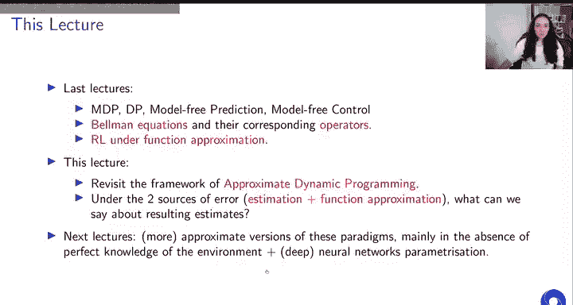

A couple of preliminaries this have been introduced before， but just to。

To recap and be on the same side， we've introduced previously the Belmont Opity operator。

 this was derived from the Belmon Opity equation。

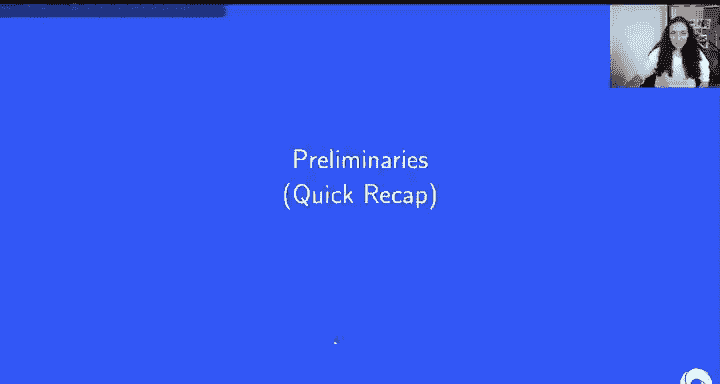

And the definition is in equation one here。To note that this Belmont operator has a unique fixed point。

Wwhich is exactly the value function that we are looking for。

 That's why iterating this operator will eventually get us to the optimal value function。

 This is under you know no approximation condition with perfect knowledge of the model so this is just pure dynamic programming。

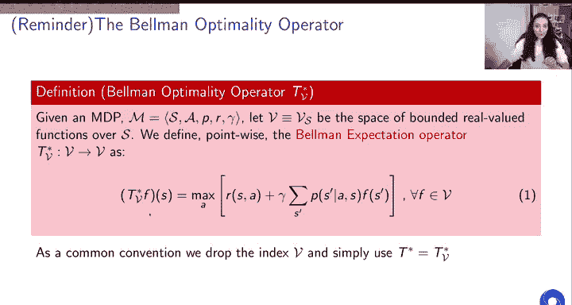

Okay。And then we had the Belmont Exp operator， which has similar properties， it's a contraction。

 it has one unique fixed point， but the unique fixed point of this operator is the evaluation of the policy pie。

For which this operator is defined。Okay。

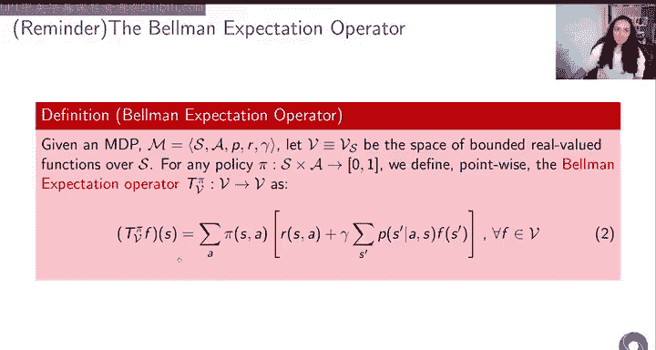

给。And just another reminder， dynamic programming through the lens of these operators。

 the two popular algorithms there that we've seen are value iteration and policy iteration and you've seen approximate versions of this for instance key learning being an approximate version of value iteration so these both of these say value iteration is just applying multiple times the Belmont optimality operator and again under perfect conditions。

 no approximation this is guaranteed to converge to the fixed point of this operator。T star。

 which is the optimal Belmont operator， which is the optimal value function and policy iteration was this procedure of starting with a particular policy。

 doing policy evaluation， which can be done itatively via the Belmont。

Expectation operator or can be done in any other way。

 especially if we can solve the true system of equations。And then on top of this evaluation。

 we're going to do an improvement step， usually a greedy improvement step。

 and if we've seen in previous lectures that that is guaranteed to give us a better policy。

 than the one we've just evaluated and we just iterated this process by improving greedily on this evaluation and at least in finite cases。

 this will eventually， because we're improving the policy at the age point in time。

 this will eventually get us to the optimal policy。Okay。Okay。So。

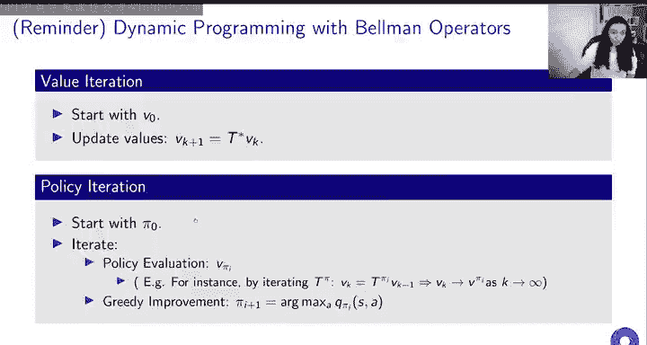

Now， approximate dynamic programming， as you've seen before。

 removes a couple of the assumption of the。the true of knowing the underlying MDP and being able to represent exactly the value function。

 so moving away from Tular and moving away from the assumption that we can actually evaluate perfectly the expectations needed in these updates。

And by doing so， in one of the cases where we don't know the underlying MDP。

 we're going to be introducing some sampling or estimation error because we're trying to estimate an expectation via samples。

And in the other case， we're going to be introducing some kind of approximation error because were we might not be able to represent exactly in the parametric function class we've chosen the true value functions that we want to estimate at each point of this process。

All of these procedure are kind of deterative procedure。

 so we'll have a lot of value functions in between value functions that we would need to estimate so whenever。

Neither of like any of these functions cannot fully be approximated by the approximation。呃。

By the parametric class we've chosen， then we incur some error at that iteration。

 so it's not only that the true solution can't be represented。

 it might be that the true solution is representable。

 but the intermediate steps the intermediate value functions that we're trying to approximate or not representable under the parametric class。

 then we're still going to incur some approximation error。Okay。And of course， as always。

 the even under these conditions， the objective of Rl is to come up with a policy that is。

Hopefully close to optimal behavior。

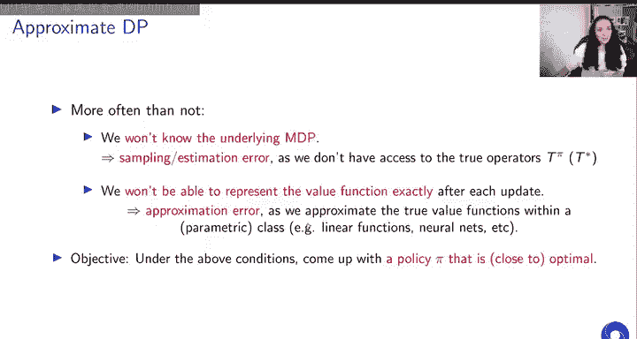

给。So let's look more in depth at the approximate value function， value iteration paradigm。

 so this is close to what you've seen， for instance， in Q learning。

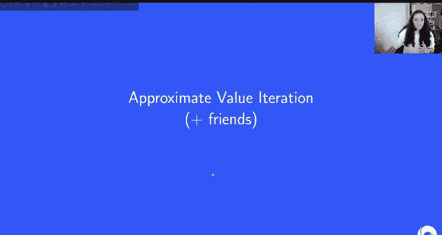

So again， as a reminder， just this is value iteration through the lens of the Belmont optimality operator。

 so we started with the value and at each iteration K。

 we update VK plus one towards or in the exact case。

With the one step application of the Belmont optimality operator。

Applied to the value function at the previous iteration。Okay。

 and iterating this as khens to infinity this。The sequence of value function eventually converges under the infinity norm to V star。

If this is still not clear to you， I would urge you to to go back to our。

Second lecture on dynamic programming and see the arguments there。

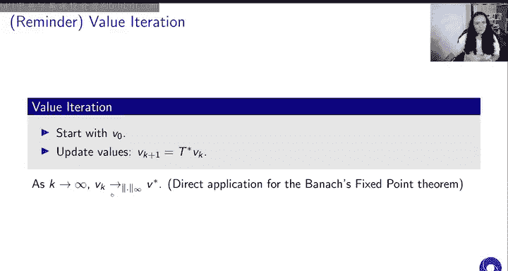

Now， the approximate version of this is basically we're going to do this authorative step at each iteration K approximately。

 so that's what this a stands for and again， this approximation can be based on the function approximation or based on the fact that we actually don't have access to a T star and we'll have to sample to approximation。

And the same as before， we're going to do a greedy improvement step。

On the one whatever value function we approximated here。Okay。Now the question that arises， of course。

 is。If we tolerate this process， would we converge to the optimal value function would we converge at all。

 and in general that's a no， it highly depends on what the approximation here is。Okay。嗯。

The nice things that we kind of hinted last time is that even if we don't converge all the way to the optimal value function。

 we are actually interested only in the quality of the policy this derived greedy policy with respect to the estimate at one point in this iteration。

 we're never going to do this iteration forever and。

We're trying to understand how good that policy is。对。And just。Just to be clear。

Usually we would be using something like the Q version of approximate value iteration。

Where we do exactly the same process， but not for V， but for Q， again。

 start with an arbitrary value function Q0 update。Toward the one step Belmont operator with respect to QK。

At iteration K plus one and then return as a control policy。

 the greedy with respect to that estimate。This is， this is what we use usually in practice。

 especially if we don't have a model， because remember that to derive this greedy policy。

 we actually need the action value function to just。Basically pick the the the artrc max of the。

Q value function if we don't and we have only V， then we would have to have at least a one step model in order to to derive the greedy policy。

 So usually we're just going to go for approximating the Q value。

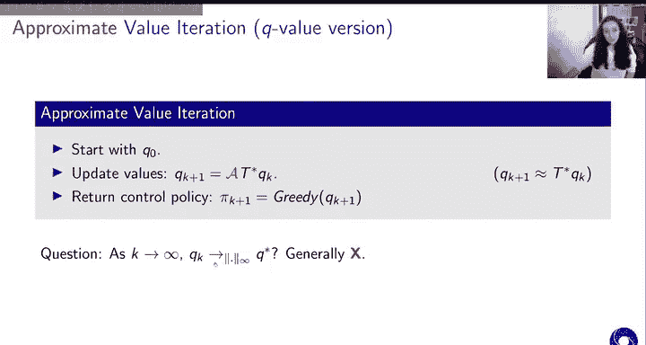

O。And as I hinted before， we really want to be able to say something about the quality of this。

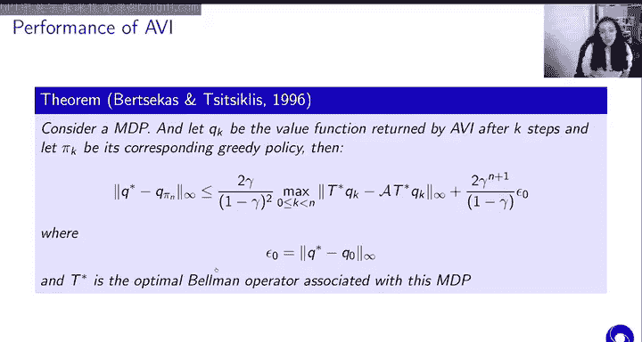

Greedy policy derived after end steps of iterating this approximate value iteration process。

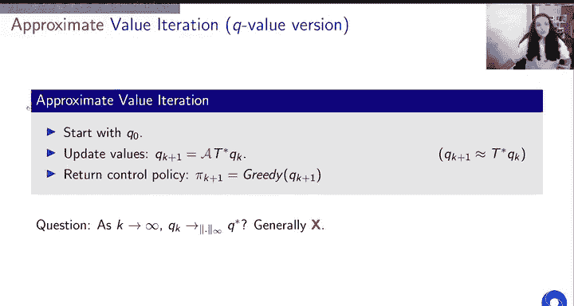

And this is what the following theorem is saying， this is an old result from 96。

 but still a very important result in in the field that basically。Does this for us。

 So we're going to bound under the infinity norm， the performance of the policy at。

The eighth iteration of this value iteration。Procedure。With respect to the optimal value function。

So that's what this first term says。And this is。Going to be bounded by two factors first。

 the initial error。This is basically defined in the second line here is how far is my initialization with respect to the optimal value function with respect to the L infinitefinity norm。

 So this is the second term in the bound。Okay。😊，And the first term here is the approximation error that I'm going to incur at iteration K。

给。So usually at iteration K plus one， I'm going to try to estimate， I'm going to try to back up。

The star。9。Okay。But because I'm in an approximate setting what I'm actually going to be my next Q k plus1 would actually be a T star。

QK。So。This is this accounts for how much error am I incurring by introducing this A in my backups in the value iteration？

Okay， so this should be kind of intuitive outside you know。

 the terms in front that our performance of the policy。After an iterations of this value。

 iteration is bounded by both where we started， so our initial error。

And the approximate error that we're going to be incurring。At each iteration。好。

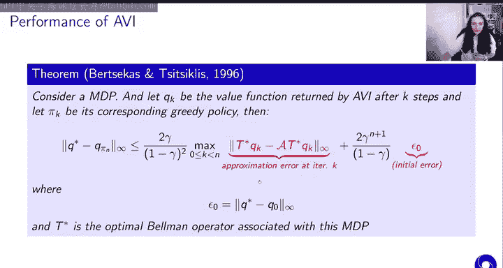

So next we're going to move into the proof of this statement。

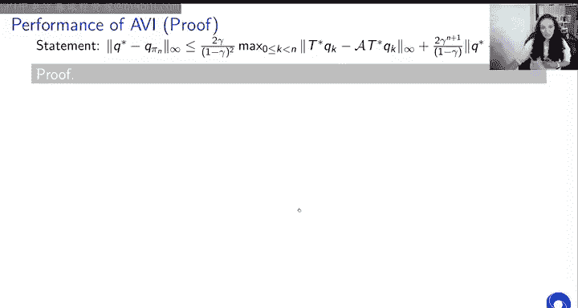

Okay。Let's start by first denoting the maximum error。That we can incur up to iteration N。

 So for any iteration， K in between that and n。We are maximizing over the approximation error。

 This is， again， for usually for dynamic programming， this would be。嗯。QK plus1。

 but in approximatema dynamic programming we're introducing approximation。

 so this instead this term will be our value function at iteration k plus1。So discrepancy between。

This K plus one and this K plus1 is what the approximation error introduces。Okay。

 so we're going to now maximize。Over all of these errors and denote that by epsilon。Okay。Next， the。

 the first thing we're going to do is try to relate the。Value function add iteration K plus1。

And in particular， at iteration N。With respect to the optimal value function。

Note that this is not exactly what we want， the statement of the theorem is actually saying something stronger in terms of the performance of the policy derived based on the estimate。

Aiteration。N， so if we have Q N， then this induces via greedy this policy， Q N。Sreety。

With respected the estimate that we had at iteration N and were interested really in the value of that policy。

Okay。But we'll see that this is really simple based on the result that we've had in the last lecture on dynamic programming where we have a result that relates the performance of greedy policy。

With respect to the value function that induces that policy。

 we're going to just revise that result in the next slide。First， let's look at this equation。Okay。

And we're going to break it down into a couple of terms。 So first we。Add and subtract the same term。

 And due to the triangle inequality， we can， we can split these apart。 This is an upper bound to。呃。

The left hand side。Okay， and then note that。Dister。Is exactly。The approximation error at iteration K。

Wwhich is upper bounded by definition by this epsilon。

 which maximizes over all the iteration up to n so that's why we get this term being less and equal。

Then。Apsilon。And then on the， the first term there， we are using that the。

Bman operator has a unique fixed point， which is Q star。 So just as a reminder， that means that。

This holds again， because Qstar is the unique fixed point of this operator。

And then we're going to be using the fact that this operator。Gstar is a contraction。Contraction。

Actually， it's a gamma contraction。Which means that。Less than equal than gamma。So， the。

So this term now is less and equal than this term。Okay。

 and now what we've actually achieved is a recurrence relationship between how far。

The value function at iteration k plus1 is。Related to how far it was at the previous iteration QK。

Okay。And what we're going to do。Now is basically unfold that equation。So。

This is the question that we're going to like the inequality that we're going to be using。

And we're going to apply it at previous iteration， so first for k。

And we're going to relate it to k minus1， then k minus1 to k minus2 and so on and so forth。

And what we get is we can relate this to the initial error at iteration k equals 0。嗯。And。The term。

 which is the discounted errors， it's an upper bound actually。

 of the discounted errors that weve encountered at each iteration。

And this is also less than equal than if this would have been you。K equals。

Capital K actually goes to infinity。 So this now is upper bounded by。The mistake or the。

How good our initialization was and the term accounting for the errors that we've seen is' actually an upper bound on the errors that we've seen throughout this approximation at every iteration K。

Okay。Now I'm just restating this。Here。😊，It's the same equation as here。

And now the last step is to relate。Apologies for the buzzer there。But as I was saying。

 we're going to now relate to this result。To the performance of the policy induced by the estimate at iteration K or iteration N。

 So just as a reminder。The policy that we're deriving is greedy with respect to that estimate。

 and we are interested in evaluating。That policy at iteration N。And for that。

 we're going to be using the result we had in our。Last lecture on dynamic programming。

Which was the performance of the greedy policy。Based on an arbitrary value function， QK。And that。

 if you remember this， was the performance of the derived policy。Q pi k。

Can be bounded in terms of the performance of how。For。

This estimate on which we're basing the greed on is with respect to the optimal value function。Okay。

And note that we already have this term upper bounded here。

And just by plugging in 10 into equation 11。You get exactly the statement of the theoryor。

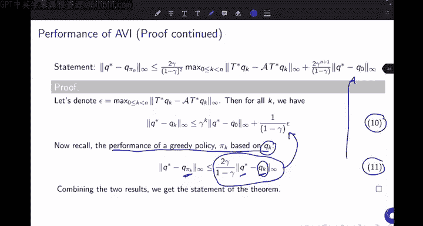

Okay， now that we've proven the statement of the theorem。

 let's look at some of the implications that this has。And first， we're going to look at the。

Last time there。So some of the implications are as intense to infinity。This term in red。

Tends to zero as。嗯。This gamma to the end decays exponentially past。

 So what that means is that although at each iteration N。

 this this term appears and is is bounding our performance with respect to the the initial point。

 our initialization of this this process as n tends to infinity basically this term will disappear。

 which is good news， which means that。In the limit， we will have no。

Dependence on the initialization point。Okay。Another question here。

 just as maybe as a sanity check is what if we do initialize， you know。

 by chance at exactly the optimal point？At Qstar。Well， let's say what the bound says。

 so obviously the second term goes away because the norm there of the initial error is0。

 but you can see that we are left with another term here。

Which is still the maximization of all the approximation error that we would encounter in each iteration。

O。嗯。Now the question becomes， would that be zero in general？

let's consider just one iteration of this process， so let's say at we start at Q star as our first iteration of this process。

 so Q0 is Q star。And our first iteration of this approximate value iteration process。Gets us Q1。

 which is the approximate version of the one step application of the Belmon operator。

2 Q0 because Q0 is Q star， then the application of the Belman operator to Q star is Q star so Q1 is actually。

The approximation operator applied to Qstar。Now， in general， this might not be0。 So， for instance。

 if a is an approximateimate of。呃。Hypothesis space。

 let's say that is not within our class of approximations。 Then this。

 this error at the first iteration might not be by might not be0。 So even initializing at the。

Right solution in a sense。By approximation， we might move away from this solution。That being said。

 if if this initial point has to be in the function of approximations， then。This。

Has to be zero because the projection here， just in terms of coming back into the class of functions。

This would be like not losssy。So the projection of。Q star under the function approximation。

Would just give you back the Q star because that's the closest point in the function approximation。

Again， if a is something like an estimation error。Where instead of having the true Belmon operator we have a sampled version of this。

 again this error at the first duration might be nonze， probably will be nonze。

 which means that even if we initialize at the right solution we might move away and once we move away from the solution。

 we can further move away and so on and so forth。So this result is very general。

But it does state that even if we are close enough to the solution。

 it highly depends on what the approximation errors incurred that each iteration will do and how much we could。

 in principle， lose based on that。Okay。Now let's focus a bit on the other term。

We've seen already that as n tends to infinity， the second term goes to zero。

 which means we wash out the initial approximation error。Now， let's。Consider a hypothesis space F。

 so this is where let's say our approximation comes from。And let's now have A。

 B exactly the projection。With respect to the L infinity norm。Okay。

 so this is the definition of this projection is is now in the。In the equation below。

So we're just looking for the projection of G of function。

Or vector under the L infinity is trying to find in the space of value function F。The closest point。

2G under the L infinity nerve。Now， if we do that， then approximate。Valueration algorithm。

At each iteration K plus one tries to will take the form of applying the Belman operator。

Two optimality operator， to the previous value function， and then projecting it via this operator。

Now， the thing to note here is that this combined operator。The approximation。

 just via the projection， we're still doing full dynamic programming in terms of using the expectation。

 using the true model here。So this combined operator is indeed a contraction。

Operator in L infinity because basically T star is a contraction with respect to L infinity and the projection with respect to that norm is a nonex mapping so the full thing is a contraction with the same gamma parameter。

Because this whole operator is a contraction， this algorithm does converge。

It is guaranteed to converge to a fixed point， actually because it's a contraction from previous Bna fixed point theorem。

 it has one unique fixed point， it says a fixed point and this is unique。That has this equation。

And as before。If。Q star， the thing that we're looking。I， indeed in F is under our functional class。

Then the above algorithm， the situation in red。Actually converges to the to the true value function。

 And this is， this is easy to to see if we again， remember that this algorithm。

Has one unique fixed point。 And you can， you can plug in in this equation， if F equals。

The projection。Vi the L infinity norm， t star F and see that Q star actually satisfies this equation。

Cool，So now we've got at least on the function appmator， still full full model of the MDP。

 a converging algorithm that at least if the true value function， the one that we're looking for。

 the optimal value function is representable in our functional class。

 then we are guaranteed to converge there。Even if it's not in our if Q star is not in that function across。

 this algorithm still converges。It just might not be to Q star because as we've established。

 Q star is not representable enough so we't hope to something we can't recover Q star via dis parameterization。

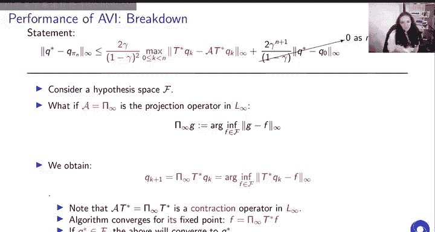

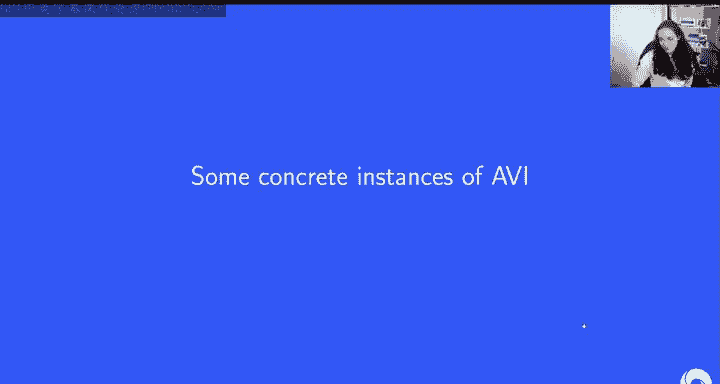

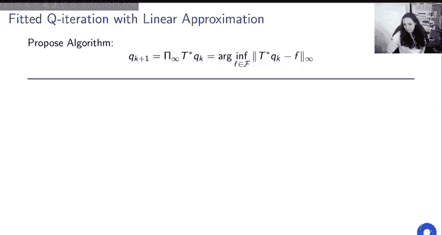

Let's look now at some concrete instances of。This paradigm， and。

Although I have just proposed a convergent algorithm。

 we'll see that this algorithm is somewhat impractical and we're going to try to fix that and we'll see that trying to fix that actually gives us some of the popular algorithms that you've seen before and that are now used in the literature。

So let's first have a， you know， clear instantiation of the algorithm that we've just proposed。

 So at each duration K， we're trying to approximate the。The one step Belmont operator。

By projecting back。With respect to the an infinity norm under some hypothesis class F。Now， for。

Concreteness， we're going to consider F's to be the space of all linear functions with respect to some feature space phi。

So all of the functions， all of the Q。 in all of these iterations will have to be represented or approximated。

In this in this functional class okay？And then。Doing that， we obtain this simplified algorithm。

At iteration K plus one， we're looking in the space of linear value functions of the point that best approximates under the。

L infinity norm。D star。QK。And because we have only one set of parameters， which is W。

 the weights of this feature vector， the equation 12 can be reinterpreted as just finding at each duration k or k plus1。

A weight vector k plus1 that minimizes this equation。Yeah。嗯。How would you solve this this equation。

 how tractable is this even under a very you know？One of the simplest hypothesis classes out there。

Now， here are。A couple of potential problems， but before before I flashed that just just。

Try to take a moment here， and。Try to think how you would find this vector。

WK plus one at each duration and how hard or how easy would that update look like or what's the complexity of that update？

How would you do it for a linear class or something like a neuro network or any kind of other function appator class there？

Okay， hopefully you've at least tried this cemental exercise and see that this is not trivial。

And there are basically two problems there。 One is that the L infinity minimization is typically hard to be carried out。

 Usually we are using different norms。More prominently， something like L2 that is very well behaved。

And easy to， to optimize in the linear case， this has a， you know。

Close form solution El infinity is is。Is usually a much harder optimization problem and as you've seen in the previous lectures and this is the general assumption。

 I guess in reinforcement learning is that T star is typically unknown and has to be approximated somehow usually from samples。

So here are some proposals of easing these problems。

 so first I just hinted at this that instead of L infinity。

 we're just going to replace that with something like L2 that is much easier to optimize so instead of having now the L infinity optimization there we're going to do the same thing but find in find。

The point in F that is closest to。T star Q K。With respect to an alton norm or an al norm with respect to some probability distribution mu。

And hopefully you， you know how to solve this any any kind of like。

Squared regression kind of thing will tackle that so in most cases this will have both at least for the linear case a fixed like tractable form and if not in most of the other cases we can do something like pepro and just take gradients with respect to this loss。

And you've already seen， you know in the lectures in model free control and variants of that that in order to approximate T star。

 we're just going to sample。And。Usually we have this topples of SR next state that we're going to sample with respect to this distribution。

 with respect to that norm and our transition model。

 and we're going to approximate the term T star Q。QK by this YT target for each sample。

And this is just， again， the true operator， the true。QD star would be just an expectation。Of Y B。

For all the samples， SD 80， Rt plus1 and SD plus one。Okay。

 so now what we get is that at each it iteration we're going to find in our。Hypothesis， space F。Q W。

 these are the parameters of the our function appximator。 we're still we're still using。

A linear function class。That minimizes the square loss。

And this is now a sample square loss rather than the true expectation loss。对。

So this is just the reating but what the last equation was and just。

Reinterpreting Yi as an approximate application of the Belmont optimality operator to the previous value function at iteration key。

And this actually is a very general recipe for coming up with。

Fitted fuel iteration kind of algorithms or just。Simple。C based Q learning based algorithms。And。

There are a couple of dimensions there that we can vary one I've really never used that word're using here。

lineinear parametermetricization， so this can be done with any kind of functional class F that can be parameterized by。

 as we did here with linear function classes with neural networks kernels。

 whatever your parameterization of your regressor is anything can go in there。

So these these are you the parametric class that we're going to be approximating the intermediate value functions with。

Now there's a couple of other dimensions that we can vary the other one is again we're going to be approximating T star。

 the application of this operator and in order to do that we're going to have to sample somehow and this can be done online can be done from a fixed predefined or pre given kind of data。

 someone you know gets you some data some previous intervention protocols。

 some previous behaviors of policies that have been used in regulating a power plant or something like that and those are like you just a fixed data。

You can also have a replay kind of bottle or replay memory or a generative model where you can sample from this bottle to generate those samples。

 so all of these are you know a way of approximating that operator via samples but how you generate the samples and where they come from。

 its you know it's a three dimension in a sense。And the last I mentioned there that is free also。

has to do with how we approximate this one step Belmon operator and the simplest one is the one we've used before。

 this is basically Q learning the other instantiation。

 the second instantiation there is instead of the application to the previous estimate。

 we have something like a target network that we keep fixed。

 it's almost like saying at one point decide that iteration K is the target network that we saved and we're going to keep that for a while and make estimate and update and when we change the target network again。

 we're going to call that iteration K plus1。And there are multiple other versions of this target that can be done off policy learning and multi step operators where we can get not a one step estimate。

Of this operator， but maybe multiple steps estimate to。To speed up the credit assignment。

And you're going to see that。In the next lecture with Haddo， both of these variants。But again。

 this is a very general recipe and there are， as I said， like these these three dimensions。

 you can pretty much mix and match。So let's look at one particular instantiation of this recipe。

 which is DQN。 I'm sure you've seen this before or at least you've looked at the paper and the。

DQN is one of these algorithms that does follow this recipe and in particular for the approximation class。

 we chose neuroes， the samples are sampled from a replay。

And the target here in the regression is based on a target network。

Now here's another instantiation of this， which is batchcher where we can't interact necessarily with the environment is。

Examples I mentioned before that maybe someone hands you in some data that has been collected under some policies or under human interventions or any kind of other data set and you want to still make use of that。

 so the function appator there can be whatever is appropriate for the size of data or you the problem specification。

 the observation set。And then we are working with the fixed data set and let's say。

A option here for instantiation is just a one step approximation of the Belmon operator via one sample。

 which is what the first line here says this is probably the first thing that I would try。

But of course， like you can have something like just more generally off policy update because the data set is is fixed and you didn't have necessarily access to the policy that。

Generated that data set this might be hard so Q learning so the first version there。

 this one is probably the easiest if you do have access basically to the collection policy then you can do something more fancy in terms of off policy updates。

 but again in both of these。Examples， I'm kind of assuming that the data set that you are given is not the current policy that you're trying to evaluate。

 so this will be off policy。Most of the time， if not all of the time， I mean。

 for the control problem， we will always be of policy because the data was collected under a particular policy versus now at each duration we're changing the policy。

Okay， and another example here is what you've seen in the last lecture。

 which is something like Dah again， we can choose whatever approximation family we choose to and this is。

Okay， this is a mistake， it should be samples are both online and from a replay model。

And the simplest instantiation of Dina will choose to do something like Q learning。

 which is the one sample instantiation of this operator。

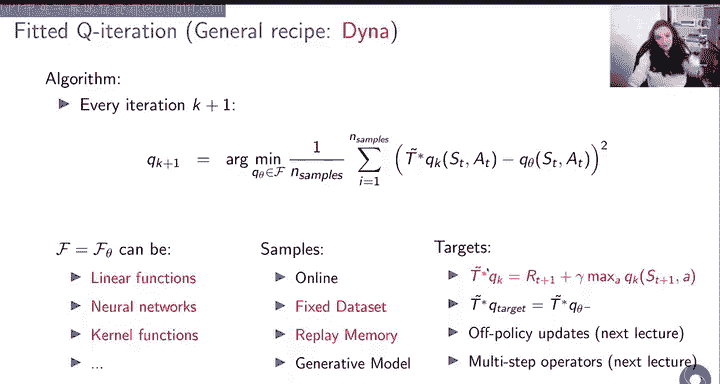

O。That's it for approximate。Value iteration next we're going to be looking at approximate policy iteration。

 the other algorithm for for using for doing control， this is a much。lessss studied， I guess。

 or less popular paradigm， but it's good to go through it because there are many algorithms these days that do follow that。

 but most of the algorithms that you will encounter in control， especially for off policy。

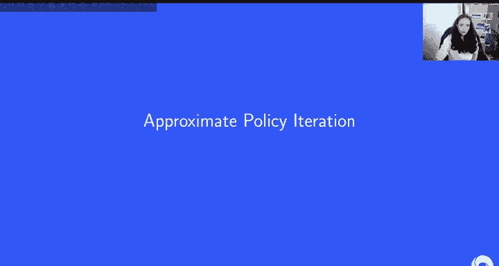

Actually， follow the， this kind of recipe of fitted curiteration with。

One of these dimensions varying or an instantiation of one of these dimensions。

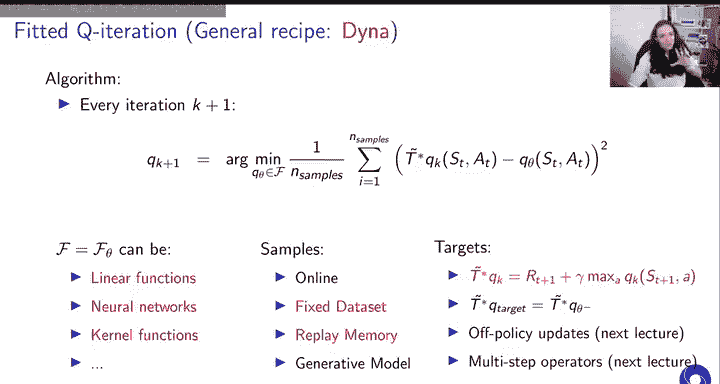

Oh。

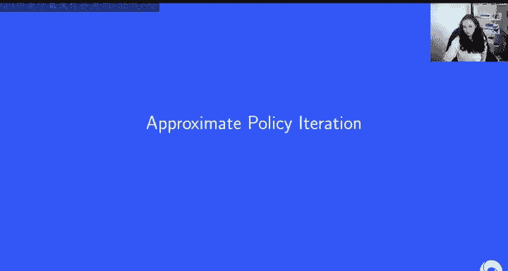

We start with a reminder of the policy iteration paradigm。This again。

 is the iterative procedure where we start with the policy at。

At initialization and we it this process of policy evaluation and policy improvement， in our case。

 greed improvement。So at each point in time， we're evaluating the policy。

Dived at the previous step and we make a gratification step with respect to that。

 and we know that at least in finite cases this will converge to the optimal policy。Now。

 the approximate setting， actually the approximation occurs in this policy evaluation step only。

And now the value we derive at or our approximation at iteration I is the one that will provide the argument for the gratification。

 so instead of doing a gratification with respect to the actual evaluation of our previous policy。

 we're going to do a gratification with respect to the approximation to that evaluation problem。

As hinted before。This usually does not converge to the optimal value function。

 but nevertheless what we're really interested in is the quality of the policy that we're going to get after let's say iteration K in this particular notation iteration I so in general we're interested in the quality of the policy pi I。

As determined by QI with respect to。Let'd say the optimal value function。

 so how good is that policy after I iterations of this procedure？

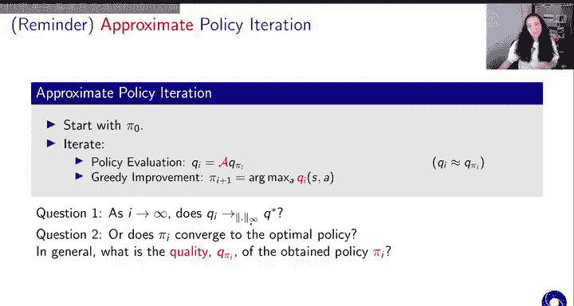

And this is exactly what the next result we're going to look at quantifies。

So considering gun MDP and QK and。By k are the。Valy function。

A iteration K and the theification at iteration K minus1 then we。We have the following statement。

 so we can bound the quality of。The policy at time at the iteration K。By the。

Approxims errors that we've incurred up to that up to that point。 Actually， it's a。

 it's a much stronger statement than this is saying the the in the limit。

 the limb soup of this error。 So your。And with respect to the value function is upper bounded by the last errors。

 like the convergence of this approximation errors as you approach convergence。Okay。

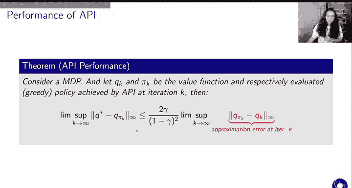

嗯。We're going to try to prove this， but first some notation， I think first of all。

 this should be a somewhat intuitive statement， the same as before we're going to。

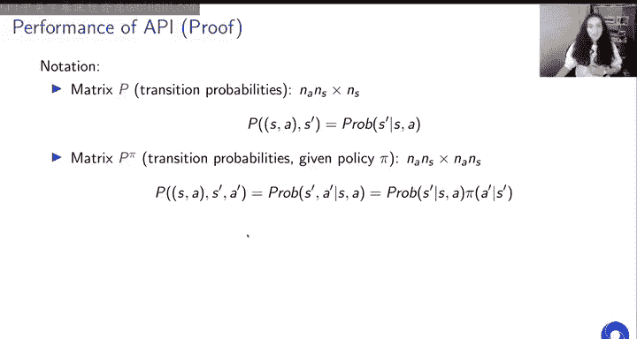

The quality of the policy that you were going to get after Keration is bounded by the errors we're making in this approximation。

 but this is actually a stronger result， as I said。As these things。

 the approximation errors might still converge in the limit， or at least they are bounded。

 which means that this。This term is also bounded and will converge， at least in within that bound。

 So it might oscillate around a fixed point， but it is， it is bounded by the。

By how much the approximation errors vary in the limit。

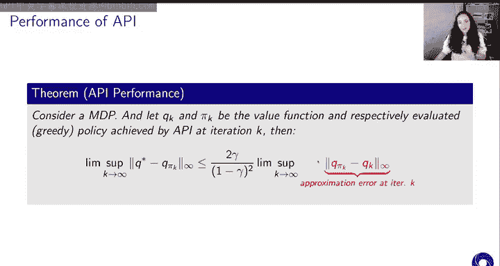

So a bit of notation before we jump into the proof。

 you've seen these notations before just as a reminder， so we're going to note denote by P。

 the matrix corresponding to the transition kernel and this is the entries of this P or。

SA and S prime， which the entry SA S prime denotes the probability of transitioning to S prime considering we started in S and took action A。

 this is just the transition kernel and then P pi is the transition probability corresponding to policy pi this is number of actions a number of states by number of actions number of states。

 so this is basically a probability transition between SA and SA a prime under policy pi。

And just a reminder under this notation， the Belmont。Equation can be written in matrix form。

 as we've seen before in policy evaluation。Okay。So having this in mind。Lets let's start to proof。

First thing we're going to do is look at。This quantity that we call gain。

 which is the performance of policy。Eiteration K plus1 versus the policy a iteration K。

So between two consecutive iterations of approximate policy iteration。

 where we have two policies at this iterations and we're saying like how much better is policy at K plus1 with respect to the policy at iteration K。

Okay， and first， we're going to。Try to say something about this quantity and then we're going to relate to this quantity with the thing that we're actually interested in。

 which is the performance with respect to the optimal policy。

So the gain as defined here is just the difference between these consecutive。

Evaluation of two consecutive。Iterations of policy approximatexima policy iteration。

 and this is just rewriting。The above equation， just using that the fixed point of operators。

Py K and Pi K plus1 are the value function corresponding to these evaluations。

And then we're going to add and sub a couple of terms there。Okay。

 this might sound a bit or might look a bit scary at this point。

 but it's it's just adding up abstracttraction and it does have a。

It does make sense in terms of we always do this this kind of procedure just varying one term at a time。

 so if you look at the first equation here 17 we are keeping the operator fixed。

 but we're varying the argument in the next equation again we're keeping the operator fixed。

 but we're changing the argument now。In the next equation。

 we are changing the operator but keeping the argument fixed and in the last one we're keeping the operator fixed between these two and changing the argument。

 so usually that's the kind of relationships that we're going to have because we're going to exploit the properties of these operators。

O。So Ive just written。Exactly what we had in the previous slide and we're going to unpack these terms。

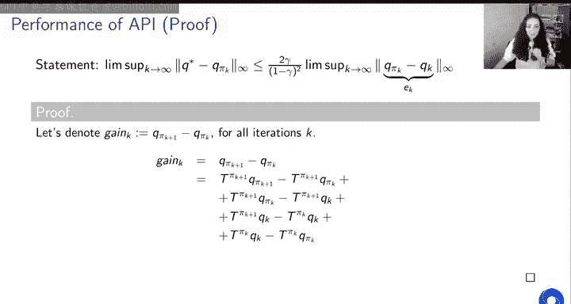

Okay， let's look at the first term here。Yes是。This is going to be R。

Or just unpacking the definition of these Belmon operators。Plus gamma。And。Sorry。場所？Minus R plus Yama。

我说。And。O。And we can see that R there。goes away and what we left。With is gamma。5 k plus one。And。

The difference between these policies and this is what we called gain。Okay。And similarly。

 we can do the same trick for this equation and this would be now the Rs again simplify。And we have。

A比。Pi k plus one and the difference between。This。Which we called Ek。

 which is the approximation error at iteration K。We're going to skip this next term because this one has a very similar expression as the ones which we've just seen because the operator is the same again things simplify and we get the gamma。

B。5 k。And。Diffence between these two。 And again， these are as before in the notation， it's minus。

The approximation error that we incurred at the iteration。Okay， just a bit of notation。

 EK we've denoted。This。The difference between the evaluation。Of the policy PK and the estimate QK。

 but not the norm of that， this has a sign kind of thing。O。

The last term that we have here is this one。And this one where we're actually not going to do anything but say that this is greater or equal than zero。

And this is because。嗯。The spulsing。P k plus one is the greedy。With respect to。This。Q九ケ。

Which means that。The evaluation operator there is actually the optimality， the one。

Application of the Belmont optimality operator， and this is less greater than equal than any。

Application of any other policy。

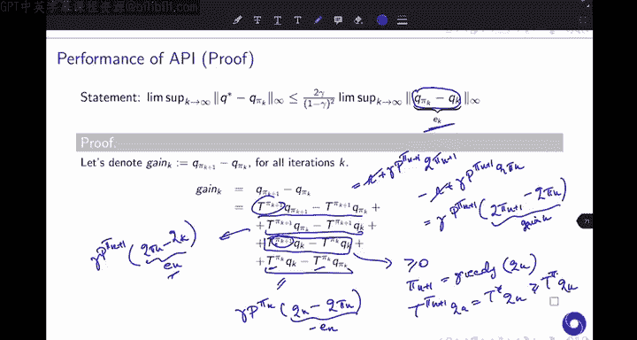

Okay， hopefully you were able to to follow that， if not， just stop the video and go over it。

 but these are。Exactly the same equations， but repeated in the slide。Okay， and again， this。

This particular inequality， you can unpack it explicitly if you want to convince yourself of that。

 but the argument we've just done is sufficient。Okay。So。We。

The only thing that we're going to do now is basically upper bound this by this so because we're going to replace this term with zero。

 this is an upper bound and we're just going to plug in the terms that the simplification of the terms that we just had here。

Okay， this is just rewriting。 and rewriting a bit by noticing that the gain K appears both on the right hand side and the left hand side and collecting those terms。

 we reach this。A finalin expression bounding the gain at iteration K。拿开。

So this is the statement that we've just proven。Let's see a couple of implications。

So this gain is really how much your policy， the quality of the policy that you derive has improved from one iteration to the other。

So。The first thing to notice is that if EK。Which is the approximation error。Is。

By definition here is the gap between the actual evaluation of policy pi k and our approximation of that。

So if that is zero， which means you have perfect evaluation at allCK。That thing is zero。

 so what we're getting is that the gain at iteration K is greater or equal than zero。

 which means that the quality of the policy at iteration K plus1 is greater or equal than the policy the quality of the policy at iteration K。

Whi is exactly what we've proven before in terms of the greedy improvement step being an actual improvement step。

 guaranteed improvement step over the whole state space。Now。嗯。If this term is different than zero。

 either larger or smaller than zero， this is a vector， so some of the entries might positive。

 some of them might be negative depending on your approximation。

 so can this gain be zero or negative？Which would mean that at least in some states。

 the policy at iteration K plus one。Actually is worse than the policy at iteration K。So fortunately。

 under approximation， that can happen。嗯。And this is a very simple example just to give you an intuition where things can go wrong。

So this is a simple MDP three states， we have plus one rewards every time we transition at the end of this。

Chain。The action space is left and right， fully deterministic。And were， let's say， at iteration K。

 the policy that we're evaluating。Is always going right。OkaySo if we evaluate this policy。

 the value function， Q pi k associated with that is as follows can。

You can convince yourself that at least。In the terminal state， if， if we're in state S1 S 2 and。

Taking action one， which is exiting to this plus one reward， then we get the reward plus one。If not。

 if you're in state at zero and you're taking action。One， which is going to S2。

 you basically have a zero reor plus gamma is 0。9 here， so 0 plus 0。9 and the value at this state。

 which is 0。9。The same for Smon we're taking one step with。Reward 0， but then we're discounting by 0。

9 this already discounting value of 0。9。Now for action two， this is。

A bit more complicated we start with S1， so if you're in S1 and take。Action A2。

 you're going to transition to this terminal state and get reward one。Now。

 if you are in state as zero and take action。A2， you're going to transition to S1。

And then you're still going to follow this is evaluating this deterministic policy of always going right。

 so we make one transition according to A2， we transition to S1， and then from S1。

 we continue according to policy pi k。And according to policy PK， we're just going to go right。

Which means that we're making a step， we transition to S1。

 and then basically we're just discounting this value。Again， because in S1。

 we're not actually transitioning to the end state there。

 we're not actually exiting because we are executing a policy that will get us in the opposite direction。

Okay。Hopefully that's there。Now， consider instead of having this full evaluation of policy PK。

 consider an approximation。嗯。For different reasons you might have either a functional class or based on samples。

 you get this approximation and I've just made up some values that are you know fairly close to what the the evaluation would be and it's also maintains the you know。

The relationship between the action values。At least within within the same action Okay。

 so it it's a reasonable approximation Now， if you take the greedy with respect to this approximation。

To this evaluation， then you get a policy。P k plus one， which is this。

So this is just reading out from our approximation what am I going to do in S1 well I look at the value of these two actions obviously a2 is better I'm going to take that one the same in S0 I look at the。

The values of these actions。The one corresponding to a1 is better， so I'm going to take that one。

And in S2。I'm going I'm looking again at the approximate values here。

 and I see that a2 in this case is better than than a1。 so the the induced policy is。嗯。

It's the one depicted here。So let's now see this new policy at iteration K plus1。

 if I were to actually evaluate how good that policy is。

 what would that evaluation be and this is the evaluation for the policy that we've just computed as greedy with respect to the approximation that we had。

And this one， because of the cycle there。Going back and forth between those states actually has this value function。

Wwhich you can see that if you compare the value of a policy at policy pi k and the one at policy at K plus1。

 you can see that even state by state， these things are either equal or the policy at iteration K plus1 is actually worse。

In this state。In this state。 In this state。So actually。

 this is an extreme example of what I wanted to illustrate in the gain being negative that in all of the states and actions。

The gain is either zero or negative。In most situations。

 you would have a mix of these where in some cases it will be an improvement。

 but in some states and actions it can actually be negative so it's not。It's not under approximation。

 it's not necessarily a strict improvement。Over the policy we had at the previous iteration and there is where the the problems。

With convergence and with the monotonic improvement of these policies occurs。O。

This was a bit of a detour， but I think it's good to have an intuition of what happens from one iteration to the other and why this fails under potentially fails under approximation。

 so let's go back to the proof。And actually go for the term that we are actually interested in bounding。

 which is the quality of the policy after keration with respect to the optimal value function。

We're going to denote by LK。Exactly the difference between the optimal value function and the。

Quality of the policy at theeration K。Note that this thing is always positive。Because by definition。

 the value of the optimal policy is。Greater than the value of any other policy and this is not an approximation。

 this is an actual valuation of the policy at the duration K。O。

So we're going to start with just the definition， we're going to do a similar thing that we did before introducing the the Belmont operators and using the fact that both of these。

Value functions are。Fixed points of。The expectation operator of P K plus one and the。

Fixed point of the。EvaluThe expectation evaluator with respect to the optimal policy。Okay。

And then we're going to do exactly what we did before， which is introduced like。

Introduce a couple of terms， so adding and subtracting a few of these terms。So， just。

Just convince yourself that this thing and this thing goes。Simplify the same this one and this one。

 this one and this one， this one and this one and again the same recipe as before we're just changing one thing at a time so the operator stay is the same the argument is different again the operator stay the same argument is different。

The operator changes here and so on and so forth。Okay。

 and we're going to do very similar thing that we did before and。

Basically bound all the terms that that we've all this。

Difference is we're going to either spell them out or bound them in this case by zero。

The argument goes exactly as we did before， they are just rewriting what these differences are。Okay。

So by collecting the terms here。And again， this。This particular inequality is follows the same argument as we had before because。

This operator is the greedy with respect to。あ、九。Okay， so pi k plus one is by definition。

 the greedy with respect to the approximation。QK， so that means this operator is actually the one step Opity operator applied to。

QK。哎。So this one is always。Better or it's always greater than any kind of policy there。So any。

 any other evaluation operator applied to。QK can't be better。

Sore we're just going to agreewrite for all of the terms that we engroup all of the terms that we had here。

嗯。And we're going to now expand， we had the term here in terms of the gain at iteration K。

 and we've previously upper bounded this by this expression， so from 27 to 28。

 we're just plugging in the bound that we've previously proven for GK。And we're just。

Bringing the terms together and rewriting a couple of stuff and a couple of things simplify from。

29 to 30。ok。And。Now。Sorry as。As K tends to infinity。嗯。Then， we can。呃。

We can introduce the limb soup of this quantity， so we have LK and LK plus1 in one side of the equation and the other side of the equation in asymptotic regime as K tends to infinity。

 this will become just disturb。And then basically by rewwriting we have this expression。

 so this term， all of this term here appears in the limbup here。

And the last thing that that we're going to do is we're going to take the L infinity norm with respect to this equation。

 this is just rewriting what was on on the other slide。And when we take that。

We have a couple of terms there that will simplify。So in particular， if you look at this term this。嗯。

Fairly ugly in equation 37。This actually simplifies to being upper bounded by one plus gamma or over one minus gamma plus1。

 This is using the fact that all of these mates。P pi for pi equals pi k plus 1 or a pi k or the optimal policy。

 all of them are satorcchastic mates where the L infinity norm of all of these is one。O。

And that is it for the proof。If you rewrite basically this term。

 you get exactly what the statement of the theorem says。

 so this is EK was exactly the approximation error that we incur at iteration K。

And this term just simplifies to this。Okay。

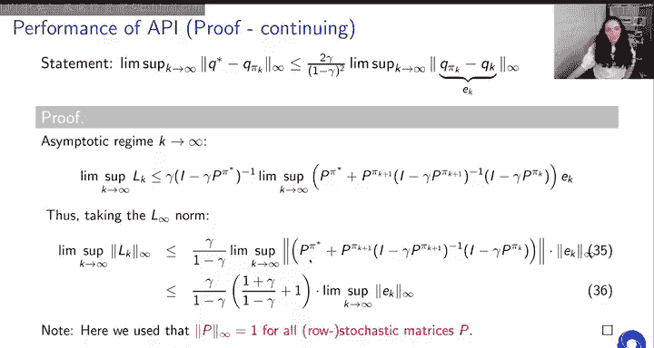

Last thing we're going to do here is look at the concrete instance of this algorithm。

And we're going to actually look at an algorithm that you've seen before。

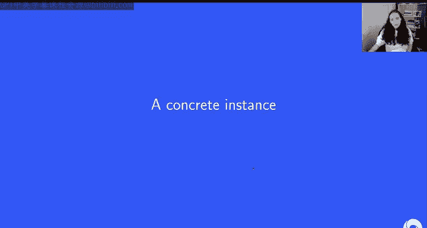

Namely Td Lambda with under linear approximation。Important to note that this point that this algorithm。

 at least in form that I describe it here， will just implement the policy valuation step in an approximate policy iteration loop。

So it's just one of the steps that you have to do at each iteration K in this approximate policy iteration。

It's the policy evaluation this is mainly to show how one could reason under function appximator about the errors you incur at this evaluation step。

Because we've seen from the previous result that the quality。

 at least in the limit of the policy that you're going to get at iteration K as k tends to infinity as compared to the optimal value function is bounded by how the errors at each iteration。

As kidss go to infinity behave。Keeping those errors as small as possible in the policy。

Eval case will mean that that bound is tighter and tighter。

 which means that with respect to the optimal value function you're losing less and less。

 so in the best case scenario if those are zero， then you will converge to the optimal value function。

So this is just an attempt at saying under the normal scenario where we're using function appromator and we're using something like TD learning。

 how can we reason about the errors that we occur in this procedure？Okay。

So we start with the linear functional space。And remember that the TD error under this approximation is defined as in equation 37。

And then the parameter update。double you。At each step after each TDR is updated。

With the magnitude of the TDR in the direction of phiD80 previously I think you've seen this update for just the values function。

 not the state action value function and this phi would be just a function of the state。

 and I think you've dennoted it as XD。Okay。Well， under this under this。Paraigme。This。

 this algorithm actually has nice properties。 So under the normal conditions on of the。

Learning great here。Satisfying these conditions， the sum of them being infinite and the square of them being finite then this procedure。

Converges to it's a limit denoted here by。W star， which is not approximating the optimal value function。

 iss just annotation for the fixed point。And all of this procedure is trying to approximate the value of some policy pi。

 the one we're computing the TDRs with respect to and furthermore。

It has been shown in the same paper of Ci and Panroy that the。

The approximation error that we're going to be occurring by using Td in this。

In this formulation is bounded。By one minus gamma lambda。Over one minus gamma。

And this term is basically the best that you can do。In this functional space。

With respect to this norm， so this is the。The point in F。That is the closest。

To the value function you're trying to approximate。The closest to the approximation。

 so this is really saying that if I were to know this evaluation in advance。Then。

If I were to just represent it in this functional space F。

 this is the closest that I can get in terms of approximation。And。

The whole expression is just saying that if I am doing this。

Temporal difference learning under mild conditions。

I'm going to be bounded by basically the best way of representing the value function that I'm interested in。

This might not be exactly this point， the best appromator to Qpi， but it's very close to it。打开。

Just a couple of。You know breakingreaking down the statement as we usually do。One is。You can。

Lambda is a parameter in TD Lambda， so。One thing that we can ask is for which lambda is this upper bound the tightest which means that we lose。

 we are guaranteed to lose the least and it turns out if you're eyeballing up or maximizing over that is that for lambda equals one which corresponds to the Monte Carlo estimate this。

Dissp this slider and。I'll let you reason why that would be the case。Okay。

 the the other question that might come to mind is what if the。

The value that we're trying to evaluate it。The the value of the policy that we're trying to evaluate this cubepi is actually representable in our。

Space of。A hypothesis class。Well， then the this part of the equation actually is 0， which means that。

Q。W star， which is the point of convergence of the previous algorithm is actually Q pi。

This is nice because we're seeing that if my。The function that I'm trying to represent is part of my。

My functional class， then I'm guaranteed with this algorithm to converge to that。Okay。

 now the question becomes if this is not the case， if QI is not representable in。

Our hypothesis space then in general， well， we won't recover Qpi， but more more general than that。

 the fixed point we converversege to this。呃Q。W star is generally not the best approximation that we can get。

In this functional class， which is exactly what this term says。

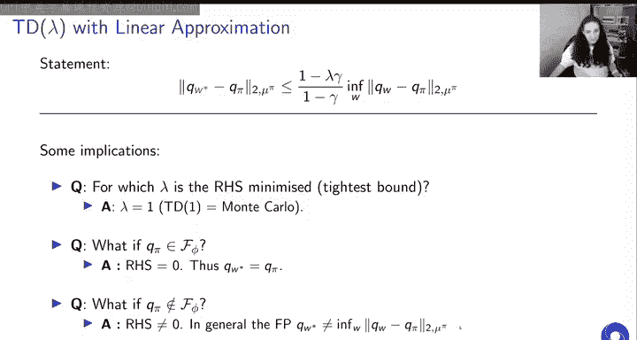

Okay， that is it for today， I'm going to just do a quick summary now of the two paradigms in approximate to dynamic programming that we've seen today。

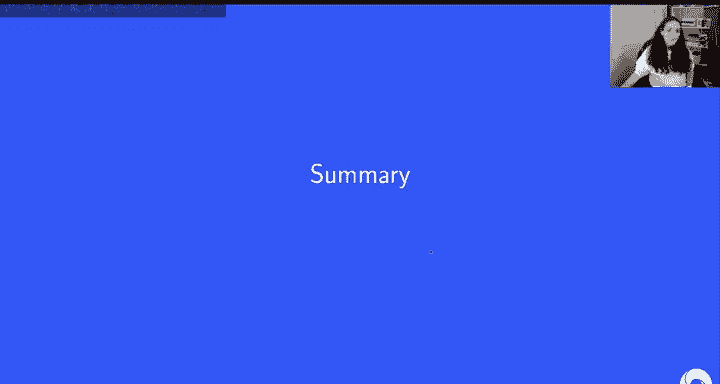

First， let's start with approximate value iteration。So we've proven this result where as a reminder。

Pi N is the policy that we're getting at iteration n。Of this procedure。Now。

 some lessons that we've learned in general， the conversionverg is not guaranteed。

 depends highly on the approximation。But in practice。

 a lot of the algorithm that we've seen and we use in practice。

Look at all the iniations that we had at the end of this section。嗯。Seems to point that in practice。

 this is generally well behaved。嗯。How do we control how good the policy that we're getting is well the the way to control this is to control the approximate the approximation error and there are two sources of error the estimation via sampling so we don't have access to the true Belman operator and then there's the approximation coming from the functional class that we are using we saw that。

Although all of these results are in terms of the Linfinity norm and if we were to optimize with respect to that。

 we would get a safe algorithm in the sense of this being a full contraction operator and having a unique fixed point。

嗯。For more efficient optimization， we usually substitute this efinity norm with something that I can L to with respect to some distribution。

 usually that will be the stationary distribution。With respect to the policy that we're following。

Note that the convergence point is not always Q star。

 especially if Qstar is not representable in the function class。And even if that is the case。

 if Q star is representable in the functional class， that is not enough。

Just remind yourself of the example that we had where。Really。

 the the inside there is that all of the intermediate errors kind of have to be zero in order for that to happen。

's it's not， it's not exactly necessary。 It's the better way of saying it is that there might be。呃。

Errors at different points in that iteration。Process that can introduce。You。

Errors that cannot be washed away。Or at least we can't say anything because this is kind of the worst case scenario we're maximizing over all these errors。

 it might still be possible to converge to a Q star，嗯。At least based on this bound。

 we're not guaranteed to do that if we are incurring any kind of error at any of the intermediate iterations。

Okay， and then。What we've just seen is approximate policy iteration。And we've proven this result。

A couple of lessons again， in general convergies is not guaranteed。

 but again in practice this seems to be well behaved its popularity is not as great as the other paradigm just because it does have this。

Inner loop， this procedure of policy evaluation， which in itself is a problem of its own。

 you've seen I guess the first lecture on model three prediction that that alone can be an iterative procedure itself。

 so it is not easy to。Usually， it's not easy to evaluate a policy。 So this being just the side。

Inssideight step of another interactiveerative procedure。Means that。In practice。

Its not it's not used as often。Again， the statement really the only thing that says is that if we can control these errors。

 EK， actually the L infinity norm of these errors。Then we are able to control the quality of the end result。

And at the same as before， there are two sources of error sampling and functional across approximation。

For。We haven't gone really that much into this example but。For efficient optimization， again。

 we do the same thing of trading in the Linfinity norm to a much more behave well behaved approximation。

Prob optimization problem in the L2 norm。 And this is usually now with respect to the。

Stationary distribution of the policy that we're trying to evaluate right now。

 a different way of saying is this is that we are safe on policy。嗯。This is just the。

The distribution of states that。Acting in the environment with respect to the policy that we're trying to evaluate pi I in this case will induce。

Okay， and。Again， depending on the function class and the couple of mild condition。

 we can obtain convergence， but the convergence point is not always。C呃 cute。

A Q star or even Q pi in the policy evaluation case。 And moreover， we haven't touched upon this。

 but it is known that the convergent point for。Apprxiimate policy iteration may not be unique in the sense of this expression actually can have the behavior of stabilizing like going down in terms of the error and stabilizing around the band around around the point。

 still bounded by the term， but it might oscillulate back and forth around that point。

That is it for today， any questions that you might have。

 please post un Moodle or come to the Q&A session。

Thank you for your time。