# DeepMindxUCL《强化学习｜Reinforcement Learning 2021》中英字幕 - P11：[11]Multi-step & Off Policy [11_13].zh_en - GPT中英字幕课程资源 - BV1JssaeVEMp

My name is Hard of Nussels and today I will be talking to you about off policy and multi step learning and if these intros are starting to sound a little bit repetitive。

That's okay， as long as the contents of the material is hopefully more engaging to you。

In terms of background material， I would advise that you have a look at Susumbartos chapter 5。

7 and 11。If you forgot anything about those， because you likely looked at these before already。

But there will also be some material in this lecture that is not contained in any of those chapters。

 so just be mindful of that。

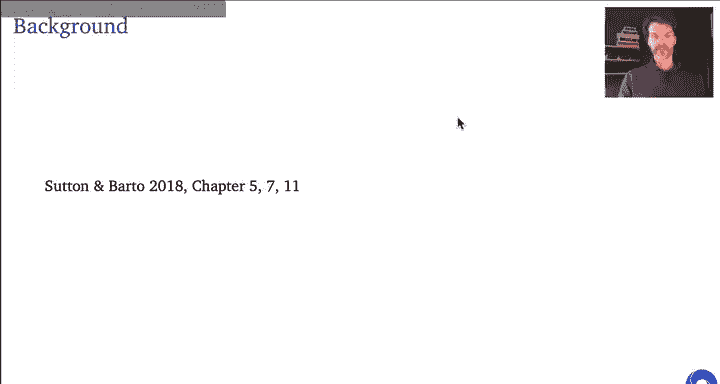

But we are going to start before we dive into any new material in recapping and also motivating what we're going to do today。

 just at a very high level we've seen this over and over again now。

 the point is to take actions in the world where we observe certain observations which might include some partial information about the environment state but typically not the food environment state and we want to figure out how to take actions so to improve our rewards。

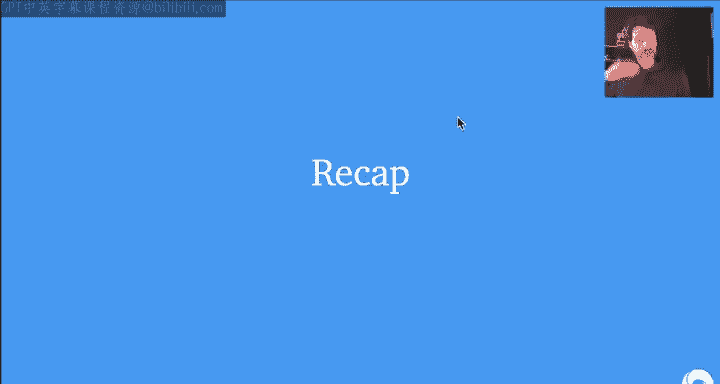

Where the agent internally might have a policy， as we discussed last lecture in our policy gradients and aritic discussions。

 might include a value function which is predictions about the future。

 also potentially a model or multiple models。And then the general problem involves taking into account time and consequences because the decisions don't just impact the immediate reward。

 but also the agent's internal state and potentially the state of the environment。

 which means certain actionses might have long-term consequences。

 which might also not be immediately observable。Now in previous lectures。

 we talked about how to do model free prediction and control in this setting。

 we talked about using multistep updates rather than one step updates and eligibility traces because sometimes this provides a better tradeoff in the learning efficiency。

We also talked about more theoretically about understanding dynamic programming operators because a lot of reinforcement learning algorithms can be understood as approximating dynamic programming operators。

 so it's really helpful to understand how these work in principle because then the algorithms that we actually deploy might be considered approximations of this and therefore might be better understood if we understand the fundamentals。

In addition， we talked about what happens if you don't include function approximation。

And how to do this， and typically we use gradient based algorithms when we do that。

We talked about model based algorithms a little bit and algorithms like Dner。And more recently。

 we talked about policy gradientds and aritic algorithms， which， as I said before。

 keep an explicit representation of the policy and try to update that directly。Now in this lecture。

 we're going to talk about off policy learning again because we touched upon this before。

 but we're going to focus a little bit more on this specific topic because it's important and then especially when combined with multistep updates and with function approximation。

 this will be both in the setting of model free prediction and control。

 but also in the setting of policy gradients。We won't be talking about models so much in this lecture。

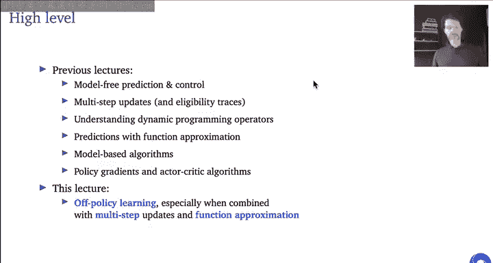

Now in terms of motivation， why do we care about this topic， why is this important。

 so there's a number of reasons actually。

So first off， what is of policy learning well of policy learning is learning about a different policy than that is used to generate the data。

And there's a number of reasons why you might want to do that， but in general。

 it means you're basically posing what if questions， hypothetical， counterfactual what if questions。

 what if I would have done this rather than this other thing that I actually did？

Now use clear cases in which this is useful include you might want to learn about the degree policy。

 but you might not want to follow the degree policy all the time because that doesn't explore sufficiently。

 Q learning is an example of an algorithm that does this and it's often named as a canonical example of an off policy learning algorithm and this is true。

 but this is not the only of policy learning you could do in addition or instead you could also learn about many other policies。

 this could be useful because you for instance care about these policies but also because you might just want to learn a lot about the world and condsense all of that information into the agent somehow to reuse this later。

The greedy policy is typically a tempting thing to approximate because then you can do something like policy iteration。

 but it doesn't mean it's the most effective thing to only learn about the greedy policy all the time。

In addition to that you might have certain other constraints。

 for instance you might want to learn from observed data。

 for instance logs that you've stored or from information gathered from other agents and learn maybe about the greedy policy there or about a different policy and this could just be because you're interested in a certain application。

 oh I have this data store for instance collecteds by watching humans interact with the system and seeing which actions the humans took and you might actually wants to then ask what if questions。

 what if they have done this other thing what would have then been the value or what would have then been my predictions。

And of course， this also includes learning from your own past policies because that's also just a data store。

 so you could imagine doing something called replay where you collect a lot of data。

 but you keep on changing your policy because you want to keep on getting better。

 but that means that the old data that you've collected doesn't actually correspond to your current policy anymore。

 and then you might want to do off policy learning from that because the behavior that generated the old data doesn't match the current behavior that you're interested in。

So that might be a different reason to want to do off policy learning because you want to do extensive replay。

 for instance， in order to be very data efficient because you can then reuse all the data that you've generated so far。

Now there's a different reason why policy learning is important rather than just trying to learn about many things or trying to learn。

About degree policy or something like that in a value based method。

It's also very important in policy gradients to correct for mismatching data distributions。

 and I'll go into that a little bit more in a second。

So first let's just remind ourselves what we could do。

 so if we want to do off policy learning about any different policy pi。

 so we're following some policy mu which is not given on the slide here。

 but it might be different from the policy pi that we're actually interested in。

Now one thing you could do is you could use this general Q learning or sometimes called expected SArsRSA update。

 this is what Rich and Andy called it in the book。Whi is basically straightforward application of bootstrapping where we take a certain action A or we consider taking a certain action AATT in a state ST。

 and then we just see what happens if you take that action。

 but in the next state we consider following this policy pi and pi does not have to match the behavior。

 it could match the behavior in that case you're just doing on policy expected SArsRSA。

 but pi could for instance also be greedy in which case you're doing Q learning。

But it could also just be something else so in expected SARSSa。

 in the original expected SArsSA it was meant to be the current behavior policy in the book Exp SArsSA is used to refer to this more general algorithm that it can be anything。

In SARS size it is also interesting to point out this still corresponds to this update but then pies a stochastic policy。

 which assign all probability mass on the action that you actually pick in the next state。

 that is an open policy algorithm。But in general， you could just plug in anything there。

And learn about whatever policies of interest to you。Okay， so now moving on。

 this is all recapping things that you've already learned about before。

 We might want to do multistep updates and then we can't use this trick of bootstrapping that we had on the previous slide because now we have to consider what happens on a longer trajectory So just bootstrapping is not enough anymore and then we introduced important sound corrections So basically if we have a trajectory tau which spans from ST to as big T maybe that's the end of the episode。

Then we can correct。For the distribution that was used to generate this by basically multiplying the observed return gene。

 let me pointed it with the mouse。By multiplying this with the probability of generating that trajectory that we saw under the target policy that we're interested in。

And dividing that by the probability of that same trajectory under the behavior policy that we're interested in。

If we do this， then the expectation of this return will be equal to the expectation of the return。

That we're interested in under the target policy。 So note here that GT is the uncorrected return。

And GT with hat is the corrective return， which is defined over here。

And what this is saying is that if you make this correction and then you take the expectation under the behavior policy mu。

 then with this correction， you're guaranteed the expectation of this whole entity here。

 which we call G hat will be equal to the uncorrected return under the target policy so this provides us a method that allows us to take any return under any generated under any behavior。

 and then correct for the distribution of generating that trajectory3 that led to the return。

 to something that has the right expected value。So let me make that a little bit more concrete。

 What could happen is you had a trajectory that was actually quite unlikely under your behavior policy。

 but it just happened to happen， but it's one that would happen all the time under your target policy。

 Now what would happen here is that effectively than you'd have a number that is relatively high。

 divided by number that is relatively low so we would up weight that return and that makes sense because this return would be more common this trajectory under the target policy。

Conversely， we could also of course， and this might be the more common case。

 we could generate a trajectory under the behavior that is quite likely to happen。

 but would be very unlikely under the target policy， maybe it's even impossible。

 maybe the probability of that trajectory which just happened under your behavior policy would literally be impossible under the target policy and the probability could be zero in that case we just zero out that return or we downweighs if the probability is not quite zero but very low。

 and this means that we're basically reweighting the samples in exactly such a way that in the end the expectation is the same to the thing that we actually want。

Now additionally， as shown on the slide， the probability of a trajectory under a policy divided by the probability of that same trajectory under a different policy can actually be written down as just the multiplication of the individual important sampling ratios for each step。

The transition probabilities， which are also contained in this probability of the trajectory are the same above and below the line so they cancel out。

And what we're left with is just the probabilities of selecting each of the actions in the trajectory。

I notice there's a little type on the slide just to be clear。

 the trajectory here was ending in S big T， but here we're actually considering a T as well as a big T so basically this should have been t minus1 because this last action wasn't part of the trajectory that's a minor title but the general principle here is hopefully clear。

This was discussed before in a previous lecture when we talked about policy corrections and we'll go back to it a little bit more later in the lecture。

But so why do we consider these multistep updates， we had a simple algorithm let me go back to this slide first where we would just bootsrap immediately and make a correction and we didn't need these awkward important sampling ratios so why do we consider them well because this allows us。

To do multi step updates。 And we've seen before that this can be beneficial to trade of buys and variants。

 And intuitively， this is depicted in this figure from。From the book by Sa Ibarto。

Where if you consider that a certain path has been taken， if you would just do one step updating。

 like in this case with one step SArsa， you would only ever update the previous state before reaching the goal。

 and then you'd have to wait all the way until the next episode before we can propagate the information from this newly updated action may be backward to whatever action then led to this state or maybe a different action leads to the goal and then you update that one so credit will propagate correctly if you do one step updates。

 but it might be quite slow。And then we argued that sometimes it's better to do a multistep update。

 maybe not fool Monte Carlo， maybe not all the way until where we started。

 but maybe more than one step just to propagate the information a little bit faster。

 And one way to interpret this is that this is a bias variance trade off where doing multistep returns increases the variance。

 but it decreases the bias of your update because we're not relying on estimated state values as much。

And in addition to that， you can just see that the information will propagate faster in an episode when you do this。

Typically the trade off is that a multi step return tends to be more effective。

 but full Monte Carlo or full TD tend to be worse than doing a couple of steps。

So neither formal tocarland nor one step blue truckping is typically the best trade of。

Now as I mentioned， this is maybe also quite important for policy gradients and this turns out to be really the case in practice so recall that for policy gradient methods we want to sample something similar to the equation on the slide for details。

 I refer you back to the lecture on policy gradients。

But we basically get an expectation where the expectation is over the dynamics of the Markov decision process that we're in and over the policy that we're currently following。

 which is pi。And then we want to estimate this term here。

 which is the expectation of the actual value of that policy Q pi， this is not an estimate。

 this is the actual value。Times the gradient of the logarithm of the policy at that state an action。

And the reason why it was explained in the policy gradients lecture so if you want to remind yourself why this is the equation that we're after。

 you could look at that， but this would give you。If we could sample this。

 this would give us an unbiased estimate， a stochastic estimate to the true policy gradient。

 and would allow us to make our policy better by following that gradient。Now。On policy。

 we could sample a return， a multi step return， maybe even a Monte Carlo return。

 such that the expectation of that return would be equal or approximately equal to a cubepi。 Now。

 if G T here is a Monte Carlo return and we're on policy， then this would just be inequ even。

If wherere。If full Monte Carlo would be too high variances and this is the common case。

 we might actually want a bootstrap， which is why I put an approximate equal here because GT might be a multistep return instead of being a full Monte Carlo return。

 and in that case the expectation is not quite exactly equal to K pi。

 but it's typically close and that's good enough。But what of her off policy？

Then this isn't necessarily the case anymore if we're following mu。

 then we have to correct G somehow to get a good estimate for Qpi。So if the behavior is different。

 we need to do something to correct because otherwise the gradient won't be pointing in the right direction。

And that's important for policy gradient algorithm because if we get a wrong estimate for the return here。

It might just mean that we're no longer following any gradients or even we're even following the gradient of maybe the wrong objective and that means that your policy for instance could get worse rather than better。

 That's not just purely a hypothetical theoretical thing It turns out to be the case that policy gradients are quite sensitive to off policy updates you have to really be careful that you correct for them。

Because if you're too off policy， a little bit of policy might be okay。

 but if you're too off policy with policy gradientding updates。

 degrading is quite likely to point in a direction that's not going to make your policy better and sometimes even makes it worse。

So there is another motivation for of policy learning specific to a policy gradients where it maybe be even more important to correct completely for the of policyiness or more completely for the of policyiness than in value based methods。

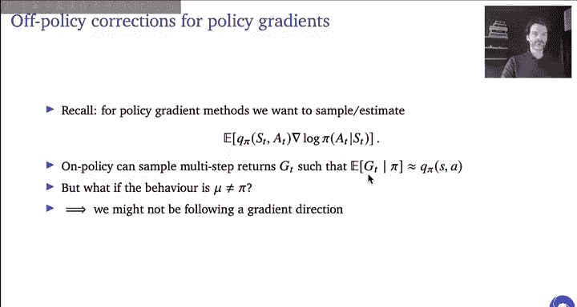

Okay， and now we're going to basically talk about a couple of issues of policy learning。

 so that seems to present so far a solution。But then this isn't the full solution。

 There are still some problems that need to be addressed。

 and we're going to talk about that for the remainder， basically of this lecture。

So these issues can basically be grouped into two main categories。So the first one is high variance。

 and this is especially true when using multi step updates。

 and I'll show this with an numerical example in a moment why this is especially。

Problematic when we of policy corrections。Or it can be and we'll talk about some ways to mitigate this and then a separate issue is that sometimes you can get divergent and inefficient learning because of a subtle property that if you' are going to go of policy and you're going to correct for that。

 even if you correct for that in the targets， theres still maybe be a mismatch in your state visitation distribution。

It's okay if you didn't understand that sentence， I will get back to that later in this lecture and make clear what I mean with that。

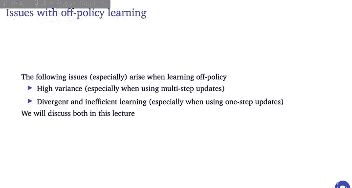

So to start off， the first issue that we're going to talk about is variance。

And this is specific to basically these important sampling corrections in a sense。

 but it's also somewhat inherent to of policy learning and one way to think about this is that。

We can consider a one step reward。And then we can look at the expectation of the important sample reward word。

 So for simplicity here， we're first looking at the one step case。

 but some of the conclusions here will transfer to the multi step case。

 and this is why this is an easier place to start， right。

So we're first going to just verify that this is true， so we're going to sample an action。

Under a behavior policy mu right and then we're going to correct for that with the in this case we just need to look at one step because we're just looking at the immediate reward。

 so we're looking at the probabilityity of selecting that one action。

And we're going to divide the probability under the target policy that we're interested in。

 whatever that is might be greedy might be something else altogether。

By the probability of actually selecting it on our behavior mu。😊，And then we just write this out。

 we say oh， this expectation can actually be rise because we're just sampling the action mu。

 we can just sum overall actions， or if it's a continuous action space。

 you could even have an integral here and we basically look at the probability of each of these actions in the state of interest that we're in state S in this case。

And then we look at the resulting。Quantity here， which is the random thing over here。

 is written here explicitly where RSA is the expected reward when taking action A in state S。

And then we see it that these mus they cancel out by design。

 so the probability of selecting the action cancels out with the mu that we use in this division。

 which means we're left with pi， which means we can actually rewrite this as an expectation。

 but now with the action set selected according to the target policy pi。

So this is just to verify that indeed the expectation is the same。

 should we import sampling corrections。But the variance is not necessarily the same。

 and we're going to look at that in an example， and sometimes the difference can be quite large。

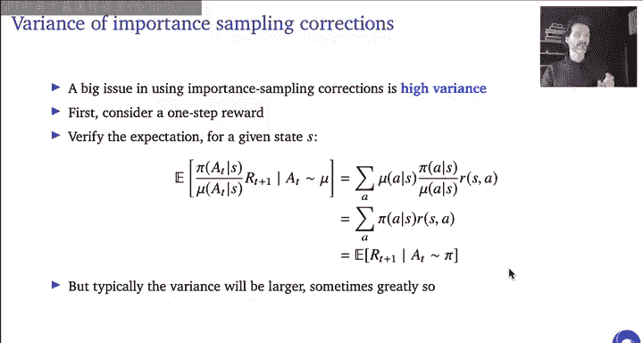

So let's go to the blackboard for a sec and we'll show an example there。

Okay， so。You can hopefully see。My writing。And I'm going to start by basically specing out what the situation is that we're in。

 we're going to consider a one step reward。 There's going to be two actions。

 so let me write them down we'll have。嗯。One action to go。Right， and we'll have one action to go left。

And。We will also have a reward associated with each of these actions。

 we don't know these rewards yet， we're going to learn， right？But we。

Do have these rewards for the purposes of our analysis。

 So we know just for the purpose of the example that the reward of going to the right is actually always just going to be plus 10。

And reward of going to the left is better， that's plus 20。And then we have to pick a probability。

 So let's say the probability of these actions。Under the target policy that we're interested in is to go right with probability 0。

9， so we're more likely to go right， and maybe we go left with probability 0。1。Now， to start us off。

 right， let's consider the own policy case where the behavior policy。

It's the same as its article policy。This is what it means to be on policy that those are the same。

And then we can just reason through what the second。Second moment is。For the update。

 So the update that we're going to do will depend somehow。

 And we're just going to consider the reward itself。

 So we're not going to actually consider a full update。 We're going to have some。Action 80。

And we're going to correct it for the of policyiness now because we're own policy。

 this term will actually just be one for now， but in a moment I'll go for the off policy case as well。

 and this is a term that we're going to consider。We already showed that the expectations this term for any combination of PMu will be the same as the expectation that we wanted under。

So let me just write it down。The expectation of this under new。

We just showed that this is equal to the expectation of R T plus one。Under pi。

 and this actually holds under any new MP。 So in the example above in the table。

 I put the on policy case， right， and I'll do a numeric example in a second。

 But we already knew this was the case in general。 But now actually， let me go。

And not consider then the。First moment or expectation。But instead。

 we're going to consider a second moment。The second moment is enough to understand the variance in this case。

 because the second moment is equal to the variance。嗯。Plus， the squared expectation。

 but because the expectation is the same we can just look at the second o set。Now， in this case。

 because we're on policy。This will just be equal to。Let me just write it underneath。As I said。

 that ratio is just one pi divided of M。 So this is just equal to。R T is one square。🤧。Right？

And because mu is in this case， in this example equal to pi。

 we can immediately just replace mu with pi。And we get the following。😊，Expectation。

 the reason I'm doing this is because I'm going to compute the second moment numericalmer。😊。

And then we're going to compare to when we go off policy。So what will happen here， Well。

 this expectation is with probability 。9。We're going to select the action to go right。

If we get that action， we're going to get a reward of 10。So the second moment will be 0。9。

Times 10 squared。Plus， with probabilitybiity。1。We're going to select the action to go left。

And we're going to get a reward of 20， so the second moment will be this in total with 0。9。

 we get 10 squared with 0。1， we get 20 squared So we just write this out。This will be 90。

This will be 40。So we reach。A conclusion of our second moment in this case turns out to be 130。

So this the the variance， let's make that final step， right， the variance of。This quantity。

I'm not going to write it out again。Is going to be。As I mentioned in words just now。

 but let me just write it out。Let me actually。不者。A random variable in there to make it a little bit clearer。

 So let's call it X。This is a generic truth。Expectation。Minus the expectation squared。

 So we can see the second moment we just calculated here， and we can see the。Me there。In this case。

 the expected value， let's quickly do a back of the envelope。🤧Calculation of that。

 the expected value of this reward。Is going to be 。9。Times1。Plus 0。1 times 20。

Which is just9 plus two， so that's 11。So what do we have here， so we know that the variance is。130。

minus。11 square。11 squared is equal to 121， please check my math。Which means that the variance is。1。

30-12，1， which means it's 9。Or if you prefer the standard deviation。It's going to be the square root。

Or the variances。Its going to be3。Okay， so we did young policy case here right。

 so we basically are just going through a numerical example。

And now what I'm going to do next is I'm going to change it to enough policy case。

 so we're going to compare what happens to the variance in that case。Okay。

So maybe let me do that by introducing a new color。ma I'll use green。And I'm just going to。

Change some things。 So we're going to introduce。A change to the behavior policy。Instead of having 0。

9 and 0。8， let's sample uniformly。So both actions now have a probability of being selected of 0。5。オ。

No。Some things change because now this is no longer an equality。So let me go back and erase this。

We're going to write it out carefully。 I'm going to show you that it's something different。

So this is all for the old case， right， we're going to recompute that for the new case。

So what is this thing， so this is， let's write it out。A summation over actions。

Probability selecting that action。Times that thing that is in the expectation。

And notice that there's a square there， so what we get is pi k。Square divided by mu a。Squared。Our。

S a。Square。Now notice that something different happens here from the expectation case。

The mue that we're multiplying because of the probability that we're actually taking that action cancels only one of the。

News in the ratio。 So what we get here is we can rewrite this as。

Let me pull out one of the target policy probabilities。We cancel one mu。

So we can cancel this one with one of the mus in the。Raatio， but there's one left。

 So let me pull out one probability。 there remains one because we had a squared and there remains one mu as well。

So what we get is this new quantity。Then we make a little bit of room， let me get rid of the。

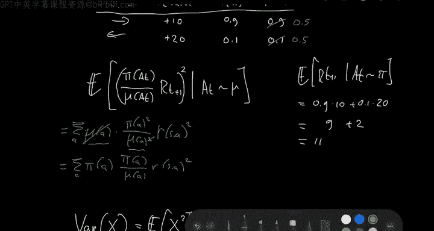

Generic facts over here。嗯。And then I can continue and I can say， okay， this is paraine。

Going to be equal to。The probability of selecting action on the policy times this ratio times the reward square。

So let's pick again the， let's just write it out for the explicits。Calculations。

 so what we have now is again， we pick the action under the target。

 and we pick the action to go to the right with probability 。9。

But instead of just multiplying this with 10 squared， there is a different thing here， which is 0。

9 divided by 0。1。And that is times 10 squared。So this ratio here is new to the own policy case that wasn't there before。

Similarly， if we pick the other action。To go to the left， we will have。Oh sorry。

 I made a mistake here， let me go back。Let me correct that mistake。 behavior policy here wasn't 0。1。

 It was 0。5。 That was just a little fluke。And the ratio here is we pick under the charter policy under pi。

Those are all target policies。We pick the other action， and then the ratio will be。Ding。20 squared。

Okay， so now let's just write it out， what are those numbers？嗯。It's a little bit less obvious。

 perhaps， so feel free to check my math， but maybe let's just write it up。 We basically get 0。

9 times。1。8， that's that ratio times 100。Plus。1 times。2 times 400。And this is going to be equal to。

 let me put that on the next line。Get rid of the previous。If I did my math correctly， this is 162。

It's。We can do this one first， it's 90 and then plus 0。8 times 90， so that's 90 plus 72。

 so that seems correct。Plus， this is 0。02 times 400。So that's。8ight。So what we get is that in total。

 this second moment now is going to be 1 and70。Okay， so what is the variance then？

The variance in this case is going to be。1，70。And we're still going to subtract the expectation square。

 the expectation did not change that's still 11。This is still the expectation in the York policy case because we correct it。

 right， the expectation by definition， because we're using this important sampling correction did not change。

So we're going to check compute values we're taking the second moment and then subtracting the mean squared。

Which will be 1，70 minus12，1。Will be。49。So what is not the standard deviation in the off policy case。

 we find that the standard deviation。This square root of 49 is 7。Substananttially higher。

 the standard deviation is more than double from what it was in the own policy case。

This is just a numeric example， but in general one can prove and feel free to play with this a little bit。

 try more numerical examples or maybe even try to prove in general that the variances will increase if you do all quality corrections。

This makes intuitive sense。Typically because under some like under some conditions， it will increase。

 but the intuition behind this is that we're going to zero out some of the returns that happen and we're going to up other returns that happen。

 especially returns that are rare under the target policy。

 but they are very common under the behavior policy。 They will be down weighted。

But the other one is what increases the variance， which are is the things that are very common under the target policy。

 but rare under behavior policy。 So the example here is actually the behavior policy。

 none of them are particularly rare， but we have this ratio here。

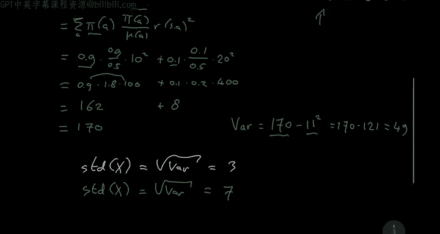

Let me highlight that with a different color， so it's easy to see where I'm writing。

So this ratio here is the ratio that is increasing the variance in some sense。

 it's where the target policy is fairly high 0。9， but the behavior policy is lower than that， it's 0。

5。Okay。Now， let me go back to the。

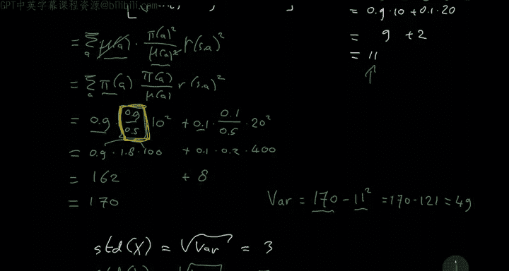

Sldes。

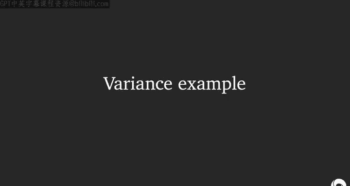

Now， it actually turns out that in some cases， the variants of important weight that returns can even be infinite。

 There's an example in the book。 I believe it's example 5。5。

Or you have a very simple mark decision process。And the target policysing behavior also quite simple。

 there's a left action and a right action。And the behavior policy is similar to the example I just gave is uniform。

 In this case， the behavior policy is depicted with a B rather than a mu， but it's the same thing。

And the target policy always moves left。Then it turns out if you take Monte Carlo estimates。

 the variance of this can be infinitely large and this can exhibit itself。

As shown in the graph where you can get these spikes。

And these spikes will continue to happen and the reason why is that the variance is literally unbounded in this example。

 which means that there's always a probability of getting something that is so high that even your average can get polluted by it。

Infinite variance is typically a bad thing。 Now， of course。

 there might be ways to limit the variance。By making it little infinite， right， you could。

 for instance， just have a hard cap on something， you could like put some heuristic in there to make sure that the variance is at least finite。

 but it doesn't really solve the underlying problem， which is that the variance is just very high。

But it's interesting to note that the variance can be actually so high that it can be infinitely large when just doing naive important sampling corrections。

So we might want to mitigate this variance， right we want to reduce the variance and we're going to talk about multiple different ways in which we can reduce the variance。

So we will discuss specifically three different strategies， one is per importance weighting。

Which is an older idea it's some 20 years old now， but it's quite useful in reinforcement learning。

 it gets rid of some unnecessary variances， completely unnecessary variance in our updates。

We also talk about control variants。I will explain what I mean with that。

 and we will also talk about bootstrapping again and specifically adaptive bootstrapping。

 which will allow us to kind of pick。In some， automatically by looking at the important sampling ratios when to bootstrapap。

 when it's important to bootstrap to minimize the variance。

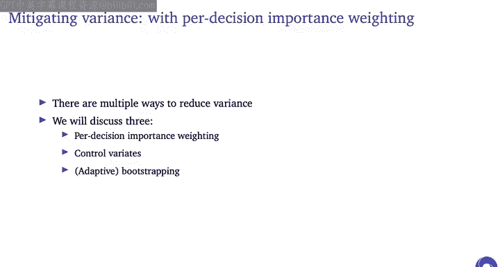

And we'll start with， as I mentioned， per decision important something。Okay。

 so what does this term mean perioditization importance waiting？

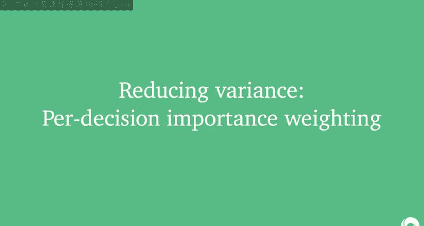

嗯。We're going to consider some states， S， some arbitrary states。

 and we're going to look at some random variable X。So think of the X as for as a reward。

Now we're going to basically observe that for any X does not correlate with the action。

We don't actually need to import samples。So this is written here on the slide。

 look at the left hand side first， we have the expectation of this random variable X。

 for instance your reward under the target policyulsy pi， this is the thing that we want right。

 we want this expectation。We noted before that this is actually equal to the expectation of x under the policy mu as long as we multiply it with this important happening ratio。

Right？But now what we're claiming is that if x is uncorrelated with the action。

 that this thing is actually equal to the expectation of the uncorrected random variable x。

Intuitively， this makes sense if X does not depend on the policy。

 we don't actually need to correct because the expectation will be about everything else that is random。

 will be about your MP， for instance， right， But if it doesn't depend on the action。

 then the policy shouldn't matter。 We shouldn't need to correct。Now why is this a good thing， well。

 this means that we might be able to have lower variance than otherwise by basically not adding this additional variance that we do with these corrections and just ignoring。

You random the variables that don't correlate with the actions and the consideration。

So let's first prove this fact and we're basically just going to do a very simple derivation so you can also kind of check the assumptions that are being made here right we start off with this important sample correct it's random variable X under under sorry under the behavior policy mu。

Now， because。This ratio is a random variable。But it's only a random variable because a is a random variable。

 right？So if a does not correlate with x， this means that we can write this expectation as a multiplication of different expectations。

 You can only do this when these random variables X and this ratio do not correlate with each other。

 but that's the assumption that we're making that they're uncorrelated。Now if that is the case。

 we can just unpack this last thing and this is an important property to be aware of in general。

 the expectation of the important sampling ratio itself under the behavior policy is always equal to one。

We're going to prove that here by just writing it out so again we're going to sum overall of the actions。

 look at the probability of selecting the action multiplying that with a ratio as usual the behavior policy cancel out apologies for the SK here that's just small this is a typo on the slide so these cancel out with each other What is left is just a summ over actions for the target policy。

 but because the target policy is a proper policy this will equal to one so we can just cancel it out it disappears。

So this shows that the expectation of the corrected x is equal to the expectation of the uncorrected x if x does not correlate with the action。

This is a general statement， as I said before， so the expectation of the ratio itself。

Should always be equal to one。Only if the ratio itself， right。

 it's not if we multiply with something。Then this ratio does not disappear。 as we saw before。

 You can actually change your expectation by。Adding this ratio。

 but the ratio by itself is always equal to one this can also be useful if you use these things。

 for instance in experiments， this could be a useful check that on average or important sampling ratio itself should always be on average one。

Now we're going to supply this to reinforcement learning。But in order to do that。

 we're going to introduce a little bit of common notation from the field to be able to condense the notation quite a bit and hopefully make things quite clear。

So the most important thing here to keep in mind is that row。

Is the new notation that we're going to use for this important sampling ratio because this term shows up all the time right and it's quite a large term to to keep on writing down so the important sampling ratio for the different policies at some time step T we will condense that notation into row T so the T here refers to the states and to the actions and implicitly row depends on the target policy and behavior policy。

Now in addition to that， we can introduce this other notation where we can consider row from time step T to time step T plus n。

 and this will simply be the multiplication of all of the rows for all of those time steps。

 which by definition of row is just a multiplication of the important sampling ratios。

So we would call row the important sampling ratio row could be thought of as a ratio， right。

 so this might be a useful。Point remember。And if we do that。

 then we can condense notation quite a bit。 So the thing that we're interested in is the return。

Which I written down here explicitly for an episode terminating with a final reward at times7 Big T。

So the return is just a summation of the discount at rewards， as usual。

 starting at time step T because we're considering the return at time step T。

In order to correct this return， if this return was generated according to some behavior policy mu。

 but we're actually interested in target policy pi。

 then we can multiply with this important sampling ratio for the full duration of the trajectory。

 so in this case the return spans the trajectory from time step little T to time step big T。

 and that means that we're going to correct with all of the actions in that trajectory multiply together all of the ratios multipplied together。

 which with the new notation we can just write on as the ratios from T to t minus-1， big t minus1。

So this gives us a very condensed， nice notation where this is the total ratio。

 which captures the probability of the trajectory under the target policy divided by the probability of the trajectory under the behavior policy。

And we multiply the return in order to make it an unbiased estimate for the return under the target policy。

However， we can also note that this return is actually a summation， right。

 a summation of individual rewards。 So instead of。Perceiving this ratio as correcting the full return。

 we can also push it into this summation and apply to each of the individual rewards within that return。

The return is just a sum so we can push this ratio through the summation and multiply it with each of these individual rewards。

 but this raisess a really interesting question。So is this the rights or the best important sampling ratio to be applied to each of these individual rewards？

And turns out maybe we can do a little bit better。So what we're going to do here is we're going to get rid of some terms that we don't need。

 So we're just going to remind you row T to big t minus1 is the important sampling ratio for the full trajectory that spans that this returns spans。

And we could push it inside the summation that this return actually is。

By multiplying each of the individual rewards。But now we're going to recall this fact that I mentioned before。

 and we're going to note that earlier rewards cannot depend on later actions。

 When you've received a reward， you can't change that reward in hindsight by picking actions later on。

 This just violates basic causality。So this means that the rewards that happened earlier。

If the policies are fixed， which you're considering here。

 we have a fixed target policy and a fixed behavior policy， then earlier rewards。

Cannot correlate with later actions， later actions have no influence on these earlier rewards。

This means that for each of these individual important sampling ratios multiply each of these rewards。

 we can actually truncate them。Up until the action that was just before the reward。

We're basically cutting off all of the actions that happened after we've already received this specific reward。

What does this mean， Well this means that this is an equality if they don't correlate。

 right the actions after time step K cannot influence the reward we receives at K plus1。

This means that these expectations will be equal even if we ignore those ratios because of this earlier property that we talked about。

 where the ratio， if it's uncorrelated with the random variable that you're multiplying。

Then you could just pull them apart and the ratio will be equal to the expected ratio will be equal to one。

 so it disappears from the expectation。But this doesn't mean that these have the same properties。

 in fact， this term here might have much lower variance in some cases because it's basically a shorter。

APartial trajectory that we're considering。Right？Now。

 interestingly and maybe kind of like aesthetically pleasing as well is that this new thing can be written down recursively quite nicely as shown here。

 So we're considering in this whole slide we're considering Monte Cardo returns right we're not considering bootstrapping。

 we'll get back to woodtrapping later， but for clarity。

 we're just considering Monte Cardo returns for now。😊。

And then this term here can be written down as follows， where at time step T。

 the important sample return denoted here with the superscript row。

Will apply an important sampling ratio， but just one。

 just the important sampling ratio is corresponding to that time step。Two to reward。

And to the next return at the next time step。Recall row here。

 row T is simply the division of the target policy at that time step only with behavior policy at that time step。

 So or basicallyeski saying is， oh yeah， we get a reward。

 we need to correct for the fact that we took this one action under the behavior policy but it might have been a different distribution behavior policy than the target policy。

 so we need to correct for that。And we also need to correct the rest of the return。

 but the subsequent corrections on all of the future time steps， T+ 1， T+ 2， and so on， and so on。

 they are recursively within this term right at the next time step only we're going to apply row T+。

One， and then row T plus two at the time step after and so on。

So instead of multiplying for instance this first reward with the important temp ratio that would correspond to the full trajectory。

 we're only multiplying it with this one。Step。And this can reduce variance quite a bit。

 and especially if we later combine this with bootstrapping。

And this is called per decision importance so waiting because we're only adding each important sampling ratio essentially when we need it a no earlier。

And this means that if you thent write this out， it will be equivalent to this term。

 where each of the rewards get multiplied at least with the first important temp ratio。

 but only to reward the later rewards also get multiplied with later important sampling ratios rather than indiscriminately multiplying all of the rewards with all of the important sampling ratios。

So we have this recursive definition， and now we know and we can prove that the expectation of this return will be an unbiased estimate for V。

Even if so row corrects for the mismatch between the target policy pi and the behavioral policy mu。

 so the assumption here is that we're generating the data under this behavioral policy mu。

 but then row sorry G row will be an unbiased estimate for V Pi so we can use this in a TD like update for instance。

 right or a multi Carlo like update。We could also do the same for action values。

 there's slight subtlety there because for action values。

 we don't need to correct for the first action because we will already be conditioning on having taken that action if we want to learn action values。

 we typically say， okay， we have some states， say ST。

 we took some action A and we want to update the value of that。

 conditioned on the fact that we were in that state and already took that first action。

What does this mean， we need a slightly different return。

One that doesn't apply the first important sampling ratio because the first action is already given right when we update our action values。

 this means that we can only we should only apply the important sampling ratios a little bit later。

So again， this return will apply the important ratios on a step by step basis。

 on a prioritization basis。But it will start basically one step later before it applies the first one。

 Then on the next time step， row T plus 2 gets applied and so on and so on。

 So I just want you to basically take a moment and reflect on this。

 how and why these are different and what that actually means and convince yourself that these are both appropriate terms。

So this one is unbiased for V pi is the claim， and this one will be unbiased for Q pi for the。

Stayates action that we already took。So for ST 8。

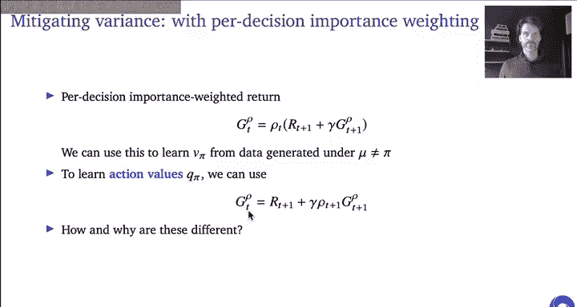

Okay。Now we're going to move on to the second topic to reduce variance。

 which will be control variants。

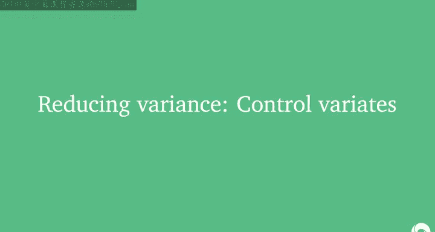

And to explain control variant， I will actually start by showing an example。

So we're going to go back to the。Blackboard， if you will。

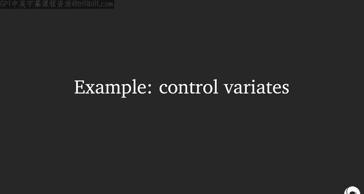

There we go。And we're going to do a very similar example to before。

 So let me just start first by let give me use white。I want to start by writing that action。

And let's just consider the immediate reward case first we're going to go discuss the sequential case in a moment。

 but let's first do the immediate reward case where again we're going to define an action， a reward。

 a probability of the action and a probability under the behavior policy of the action So again let's maybe consider an action that goes to the right。

Or to the left， let's make a rewards very simple， as's say to the right is plus one。

And to the left is mine from。Let's also considered a very simple target policy。

 we're only interested in estimating what happens if we go to the right。Of course， by inspection。

 you can very easily like determine already what the value is。

 but that's not the point we're going to basically try to estimate this from data。

 we don't actually know the rewards。And maybe they might actually also be random。

 you don't know it in advance。 So what we're going to do is we're just going to consider an update to our value function。

And let's consider the tabular case just for simplicity， right， So our updates to the value function。

 let's call it DV。S T。So the value of ST or actually， let's not even put the state there。

So let's just call this V T。So the value is going to be an estimate of the expected reward。

Under the target policy。So our update to the value is going to be defined as some step size as usual。

Times the reward。That we got。And we're going to multiply that reward。With。R。Right。

We're going to correct the reward so that we get the right expectation and we're going to take our current value and update it towards it。

 This is the tabular update。 So there's no times gradient or something， just for simplicity。

So what is this？We can just write it out， right？There's two cases。

 either we picked the action to go left or we picked the action to go right。

And the behavior will actually pick each of them with equal probability。So what happens here。

 let's just write out the cases if we pick the action to go right。Our update will be alphapha。Times。

The important sampling ratio when we go， right， What is the important sampling ratio when we go right。

 It's going to be pi。Divided by mu。 So what we get is the in。Pi。Rights， divided by。Mu， right。

Is gonna be one divided by half。He's gonna be too。Okay。So if we picked the action to go right。

 we get rh equal to2 times the reward that we get， which is one。

 and we're going to subtract our current value。So what is our current value。

 it doesn't really matter for the purpose of this example， so I'm just going to put VT。This is if。

The action。Was gonna。Go right。And of course， then the alternative is， if the action is to go left。

 the important sampling ratio then has zero divided by half， so this will just be 0。At times minus1。

 but the minus1 doesn't really matter， of course， because we're multiplying by zero。If the action is。

To go left。Right， so we basically gig get that we either。Let's actually write that again。

 so the updates are either basically update your value towards2。Or update your value towards zero。

Now you may have already done the math has not too hard。

 our actual reward ongoing ride is always one and indeed。This is doing the right thing on average。

 right， because we 50，50， we pick the action to go right or left because the behavior policy is 50。

50。And in one case， we update towards2 and in the other case， we update towards 0。 So on average。

 we're updating towards one。 We're doing the right thing。 We're updating towards the right return。

But why would we do it like this， why would we update towards this arbitrary value of zero when we take an action that the target policy would never take？

Well， it's because to get the right expectation， but is there something else that we could be doing。

 is there something maybe a little bit better that we could be doing？So let's change the update。 Now。

 Let's consider a separate different update。 And what we're essentially going to do is the following。

 we're going to。Pull out， and I'll explain in a moment why we can do that。

The row outside of the brackets。So dis first part is the same， right we are multiplying the road。

 the important something ratio with the reward。But it now also multiplies the value。

The reason we can do that is because the role and the value das correlate with each other。

And that means that in expectation， row times v is the same as V。Now。Let's go through the example。

 What does this mean for this specific example。Let's just go through the cases， again。

We're going to have alpha times 2 because the row is now outside of the brackets。Plus1 minus V T。

If the action is。To go right。But if the action is to go left。

We're going to multiply the whole error term here。With 0。Cons is our import sampling ratio of raw。

So what does this mean， Well， this means that if we're going to。Go to the right。

We actually can consider this to be。An update with the step size of2 alpha。Towards one。Oh， nice。

 we're updating towards one， which is exactly the right value to update towards right if the action is to go right。

And when the action is to go left。We just don't update at all。

So you might notice here that this is lower variance because we either update towards one。

 which is the value that we actually want， or we don't update at all。

 So when the value becomes equal。2， one。 So when our value estimate becomes accurate。

 this second update just stops updating。Whereas the first update that we were doing would continue to update with updates and are on average they're correct。

 but they continue to bump around right， you continue to update towards 2 and then to  zero。

 maybe it to zero again and then2 again， and in the end it all works out。

But the second update is lower variance because it will just update towards one and when you've already reached one。

 you're done and it doesn't actually update anymore， the error will simply be zero。

So that seems intuitively to be a good thing， right？And indeed， we can show that the。

Varariance of this update。Is going to be。Epha squared。Steps are squared。If I did my math correctly。

And the variance of this update。Will be zero， both of these are under the assumption that our estimate is accurate。

So this is what I just mentioned。 essentially。 Let's consider that the R V is already one。

So let's say that explicitly， if V T is already good， if it's already1。

 then the variance here will be alpha squared because we either update with alpha up or with alpha down。

You see that2 minus1？Is one， so we either update up with alpha and 0 minus1 is minus1 or we update down with alpha。

 so we're continuing to update with whatever the step size is。

 where in the second case if value is already accurate Vt is already1。

 then our variance is simply0 because the error will be0。So that looks good。

 right with lower the variances。Now， obviously， this is somewhat of an extreme example。

Because the estimate is already correct， but it turns out this。Principle applies more generally。

 and what we've essentially done here is we've added a control variance。 That's how it's called。

 And we've kind of not implic。 But now I'll now talk about this a little bit more explicitly so we can better understand exactly what's。

What's going on。

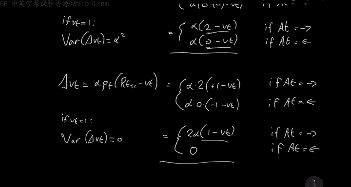

But let us first return to the slides。Okay， so。Continuing。

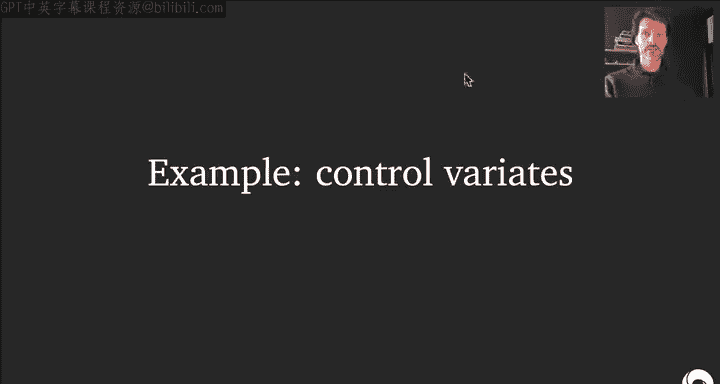

We can extend this idea of using control variants to the multi step case let's first do that and in order to do that we're going to consider a generic multistep update here。

 we're going to consider the lab update so instead of just assuming Monte Carlo for simplicity we're actually going to allow bootstrapping now and recall that this labda return。

 basically on every step so the laboratoryator is defined it just take the first reward。

And then discount。 And then on the next step， it boots traps with some weight，1 minus lada。

 or it continues。 Oh， sorry， there's an additional gamma here。 There's already a gamma outside the。

 So the second gamma should disappear。 So it's either weights。

The bootstrap target with one mile is Lada or the rest of the return with Lada。Here。

 the gamma lab is correct， because now we'。Pulled out these terms out of the expectation。

 and we can rewrite this。 We've also mentioned this before in a different lecture that you can rewrite this as the one step temporal difference error。

Plus， the discounts and additional E。Down weight it with this Lada parameter。

Recursive La await the temporal difference error。So the Labda temporal difference error。

 which is since your Lada return minus your current state estimate。

 can be written recursively as the immediate temporal difference error plus the discounted with additional Labda recursive itself。

So check just sort as a sanity check that if Lada is zero， we get zero， we get one step TD back。

 TD is0。If La is one， this will turn out to be equivalent to the Monte Carlo era。

So this is just reiterating what the multistep case looks like。

And then this idea of control variant can be applied there by basically weighting the errors rather than the return。

So basically we have this minus v part inside here， we're going to do exactly the same trick。

As we did in the example。And this is going to。Often reduce variance。

 it doesn't actually necessarily reduce variance， but it often reduces the variance。And。

This is sometimes also called error weighting。😡，Now why does it reduce the variance so let me in order to basically talk about that。

 let me actually go back。To the whiteboard。

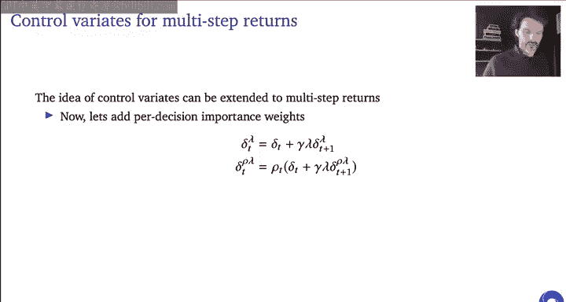

And the idea is now that we basically had， let me do the one stepcase first。

 So we had this first thing， which was row T times Rt minus Vt。

 So why do we keep using this term control variance。Because we're going to replace this。

With this second term， right， So this is one and then two is a different term where we pulled the royalty outside。

And we're going to note that this is， of course， equal to row T Rt。

 let me just push it inside plus one。Minus row T。Its， right。And that's going to be equal to row T。

R T plus 1 minus VT。Plus。1 minus royal t。Zizi。So we gets。If we call this one。

Now two is equal to one plus this additional term。So what is this additional term。Well。

 the expectation of this additional term。1 minus role T。Fiqi。

I'm going to claim actually that may be a little bit more explicit and put to behavior policy there。

And I'm going to claim the expectation this is zero。Well， why is this 0。

 Because this thing is going to be equal to the expectation of。1 minus raw T。

Times the expectation of VT， if we would be conditioning on state here。

 this final expectation wouldn't even be an expectation would just be valued that state。

I'll just keep it in the expectation just for clearness。

 but note that the value at that time step doesn't correlate with the important sampling ratio because we're considering the important sampling ratio of the action after taking the state。

So we can pull that out if we correctly condition on everything。

And this term over here is going to be equal to0 because the expectation of rh under the behavior pole is equal to1。

 so we get1 minus1 is 0， so this full thing is equal to0。

So what does this term do then this is our control variant， so implicitly by awaiting the error。

 which we were doing over here。Rather than just a target， which we were doing。Over here。

Then what we're doing is implicitly， we're adding this control variance， which we've。

Written over here。What this is doing is there's a different term， which has expectation zero。

 but it varies along with the thing that we're interested in。

 So the thing we're interested in is this thing over there， number one， if you will。

 but we've added a separate term at the end， which has expectation0。

 but because it varies along with the thing that we're interested in。

 you can reduce variance and that's what it's doing。

 that's in general called the covariate so we can view this error weighting that we were doing as essentially applying covariates。

 adding terms that reduce your variance but do not change your expectation。

There's more discussion about this in the book， so feel free to consult that if you still feel maybe slightly confused about these things。

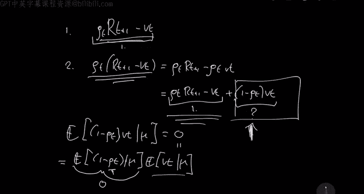

I will now return back to the slides where we've applied this idea to the multi stepcase by basically waitinging the errors rather than waitinging the returns。

And we've written that down recursively here where we have this new notation deelta row Lada。

 where the row indicates that we're import sampling and the labda just indicates that we're partially bootstrapping along the way。

And the rows not apply to the errors rather than to the returns。

So this by design includes those one minus row V control area terms that we've just seen on the blackboard。

 as。And as I mentioned， this is sometimes called error rating as in contrast to reward weighting or preition importance happening。

But we can apply this like in the per case， of course， as well。

 which you've already doing here with this equation at the top。

 right we're not applying the full ratio for the full trajectory。

 we're just doing this on a per step basis。And one can then show that the expectation of this under the behavior policy is equal to the expectation of if we would only apply these things to do return and then just subtract V as normal。

The expectations are equal， but the variance is not necessarily equal。

 and oftentimes the variance on the。Eror rate term is lower than that on the return rate term。

This is， by the way， not necessarily the case。We run throughout a paper where I was involved in as well with Rich Sutton and。

Rupam， I believe， Ruam Mahmoud and Doin Apriica。And there we were， we at some point thought。

 maybe we can prove that this actually has lower variance in general。 turns out it doesn't。

 There are counter examplesamp， but in general， it it seems like more generally speaking。

 it often has lower variance， which you just can't say it always has lower variance。

 It doesn't necessarily has lower variance。 But as the example show that I showed you before。

It makes intuitive sense to weigh the errors because essentially it means that you don't update when you get data that is irrelevant rather than arbitrarily updating towards zero and then updating towards higher numbers later so correct for that。

Okay。So typically， this is why I say that this error rateed term can have lower variance。In practice。

 it often has lower variance， you just can't say that generally it always has lower variance。

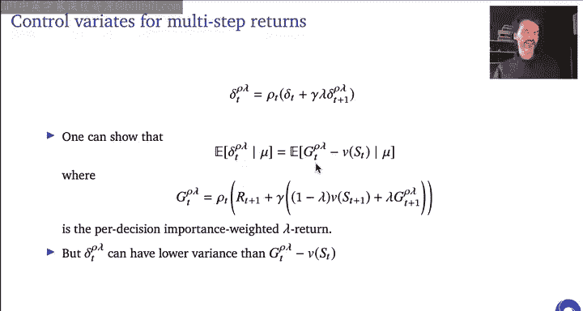

Okay， that brings us to the end of that topic of control variance。

 and now we're going to go to the next topic to reduce variances。

 which will be adaptive bootstrapping。

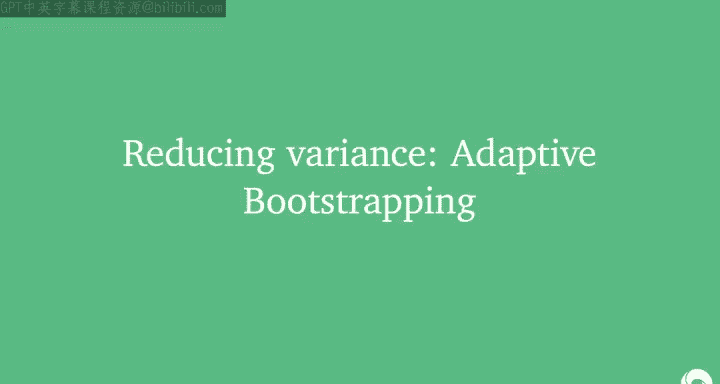

So。We already talked about bootstrapping quite a lot， obviously。

And bootstrapping is typically a good way to reduce your variance a little bit。

 and we already had these Lada weighted errors or returns where Lada could be lower than one。

 right and if a lab is lower than one， then we're going to reduce the variance。

 but we might incur some bias because we might bootstrap。

The bias is not because we are estimating for the wrong distribution necessarily。

 the bias is there because we're using estimates， our value function won't be completely accurate and therefore there might be some bias due to our function approximation error or just our estimation error because we have seen finite data so far。

So for action values， we can use this important sample to return。

Where you can see the normal thing showing up here， this is the expected SArsRSa return。

So we're doing the one step case here if Lada is equal to zero。But lab can be different than zero。

 and if lab is different than zero， then we basically recurse。And go into the next time step， right。

 So this quantity here is defined here recursively。And we can see if Lada is zero。

 we can see the expected SARSa thing reappearing that we had previously。

 which is shown here on the slide as well。And there' is no importance happening then we already discussed this slightly earlier in this lecture。

 right where we could just bootstrap and wait with our target policy and then we are doing correct of policy updates in some sense。

But we are relying on these estimates， and these estimates might not be accurate。

 and therefore we might not want to do that。 And we can see here in the equation， if labda is one。

 then this wood strapping term just completely disappears。 and we find the。Important sampled。

Returned for action values that we saw on an earlier slide again。

 So this smoothly interpolates as per usual with Lada between 0 and1。

But there's a problem if we bootstrap too much， which is specific to the off policy case。

 So I already said， oh， yeah， maybe your're estimate somewhat that great。

 So you might bootstrap and it might not be too good too great。

 There's a completely different reason why this bootstrapping might be harmful。

 It might open you up to what is called the deadly triad。 So let's recap what that is。

The deadly trial refers to the possibility of divergent learning when we combine bootstrapping。

With function approximation and of policy learning。

It only shows up when all three of these are present。

Unfortunately they often are if you want to do what is nowadays called DPl。

 we're clearly doing function approximation because we have deep neural networks to approximate our value functions。

We're often doing bootstrapping because just doing full Monte Carlo rollouts would be very much too high variants in many cases。

 and therefore learning would be quite slow or ineffective。

And we're also often doing off policy learning， for instance the DQN algorithm。

 the well known DQN algorithm which was used to play Atari games quite successfully and has sparked a lot of follow up work as well。

It uses Q learning， which means that we are in the original DQ and we're actually bootstrapping after just one step。

 it's one step Q learning。And later iterations such as rainbowdant to name one example。

 this has been extended to multi step updates， but still。After。

 say three or five steps or something like that， typically we bootstrap because it just turns out to be more effective that way。

 The variance will be lower and the updates will be better。

 but it does mean that we're combining all these three things then we're bootstrapping。

' we're doing deep neural networks or we're doing function approximation and we're doing off policy learning because we're using something that's Q learning like we're bootstrapping with a max at the。

States where we will trap。So to recap so why does this happen so we saw this example before so we have two states here。

 the rewards are always zero but we're only going to consider this one transition and we only have one feature the feature value here is one in this first states and the same feature has a value of two in the second state we only have one parameter。

W and our value function will be linear， so it will be w times x。

 which in this case first state is just w and w times x in the second state will be 2 w because the feature value has value 2。

The optimal value function is within reach， if we would set our weight parameter w to0。

 our estimates would be perfect。But if we use TD learning， once of TD learning on this transition。

Then something happens that we don't want， so our value function。

 the weights of our value function will be updated according to one step Td learning as shown on the slide。

 and if we fill in all the value so we put r0 here。

 the value of the next state will be 2 w and the value of the current state will just be W。

The gradient will just be one because。Sorry， willll just be W because the gradient of our no。

 sorry I'm saying is wrong。 The gradient will just be the the value of the feature。

 which is for this state one right So the gradient here is because it's linear is just x and x in this state that we're interested here is just one。

 So we're multiplying this whole term with one。 I got distracted slightly with the W here。

 but the thing that happened here on this step is that both of these values have a w in there and we just pulled it outside of the。

Pentheses。So this total update you can verify is by carefully slowly stepping through it will look like this。

 and then we can note that if the discount factor is more than a half。

 which is of course quite a common case， then in this specific example。

 if the weights are already positive，Then this term will also be positive。

 which means that the next weight will be even more positive。Similarly， if the weights are negative。

 then the next term， this term will be within the brackets will be positive。

 but the weights are negative， So the total term will be negative。

 which means that the next weights will be more negative。 So in both cases。

 we're updating away from 0。And in fact， we'll update the way faster from zero。

 the larger your weight becomes， as larger the magnitude of the weight becomes。

This means you'll exponentially quickly diverge to either plus infinity or minus infinity。

 depending on where your weight started。So that's problematic and that's an example of the Dely triad and it happens because we're updating off policy。

 which in this case refers to the fact that we're never considering any updates from this second state。

 so although we go there we never update by going away from it again。

 that is why this example is of policy。So we can use multi step returns as well。

 so let's expand the example， and let's not consider also the transition that moves away from the second state。

And instead of just using one step TV， let us consider a laboratoryator。

 we're still only considering updating this leftmost state so we're still going to update off policy where with off policy here I mean that the state's visitation distribution does not correspond to our behavior our behavior steps through these states as follows we start here and then we go here and then we go there right and then we terminate so we spend equal amounts of time in the first state that is in the second state under our behavior。

But the updates will conduct off policy by basically only considering updates from this first state。

Now， if we consider the update to the leftmost states， we see if you just expand everything。

 there's this additional term of 1 minus lab that appears compared to a previous slide where we saw that the update would be w plus alpha times 2 gamma minus1 times W if you just write out this update where the rewards are both zero。

You get this different equation where depending on Lada。

 this two times gamma term gets down weighted。This actually means that this multiplier to the weights will be negative whenever this equation holds。

 whenever this term is smaller than one。This means that if Lada is larger than1 minus one over2 gamma。

 then。Whenever your weights are positive， they would go down rather than up and whether whenever they're negative。

 they would go up rather than down。 So if this condition holds， if your lambda is large enough。

It becomes a convergent algorithm where the weights will now be updated towards one。

 sorry towards zero rather than away from zero。This is specific to this example right I'm giving you specific equation specific conditions to labda。

 which basically take into account a full example and this two here。

 for instance comes from the fact that the feature value here is2。

But the the general gist of it is true， which means that if your labda is large enough。

 you're good to go， you won't have any problem with the Dely triad and this makes sense because the Dely tri was about bootstrapping function approximation and of policy learning。

 the larger you said labda， the less your bootstrapping the extreme case is when you consider a labda equal to one in which case we're using Monte Carlo returns were not bootstrapping at all If that is the case。

 you can update of policy， you can use function approximation， you won't diverge。🤧But if。

You want to still bootsrap， you can use a lower labda， it just needs to be large enough。

 so it's not actually a binary thing it's not about all bootstrapping is bad。

And if you do any bootstrapping， you'll be in the De tri， no。

 this example shows that if you just bootstrap less， sometimes you can be fine。Okay， so let's。

 for instance， consider the example， like if your discount is as low as a half。

 then this is just saying， oh， my lab needs to be larger than zero。And that's often the case。

 If your discount factor is， say three quarters or something like that， then this term would be。诶。

This whole term would be two thirds。 So that means that your lab that needs to be larger than one third。

 if I did my mental math quickly correctly。 So basically。

 the larger your discount is the larger your lab that needs to be for this still still be convergent。

 but we can see that there are lab does that will make it convergent。In this specific example。

So concretely if your gamma is your discount is 0。9。

 then turns out it's sufficient to have a labda that is larger than 0。

4 or5 that's all usually large labla， we often use Ladas that are say 0。8 or 0。

9 or something like that。So it turns out if you do that in this example， you're good to go。

 you can update off policy and you would still be fine。So the conclusion of Hol。

 this is just an example， but the conclusion is if we do not bootstrap to much。

 learning can be a lot better， we might mitigate， if not fully remove the Dedy trialad。

So maybe we can reduce variants by adaptively bootstrapping because we don't want to bootstrap too much because then we might get into the deadly trial。

 but we also don't want to bootstrap too little because then the variance will be very high。

 especially if we're doing these important sampling updates because important sampling ratios tend to add variances to our updates。

So can we maybe adaptly bootsrap just enough？So that the variance is at least bounded or is's at least smaller than it would otherwise be。

I'm just going to present you one way to do that， there might be multiple ways you could do that。

And the idea would be here to bootstrap adaptively only in as much as we go off policy so if you don't go off policy。

 you don't need to bootstrap， you can just continue using the data， but when you go of policy。

 this makes intuitive sense in some sense right you're following a certain policy。

 you reach a certain state at that point in that state you choose a completely different action that the target policy would never take。

Maybe this is a good point to do to bootstrap rather than trying to use this very tenuous data that had nothing to do with the thing you're trying to estimate to somehow still update it。

 That is possible， but tends to need to very high variance updates。 So there are some intuitive。嗯。

Ideas behind this idea， but we can formalize it， which we'll do next。

So we're going to start with this important sample correct it's multi step error right。

 recall Delta T is just your one step TD error。We're correcting it to be a good offability error。

And we're defining it recursively with Labda to make it a multistep error。

Now we might extend this example slightly by allowing an initial bootstrap parameter。So basically。

 we're down weighting this whole thing with an additional labda T。

If Lada T note that Lada is now time dependent， I'm allowing Lada to differ from one step to the other。

So that's important because now we can have a special case。

 we've basically just generalized the thing we had before if we set Lada T to be equal to one。

Then we just get the thing back that we had before La that T plus one doesn't also have to be equal to one because I've now subscripted by T。

So this is a slide generalization from before， and this will just make some things a little bit easier later on。

And we can pick a different lab on every time step。 That's what I mean with adaptive。

 It's two things。 it allows us to pick different labs on every time step。

 and we're going to pick the lab in a data dependent way。Now， the idea is。😡。

If we define this thing recursively， look at the recursive definition first。

 we see that there's a Lada T， row T。Then there's a delta and then we go into the recursion。

 but that means in the recursion， there will be a labda t plus 1 times row t plus1。

They always go together， they're always next to each other。And then the idea is， well， this row。

 what is the problem with row， So row is the important sampling ratio。

And we know that in expectation by itself， rh will be equal to one。

Recall that that's just the property of this ratio。

 the ratio by itself will have an expectation of one。

But we also know that it can increase variance quite a bit， so what happens。

 why is it increasing variance， well sometimes it'll be lower than one。

 sometimes it will be larger than one。And indeed， it can sometimes be very large。

 When is it very large， it's very large when we're dividing a large target policy probability with a very small behavior probability。

 that means we've selected an action that was very rare under our behavior。

 but it's actually a really common action under your target policy， occasionally that will happen。

 and is ratio can become very large when it does happen。So intuitively the idea will be。

 well what if we pick Lada in such a way that if we multiply ladder with row。

 it's always small or equal to one。Then we know that this is bounded。

 there are no large ratios anymore。So what does this mean。

 we just rewrite this inequality and basically it means that we pick Lada in such a way that it's the minimum of one。

Or one over the important sampling ratio row。 Why this minimum， Well。

 we don't want Lada to go larger than one。 So basically， what is happening here。

 If row is itself sorry， if row is itself smaller than one。Which is often the case， right。

 smaller than one row basically just means that your target policy wasn't very likely to pick the action。

 but the behavioral policy was that happens。 correct， right。

 You might take an action and the target policy is just not interested in that action。 Then this row。

Can be very small， which means that one over row can be large。 If that is the case。

 we allow ourselves to continue。 We allow a labda to be one。We continue to the next time step。

However， if row is very large， if we picked an action that was quite rare under the behavior。

 but it's really common under the data policy， then row can be very large and then we're saying， oh。

 well then we're going to pick labda to be smaller。

So whenever we pick an action that was very rare under the behavior。

 but it's very common on the desired policy， let's just bootsottrap there。That's the whole idea。

 essentially。So when we're two of policy， if row is very far from one。

 we're going to truncate this multi step error， the multi step return， if you will。

And that's the same as just bootstrapping there because the closer lab is to one sorry。

 the closer lab is to0， the more we're bootstrapping right If it's all the way equal to0。

 then we're just bootstrapping fully there。 If it's a little bit above zero。

 we're still partially bootstrapping there。 the closer we are to one， the lesser bootstrapping。

 So instead of thinking about bootstrapping as a binary thing where we either bootstrap or not。

 we're thinking about it smoothly。This idea is known as AVTD， adaptapive Botrap TD by Hoopam Mahmud。

 or also as V tracece from a paper called in Paa by Laa Espahol and others。

And it's quite an effective algorithm。😊，And。We're actually free to choose this right we're free to choose different ways to bootstrap and in fact in the tab of the case。

 all of these methods will be updating towards some mixture of the multi step returns and therefore they're all fine theyle will converge。

In deeper reinforce planning， this is an extremely common thing。

 there's a lot of agents that are using VTce and Vtrace essentially uses this idea there's a couple more things to be said and I refer to that paper if you want to know more in depth。

 but it basically boils down to this idea of bootstrapping when you go off policy。

And this is an extremely common trick， especially for policy gradients。😊，Because policy grades。

 as I mentioned before， really do not like biased return estimates because。

If you have a biased return estimate， then you're no longer necessarily following a policy gradient。

 and of course， that' seen that that might be harmful， right。

 means your policy is no longer necessarily improving， in fact， it might be getting worse。

So V trace is very common and this is a very important trick and it really helps reduce variance because we're basically just truing away parts of the returns that would give you very high variance。

 but as long as the variance is okay， we're just allowing yourself to continue and to use multistep returns。

Okay， now one final thing， which is very related， but it's a different way of doing this is the algorithm called tree backup。

So I mentioned there's different ways you could bootstrap and picking the trace parameter adaptively as we were just doing before is not the only way。

A different thing we could do is to first start with the Bellian equation。

 and then we're going to go to the multistep case。And effectively。

 what we're going to do is just first just museing this equation for a bit。

This is the definition of the action value for the policy that we're interested in pi。

And we noted from the beian equation that this is the expectation。Of the reward。

 given that you have seen this state in action， and then in the next states following that policy。

In the next state and then picking the action according to that。

This is also where this expected SArsSA update comes from， right， it just samples this。

Note that the expectation does not depend on the policy because we're already conditioning on the action A。

 this is saying given that we have a state and an action， what will be the value of the policy。

 well we only need to consider the policy at the next step。

 we don't need to consider it on the first step because we already condition on the action。

So to sample this。We can sample it as before， we could put strip immediately。

 but a different thing we could do is basically we can pull out the action that we're going to select on the next time step。

Because that's the action that we've actually sampled and we can just replace the estimated value that we had for all of the actions with the return given that action。

So what are we doing here， we're replacing this summation over all of the actions by simply pulling out。

The action that we're actually going to take on the next time step。

 we're going to turn this into a multistep update and we are keeping the weighting right because this is a weight that sum of action values and what we're basically going to do is we're going to use these as expectations。

 These are estimates of the expected return， right。

And we're going to replace only the one return that we actually had。

 So the way to think of this is think of a tree at the root note， you're in a state。

There's a whole bunch of actions。And the value of the root node for a specific policy would be the policy weighted。

Some of the values of these actions， right， But what we're going to do is we're going to actually select one of these actions。

 and for that action， we can replace the estimate with the value the return that we sampled。

That's exactly what's going on here except we're deferring at one step because we're not conditioning just on the state but also on an action。

 so the first states in action are already given， but then as the next step so basically the next node in the tree。

 we're going to consider all of the actions and all of the actions that we haven't selected。

 we're going to use the estimates that we have appropriately weighted according to the policy。

But for the action that we did select， we can actually use the sampled return。

 It's defined recursively。 So the next step， you might bootstrap again。😊。

On all of the actions that you didn't select and again， continue just with the action that you did。

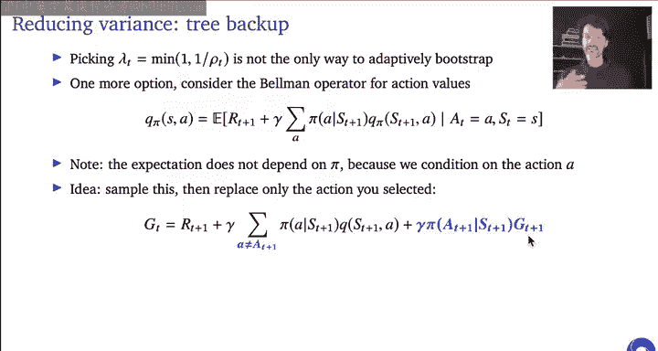

So we only remove the expectation of Q ST plus 1，8 plus 1。

 which is the action we actually selected and we replaced that with the sampled return。

This is unbiased and it's very low variance because we don't have any important happening ratios。

 There is never a division by mu， right。The pi here in fact。

 plays a role that's quite similar than Lada， of course。

 you can add an additional labda and down it even further。

But there is a problem which is maybe it's a practical problem。 Sometimes this works amazingly well。

 but there is a bit of a practical problem sometimes you might bootstrap it a little bit too early。

 and therefore you need to be careful of deadly triads。 if pi is not your behavior。

 like if your behavior is something different， which is perfectly fine for this method。

 this isn't off policy method， but if your behavior is different。

 you might be bootstrapping very much after a first step。

 let's consider that there's many actions here， each of which have a acquired quite low probability。

 then this is very similar to just bootstrapping after one step。However。

 if your policy is fairly greedy， then it might be that you actually take a number of steps before your bootstrap。

😊，In fact， I didn't put this on the slide， but if your policy is the greedy policy。

Then what this mechanism would be doing is essentially it would take as many steps as your policy agrees with the greedy policy。

 So as long as you're picking greedy actions。And if the greedy policy is the target policy。

 like if you're interested in the greedy policy， then this method would as long as you're picking greedy actions would continue to roll out a trajectory。

 but at the moment that you select a non greedy action。

 it would terminate there and then bootstrap with a max。Q， so a queue learning like bootstrap target。

That is actually an algorithm that was already proposed by Chris Wiltkins when he proposed a secure learning algorithm。

And if your policy is fairly greedy， then it can actually have long multi step returns。

 but obviously if your policy is quite uniform in which you're interested in the greedy policy。

 then the returns might be truncated quite a bit。This is more generically true。

 this this equation is not just for a greedy policy， a greedy target policy。

 the target policy could be greedy， but it doesn't have to be。

But it has the same issue that if if your behavior mismatches a lot with this target policy。

 then you might bootstrap all the time， and that might be a little bit dangerous because of the deadly ride。

There are， in fact other ways to do with the De tribe， there are solutions for this。But no。嗯。

Basically， we don't know yet what the best solution is。

 There's multiple solutions to the deadly triad， multiple algorithmic innovations or different ways to think about this。

 some of which are included in the book by Sa andbarto。

 but we don't know for sure yet what the best ways to do with this。

 So this is still ongoing research， Basically to figure out how best to deal with these issues。Okay。

 that brings us to the end of this lecture， thank you very much for paying attention。

And if you have any questions， please post them on the Mole。

Thanks。