# DeepMindxUCL《强化学习｜Reinforcement Learning 2021》中英字幕 - P12：[12]Deep Reinforcement Learning #1 [12_13].zh_en - GPT中英字幕课程资源 - BV1JssaeVEMp

Today I'll be discussing an exciting era of research that has been instrumental to many recent successes in reinforcement learning。

 and this is typically referred to as deeper reinforcement learning。

 so this is a combination of reinforcement learning algorithms such as the ones that we have discussed so far with the use of deep neural networks as functional proms。

So the motivation for function approximation and the core ideas behind it have already been introduced so you will remember how we discussed that tab Rl cannot possibly scale to certain large complex problems。

 the reason being that of course if we want to estimate say the value of each state separately for every single one state this will have a memory costs that naively scales linearly with a state space which by itself would make it inractical but even if we had an limited memory there was still a fundamental problem that it would be just very slow to learn the values of all states separately。

 if we need to visit every single one and potentially multiple times to make an even reasonable guess of the value of a state we're definitely in trouble so a response as again discussed in previous lecture is the use of function approximation which is our key tool to generalize what we learn about one state to all other states that are close according to a reasonable definition of close。

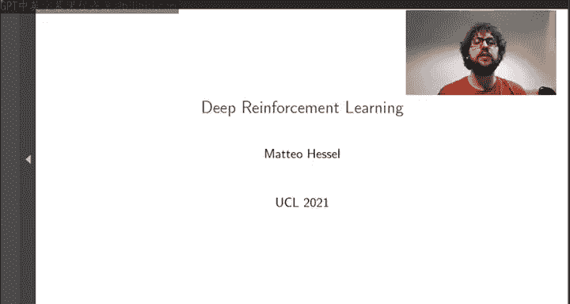

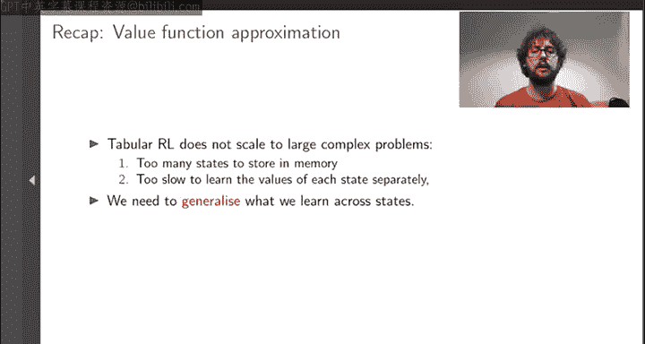

We have already introduced functional approximation。

 but the purpose of this chapter will be to discuss the use of deep neural networks specifically for the purpose of function approximation。

 and this is what is typically referred as deeper reinforce learning。

And I will delve soon in some of the practical challenges that arise in this setting and some exciting research in the area。

 but before we go there， I want to take this introduction to basically recap a few core ideas of function approximation in general and also to discuss the role of automatic differentiation in easily supporting any one of you to freely experiment with deeper Enable learning ideas。

So when using function approximation to estimate values in previous lectures。

 we typically proposed a simple scheme where we have some fixed mapping that transform any one state in some feature representation fee。

 and then we would have a parametric function that is linear and that maps features to values。

The problem of reinforcement learning then becomes to fit these parameters theta so that for instance。

 this value function V theta makes predictions that are as close as possible to the true values V pi for whatever policy we for instance。

 wish to evaluate。

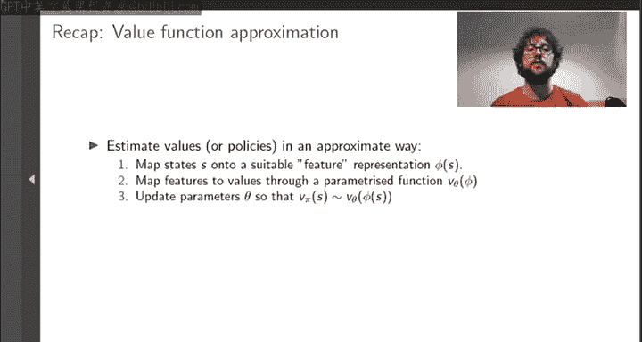

And we should have that we can turn this into concrete algorithms。

The first step would be to formalize the goal of minimizing the difference between BTta and VI。

 so for instance we could use some loss function like an expected squared error over the state。

Typically this would also be weighted by the visitation distribution under the policy itself in order to allocate capacity sensibly and then given the loss function。

 we could use radian descent to optimize the loss function This sounds very simple and easy but well of course the devil is in the details and actually doing this process for enforcement learning introduces quite a few subtle challenges So first of all。

 of course computing the expectation over all states is too expensive。

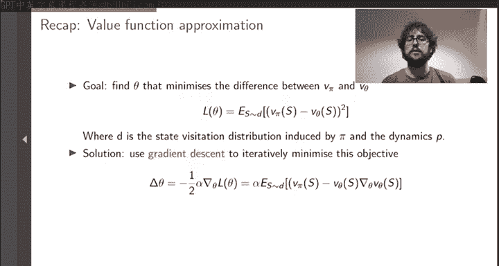

But this is maybe the least of the problem， the most deep problem is that the very target B pi that we want to learn to predict accurately is actually unknown note。

So the solution to both problems is to sample the gradient in thescent update by considering just one or few states in each update and then use the sample estimates of V as targets。

And to do so， we can reuse all the ideas that we have discussed in， for instance。

 model free algorithms， so we could do Monte Carlo deep prediction by using an episodic return as target in the gradient update。

 or we could implement a deep T prediction algorithm by bootstrapping on our own value estimates to construct the one step target。

 and again， with the bootstrap itself being parameterized by the very same parameter data that we wish to update。

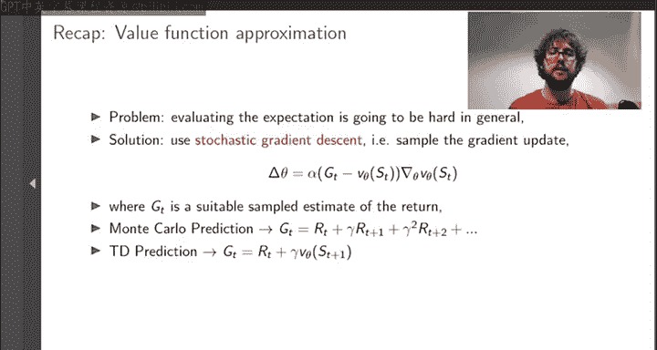

So。This is all good in principle and we already saw that if some mapping phi is given then it's possible to train a linear function to make reasonable value predictions。

 but today we want to consider a more complicated setting。

 so a setting where maybe the feature mapping is too naive and it's not informative enough to support reasonable value predictions if we have just a linear mapping on top of it。

And in this case， we might want to use a more complicated non nonlinear transformation from states to values。

 and for instance， by using a deep neural network as a function appximator。

You may wonder why choosing a neural network and this is definitely a good question so it's valuable to stress that these are by no means the only possible choice for a more complex function appxiator but neural networks do have some advantages so the first is maybe that this class of parametric function is well known and is known to be able to discover quite effective feature representations that our tailored the 20 specific tasks that you might apply this parametric function to so in our case or enforcemental learning but the neural network have been used also for processing language or vision。

Importantly， this future representation that is learned by a neural network is optimized in an end to end manner by the same gradient process that in linear function approximation is reserved just to define a linear mapping。

So we have a unified way of training the entire parametric model to represent the states in a way that is expressive and then make a reasonable good value predictions from this representation。

The second reason to consider deep neural networks is that given the extensive adoption of deep learning methods in machine learning using neural networks allows us to just leverage lots of great research。

 so all the ideas that have been introduced in superwes learning， for instance。

 for network architectures or optimization， we can leverage all this great research and benefit from it when we use neural networks for functional approximation in reinforcement learning。

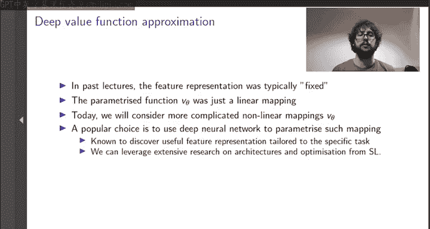

What does parameterizing a value function with a neural network actually looks in practice though in in the simplest case maybe we could consider what is called a multilayer reception。

 so this would be a model that takes a very basic encoding of a state so for instance。

 in a robot this might be the raw sensor readings that we get。

And MLLP would then take these as inputs， compute a hidden representation by applying a linear mapping。

 So W S plus some by B， followed by a nonlinear transformation such as a10H or a re。

And then the actual value estimate would be computed as a linear function of this embedding。

 but the important thing is that this embedding would not be fixed would be learned and the parameters detail of our value estimate that then we train using DRL would include not just the final linear mapping。

 but also the parameters of the hidden representation。

 so the entire system would be trained end to end。This sounds appealing， of course。

 but what if you to compute the gradient with respect to theta， we need to differentiate through。

 say not an MLP， but maybe a conflict。Or what if we have the batch normal layer or we use a transformer？

Well， it turns out that there is actually a way to compute exact derivatives for any of these architectures in a computationally efficient way。

That basically allows us to get any gradient we need without having to derive its expression ourselves。

 and given the popularity of the deep learning in modern machine learning。

 these methods that are typically referred to as outtaifF are actually available in most scientific computing packages。

So in this chapter we'll be focusing mostly on the conceptual challenges of combining RL and deep learning。

 and we'll mostly just assume that we have these kind of tools to support us in getting the gradients through any arbitrary neural network architecture that we may want to use for function approximation。

 but I want to give at least a brief intuition about how these tools work since they are so fundamental to everything that we do and to the practice of theRL。

And specifically， I will give you a very brief introduction and also show you how you can use them to implement a very。

 very simple DPL agent， specifically a Q learning agent with a neural network as functional oxygen。

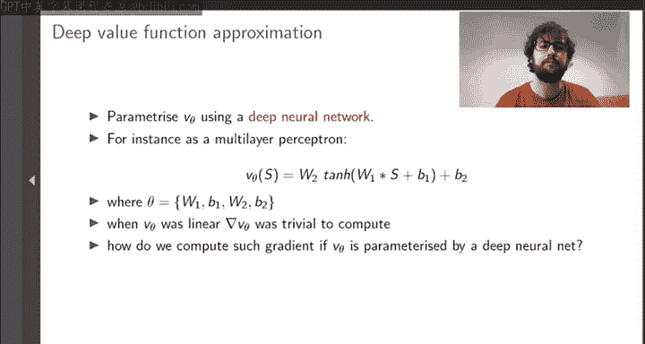

The first important concept behind automatic differentiation is the concept of a computational graph。

So this is an abstract representation of any computation that you might want to perform in our case。

 estimating a value， say in the form of a direct aesthetic graph。For instance， in this slide。

 I show a very simple instance of such a computational graph where I have two inputs A and B。

And I compute some intermediate representation as a plus B and b plus1 respectively。

 this is of course a very simple example， and then I compute some output by taking the product of these two numbers。

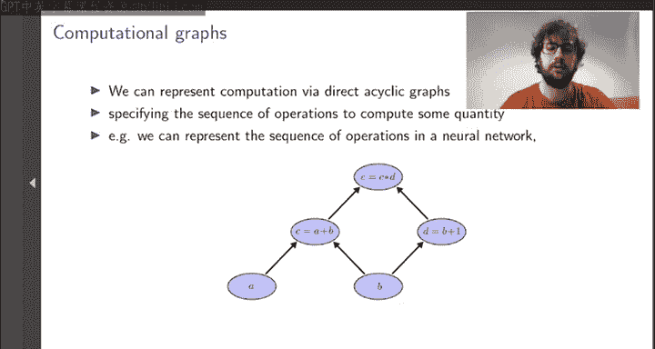

The reason computational graph are interesting to us is that if we know how to compute gradients for individual nodes in a computational graph。

We can automatically compute gradients for every node in the graph with respect to any other node in the graph and do so by just running the computation graph once forward from the input tool outputs and then performing a single backward sweep through the graph。

 accumulatings along the path and some ingredientss when path merge。So for instance。

 in this simple example， the gradient of the output E with respect to input A can be computed by just taking the product of the derivative of B with respect to its input C times the derivative of C with respect to its input A。

Which is trivial compute because like the individual nodes can。

 you can always decompose your computation so that the individual nodes are really just simple arithmetic operations。

😊，If you take again in the simple example， maybe a slightly more complicated derivative where we wanted the gradient of e with respect to the input B。

 then this will be just the sum of the derivative of E with respect to C times the derivative of C with respect to B。

 so this is one path from e to B， and then following the other path。

 we just need to take the gradient of E with respect to D and then times the derivative of D with respect to B and sum these two path since the two paths merge。

And this might even seem slightly magical at first， but if you actually write it down。

 its just implementing the standard chain rule that you all have seen when in a calculus correspond。

The advantage though， of doing this in the form of a computational graph is that it helps implementing the chain rule is implement the gradientding computation in an efficient way for any arbitrary numerical function by just decomposing your computation which in our case will typically just be a program。

 decompose it into the sequence of basic operations， additions， multiplications and so on。

 and then considering each of these basic operation and node in the graph。

 that then we can differentiate by implementing the graph algorithm that I just described。

And I wanted to stress here that the entire process is not just computationally efficient。

 so it's always order all the cost of doing it forward from the pass。Now it's also exact。

 so this is not a numerical approximation like you could do。

 for instance by computing a gradients by finite differences。

 this is an actual way of evaluating the true gradient of an arbitrary numerical function in a fully automatic way。

😊。

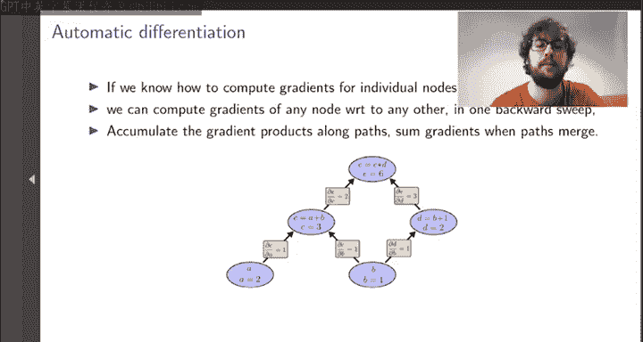

It's really， really exciting if you think about it。

Outto this is nightively implemented in many modern machine learning frameworks， including Js。

 which is the framework of choiceice for Discourses assignment。

Some of these frameworks like Tenentflow require you to explicitly define your computation in terms of a computational graph so that they can then do things like out di very naturally on top of this graph。

 Others though， like jacks allow you to still write your computation in a standard imperative way。

 but then implicitly we the graph by tracing your computation。

InJX AltadF is implemented based on this tracing mechanism and it's exposed to the users via the Js。

grad， the program transformation， so this is a utility of JX that takes a Python function that you can just write in nu by in a very standard format and then it returns to another Python function。

 but that now computes the gradient of the original function and evaluates that for any given input instead of computing just a forward bus。

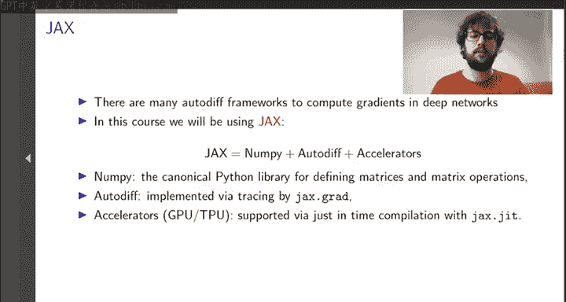

To conclude the introduction， I want to show a very simple example of implementing a basic Q learning agent that uses a neural network as a function appximator using an Autoive tool from JX。

So what does such a deep Q learning agent look like？

First we will need to choose how to approximate Q values and for this we will use a single neural network lets say that takes the statustas input and outputs the vector output with one element for each available action。

For instance， this network could be an MLLP as before。

And note that we have implicitly made a design choice here of the network taking a single state and outputting all action values。

 but this is not a strict requirement， we could also pass state and action both as it inputs to the network and then the network would return you just the Q value for that actionction。

 but in general it tends to be more completional efficient if we can compute all Q values in a single pass so this is a fairly common choice in practice。

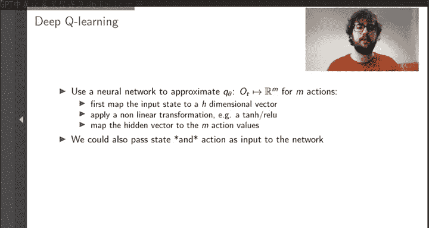

In JX， we could define such a neural network very trivially using the highikkuu module。

In with this library， we just need to define the forward path of the network as for instance。

 in the case of an MLP， a sequence of a linear， a raylude， and another linear。

And then we can use the Haikkuop transform to extract Python functions， two Python functions。

 specifically one network in it that initializes the parameters of the network。

 and the second network apply that basically computes the forward path。

 taking the parameters and the state as the input。Once we have a network though， of course。

 our job is not done when to implement DPQ learning。

 we will also need to define gradient gradient updates to the network parameters。

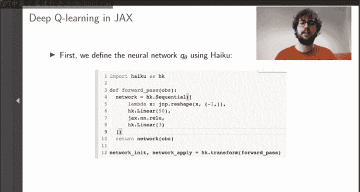

And with Q learning， this looks very much like the D T update that I showed at the beginning。

 but we will be updating one specific action values， so the Q theta for specific ST and A。

And we will be using as target， as a sample estimate of a return， the reward。

 the immediate reward plus the discounted max Q value。Where again。

 we're using our own estimates that depend on parameters the as tab bootstra。

It's interesting to point out， though， that while you can write your update exactly in this form。

 that matches very naturally the math， after all。Often， if you， for instance。

 look for an implementation of a DP learning agent。

 you might see it written in a slightly different way。

For consistently basically with standard deep learning。

 you might see that instead of defining directly a gradient update。

 they might define a pseudo loss function， which is the second equation on this slide。That is。

 in this case， just the1 half times the mean squared error between the chosen action and the target。

 which is given as usual by the rewards plus the discounted maxQ value。And this is fine。

 but for this gradient of this loss function to actually recover the correct key learning updates。

 there are a couple of important cabinets。So first of all。When we compute the gradient of this loss。

 we need to ignore the dependency of max Q on the parameter theta。

 This is denoted by the fact that we have a double vertical bar around max Q。

 If we did not ignore this， then the gradient of this loss would not recover the first equation。

 We would have an additional term。And the second is good to realize that this is not a true loss function。

 it's just a prop that has the property of returning you the right update when taking a gradient。

How does this translate into code， well， this is again fairly simple in JX because we can just define the pseudo loss function that takes the parameters theta and the transition。

 so an observation an action or reward， the discount and a subsequent observation。

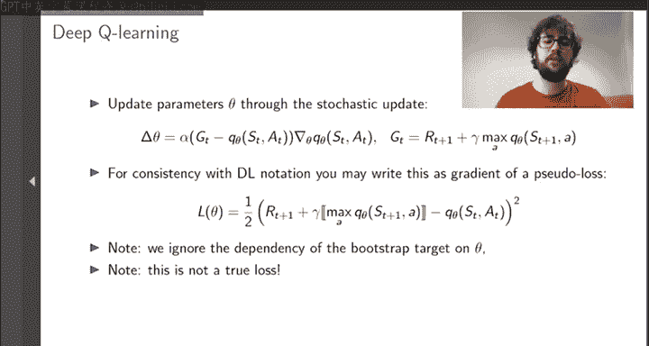

And then first computes the Q values in both SD minus1 and SD。

assesembleles the target by summing the reward plus the discounted max cube and then computes the squared error by just one half the square of these two what is critical is that to ensure that the gradient of the two the loss implements our BQ learning update。

 we must take care of adding this stop gradient term in line 25。

The stop gradient implements this idea that will the grading computation will ignore the dependency of target t minus1 on the parameters data。

To actually get the update， then we we need to actually take the gradient。

 so this is done in line 30 where we compute jackx。 grad of this loss function。

 this gives us back another python function again， and then we evaluate in theta of steam -1。

80 minus-1， RRT DT and of steam。Finally， just updating the parameters。

 we can do it by just stochastic gradient sent and in this case willll be equivalent to just taking the parameters theta。

 the gradients and subtracting small step size times the gradients。

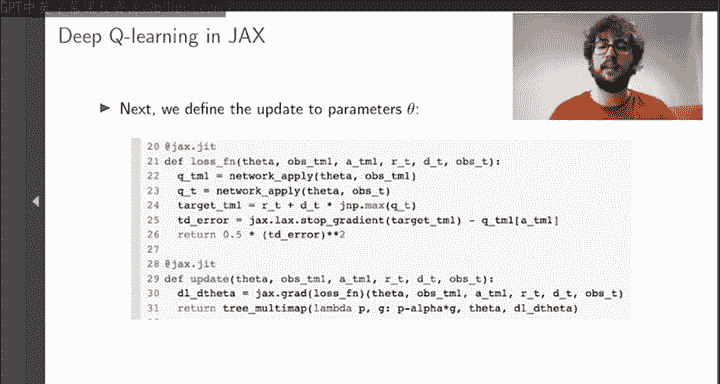

This is of course， a fairly simple agent， but it really shows actually a full pipeline for defining a deep parallel agent because we defined the network and the gradient updates and we have applied these updates。

And the reason it looks so simple and clean is that we have exploited the dis beautifulful J AF capabilities that allow us to get an update from a loss function or a pseudo loss function in this case。

 by just completely calling jack red on the relevant numericalaritital function。

So in the next section we'll actually now delve into what are the challenges of DRL。

 how we can make the reinforcement learning part aware of our specific choice of function approximation。

 and also vice versa how we can make our deep networks more suitable for ourL by understanding the unique properties of updating the parameters with our reinforcement learning objective。

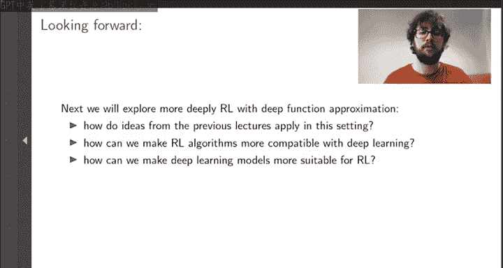

In this section， I want to give you some insight in what happens when ideas from Enment learning are combined with deep learning。

 both in terms of how known RL issues manifest when using deep learning for functional approximation。

 and also in terms of how we can control these issues by keeping in mind the effect on functional approximation of our reinforcement learning choices。

Let's start with the simple online DPQ learning algorithm from the previous section。

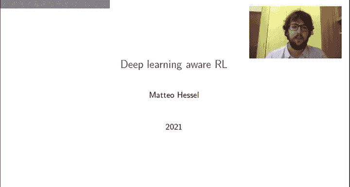

What are potential issues with these algorithmg？To start， we know from deep learning literature。

 for instance， that to castastic gradient descent assumes gradients are sampled IID。

And this is definitely not the case if we update parameters using gradients that are computed on consecutive transitions in MDP。

 because what you observe on one step is strongly correlated with what you observed and the decisions that you made in the previous steps。

On the other side， we also know that for instance， in deep learning typically mini batches instead of using single samples is typically better in terms of finding a good biasfi in straight。

And again， this doesn't quite seem to fit the online deepcu learning algorithm that I described in the previous section。

😊，Because there we perform an update on every new steps。

 so every time we are in a state and execute in action。

 get a reward the discount and another observation we。

 we would compute an update to our parameters data。

So how can we make ArL more deep learning friendly？

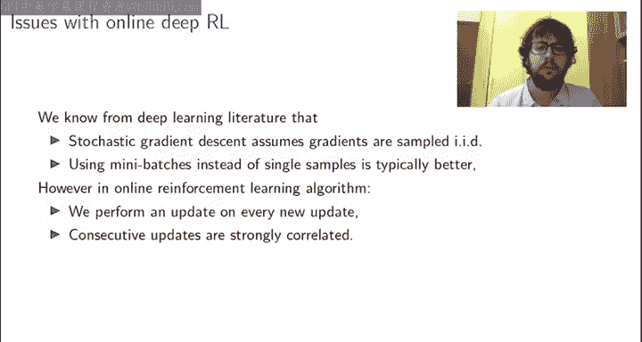

If we look back to previous lectures， it's quite clear that certain algorithms may better reflect deep learnings assumptions than others。

 so it's good to keep deep learning in mind when choosing what to do on the else side。

 so for instance during the planning lecture we discuss DnaQ and the experience replay where we mixed online updates we also updates computed on data thats was sampled from a learn model of the environment in the case of DynnaQ or from a buffer of past experience when we're doing experience replay。

And both actually might address very directly the two concerns that we just highlighted in the vanilla DPQ learning agent that I described before。

 because by sampling state action pairs or entire transitions from a memory buffer。

 we effectively reduce correlations between consecutive updates to the parameters and also。😊。

We get for free basically support for mini batches instead of doing a loop where we apply end planning updates。

 we could just batch them together and do a mini batch gradientding asscent instead of Ba S GD。

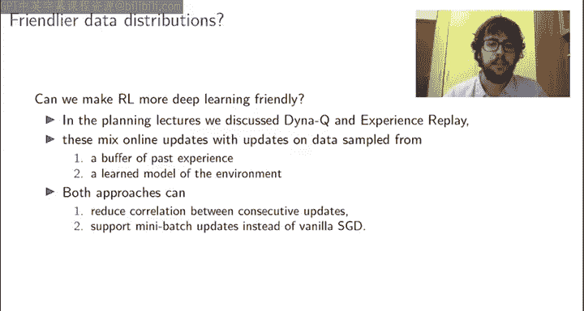

Similarly， if we know we are using deep learning for function approximation。

 there are many things we can do to help learning to be stable and effective， so we could use。

 for instance， alternatively online RL algorithms such as eligibility traces that naturally integrate in each updates with the parameter stta informations that comes from multiple steps and multiple interactions with the environment without requiring explicit planning or explicit replay like in DynnaQ or experience replay。

Alternatively， we could also， for instance， think about certain optimizers from the deep learning literature that might actually address and alleviate that they issues come from online deeper reinforce learning by。

 for instance， also integrating information across multiple updates in a different way， for instance。

 by using momentum or data add updates。😊，And finally。

 in some cases if we keep in mind the properties of deep learning。

 we might even be able or willing to change the problem itself to make it more amenable。

 so for instance， we could think of having multiple copies of the agent that interact with parallel environments and then mix this diverse data that comes from multiple instances of the environment in each single update to the parameters。

That's how de'llve even deeper， so we said that if we use DnaQ or experience replay。

 we can address certain issues that and better fit certain assumptions of deep learning。

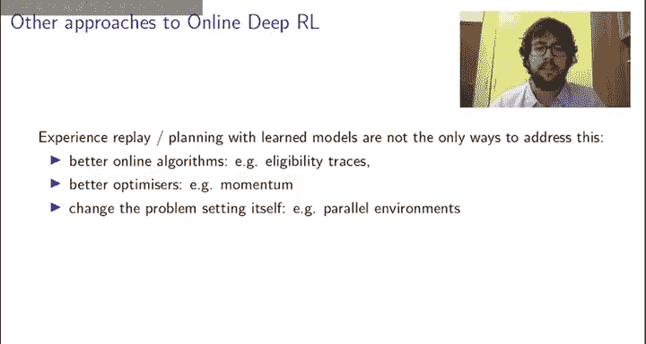

At the same time。If you think about dying Q and the QN and what happens when we use these algorithms in combination of functional approximation specifically。

 then we are actually combining functional approximation of course。

 but also bootstrapping because we are using， for instance。

 Q learning to as model3 algorithm and of policy learning because by replaying past data。

 we are effectively mixing the data is sampled from a mixture of past policies rather than just from the latest one。

😊，AndYou might remember that we denoted the combination of exactly these three things。

 the deadly triad， which doesn't sound good right， and the reason is that we know from the theory that when you combine these three things。

 there is a possibility of divergence。😊，At the same time， if you read the DeepR literature。

 you will find that many， many successful agents do combine these three ingredients。😊。

Theres maybe attention here， how is this possible？😊。

A partial resolution is that the deltraread states that divergence is possible when combining these。

 but not as certain and not even that it's likely， so if we understand and keep in mind the properties that underlie both Arl and deep learning algorithms。

😊，There is actually much we can do to ensure the stability and reliability of deeper alles。

 even when they are combining all the elements of the deadly trade。And in the following slide。

 I want to exactly help you develop an understanding and an intuition about how and when the De manifests when combining reinforcement learning with the use of neural networks for functional approximation。

😊，And as done with for instance， the two initial issues we discussed so batching and correlations。

 this by understanding and keeping mind the properties underlying RL& deep learning。

 this will already go a long way towards being able to design the parallel algorithms that are quite robust。

So let's start with a larger empirical study that I performed with Haddo。

 where we looked at the emergence of divergence due to the deadly Tri across a large number of variants of deep learning agents and across many domains。

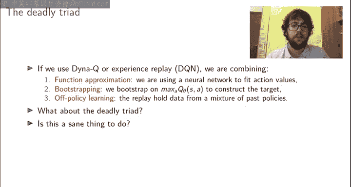

what we found is that empirically unbounded divergence is actually very， very rare。

 so parameters don't tend to actually go into infinity even if you are combining all the elements of the deadly tried。

 what is more common is a different phenomena we call soft divergence and this is shown on this slide where we show the distribution of value estimates across many。

 many agents in many， many environments and for different networks on the left and the right respectively。

And what you see is that the values explode initially。

 so they grow to orders of magnitudes larger than it's reasonable to expect in any of the environments that we're considering because the max crew values were at most 100。

😊，Well， here we're seeing values even in the order of tens of thousands or hundreds of thousands or millions。

But what we see is that these values that are initially diverging don't go to infinity。

 So over time the estimates actually recover。And go back down to reasonable values。You may wonder。

 well， if soft diveverrgilence mostly resolves itself when doing the paralleling practice is it even a concern。

 should we even be discussing how to minimize this initial instability？

And I think the answer is that， yes， I think it's worth discussing these things because even if doesn't diverge poorly to infinity。

 having many hundreds of thousands or millions of interaction with the environment where values are wildly incorrect does affect the behavior of the agent and the speed of convergence to the correct solution。

Then let's then discuss what we can do about it， how do different reinforcement learning ideas help us ensure that the learning dynamics when using deep networks for functional approximation is stable and effective。

The first approach I want to tell you about was introduced by the DQN algorithm and is known as target networks。

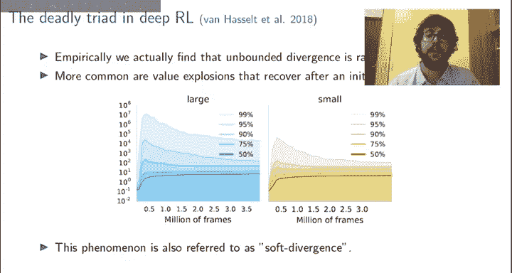

The idea here is to hold fixed the parameters that are used to compute the bootstrap targets。

 so in Q learning， for instance， this would be the parameters that are used to estimate the max queue on the next step。

And then only update these parameters periodically。

 maybe every few hundreds or even thousands of updates。

By doing so we interfere with the feedback loop that is at the heart of the Detride if you remember the core issue with the detride is that when you update a state。

 you also inadvertently possibly update the next state that the one that you are going to bootstrap on and this can create certain feedback loops but if the parameters that use to bootstrap are frozen at least for a while。

 then this feedback loop is broken。

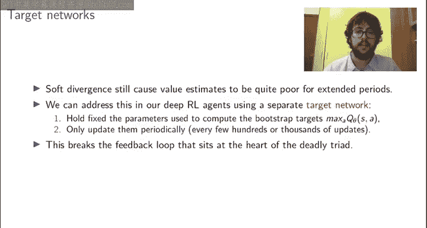

This is also the only approach so for instance we know that Q learning by itself。

 even in a tabler setting has an overestim bias， and this can result in unreasonably high value estimates of least in an initial phase。

So it's possible that actually this could interact with the deli try then in the likelihood of observing these explosions in the value estimates。

😊，If this was the case， then we could use， for instance。

 doublele Q learning to reduce the overestimation of the update。

 and this would also help us make the algorithms more stable with respect to the deadly tried。

In WQe learning， you may remember， we use separate networks to choose which option to boostrap upon and the evaluation of such action。

And neatly， this actually combines really well with the target networks idea because then we can use the frozen parameters。

 the ones of the target network as one of the two networks。😊。

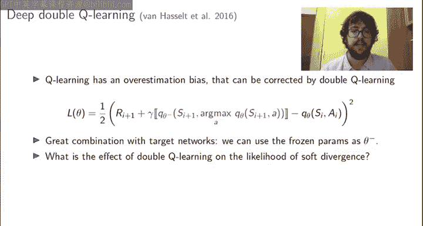

And in this plot， you can see and compare the effects of both using target networks using only doublele Q。

 which is what is dubbed here inverse doublele Q and doing both。

 so doublele Q learning typically uses both the separation of the evaluation from selection of the bootstrap action。

 but also use target network for the target estimation。😊。

And what we see is that actually both these idea have a strong stabilizing effect。

 so just using target networks， for instance， dropped the likelihood of observing soft divergence across the many agent instances and environments from 61% of their experiments to just 14%。

And if we consider the full double queue that combines both the idea of deco coupling action selection and evaluation and the target network idea。

 then the likelihood of observing soft divergence actually dropped to only 10%。In general。

 I personally find it's quite insightful to see these things and see how different choices on the reinforcement learning side interact with the deadly triad that is triggered by the combination of the bootstrapping and of policy with function approximation。

And it's quite interesting to see that this is not just about， for instance。

 target network or double key learning。Throughout our design choices that we make in our regions。

 each design choices can interact with function approximation and the learning dynamics of our deep networks。

So consider， for instance， a different aspect of our agent。

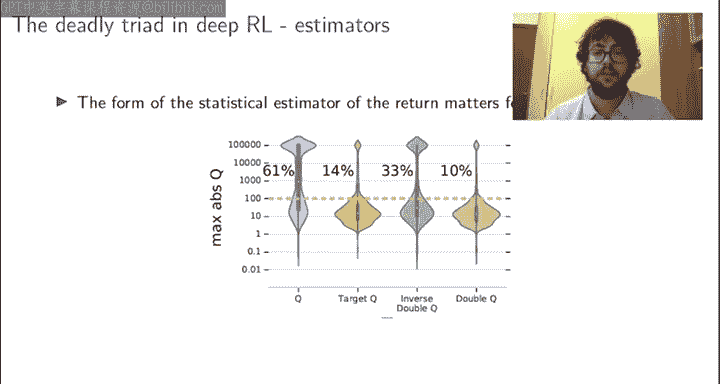

If you're using Dner or experience replay， we will be sampling either state action pairs or entire transitions。

And one choice there is to just sample uniformly is。Most simple。

 but also the safest choice as we'll see， but it's also somewhat unsatisfying because。

Not all transitions that you have seen in the past are equally useful or important。

 some states we might be able to make already predictions very accurate very well。

 while in others there might be a lot that we can still learn because maybe our states that we haven't seen many times。

And prioritized replay was introduced to allow us to make more efficient use of resources by sampling more often these more interesting transitions。

And there are many ways you can prioritize， so I don't want to go into too much details here。

 but for instance you could sample more often transitions with higher to the error。

But regardless of the details。What I want to what I want you to think about for the purpose of this lecture is how does the choice of prioritization？

😊，Affect the emergence of the deadly tried in terms， for instance。

 of the likelihoodlude of observing soft divergence。And if you think about it carefully。

 by prioritizing， you are increasing the amount of policyiness。

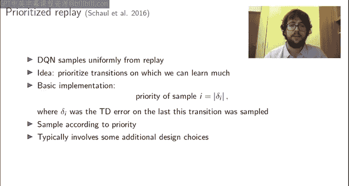

And indeed， what we see in our empirical study is that we find the stronger the prioritization。

 the more likely it is that we observe self diveence。

This by itself does not mean at all that prioritization is a bad idea。

Just that we need always to strike a balance when we're using prioritization between the benefits of seeing more often the most useful transition and the potential risk of reduced value accuracy。

 at least in the short term， due to the emergence of this deadly tri。

By being aware of this subtle interaction， we can also modify the ArL algorithm to reduce adverse effects on the learning dynamics of our function appxiator。

So for instance， in the orange line in this plot， what we show is the likelihood of soft divergence。

 if we at least partially correct the of policyness， via important sampling。And as you can see。

 we can actually push prioritization much forward along the X axis while still keeping the risk of soft divergence reasonably low。

😊，But there are other things that if you are thinking about that try it could be important to think about to ensure that our DRL agents are state。

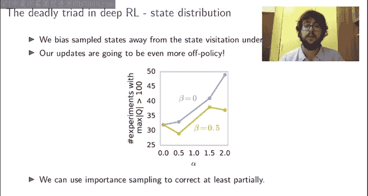

So if you think about the deadly tride， at its core， it's an issue of inappropriate generalization。

 we already said this many times， the reason we observed the deadly tri is that the value of a state and the value of the subsequent state that we would strap on are tied via generalization。

😊，But we don't need to immediately bootstrap when we're computing D parallel update。For instance。

 instead of accumulating one reward and then bootstrapping on the maxQ value on the next step。

 which is very close to the source state and therefore might be more affected by generalization。

 we could instead accumulate many rewards and only then bootstrap on the maxQ value。

Potentially we could even do this and combine as， for instance。

 wes using a double estimator for extra stability。And in D parallel setting。

 this would result in a multistep double queue update， which has shown this slide。

 and this will go a long way to help us because it's still well defined target。

 is still a policy improvement， but is much less susceptible to the triad because we' are reducing the reliance on bootstrapping and we're reducing the amount of generalization only appropriate generalization and we get on the bootstrap target。

😊。

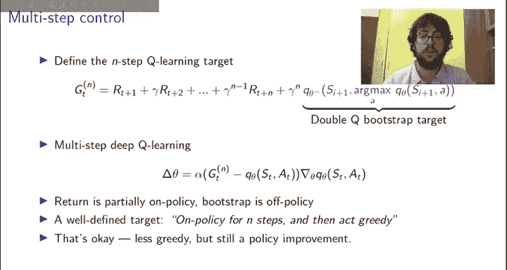

For instance in this plot， we are showing again in our usual empirical study across many agents and many environments。

 what is the likelihood of software divergence if we increase the number of steps before bootstrapping from 1 to 3 and to 10。

 and what you can see is that the likelihood of soft divergence drops radically from more than 80% to just 9%。

It might seem maybe a bit scary at first， the way in which basically every divine design choices in our RL updates subtly interacts with the learning dynamics of our deep function appximator and while in this lecture I focus on the deadly try that this is by no means the only case。

😊，But hopefully you can also see this in a positive way because this is what makes DPL quite an exciting Arab of research because it really requires you to think holistically about the whole process of learning and decision making and how all the components fit together。

😊，But if you have a good understanding of the core ideas behind both RL and deep learning and I hope you will have by the end of this course。

 you can do this so you can reason about how these components fit together and you have a chance to build really powerful learning system that can really push the limits of what is currently possible with AI。

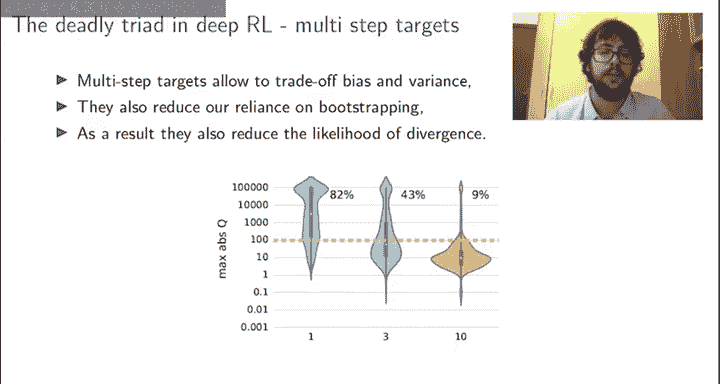

In this section， I want to take a rather different perspective from the previous section。

Instead of focusing on being aware of our functional approximation choices when designing our ourL algorithms。

 I want to discuss about the deep learning side， so can we design our neural network architectures to be especially effective for enforcement learning can we understand what it means to optimize the neural network with targets constructive via bootstrapping。

What does it mean to increase， for instance， capacity in the network if we are training a reinforce learning problem？

This of course is a huge hour of research， so I won't be able to cover all ideas in the space of this lecture。

 but hopefully I can give you at least some intuitions and some ideas。

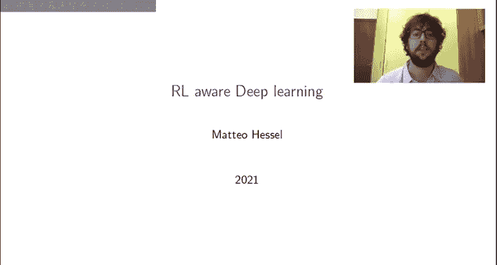

If you think about the recent history of deep learning。

 much of its success comes from being able to encode certain inductive biases in the network architecture so that they can best support learning in certain broad categories of problems without limiting their ability to build tailored representations specifics to each task purely from end to end gradient descent。

So for instance， convolutional nets source much of their power from their capability of learning translational imvis to sectors that make learning computer vision tasks much easier or similarly。

LSTMs support long term memory by a specific architecture that allows gradients to learn to use gating to preserve information over large horizons。

 and this was instrumental to many early successes in natural language processing。

Since ArL is relatively different from both vision and NLP and the most common supervissed learning task where deep learning is applied to。

 I think it would be surprising if just copying network architectures designed for supervarious learning would actually give us the optimal results。

Instead， I think we should consider what are the right architectures for reinforcement learning。

 which inductive biases should we incorporate to make， for instance。

 value estimation as easy as possible。And this was the motivation of the Duing Network paper that was introduced a few years ago。

 this introduced a network architecture that could improve the performance of deepQ learning agents quite significantly and basically out of the box without requiring any change on the reinforcement learning side。

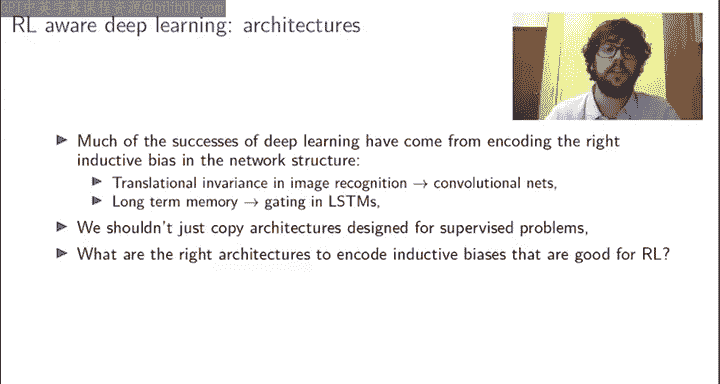

As with the convolutional nets and SDMs， the AD is actually remarkably simple。

 so normally DPQ learning agents use a network architecture like the one on the top in this slide。😊。

They take an observation as input， for instance， pixels on the screen if the agent is learning to master a video game。

Process this input via a number of hidden layers， so typically con layers if the observation is in visual form。

 and then apply some fully connected layers to output all action values as a vector with many elements as many elements as actions。

In general， though， we know that we can decompose action values as a sum of the state value estimates that looks at long term with n is independent of the action and only depending on the state。

 plus an immediate advantage term that depends also on which action we are going to take right now。

So this actually suggests somewhat naively a different architecture。

 whereas as before we take an observation as input， process it by some coners if it's an image。

 but then。The network generates the Q values by summing a scalar and a vector output。

 with their own separate stream of processing， therefore forcing the network to represent action values as the sum of an action dependent and action independent term。

If you use something that looks like this， you can train the resulting Q values to using standard deep Q learning。

 you don't need to change basically anything else。

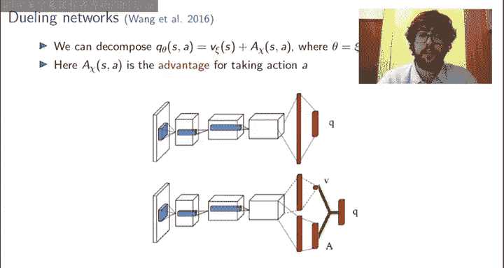

But will this help？Well， let's consider a concrete problem where we have trained this Ulink Q network to estimate Q values for an agent that must control a car running on a highway。

 There are some turns。 There are some other cars that you must avoid crashing into。

And in the images in these slide you can see what the sc and vector component of the due network are mostly attending to。

 so the plots are generated by highlighting in red the pixels that most affect the two outputs。

 so this is what is called a salency map with on the left what the scal term is mostly attending to and on the right what the vector action dependent term is attending to。

What you can see is the sc term on the left learns to attend mostly to the direction of the road far ahead of the current location of the car。

 as this is what matters for the longter value of the current state Instead。

 the vector term on the right learns to attend mostly of what is right in front of the car。😊。

As this is what is important to estimate the immediate advantage of each action。So this。

 I think would be very interesting by itself， but it also results in quite significantly improved learning with agent learning both quicker and more stably。

If we're thinking about our railware deep learning though。

 the topology of the network is not the only important factor。

 so in supervised learning for instance， we often find that more data plus more capacity。

 not just better architectures equals better performance for instance。

 because the loss might be to optimize。But how does network capacity affect， for instance。

 value function estimation in reinforcement learning？In my experience。

 typically larger networks do tend to perform better in reinforcement learning as well。

 but it's not all roses。

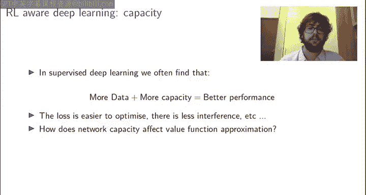

If we use larger networks， we will， for instance， be more susceptible to the de it。

 especially if using manil learning。In the large empirical study that I discussed already extensively in the previous section。

 we also looked， for instance， at different network capacities and what we found is that with Q learning。

 for instance， the likelihood of soft divergence where at least initially the values might grow to unreason estimate was actually increased as we would make the network larger and larger。

And there are many reasons for this， one potential leading candidate is that larger network is tend to have a mover landscape。

 and at least initially this means that it might suffer more from inappropriate generalization。

Of course this is as always in reinforcement learning and in deeper reinforcement learning。

 these are all tradeoffs， it doesn't mean that we should not use large neural networks because those do tend to result in better final performance at convergence。

 but we should be aware that if we as we increase the capacity of our network for instance。

 this might result in some instability early on if we don't take care to use double Q estimators multistep targets。

 or generally the functionalroiator friendly updates that we discussed in the previous section。

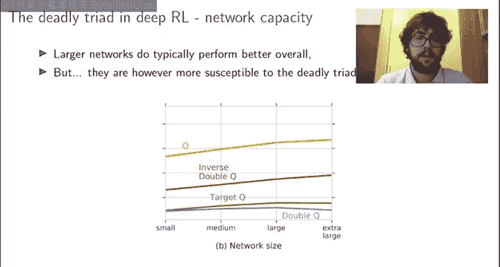

Another issue that is worth being aware that also relates to smoothness is that。😊。

Many deep learning architectures have a bit of a problem at approximating sharp discontinuivities。

And this is not so much of an issue in supervised learning。

 but it can be quite tricky when we're doing aL， and I'll try to give you a bit of insight why this smoothness property might be problematic。

😊，So in the plot in this slide， we have a grid rule where an agent might move from any cell to any of the neighbor cells。

But the grid will is split in two parts， separated by a wall。So if an agent starts on the top。

 it will not be able to reach the bottom portion of the grid world and vice versa。Critically though。

 a rewarding location is present only in the bottom half， but not the top half of the grid。

 meaning that the values in the upper half are exactly zero。

 while there are none zero immediately beyond below the wall。

So if you attempt to learn state values for this problem， for instance。

 under assume the fixed random policy。We could use Monte Carlo updates on the parameters of the network to do so。

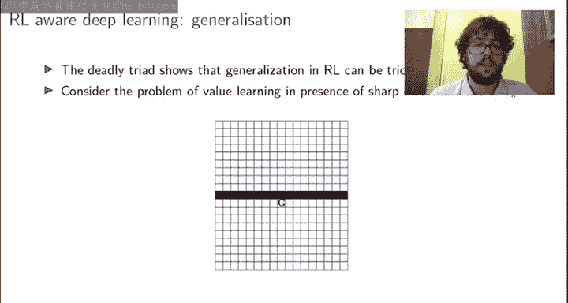

If you do it， what you will see is basically the error heat map on the left。

The predictions are mostly accurate everywhere， with some noise in the bottom half due to the fact that Monte Carlo updates are high variance。

And some error in the upperpper health in a very tight band just above the wall。

 this is due to the fact that a network with the canonical architecture such as those that we use in supervised learning has troubled to approximate the sharp discontinuity values that go from nonezero to exactly zero soon as you cross the wall。

Overall this， though， might seem reasonable， sure， you， smoothness might have introduced some errors。

 but maybe that's expected， it's not too concerning。

And now consider what happens in the error map on the right。

 this corresponds to training the same value network by using TD instead of Monte Carlo and the result is quite fascinating I would say because in the lower half the values are still very accurate actually even more because the TD updates are lower variance so you don't get to that the noise that we are seeing in the bottom half with Monte Carlo prediction。

But on the upper half， there is an hour not confined any more to a low small band close to the wall。

 and instead the difficulty in fitting the discontinuity just above the wall actually leaks to the valley predictions in the entire upper half。

So this may might be surprising at first， but the reason is that states throughout the upper half will bootstrap on the incorrect states just above the wall。

 and this means that error will propagate， and this is a phenomenon that's been called leakage propagation and is an example。

 another one now of how certain movementness property of a function appator that might be acceptable in supervised learning can be quite problematic in RL。

 so this is maybe a further motivation to double down on reinforcement learning aware deep architectures to make sure that we can support the kind of problem and function classes that we care about in RL。

And there is much more still that could be said than certain architectural traits that could alleviate these issues。

 but for now I really want to conclude highlighting what's behind the many of the things I discussed in this section and this is again like in we saw in the past inappropriate generalization。

 so this movementness leads to inappropriate generalization and this leads to leakage propagation and this leads to the deadly tried for instance。

😊，But so while ArL where deep learning architecture will certainly help。

 and I think this is very important， although some comparatively underexplored topic in deep parallel research。

 the issue of learning good representations for ArL will likely not be entirely solved by architecture alone and to help we will also need to change I think the way we train the representations in the network because by having better representation is we will then be able to have less inappropriate generalization and one leading idea in this space I would just want to mention now but will be the topic of the several lectures in the remaining part of the course is that maybe we should consider learning state representation that are not just for the single purpose of predicting a single value function for a single award and instead we should maybe share representations across many tasks。

 for instance， predict the value for different policies or for the same policy but under different discount or for the same policy under the same。

Discount but for a different cumulants other than the main task reward。

And if we can find good ways of doing this， this might alleviate many of the issues that we discussed throughout this deeper DRL chapter。

 both in terms of deadly triadligit propagation and so on， so this is a very。

 I think interesting area of research in DRL that we are going to touch on quite extensively。

