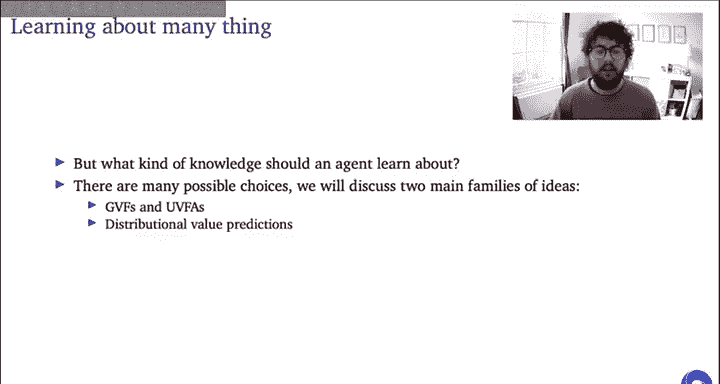
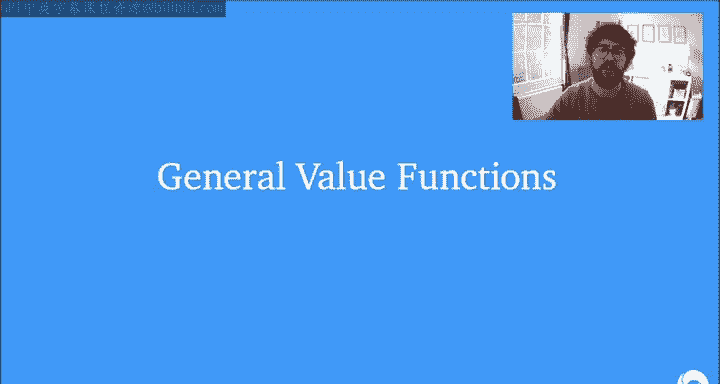
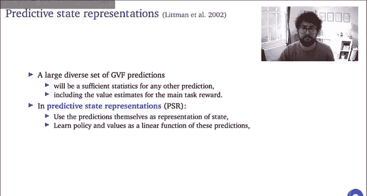
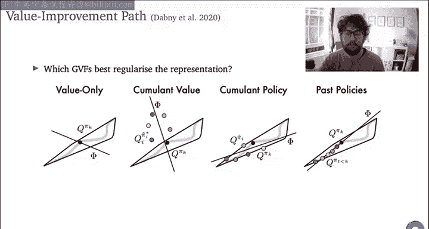
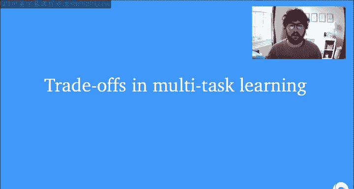
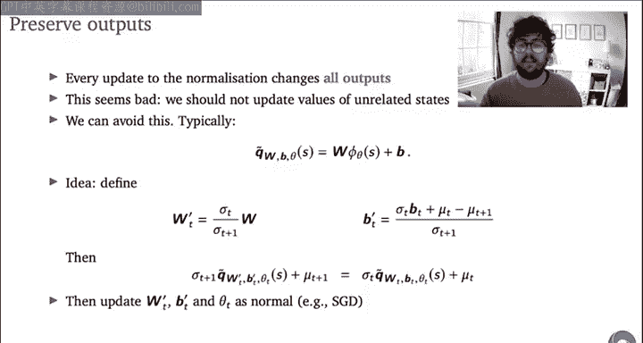
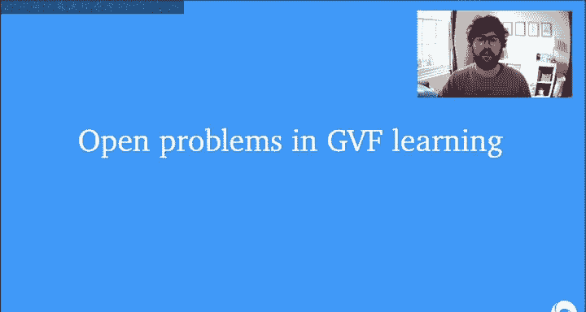
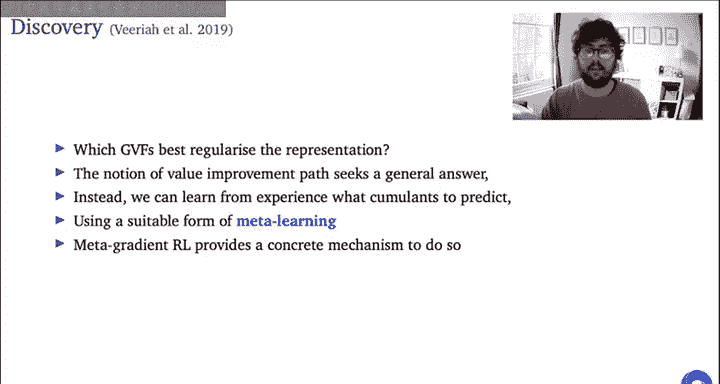
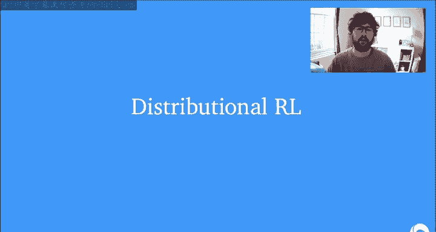
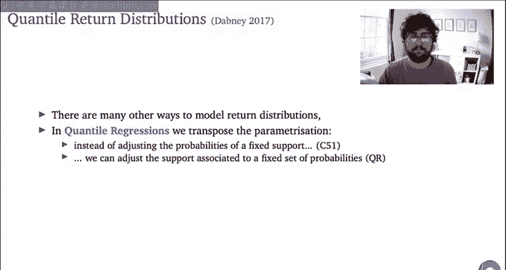

# DeepMindxUCL《强化学习｜Reinforcement Learning 2021》中英字幕 - P13：[13]Deep Reinforcement Learning #2 [13_13].zh_en - GPT中英字幕课程资源 - BV1JssaeVEMp

Yeah。Welcome back to this second part of our introduction to DPL in the first section we started by discussing how deep neural networks can be used for function approximation in RL and how automatic differentiation specifically can support doing so with relative eases。

And then we delved into the issues that arise when doing so when using deep learning for function approximation。

 so for instance we discussed how the different choices that we make on their L side affect the learning dynamics of approximate value functions through phenomena such like the deadly triad or literature propagation。

Several of the issues that we discussed there were ultimately issues of inappropriate generalization。

 so today I want to talk about some of the ideas that can be used to help with this problem by tackling directly the fundamental problem of representation learning in ourL。

And I want to stress that this is far from a solved problem。

 so what I will discuss today is you can see it as a partial snapshot of recent research on this challenging issue。

 but not an ultimate answer。But the main side that underlies many of the things that we will discuss today I think is quite important and is that so far our agents optimize the representation for a very narrow objective。

 purely the prediction or maximization of a single scalar reward。

 and this narrow objective is the only thing that is driving the entire representation learning in our D parallelL agents。

And this has some advantages， so the ability of building flexible rich representations that are kind of tailored to a specific task at hand is。

 that all the main reason we use deep learning in the first place。

 but this come with some disadvantages because such a narrow objective can induce an overly specific overfi state representation that might not support good generalization and this in turn can make agents even more susceptible to issues like the deadly Tri。

And if you agree with this premise， then maybe the natural step is to ask our agents to learn about more than just a single task award。

 have them strived to build the richer knowledge about the world。But of course， this is。

 in a sense it's easier said than done because in order to do so we need to think of what other knowledge should they learn about and there are many many possible choices。

And since representation learning is not a problem that as exclusive URL。

 we can also tap into supervised learning literature for some inspiration and among the many possible ideas that can help build these representation。

 I want to focus on two families of ideas that have attracted very very a lot of interest among ourL researchers in the past years and these are general value functions and distributional value predictions。

So let's start with the first general value functionss。

If you're a recall from the beginning of this course。

 R is based on the so called reward hypothesis that states that any goal can be represented as the maximization of a suitable sc reward。

This hypothesis was originally discussed to argue that maybe Ar as a whole is a sufficiently formalism for intelligent goby oriented behavior。

 but today I want to use this hypothesis to make a different point and argue that if this is the case。

 maybe then all useful knowledge that agents should or could aim to collect in order to support learning can also take the form of predictions about suitable cumulative color signals。

But importantly， this predictive knowledge does not need to refer to the single main tasks of overreward。

 instead the agent could make predictions about many different undercalalar quantities。

 and these predictions would still look very much like value functions。

 but it would refer to a different scal signal and are therefore typically called the general value functions。

General value function is in a sense very much like a standard value function and it is a prediction about the expected coolulative discounted sum of a suitable Sch signal under a given policy。

But in general many functions， we make explicit this dependency on the scal signal C。

 a discount factor of gam and the policy pi， because we are open to make different choices for each of these。

So in the GVF language， the Sch signal seeda we choose to predict will be called a cumulant。

While the discount gamma associated with GF will still define a horizon for the predictions that we make about the dec cumulant and the target policy pi is going to be in arbitrarybit behavior under which we compute expectations。

 and this will not necessarily be the agent policy。Of course， this may still feel a bit abstract。

 so let's be even more concrete。 and let's let's consider some examples。 So if the cumulant。

Its the main task reward and we compute the expected discounted cumulative sum of this signal under the agent policy and under the agent discount。

 then the GB prediction problem just reduces to canonical policy e。

 that is the problem that we have dedicated so much to space in previous lectures。But if instead。

 for instance， the cumulant is still the main task reward。

 but and we still predict an under agent policy but we have this kind of zero。

 well then this becomes an immediate reward prediction problem。

And we are not supposed to have only one prediction we making so we could have ends。

 each corresponding， for instance， to one of the state variables or one of the features。

And if we predict these under agent policy with a discount of zero。

 then this becomes the next stage prediction problem。And of course we can go on and on。

 we can consider many different cumulants， many different horizons。

 many different hypothetical behaviors on which to predict these cumulants。

 and the useful thing about the GBF frameworks is that it allows us to just represent this very rich knowledge about the world。

 but learning all of these predictions with the same mechanism。

 so for instance we could use same TD algorithms that we are served to predict make value predictions for the main task reward to predict any of these。

And the main problem then becomes not how to learn such a knowledge。

 which in some sense we can address with the standard URL， but how do we use these predictions。

 this rich knowledge about the world to provide our agents with good representations that can support fast learning。

 effective generalization and all the things that we are after。

One beautifully simple approach would be to use the GF's predictions directly as representations。

 and this is what is called predictive state representation or PSR。

And it's based on the argument that for a large， sufficiently large and sufficiently diverse set of GBF predictions。

 these will be sufficient statistics for any other predictions that we might want to make， including。

 for instance， the value predictions for the main task award。

 therefore we can use the GBF predictions themselves as state features and then learn values or policies for the main task as linear functions of these predictions。

And this actually has a number of opinion properties and so I would encourage you to read the paper linked at the top to learn more about this。

 but it's also not the only way of using GBF predictions。

Another option for how to use GFs for learning state representations is to use them as auxiliator。

So this use of GB resembles a number of techniques from supervised learning。

 where forms of auxiliary tasks have been introduced to help with representational learning。

 so think for instance， to the self-supervised learning objectives that are common in computer vision。

And this approach has the advantage of being especially well suited， I think。

 to B parallel agents because the compositional nature of neural networks allows us to combine auxiliary predictions with the main task predictions with relative。

When we use GB as auxiliary tasks， the way we typically do so is by sharing the bottom part of a neural network that we're using as function appator between the main task prediction。

 so for instance， a policy prediction or a value prediction and all of the auxiliary G predictions。

And by doing so， what happens is that both the main task and Ex predictions become a function of a single shared hidden representation。

And then both the shared and unshared parameters can be optimized by minimizing jointly the losses associated do both types of predictions。

And the result is that the hidden share representation is forced to become more robust and more general and encode more about the world。

So this specific way of using GVF such auxiliary tasks was， for instance。

 implemented in the Un agent， it was introduced by Yaderberg and a few others a few years ago。

So in Un， a neural network is used to map input observations to both a value prediction and a policy prediction because it's based on a fairly standard aritic system。

 but additionally， 400 distinct cumulants are constructed as the average change in intensity of pixels between consecutive observations。

And then an additional head is connected to the hiddenA representation from which we make value and policy predictions。

Just after the end of the convolutional stack， and the auxiliary head is then trained to predict GBs for each of these 400 cumulants。

And these auxiliary losses are then referred to as pixel control losses and are just summed to the standard policy and value losses。

 and everything is optimized and to end。The same kind of system can also be applied if the observations are not images or if the observations themselves were too big to use them directly to construct this large number of cumulants。

 so for instance in the same paper they introduce another related GBF based auxiliary task。

 which is what they call feature control， again it works by constructing a large number of cumulants。

 but these are computed as the differences between the activations in the network itself between consecutive steps instead of being differences in the intensity of pixels。

But similarly to pixel control， once we have this large set of cumulants， however we derive them。

 they just learn the GFs associated to each of these cumulants by having an auxiliary prediction head again that shares the bottom convolutional stack with the main task policy and the main task values。

 but then is forced to also support this additional auxiliary tasks and therefore learn a richer。

 more effective representation basically。It may seem as a small change。

 but actually making these GPS predictions either in the pixel control type or in teacher control type did make a real difference。

 so for instance， in this plot taken from the unreal paper。

 you can see how using these auxiliary predictions so the blue line labeled unreal in this plot delivered the huge improvement in the overall performance of an acrorytic system on a suite of challenging navigation tasks。

And this is despite these auxiliary predictions only affecting the rest of the system。

 food improvement and representation learning， so for instance we're not using them to implement PCR for instance or for anything else except。

Proroppagating gradientdis and updates into this shared representation。

And it might seem surprising at first that how can it make all thecer difference。

 after all the cu ones that we are predicting these GPSs for don't seem to encode a particularly useful type of knowledge。

 it may actually seem somewhat arbitrary and contrived and particularly in the pixel control setting。

And even worse， we're not actually making use of the resulting predictions in any way。

 but if you consider， for instance， pixel control， making these predictions regarding the variation and intensity of pixels between consecutive observations actually requires the agent to understand many nontrial aspects about the environment。

For instance， how data agent actions affect the location of objects in the field of fuel updates。

So even though it may seem a bit bed that these representation actually forced their representation to encode a lot of useful knowledge。

 and that is why they're likely to then make their representation more useful even for advertise types。

And this， I want to stress is particularly important and particularly useful in settings where maybe the main task reward itself is actually sparse and would therefore provide very little signal。

 at least early in training。Well in contrast， these auxiliary a cumulants that were constructed either from features or from observations can provide a very dense learning signal。

 and then it can help kind of bootstrap representation learning even even before the agent has had the chance to see the first reward。

 for instance， and then when it does actually see these rewards。

 it can pick up on these more quickly and then learn much more effectively。To understand， though。

 why using GB as computer predictions？Is actually useful。

 it's maybe worth thinking at what happens to the feature representation to try to understand what is the actual effect of this。

So let's start with the linearar function vaccination case。

 so this is the plot on the left and here we see that what happens in our enforcement learning update for some value functions。

When we're doing linear functional approximation is that we have some fixed feature representation and we construct a target value function using a suitable operator。

 for instance， a one step temporal difference operator。

And then this target value is projected onto the space that you can actually represent under the fixed speaker representation and the parameters are updated accordingly。

In deeper reinforceable learning， this is the plot in the middle。

 we have the more complex phenomenon， again we construct some sort of target value function using a suitable operator。

 but then we project on the space of value we can represent not under the original feature representation。

 but a new one that is updated to have a support as well as possible this new value of targets。

So we we are both changing the final value predictions。

 but also we are changing the representation itself to support the value predictions。

So what happens when we add auxiliary GB predictions。

 like the ones that we discussed with pixel control or fision control。

 well what happens is when we're regularizing the second step。

So we are preventing your representation from becoming overly specific to the current value predictions。

And what we find the least empirically， is that this regularization does seem to help quite a lot。

But by itself， this interpretation， wallet helps understand what happens when we use G as a binary task in a way。

It maybe raises a bit more questions than answers because after all。

 isn't it desirable for the representation to be updated to support the value predictions as well as possible。

 so why should regularizing the representation help in the first place and if it does。

 which GS would provide the best regularization？So let's try to answer these one at a time。

 so the first thing to keep in mind to understand why using GBFs to regularize representation is useful in the first place is that over the course of learning。

 we will actually need to approximate many value functions。

This is because if we're doing our job properly in ourL， the agents will get better over time。

 therefore both our data distribution and our value predictions。

 even in the same states that we have seen in the past， change as the agent's behavior changes。

And this means that we want a representation that can support not just good value predictions right now。

 but it can support approximating all of the value functions in a way that on this path in value space that goes from the values of the initial policy。

 all the way to the values of the optimal policy。Regognizization can help us achieve this by preventing the representation from overfitting to the current value。

 therefore making it more likely to effective for a future value。アップ？

This is not that a decary thinking about it from what realizationization is used in supervisored for。

Where with just the need to generalize from a value to the next being akin to the needs to generalize from our training set to the test set。

The next thing about this value improvement interpretation that doesn't just give us some about why regularization might help。

 but it also provides us a handle to think about the second question of the gap that you might feel。

 so which GPS should be predict to make regularization as useful as effective as possible。To you。

 if you remember to construct the GF to use that observed task。

 you need to specify humans and target， So to try to answer this question of。

Wwhichch the might make the regularization more effective and aspect of that possible。

 let's see how the choice of cuulence and target policies affects the type of representation used by the use of a tasks as a representation。

So consider it based on old G thats， considering to。Different policies。

 but all referring to the same main task， so this takes a function which geometrically speaking forms the polytope will be depicted on this slide as a tri。

The value improvement of O we discussed before is that in some sequence of value functions within this portal that corresponds to the values of all various policies that an agents pass through over the course train。

 so this sequence will be affected by a brain line that is within the track。Nevertheless。

 value improvement path should always unfold in the direction of the optimal values。

 but the exact sequence depends on the initial also。But in any case。

For each given representation p that this here depict by a strict back。

 this will support different value functions more or less so。

So to understand how the different G choices of GPS affect will affect the learning and will make the representation more or less effective。

 we need to look at how the choices of the targets policies and cumulants affects the representation and how this interactable of data elements that we just define so starting from left the first stop we have the under case here representation learning is only driven by accurately predicting the current value function。

So in this case， there is nothing to force a representation to be well aligned with any other function except for a parent。

So can we have a very strong fitting？In the second law from left。

 we set to consider a case where we include the X of the specific class。

 but these correspond to cuulants that are different from the domain topic world。

This means that their value actually is that a side of the phtop that we have the define。

 so that a side of the define and is visually mixed as these colorrant off。Again， also in this case。

 there is actually no strong reason to believe that regularization will be especially when allowing to induce a representation that supports values along the boundary off。

But it does still at least seem to work empirical for a certain person of， for instance。

 so that a pixel control of the in the unreal religion has helped a lot and these actually correspond exactly to this second lot。

But it's good to realize that there isn no strong guarantee before it might to be something that tire to pick suitable deals。

The third plot on the left captures and said the case where we use GF as a the class。To predict。

The main cost award over a1 set of different target policies that differ from the Asian policy。

So now representation is forced to support a range of values within the polytope and given the geometric structure of this space of value function。

 it actually can be shown that for a suitable set and choice of policies。

 the new representation will capture the principal components of the value polytop and therefore provide good supports to approximating values in the polytoppee and including the ones in the value improvement path。

But unfortunately， the exact solution to construct the right set of policies is computationally in tractable。

So in the final plot， we show a concrete approach to picking these policies in a way that is instead tractable and the intuition here is that。

The actual value improvement path， so the set of values that we will care to predict during the course of learning is actually much smaller than whole polytop of all the possible value functions for all possible policies。

So maybe we should just target the values on this path。And at each point in time。

 while the future policies on the path are known， we do have already at least passed through some sequence of policies and associated values during training。

Basically the sequence of policy and that is we have been predicting so far。

So rather than picking the policies arbitrarily， we could take advantage of the trajectory。

To pick a of a selection of policies at least aligned with the value improvement path up to the current moment and by picking these past policies as the policies to use as targets in our auxiliary GFs。

 then we don't guarantee that these policies will induce representation that optimally supports future values。

 but at least it must support well the values on a subset of the value improvement path and provided us both an informed choice that is at least reasonable and a choice that is computationally tractable because we have access to these because we went through these policies during training。

And indeed， this choice of GEF as accilierary task was actually found to perform the best among all the choices that we discussed in a recent empirical study。

Learning about multiple Gs as an auxiliary tasks is basically turning agent learning into a multitask problem is we're now jointly training shared representations or many predictions that we can see as different tasks。

This is great for all the reasons that we discussed so far。

 but it can also introduce a few challenges。

When we want our agents to learn as much as possible about the world and make all of these additional predictions。

 we need to face the fact that we only have limited resources， so we have limited memory。

 we have limited representation， capacity， computation， and so on。

So different tasks will always find themselves competing with each other for these shared resources。

 so any concrete system will actually need to define some way of trading off these competing domains。

And the。The important thing to realize is that there is always a trade off。

 So even if you don't make it explicit， even if you don't do anything fancy about it。

The system will make some tradeoff， so for instance。

 the magnitude of the predictions and the induced gradients for different tasks will be different for different GF predictions。

And this magnitude will scale linearly with the frequency and the size of the individual cumulants。

 so it will be quite different across predictions， and this means that the updates from the different predictions will basically be reweighted accordingly in terms of how much they contribute to shaping the shared parameters。

So if we actually want these trade offs to be sensible。

 we need to think about them because otherwise we'll just be making some tradeoff。

 but these might not be the tradeoffs that we actually want for our agents。

understandstand how important and also how difficult the task is and how much the magnitude of the gradient can actually differ when making different types of predictions。

 I think it's good to consider the graph in this slide。

 so these three plots were generated by showing the gradient norms during training of value based agent on different atti games for three different types of agents。

😊，So the different atari games here constitute different tasks that you might make value predictions for。

And in all the free plots， the lines correspond to different percentiles of the magnitude of the gradient norm。

So this means that the width of these distribution gives you an idea of how diverse gradient magnetes can be across different tasks of different predictions。

 in this case， the values of predicting the values in different at games。

And what you see is that on the left and this is vanillail you learning。

 the magnitude of the gradients actually spans eight orders of magnitude depending on which task you're in。

With basically gradient norms ranging from 10 to the minus 2 to gray norms in the order of the millions。

And in the second plot we show what happens if the individual rewards are clipped to a small minus1 to plus one range and then again bancular learning is applied。

 so this reduces the range， but is important to see that the gradient norms actually still span almost four orders magnitude and this is because it's not just the size of the individual cumulants that you're predicting in a different task that counts。

 even if the individual rewards are of a similar size。

 the frequency of these rewards will be different between tasks and the gradient magnitude actually scales with the value magnitude。

 not the magnitude of an individual rewards。AndFurthermoremore。

 if we look at even at the individual tasks， the gradientd magnitude actually changes during the course of training because as the agent's behavior changes and the number and the size of rewards that the agent collects changes。

 so does the magnitude of the updates。And this is already a problem if you're training our Le power re agents on individual tasks。

 because you can imagine how hard for instance it can be to tune hyperparameters the learning dynamics can be so different across tasks。

But it also means that any naive multitask prediction problem， such as predicting auxiliary G will。

Will be really hard to get right unless you do something to control how you're trading off the demands from different tasks。

idealally what we would want is that across the different tasks that were making。

 gradients look like in the third plot on the slide， the green plot。

Here you can see that across all of these prediction tasks。

 the gradient magnets are actually confined within a reasonably small range。

 and this means that we can then be explicit since we can assume that the gradients themselves have a similar magnitude。

 then we can choose explicitly how we trade off between the different tasks。

 we could just assign an equal weight in which case given that the gradients have an equals an equal magnitudes then they would equally shape the representation or we can choose。

 for instance to put bigger weights on some task which we consider our main task and treat the others as auxiliary task and maybe contribute to shaping the representation but with a smaller weight。

The problem is how do we get there， how do we get to the point where our gradient updates have a comparable magnitude across all the many different predictions and all the many different tasks that their agent could be trained to learn？

So。The way we get there is by using what is called an algorithm using an algorithm that iss called pop art。

 which so that those plots are actually generated by running a vanillail learning algorithm。

 but with pop art on top。So but before I delve into exactly how this algorithm works。

 it's good to discuss another thing， which is if the issues can be so dramatic when training DPL systems to make different predictions。

 why isn't it usually discussed in supervised learning？Because also in supervised learning。

 we sometimes use multitaskism， and the reason is that in supervised learning。

 we typically assume fixed dataset sets。And this means that we can easily normalize both inputs and targets across the entire data set for any number of target variables that we want to predict。

 and everything will be always be well behaved。And this is actually what we do in supervised learning。

 we just don't even think much about it where we normalize variables before feeding gets into a deep learning system。

 because it's such a trivial preprosing that it doesn't require much fault。

But the problem is that in reinforcement learning， we do not have access to a full data set。

 and the scale of prediction is even non stationary， it even changes over time。

whichch means that any normalization scheme will need to be adaptive to always normalize appropriately across the duration of training。

 and this is a much more complicated system and that requires to actually think deeply about what we're doing。

Luckily this problem was already addressed， so for instance there are a few different ideas that we propose in the literature。

 but one that I want to discuss today is the Po art algorithm from the plots in a few slides ago。

 so this was introduced by Haddo and me a few years ago。And the algorithm works in two steps。

So the first step is what is called adaptive target normalization。

 So consider any one prediction that you're making。 So for instance， one of the GB。On each update。

 you will typically observe some target for that prediction could be， for instance。

 a key learning target， which you can construct for whatever cumulant you're learning a GB for。

Then what you can do with pop art is to normalize this target adaptly by keeping track of the first moment new and the second moment new of the targets for that prediction。

 so for instance， by doing some exponential moving average of the targets associated to one of the GPS。

And then you can update the network outputs to match up the original target。But on each step。

 use a normalized target that is constructed from the target， for instance the Q learning target。

 by subtracting the first moment and dividing by the variance sigma。

 which is estimated from the first and second moment by just subtracting the square of mu from nu。

And this will basically provide you a gradient of that is much better behaved in terms of magnitudes。

Iresspecably of what was the size of the rewards， what is the frequency of the rewards and so on。

 and this means that if you apply this normalization independently to each GDF。

 the gradients that apply that you will apply to the shared parameters of the network will contribute equally to the shared representation instead of having one or more of the auxiliary predictions dominates the entire learning process。

Importantly， when doing this kind of normalization。

 you can still recover the unnormalized Q values by just multiplying the network outputs which are trained in this normalized space by these statistics。

 sigma and Mi。And this is important because you actually need the unnormalized values in certain circumstances。

 for instance， to construct the targets via bootsrapping。The problem with the adaptive normalization。

 as we discussed it here， is that every time you update the normalization statistics。

 which would typically do on each step because we're just keeping trying a moving average。

 you're actually normalizing the update in the current state。

 but you're inadvertently changing the unnormalized agent predictions in all other states。

 and this doesn't seem good。Because there is no reason for indiscriminately changing the value of all other totally unrelated states。

And also it's in， not only seems a bit fishy， but it's also a concrete a， for instance。

 no station everything， which we know can make life harder for our prediction algorithms。

But luckily we can actually prevent this from happening at all with a very simple trick which I'll discuss in this slide and this is based on the observation that most neural networks typically have a final fully connected or otherwise linear layer at the very end。

 so you can effectively write the network outputs as a linear transform of the activations of the last hidden layer。

So the undermalized Q values will typically be some matrix w times p plus a by Spec B for a suitable WMV and a suitable hidden representation fee which。

In general， we'll include any number of nonlinear layers， for instance。

 some convolution layers with some re activations and so on。

The insight from pop art is that every time you change the normalization statistics。

 you can actually undo this change in terms of the unnormalized predictions by making the reverse updates to the weights and biases of the last layer。

 and this can actually be done with a very simple formula in an exact way。

The way Popar does it is by multiplying the weight metrics by the ratio between the old and the new scale factor and updating the bias as well with this slightly more complicated expression。

 which is showed on this slide。If you do this， then we get the best of both world because on each step we can still normalize the targets in our gradient updates as in the previous slides。

 but the unnormalized predictions that we use， for instance。

 for bootstrapping are not affected by this continuous change of this normalization statistics and this prevents any instaabbilities。

This search has been actually very successful in the past， so for instance， in this plot。

 you can see what happens if you train a single agent to make value and policy predictions for 57 different Atari games。

With all these predictions sharing the bottom layer of that effort。

The version with pop art is the one showed in orange。

 and you can see how it performs really much better than any naive baseline that does not normalize the updates for the different tasks。

 so the orange line actually gets to above human performance in aggregate across the 57 games。

 while the other baselines actually struggle to reach even 60， 60% of human performance。But。

While this plot shows specifically for the case of Tri。

 it's important to notice that the approach is in no way specific to atiri or the specific multitaask setting and can be used whenever you want multiple predictions to use a shared representation。

 but you want to trade off in a sensible way their relative contributions， as for instance。

 in a GBF based auxiliary task scenario as we discussed in the previous slide。In this section。

 I want to discuss a few more advanced topics in GF learning that we don't quite know yet how to tackle in order for still a very active area of research。

And I won't go into too much detail of the specific solutions as the specific methods used to address these issues will likely change as our understanding of these problems improves and instead I will give you a brief overview of what these problems are and just a sneak peek of what the frontier research looks like in the SA。

The first important topic that we need to make progress on to really scale these ideas up is of policy。

So this's something we discussed so far。We already have multiple auxiliary Gs that are only used as auxiliary predictions。

And are learned from prediction experience that is generated by a different main task policy。

Since the GFs might refer to a different target policy and a different equivalentvalant and a different discount。

 learning these auxiliary tasks already will require of policy learning。

And as you know from previous lecture， we have some tools to build with false learning。

But the reason I consider this still an open problem is that the degree of policyiness that you might face in this setting where you youre striving to learn like this rich knowledge about the world and many。

 many different predictions from a single stream of experience。

 the degree of policyiness that you face here might be quite extreme。

 and so I really think we will need fundamental improvements to our policy methods to really succeed in learning this fully diverse predictions about the world as exuxiliary tasks。

And another reason of policy learning is interesting is that in the context of GF learning。

 it's not only a challenge and obstacle to overcome。

 but it's actually also potentially an opportunity because if we are predicting values for many different cu policy and discounts。

 we could for instance， use the additional predictions。

 not just as ahierate tasks but to generate experience。

 there is more diverse and provide an excellent form of exploration。

 even for learning some main task policy。But how to best do so is still an open problem and again will require improvements also in how well our methods can cope with wildly of policy data。

Still， even though it is still a problem for we have at least some proof of concepts that these ideas can work and can provide meaningful improvements。

 for instance， in a unicorn paper from a couple of years ago we showed how a multitaask system learning about many tasks or varying difficulty。

 but sharing experience between all these tasks so that each prediction was learned off policies from data generated from behavior that wast use by all other predictions。

Then this sharing could allow to solve certain heart problems that were impossible if you are only striving to optimize for the hardless task。

Another important problem that might need to be revisited in the context of PF learning is generalization。

So far we have treated GBs as discrete sets of predictions。

Does potentially share a hidden representation， but are otherwise learned independently。

But how do we scale this to thousands or millions of predictions？

Learning about all of them independently might not actually be that effective。

 just like learning about the value of each state in the NP was not very effective。

 So several people and are quite excited about investigating whether we can use a similar approach used to learn values in large state spaces。

And try to generalize what we learn about one GVC to other related G in some large space of predictions and problems。

one concrete approach to doing this is to feed the。

 some representation of a cuant or discounts that we wish to make a prediction for as additional inputs to a single network that makes predictions for all GB wearing in。

So instead of having a naturally， it only takes one state and outputs multiple independent predictions。

This would be an effort that takes the representation of which predictions you are required to make as inputs and then basically exposes to generalization。

 both states and goals and tasks and cuvalants and discounts。

By using the same function approximation techniques that we have used to generalize across states。

So this kind of Gs， where we attempt to generalize across different predictions are referred as universal bodys that are actually a very exciting area of research and deeper learning。

The third important open problem I want to mention is discovery。

 so this is the problem of where do GBFs come from。

Even if we know how to learn about all of these of policy。

 even if we know how to generalize across many of different predictions。

 where do the predictions themselves come from， How do we pick which Gs to learn about So in the previous section。

 we discussed that there are many different ways we can construct Gs， right we can。

Construct pistol based cuulants， we can build feature based cuulants。

 we can predict the main past reward under previous policies of the agents。But。

While many of these work in practice and while specifically at least the value improvement path of interpretation actually gives us at least a relatively principled way of picking GPS。

 the research in how to choose what to learn about is really。

 really far from con so among recent approaches are quite different from what we discuss so far I want to briefly mention at least one that we introduced but if you colleagues including howdo in the paper discovery of useful questions as auxiliary tasks and here we propose that maybe we should learn from experience what are the useful GB that our agents should learn about and specifically we propose to do so by paraizing the cumulants and the discounted that we want to learn about as neural networks and then use the form of metal learning called meta gradientds you kind of discover online。

 what questions our agents should ask about the world and then try to learn。

Online while it's learning about the main task， for instance。

 and this actually resulted in quite a nice performance gains in Atari， for instance。

The final topic for today is what is referred to as distribution or reinforcement writing。

No are discussions so far to think about GBs who are still representing predictive knowledge。

 but in the form of expectations， so expectations of the cumulative dised sum of some scholar quantity as usual。

Another approach that has been proposed is to instead move towards learning distributions of returns instead of expected value。

 so this generalizes the usual prediction problem in a different direction so instead of changing the cuvalants or the discounts or the target policy that we are making predictions about。

 it changes the type of predictions that we make so that we predict not expected values but full distributions of return。

So while we generalize in different mechanisms those。

 kids realize that similarly to how predicting managed GVFs can help with representation learning。

 by providing some auxiliary task effect， learning distributions instead of expected values could also provide a richer signal that could result in better and more robust learning。

However， there is an important distinction between these two approaches while when we， for instance。

 are learning GBs the methods from as in the previous slides。

 we can reuse the same algorithms from the previous lectures since the beginning of the course。

 just applied them to different cu lengths， the problem of learning return distributions actually or requires us to extend our temporal difference algorithms in quite interesting ways。

And there's several concrete approaches that have been introduced in recent years。

 but I'll discuss just a couple to give you at least a feel of how you can change temporal different algorithm studio with distributions instead of expectations。

So the first instance that I want to talk about is what is called the categorical of the UN agent。

And the objective of this agent is to learn a categorical approximation of the true return distribution。

So how do we do this， Well， first， the data needs to define some some fixed comb distribution to act as a support for。

Expressing the categorical approximation of their returns。So for instance。

 we might allow the return to assume any fixed value between minus 10 minus 9。9， minus9。8， 9。

7 all the way up to plus 10。And then what we might do is we use this a neural network to output now not the expected value。

 as we would do traditionally， but a vector of probabilities associated to each element of this support。

So that you can still recover the expected value by， for instance。

 computing the dot products between the fixed ports。

This column distribution of emplifying and the network probability is through predictions。

It's important that you can still recover the expected value because it means that this is a strict generalization。

 so we could， for instance， still do what we do traditionally for selecting actions。

 so we could for instance still select actions according to3y policy with respect by choosing the action with the highest expected value。

But importantly， the way we learn these values has now changed because instead of learning an expected value。

 we have to learn a suitable probability predictions over an fixed categoral support。

So how do we do this， how do we update probabilities that the probabilities that we associate to each possible value of their return well turns out that our temporal difference algorithms can actually be extended to this distribution setting in a relatively clean way。

So let's look into that this way， so as usual we consider a transition。

 so a topple consisting of a stateta t or word R t plus1。

 and this got gamma and an x stateta D plus1。What we can do then is to。

Take the network predictions in S plus1， this will provide you some sense of bootstracting。And。

But take the supports of these predictions and shrink it by the thiscam gamma and shift it by the reward arc+1。

Then this transform the distributions be a reasonable target for our predicted probabilities in the previous state as。

This is a really vanilla transposition of how bootstrapping works for expected value。

But with an important caveat， and the caveat is that when we shrink and shift to the support of the distribution that we are bootstrapping from。

Well， the support doesn't match anymore， the support of the distribution that we want to update。

 the one in the previous state S， so how do we update the probabilities to match？

These two distributions， well what we need is an additional step。

 which is to project the new support onto the support that we are making predictions for。

reallocating basically the probability as to minimize this project projection error。

And then at that point we can just take the KL between the two distributions。

 so the predicted distribution in ST and the shrink and the shift the distribution in the next state and just minimizes KL to update the probabilities in SD。

So this actually was shown to work really well in practice and as a result it's kind of sparked a whole lot of new research in this area because focusing either on how to use these solutions。

 so can we do more than just provide a richer learning signal？

And also a lot of research and how we could alternativelyly represent and learn the distributions of research。

So。Ideally， to go beyond this somewhat crude categorical approximation area that I just described。

So for instance， just recently， quantile regression was proposed as a way to kind of transpose the parameterization from categorical DQN。

So that instead of adjusting the probabilities of fixed supports。

 we instead adjust the support associated to fixed set probabilities。

So this provides often better result because the support can now move around to approximate the distribution as well as possible and is not constrained to a fixed range that is arbitrarily defined at the beginning。

And this means that it is strictly more flexible because the categorical approximation could instead be quite sensitive to the choice of the balance of the fixed coupon points。

And then， of course there are more extensions that you could think of you could maybe adjust both probabilities and the support and there is a lot of ongoing research on this problem that I think is quite exciting and interesting。

