# DeepMindxUCL《强化学习｜Reinforcement Learning 2021》中英字幕 - P1：[01]Introduction to Reinforcement Learning [1_13].zh_en - GPT中英字幕课程资源 - BV1JssaeVEMp

Hello and welcome to this courseur on reinforcement Learn。

My name is Har Husel and I'm a research scientist at Deep Mind in London。

And every year we teach this course on reinforcement training at UCL。

This year it's a little bit different because due to the pandemic situation with COVID 19。

 we are prere the lecture， so instead of talking from a lecture hall。

 I'm now talking to you from my home。The topic of course， as mentioned is reinforcement learning。

 I will explain what that means， what those words mean reinforcement learning and。

We'll go into some depth in multiple lectures to explain different concepts and different algorithms that we can build。

I'm not teaching this course by myself， some of the lectures will be taught by Dina Bursa and some will be taught by Mahio Hessel。

And today will be about introducing reinforcement learning。

There's also a really good book on this topic by Rich Sutton and Andy Bartto。

 which I highly recommend and this is also going to be used basically against background material for this course。

And if you go to the URL that is shown here on the slide， you can access a free copy of that book。

Just a little bit of admin before we get started for students taking this for credit at UCL。

 there's a portal called Moodle。And we'll be using that to communicate with you。

 so please check that for updates and please use the forum there on for asking questions。

If you do that， then if we answer these questions and other people can also benefit from that interaction and multiple people might have the same question or people might have a question but not even realize that they have that question。

 so then it's very useful if you ask it publicly on that forum。In terms of grading。

 we will have assignments which will be graded this year there will not be an exam。

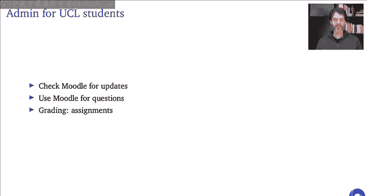

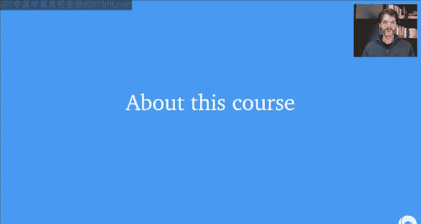

So now about this course specifically， what are we talking about？

The main question for this first lecture especially is just to question what is reinforcement learning and I'll explain it a little bit and then we'll go into a lot of depth into different subtopics of this question。

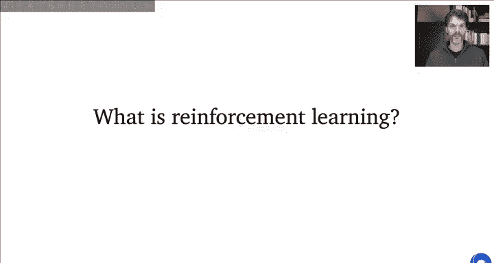

And in order to understand what reinforce including is。

 it's actually useful to first ask the question what artificial intelligence is and how these two are related。

 because turns out these are closely related。And to understand at least what I mean when I say artificial intelligence。

 I'm going to pop up a level。

And we're going to turn first to the industrial revolution。

So this is a period in time that happens a couple of hundred years ago or started a couple of hundred years ago。

 and one could argue this is all about automating。Repeated physical solutions or manual solutions。

 if you will， so think for instance， of a steam train or a steambo and how this replaced the manual labor of pulling a cart by yourself or using for instance animal labor horses to draw those cards。

Now of course some of that still happens， we still have manual labor but we replace a lot of that with machines and this led to the machine age where we started replacing more and more things with machines and in addition to that also coming up with new things that we could solve with machines so even things that we weren't doing before we could now make machines that could do those things for us。

Of course， this led to huge productivity increase worldwide。

 and it also fed into a new stage you could argue comes after this。

Which you could call the digital revolution。And one way to interpret this is to say the digital revolution was all about automating repeated mental solutions。

So a classic example here would be a calculator。We know how to add two numbers together。

 we know how to multiply two numbers together， and in fact we know that precisely enough that we can write a program and implement that on a machine on a computer if you will。

 and then automate that process in such way that it's very fast and very precise and therefore replace the slower mental calculations that we had to do before。

Now this of course， also led to a lot of productivity increase。

But both of these phases they have something in common。

 which is that we first had to come up with the solutions。

Now I'm going to argue that there's a next thing that you can think of， which is already ongoing。

 and that would be to allow machines to find solutions themselves。

 and this you could call the domain of artificial intelligence。

Now this has huge potential upside because if you are able to find machines that can learn for themselves to find solutions。

 then this takes away the responsibility on us to find a solution in advance and then to automate it。

 instead then all that we need to do is specify a problem and a goal and then have the machine figure out how to solve this。

As we'll see later， this will often involve interacting。

 you have to have some data to find a solution。And this means that there's a process of learning。

 so here we already bump into this term learning， which I'll get into much more in depth。In addition。

 this requires you to autonomously make decisions。 So I'm I'm putting these。

Terms basically upfront and center， so there's learning and autonomy and decisions and these are all quite central to this generic problem of trying to find solutions。

Of course we were not the first to talk about artificial intelligence。

 this has been a topic of investigation for many decades now。

 and there's this wonderful paper by Alan Tring from 1950 called Computing Machinery and intelligencetelligence。

And the very first sentence of that paper reads， I propose to consider the questions。

 can machines think？Now。I， by the way， recommend you to read this paper， it's wonderfully written。

 it's very accessible and it has lots really interesting thoughts。

But there's one paragraph that I want to highlight specifically。And I'll read that to you now。

So Ellan Tring writes。In the process of trying to imitate an adult human mind。

 we are bound to think a good deal about the process which has brought us to the state that it is in。

We may notice three components， the initial state of the mind， say at birth。

 the education to which it has been subjected and other experience not to be described as education to which it has been subjected。

Instead of trying to produce a program to simulate the adult mind。

 why not rather try to produce one which simulates the child's？

If this were then subjected to an appropriate course of education， one would obtain need adult pre。

Presumably the child brainin is something like a notebook as one buying it from the stationers。

Rather little mechanism and lots of blank sheets， mechanism and writing are from our point of view almost synonymous。

Our hope is that there is so little mechanism in the child brain that something like it can be easily programmed。

So what is Adamlan Tring talking about here？He's essentially talking about learning。

 He's essentially conjecturing that trying to write the program which constitutes an adult mind might be quite complicated。

 which makes sense because we're subject to a lot of experience throughout our lives。

 this means we learn a lot of you could think of these as being rules or pattern matching that we learn how to do skills that we acquire and enumerating all of that describing that all of that clearly enough and clean enough that you have something with the same capability as an adult mind。

 he's conjecturing that that might actually be quite tricky。

And maybe it's easier to actually write a program that can itself learn in the same way maybe that we do or maybe in a similar way or maybe in a slightly different way。

 but it can learn by interacting with the world， by in his words， subjecting itself to education。

Maybe to find similar solutions as the adult mind has。And he's conjecturing it， maybe this is easier。

Now this is a really interesting thought and it's really interesting to think about this a little bit。

So。Maybe this is a good time for you also to maybe pause the video and ponder this a little bit whether you agree with this conjecture。

 that indeed maybe it might be easier to write a program that can learn than it is to write a program that has the same capabilities as the program that can learn will achieve over time。

So what is an artificial intelligence。 Well， one way to define it would be that the。

Goal would be to be able to learn to make decisions， to achieve goals。

This is not the only possible definition of artificial intelligence and other people have proposed sometimes slightly different versions or vastly different versions。

 I'm not going to argue that this is the best definition of artificial intelligence。

 Maybe there are different types of artificial intelligence that we could consider。

 But this is the one that is central to us。 So we're going to basically ask this question。

 how could we build something that is able to learn to make decisions to achieve goals。

And that is our central question。And know that the learning。

 decisions and goals are all very central concepts in this。

 and we'll get into a little bit more detail what I mean with all of them。

So this brings us to this question， what is reinforcement learning？And。

This is related to this experience that Ellan Turing was also talking about because we know that people and animals learn by interacting with our environment。

And this differs from certain other types of learning and that's good to appreciate first of all it's active rather than impassive and we'll get back to that extensively in the next lecture what this means is that you are subjected to some data or experience if you will but the experience is not fully out of your control the actions that you take might influence the experience that you get。

In addition to that， interactions might be sequential。

 so future interactions might depend on earlier ones if you do something。

 this might change the world in such a way that later other things are possible or impossible。

We are also goal directed， we don't just randomly meander， we do things with a purpose。

And this is also this is at large scale， but also at small scale。

 I might have a goal to pick up a glass， for instance， that is a small thing perhaps。

 but you could think of this as being a direct action where I pick up that glass and of course this consists of many small little micro actions of me sending signals to my muscles to actually execute that。

Also we can learn without examples of optimal behavior and this one's interesting。

 it's good to think about that a little bit and to appreciate what I mean when I say with that because obviously we are subjected to education as El course。

 so we do get examples of what we behavior that we want or behavior that other people want us to do and we try to follow those examples in many cases。

But what I mean here is something a little bit different， I mean that when you do pick up a cup。

That maybe somebody showed you at some point， oh it's useful to pick up a cup or you could think of it that way。

 maybe that's not the greatest example of that， but somebody taught you how to write or taught you how to do math。

But nobody actually told you exactly how to steer your muscles in such a way as to move your arm to pick up a pen to pick up a cup things like this So clearly we still learn some sort of a behavior there。

 we learn to control our muscles but not in a way that somebody tells you exactly oh this is how you should have moved your muscles and now you just replicate So that is what I mean when I say we learn without examples Nobody gives you exactly the low levelvel actions that are required to execute that thing that you want to execute。

And this actually maybe constitutes most of the learning that we do。

 most of the learning that we do is actually of that form。

 where maybe we do interpret something that we see in some sense as an example。

 but maybe typically at a much higher level of abstraction。

 and in order to actually fill in that example in order to execute what we want to mimic this might still require us to learn skills in a much more autonomous way without clear examples。

So one way to think about this and I'll go back to this is that you can think of this as optimizing some reward signal。

 we want to achieve something and by achieving it we feel in some sense satisfaction or happiness and this is what stares our behavior we notice that some things are more pleasing than other things。

So this brings us to a very central picture that I'm going to show multiple times during this course。

 which is the interaction loop， and one can perceive as being basically the setting that we find ourselves in。

So this is something to keep in mind that we are basically considering an agent interacting with an environment。

 and here I drew them separately， but you could also think of the agent as basically being inside that environment。

 there's this huge world out there， the agent lives somewhere in that world。Now， this could be。

Quite concrete， for instance the aid could be a robot and the environment could be the real world。

 it could also be much more abstract， for instance the environment could be some abstract game or it could be a virtual environment。

It could be the internet and the agent could be some program that tries to interact with that environment instead。

 so it's quite a flexible framework。And we basically say that the agent then executes actions and observes the environment This is typically drawn in such a way as I did here where the actions go from the agent into the environment and the observations go from the environment into the agent。

 but of course， you could also think of the observation as being something that the agent pulls in。

 In fact， the observation typically depends on the agent because the agent will have some sort of a sensory motor stream that is defined by its interface。

 For instance， the agent could have a camera， and that defines which observation it gets。

So the main purpose of this course is then to go basically inside that agent and figure out how we could build learning algorithms that can help that agent learn to interact better and what does better mean here。

 well the agent is going to try to optimize some reward signal。

This is how we're going to specify the goal and the goal is optimize immediate rewards so we're not just interested in taking an action and then forgetting about everything that might happen after no we're actually interested in optimizing the sum of rewards into the future I'll explain it a little bit more clearly in a moment but it's good to appreciate that there must be some goal to this right if there's no goal specified then it's unclear what we're actually optimizing and it's unclear what the agent will actually learn to do so we need some way some mechanisms to specified that goal。

Many cases when people show versions of this interaction loop when talking about reinforcement learning。

 they put these rewards next to the observation， and that's why I'm useful to think about this。

 that you take an action and then the environment gives you an observation and a reward。

But sometimes it's a bit more natural to think of the reward as being internal to the agent。

So you could also think of the reward signal as being some sort of a preference function over these observations or over sequences of observations that the agent receives。

 and the agent just observes the world and feels happier or less happy about what it sees and then tries to optimize its behavior in such a way that it achieves more of these rewards。

So this is why I didn't put the reward in the figure because sometimes it's easier to think of it as just coming from the environment through the external to the agent。

 sometimes it's easier to think of it as being in some sense part of the agent。

But it should still be there and it should be clearly specified because otherwise it's unclear what the goal of this whole system would be。

And this reward function is quite central， so it's good to stop and think about why this a good way to specify a goal。

 and this is formulated in this reward hypothesis that we see on the slide。

 which states that any goal can be formalized as the outcome of maximizing a cumulative reward。

Now I want to encourage you to think about that and think about it critically and try to see if you can maybe even break it in some sense。

 so breaking it would mean coming up with a counter example of a goal that you cannot specify by maximizing a cumulative reward。

Feel free to pause the video and think about this for a bit。

So I've not been able to come up with examples myself。

And maybe this is somewhat even trivially true in some sense。

 because you could think of a reward signal that basically just checks whether you've achieved that goal that we want to specify and then whenever you've achieved the goal。

 the reward signal becomes one and before that it's zero。

Then optimizing this cumulative reward would clearly correspond to maximizing or achieving that goal。

Doesn't mean that it's easy to specify that， sometimes it's hard to specify your goal precisely or sometimes it's hard to specify a rewards。

 which is easy to optimize， which is a completely different problem。

 but that's not under this reward hypothesis this just states that there must exist a reward and indeed sometimes there's many different ways to specify the same goal for instance。

 instead of saying you get a reward of plus one whenever you achieved a goal and zero before that。

 you could also say let me give you a reward of minus1 in some sense a penalty on every step before you've achieved a goal and then zero reward after you've achieved it。

Then you could think of the agent as maximizing this cumulative reward as in some sense minimizing these penalties。

 which would also then maybe lead to the behavior of achieving the goal as quickly as possible。

 because minimizing the number of minus one rewards。

 the number of steps until you've achieved to goal will then become relevant。

So we see that a goal could also include not just that it happens。

 but also when it happens if we specified in this way。 So it's quite a flexible framework。And。

It seems to be a useful one that we can also use to create concrete algorithms at work rather well。

So some examples， some concrete examples of what reinforcement learning problems could then exist。

 so here's a list including flying helicopter， managing an investment portfolio。

 controlling a power station， making a robot walk or playing video or board games。

All of these examples were picked because they have actually been used and reinforcement everything has been applied to them successfully。

And for instance， we could have a reward function for the helicopter that is related to airtime or inverse distance to some goal。

Or to pick， for instance the video games you could or board games。

 you could think of a reward function that used to accept whether you win or not。

 so think of the game as chess， for instance， you could have a reward function that gives you plus one whenever you win minus one whenever you lose。

And if the goal is then to learn via interaction， these are all reinforcement learning problems。

This is irrespective of which solution you use and I put that on the slide because sometimes people conflate the current set of algorithms that we have in reinforcement learning to solve these type of problems with the field of reinforcement learning。

 but it's good to separate that out and to appreciate that there is a reinforcement learning problem and then there's a set of current solutions that people have considered to solve these problems。

And that set of solutions might be under a lot of development。 They might change over time。

But it's first good to think about and appreciate whether we agree with the。

The goal with the problem statements。And if we agree with the problem statement。

 then we can think flexibly about the solutions， we don't have to be dogmatic about that。

 and we could think about new solutions that achieve the same goal。

So it's good to separate that out and I would argue that if you're doing any of these problems。

 where there is a reward functionary a sequential interaction， then you're doing greenfor learning。

 whether or not you call your algorithm between force learning algorithms。So。

In each of these problems that I specified， these reinforcement learning problems。

 there might actually be two distinct reasons to learn。So the first one， maybe obviously。

 is to find solutions。 So going back to the example of the helicopter， for instance。

 you might want to find a。A policy of behavior for this helicopter so that it flies to a goal as quickly as possible。

But maybe in order to optimize its cumulative reward。

 it also sometimes has to do some more complicated things such as first go somewhere else to refuel because otherwise it won't even reach the goal。

But in the end， you might have some learning process and you might find a solution to examples here to make that concrete。

 you could think of a program that plays testses really well。

 that might be something you desire or you might want a manufacturing role with a specific purpose。

And then reinforcement could potentially be used to solve these problems and then to deploy that solution。

Now， a subly different but importantly different thing that you might want is an system that can adapt online。

 and the purpose for this would be to deal with unforeseen circumstances。

So to take the same two examples and to contrast how this is different in the chess program。

 for instance， you might not want a chess program that display plays maybe the most optimal form of chess that you can find but instead you might want to find a program that learns to adapt to you Now why would you do that Well for instance you might want a program that doesn't win too too often because then maybe your enjoyment is less So instead of optimizing the number of times it wins maybe it actually wants to optimize so that the number of times it wins is maybe like roughly half of the time or something like that or maybe it wants to optimize how often or how long you play it because maybe that's a good proxy for how much you enjoy playing it。

Similarly， you could think of a robot that can learn to navigate unknown terrains。

 maybe you can pretrain this manufacturing robot from the first example because you have a very good simulator for the setting that it might be in。

But in other cases， maybe you don't have a very good simulator。

 or maybe you do have good simulators for different types of terrains that the robot might encounter。

 but you do not know yet exactly what the terrain will look at where it will be deployed。

 and there might be unknown， unknown so might be things that you haven't foreseen。In those cases。

 obviously it's quite useful if you can continue to adapt， if you can continue to learn。

 and we do that as well， we continue to learn throughout our lifetimes。😊。

So that's a different purpose， but fortunately reinforcement learning can provide algorithm for both those cases。

 it's still good to keep in mind that these are actually different goals and sometimes that becomes important。

Note that the second point about adaptive algorithms to be able to adapt online is not just about generalizing。

 It's not about finding a solution similar between the first category。

 but one solution that is very general in some sense。 Now it's really about unknown unknowns。

 It's really about what if the environment changes。 What if for instance。

 you have a robotble and it gets deployed and at some point there is wear and tear。

 and you haven't foreseen this， there was no way to know exactly what would happen。

 and all of a sudden the robot has to deal with this somehow then if it can't adapt online。

 then it's really hard to find a solution that is generic enough general enough that can deal with that。

And indeed， there are other reasons why it might be useful to learn online because it might be easier to have a smaller program that continue to track the world around it than it is to try to find this one among the sushi that continue with all of the unforeseen circumstances that you could possibly come up with。

So these are really different settings。Okay， so now we finally are ready basically to answer this question what is reinforcement learning。

 and I'm going to say that basically reinforcement learning is the science and framework of learning to make decisions from interaction。

So reinforcement learning is not a set of algorithms， also not a set of problem problems。

 sometimes in shorthand we say reinforcement learning when referring to the algorithms。

 but maybe it's better to say reinforcement learning problems or reinforcement learning algorithms if we want to specify those two different parts of it and then reinforcement learning itself could just be the signs in the framework around all of that。

This has some interesting properties， it requires us to think about time and consequences of actions。

 and this is a little bit different from many other types of learning from for instance other types of machine learning。

 where oftentimes you are given a data set and for instance you want to find a classifier or something of the forum。

And then maybe there are no long termm consequences。

 You basically just specify that your goal is to minimize the errors that the system makes。 Now。

 reinforcement learning， we would argue that maybe you want to consider the whole of the system。

 So maybe you don't just want to consider the classifier。

 but you also want to consider the consequences of classifying something wrong。

 And that might be taken into account if you consider the whole framework。

 This makes it more challenging。 And it also means we have to actively gather experience because these actions will change the data that we see。

We might want to predict the future， so not just on one step thing。

 so unlike a classifier where you just get an input in your own interested in like the input for that or the output for that specific input。

 we might actually want to consider future steps further into the future。

 which is an interesting and tricky subject。And indeed in addition。

 we this is a more typical thing that happens in machine learning we have to deal with uncertainty somehow。

Now the benefit of this is that there's huge potential scope。

 but you might have also realized by this is also a very complicated or difficult question in general。

 how to solve this very generic problem。But the upside is huge。

 if we are able to find good generic algorithms that can deal with this very generic setting。

 then maybe we can apply this to many different problems successfully。And indeed。

 one way to think about reinforcement learning is that it's a formalization of the AI problem。

 as I defined it earlier。So。It's good to appreciate basically the ambition here that reinforcement learning is quite an ambitious endeavor。

 that doesn't mean that of course it sits on an island and in fact we will see during this course that current day reinforcement learning is very syner with deep learning。

 which is all about training deep neural networks and indeed，This is also very， seems very。

 very suitableable component for a full AI problem。

So the reinforcement learning description is just about formalizing the problem that doesn't mean that we don't need solutions from all sorts of subparts of machinery。

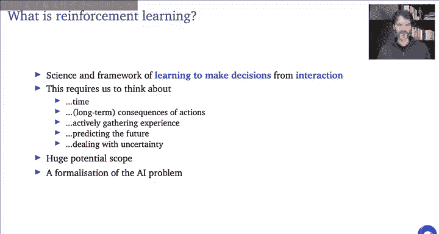

Okay now I'm going to show you an example。

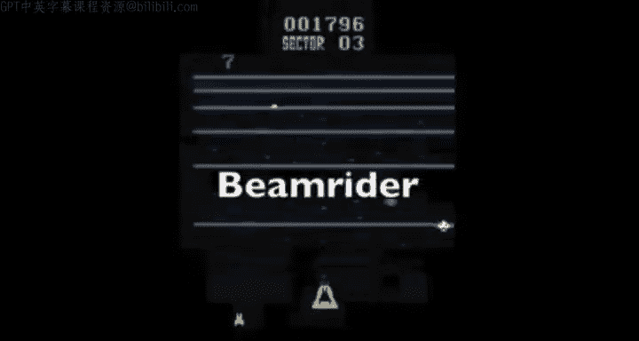

What we see here is an Atari game， this is an old video game from the 1980s called Beam Rider and the agents that is playing this game has learned to play it by itself。

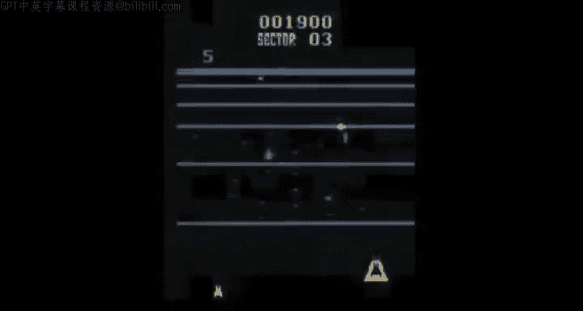

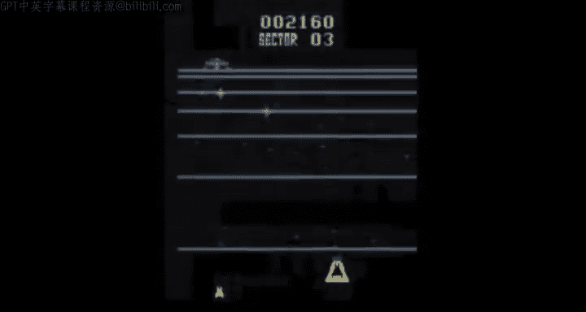

Its observations were the pixels， as you also see them on the screen。

 here's a different Atari game with different pixels。And in each of these cases。

 the actions that the agent would take are the motor controls。

 which are basically just the joystick inputs for the Atari。Games。

 which means the agent could press up down left right or diagonally。

 and it would press a fire button。And then the agent just had to deal with that in input output stream。

 So it just gets these observations， these pixels from the screen。

 and it outputs these joystick controls。 And we see that it did relatively well learning to play each of these different games。

 even though they're quite different。 So here's a racing game and euro。😊。

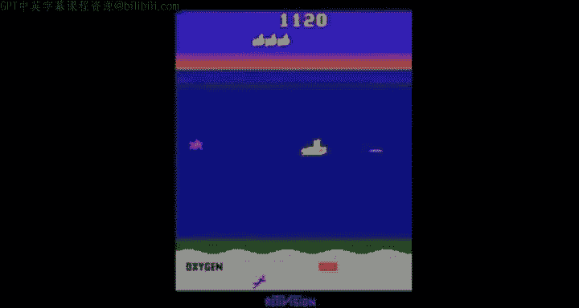

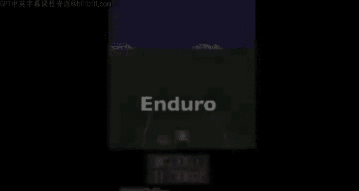

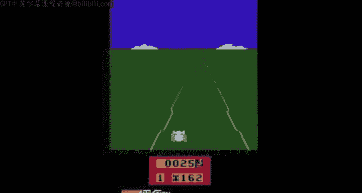

And it's good to appreciate that the agent is not even told what it's controlling。

 right It just gets these pixels。 So it's not told oh theres existing thing at the bottom here。

 which is kind of meant to be a racing car。 And your goal is to pass these other cars。 Now instead。

 you just get these pixels。 you get your motor controls and you get a reward signal。 Now。

 in these games， the reward signal was defined as the difference in score on every time step。

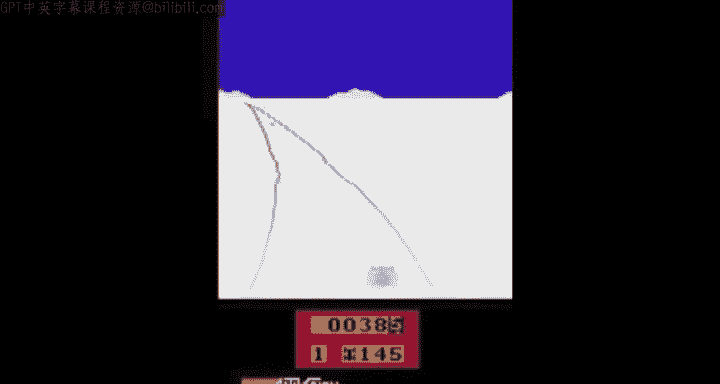

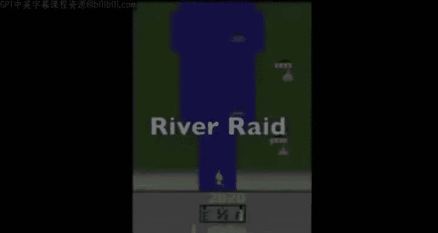

On the lot of time steps these differences score is0， that's fine。

 but on other time steps it will be positive and the agent tries to maximize the summation of that over time。

 so it's once to take actions that will lead it to good rewards later on。

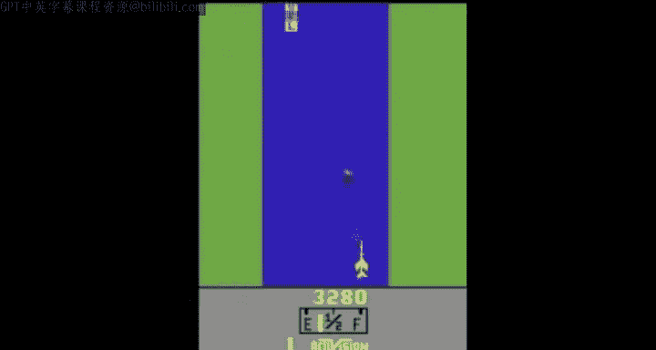

Now the most important thing to take away from this is that we have used a learning system to find these solutions。

 but we didn't need to know anything about these games ourselves。

 like there was nothing put into the agent in terms of strategy or even in terms of prior knowledge on what you're controlling on the screen。

So the agent， when it started playing space invaders did not know that it was going to control this thing at the bottom。

 which is shooting。

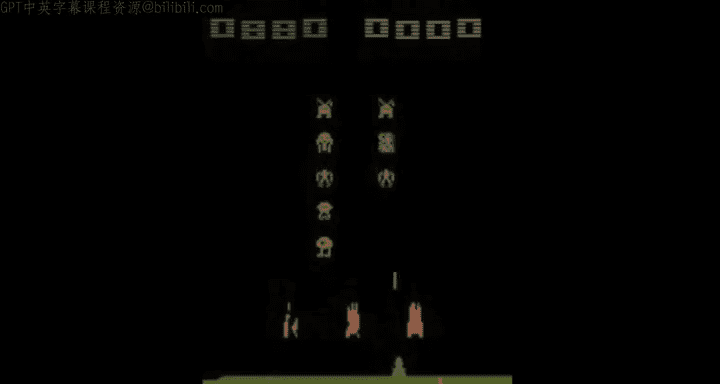

Or that it was controlling one of these boxes in this example。

And that is the benefit of having a generic learning algorithm in this case this algorithm is called DQN and we will discuss it later in the course as well。

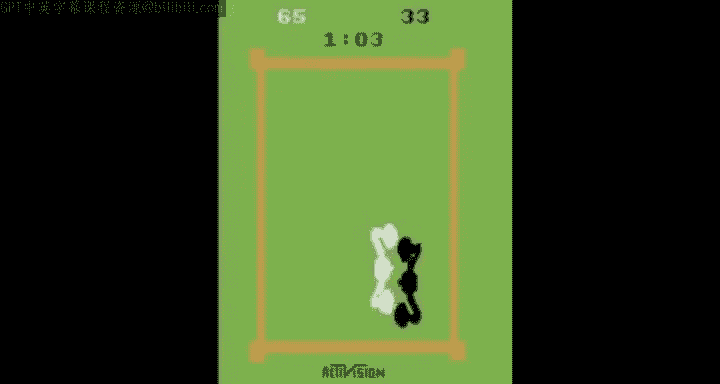

Okay， so now I'll go back to the slides。So now I've given you a couple of examples。

 I've shown you these Atari games， and now's a good time to start formalizing things a little bit more concretely so that we know a little bit more of what's happening。

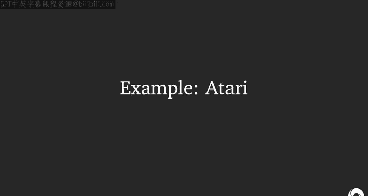

And in future lectures， of course， we will make this much more。Clear and rigorous。 And for now。

 we're going to give you kind of like a high level overview of what happens here。

 What is this reinforcement learning problem， What's inside that agent。 How could this work。

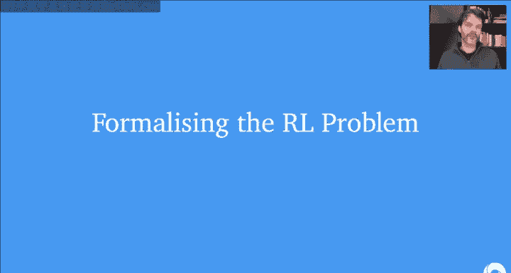

So we're going to go back to this interaction loop and we're going to introduce a little bit of notation where we basically say that every time step T。

 we receive some observation， OT and some reward RT。As I mentioned。

 the reward could also be thought of as being inside the agent。

 maybe it some function of the observations， or you could think of this as coming with the observations from the environment。

 and then the agent executes some action， so the action can be based on this observation O T in terms of our sequence of interactions。

And then the environment receives that action and emits a new observation。

 or we could think of the agent as pulling in a new observation and a next reward。

Note that we increment the time step after taking the action。

 so we say that the action is emitted at time step T and then the next observation is received at a time step T plus one。

 that's just convention， this is where we increment the time index。

You can actually extend reinforcement learning into continuous time as well rather than having these discrete time steps。

But we won't cover that in dis course。The extensions are， in some sense。Not too difficult。

So it's good to have that in mind， but there are some subtleties that one would have to consider。

So the reward here is a scalar feedback signal。 It's just a number。 It can be positive。

 It can be negative， a negative rewards， you could call a penalty。

 but we just call that a negative reward just to have this one word that refers to the feedback signal。

 And just to recall， I put the reward hypothesis on the slide again。

 where we stated that any goal can be formalized as the outcome of maximizing a cumulative reward。

This instantaneous reward and indicates how well the agent is doing at that time step T。

 and this helps define the goal of the agent and the cumulative reward is in simply the accumulation or the sum of these rewards over time。

It's useful to also devote a letter to that， which we'll call G so roughly speaking you can think of G as kind of specifying goal。

 but we'll use the term return to refer to this。So the return is just shorthand for the cumulative reward or the sum of rewards into the future。

Note that the return is only about the future， right， so this is at some time set T。

So this is useful to determine which action to take because your actions cannot influence the past。

 they cannot only influence the future， so when we define a return。

 the return is defined as all of the future rewards sums together。

 but the past rewards are in the past and we can't change them anymore。

Then we can't maybe always hope to optimize the return itself。

 so instead we're going to define the expected return， which we'll call a value。

So the value at time S would simply be the expectation of the return。

 so that's the sum of the rewards going into the future conditions on the fact that you're in that state S。

I haven't defined what a state is yet， but for simplicity you could now think of this as just being your observation。

 but I'll talk more about that in a moment。So this value does depend on the actions the agent takes and I will also make that a little bit more clear in the notation later on。

 so it's good to note that the expectation depends on the dynamics of the world。

 but also on the policy that the agent is following and then the goal is to maximize the value so we want to pick actions such that this value becomes large。

So one way to think about that is that rewards and values together define the utility of states and actions。

And there's no supervised feedback。 So we're not saying this action is correct。 That action is wrong。

 Instead， we're saying this sequence of actions has this value。

 that sequence of actions has that value。And then maybe pick the one that has the highest value。

Conveniently， this is used in many algorithms， the rewards。

 sorry the returns and the values can be defined recursively。

 so the return at time step T can be thought of as simply the first reward plus the return from that time step T+1。

Similarly， the value can be defined recursively， so the value at some time sorry the value at some state S is the expected first reward you get after being in that state and then the value of the states you expect to be in。

After being in that state。So the goal is maximizing value by taking actions。

And actions might have long term consequences， so this is captured in this value function because the value is defined as the expected return ready return sums the rewards into the future。

And one way to think about this is that actual reward associated with certain actions can be delayed。

What I mean with that is you might pick an action that might have consequences later on that are important to keep in mind。

 but that do not show up immediately in the reward that you get immediately after taking that action。

This also means that sometimes it's better to sacrifice immediate reward to gain more long term reward and I'll talk more about that in the next lecture。

So some examples of this might be one that I mentioned before today。

 refueling a helicopter might be an important action to take。

 even if it takes you slightly farther away from where you want to go。

 so this could be formalized and situated that the rewards for that are low or even negative for the act of refueling。

 but the sum of rewards over time might be higher because eventually you get closer to your goal than if you wouldn't refuel。

Or to pick the last example， learning at a new skill might be something that is costly and time consuming at first might not be hugely enjoyable。

 but maybe in the long term it will yield you more benefits and therefore you learn this new skill to maximize your value rather than the instantaneous reward。

Fornce instance， maybe that's why you're following dis course。Just in terms of terminology。

 we call a mapping from states to Act a policy， this is just shorthand in some sense for an action selection policy。

It's also possible to define values on not just states but on actions。

 so these are typically denoted with the letter Q for historical reasons。

 so we have the letter V to denote the value function of states and we have the letter Q to denote the value function of states and actions and this is simply defined as the expected return condition on being in that states and then taking at action A。

So instead of considering some sort of a policy which immediately could pick a different action in state S。

 we're saying no， no， we're in state S and we're considering taking this first action A。

Now this total expectation will then of course， still depend on the future actions that you take。

 So this still depends on some policy that we have to define for the future actions。

 but we're just pinning down the first action and conditioning the expectation on that。

 we'll talk much more in depth about this in。Lectures 3，4，5， and 6。

So now we can basically summarize the course concepts before we continue。

So we said that the reinforce including formalism includes an environment which basically defines the dynamics of the problem。

 it includes a reward signal which specifies the goal。

And sometimes this is taken to be part of the environment。

 but it's good to basically list it separately。And then it contains an agent。

Now this agent might contain different parts and most of the course will essentially be about what's in the agent。

 what should be in the agent， how could we build learning algorithms that work well？

And some of the parts are listed here， so the agent will contain some agent state。

 this is just the internal state of the agent， it will contain some policy。

And it could contain a value function estimates， so a prediction of the value or a model which might be a prediction of the dynamics of the world。

 I put questions marks there because these are in some sense more optional than the first of the agent must have some internal state。

 this could be a very simplistic state， it could be a null state or your agency say it could simply be the immediate observation that you received right now。

 but it could be a more complicated state and it must have some policy。

 it must select actions in some way。Again， this policy could be particularly simple。

 it could be a random policy that just selects actions。Complete uniformly at random。

 but there must be some policy。The value function in the model are more optional in the sense that they're not essential parts。

 but they are very common parts， and I will discuss them a little bit in the remainder of this lecture。

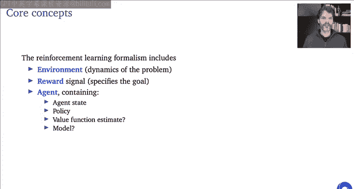

So now it's time to go into the agent。And we'll start with the Asian state。

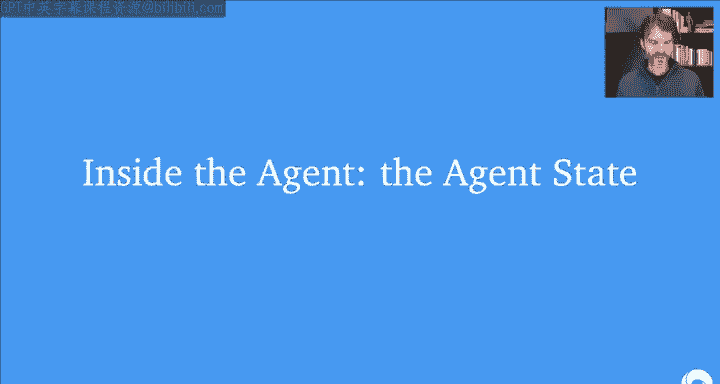

So this is one way to depict the internals of the agent。

 so now we're inside the Asians and in this schematic here on the right hand side。

 time increments as we go to the right。And so we see inside the agent from the view inside the agent on every time step。

 there's an observation that comes in。And then there's some internal state of the agents。

 and from this state of the agent， the agent might make predictions。

And it should define some policy somehow， and then the action gets selected by this policy。

 so I could have basically drawn another error going from the policy into the action。

 which would then go back into the environment。But we're focusing here on that state component and state here basically refers to everything that the aging takes along with it from one time to the next。

So if there are things that are not taken along， for instance the policy at the instantaneous policy at the time set might not be taken along。

 the predictions might not be taken along or they could be in that case。

 they could just be part of the state。But there might be other things in the state as well。

 there might be some memory in the state， there might be learned components in the state。

 everything that you take along with you from one time to next we could call the 18th state。

We can also talk about the environment states， which is the other side of that coin in many cases the environment will have some really complicated internal state。

 for instance in the example where the agent is a robotble and the environment is a real world。

 then the state of the environment is basically just the state all of the physical quantities of the world。

 all of the atoms， all of the quantum mechanics of the world， that's the environment state。Of course。

 in many smaller examples， if it's a virtual environment， it could be much smaller。

 but it could still be quite complicated。This also means it's usually invisible to the agent。

 it's very really， really large and is not part of the observation stream per se。😊。

Even if it would be visible， it might contain lots of irrelevant information and it might just be simply too large to process。

 but actually the first one is more interesting， it's usually just invisible to the agent we can only see a subse of it。

 we can see a small part of it via our observation stream。

An important concept to keep in mind then is that we can also formulate the whole interaction sequence into something that we could call the history of the agent。

And this is simply everything that the agent could have observed so far。

 so that includes the observation from the environment。

 but also the actions that the agent took and the rewards that it received。

 So this is really just taking that interface and storing everything that happens on the interface level。

 and we could call that the history of the agent。😊，So for instance。

 it could be the full sensory motor stream of the robotble。

Now we can say that the history is the only thing that can be used to construct the agent state in some sense。

 apart from whatever prior knowledge you put in all the way at the beginning。

 but let's just set aside for a moment and everything else must be a function of your history。

 There's nothing else essentially the agent has no additional information apart from its sensory motor stream。

 so that's what you should be using to construct your agent state。Then a special case。

Is when the agent can see the full environment state。

So that the observation is the food environment state and this is Scott full observability I mentioned before reading this is a very special case。

 this is not the common case at all， but it's a useful one and sometimes it's used， for instance。

 in theoretical statements just because it's easier to reason about in some cases。And in that case。

 the agent state can just be the observation， right we don't need to worry about this whole interaction stream。

 we can just observe whatever the environment state is。

And then this should be sufficient in order to basically tell where you are。

 you don't need additional memory， you don't need anything else。

 you just need the environment state as your state。Now in addition to that。

 there could be the learnable parts of the agent right the agent might have some parameters that is's learning and you could also consider that to be part of the agent state in this case I'm actually not considering that to be part of the agent state that's something that we also have that's also part of the agent but let's just set that aside and call that the agent's mind is essentially separate from its state in this sense。

So in the food observable case， you can just look at your observation， you could say， oh。

 that tells me everything I need to know about the environment。

 so I don't need to log any of the previous interactions。

And this leads us to an important concept in reinforcement training， which is the mark of property。

And this has been used to formulate essentially the reinforcement building problem and also precursors to this。

And importantly， a Mark of decision process is essentially her useful mathematical framework that allows us to reason about algorithms that can be used to solve these decision problems。

The Mark propertyy itself states。That a process is Markovian or a state is Markovviian for this process。

 if the probability of a reward and a subsequent state。Doesn't change if we add more history。

 that's what the equation on the slide means。So we can see the probability of a reward in a state。

 you should interpret this as the probability of those occurring on times of t plus1。

And we say that the probability of this happening conditions on set S is equal to conditions on the full history after the third time set。

That means if this is true。🤧That the state contains， excuse me。

 that the state contains all that we need to know。So we don't need to store anything else in the industry。

Doesn't mean that the say contains everything， it just means that adding more history doesn't help。

 for instance， if your observations are particularly uninformative。

Then adding more uninformative observations might not help， so that might lead to a Markcoian state。

 but it doesn't mean that you can observe the full environment state。However。

 if you can observe the food and environment states， then you're also Markovviian。

So once the state is known， the history might be thrown away if you have this mark property and of course this sounds very useful because the state itself might be a lot smaller than the full history。

So as an example， the full agent and environment state。😊，Is Markov， but it might be really。

 really large because as I mentioned， the environment state might be yourongs。

 it might be the real world。And also the full historytories Markco。

 which you can kind of clearly read from this equation， because if you put。

HT on the left hand side where it says SD， then obviously this is true。

But the problem with that is that that safe keeps growing so if we want to use the full history as our agent says。

 then the amount of memory that we're using inside the agent's head keeps growing linearly over time and sometimes that also becomes too large or actually oftentimes it also becomes too large。

So typically， the agency said is some compression of the history。

Whether it instills the marker property is actually maybe not even the most important question。

 but it's an interesting thing to keep in mind。So note here that we use ST to denote the agent states。

 not the environment states。And we'll use that convention basically throughout。

 where sometimes as a special case。These will be the same because the environment state might be fully observable。

But in general， we will not assume that and then whenever you say it states。

 this is basically the statement part on the side of the agents and that specify differently。

Now I said that full observable cases are very rare so that we should talk about the complement of that。

 which is the partial observable case， so in this case the observations are not assumed to be Markovviian and I'll give you an example or a couple of examples。

 so for instance a robot with a camera。Which is not told as absolute location would not have Markovvian observations because at some point it might be staring at a wall。

And it might not be able to tell where it is， if might not be able to tell what's behind it or behind the wall。

 it could maybe just see the wall， and then this observation will not be Markovium。

Because the probability of something happening might depend on things that it has seen before。

 but it doesn't see right now， it may have just turned around。

 and there might be information about what's behind it。

 which should influence the probability of what happens next。

But it can't see this from its observations per se。Similarly。

 a pokerpay agent only observes public cards and its own cards。

 it doesn't observe the cards from the other players。

 but obviously these are important for its future rewards。

 so part of the environment stays then hidden to the agent。

So now using the observation to say it would not mean Markovian。

 that doesn't mean it's necessarily a bad idea， but it means it can be a bad idea because you're ignoring some information that might be contained your past observations。

This is then called a partial observ Markov decision process or P DP for short。

And it's basically just an extension of the marketization processes。

 which will define more rigorously in future lectures。嗯。

And it's good to keep in mind that this is basically the common case。

Note that the environment state itself could still be marked。

 it's just that the agent can't see it and therefore can't know it。In addition。

 we might still be able to construct a mark of agent state。

The example I gave from the previous slide is you could always take your full history and that would be Markovian。

 The problem with that is just it's too large， but maybe there are smaller agencies states we can construct which still hold enough information to be Markovviian。

So the agent states is。An important concept， and。It must depend on this information that you've seen before about。

 right， this must depend on this interaction stream。And the agent actions then depend on the state。

And it's some function of history， so the examples that I gave were like the states could be the observation could be your full history。

 but more generally we can also write this sound recursively。

Where to state at your next time step deep of one。Is some function of your previous state？

The action that you that you've taken the reward you've seen and the observation that you've seen。

 so we're taking one step in this interaction loop and we're basically saying we're going to update this state。

To。Be aware of this new timest。😡，Clearly， if we're concatenating the action， reward and observation。

 then ST plus one could just be your full history if ST is your full history up to time set。

So the full history is contained within this formulation。

 also quite clearly the special case of just looking at your observations containing as formulation。

 and this is the more flexible way to think about it。And then new is the state update function。Now。

 as I mentioned， it's often useful to consider the agency state to be much。

 much smaller than the environment state。And in addition。

 you also typically want it to be much smaller than full history。

 so we want this a update function to give us some compression of the full history。

Maybe recursively and maybe the state actually stays the same size right so ST could be of a certain size。

 we see new action reward and observation and we condense all of that information together into something that is the same size as ST。

And here's an example just to make that a little bit more concrete all of that。

 so let's consider a maze and let's say that the full state of the environment in at Maze is this layout。

😊，And in addition， it's where you are in the maze。And that would define for an environment stage。

But let's say that the agent can't observe all of that it can't observe its location in the maze and instead maybe you can only see this little3 by3 around itself。

 so in this case the agent would be in the center of this3 by3 block and what it can see is exactly the pixels around it the cells around it so it can see for instance that above it it's empty to the left and the right there's a wall in black below it it's empty so it could walk up。

 it walk down and also it can look slightly around the corner where it can see that if it goes up and then right there is also an empty spot but if it goes up and left it would bump into a wall。

And that's all I can see。Now， this observation is。Not Markov because if we look at a different location。

These observations are actually indistinguishable。😡。

So if we would just use the observation in this case。

 then the agent won't be able to tell where it is。And we can also talk about why that might be problematic。

 So let's say that the agent starts in the top right corner。

And let's say that the goal for the agent is to go to the top left corner。

Then if you consider the shortest bath。In the states that we see the observation that we see in the top right here。

 the optimal action would be the step down because that's in the direction of the goal because we have to go via the bottom of this maze in order to reach the top left corner。

However， if you then't look at the left observation in that observation。

 the ultimate action would be to go up。😊，But if the agent can't distinguish between these two。

 if it would be using the observation as its full agent state。

And its action selection policy must depend on only that observation。

 then it's unclear what it should be doing。In the top right， it should be going down。

 in the left should be going up， but there's no single policy。

 single function of this observation that will do the right thing in both cases。

This is why it can be problematic and let have a Markov in observation。

So now I actually want you to think about for a second。

 so feel free to pause the video here and think about how you might be able to construct a Markov of an agent state for this specific problem and maybe for any reward signal。

 so not just for the one that goes from the top right to the top left。

 but maybe that one that works for any reward signal。

So feel free to pause the video and then I'll talk about this a little bit more。

So one thing that you may have come up with is well maybe we can use that thing that you said where you can use the full history。

 Yes， the full history would be Markovian will be rather large。

 so I think many of you will have kind of discounted that as being not the most pleasant or feasible solution。

So maybe we can do something that's a little bit in that direction but not quite the same。

 So let's say we consider storing not just the observation that we see right now。

 but also the previous observation。Would that work？WellIt kind of depends， actually。

 it depends on the policy。And it depends whether the state transitions here in the real world are completely deterministic。

 So if you go down， you really go down or whether there are some noise in there where sometimes when you press down。

 you actually go up。Because note that if we look at both of these observations that are highlighted right now。

 if you step down one step， the observation is still the same。

So if you would come from this situation below where we currently are and you would just concatenate these two observations that would not be sufficient to be able to tell where you are。

 so just concatenating two observations is not necessarily Markov in this environment。However。

It can be sufficient if your policy never does this。

 so if we step on the right hand side in the right top corner right first we step left and then we step down this browse to where we currently are。

If we would have stored the fact that we just stepped down and then we see this。

Then we know that we are where we are because then the previous observation is sufficient and then we step down again and if the policy never does that same action in the left states。

 then the ordering of the observations is enough to distinguish the left from the top right。

But in general， for any policy， for instance， a uniformly random policy。

 just concatenating two observations is not sufficient in order to get a Markov states in this case。

Okay。So in general， what I'm doing there is basically trying to construct suitable state representation to deal with the partial observability in the maze。

And as examples I mentioned， using just the observation might have be enough using full history might be too large。

 but generic you can think of some update function and then the question is how do we pick that update function and that's actually what we were doing just now like we were trying to handpick a function U that updates the state in such way to take into account the stream of observations the example that I gave where I just concatenate two observations would be where you just keeps track of this buffer and whenever you see a new observation it basically replaces the oldest observation with a new one。

With a newer one and then adds the newest one on top。

 so you have like a two observation buffer in that case。ううん。😊，Excuse me。

So this is an generic you can do other other things as well， of course。

But it's good to note that constructing a full Markovviian agent says it might not be feasible。

 like your observation might be really complicated and it might be really hard to construct a full Markovviian agent says。

 and so instead of trying to always shoot for complete Markovianness， maybe that's not necessary。

 maybe it's more important that we allow good policies and good value predictions and sometimes that's easier。

Sometimes going for optimal is really， really hard。

 but going for very good is substantially easier and that's something more generally that we'll keep in mind when we want to deal with messy big real world problems where optimality might be out of reach。

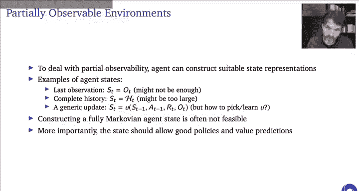

Okay， now we're going to continue our journey inside the agent and we're going to go to the next bits。

 which are the policy to value function in the model， starting with the policy。

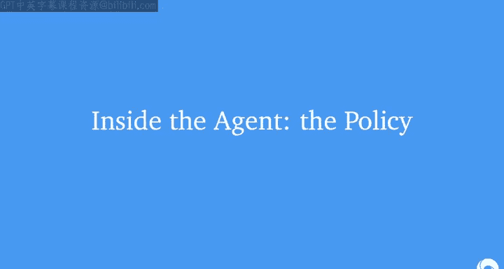

So we covered the agencies now we're going to this policy and then immediately into the value function and the model。

And the policy is simply something that defines the aging behavior。

 it's not a very complicated construct， it's a mapping from agents say to actions。

 and for instance we can write this like this for a deterministic policy it can be considered simply a function that takes a state as inputs and outputs in action。

Now， actually， it will be more common and often more useful to think of stochastic policies where instead pi means the probability of an action given state。

Pi is just conventional notation for policies， we often use pi to den not a policy and stochastic policy in some the more general case。

 so typically we consider this a probability distribution of actions。

And that's basically it in terms of policies， of course we're going to say a lot more about how to optimize these policies。

 how to represent them， how to optimize them and so on。

 but in terms of definitions all that you need to remember is that pi denotes the probability of an action given a state。

And then we can move on to value functions and value estimates。

And I'm going to what I have here on the slide is a version of the value function。

 as I defined it earlier。 And I want to mention a couple of things about this。 First of all。

 it's good to appreciate that this is the definition of the value。 Later。

 we'll talk about how to approximate that。 This is just defining it。

 And I've extended it in two different ways from the previous definition that I had。 First。

 I made it very explicit now that the value function depends on the policy。

And the way to reason about this， if I have this conditioning on pi。

 means that I could write this long form to say that every action at subsequent time steps is selected according to this policy pi。

So know that we're not conditioning on a sequence of actions。

 now we're conditioning on a function that is allowed to look at the states that we encounter and then pick an action。

 which is slightly different。The other thing that we've done now on this slide introduce a discount factor。

 this is a somewhat orthogonal thing but I thought I should include it here so that we have the generic form of a value function which conditions on the policy and includes potentially this discount factor。

 which is a very common construct and reinforcement learning。

And one way to think about that is that the discount factor helps determine the goal in addition to the reward function。

For instance， if you consider a reward function to be plus one on every time step。Then it could be。

Infinitely large。Alternatively， if you think of a maze where the reward is zero on every time set until you reach the goal。

And the value function for a uniformly random policy would would be， sorry。

 if it's0 every times at one when you reach the goal。

 then any policy that eventually reaches its goals gets a value of one。

 So then we can't distinguish between getting there quickly。

So sometimes discount factors are used to define goals in the sense of。

 oh maybe it's better to look at the near term rewards a little bit more unless it's a long term reward。

 so this allows us to trade off the importance of immediate versus long- term rewards。

So to look at the extremes to make it a bit more concrete。

 you can consider a discount factor of zero。If you plug it into the definition of the value as it's written on the slide there。

 you see that then the value function just becomes the immediate reward。

 all of the other rewards are canceled up because they're multiplied with the zero discount。

So that means if your disfector is small or in a special case， if it's zero。

 then you only care about the near term future。If you don't want to optimize your policy。

 then the policy would also be a myopic policy， a short title of policy。

 which only cares about immediate reward。Converse to the other extreme would be when a discount factor is one。

 this is sometimes called the undiscounted case because then the discounts basically disappear from the value definition and we get the definition that we had before where all rewards are equally important。

 not just the first one but second one also is equally important to the first one and it also means that you no longer care in which order do you receive these rewards。

And sometimes it's useful to have disconfed that in between these two extremes in order to define the problem that you actually want to be solving。

Now as I mentioned， the value depends on the policy and then ultimately we want to optimize these。

 so we want to be able to reason about how can we pick different policies。

And we can now do that because the value function can now be used to evaluate the desirability of states。

 and also we can compare different policies on the same state。

 we can say one value might have a different sorry。

 one policy might have a higher value than a different policy。

 and then we can maybe talk about the desirability of different policies。And ultimately。

 we can also then use this to select between actions so we could do so not here we defined the value function as a function of a policy。

But then if we have a value function or estimated value function。

 we can then maybe use that to determine a new policy。

So this will be talked about in a lot more depth in future lectures。

 but you can think of this as kind of being an incremental learning system where you first estimate the value of a policy and then you improve your policy by picking better policies according to these values and that's indeed a relevant algorithm idea that we'll get back to later。

As I mentioned before， the value functions and returns have recursive forms。

 so the return has this discount factor in the more general case。

And the value function is also recursive。Where again， as I mentioned before。

 the value of a state can be defined as the expected value of the immediate reward plus now the discounted value at the future state for that same policy。

And here， the notation a ted pi just means that a is sampled according to the probability distribution pi。

And we'll just use that same notation， even if the probability execution is just deterterministic for simplicity。

This is called a Bman equation。 It was first described by Richard Bellman in the 1950s。

 and it' useful because she can turn it into algorithms。

 So these equations are heavily exploited and a similar equation can be written down。

For the optimal value， which is really interesting。

 So note that the equation above this is conditioned on some policy。

 So we have some policy and we can determine its value。

 Turns out we can also write down an equation for the optimal value that you can have。

 So there is no higher value that you can get in this setting。

And this turned out to adhere to this recursion that is written on the slide where v star。

 the optimal value of state S， is equal to the maximization over actions of the expected reward plus discounted next value conditioned on that state in action。

Importantly， this does not depend on any policy， it just depends on the state。

And this recursion is useful， it defines recursively the optimal value because know that the V star is on the left hand side and the right hand side。

 what we can use is to construct algorithms that can then learn to approximate V star。In the future。

 in future lectures， we will heavily exploit these equations and well use and create concrete algorithms。

And in particular， of course， we often need to approximate so the previous slide just defines the value of a certain policy and it defines the optimal value。

 doesn't tell you how to get them and in practice you can't actually get them exactly and we'll have to approximate them somehow and we will discuss several algorithms very least efficiently。

And the goal of this would be that if you have an accurate value function。

 then we can behave optimally I mean if we have a fully accurate value function because then you can just look at the value function。

 we could define a similar equation that we had on the previous slide for state action values rather than just for state values and then the optimal policy could just be picking the optimal action according to those values so if we have a fully accurate value function we can use that to construct an optimal policy。

 this is why these value functions are important。But if we have a suitable approximation。

 which not be optimal， might not be perfect， it might still be possible to behave very well。

 even in interactively large domains。And this is kind of the problems for these approximations that we don't need to find the precise optimal value in many cases。

 it might be good enough to get close， and then the resulting policies might also be performed very well。

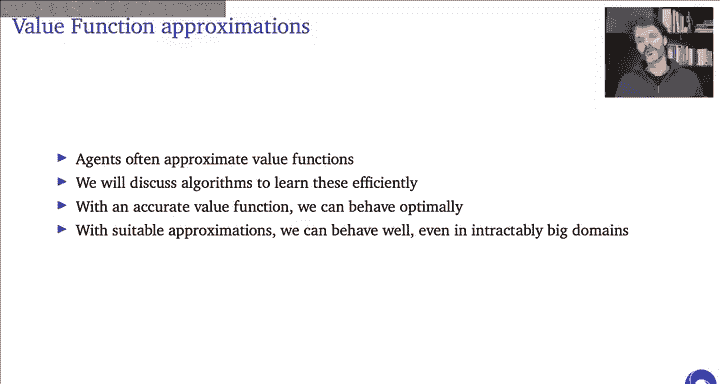

Okay， so the final component inside the agent would be a potential model。

 this is an optional component similar to how the value functions are optional。

 although they are very common。

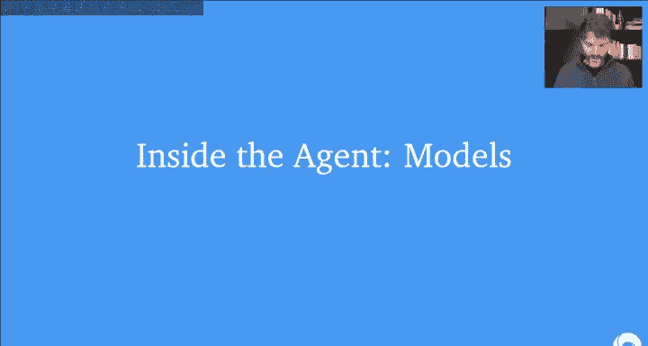

And a model here refers to a dynamics model of the environment。

 The term is sometimes used more generally for other things as well in artificial intelligence or machine learning。

 but in reinforcement learning we typically when we say we have a model。

 we typically mean a model of the world in some sense。

So that means the model predicts what the environment will do next， for instance。

 we could have a model P which predicts the next state。

Where maybe if you give it inputs as inputs a state and action and a next state。

 the output of this thing is an approximation to the actual probability of seeing that next state after observing this previous state in action。

So again， for simplicity might be good to keep in mind a specific agency where for instance these agency could be your observation。

 then this would be the probability of the next observation given the previousview observation and the previous action。

And we could try to model that。 We could try to approximate this。And then in addition。

 we could also approximate the reward function， which could be， for instance。

 condition on state and action， where this would just be the expected reward。

 given that you are in that state and taking that action。

A model doesn't immediately give us a good policy like for value functions we can actually just kind of read off a policy if we have state action value functions。

 we can pick actions according to these values for a model we don't immediately have that we would still need to conduct some sort of a planning mechanism and we'll talk about specific algorithm that can be used in addition to like sorry on top of a model in order to extract a policy。

 but it's good to keep that in mind in general that a model would still require additional computation in order to extract a good policy。

In addition to the expectation above for instance for the reward， we consider the expected reward。

 we could also consider a stochastic model or an expectation model for the state。

 so the state model here in particular this would be an example of a distribution model where we try to actually grasp the full distribution of the next state given the current state in action。

You could also instead try to approximate the expected next state。

 or you could try to find a model that just outputs a plausible next state。

 or maybe randomly gives you one of the states that could have。These are all choices， design choices。

 and it's not 100% clear in general yet what the best choices are。

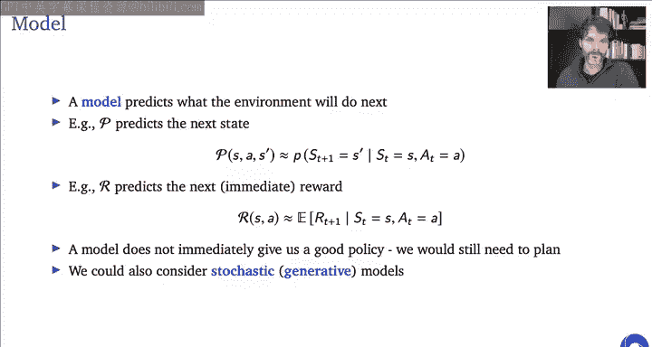

And now I'll go through an example to talk about all of these agent components a little bit。

 it's just a very simple example see much more extensive examples in data lectures。

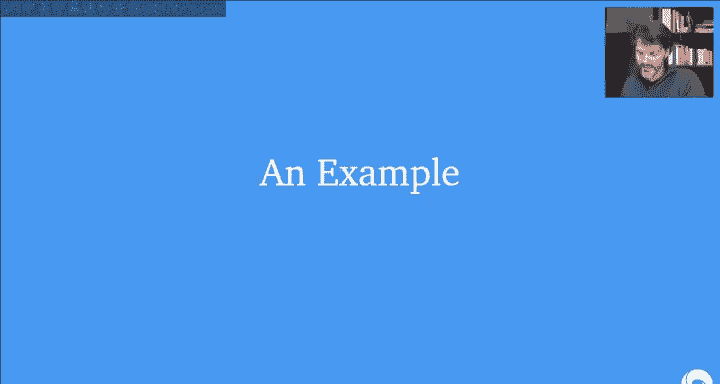

And in particular， we're going to consider this maze。

So we'll start at the left and the goal is at the right。

 and we define a certain reward function which gives you minus per time step。

That means that the optimal thing to do is to go to the go as quickly as possible because then you'll have the lowest number of minus one。

Then the actions will be up down left and right or northeas， south and west， if you prefer。

And the 18th location is the state。Let's say that this is fully observable。

 So you can basically just tell where you are。 Maybe you could think of this as X， Y coordinates。

 which are easily。Easily shown to be Markovin in this setting。

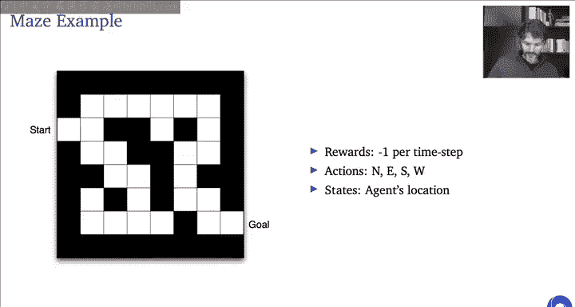

So here's an example which shows a policy。And in fact。

 this shows the optimal policy so in every state we see an arrow。

 this arrow depicts which action to take， so for instance in the leftmost states。

 the arrow points right。So we say that in the leftmost state。

 the policy now will take the action right。 This policy is deterministic policy that indeed gives us the shortest path to the goal。

 and it will be an optimal policy。 You could also consider it a storcchastic policy。

 which we might might select。Multiple actions with non zero probability。

Here is the value of that policy on the previous slide。

 which happens to also be the optimal value function。

 which as you can see increments every time you step away from the goal。

 and this is because the value function is defined as the expected sum of rewards until into the indefinite future。

 but if the episode ends at the goal， then the rewards stop there。

So if you're one step away from the goal， the value will just be minus1 for that optimal policy。

 if you're two steps away it will be minus two and so on。

This is a model and specifically this is an inaccurate model because note that all of a sudden a part of the maze went missing。

So in this case the numbers inside the squares are the rewards so these are models as just oh we've learned the orders basically minus1 everywhere maybe this is very quick and easy to learn and the dynamics model was learned by simply interacting with the environment but turns out maybe we haven't actually gone to that portion there in the left corner left bottom corner and therefore the model is inaccurate and wrong there if you then use this models plan it would still come up with the optimal solution for the other states that it can see but it might not have any solutions for the states that it hasn't seen。

It's just an example， of course it's unrealistic to have an accurate value function but an inaccurate model in this way specifically。

But it's just an example to say， oh， the your model doesn't have to be perfect if you learned it。

 it could be imperfect， the same of course holds for the policy and value function these could also be imperfect。

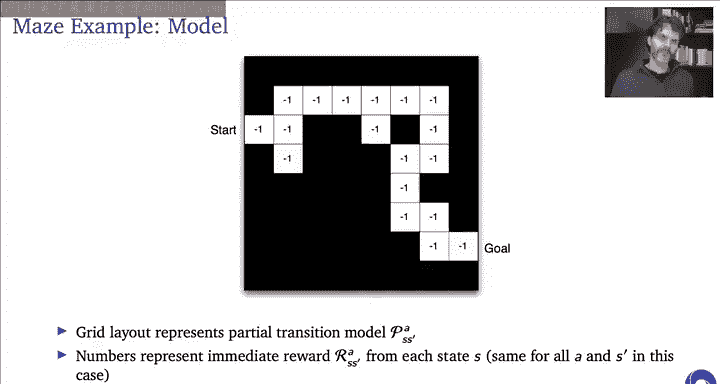

Okay， now finally， before we reach the end of this lecture。

 I'm going to talk about different some different agent categories。

And in particular this is basically a categorization， it's good to have this terminology in mind。

 which refers to which part of the agent are used or not used。

And a value based agent is a very common version of an agent。

 and in this agent we will learn a value function， but there's not explicitly a policy separately Instead the policy is based on the value function。

 This agent that I showed earlier that was paying Atry gains is actually of this form where this agent learns state action value functions and thens picks the highest rate of action in every state with the high probability。

Conversely， you can think of a policy based agent which has an explicitquiite notion of a policy but doesn't have a value function。

 I haven't yet told you any algorithms how you could learn such a policy if you're not learning values。

But we will actually see an example of that in the next lecture。

And then there's the terminology actor critic， the term actor critic refers to an agent which both has an explicit representation of a policy and an explicit representation of a value function。

 These are called actor critics because the actor refers to the policy part。

 there are some part of the agent that acts and the value function is then typically used to update that policy in some way。

 So this is then interpreted as a critic that critiques the actions that the it takes and helps it select better policies over time。

Now all of these agents could be model free， which means they could have a policy and or a value function。

 but they don't have an explicit model of the environment。

So note in particular that a value function can of course also be considered some model of some part of the environment。

 it's a model of the cumulative expected rewards。But we're not calling that a model in reinforcement building parlance typically。

 so instead if you just have a value function， we tend to call this model free。

I'm saying that not because it's a great definition or a great division between agents。

 but because it's a very common one， so if you read papers and they say something about model free green forces learning。

 this is what they mean， there's no explicit dynamics model。😊，So conversely。

 a model based agent could still sorry could still optionally have an explicit policy and a value function。

 but it does in any case have a model。 Some model based agents only have a model and then have to plan in order to extract their policy。

 other model based agents have a model but in addition to that have an explicit policy and for instance。

 use the model to sometimes just incrementally improve value function or a policy。😊。

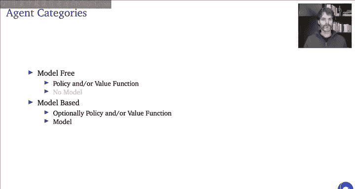

So now finally， we're going to talk about some subpros of the RL problem。

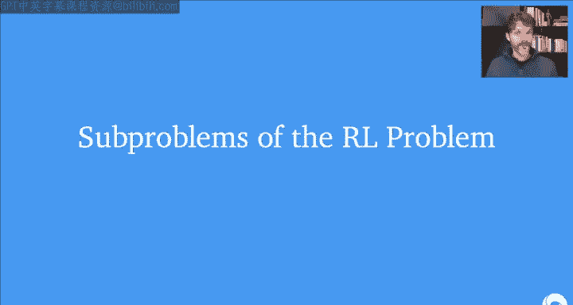

Prediction is about evaluating the future。 So for instance， learning a value function。

 you could call a prediction problem and this is need often the terminology that is used。

 typicallyyp when we say prediction we mean for a given policy。

 So you could think about predicting the value of the uniformly random policy， for instance。

 or of a policy that always goes left or something of the for。

Conversity control is about optimizing the future， finding the best policy。

So it's good to note that this terminology is used quite frequently in papers。

 so it's good to have that in mind and often of course these are quite related because if we have good predictions。

 then we can use that to pick new policies in fact the definition of the optimal policy pi star is the arc max of policies over these value functions by definition。

 the value function defines which policies are the ranking on policies essentially your preferenceable policies。

 that doesn't mean that you need to have these value functions per se in order to learn policies。

 but it just shows how strongly related to the problems of prediction and control are。In addition。

 there's this interesting question that I encourage you to ponder a little bit。

 which is that this is something that Rich Sutton often says。That in one way or the other。

 prediction is maybe very good form of knowledge and in particular， if we could predict everything。

 it's unclear that we need additional types of knowledge。

And I want you to pond it and think about whether you agree with this or not。

 so if you could predict everything， is there anything else that we need？

So feel free to pause to review you and think about that for a second。

I'm going to give you one suggestion， so indeed if you can predict everything about the world。

 this gives you a lot of knowledge， it might not immediately tell you how to do things。

 so maybe it's sometimes useful similar to these policies and value functions。

 sometimes it can be useful especially if we're approximating so we can't predict everything perfectly。

 it can be useful to separately store predictions and separately store policies or you could think of these as them being skills and something。

But indeed， predictions are very。Rich form of knowledge。

 And many things can be phrased as a predictive problem。

 even if they are not immediately clearly a predictive problem。If you first think about it。

And as I refer to when I was talking about models， theres two different parts to the reinforcement coding problem。

 One is about learning。And this is a common setting。

 which we assume where the environment is initially unknown and the agent interacts with the environment and someone has to learn。

Whether it's learning a value function， policy or a model。

 all that could be put under the header of learning。And then separately。

 we could talk about planning， so planning is a common term in artificial intelligence research。

And planning is typically about when you have a model。

 so let's say the model environment is just given to you。

And then the agent somehow figures out how best to optimize that problem that would be planning。

 so that means you're using some computes to infer from the statement of the problem from the model that is given what the best thing to be done is。

Now。Importantly， the model doesn't have to be given but could also be learned。

 but then it's good to keep in mind that the model might be slightly inaccurate。

 So if you plan exhaustively in a learned model you might find a certain policy。

 but it's unclear that this policy is actually optimal in the true world because the model might not be completely accurate and indeed the planning might latch on to certain inaccuracies in the model and hence might find solutions that are actually not that suitable for the real world because for instance。

 the model might have a wholeli little wall somewhere that is not actually there and then the shortest path might take the agentth through that hole which isn't actually there and the policy might not be great you get from there。

But we can think of planning more generally as some sort of an internal computation process。

 So then learning refers to。Absorbing new experiences from this interaction loop and planning is something that sits internally inside the agent's head。

 it's a purely computational process， and indeed I personally like to define planning as any computational process that helps you improve your policies or predictions or other things inside the agents without looking at new experience。

Learning is the part that looks at a new experience that takes in a new experience and somehow cans that and planning is the part that does the additional compute that maybe turns a model that you've learned into a new policy。

It's important also to know that all these components that we've talked about so far can be represented as functions。

 we could have policies that map states to actions or two probabilities over actions。

 value functions that map states to expected a rewards or you need also to probabilities of these。

 we have models that map states to states or state actions to states and we could have rewards that map states to rewards again or distributions over these。

 and we have a state that that function that takes a state and an observation and potentially in action and a reward and mapps it to a subsequent state。

All of these are functions and that's important because we have very good tools to learn functions。

 specifically these days neural networks are very popular very successful and the field of researching how to train neural networks is called deep learning。

And indeed， in reinforce force and film， we can use these deep learning techniques to learn each of these functions。

 and this has been done with great success。😊，It is good to take a little bit of care when we do so because we do often violate assumptions from say supervised learning。

 for instance the data coming at us might be correlated。

 because for instance think of a robot operating in a room。

 it might spend some substantial time in that room so if you look at the data coming into the agent。

 it might be correlated over time and then sometime later might go somewhere else and it might be less correlated。

 but there might be in the near term quite some strong correlations in the data。

 which are sometimes assumed not to be that when you do supervised learning。In addition。

 the problem is often assumed to be stationary in supervised learning in many supervised learning problems。

 not in all of course， but in important learning we're often interested in nonstationary things think for instance of a value function as I mentioned the value function is typically conditioned on a policy but if we're doing control if we're trying to optimize our policy the policy keeps on changing that means that the relevant value functions maybe also keep on changing over time because maybe we want to keep track of the value of the current policy but if the policy keeps on changing that means that the value function of change。

So this is what I mean when I say we often violate assumptions from supervised learning。

 that's not necessarily a huge problem， but it does mean that whenever we want to use some sort of a deep learning technique。

Sometimes they don't work out of the box。So deep learning is an important tool for us when we want to apply reinforcement learning to big problems。

But deep reinforcement learning which is basically a research field of the merger of deep learning and reinforcement learning or how to use deep learning in reinforcement learning is a very rich and active research field。

 you can't just plug in deep learning and then hope that everything will immediately work that works up to a point but there's lots of research to be done exactly at that intersection of deep learning and deep reinforcement learning。

We'll talk much more about that later in this course。

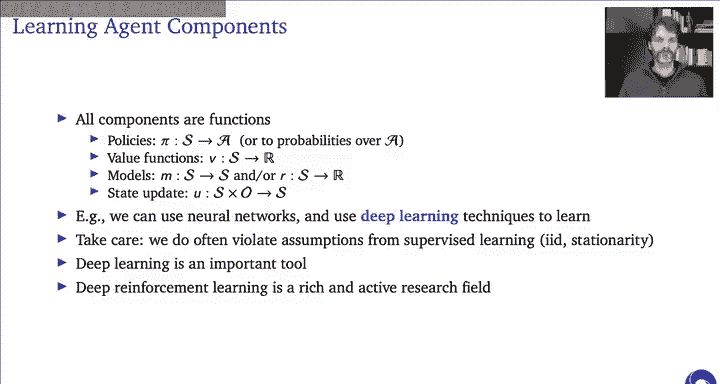

Okay。😊，Now that brings us to the final examples， so I talked about Atari。

 let's make it a little bit more specific now what was happening in the Atari game that I showed you so you can think of the observations as the pixels as I mentioned at that point in time as well。

 the output is the action which is the joyst controls and the input is the reward here on the slide it actually shows the score。

 but the actual reward was the difference in score on every time step。

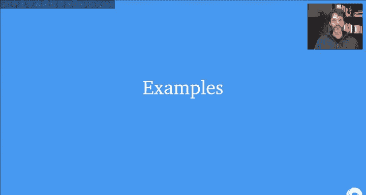

Note that the rules of the game are unknown and you learn directly from interactive gameplay。

 so you pick actions on the joystick， you see pixels and scores。

 and this is a well defined reinforce and printing problem。

 and we have algorithms that can learn to deal well with this。As a different example。

 here's a schematic example， a little bit more of an illuitative example。😊。

And this is easy to easier to reason through。 This is why we sometimes use these much smaller examples and oftentimes the conclusion is still transfer。

 So the Atari example is an example of a rich， messy。Hard problem in some sense。

 right and this would be an example of a very small scale illitative problem and we do this because we can often learn something from these smaller problems that we can apply to these much harder to understand difficult big problems。

So in this specific example， which is from the Subartto book。

It's basically a grid world without any walls， although there might be walls at the edges essentially。

But not only rolls inside the5 by5 grid。And there is a reward function which is defined as minus1 when bumping into a wall。

Zeroro on most steps， but if you take any action from states A， the state that is labeled with a。

 you get a plus 10 reward and you transition to a prime。So even if you press say up from state A。

 you still find yourself in a prime and you get plus10。Similarly， from state B。

 you would transition to state B prime and you get plus5。

Now we can ask several different questions about this setting and there might be reasons why we might be interested in these different settings questions。

 so a first question could be a prediction question， which is， for instance。

 what is the value of the uniform random policy that selects all of the actions uniformly at random。

And that's depicted here on the right hand side in figure B。

And what we see is that this is quite a complicated construct right I wouldn't have been able to tell you just immediately just by looking at the problem what the value function is for the optimal sorry for the uniformly random policy。

 but we can use reinforcement building algorithms which we'll talk about in future lecture to infer this and to figure out what that value is。

And it turns out just to look at this a little bit more in detail that of course。

 the value of state A is quite high because from this states， you often get a high。

 you always get a high reward。But it's lower than 10 because the rewards after this first reward of 10 are negative。

 You see that the value of state a prime is actually minus 1。3。 Sorry， I didn't say。

 but there's a discount factor here as well，9。Which means that the this is why the value of state is 8。

8。And the value of state A prime is 1。3， and the difference between them is not quite 10， right。

 but from from state B。You often get a minus1 because you often find yourself bumping to the water bottom。

Or you don't get a minus1， but then you might get a minus one on the next time because you might have walked left to the corner。

And it's quite a complicated thing because of the discount factor。

 because of the dynamics of the world， but we can see that state A is desirable。

 state B is somewhat desirable， states in the bottom left are quite undesirable。

But you might actually be more interested in okay， but what's the optimal thing to be doing and that to me is not immediately obvious right。

 should you be going to state a and then loop to a prime。And get this plus 10 every time you could。

 but it takes you a couple of steps in between each two times you do that transition。

You could also go to state B and go to B prime and then you can get these transitions more often。

Now it turns out we could also figure out what the optimal value function is for this problem and what the optimal policy is。

 If you look at the optimal value， they're all positive now because you never have to bump into a wall anymore because the optimal policy doesn't bump into walls。

 So even the top sorry the bottom left corner now has positive values。And in fact。

 the lowest positive values are in the bottom right corner now。

 because from there it takes you a long time to get to the best possible state that you can and it turns out the best state you can be in is state A。

Looping with these plus 10 rewards is apparently more beneficial than looping with these plus5 rewards。

 even though the difference in distance on these plus5s is smaller。

So you can get more plus5s in a row very quickly by going from B to B prime after each like every time again。

 but going from a to a prime is apparently more profitable in the long term and we can see this in finger C here as well where the optimal policy is depicted。

We see that if you're in almost any state， what you should be doing is you should be moving to state A。

This will transition you all the way to the bottom to a prime and from there you'll just move straight up again。

Up to state A and repeat。Conversely， if you're in state be prime。

If you just look at where B prime is in this， you would either go up or left。

 it doesn't actually matter which one they're equally good。But if you go up。

 you would then move left so you wouldn't move into state B instead you would move left and then you move up or left again in order to get state A。

There's only one states that move into B， which is the top right corner。Because from the top right。

 going around stage B and then going all the way to A。

Would take so long that it's actually more beneficial to jump into state B。

 which will transition you to B prime and then from there on go to state A and then loop indefinitely。

So this is quite subtle， I wouldn't have been able to tell you just from looking at the problem that it would be optimal policy。

 but fortunately we have learning and planning algorithms that can sort it out for us and they can find this optimal solution without us having to find it。

So popping up in this course， we will discuss how to learn by interaction。

 we didn't really discuss it in this lecture in this lecture we just talked about the concepts and the terminology and things like that。

 but we haven't really given you algorithms yet， we will do that in the subsequent lectures。

And the focus will be on understanding the core principles and learning algorithms。

 So it's less about what the current state of the artist will touch upon that a little bit for sure。

 but it's less about specific algorithms that people happen to use right now。

 and going all the way to the depth of those。 We will do that for some algorithms， but。

It's much more important to understand the core principles and learning algorithms because the algorithms that are currently saved if you are they will change next year there will be new algorithms and if you understand the core principles。

 then you can understand these new algorithms and maybe you could even invent your own algorithms。

Topics include exploration in the next lecture。In something called bandits。

 which is basically one step mark processes。We will talk about more about what market decision processes actually are。

 like how are they mathematically defined and what can we say about them and we will talk about how to plan in those with dynamic programming。

 this will be the lectures after the next lecture by this will be given by Di Ba。

And then we will use that to then go into model free prediction and control algorithms。

 you may have heard of an algorithm called Q learning。Or I mentioned earlier in this lecture。

 an algorithm called DQN， DQN is short for Deep Q network。Q， as I mentioned。

 is often used to refer to state action values。 Q learning is an algorithm that can learn state action values。

 and then the DQN algorithm is an algorithm that uses Q learning in combination with deep neural networks to learn these at games。

This falls under model free prediction and control because no explicit model of the environment is alone in another algorithm。

We also talk about policy gradient methods， we in fact already touch upon them in the next lecture。

 but we'll talk about them more later and these are methods that can be used to learn policies directly without necessarily using a value function。

 but we also discuss a criticalittic algorithms in which you have both an explicit policy network or function and you have an explicit value function。

And this brings us also to deep reinforcement training because as I mentioned。

 these functions are often represented these days with deep neural networks。

 that's not the only choice， they could also be linear or they could be something else。

But it's a popular choice for a reason and it works really well and we'll discuss that at some length later in this course。

And also we will talk about how to integrate learning and planning。

 I talked a little bit about planning being an internal computation process and then learning being a process that takes a new experience and learns from that and of course we could have both of those happening at the same time in an agent and then we want them to play nicely together。

And there will be much more there will be other topics that we'll touch upon when we go through all of this。

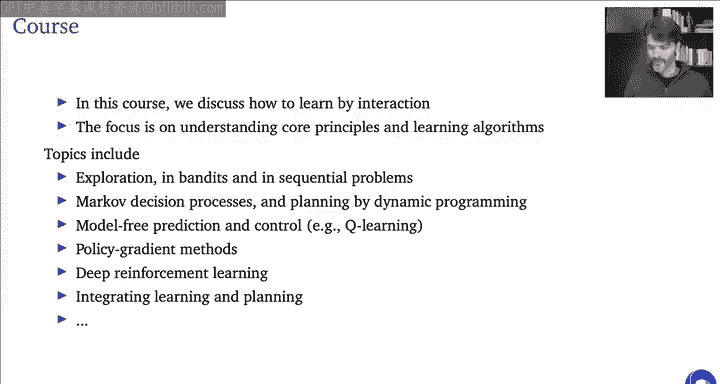

Okay。😊，Now， finally， I want to show you one final example of a reinforcing learning problem。Again。

 what we'll see is a little bit more of a complicated example。

So what we'll see is a system which was learned to control the body。

 So you can see the body already here on the still。 I'll press play in a moment。

 And what will happen is， is that there's an algorithm that controls the basically the forces of these body parts。

 So this agent specifically it came run right， and it had to learn itself how to move its limb in such a way as to produce forward motion。

 The reward was a very simple one。 The reward was just go in that one direction。

And you'll get plus one or you get positive reward basically proportional to how fast you go in that direction。

 so it really wants to go really fast in one direction。

 it was not told how to do that so it doesn't at first when it starts learning。

 it doesn't know how to control its limbs， it just knows that that it perceives a world in some sense by cs which I won't go into that much depth。

It's not too important it here， but the point is it doesn't know how to move its limbs。

 it has to figure it out by itself， and it just notices that when it movess in certain ways。

 it gets more rewarded in other ways。Doing that。You get the following behavior。

With simplified vision， as it says on the slide and prooception。

 which means it can feel essentially where its own limbs are in some sense。

And then it can traverse through this very complicated domain。

 and it can learn how to jump over things and how to maybe even climb in some sense。

Just because it wants to go to the right。Not everything is easy， but it does manage to get there。Now。

 interestingly。By using this setting by just having this simple reward。

 you can traverse different types of domains， you can learn to terrain， sorry。

 you can learn to traverse different types of terrains and do this in very nontrial ways。

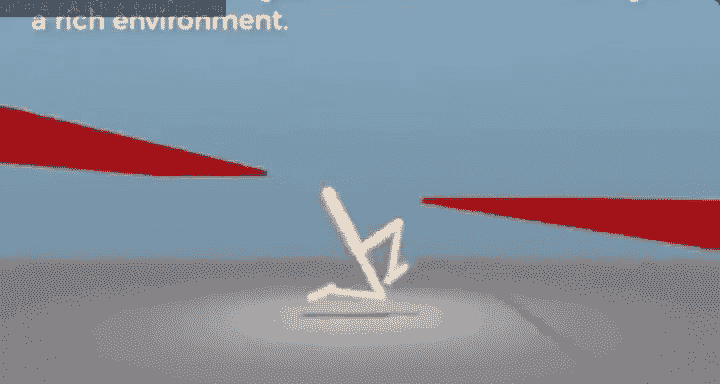

Would be very hard to specify policy by hand that does this and in fact。

 because we have a learning system， it's not just that we don't have to specify a thing by hand。

 but we can also apply the exact same learning system to different body types。

So this was with the exact same system that was used for this other thing。

 and you can use this in two dimensions or you could use this in three dimensions。

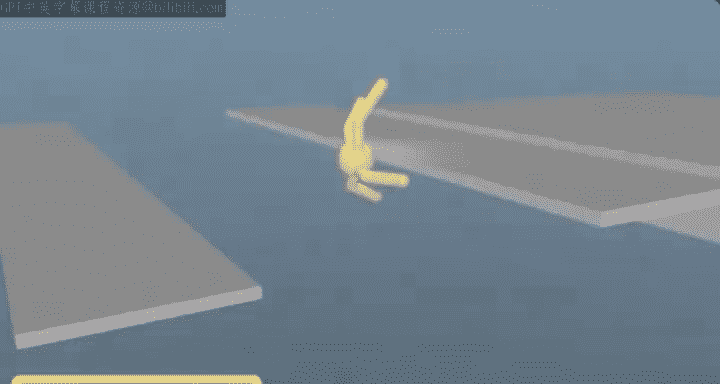

And in each of these cases， the agent can learn。V your interaction。

 how to actually scale these obstacles。So the reward is particularly simple。

 We didn't have to think about how to move to limbs in order to do that。

 We can just have the learning system come up with it。 And that's the important point here。

And you can apply to some more difficult terrain， you can apply to different body types。

 so you can get quite non trivial behavior in doing so。

Okay， so that brings us to the end of this lecture。

Thank you for paying attention。And。Well see you in the next lecture。

 which will be on the topic of exploration。

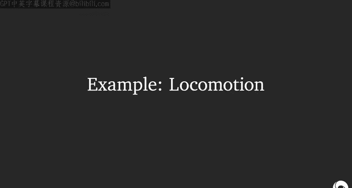