# DeepMindxUCL《强化学习｜Reinforcement Learning 2021》中英字幕 - P2：[02]Exploration & Control [2_13].zh_en - GPT中英字幕课程资源 - BV1JssaeVEMp

Hi and welcome to this second lecture in this course on reinforceinment learninging。

My name is Al Hussels and today I will be talking to you about exploration and exploitation。Now。

 before I going to tell you what I mean with these terms。

 I'm quickly going to flash up a slide with some background material。

 I highly recommend you read chapter2 from the book by Rich Sutton and Andy Barto on reinforceinformentBuilding and introductiontrouction。

And in addition， if you're particularly interested in the material that I discussed today。

 there's some further reading on this slide， which goes into much more depth。

 which won't be necessary to understand the rest of this course。

 but it's a really interesting material if you want to go into more depth。

 specifically in the topics of this lecture。And this is the Bit algorithms book by Tora Lattimoan Chaba Sivari。

 which just came out last year。And in addition， I put a reference here to the classic paper by Peter Aer and Casa Bianchi and Fisher from 2002 in which they describe the UCB algorithm which I'll be talking about later today。

So first to recap in the previous lecture， we talked about how reinforcement learning relates to the problem of artificial intelligence and what we mean with the term reinforcement learning。

And in particular we put up this interaction loop which we see on the slide。

 where there's an agent which takes actions and these agents sorry these actions somehow might influence the environment around the agents。

 you can think of the agent as being part of the environment。

 think of a robot in a world walking around where the walking around might impact the environment around it or maybe the robot sometimes picks up something and this changes where that object then is。

And therefore， the state of the environment is somehow changed。

Now the agent also observes the environment， it gets observations as an input and these observations obviously depend on the environment states。

 but they might not fully describe the say of the environment because the save of the environment might be this huge complicated thing and the agent only has a very small interaction with this。

 the agent might have a camera with which it perceive part of the environment but it can't perceive everything at the same time。

And then reinforcement learning can be thought of as being a science of how could this agent then learn to make decisions。

 how could it pick its actions in such a way that the agent is happy。

 and we're going to define happy here in terms of reward。

 where some sort of a reward signal that the agent is trying to optimize This is what defines the goal of the agent without a reward the agent is。

 in some sense an aimless machine， it doesn't have a goal but the reward function defines what it's trying to optimize。

This reward can sometimes be considered part of the environment where it gets sense to the agent as part of the observation。

 and the other cases it's more natural to define it as part of the agent where the agent has an internal preference function that means it likes certain observations better than others。

That's not too important for now， we'll get back to that later。

 but the important thing is that there is some sort of reward function that the agent is trying to optimize。

The agent itself must contain a policy or it must contain a policy because you have to select these actions in some manner。

It might also contain a value function which is a prediction of the future rewards the agent might receive。

 and it might also contain a model about the environment we discussed all of this in the previous lecture。

Now this general reinforcement learning problem requires us to take into account time and consequences。

 I mean with this that actions can only impact the future， not the past。

 and sometimes this can happen in complicated ways so you might take an action that changes to saves the environment in some way that for instance influences later rewards or later observations and sometimes you can't immediately see the effect of the action or at least not the full consequences of it。

 but still the agent in order to pick the right actions should somehow be able to reason about all of this。

So these actions or decisions you make， which action to pick， affect the immediate reward。

 they might affect the state of the agent itself， and they might affect the state of the environment in some way or the other。

 which might itself then have consequences for later observations and rewards。

Now this is a challenging setting and one interesting property that we're going to talk about a lot in this lecture in a sense is that it's an active learning setting and this means that these actions they don't just change the reward they don't just tell you how well you're doing but it also influence the data that you see and this is going to be important and this is different from some other types of machine learning because normally in other types of machine learning we might assume that a data is given to us and we want to answer some questions given that data we want to learn something from the data but the data is given and is not under our control and reinforcement learning in a full setting this is different the data is in some sense under our control。

But in some indirect sense， we can take actions to change the data and we cant deliberately pick out certain data points。

 or sometimes maybe we can， but we can't maybe always do that。

And this means that the agent has to actively seek out information that it can use to learn from。

Now in this lecture， we're going to simplify the setting quite a great deal。And in particular。

 we're going to assume that the environment actually only has one single state it could ever be in。

 or maybe equivalently you could think of the environment as having no states whatsoever。

So the environment， all that it then returns to you is rewards， it doesn't return any observations。

 I'm going to assume here that the environment does indeed return to rewards。

 although again you could also think of this as being kind of internal to the agent where maybe the environment could be thought of as sending you a signal that tells you which reward you can then apply to it with your preferences。

 your internal preferences。But just think of it as an environment with a single state and this has some consequences。

 first of all， actions can no longer have long termm consequences in the environment if you take an action。

 it can't change the state of the environment because the environment only has one single state。

In addition， the actions can to impact the immediate reward。

 which is actually not a function of the sequence， it's a function of just the immediate action that you take。

But the other observations can be ignored， so if you consider the reward and observation。

 you still want to say pay attention to that because this defines your goal。

But other observations are basically irrelevant because all they could ever tell you is something about the environment state。

 but if the environment only has one state， maybe this can just be ignored。

And then we will discuss how to learn a policy which is a mapping from your internal agent states to actions in this more simple setting。

 and turns out there's already like a lot of rich things that we can say in this setting and a lot of really interesting questions that we can get get to。

 which is why wed consider the simpler setting first。Then in subsequent lectures， so not today。

 but in subsequent lectures， we will be talking about the more general setting again。

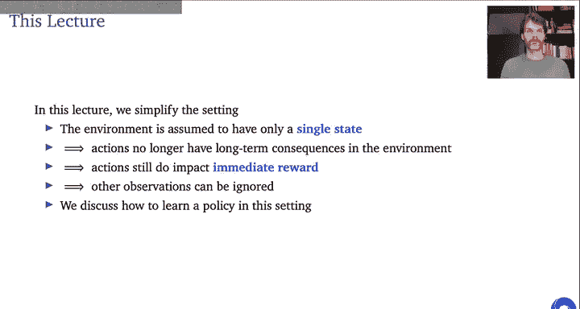

Okay， so now I'm going to。

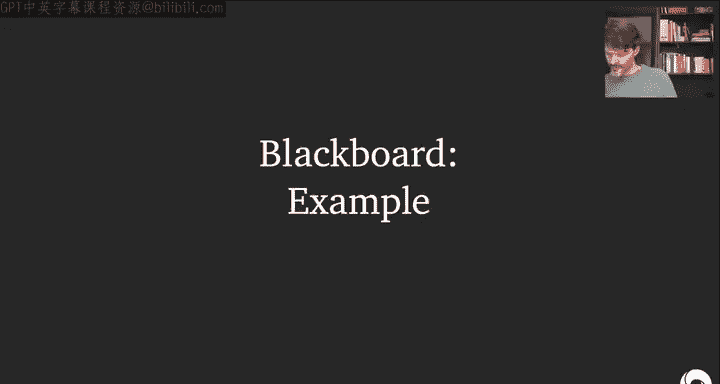

Just go through a little example and for that， I'm going to switch。

So the Blackboard。So now。Let's consider that we're going to compare two different。Actions。

And as mentioned， these actions won't have long term consequences， so basically we take an action。

 it might be action A or it might be action B。And we're going to compare how well these do in some sense。

For instance， you could think of action A and B， you could think of them as being medical treatments where you maybe have the choice between。

 say one vaccine or a different one， but maybe you can only do one at a time。

 or it could be more extensive medical treatments where clearly you can't do them both at the same time。

 perhaps， and therefore you have to pick one or the other。

 or maybe action A is doing no treatment and action B is doing some treatment。Or alternatively。

 if you prefer this as an example， you can think of a recommender system where you have a streaming service and people can watch movies and you have a choice which movie to recommend next in the top position。

So picking a movie there， picking a good one might mean that people pick it and then watch it。

 where picking a bat one might mean that nobody clicks it。For every user。

 you didn't have this option， whether to pick movie A or Mo B。

 and success would be if the user then picks towards that movie。First simplicity。

 let's assume the only two options here are failure or success。

So let's say the rewards are basically plus one or let's say plus one or zero。

Now we could have some prior information， but for simplicity let's assume we know nothing。

 so we kind of just randomly have to pick between these two options the very first time we try them so we have trials here on the aes。

Accs。And at first， let's say we pick action A。And we observed a reward of zero。

 this was all a success。Re， for instance， showed a movie and the user didn't pick it。Okay。

 so next user comes around， we have this choice again。

 let's say now because action A didn't quite work out， let's say we pick action B。

And let's say that this one's more successful， we get a plus one。

So the question now what should we do next， well， maybe here it seems sensible。

 given that we have no additional information， we only have one failure for action A。

 one success for actionction B， so maybe we'll pick action B again。

Now let's say that this time around， it didn't work out that well and it was no success the user didn't pick the movie or the medical treatment didn't quite work out as well as we hoped。

So we consider this a reward of zero。Again， the question pops up next time around。 What should we do？

 Well， the average value for actually B is still a little bit larger than the average value for action A。

 so maybe we'll try it again。But let's say we are unlucky again， we picked movie B and again。

 it doesn't get picked。So the question here is what to do next， when should we switch？

Back to action A。How long should we persist to action B。

 What happens if we do switch back to action A， but then we get another zero。

 maybe then we switch back to action B again， but for how many steps。

 So these are the questions that are under consideration， I won't give you an answer right now。

 but we'll discuss different algorithms which will help you pick between these two actions and they will pick maybe in different ways and we will discuss this at length。

 these different algorithms that you could apply to this setting。

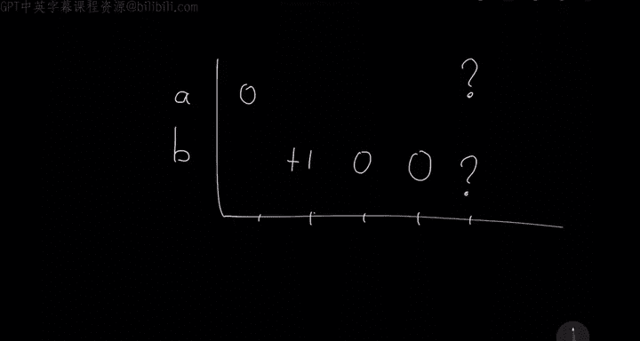

Okay， so now let's switch back to the slides。

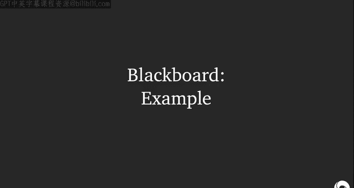

So。We're basically talking here about the difference between exploration and exploitation。😊。

And this is something that any learning agent which actively gathers its data must trade off。

Exploitation here refers to maximizing performance based on your current knowledge。

So as in the example， if we've only ever shown two different movies and one of them has been more successful than the other。

 maybe the reasonable choice， if you really want to get an next one right would be to pick the one with the highest success rate so far。

But we know in the long run this might not be great because if you exploit all the time。

 you're never going to get new information about movies that you haven't tried very often in the example。

 we only ever picked movie A once and even though that wasn't a success。

 maybe we want to pick it more often just to be sure how often is it actually a good choice。

And this is called exploration， and the main purpose for exploration is to increase our knowledge by exposing ourselves to new information。

 to new data。And this is a fundamental trade off that we need to think about clearly and carefully。

 and we went to this simpler setting where the environment only has one states to be able to reason this through basic as far as we can。

And then from here， we hope to learn some lessons that we can apply also to the more general case。So。

Basically， in general， we would need to gather information to make the best overall decisions。

And the best long term strategy might involve taking some short term sacrifices。

 Sometimes you want to try something that you' never tried before。

 which you think is maybe not that likely to be great， but you have high uncertainty about it。

 If you never try it， you will never know。 And there might be some brilliant rewards to be gathered。

 but if you never try it， you will never find those rewards。

 Maybe sometimes you may have to make a short walk through the rain to find a brilliant new place to go to。

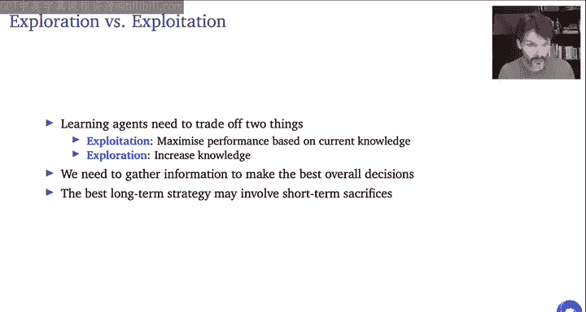

So now we're going to move towards formalizing the problem。

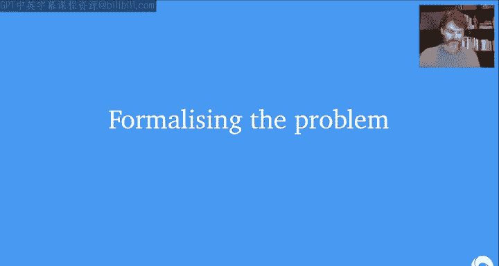

So what this setting is sometimes called is a multi armed bandit。

And this is basically a set of distributions where we have a reward distribution per action。

Why is this called a multi arm band， this actually alludes to slot machines。

You can think of a slot machine as being。Something where you basically don't have a lot of choice。

 some complicated slot machines， of course， you do have a lot of choices。

 but let's think of a very simple slot machine where all that you have is a lever and you can pull it and you either get some reward or you don't or maybe there's different types of rewards that you can get there could be some complicated reward distribution。

Now we can think of this as being a single action， a single slot machine。

 but then you could think of having many slot machines， each of which have their own lever。

 and you could pull them each of them and each of them might have a different reward distribution。

Now we know a priority that typical slot machines will give you less money than you put into them。

 but let's assume that we don't know this， we can generalize this problem。

 so there could be some slot machines that are quite worthwhile where others are not。

Now this is where this term multi-yrm bandwidth comes from because a slot machine is sometimes called a onear bandit because it takes your money away and then a multi-arm band is a setting where we don't have just one choice。

 we don't have just one slot machine with a single lever。

 but we have a whole row of these slot machine so's many different choices we can make。

This is just terminology， of course we're not talking about slot machines here。

 we're talking about a more generic setting where it this could be a recommender system or a way to formalize picking between a host of different policies。

 say for determining medical treatments， as I mentioned or other examples you could come up with。

This curry is is just a set of known actions or arms in multi and terminology。

And R query R of a is then the distribution for that specific action。

 and as I mentioned for different actions， the distribution could be different。

The goal is now to pick the action that gives you the highest average reward。So at each time step。

 you're going to select one of these actions and you're going to observe this reward。

 which might be a random variable。And the goal is then to maximize the rewards over time。

This is a little bit different from what we talked about before Note that this is actually taking and account the full learning process this turns out to be a useful thing to think about。

 so we want an algorithm， a learning algorithm that trades off exploration and exploitation in such a way that if you apply this algorithm throughout your life that you get reasonably high reward Of course this reward can't be optimal all of the time because you don't know what the optimal action is yet。

But this way of writing down the goal， including all of the steps that you ever take。

 allows us the reason about which learning algorithms are more effective than others。

And we will specifically optimize this cumulative reward over your lifetime by learning a policy。

 which in this case is just some distribution on the set of actions。

We could think about deterterministic policies which always take the same action。

 but during learning it's also sometimes useful to have stochastic policies which pick actions according to some random distribution。

 and the policy will change over time as we gather more data。Now。

 one good concept to still use would be the notion of an action value。

 which we also talked about last lecture， which in this case is quite simple。

 is this is just the expected reward， given that you've taken that action。

 So the action value for action A is the expected reward for action A。

Now we can also talk about the optimal value， the optimal value that you can achieve at any the time step is simply the maximization of the action values over actions。

 this is the maximum expected reward。Another useful concept that we will talk about extensively in this lecture is the notion of regret。

What is regrets， the regret is a specific number for each action。

 which is basically the difference between the maximum possible expected reward you could have gotten and the one that you did get for this action。

Not that this is not a random quantity， we're subtracting one expectation from the maximization of her expectations。

 so this is just a number for each action Now we don't know this number that's the whole point if we would know this number we would simply select the action which has zero regret。

Not there's always one action， the optimal action for which this quantity is zero。By definition。

And note also that for all the other actions， this is a positive quantity。

 So regret enumerates essentially how bad we're doing。 the more regret you get。

 the worse you're doing。 If your regret is0 or closest to zero， you're doing quite well。

This will become a lot more clear when I talk about specific algorithms and I talk about the regret that they incur。

 and then you'll see that this is a useful way to look at the differences between different algorithms just to look how much regret do they attain over their lifetime。

So the regret， as I mentioned， for the optimal action is zero and that's going to be important。

And then we can think about minimizing the total regret as our overall。

This is a random quantity because it depends now on the actions that we take。

Note that the regret the instantaneous regret for a given action is not a random quantity。

 but here the actions themselves are random quantities because our policy might be random and。

 in fact， will be random because typically our policy will depend on our history。

 So we take some action， even if we do that dehuministically， we get some random reward。

 and we want to use that reward somehow to pick the next action。

 which means that the next action will then be a random quantity。

So this is simply a summation over time of this instantaneous regret at every time step for the action that we picked。

And then we want a reason about minimizing this total summation over all of our lifetime up to some time step T of this cumulative regret。

Note that I didn't actually change the goal here， I mentioned two different goals。

 minimize total regrets or maximized cumulative reward， these are actually the same goal。

 there's just a different way to write the same thing。

So note this is true because if we maximize the expected cumulative reward。

 this would correspond exactly to minimizing these gaps between the optimal expected value and the one for the action that you've selected。

 So these are really the same goal we're just writing it down differently and this notion of regret is quite a common one in multi-ar bandit because it allows us to reason about how quickly does this regret grow over time。

In turns out， this growth rate is very indicative of how good an algorithm is。

So we basically go to algorithms that for which the regret doesn't grow too quickly over the full lifetime of learning。

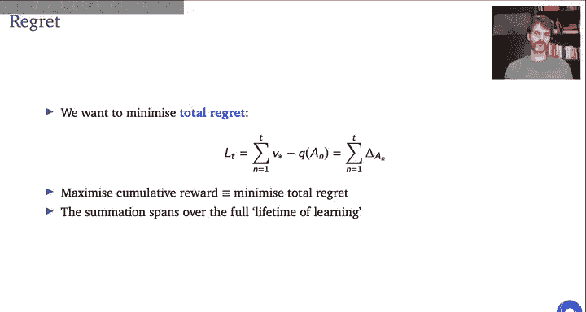

So when it follows the rest of the lecture essentially。

 I will mean talking about different algorithms and also different analysis that we can do。

 like theoretical analysis on these different algorithms to discuss whether like to determine essentially whether one algorithm is better than another。

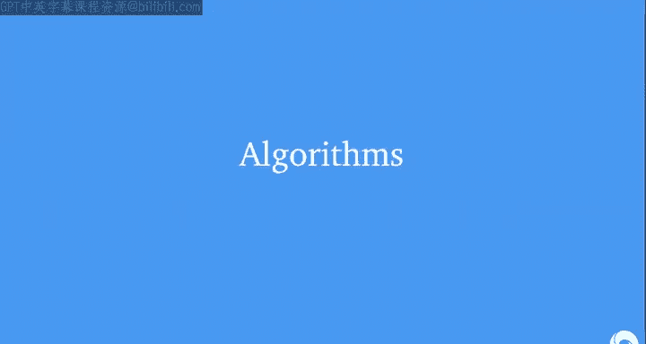

Okay， so let's get started。We will discuss the greedy。Policy， an Epsilon greedy strategy。

 which I'll explain what that is。 The UCB algorithm， function sampling and policy gradients。

 And I will explain what each of these means in what follows。 This is just a quick overview。

 If you don't know what these terms mean， that's perfectly okay。

 because I'm going to explain that in a second。The first three of these approaches use action value estimates。

So we are going to keep track of some big Q of T， I use big Q there because it's a random quantity because it depends on your past observations。

And this big Q of a at some sub T is supposed to approximate the actual true value of that action A。

So little Q A here is a true expected reward given a and big Q is an approximation0。

So let's very briefly discuss how to learn those action values which won't be very surprising。

 so the true action value we know is the expected reward。

 so one thing we could do is we could just average the rewards for that action。

That's written on this slide maybe be a little bit verboly。

 but we're basically just picking out with an indicator function。

 the time steps on which we selected this action A。

This indicator function of A N equals a will be one。 if its argument is true。

 So when we've actually selected action A， and it will be 0 otherwise。

 So we're basically just sum of summing of all time steps。

 picking out the rewards that correspond to the action A。

 and then dividing by the number of times we've selected at action A。 And this is called the count。

 So we're dividing simply by the count for that action。

 which is just the number of times you've selected that action， including time step T。

This is just a way to write on the average， so we're simply just tracking for each action whenever you select that action。

 you just average in that reward into your estimate。

Now written like this you might have to keep track of all of the rewards and put them into like different tables。

 of course you could also do this incrementally which is written down on this slide where we simply take our average and we update it。

So this can be written in the way that is written on the slide where we take our action value at times step T。

 and we define this to be the action value at the previous time step t minus1。

Plus some learning rate， alpha or step size parameter alpha times an error term。

 and the error term is simply the reward that you've received。

 given that you've taken this action minus the average for that action so far。

And all of the other actions， we simply don't update them because we haven't taken those actions at this time step so we don't update the mean。

And then we also increment the account for the action that we taken。

 and we define the subsize parameter to be one over the account。

 Then this is just a different way to write down the same average we had on the previous slide。

In later lectures mostly we will also consider other step sizes， which are sometimes useful。

 for instance you could think of a constant step size which would lead to tracking behavior and this can be useful when for instance the problem is nonstationary in some way。

 then you might want to track the rewards rather than to average than flat out。

For now this is just a way to average the reward， so that's what I want you to keep in mind for each of these actions we have the average reward for that action so far。

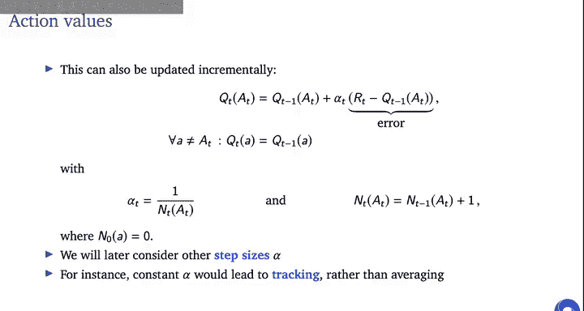

Okay， so now we can dive in and talk about concrete algorithms。

 the first of which it will be degree algorithm， which is a particularly simple algorithm。

 it simply takes the action with the highest value as you've estimated it so far。

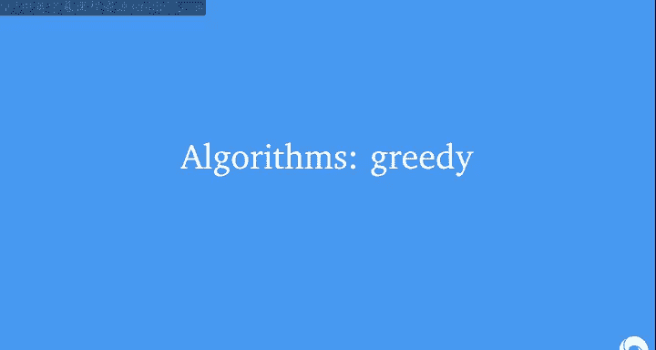

So equivalently we can write this down a little bit differently。

 what we often use is a notation of pi to the policy and pi of action A is the probability of selecting that action。

 which in this case is just an indicator again， which checks that the action is the one that maximizes the value。

The way it's written down here is assuming no ties are possible because otherwise the probabilities don't sum to one。

 so if multiple actions have the same maximizing value。

 then obviously you still have to decide what to do and for instance you could pick random you could break ties randomly in that case。

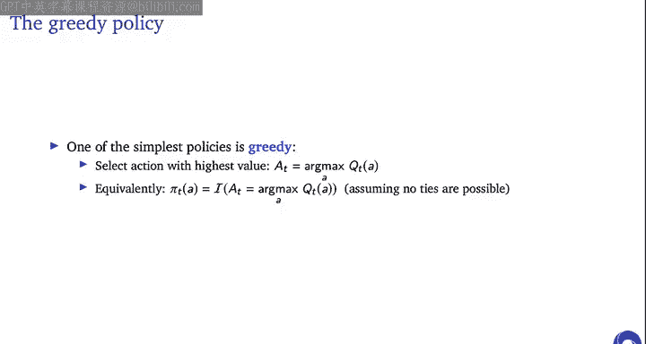

Okay， now I'm going to go back to the blackboard again。

And this is just to。Think about the regrets of the greedy policy。

So going back to the example we had before。We've taken action A once， we've got a reward of0。

 we've taken action A about three times by now， we've got a reward of1 and then0 and then0 again。

Now what are the action values at this point， Well the action value as estimated at time step。4。

Of action A。Is simply one sorry， zero， we've taken it once， it wasn't a success。 we have zero。

The action value at times step four for action B， on the other hand。Is one third。

We've taken it three times。We' got a plus one， and a0 and a 0。

The greedy policy would continue to select A B。Because the value is positive。

Whereas the value of their a is simply0。But notes that it will actually continue to do so indefinitely。

 if the only possible rewards here， as I stated before are0 or plus 1。

 then the algorithm from this point onwards would never ever select action A again。Now。

 it could very well be the case that action A is actually possible the optimal action in this this case。

 it could， for instance， be that the probability of getting a plus one reward given action A。

Could have been something reasonably large， like 0。8。

Whereas the probability selecting of getting a plus1 reward when selecting action B could be moderately low like 0。

2 or something。That would mean that the regrets。For action A is0。

You get no regret when selecting action A and regrets for action B。Is 0。6。

Recall the regrets for an action。Is simplyD maximumimal attain expected reward minus the value。

For taking that action。The value for taking action here is exactly the same as the probability of getting plus one because the only two alternatives are plus 1 and0。

 so the maximum value of v star here in this example， as I wrote it on the side would be 0。8。

Whereas the value for B。These are essentially values。 It's just 0。2。This。

Probability being equal to the value is just a happenstance。

 of course it's just because our only options are plus1 and zero in general you can just think of the expected values rather than the probabilities。

So clearly we should be taking if this is all the case， we should be taking action A。

 but the greedy policy won't necessarily take action A， it could have happened， of course。

 that on the very first time we took action A， we did get a plus1 in which case the greedy policy might have stuck to action A depending on the rest of the data and then everything might have been okay。

OrOr actually should say， depending also in your initialization of the action values。

 because whether we select action B ever depends whether we initialize this value low or high。

So this is just to say that the greedy policy is not great。

 which is probably something that's quite intuitive as well。

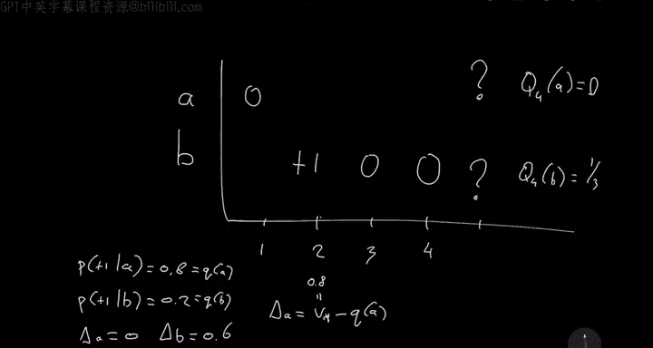

So we'll go back to the slides now。Okay， so the Read policy might not be that great in some cases。

 so can we do better？

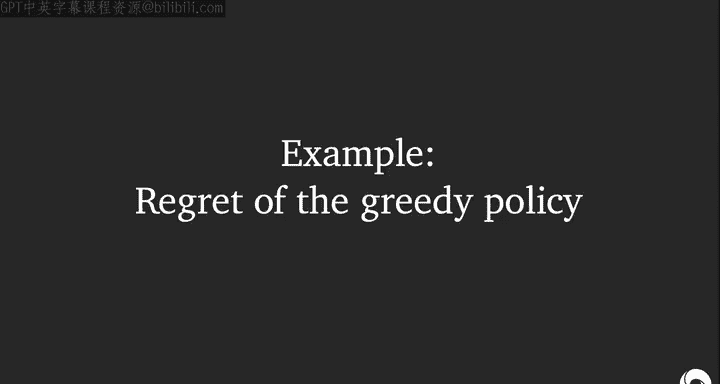

And turns out we can。And one simple alternative would be epsilon greedy。

 So the problem with the greedy policy just to reiterate what we showed in the example is that it can get stuck selecting the wrong action indefinitely。

 There was this one action which happened to get a higher valued than the other one。

 and then it just keeps on selected at action because the value kept on being positive。

 whereas the other value estimate was 0， even though the value estimate with estimate of 0 was actually the optimal action。

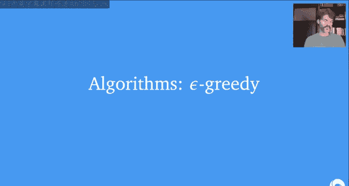

This means that your regret can continue to grow linearly and every time you get a similar amount of regret。

 and that turns out is not great。So the reason that this happens is because the greedy policy doesn't explore enough。

 it keeps on exploiting the knowledge that it thinks it has。

 but it doesn't realize or doesn't reason about uncertainty about the value estimates。

 Now was just one action which we only selected this single time。

 so we should have some very high uncertainty about having a valid accurate estimate of its value。

So an alternative is to add some noise that keeps them exploring and this is what Epsilon greedy does and this is a very popular algorithm actually。

And the way this works is that with probability 1 minus epsilon， you select greed action。

 similar as the greed D， but with probability epsilon， you select a random action， any action。

 including potentially degree greed1， but with just random probability。

We can write this un equivalently as a closed form policy。

 so the probability of selecting an action and depends on whether the action is a greedy one。

Again here I'm assuming that there are no ties to be broken。

 otherwise you have to carefully correct for that。But if there are no ties possible。

 then the greedy action will be selected with probability 1 minus epsilon。

 plus a little bit of probability to gets selected when you pick the random action。

 and then all other actions are selected with epsilon divided by the number of actions because we're picking randomly。

So Epsilon greedy continues to explore with this probability Epsilom。

 but that means that it also has linear expected regret because the epsilon doesn't decrease。

 so you keep on picking actions even if at some point you should be quite certain that these actions are really actually quite bad so you've obtained in some sense enough information about them and you should stop really stop selecting them Epsilon greedy doesn't do that keep on selecting these actions。

That said， it is a very popular algorithm in the first lecture I'll show you an example of an agent playing Atari games。

 this agent was actually trained with Abpsidom greedy exploration。

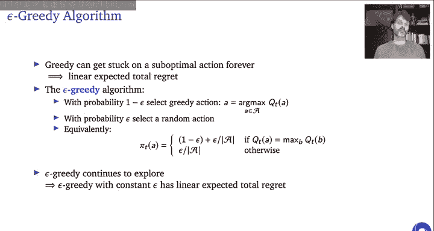

Now moving yet to another example of a way to update our policies。

 we're going to sidestep action values for a second， and we're going to ask the question。

 can we learn this policy directly instead of learning values？

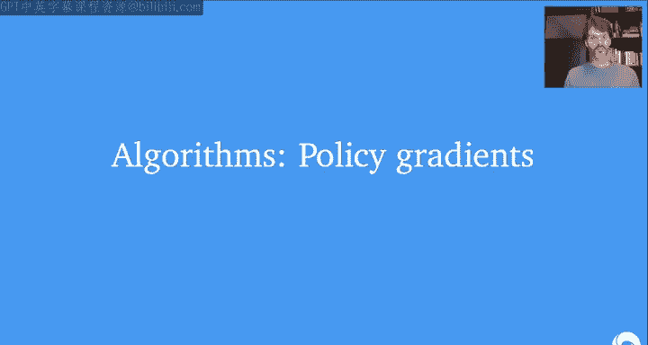

Now， it turns out this is possible。And before going there。

 I'm going to make this a bit more concrete。 Let's consider that we have some action preferences。

 and let's also pick a policy。 In this case， we're going to pick a differentiali policy。

 one that we can take a gradient off So we're not going to pick epsilon greedy Instead we're going to pick this alternative。

 which is a softm and the way softm policy works This is another very popular policy is that you expentiate these preferences and then you just normalize。

 So we see an expentiated preference for action A divided by the sum of all of the expentiated preferences for the other actions。

 by expentiating， we get a positive number， so we know that all of these probabilities must be positive and we know because we're normalizing with the sum that they must sum to one。

 So this is a welldefined policy on these actions。And then we just select an action according to this policy。

Note that the preferences themselves are not supposed to be action values per se right。

 we could plug in action values into a Som policy for sure。

 but now we're considering them just to be learnable policy parameters and we're going to ask the question how could we update these preferences in such a way that the policy gets better over time？

So the goal is to optimize the preferences so that the policy becomes very good and the question is how can we do that。

 and I'm going to give you one such algorithm to do this。

And the idea would be to update policy parameters such as the expected value increases。

 and we can just write this down and we can do this via gradients ascent。

So essentially what we're going to do is we're going to consider the policy parameters these preferences to be something that we can just learn and we're going to try to learn them with grades。

So in the bandit case， the update would look something like this。 we have theta。

 which are our parameters of the policy。For instance。

 you can think of theta as being a vector that just contains these action preferences for each of the actions。

More generally， this can be applied to other policy parameterizations and indeed it turns out this algorithm is quite easy to apply at scale in what we call deep reinforcement learning because for instance。

 Theta could be the parameters of some large， deep neural network。

So the algorithm here is quite easy to extend， which is one reason why it's of interest。

 but for simplicity now you can consider theta just to be a vector containing these action preferences that we talked about on a previous slide。

And then what we want to do is we want to do gradient ascent on the value of the policy。

What is the value of the policy， the value of the policy is the expected reward。

 given that you're following this policy？Note that the softm policy is a stochastic policy。

 so this means that itll it might select different actions under different。Probbil。

 so don't mistake this for the expected reward for a given action now the policy might be stochastic。

 so it's really awaited some of those。Now， one problem is here that we have a gradient of an expectation。

 but we don't have that expectation， we don't know that expectation typically。

And that means that we can't easily compute this gradient immediately。

 but turns out there's a useful trick that we'll discuss。

 which allows you to get a stochastic sample for this。

Note also that we can't directly just sample the expectation and then take the gradient because the sample for this expectation would just be a reward and we don't know how to take the gradient of that reward with respect to the policy strategy so we need to do a little bit of work to make this into something that we can sample so that we can do stochastic gradient descent rather than gradient decent per se。

So how can we compute this grade， that's the question that we're getting towards。

So this is a derivation on the slide that turns that gradient into something we can sample。

 and I'll step through this carefully。And this is sometimes called the log likelihood trick and sometimes also referred to in the reinforcement learning literature as the reinforce trick because this was introduced into reinforcement learning by Ron Williams in an algorithm he called reinforcefor。

 which is actually an acronym， but I won't bother you with the exact。诶。Semantics of the acronym。

 in this case。So we start here。On the left hand side with the gradient of the expectation of the reward。

 given that policy。 And what we're going to do first is we're just going to write that out。

 So we're going to expand this。Expect a reward given to policy into a summation over actions。

And then we have the probability of selecting each of the actions times the expected reward。

 given that we've taken specifically that action， and we know that to be our action value QA。

Now we note that this QA does not actually depend on our policy parameters because we've already pinned down the action by now right so given action A QA is just some number and it doesn't depend on our policy anymore that means that we can push the gradients inside the summation now and it will only affect the policy。

 not the Q values。Now we're going to do a little trick。Which is quite useful in general。

 We're going to multiply this whole quantity with something that is basically one。

 It's the probability of selecting the action divided by that same probability。

And the reason to do this is because then we can write it as an expectation again。

 so we're going to pull this probability of selecting the action A up in front again and let's push back the division by that same probability to the back just for notational simplicity。

 and then we know that we have something that is of the form of an expectation again。

 we have a summation over actions of the probability of selecting an action and then some term that depends on the action somehow。

So let's write this back as an expectation where this can be written as the expectation of the random reward。

 So we this expectation of the。The reward with the random reward inside the expectation again。

And this gets multiplied but it kind of wear it looking ratio。

 which is the gradient of the probability of selecting action A。Divided by that same probability。😡。

And now as our final step， which is actually somewhat optional。

 but it's just a different way to write down the same thing and actually a much more common way to write down the same thing is that this whole term turns out to be equivalent to the expectation of the reward times the gradient of the logarithm of your policy。

😊，This is true simply because of the chain rule because you might recall that the gradient of the logarithm of something is one over that thing。

 but then we have to apply the chain rule so if we're considering something that has the form of the gradient of the logarithm of some function of say x。

 then the gradient with respect to x of that thing is one over the function of x。

Times the gradient of the function of x。So that same thing happens here this。

Cscheient here turns out to be equal to the gradient of the logarithm of the probability of selecting action A。

 This is just equivalent， right this is just writing the same thing down differently。

So now the important thing is that we've arrived here on the right hand side to something that has an expectation on the outside and then some term on the inside which has the gradients。

 but that means that we now have something that we can sample。

 we can just get rid of the expectation in some sense in our updates by just sampling the thing inside and then we would be following the stochastic gradient rather than the true gradients but we know from practice that stochastic gradient descent and stochastic gradient ascent are quite useful algorithms and they work quite well。

So that seems to be fine。So this is just to condense this derivation from the previous slide into the main output。

 which is that we've now been able to rewrite the gradient of the expectation of the reward under the policy parameters as the expectation of the reward times the gradient of the logarithm of the policy。

Of taking that action， A。So we can sample this and turn this into a stochastic gray descent algorithm。

 which means we're going to update our policy parameters to theta。Again。

 this can be thought of as a vector containing your reference to action preferences， for instance。

 and we're going to add a learning rate times the reward times the gradient of the logarithm of the probability of selecting that action。

Notes we're adding， not subtracting because we're doing gradients ascent rather than gradient decent。

Instead of subtracting the gradient of a loss， we're adding the gradient of a value in this case。

And then we can just execute this over and over again。

 and then we would be performing stochastic gradient ascent。On our。Values。

 which means the policy should be getting better and better over time。

And we can use the sample reward board， we don't need to make any value estimates。

 so this is a value free algorithm。Now we can extend this and this has been extended to also include values and we'll talk about much more length in data lectures。

Now one more thing that I want to say before we go to other algorithms。

 first we're going to derive this concretey to give more of an intuition and then I want to add one component。

So let's consider the softmax policy that we talked about before where H is just some preferences for an action and to build our intuition for what this policy gradient algorithm is doing。

 let's just step through that example where we specifically parameter our policy using these action preferences。

What does this update then mean well we can consider the preference for what just one of these actions。

 so instead of considering this whole vector theta。

 we're only going to consider one component in that vector。For action A。How does this get updated？

Well we add， as mentioned before， some step size alpha times the reward you've seen。

 times the gradient of the selected action  A， whether or not this is action A or not。

And then turns out this gradient here， this logarithm of the probability of selecting A by the preference of action A turns out to be this quantity below。

 which is one minus the probability of selecting the action if the action is equal to the one that you've selected and otherwise it's just minus the probability。

 So writing that out in case by case basis means that the preference for action A。

 the one that you've selected。Gets updated by adding learning rates times reward times1 minus probability selecting action。

Whereas the preferences for all the other actions get updated by subtracting a learning rate times to reward times for probability of selecting that action。

I encourage you to step through this more。Detailed， basically just take the softmax distribution。

 plug that in into pi here and see whether you can derive these results on the slides as an informative exercise to go through。

Okay， so now that we know these updates， can we interpret them somehow， Well。

 let's plug in a specific value。 Let's say we saw a reward of plus one。

What now happens to these preferences， Well， the action that we selected will get updated。

To be higher， the preference for the action that we we selected gets updated to be higher。

Because the step size here is a positive quantity， the reward is plus1， as I just mentioned。

 and this one minus the probability of selecting the action is also the positive quantity。

 so the preference for selecting action A will increase if the reward is positive if the reward is say plus1。

At the same time， the preference for all the other actions will go down a little bit。

And note also that how much they go down depends on how likely they were to be selected actions that were very unlikely to be selected don't go down that much actions that were very likely to be selected go down more because we saw a different action that was quite good at this point。

How much do they go up or down that depends on your step size parameter？So。

What then happens is is that the preference increased for the action that had a plus one and if say you sometimes get a reward of minus-1。

 exactly the opposite happens If you get a reward of minus1。

 the preference for the action that you selected will go down and the preference for all the other actions will go up。

But what now if there are no negative rewards， what if the only possible rewards are plus one and plus two。

 let's say？Then always， whenever you select an action， its preference will go up。

But turns out everything still works out because whenever you select a different action。

 its preference will go up faster because the reward will be two rather than one。

 which means the preference increases faster。And indeed it turns out we're still doing that as stochastic gradient ascent in that case。

 so the intuition with minus1+ one reward， that one a little a bit more intuitive when you get a plus one your preference increases when you get a minus1 it decreases。

But if you have。Only positive rewards， let's say plus1 and plus2。

 then always when you take an action， the preference will increase。

 but the actions with the higher average reward will increase faster。

 which means that over the long run， we're still following a valid gradient。

 the policy still converges to the right policy。O。So the intuition is， as summarize here。

 the preferences for actions with higher rewards increase more or decrease less。

 making them more likely to be selected again， and that makes it a valid algorithm to learn policies。

The expiration here is not very explicit， though， the expiration is purely due to the fact that the policy happens to be stochastic。

This does work often if your policy is stochastic enough for a long enough amount of time。

 you'll learn enough about your policy， and it's a valid gradient algorithm。

 which means that it will continue to go up。 The only problem is that the gradient itself。

 because it's a gradient algorithm， it can get stuck in a local optimum。

So there's no guarantee here that this algorithm will converge to the right policy。

 and there's no guarantee that it won't also suffer from linear linearly increasing regret over time because it could get stuck at a suboptimal policy similar to the greedy policy。

But it turns out to be a lot better in practice often and it's quite a common approach also because of this property that I mentioned before where we can extend this algorithm quite easily to。

 for instance， deep neural networks。But it's good to keep in mind that this doesn't solve the full exploration problem just by itself。

We will get back to this later because in later lectures we will talk more about policy gradient algorithms and how to apply these to the full reinforcement learning setting。

One more thing to say about policy gradient algorithms already。

 and I will repeat this in the later lecture as well。

 is that we can modify them slightly by basically changing the mean of the reward in some sense。

And the way that works is we first note that the probability sum to one， this is a valid probability。

 so they must sum to one， and what this means is that for any number B， which is just sum number。

 we can multiply the gradient of the policy with this B。

Pull the B and the gradient outside of the summation。

 but then what we see is that we simply have B times the gradient of1。

But the gradient of 1 is simply0 because one is a constant and we can't change the constant by changing theta。

 the total summation won't change if we change theta。

 it will always sum to one that means that this this whole quantity here on the left hand side is always 0 and it doesn't matter what B is。

As long as B does not depend on your actions， because otherwise we couldn't do this first step where we pulled B out of the summation。

Now why is this important， well， it turns out we can use an anyB and subtract it from the reward。

And this can change the way that the algorithm works in practice， for instance。

 instead of having a reward of plus one and plus two。

 we can now effectively get rewards of plus a half minus a half。So this is not important。

 turns out for the expected value because of this little derivation above。

 it does not actually change the expected direction of the gradients。

 but it can change the variance of the update and this is specifically useful or maybe especially useful in the full case because later on we will use this algorithm and we will have different states and then this value B it's not allowed to depend on your actions but it is allowed to depend on state that means it can covariry a little bit with the rewards that you might get it might therefore reduce variance quite a lot。

Now don't worry about recalling this whole trick with the baselines in one go。

 it's good to be aware of it， but I will repeat it later in a different lecture as well when you go to the full sequential case。

So now we've discussed three different algorithms and we can see here the effect of the baseline and it can be quite important。

 this is an example just from Susam andbarto where we look at some sort of a step sizeize alpha which is either 0。

1 or 0。4 and we look at the difference between the pulseulsgraded algorithms with and without a baseline。

And we see that with a baseline in this example， the algorithm perform and better。

But we can't actually guarantee in general that policy gradientdings will will find the optimal action。

But there are algorithms for which we can guarantee that。嗯。

So I already mentioned these gradientd methods can be extended to include full context and full RL case。

 partial observability， and we will discuss them again。

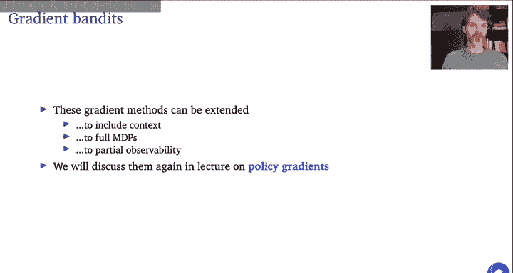

But now we're going to move to the question what is actually possible。

 what is the best we can hope for。And we're going to talk about some algorithms that we can apply that will get the best thing into the bandit case。

So we're going to discuss this theorem first， which is a very general theorem。

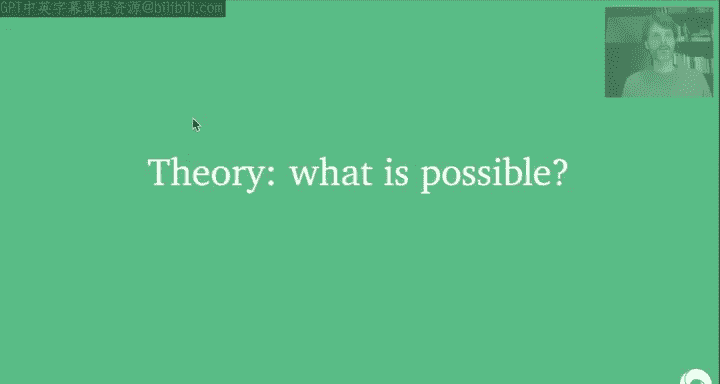

By Ly Robins， it's somewhat all the results。 and the interesting thing about this theorem there's a couple of things that are interesting about this theorem。

 but the first one is to note that this is a statement about any algorithm。

 So this is more of a statement about the problem than it is about an algorithm。

And what this problem， what is sorry， what this theorem states is that in the limit。

 the regrets will grow at least logarithically in the number of time steps。

 So note thats log T here's the leading term that depends on time。

 and there's this other quantity behind it， but that quantity does not depend on time。

 It only depends on the differences in value between the optimal action and the action that we're taking。

 Delta a。 and a Kl， which is a Kbe liar divergence。

 which is a measure of the difference between the distribution of the reward under action a and the distribution of the reward under the optimal action A star。

 If you don't know what Kl divergence is， that's okay。

 It's something that measures the difference between these distributions and it turns out it's roughly proportional to the delta squared。

 So a different way to think about this is that it just bounds essentially。

The regrets in a term that is logarithmic in T and then some term that depends on the differences in means between these actions。

Now the important thing， the most important thing here is that the regret grows logarithmically and note that this is a lower bound。

 so what this says is that for any algorithm you could possibly think of。

 the regret will grow at least logarithmically in time。

But that's still a whole lot better than linear growth， which we had so far， greedy。

 epsilon greedy and policy gradients， they can all have linear regret。

 So can we get logarithmic in practice， Are there algorithms that have logarithmic regret。

So what we'll talk about is whether we can prove that we can find an algorithm for which not just this lower bound is logarithmic。

 but the upper bound， the worst the algorithm will do is also logarithmic in expectation。

And of course， I going to be mentioning this if this wasn't the case。

 there are algorithms which this is true。So in order to think about this。

 we are going to write under regret a little bit differently first recalling the definition of this delta is simply the maximum action value of v star minus the action value for action A。

And then we can write down the regret in two different ways。

 So the first one we we already saw before， where the total regret at time T。

 So L T can be written as a summation over time where we count in n。For n is zero。

 oh sorry for n is1 all the way up to the current time step T。

 and we just count the regret that we get at every time step。This is just for analysis。

 we don't actually know these regrets， this is not something an algorithm uses。

 it's just just for our analysis that we know that a regret is going to be equal to the summation of all the instantaneous regrets that you get at every time step。

But we can also write this down differently and sum instead of over time。

 we are going to sum over all of the actions and then simply look at the count for each of these actions up to time T。

 so obviously this does still depend on T right all of these quantities depend on T。

Times the regret for that action， which does not depend on。

 So here we're replacing the summation over time with the summation of actions。

 and quite intuitively， these things are equal。 So we can also just， for each action。

 consider how often did we take that action and how bad was it。 And we want that to be low。

 Our goal is to have the total regret to be small。So a good algorithm will ensure a small counts whenever the regret is large。

 and if the regret is small， the count can be a bit bigger。In particular。

 the regrets for the optimal action is zero so we don't care how big the count will be。

 the multiplication of the count and the regrets for the optimal action is always zero no matter what the count is。

 but for all the other actions we do care。

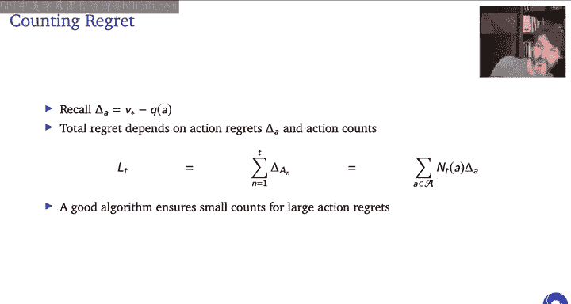

And the algorithms that will be able to do well in this regime can in some sense all be considered to implement this strategy。

 which is called optimism in the face of uncertainty。

And this is somewhat of a container term because you can implement it in many different ways。

 but the idea is quite intuitive where whenever we're uncertain about the value of an action。

 we want to be optimistic about how well， how good it could be。

 and then we want to basically pick it more often if we're more uncertain about its value。

 so we want to be optimistic that it could be good。

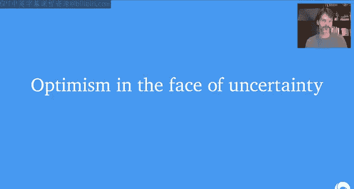

And let's make that concrete with an example， so let's consider we have some belief probabilities here。

 these are not reward probabilities， these are the probabilities that we subjectively assigned to the mean of each of these actions。

So for the red action， well， we're pretty certain that the red action is positive。

 that its expected value is positive。We're also pretty certain it's not larger than2。

 it might be below  zero， it might be negative， but it's definitely not going to be larger than say4。

 it's definitely not going to be smaller than say minus2。😡，For the blue action。

 we're a bit more uncertain， we think it's closer to zero probably。

 but it might actually be as large as two and it might be as small as minus 2。

 although with small probability。Degrre in action A3， we've barely ever selected。

 so we think it's not that great in on the average we expect maybe its value somewhere are close to minus1 or zero。

 but it might be as large as four because we've maybe only selected it once or twice and we really don't have a good idea。

Now the question is now which action should we pick and let's step through this as an example。

If we have more uncertainty about its value， I am arguing that maybe it's more important to explore an action because the mean could actually be high。

 We're not sure where an immune is， and it could be that it's higher than we think it currently is。

So let's now consider what we should do now in this case， the red action like action A a1， sorry。

 does look quite good， so maybe not knowing anything else， we do pick action A1。

And now we're going to observe some reward It won't be that far off because we're quite certain and maybe the reward will be somewhere around zero Now obviously the reward could actually be pretty far off and the mean could be quite certain because over time this becomes more and more certain irrespective was the variance of the rewards but let's say the reward was like a little bit less than zero and then we update our belief of where the actual expected value for this action is so maybe we move it a little bit to the left and we also make it a little bit more narrow。

Because we haven't just seen a slightly lower reward， we've also seen an additional reward。

 so we have more data， so maybe the distribution over time becomes more and more narrow。

So this is our updated belief of where these probabilities lie， what should we do next？Well。

 maybe by now， it's time to select the action A3， which was the green action。

And maybe see what we can get for that one because we're quite uncertain。

 maybe we've only selected it once or twice before。

 and let's say that then we find this not quite unexpected reward of larger than one。

 like maybe it's one and a half or something like that and we update its distribution a little bit towards it。

It also becomes slightly more narrow， but its it's still quite a bit broader than all the other distributions。

 So maybe next time around， you select this action again。

 and maybe you find out that the mean value for it is actually larger than that than it is for the red。

More peaked distribution。So that's the whole intuition of optimism in the face and uncertainty。

 and this underpins several different algorithms， the first of which that we're going to discuss is the UCB algorithm。

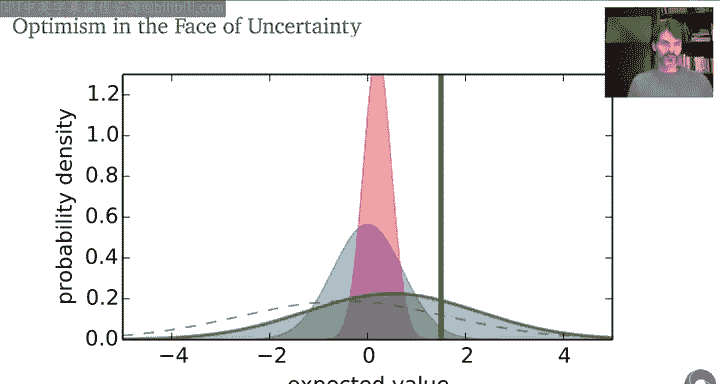

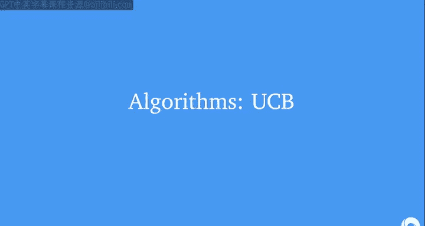

So the idea behind UCB is to use something called an upper confidence bound。

 so we're going to have some notion of uncertainty and we're going to basically estimate the upper confidence for each action values such that we're pretty sure that the actual action value QA。

Will be smaller or equal？To our current estimate of the action value plus this upper confidence bound。

So obviously， if we pick u to be very， very large， this will be true。

But we don't want to pick it too large because then it becomes meaningless。

 So we want to pick this large enough that we， if we're very uncertain that we。呃。

That we're still certain that the mean is lower than this number。

 but we want to also pick it small enough that this eventually converges to the true mean。And then。

We're going to select our actions greedily， but not greedily with respect to just the action value estimates Q。

 but with respect to Q plus this bound U。So essentially we're going to define some sort of a time dependent an action dependent bound that depends on the uncertainty of the action。

 and we' are going to define it in such a way that if we're very uncertain about an action that we'll pick it。

If we're not very uncertain about an action， so if we're quite certain about the action。

 the only other reason why we might pick the action is because the estimate itself is high。

The uncertainty， someone intuitivetuly should depend on the number of times the action has been selected。

And in particular， we kind of want a large small stroke。

 a small counts to imply a large bound because if the count is very small for an action。

 then its uncertainty must be large and therefore we should pick it occasionally。

In order to check how good it actually is， but if the count then grows and in particular if the count becomes very large compared to other actions。

 then the bound should become small compared to the other actions because this means that the estimated value is accurate。

So this is the idea behind the algorithm and what happens then if you apply this algorithm is that each action A only gets selected if either its value is going to be good。

 so if you have a high estimate you're going to select the action right or。

If it's bound is very large， which means that we're very uncertain about the action。

And if neither of those is true， if both the action value is quite small compared to other actions and the uncertainty is quite small。

 then we're not going to select the action， and that seems indeed to be the reasonable thing to do because were quite certain that an action has a comparatively low value。

 then at some point we should stop exploring it。This is what Epsilon greedy does not do。

 this is how Epsilon greedy fails， it keeps on selecting these actions indiscriminately of our uncertainty about it and also not looking at the actual values。

 whereas UCB stops selecting certain actions or select them much less often when the values become low。

And the uncertainty becomes low as well。Now this is the intuition。

 but can we somehow maybe derive this bound， can we somehow figure out what the right way is to approach this and can we somehow maybe come up with a bound that is optimal in some way or the other？

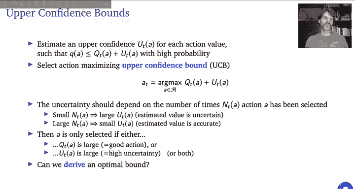

So。We're going to discuss that and then I'm going to actually derive it on the blackboard。

 but first we're going to do it on the slides。

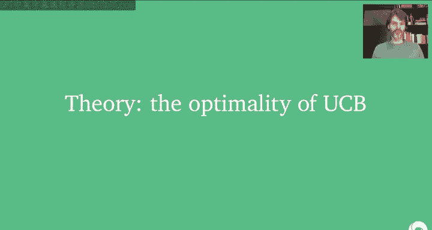

And what we're going to use is something called a concentration inequality。

And this specific inequality that we're going to use is called Haing's inequality。

And what this gives us， it gives us a bound on how wrong our estimate will be。So in general。

 let's consider a bunch of random variables， x1 up to xn。

And these are going to be identical and independently distributed random variables。

 so we're going to use these later on for the reward。

 so think of x1 to xn as being the rewards for a specific action these are all just random variables drawn from the same distribution and in particular for simplicity of the theorem statement let's assume that these are all between 0 and1 the theorem is easily extended to more general cases。

 but for simplicity we're just going to assume that all of the rewards essentially are going to be between0 and1。

There will be some true mean the expected value of x for any x in this set。

 and this is going to be mu。Now we're going to define x bar。

 so x T with a bar on top as be the average。Or does sample mean for all of these random variables that we have so far？

And what Huffing's inequality then allows us to do is to consider。

How far off could we could this mean be， So consider some quantity U。

If we add that quantity U to the mean that we've estimated so far。How likely is it that this thing。

 even after adding this U is still smaller than the actual mean？

And turns out we can bound this quantity to be a small number。

 and in particular it will be the exponentiation of minus2 times n where n is the number of elements going into this average。

And U squared where U is this bound that we add。So what do we see here， this is a probability。

 it's a number。That's going to be between zero and one。In particular。

 this is a bound so the bound is not actually capped at one， but of course。

 if this is larger than one then we don't care it， then the probabilityb will be bounded at one instead。

And what what we see， this is typically going to be a small number。

 and it's going to be smaller and smaller， the larger either n is or U is and just makes intuitive sense the more。

Numbers we have in our average。The less likely we are that if we then add an amount。

 that this is still going to be smaller than the actual mean。

We are quite likely to be within you of the actual mean if we have enough number in here。😡，Similarly。

 if we pick this U to be larger， the probability also decreases。

 which means that even for a given number of elements in our mean。

 if you consider it to be far away enough，Then it becomes exceedingly unlikely that our sample mean is that far off。

That is the intuition， but the statement is as given and we're going to use this in a second to derive UCB。

And the idea is to apply this to bandit with bandits with bounded rewards。 So as I mentioned。

 so let's assume for simplicity that the reward is between0 and 1， this is not necessary。

 we can extend the theory to more general cases， but for simplicity。

 we're just going to make this assumption and then we're just going to plug in the bandit case into this huffing's inequality So specifically we're going to consider our current estimate for the value A Q A plus some uncertainty bound U A。

 which we're going to want to determine what we want that to be。

 and we're going to consider the probability that this whole quantity even though we add that U is still smaller than the actual expected value and now we know that we can bound that probability in this fashion。

And by symmetry of the argument， you can actually flip this around。

And you could also consider like this is consider in how far off is it in one direction。

 This is considering how far off are you in the opposite direction。 So instead of adding the bond。

 you could also subtract it and then check whether you're still。

 even after subtracting whether you're still large in an。I'm just mentioning that for completeness。

 it's a useful thing to be aware of。Now the whole idea behind UCP is to basically pick a probability。

 so we have here a bound on the probability and we're going to say， well let's pick this thing。

 let's pick U so that this doesn't exceed some sort of a number。

 so let's pick a probability P and we're going to say let's pick our bound to be equal to that probability P。

Now we can solve this for the bound U if we want this to be true， this first statement。

 that means we have to pick U in this following way。But now we can so what what does this mean， Well。

 if we pick you specifically in this way， then we know that the probability that were going to have。

A mean that is farther away from our sample mean than this bound is smaller than this quantity P。

And now we can pick P to be small and decrease over time。

 So that's the whole idea behind the algorithm。 we're going to reduce the probability that we're going to be more than this bound off。

And specifically， we can pick it to be 1 over t， just plug that into the bound there and we get this bound that looks like this。

 which is the bound going to be the square root of the logarithm of t divided by twice to count for that action。

Now I didn't tell you how to pick P， I didn't tell you why we're picking it to be 1 over t。

 and in fact， there are different choices you could make there and I'll get back to that in a moment。

But this is just an example of， oh， you could pick now a probability that you're going to be more than。

This bound you wrong with your sample estimates。😡，So what does this capture， well。

 if we don't have a lot of samples， if n is pretty small， then this bound will be pretty large。

If n grows large， which is bound will go down。In addition to that， the bond grows。Over time。

 what does this mean， this means that indefinitely we're going to continue to select each action。

 but maybe less and less so if it's really not a great action。

So this ensures that we keep exploring the fact that this grows with the square root of log of T does ensure that we will keep exploring every action。

 but not that much， because if the action is really not that great at some point the uncertainty starts growing growing growing because of this log T term。

 So whenever we don't select an action， slowly the bound is creeping up。

 but quite slowly because log t is a slow growing function。

 and the square root of log T is even slower， but then when we do select the action。

 the bound goes down。 So then the only reason to keep on selecting that action is if the estimate the mean is large enough。

So the UCB algorithm？Then looks like this where if we've now instantiated the upper bound by plugging in this square root of log t divided by the count n。

 and we've introduced this new hyperparameter C on the previous slide。

 we basically within the square root we were dividing by2。

So this is the same as picking C here to be1 over square root of2。

 but turns out C can also be just considered kind of like a hyperparameter for larger C you'll explore more for smaller C you'll explore less in particular。

 if you pick C to be0， we get the greedy algorithm back that's not great that doesn't explore enough。

And the intuition now behind this algorithm is that if your gap is large。

 that means that the count will be small because the sample average is likely to be small。

So it take more if your gap is really large， it will essentially take larger gaps to span。

So the bound must be quite large for you to be considered。

So that means in practice that either the gap will be small or your account will be small。

That's not a formal statement， this is just your intuition。But in fact。

 turns out we can prove that in total the products of this gap times count。

Will be bounded by the logarithm of T for all actions。

 and that means that we have now established an algorithm which has logarithmic regrets as an upper bound。

Because we know that the regret is also logarithmic as a lower bound。

 this means that we now know that the algorithm will have logarithmic regret。

And this was proven by Peter All， and this was one of the references that I said at the beginning of this lecture year。

Where he proved famously that UCB and he had a specific C there。

 which is not that important for the proof， actually。

 but this is the specific statement that he proved he plugged in a specific C there or he derived it with a specific C。

 and he showed that the regret for this was logarithmic in the way that is shown on the slide For more details。

 please do refer to the paper or you could also see the proof for that specific algorithm。

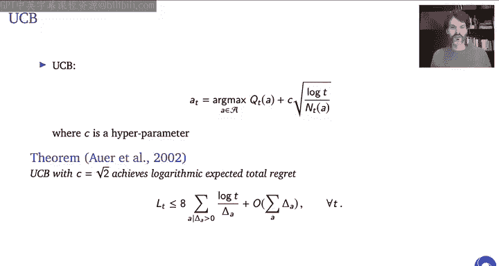

But I'm also going to prove it here， which will hopefully help you establish。

Maybe some techniques on how you could come up with this。

 So instead of just taking UCB and proving it， I'm going to try to derive it in some sense from first principles。

 There will be a couple of steps there that are， maybe in some sense cheating because I already know the algorithm。

 but。It will hopefully still be useful。If you want。

 you can skip this section from the lecture as well and just go on to the other algorithms。

 but it's useful to at least go through the proof either the one that I'm going to give you now or maybe the one in the paper by Peter hour。

 just to get an intuition for how these things work。

Okay， so we'll go to the。Backboard and I will try to in some sense derive the UCB algorithm。

Which means that I'll start at what we want and then see if we can somehow come up with the algorithm。

From first principles， there will be a couple of steps here that are going to be a little bit creative in the sense of I'm jumping to maybe something that won't be immediately obvious and indeed when of course you come up with such an algorithm。

 this often involves a little bit of trial and error let me try this well that doesn't quite work let me try a different thing and of course now I already know where to end up and I also don't want to make this too lengthy this segment so sometimes I will make a step that is maybe a little bit of a shortcut but hopefully it will still give you some clarity of how you could come up with such an algorithm。

So to start off， let's write down the objective， we have the total regrets， which。

 as noted in the previous slides， you can write down as the number of times you selected in action times the。

Expect a regret for that action。嗯。Sorry， this is the expected regret that we're interested in， right。

 And then note that the only random quantity in the right hand side are these counts。

Also note that the instantaneous regret for the optimal action， which we'll call a star。

 is by definition zero， so that means that we don't care about the count for the optimal action。

We simply don't care how often we selected it， in fact selecting them more often is a good thing because that means that our total grid does not grown。

For all the other actions。Several actions that are not the optimal action。

We want this count to be small。Note that the regret itself does not depend on time。 right。

 This is just some number that depends on the action。

 So that means in order for us to have a suitable。Count we want， sorry for a suitable regret。

 we want to count below and in particular we want a multiplication of discounts times to regret。

Maybe to match the lower bound that we know from the Ly Robins theorem。

So let's assume that we don't know exactly what we are able to get。

 but let's hope that we can get something that is smaller or equal to some。

Constant that we'll fill in later because we don't know yet what that should be time the logarithm of T。

That would be great if we can get that。So。We'll start here and then we'll see whether we can find an X and also to find an algorithm such that this is true by the way。

 the algorithm I should note that at the beginning the algorithm that we're going to consider is going to be the UCB style algorithm。

 so we're going to pick an action。Such that。It maximizes。The expected。

Estimated value plus some bound。And what we're going to do here is to see if we can come up。

With what you should be， can we come up with an upper confidence bound you such that we have logarithmic regret？

Now in the size already really told you one way to instantiate that。

 but let's assume we didn't know it that in advance and that we can somehow see if we can derive that。

So in order to get the lie Robins lower bound， we need the regret to grow logarithmicically。

Or something that grows equally fast， which means we need this property。

Now it could be that this is already true on some time steps right we know that Nt should account for action A at time T is a random quantity and at some time steps we could already be in the clear。

So let's assume that we have some time step in the past before time step T or it could be time step T itself。

Let's call it time step。嗯。😊，Which is smaller or equal to T on which we know that the count is small enough in particular。

 let's say。That our count。He is going to be。Well， let's just say this equation above already holds。

Well， that means that we're good because this is the。Total regrets up to that time step。So if。

This equation above already holds， very' good to go for times set M。

Which means that we only need to consider。Let's just write it down equivalent。 sorry， explicitly。

If this is true。Then clearly， it's also smaller than。Long T。

 which is the time set that we care about。So in what follows。

 we only need to consider the time steps after the very last time this was。

 so let's say it was some time step N。Let's make it a clear that it is an。And this was true。

 That means that up to that point in time， time step M， the regret in total was logarithmic。

 even though at some earlier time steps before time step M。

It could have been it could have popped above this number。

 We know that by the time we're at times of M， this is true。 Now this at times of M。

 we don't know what it is， right， It might be some number that is close T might be some number that is close to one。

 but we don't care for now。 What we're just going to say is， oh。

 there's going to be some additional time steps。And they're going to be after this time step M。

And because we're already good to go at times set M。

 all that we have to look at is these time steps that are after and we know that for these time steps it must be the case that the count。

Is larger。By assumption that M is the last possible time step on which。This statement above hold。

Help。That means that in the subsequent time set this statement must hold。Okay。

 so we can just put that to the side for now， we're basically considering a couple of time steps。

Beyond this time step M in the past。And now what we're going to do is we're going to look at how quickly does the regret grow after the first time that we've violated this nice。

Property that we had low enough regret。And if you can show that the regret grows slowly enough when this is the case。

 then we can bound the total regret。So effectively。

 what we will be doing is we're looking at the total expected count for a given action for a given time step。

And we're basically noting that you can write this down explicitly as the expectation of a sum。

Of these indicators that action A was picked。That's just by definition。

And what we did is we basically split this up into two parts where we say， well， we have。

The number until this times step M doesn't matter that we don't know what it is。

 there is maybe sometimes that M could be M is1 or could be M is T somewhere between1 and T in which this was true the fact that。

The regret was low enough。Plus， the remainder of the time steps where we're just going to concern ourselves with these intermediate time steps now。

And we know that。This by， by definition of what M is。Is going to be。Smaller or equal to the。嗯。

X a times the logarm of T divided by。They'll say， I'm just using that。Property that we had up here。

For M， So there are sometimes of M for which we know that this is true。

And I'm just plugging it in here， and then we have the remainder as we had up there。

Just go to repeat that。Compteness。And then what we're going to do。

 we're going to notice is that this first quantity is now no longer a random variable。

 we've just bounded the random variable that we had into something that is no longer a random variable so we can take the expectation away so we can push the expectation all the way into the summation that we have。

So this is going to be equal to the sorry， not the expectation。This is just going to be Xa。

 which we haven't determined yet。Block tea， the right by。Hei。Plus。

 and we can push the expectation all the way into the summation。The indicator that A N is a。

 and we know that this is actually conditional。 So let's be explicit about that now on N being the times step beyond。

M。Which means that we know that at these time steps。The count。Will be sufficiently large。

That this is true。And then we take it from there and we can see。What will happen。

 but note that here we actually have the expectation of an indicator。

 so we have the expectation of an indicator of an event。

The expectation of an indicator is the same as the probability of that event。

So we can write this thing inside the summation as a probability。

So now I'm going to put a this condition like I put it there explicitly。

 but let's put that to the side for now， this is going to be we're going to consider a time step。

N and an action A， when this is true， but I'm not going to include it in the notation all the time because it becomes a bit cumbersome。

 So now we're going to look at can we bound。Probability that we're picking the action。Given thats。

This is true。We're just logging that to decide， we don't know yet whether it'll be useful。

 but we know that that's through all these time steps so we might as well keep it around。

So now we can talk about the probability of selecting action。

Not that a is a suboptimal action right we already took care all the way at the beginning we took care of the optimal action and we said。

 well we don't care often we select that so we don't need to worry about bounding the count for the optimal action we're only worried about bounding count for the suboptimal actions so what is the probability of selecting an action？

Well， in order to select an action， it must have the highest value plus bound。And in particular。

 we can bound the probability selecting the action by saying， well， at the very least。Li。

Value for that action。Plus， the bound for that action， the estimated value plus bound for the action。

Must exceed those quantities for the optimal action。I put greater or equal here。

 I could have also put greater because then。嗯。Like we are strictly certain we're picking action A。

 but let's just assume that ties don't really matter that much so that these values are never exactly the same。

So it doesn't really matter whether it could greater than or greater or equal than。

Though this is not intended to be very rigorous proofs。

 it is more of a proof sketch or derivation of how you could come up with the algorithm。Now。

 let's simplify notation a little bit。 Let's get rid of all these brackets and subs and stuff。

 So let's actually write this down just notationally。For now， as Q plus U。

Is greater or equal to Q star。Plus youた。This is just a notational shortcut。

 I didn't change anything here。So can we somehow bound this probability because we know that the probability selecting action a is going to be smaller or equal to this probability？

Because in order to select action A， you must at least have a larger value plus bound than the optimal action。

 otherwise you won't select it and indeed there might be other actions that you might select as well。

 but we don't even need to worry about those turns out。

Now this we can write out by considering different cases。

So it might make sense to look at these estimates， so we have an estimate for the action A and an estimate for the action A star。

And let's just pick one of those， let's pick a star and consider whether our estimate is。

 in some sense wrong。So it could be that our estimate for a star is quite low。

 it's in fact substantially lower than maybe it should be the case and we could consider some quantity。

So let's write down this whole thing again and let's condition it。On that Q star plus u star。Is。Low。

 so we're going to say this is lower than expected， it's low。

 lower than some number wide that'll fit in in a moment。

And then of course we also have to consider the opposite case， so in one case we're saying， well。

 maybe Q star is quite low and maybe then we can bound this probability and in the other case we're going to say well now Q star is not particularly low。

But maybe then again， we can bound that probability because maybe then Q needs to be quite high。

So the ultimate case is just。Using the law of total probability。Right。I didn't change anything here。

 I'm just writing things out I'm considering case by case。

 and of course I need to multiply both of these with the probability of this new condition that I put in。

And this is starting to look interesting now because here we have something while I'm putting down the wrist。

We have something that looks。Similar to have inequality。We have a random quantity。Q star。

 we have some bound U star and we have some quantity on the right hand side y。

So maybe we can plug into Hting's inequality here and in order to do that。

Why should be the expectation of the random quantities， So maybe we can pick why to be。

The actualctua value。Of the optimal action， is that a good choice？Well， let's just try。

 let's just plug it in and see what happens。So。If we plug in。😡，Y being the actual value of Q star。

 we have this probability。P Q star plus Q star。Is smaller or equal to Q。So， right。

 this is just shorthand for the actual value。a time。And this。

 we know from Huuffson's inequality is going to be quite small。

It's going to be specifically on some time。 Sorry， I was at time step。I was calling it n。

 so let's use consistently， let's use。Time to pen。This is going to be。

Just using have in quality as given indeed。Yeah your smiles。We know that this is true。And now we can。

See that maybe we can pick this bound U to make this probability substantially small enough。

How small do we want it to be Well， we were looking eventually going back all the way to the beginning。

 we were looking at the probability of selecting in action， How small should we make it？

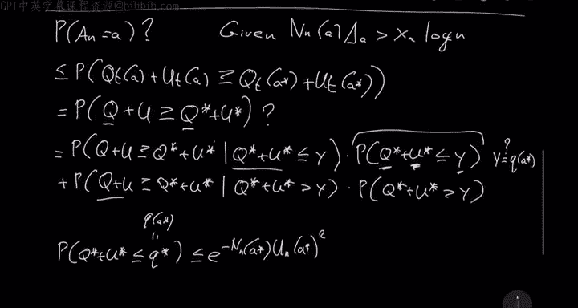

Well， we're looking at the probability of selecting the action on a specific time step。

And we want the summation of that， so the summation of these probabilities over time。

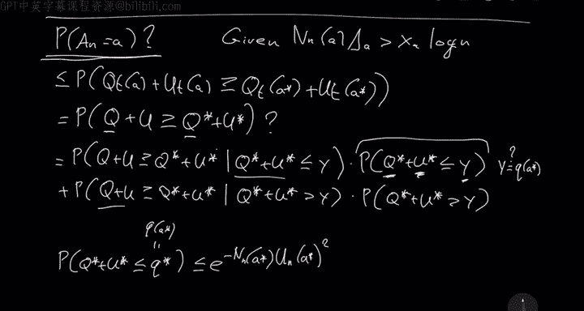

Which is what we have up here。We want that to be small。

Now if we sum a function of time over time and we want it to be smaller than the logarithm of T。

Then maybe we can bound this probability of selecting the action。

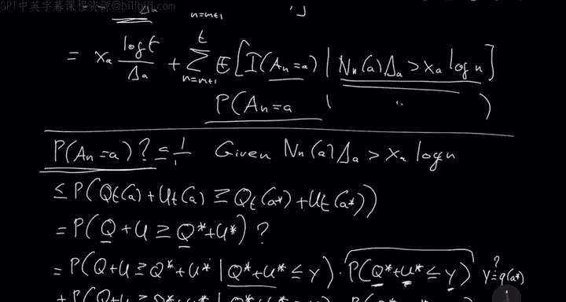

With one over N， is this possible if it were possible to bound to probability selecting the action with  one over n where n is the time step？

Then the total summation of that would be smaller than the logarithm。Of end。

Or up to whatever action you put。Because the。And I'll just put it to the side and I' move it in a moment。

 We know that it's true that if n is one to T and we have one over n。

 this summation is smaller equal to the logarithm of。T plus1。It's actually small。I is。

Small quantity there。It's slightly larger than logarithm of T。

 buts smaller than logarithm of T plus1。So this will be small enough if we can somehow make sure that this is equal to1 over n。

Can we make that happen？Well， we have full choice over what you is， so let's just solve this。

So if we have E。Minus N u squared， and we want that to be equal to1 over n。Then this implies。

That we want you to be equal to the square root。The logarithm more then， divide it by。Begin。

So this is interesting because here we see the UCB bound showing up。

But we've derived it from this need for the probability in every step to be1 over n in order to get this logarithm of T in total。

So now we can go back， we've kind of come to this conclusion that maybe this is a good bound and now we can go back to the rest of the proof and see if we can then prove。

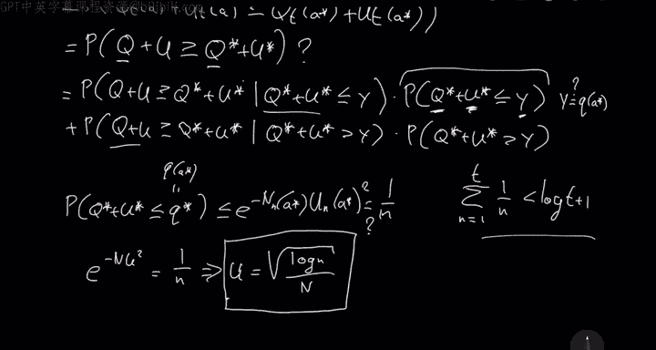

Everything holds that we want to haul。So let's go back slightly。

 so we're looking at this probability and let me use a different color now。

So we're looking at this probability。Of selecting the action。

And now what we've established is that this quantity can be bounded。By one over n。

This quantity over here。Can obviously be bounded by one。 So the first term。

In this is smaller equal to 1 over n。So next。Re move。

And I'll use a different color to this second term now。For this last bit here。

We can't say that much because we already saw that the inverse of it above is the probability that's quite small。

 so all we can say about this one is smaller or equal to one。

 perhaps perhaps we can't say that much more because we know that if the opposite of this is not very likely then this event might be quite likely so now what we are hoping to do is maybe we can bound the other side。

So let's see if we can do that。So what we're trying to bound now is we're going to see whether we can bound Q plus U。

Being greater or equal to Q star plus Q star。Given that we know that Q star plus U star is not particularly small。

 it's going to be greater than the average。For Q star。Can we make sure that this is small？Well。

 we know。That the probability of Q plus u being bigger than Q star plus u star。

That's going to be smaller than the probability of than being larger than Q star because we know we're comparing to something。

The estimated  Q star plus Q star， which itself is bigger than Q star。

 so we can bound this probability。By saying Q plus you。It greater equal to Q star。

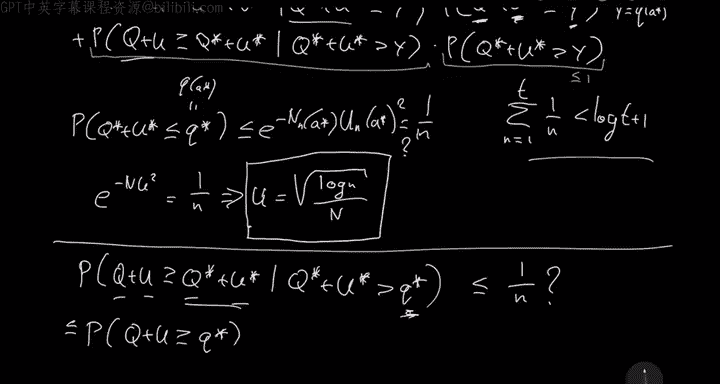

Okay， that looks less complicated， that's good。It's not quite in a form where we can apply halfin quality or anything like it。

So we need to do a little bit more work。First of all。

 we can notice that the inequality is in the wrong direction for Huff's inequality。

So one thing that we can do is first we can flip the signs。

The negative of a random variable is obviously to the random variable this。

ItDoesn't hurt applying having inequality at all。And we also。

 we're also missing on the right hand side the expected value for the quantity that we want to for the random variable。

 We have this random variable on the left hand side。

 but we don't have this expectation on the right hand side。

So let's just add and subtract that expectation so that we have the expectation on the right hand side。

And now notice that this。Minus Q star plus Q。Is， by definition， just。Mine is the regret for action A。

For the action A that we're considering。So this means that we can simply write this down。

 We can move that to the other side of the inequality so we can say the probability of all this。

Again， I'm simply rewriting things here。 I'm not actually changing anything。Is smaller or equal to。Q？

So now we have kind of the desired form to be able to apply huffs inequality。

 we have a random variable on the left hand side， we have its expectation on the right hand side。

And we have something else。Now， there' something else looks a little bit complicated and potentially messy because it has this。

Action gap is Delta A in there。So it would be nice if we were able to instead of this。

 have something that it more looks like you。So can we maybe somehow。

Have the property that this is larger or equal to2 you。If we could do that。

Then we could just replace this probability， we could bound the probabilitybilities on the left hand side with something that has this nice。

 clean， simple form where we just have this random variable minus Q， and we add some bound U。

 and then we compare that see whether it's still lower equal to also sorry there should be a minus Q here on the。

Right inside。Whether it's smaller or equal to its expectation。So can we do this。

 well now we're going to scroll all the way up and we are noticed that we do have。

 we do know something。

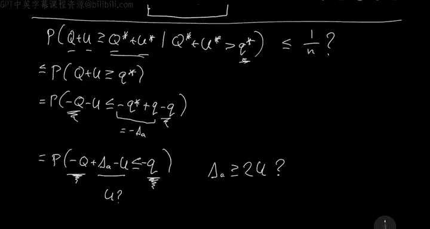

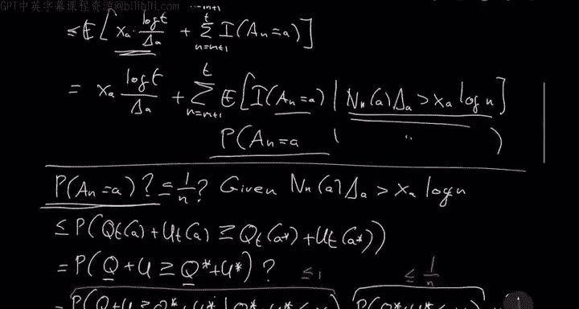

This is something I said all the way at the beginning， we were considering only those time steps。

On which it's true that in some sense we were saying that the count is rather large。

 but instead we can also interpret this as the gap being very large。

 so let me just repeat this equation let's call it equation one or something。

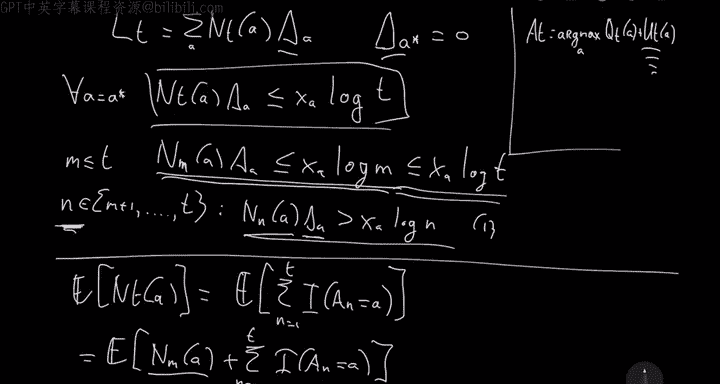

And let me repeat that equation all the way down and see if we can use that。

So we know from equation 1， I'm just going to repeat it here that n times that delta。

Is going to be greater than Xa， which we hadn't determined yet。

Times the logarithm of the time step N。So that means that we do know that Delta a is larger than。X a。

Loarithm is then divided by n。Well that's interesting。 So that looks very similar to our upper bound。

 but in fact， it's the square of it because if we go up， we saw that U was defined。

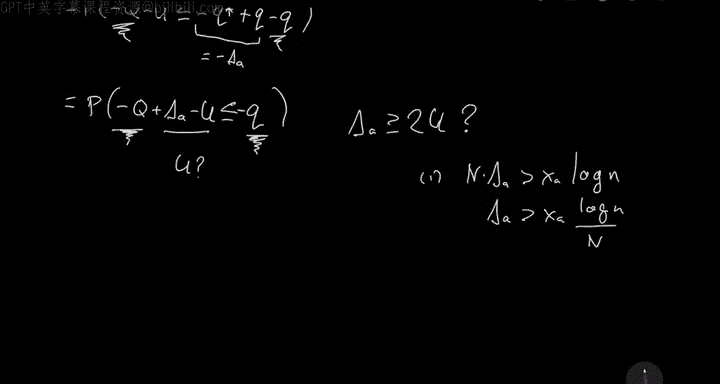

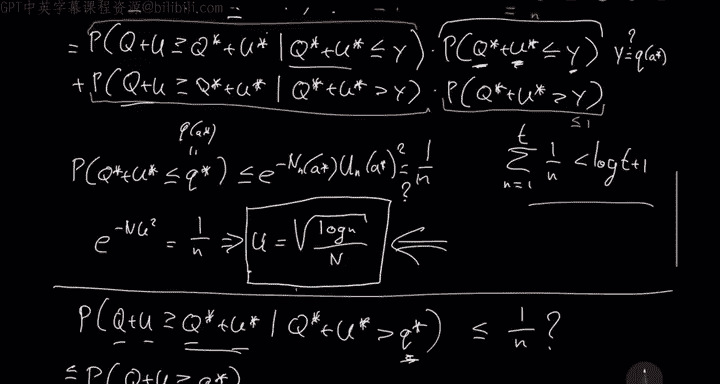

Ass the square root of log n divided by n。For any action。嗯。

This is the count for action A at times step T just to be。Clly if I write it down more explicitly。

 we suggest its from the notation， but that's what it means。So maybe。

So let's first actually write that down。 So this term here。Is equal to X a。UT。Squared。

But what we wanted is this other thing， right， we wanted the delta to be larger than2 U。Instead。

 we have the delta is larger than x times u squared。So can we somehow make these the same。

 well we could， for instance， pick Xa to be 1 over deelta a。

If we pick it in that way and notice that we can pick XA in whichever way we want as long as we don't make it dependent on the time set T。

 then we have that Dlta。Square is largerud than。U squared。Which means that Delta is larger than。

U so this is not enough。 Oh， we notice we have a， we have a problem here with a constants。

 but we could have picked x in a different way。 So let's pick it to be4 divided by deelta。

 and then we'd have。I have to make a little bit of room here。

In order to be able to then change the equation， this would be4。

 and then taking the square root on both sides， we have2 U。

 which is the required thing the thing that we wanted。

So by picking x to be a certain value for divided by the action gap for that action。

 we can make sure that in the time step under consideration， Delta has this property。

And that means that we can go back now。To the equation up here。And we can see。

That this thing must be smaller or equal to the probability of this random variable minus Q。

Plus 2 u minus u being smaller or equal to the expectation of that random variable。

And then of course， we can simply cancel the to U and the minus U to just have a U。

Now we have something that's exactly in the form of Hafts inequality。

 So we can say this is smaller or equal to the exponation of。The count。Time is u squared。

 and by definition of u， which we've defined above to be equal to the square root。

Of the logarithm of n divided by n。We know that this is going to be equal to one over n。

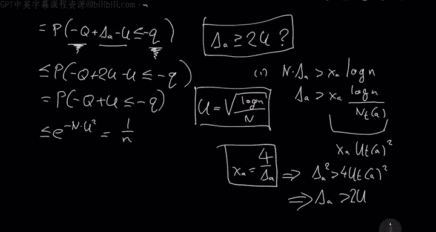

Has desired， so then we can go back up here again。

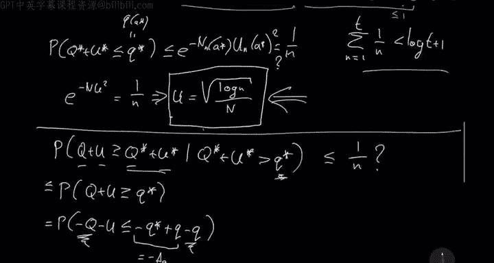

P can nice green color again， we know that we can now bound this to be one over。

So that means if we go up here that we were actually able。Too bound。This to be。嗯。

Not quite one over n because we had these two different cases。

 but we were actually able to bound it as two over N。

Which means that the summation over time is still a logarithmic entity。

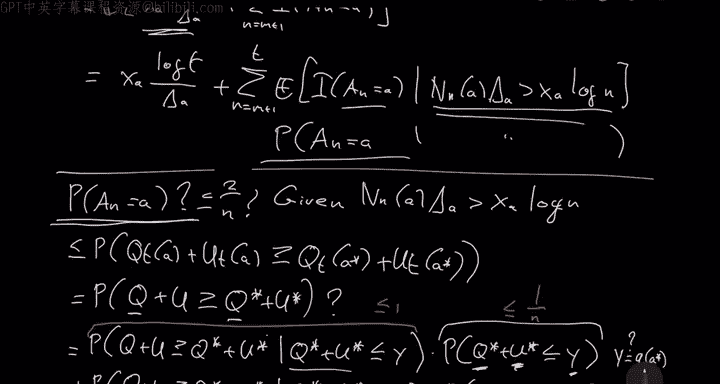

So now we can plug this in and we can see。

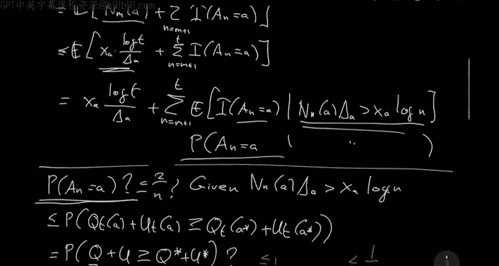

Now this total summation here。Is going to be smaller or equal to two logarithm。好自然。不说。And therefore。

 the whole term。This logarith McKinty， we had this case first when the count was relatively small that was covered in the first part。

So maybe let me do that with a color that was covered in the first part。

 and then in the second part we did a lot more work， but we were able to bond that as well。

In something that logarith can T and we were able to do that by just first picking some generic numbers。

 X and later seeing how we should fill that in and actually let us now fill that in here。

 we figured out below that we were able to do that by picking x to be equal to4 oh sorry。

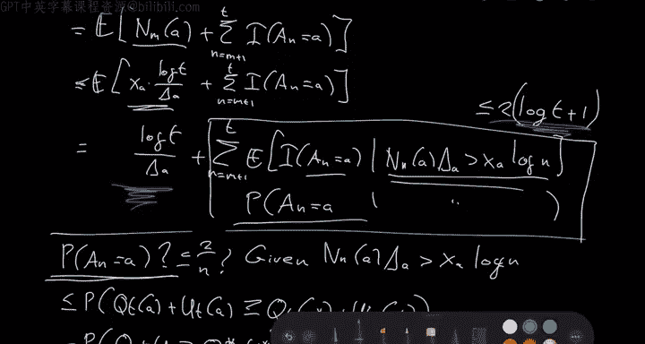

4 divided by Delta a。So you can you can do this in different ways。

 you can bound this slightly differently as well， you can pick other constants。

 you can go through this slightly differently and you could come up with slightly different bounds Not for instance。

 that we came up with a certain definition of you that is slightly different from the one from Peter hour because Peter H had a。

Factor of two there， which we didn't use。You could put that there as well and you get a similar bound which is also logarithmic。

 so we don't particularly care about these constants that much。

 we more care about the rate which we were able here to establish to be logarithmic in T for the total count for any action。

So to repeat what we've done， we've basically done a case by case analysis here first we went to this time step and we said。

 well， there are maybe some time steps。

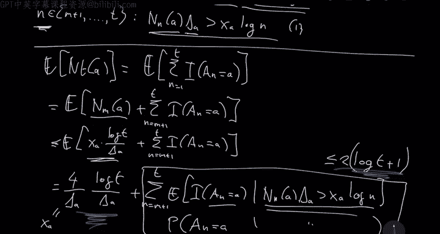

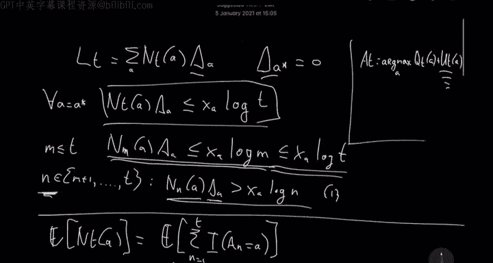

Among which we already have low regret。And then we said。

 well so now we're going to only concern ourselves with the time steps in which to regret it' not that low and it turns out we could use that later with this equation1 to make sure that for those time steps we know that the gap must be relatively large in the sense as stated in equation1 and we were able to use that later on。

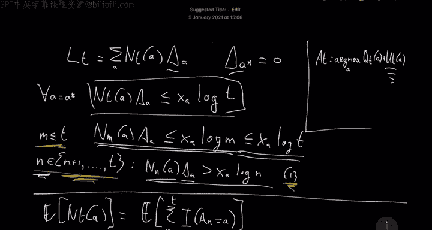

Then for those time steps in which this is the case。

 we just bounded the probability of selecting the action and this is useful because bounding the probability allowed us to eventually bound the expected count。

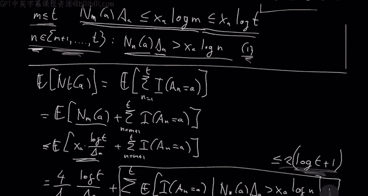

And by bound， you expect its count to be lower arithmic。

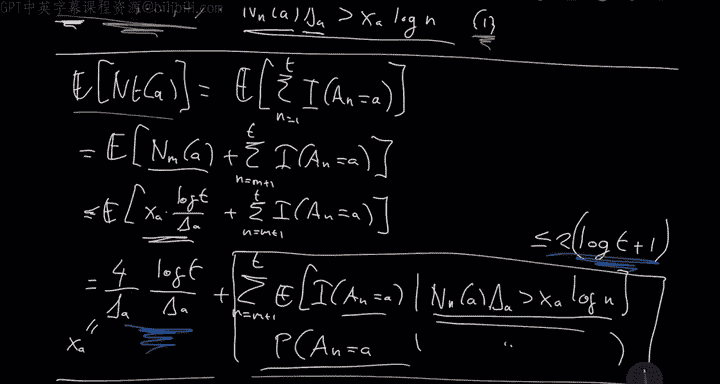

Because the action gap itself is not a quantity that depends on time。

 if we're able to bound the counts to be logarithmic。

 then the total regret is also bound to be logarithmic。

Again I'm going to stress here this is not a very rigorous proof。

 there were some steps that could have been made a little bit more precise。

 the point here was not to be very rigorous or precise the point here was more to show you how you could come up with these type of algorithms perhaps。

And how， in some sense， the UB bound could be derived by thinking about having things inequality and thinking about what are the properties that we want from。

Thisre， So we want account to be low。 we want it maybe to only be logarithmic。

 and then turns out if you want to use halfuffing in equality。

The upper bound that is used in you almost pops out in something。Okay。😊。

I'm going to go back to the slides。

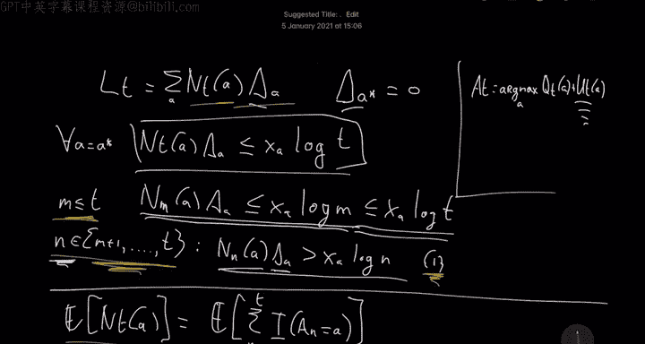

And continue。

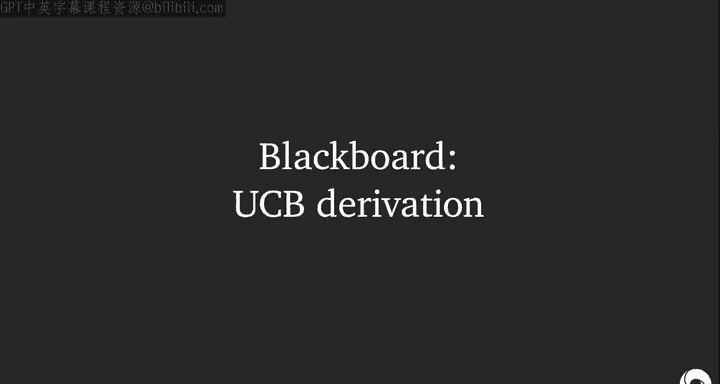

So next， we'll go into some Bayian approaches to balance。

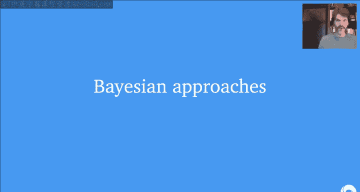

So what is a Bayesian approach and a Bayesian approach， we keep track of a distribution。

And in particular， we're going to keep track of a distribution over the expected value for each action。

This is different， it's good to keep in mind， many of you will be familiar with the Asian approaches。

 but just to be clear we're not trying to model the distribution of the rewards。Instead。

 we are going to quantify our insurgty about where the expected reward is and then update that over time as we go。

So note， the probability here is not on the。Reward or given action A。

 no it's already expected reward or the value of action A。

 which under a ebsian approach you consider to be a random quantity。

 not because it's random every time you query it， but because you have uncertainty about what its true value is。

And then theta， so the overloading notation here。 but here using theta now as the。

Parameters of the distribution， so for instance， so first like to be clear this probability should be interpreted as a belief。

 so for instance， first on number x， the probability ofq of a being equal to x is our belief that that's true It doesn't actually impact the actual probability because this is just a number but it makes our uncertainty about this and as an example。

 these that could for instance contain the means and variance of Gaussians。

 if we want to model each of these uncertainties with a Gaussian distribution。

That's a choice right we can just pick distribution and then hopefully we pick it in such a way that at least the true value is supported with the Gaussian。

 for instance， this is a real case because Gaussian has full support over the real number line。

And then。This allows us to do a couple of things that we couldn't quite do before as easily。 perhaps。

 for instance， we could already。A priori， we could pick certain actions to have a higher expected value than others because we know something about them。

 We might know that oh this value we're quite certain is between 10 and 11。

 Let's say all this undervalue。 We don't know where it is。 It's somewhere between 1 and 100 and。

If we want to model these things explicitly， we can actually inject this as prior information before we even start running the algorithm。

But you can also use these approaches if you don't left a lot of prior information， for instance。

 I'll show you an example where we assume very little and we basically say， well。

 we know the true value somewhere between0 and 1， but it could be anywhere between there。

 it's uniformly likely to be anywhere。So if we do this and we update these probabilities then we can use these beliefs to guide our exploration。

 if we have these complete distributions over where we expect the values to be， we can for instance。

 very easily pick the upper confidencefluence intervals。

Now let's go through an example to make this a bit more concrete， so for instance。

 consider a bandit with Bernoulli reward distributions and I mean with that that the distribution of the reward only has support on0 and1 so the only thing that you basically need to figure out is how likely is the reward to be one and how likely is to be zero。

And then for instance， the prior information could be very little so for each action we basically say。

 well， we don't know， it's uniformly likely to be one，0， a half a third。

 we don't really know we're going to assign equal belief to each of these possibilities on the interval between zero and1 that's just one choice of prior。

And that means that either each of these values is equally likely。

 even though the reward is can only be plus1 and minus1， the mean could be anywhere between there。

Now one way to model this is to pick beta distribution with parameters X A and Y。And for instance。

 if I pick a beta distribution with initial parameters， XA is 1 and YA is1。

 then we exactly get a uniform distribution over the interval 0 to one。

A beta distribution is quite a common one to be used in combination of Bly data。

And then we can update the posterior for the beta distribution， this is quite simple。

Whenever the reward is0， we update the X parameter by incrementing it with one。 So for the action A。

T that we selected at this time step， which is increment X。

 So this will be the number of times the reward was 0 plus 1 for action 80。

 And if the reward happened to be one， we increment the other number y。

Note that x and y together actually give us the count the number of times the action was selected plus two because they start at one each of them before even selecting any of the actions。

This is how that looks。 So if you start here at the left bottom plot。

 youll see a uniform distribution between0 and1。 and again。

 this is the belief that we have for each of these values。

 So we believe each of the values between 0 and1 to be equally likely So you have this。Block。

 essentially， uniform probability mass。Now， if we then see a reward of plus one。

 we can do the Bayesian updates to the beta distribution。

 which for the beta distribution is quite simple to implement。

And then what we see is that the probabilities immediately change quite dramatically。

 and in particular， the mass on a mean of0 becomes basically zero。

 and this makes sense because we've seen every world of plus1 now。

 so we know that a true expected value cannot literally be0 anymore。

If the only possible rewards are 0 and plus1 and we've at least seen  one plus 1。

 then we know that the true value must be at least infinitesimally above0。

 So the probability of literally 0 goes to 0 immediately after just one sample。

 and the probability of one essentially doubled So now we have this triangular shape to the distribution。

 which assigns more probability to larger numbers， given the information that we have right now。

 but still some substantial probability mass as well to lower numbers。

Now let's say we see a reward of plus1 again， then the distribution gets this non nonlinear shape it's actually cut off here slightly on the slide。

 but it goes up even farther on the right hand side。

 it becomes more and more likely that the true mean is one so far we've only ever seen plus one so the most likely mean value is actually one。

But other high values are also quite likely， very low values become quite unlikely。

If now after this we see a reward of0 and another reward of0。

 then the distribution has become symmetric again and now the most probability mass ist exactly a half。

 we know it's extremely unlikely that it's very close to zero。

 it's also extremely unlikely to be very close to 1 the average value and instead it's much more likely to be somewhere here in the middle。

This is just an example to step through how you would update these these distributions。

 so what you'd actually do if you did this sort of booni banner with a beta distribution is you just increment these counts right but implicitly these counts would then imply this distribution。

You're basically updating this distribution and this is what it looks like。

Now if you have these distributions， we could be Gaussians， they could be beta distributions。

 but then we can use this to explore and in particular we could again go back to this principle of optimism in the face of uncertainty and one simple thing we could do is we could look at the standard deviation of each of these beliefs。

And it kind of like an upper confidence bound， so we take the mean value。

 for instance for action a3 here， the mean is the highest of the bunch。

 and we add say one standard deviation， it is brings us over here。

Now note that the red action has a lower mean， but adding one standard deviation。

 I actually bring it or two standard deviations， I don't know how much it is exactly。

 some number of standard deviations would actually bring us higher。

 so the upper confidence bound for the red action here。

 action A2 is actually larger than that for the green action A3。

But the upper confidence bound for A1， which has this hugely wide distribution。

 turns out to be even larger。So we see here that by adding this uncertainty。

 we get the same principle of optimism under the face of uncertainty。

 but now instead of using an upper confidence bound，Which stems from happening's inequality。

 instead we can also just try to approximate the full distribution and then use those through the optimism and face of uncertainty。

So one way to think about this is that we have yet again。

 we have a bonus in some sense and we could use that to pick our action。

 but the bonus could be derived from these posterior distributions。

 which we've updated according to Bays。And then we could still do the same principle as in UCB。

 So basically， we could do a UCB like algorithm， but using the Bayesian approach rather than the。

Bounds that we had before。

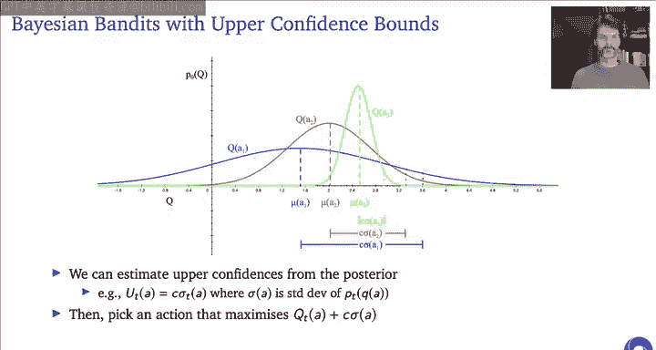

This is however not the only algorithm you could do。

 and now I'm going to tell you a little bit more about a different algorithm called function samplinging。

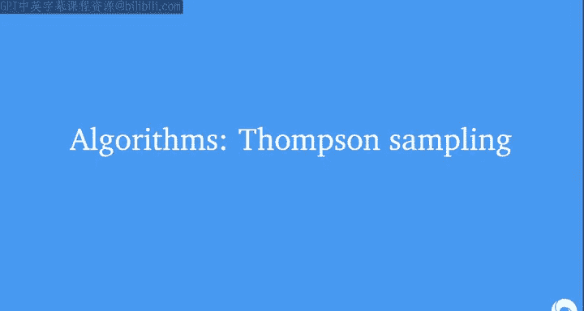

So function sampling is also an algorithm to solve band and its ava approach， and in particular。

 it's going to be related to something that we're going to describe first。

 which is called probability matching。So what is probability matching。

 this is an algorithm that is quite different from UCB because it's it's a random algorithm。

 so our probabilitybabilities of picking an action will be。呃。

Random quantity like or action will be random quantity， our policy will be stochastic。

And the way it works is it picks an action according to the likelihood， according to our beliefs。

 that this action is the optimal action。Because we have these belief distributions now。

 we can reason about this so we can pick the probability of each action to be exactly the same as the probability that that actually is optimal。

Now this is a somewhat unintuitive thing， but it is optimistic in the face of uncertainty because if you have a large uncertainty about where your action will be。

 then the probability of it being maximal also goes up。

 maybe it's not the most likely action to be maximal。

 but it might be a fairly likely action to be maximal if your uncertainty is high so actions with larger probabilities。

Are either high valued actions or do you have a lot of uncertainty about them。

 similar to the UCB algorithm and other optimistic approaches？However。

 it's a little bit of an intuitive thing， as you mentioned。

 because it's not immediately obvious that this is the right probability that you should assign to an action right。

 It's not immediately obvious that picking according to the probability that your the optimal action is also the right probability to use for expiration。

In addition to that， it can be a little bit difficult to compute this probability analytically。

from the posterior well this could be done numerically but even keeping track with the posteriors。

 of course， can be a tricky thing in a flu update， but if you have the posteriors。

 then you can compute these probabilities potentially numerically。

 it turns out there's also an easier approach which is called bump happening and this is in fact。

Perhaps the oldest of banded algorithms， it's already from the 1930s。

And it's named after the inventor of the algorithm， and the idea is quite simple。

 so we are still going to keep track of these posterior distributions。

 so we're going to update these via Bays rule， for instance。

And then the idea is to sample first from each of these belief distributions， an actual action value。

So please carefully think about what this means， you have your belief distribution at time step T about where you believe the mean value for that action to be。

And then we're going to sample the distribution， which gives us an action value。

 and we're going to do that for each of these actions。

Then we're simply going to pick the greedy action according to the sample action values。

Turns out if you do that， function sampling will select the actions according to exactly the same probability as probability matching would do。

 and the proof here is essentially contained on the slide because the instance of we have an indicator function over an event and the event is that action A was picked。

So the event that action A is speak means that action A had the highest sampled action value。

But the expectation of this instance is equal to the probability of that happening。

So it turns out if you do Thompson sampling， if you first sample the action values in any big grid lead。

 this is exactly the same as trying as just computing these whole probabilities and then selecting your action according to that。

So it's kind of an interesting， simple shortcut that if you have these steior distributions。

 you can simply sample values from these and then pick Read。So in some sense。

 Thompson sampling is simply a technique that allows you to go from the exhibition probability distributions。

 these posterior distributions to a policy。Interestingly。

Thompson sampling actually achieves the line in robins lower bound for benoi bandits and in some other cases as well。

 and therefore it' optimal in the same way that UCB is and it has logarithmic regret。

So this was actually proven not too long ago well it a couple of years ago now。

 but this wasn't immediately obvious to people， but Thompson sampling is now considered similar to UC be one of the optimal algorithms why did I tell you about multiple algorithms and I'll tell you about one more approach in a second so it's good to mention this that not all of these approaches are quite as easy to scale to the full reinforcement training case so this is why we're going to go through a couple of these different algorithms and then like we'll have a lot of tools in our toolbox which we can then see which ones we can apply best at scale and for instance Thompson sampling has been applied to the full reinforcement training setting and also to the function approximation case in which the observations coming at your just messy observations for instance from a camera and your're son are going to have to deal with it。

You can't do this exactly then， perhaps， but some of these approaches are easier to estimate than dollars and the jury' is still a little bit out of which approach is the most beneficial or the most。

Fruitful for our future work。

Okay， now we're going to continue to our last set of algorithms in a sense。

And we're going to consider planning to explore。

So what do I mean when I say planning to explore well。

 so far we've viewed bandits as one step decision making problems。

 I mentioned the way at the beginning that the stage doesn't really matter。

But we can actually also view them as sequential decision making problems。

But instead of reading about the environment state as being the sequential part。

 the thing that makes it sequential， we are going to talk about internal V agent。

So at each time step， the agent updates some internal states to summarize its fast。

This state now does not need to contain anything about the environment because the environment doesn't have any additional information。

 but it should contain something about the rewards and the action that the agent take has taken。

So each action A can be thought of as transitioning to a new information state a d plus one by adding information with some probability。

And this probability depends on given the state and the action。

 it is random quantity like the next state because it depends on the reward it you receive。

So given that we've taken action A in state ST， we're going to transition to some state ST plus one。

And that means that we have some sort of a mark of decision process。

Where the states are fully internal to the agent。This is just whatever is internal to lead Asian。

As I mentioned these state transitions， there are probabilities because the rewards can be random and also the actions can be random。

 so if you condition on one action， then that randomness goes away。

 but you could also consider the state， the state probability distribution。

 which will also then have the randomness of the action。Depending on your algorithm。

So Thompson's sampling is a， has a random policy， whereas S UCB has a deterministic policy。

But what does this all mean， well， it means that even in bandits。

 we can think of actions as affecting the future after all。

But now not because they change the internal state of the environment in whatever way。

 because there is no state for the environment， there's nothing to be changed。 Instead。

 they change they affect the future because of how they affect the internal state of the agent。

So to make that more concrete， consider ver band it again。

 where there's some probability mu that you'll find get a reward of 1 and there's therefore a probability if 1 minus mu that you get a reward of0 for some action A。

So for instance， you can think of winning or losing a game with that probability and we want to find the arm with the highest mean。

 so we want to find the strategy say that is's most likely to win the game。

Then we can consider the information state to be a twoal alpha and beta。

 where alpha counts the number of times the reward was0。

 and beta counts the number of times where the reward was1。

Recall that this is very similar to the beta distribution that we talked about before。

 where the parameters x and y of the beta distribution were essentially alpha and beta plus1 each。

So this information state is fully internal to the agents and we know exactly how it will update whenever you see a reward right。

 but which reward to receive is a random quantity， so the state transition from this information states from one time step to the next is a random occurrence。

So what we've done now is we basically formulated the as an infinite markov decision process over information states。

 it's infinite because alpha and beta in this example。

 for instance can continue to grow indefinitely right so we're never actually returning to exactly the same state that we were before。

You can of course change the algorithm， the agents。

 and some agents might actually return to the same internal state as they were before。

 but in this case it wouldn't ever loop， it would continue indefinitely。

But it is a well defined Markov decision process， it is just an infinitely large one。

 and we can still think about how to solve this using reinforcement learning techniques。For instance。

 we could learn a Baysesian reward distribution and unus planning。

We only need to learn the reward distribution because everything else is given。

 we know how we will update the information state， given a certain reward。

 so if we know the likelihood of each reward happening， then we can use that to plan into the future。

And this allows us then to reason about which action to take and therefore to explore。

This is known as Bay adaptive reinforcement learning and turns out if you do that。

 so if you learn a Bayesian reward distribution， so you're trying to learn what the reward could be。

 the expected reward could be and then you take that into accounts。

And you use that in your planning algorithm。And then you plan infinitely far into the future。

All the way until the end of time， and then you use that plan to select the action。

This turns out to optimally trade off exploration and exploitation with respect to your distribution。

Now obviously this can actually be extended to full URL by also learning a transition model。

 but it becomes very unwieldy very quickly I already mentioned planning indefinitely into the future。

And it's a little bit unclear how to scale this effectively。 That doesn't mean that it can't be done。

 It just means that it's not immediately obvious how to do that。

I did want to mention it because it might be an interesting approach for future research。

Okay， now we're going to go back。To one final example。

Okay， so for our final example， I'll go back to the blackboard and we see here a variation of the simple problem that we saw before as well。

And essentially， what we're going to ask is this question of which action we're going to select next if we've seen this information so far。

Now， as I mentioned at the beginning， somewhat intuitivelyly maybe you would say， well。

 action B seems to be the right action。But I'm going to ask you to be a bit more specific and I'm want you to think about this。

 So what I'm going to ask you is what is the probability， the actual probability of on time step 3。

Picking action a。And for a different algorithm， so let's consider the greedy algorithm。

Let's consider see an epsil agree as well。UCB。And总评三。

You can pause the video now and think about this for a second。

 and then you can compare your answers to the answers that I'm going to give。

 And if the answers don't line up， if you have a different answer。

 but you think yours is definitely correct and mine is wrong， please let me know。Okay。

 then now I'm not going to give you the answers that I would give。 So if degree one is quite easy。

 this is the example I gave all the way at the beginning of the lecture as well。

 if we've only ever seen a reward of zero for action A and a reward of plus one for action B。

Assuming that we're going to estimate the action values by simply averaging the reward so far then clearly action B will be degree1。

 so the probability of selecting action A is simply going to be zero。

For Epsilon greed it's quite similar， except that we're going to pick the greed actually only with probability 1 minus epsilom and all of the other actions with probability epsilom。

Now， the only subtlety here in some sense， is that the probability of selecting action A is then not epsilon。

 but it's epsilon divided by two because picking uniformly at random means we are also going to pick。

B with probability absolutely divided by two whenever we pick around image image。Now for UCB。

What can we say from UCB UCB is not actually a randomized algorithm， it's a deterministic algorithm。

 so we're just going to add a bound to each of these actions and UCB in its general form has some hyperparameter C that gets multiplied with the bound。

But in this specific case， it doesn't actually matter because both actions got selected exactly once。

 which means that the bound for both actions is exactly the same。

 so adding the same number to the action S estimates doesn't actually change which action will be ready。

 so that means that UB in this case will' also not select action A。The difference is。

 and this is something I encourage you to think about now。On the next time step。

 say that we get a reward of zero for picking action B。

What then happens to UCB is that the bound for action B will go down。

 whereas the bound for action A will go up。Depending on your hyperparameter C， at some points。

 action A will get preferred， whereas greedy just keeps on picking action B indefinitely。

And then for Thompson sampling， I didn't actually specify exactly what the distributions are。

 but let's assume the same as we did in the slides， let's assume we have a beta distribution。

 which is uniform between zero and1。And then we that we've only seen this data so far。

 So then it turns out for Thompson sampling the。Poserior distributions will essentially look something like this for action A。

 They'll look。Something like this in for action B。You don't look。😔，The opposite， sorry。

Not from zero to zero， but from zero to1。And if you then consider both these distributions。

 these belief distributions。And then you you should consider the likelihood that action A is optimal compared to action B turns out that's if I did my math correctly。

One quarter。You can feel free to check this， and of course。

 always keep open possibility that I made some small mistakes somewhere and please do let me know if you think I did。

But it's interesting to know the differences also between UCB and somethingense happening because I discussed both these algorithms as being optimal in some sense。

In the sense that they over time get logarithmic regrets。

 that doesn't mean that it will select exactly the same actions。

 So on this third time step UCB will never select action A again。On the fourth time step it might。

 but in the third time it will definitely select action B。

 or a stonempson sampling would actually select action A 25% of the time。

That means that the total sequence of actions and rewards that Thompson sampling gets could differ and in fact are random。

 whereas for UCB， they're only random because of the rewards， but not because of the policy。However。

 it turns out that over time UCB and Thompson sampling select actions under a similar ratio。

 and this is why they both have the same regret。 So even though in every time step they might be quite different in terms of their choices。

On the whole， they select according to similar ratios now of course。

 you can change this by tweaking the exploration parameter C for UCB or by changing the prior distributions that are used for Thompson sampling。

 and these might change things quite a bit。Okay， so that brings us to the end of this lecture。

那按照这个。Back to the slides and I have nothing more to say there except that this is the end of the lecture in future lectures just to recap this lecture。

 we assumed that there was only one state in the environment。

And we were going to optimize our policy in that setting in future lectures。

 we will go back to the full reinforcement training case。

 and first we're going to consider how one can reason about the values and how can one plan in those values and then after this we're going to consider how to do sample based algorithms that can really learn from scratch。

And for now， I thank you for your attention。

