# DeepMindxUCL《强化学习｜Reinforcement Learning 2021》中英字幕 - P3：[03]MDPs and Dynamic Programming [3_13].zh_en - GPT中英字幕课程资源 - BV1JssaeVEMp

Hi， everyone。Welcome to our third lecture in the reinforceinment learning course， anda。

 and one of the other lecturers of this course alongside with Haddo and Mao。

A bit about myself before we begin， I'm a research scientist that Deep mind and been there for almost four years now。

Prior to joining Deep Mind I was a PhD student at UCL and about 10 years ago I was taking the machine learning master course at UCL including this particular course I've been involved with the RL course for the last five years。

First thats the TA and then as a lecture。That's a bit of myself now to the actual content of today's lecture。

Today we're going to be talking about Markov decision processes。

 which are a way of formalizing the RL interaction loop as well as the objectives that arise in RL and the class of problems that we can encounter like policy evaluation and control Finally we're going to look at full class of iterative model to tackle these problems and these are known as under the umbrella name of dynamic programming and we'll see in a minute why that is the case。

First， background reading。The topics that we're going to cover today are also covered in the Satton Barto book in chapter  third and fourth。

 so I would encourage you to read those chapters alongside with this lecture。

A bit of recap from last week， we've seen that the reinforcement learning is the science of learning to make decisions in the environment。

We also learned that the RL system comprises of an agent in an environment。

 the agents can learn a policy to behave in the environment， a value function or model of the world。

The general interaction between the agent and the environment usually unfolds in time and the decisions that we're making have long lasting consequences that would affect the reward that we're going to see in the future that can change the state of the agent but also can affect change in the environment state。

Okay， so last lecture， you've seen a very small instantiation of this system with an RL problem that only has one state。

 but multiple actions。In this lecture， we're going to be formalizing the full oral problem with its sequential nature。

We're going to talk about the first class of solution methods。

Wwhich assumes that we do have a true model of the environment。

 so everything that we need to know about this interaction between the agent and the environment to predict the next states of the agent and the environment as well as the reward associated with these transitions are given to us。

These methods are called dynamic programming。And although in this week。

 both lectures will be targeting MDPs and dynamic programming， so full。

Kknownowledge of the environment in the next lecture we will see how these ideas and this principle of dynamic programming can be relaxed to the case where we。

 instead of having true access to the model， we only have access through sampling through interactions with the world。

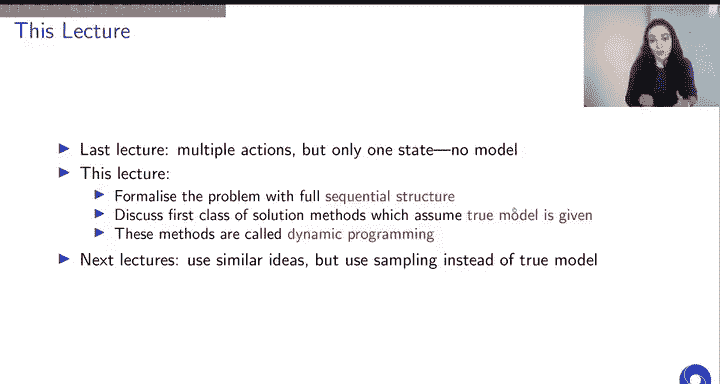

First。Ititem on the agenda， formalizing the real interaction。

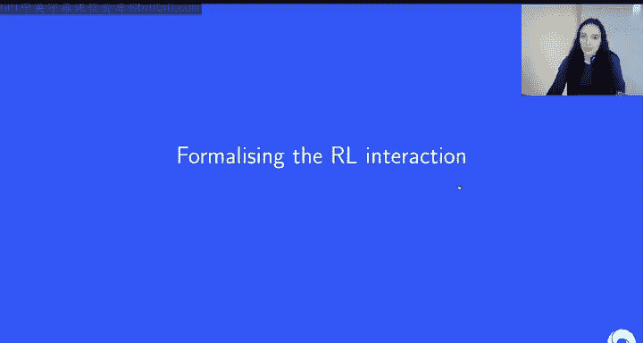

So we're going to discuss a mathematical formulation of the agent environment interaction。

 this is called the mark of decision process and this enables us to。

Talk more clearly about the objective of an RL agent and how to achieve it。First。

 a simplifying assumption。For now， we're going to assume that the environment is fully observable。

 that is the current observation that the agencies contains all the information relevant to make all predictions in the future。

Note that almost all ourL problems can be formalized as MDPs。

 so this is a very encompassing paradigm。These are just a couple of examples。

 things like optimal control problems in continuous MDP are still covered by this formalism。

 although in this particular lecture and for most of the exposition of theory we would be assuming。

Fite and discrete action space and estate spaces， but all of these can be naturally translated to the continuous case。

The other example is partially observable problems。

 although this seems to violate this first assumption we made， we can show that。

Even these models can be converted into an enpy given the right history。I mean。

 even things that you've seen last week， which are bandit。

 can be formalized as an MDP with just one state。

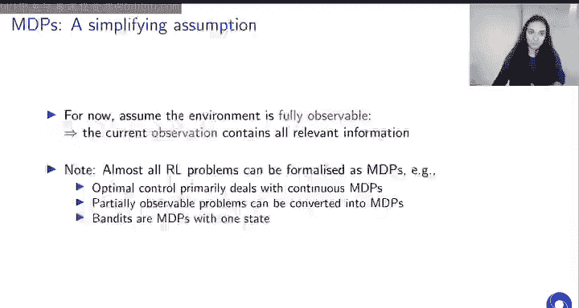

Without further ado， this is the definition of a Mark of decision process as presented in the book。

 so a Mark of decision process is a tuple that contains the set of all states。

 the set of all actions。This probability kernel， which describes the joint probability。

Of what's going to happen in the next state so given that we are in state S and have taken action A。

 what what am I going to observe at the next state。

 so what's my next state S prime and what kind of reward signal am I going to be rewarded for that transition。

And the last element here is the discount factor， which trades off later rewards that we'll see in the future with earlier ones by discounting them heavily or not。

We're going to call P the dynamics of the problem or the transition dynamics。

And it's good to notice that sometimes it's useful to marginalize out some of these quantities like the state transition and the expected reward。

 these are the two equations here。So this is just looking at the transition to the next state and this is looking at all of the reward。

That we could expect from a transition starting from state S and having taken action A and this leads us to the alternative definition of the MDP。

 which is quite prevalent in literature so we're mentioning here because most likely in a lot of the papers and other books like Chavespherva book。

 you'll see a similar definition。So the only difference here is that now the transition kernel is this marginalized transitional kernel。

 which looks only at what's the probability over my next state given that I've started in S and taken action A and R as given in the definition of this MDP is the expected reward associated with that transition。

 so although this random variable might depend on where we end up in the definition of this MDP。

 we assume that we have access。To the expected version of this quantity。

Okay and then the discount factor remains the same note that these formulations are equivalent。

 there are no additional assumption or removing any any assumption。

 and we will be using them interchangeably depending on when is more convenient to use one notation versus the other。

Okay。Now， the markov in the Markov decision process comes from the Markov property。

 and you might have seen this previously in something like hidden Markov models or in a lot of the sampling method。

This property really says that the future is independent of the past given the person。And for MDPs。

 this is a property that all states will have and what does it mean for state to have the markov property。

 well， a state S？Has the markov property if it summarizes basically all of the history that it has。

All of this is history that has come before it in terms of the prediction value of the next state or the next states in the future so is。

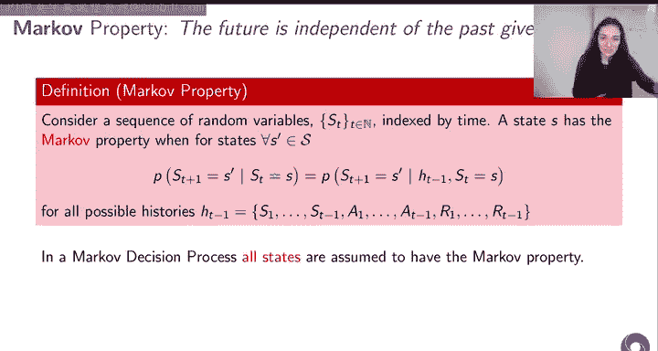

Different way of saying this is that the state captures all the information or the relevant information for the prediction problem。

Captured in the history or another way of saying it is that once the state is known。

 the history can be thrown away and a different way of saying this is that the state is a sufficient statistics of the past。

 So anything that has happened in this interaction process is summarized in terms of。

Its information about future transition is summarized in the current state。

 in the current observation。Okay， this is just a bit of a test to。

See if you understand the principle and what that means in an MDP。

 these are a couple of statements that I've written down， some of them are true。

 some of them are false I would。

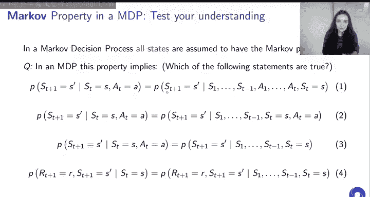

Encourage you to pause the video here and go through all of them and see which of them are false and which of them are are true。

Welcome back， hopefully you managed to go through this exercise。

We're going to just go very quickly through the results。Okay， so the。

The principle here is that the state at current time step contains all the information necessary for all future predictions。

Anything that has happened prior to time T is not relevant because all the information is captured in。

Ste。That means all the information all including 80 minus1。Easase contain。In the state。

 So anything before that does not。Marer。So that means that these two are completely equivalent。

The same thing here， these things have happened before SD。

 so because all the information is contained in SD， we can see if they remove them。Now this one。

 again， all the information here is contained in SD but。80 comes。

At the same time or after we observe state。SD， so this。Is additional information。

 the action that I'm taking at state S conveys more information and will determine or skew the distribution of what I'm going to observe in the next state。

 so this one is false。And this。The fourth one is the same as one and two。

 all the information here is contained in this one， and these are just predictions for the future。

 whether or not that state or reward functions or actions or anything that pertains to the future is fully conditioned on the current state。

So this one is true as well，So we've seen that we've argued that MDP are a good way of formalizing an R problem。

 and let's look at an example of doing such。So this is an example of a cleaning robot。

 this is from the Su andbarter book， chapter 3。This is a robot that its goal is to clean soda cans。

For simplicity， it has only two states， a high battery state and a low battery state。

 and it has three actions， one is weight for someone to put a can into its bin。

The second action is search， which means that it will actively search for soda cans in the environment。

And the third action is recharge， which will enable it to get the battery from a low state to a high state。

And for this particular example， we're going to assume that the reward associated with。

With searching。Is actually higher than the reward associated with waiting so if it's actively going into the environment and trying to search for soda cans it's it's expected。

Return， which is the collected number of cans， might be higher or is higher than just waiting for someone to put cans into its container。

And then we have some stochastic dynamics。Where with alpha probability。

 we can loop into a state of high battery and with one minus alpha probability。

 we're going to transition from a state of high battery into a state of low battery at which point we would need to recharge。

给。😊，This is just。Full table depiction of the MDP and。We'll see in the first。

Definition of the MDP as a couple of state actions。Joint transition， probability and discount。

The discount for now can be one。And the states are just the ones that we've discussed high and low。

 the action space is search weight and recharge， and then the joint transition kernel can be just read off from this table so for starting in state。

High battery and taking the action search， you have alpha probability of ending up in a state of high battery and achieving a reward for that transition of our search。

Hey， so this is。This is pretty trivial right off， okay？For the。For the other definition of the MDVP。

We have the same thing state action， those remain the same now the probability kernel in this。

This formulation is just this one。That transition to the next state。

 and then the reward that we have in this definition is actually a reward that is。

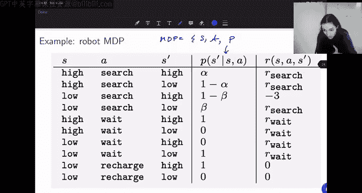

RS。Okay。And this one is not exactly read off from from the table。

 we would need to make a bit more computation there because the reward in this particular example depends on where I ended up on that transition and this reward that we have in this definition only condition on the state of action so if you if we would go for this definition in order to specify the MDP we would need the we need to compute the expected reward seen on this transition so for instance for。

These。Initial conditions， high battery and search， this would be with probability alpha I'm going to。

End up in a state of high battery and receive reward our search。

 And with one minus self a probability， I'm going to。Transition to a state flow battery。

 but still receive the same rewards。Because in this particular example。

 regardless of where I'm transitioning， I'm going to have the same。

 the reward associated with this transition is actually our search。That might not always be the case。

 so for instance， for this particular example when I start with in a low battery state and I choose the action search with one minus beta probability。

 I'm going to have a reward of minus3 and with，Beta probability。 I'm going to have this。

Our search reward， so the probability the。Reward associated with。Loow and search。Would be1 minus。見た。

不ush。20日。So， in order to。To get this definition of the NDP or to go for this definition of the NDP。

 you would need to compute these quantities。Okay。OkayNow the last thing I want to mention on this example is just to show you a graphical representation of the MDP。

 this is something that we would normally use to depict an MDP。

So we have the states a high and low battery as nodes of this graph， and then we have arrows that。

codeode the transitions between these states， and these are annotated with the probability of transitioning from one state to the other and the reward associated with that transition。

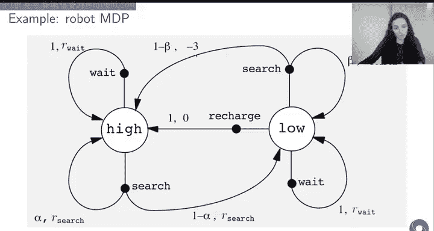

Now to formalizing the objective of an RL agent。

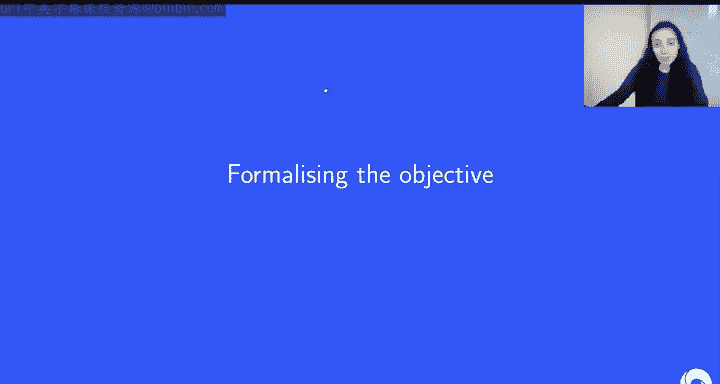

In order to do that， we're going to be introducing returns。So we've seen that in acting in an MDP。

 the interactions at every point in time would result in immediate rewards and these lead to returns。

And returns have at least three different。returnsturns that we're going to be looking at are undiscounted returns。

 which is the sum of all the rewards that you're going to see in the future。The discounted return。

 which uses this discount factor that we've seen in the definition of the MDP。

To gradually discount the rewards that you see in further steps in time and the average reward formulation that looks at the average reward。

So depending on the MDP， one of these might be appropriate， for instance。

 the undiscounted return is usually used in episodic finite horizon problems because if this becomes。

If its this is undiscounted and becomes an infinite sum this might be unbounded The discounted return is the one that we're going to be using the most frequently and it is suitable for both finite and infinite horizon problems and average reward usually is used for con infinite horizon problems note that all of these Gs are random variables that depend on both the NP so the stochastic transitions。

In the probability earn and the policy that we're employing in order to see these rewards。Okay。

So as I said， our choice here and most of the most popular choice of return in the literature is discounted return。

And。Moving forward we're going to be using this for both finite and the infinite horizon problems and this is just the same discounted reward but for the infinite horizon problem。

And the discount， which is。Number between zero and1。

Means that the marginal value of receiving rewards after K plus one。

Time steps is actually modulated by gamma to the du， which can be a very small factor。

 remember this is a number that is less than one so immediate rewards will have a more high weight。

On this return， then delayed the rewards。For instance。

 if the gamma is close to zero or if you put gamma to zero in this expression。

 you would see that the return in this particular example is just the immediate reward。

For values close to0， this gamma to decay decays very， very rapidly to0， so we。

We call this return myopic because it only considers or most of the values it considers come from immediate rewards。

To the opposite side， if gamma is close to one， this is far sided， so in the limit there。

 if gamma is equal to one， we've seen this is the undiscounted return that weights equally all the rewards that we would see in the future。

Okay， why discount？嗯。There are two sides to this。To this problem， one is。Problem specification。

 it might just be that the the NP you're considering actually has this property that immediate rewards are actually more valuable think of it as interest rates。

And it's also something that we see in animal human behavior that there is a preference for immediate reward in a sense it's。

Leveraging the probability of actually making it to 10 years time or 100 years time and seeing rewards in that park horizon。

And then on the other side is the solution side， so sometimes even when we're interested in an undiscounted version or almost undiscounted version is mathematically convenient to go for the discounted reward case and this also avoids the infinite return。

That we can get incyclic Markov models so if。If the horizon is infinite。

 the undiscounted return might not be bound， so maximizing over it might be problematic。

So the way to think about it right now is that the reward and the discount factor together。

Will determine the goal of the agent and the goal of the MDP。

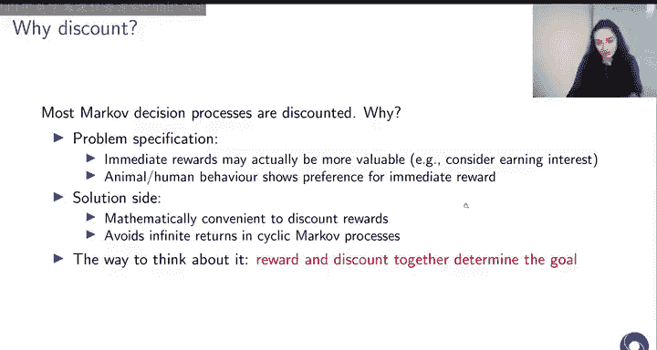

The goal of the agent is to find a behavior policy that maximizes this return and as I said before this G is。

A random variable that depends on the MDP and the policy。

So what we want is a behavior policy that maximizes the expected value of this return and a policy is mapping that for every state。

Assigns for each action in the probability set， a probability of taking that action in that particular state。

 and this is the notation that that we're going to be using for deterministic policies we sometimes use this this other notation8 equals。

PSD， which basically denotes just the action that is taken deterministically by that policy。

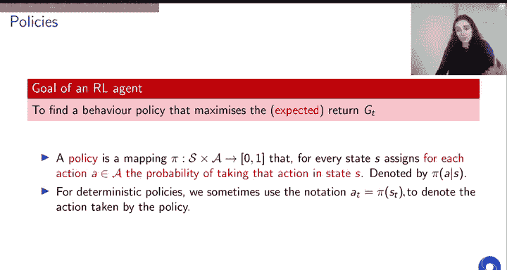

And because we're going to be looking at expected values of the return。

 we're going to be introducing some quantities to help us refer to this expected value。

 so we'll going be introducing the value function。At a particular state S。

 which is now the expected return。That we're going to get starting from state S and mean policy pi。

And similarly， we're going to be introducing the Q value or the state action value。

Which is exactly the same expectation， but now we're starting in state S。

 we're taking action A and after that。For all of the other steps。

 following and behaving according to policy pie。And there's an intimate connection between these two。

 which is noted here that the value function。Is the expected。嗯。State action value。

Under the the policy that we are evaluating under P。

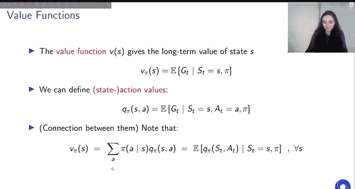

Okay。Now we're going to be introducing the optimal value function and the optimal value function is just the。

The function that for every state。

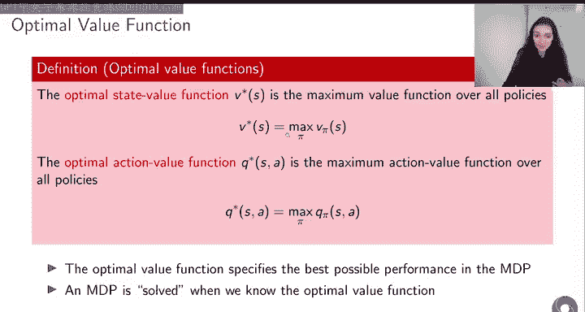

Maximizes over these quantities previously introduced。

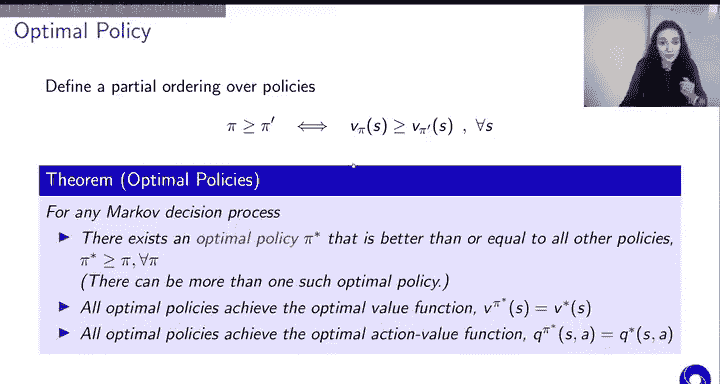

So all of these quantities， the value function introduced here。

 B and Q are dependent on a policy that we're going to follow after this state or after this state in action。

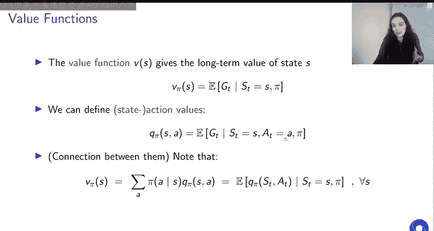

And the optimal policies are looking at for every state。

 it's looking at all of the policies that we could employ in the future and is。

Doing a maximization over all of these policies and the same for the action value function the same interpretation werere at state S taking action A and after that we're looking at all the possible policies that we might be able to employ in the environment after choosing action A。

And maximizing over those policies。So the optimal value function specifies the best possible performance in the MDP and we're going to say that an MDP is solved when we can provide the optimal value function。

 and we'll see that if we provide the optimal value function。

 we can trivially derive an optimal behavior pulse out of that。

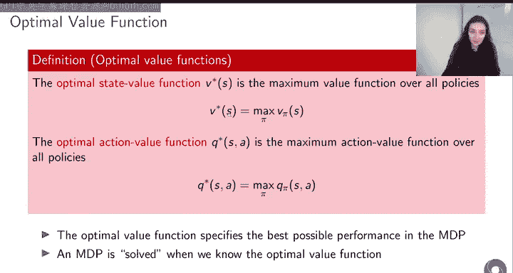

ok。😊，So in terms of optimal policies， it's good to notice that there's a partial ordering in the policy space。

That and we're going to say that a policy pie dominates a policy。

P prime if for every state in the environment。The value associated with that state is under policy a pi is greater than the value associated with the policy pi prime。

The theorem that we have in terms of optimal policy is that theres always exist optimal policy by star。

 this is how we're going to be denoted it that is better and equal。

With respect to all the other policies in the environment。

 so this is a policy that will dominate for all states in the environment， all other policies。

OkayAnd for all of the policies。They achieve the same value function and the same action value function。

 so any policy that is optimal will achieve the optimal value function and will achieve the optimal state action value function。

Okay， I'm going to pause a bit here because that's a lot to take in。

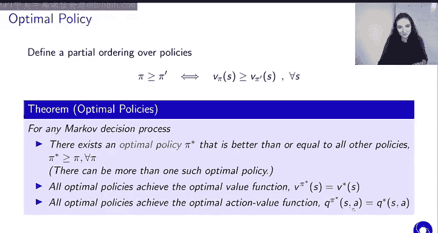

Okay。Now， I've prefaced that if we。Know the optimal value function， in particular。

 if you know the Q optimal value function， we can derive an optimal policy。

Which is just the greedy with respect to that that policy， So this policy will choose。

With probability one， the maximum action according to Q。

Q star and put zero probability on all other actions。

 So it's going to look at the values of Q star and it's going to act greedily with respect to that。

And。This will give us an optimal policy， I'm not going to show this here。

 but we will see proof of that moving forward okay a couple of observation here。

 there's always a deterministic optimal policy in the NTP。And。

The statement above implies that once we have a Q star value。

 we can immediately have an optimal policy in general there might be multiple optimal policies。

And some of them might be stochastic。

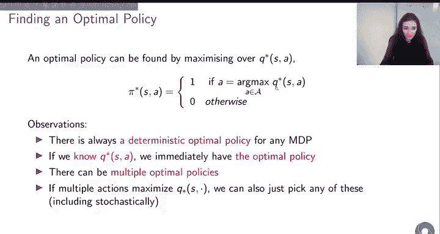

Okay moving on， we're going to be looking at the Belman equations。

 these are a very central concept in orL， so this is this is something important okay and the Belmon equations actually describe the recursive nature and the structure that that is present in the value function we've just defined so we're going to start here with the definition of the value function for policy pi which is the expected return that we're going to get。

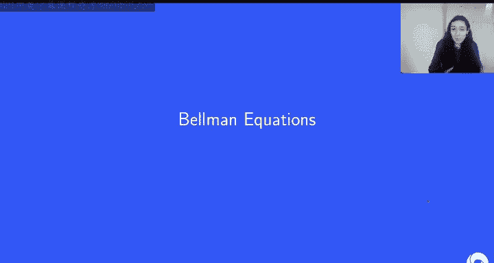

Starting from state S。 And we're going to expand this recursively。 So this is the。

Reward that we're going to get at the next step plus。

What's going to happen in the future So this is the。Return at the next time step。

 this expectation is over the whole process， so we're unfolding this in time。And we can rewrite this。

As。They immediate expectation over the next transition。And the value function。

 which is already an expectation for what's going to happen after T plus1。So you see we have。

V pi at time T on this side and V pi at time T plus1 on this side。

 there's a recursive nature of the relationship。And this is just spelling out exactly this this expectation。

 so it's the expectation of taking action A in state S， this is this part。

And then what's going to happen in the transition， So I state I started in state S I I taken action A and I've transitioned to state。

S prime， and I've been rewarded。Or。😮，So this is the transition kernel and we're going to weight all this potential transitions to R and S prime。

By their return。给。😊，So the same thing can be done for the。Qe value。And。The derivation is just here。

 so we do the same thing， we expand for the first step。And then this。

 we've seen in the previous step that the value this is just the value function associated with ST plus one。

And this is。An expectation， this itself it's an expectation over this Q value function。

When 80 plus one is chosen according to policy pi， and this is just spelling out that that expectation。

 so this is the B that we've seen before。And this is spelling out just just how these two states and actions relate to each other and of course there's。

There's an intimate connection between these two value functions that we're using for this particular step that。

呃。V is an expectation over the Q values。

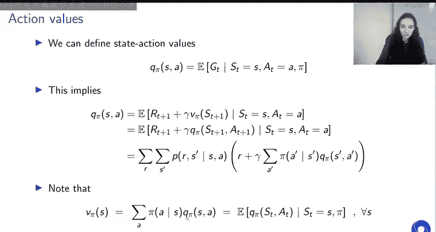

So these recursive relationships are very important and are known under the name of Belmont equations。

 and particular these are known as the Belmont expectation equation because it's an expectation over the policy that we。

Employing。Now。嗯。We also have another set of equations， which are Belmon optimality equations。

 which describe the。Would describe the optimal value functions so we。

We can say that the optimal value functions satisfy this equation。

 this is very similar with the ones that we've seen in terms of expectation。

 but instead of having an expectation over the next action here，And here。

There's a maximization over actions。And this is because of the optimality。And。

Let me give you some intuition why these the optimal value functions might satisfy this equation let's remind ourselves that the greedy policy with respect to the optimal value function so V star or Q star。

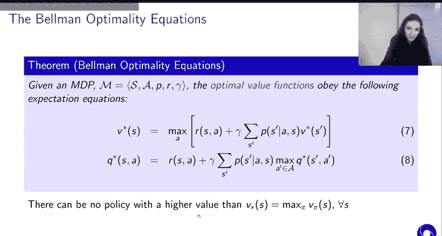

Is an optimal policy， I haven't proven this， but we've stated this before。So。

This greedy policy that takes the max over these values。Gives us an optimal policy。Now。

 if you apply the Belmont expectation equations。We know that。The value function。

 the Q value function corresponding to this Q pi， which is an optimal policy。Ahes to this equation。嗯。

And this。Part here。The expectation under this policy actually comes down to being the max over the optimal value function。

是。So this first part is just rewriting the Belman expectation equation for pi star。

And this is just taking into account the definition of pi star as the max。Over Q pi。

Which means that we get this expression， which is exactly what the optimal。

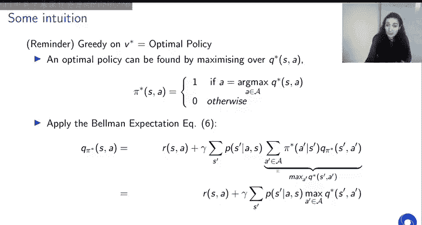

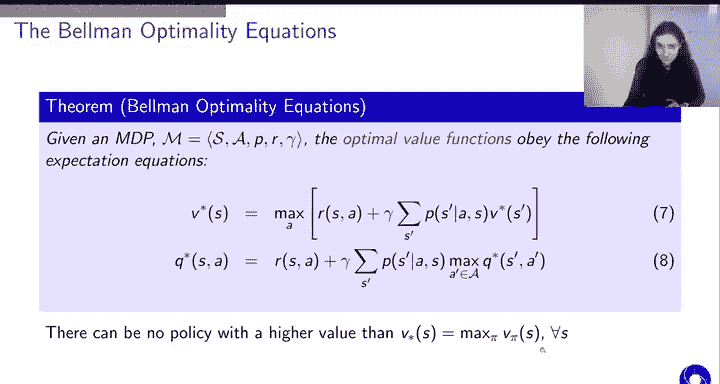

By one equation says and the same thing can be done for B。

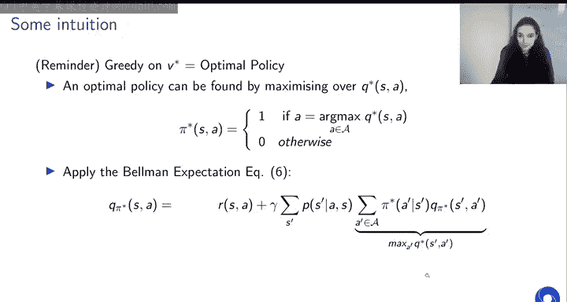

好。Now。Let's look at solving problems in RL using the Belelman equations。

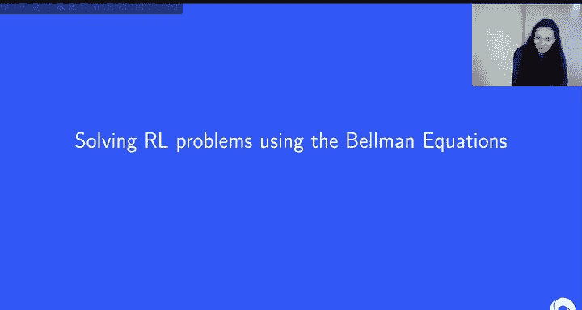

Okay first we're going to be introducing the two class of problems that we encounter in ourL first class of problems are called policy evaluation or prediction which is estimating the values of P or QI so this is answering the question given a behavior policy given this P what is my expected return under this behavior so if I were to employ this policy what am I expected to get so given this treatment protocol or this trading strategy。

 what is my expected return under my reward specification。Now the other class of problems。

Our control problems where we're trying to estimate the optimal value function， either V or Q。

And this leads to an。Optimal way of behaving so the purpose for this class of problems is to find an optimal way of behaving or to find the optimal policy。

So things like what is the optimal treatment protocol。

 what is the optimal control policy to minimize time on the road or fuel consumption。

 whatever the reward is so one is about given a behavior I'm going to try to estimate。

How good is that behavior on average， the other problem is a much harder problem where we're trying to go for the optimal value functions and the optimal behavior。

So we're going to look here at a very small example， so we're going to consider this MDP。

this graphical representation three states。We have two actions。A one， which is。Her kind of。Right。

 but once you are at the end of the state space， you transition back to the starting state and action 2 which is roughly left。

 but again when you're at the end of a chain， you transition back to S0。All of these actions。

 if they are taken。have a probability of 0。9 to succeed so if I'm taking action1 in state1。

 I'll have a 0。1 probability of transitioning to S0， but I would have a 0。

1 probability of just looping back and staying in that state。

For all transitions that end up in state zero so at the beginning。So this one。

 this one and the transition to itself， the reward is zero for all other transitions。

 the reward is minus1。And now you're going to be looking actually at an evaluation problem for this particular MDP。

 considered the discount factor 0。9， and your task is to find the value function V associated with a policy that always in this MDP takes action1。

And the same question for now uniformly ran the policy。And the last question here is。

Doing both of these。Evaluation problems。 But now with a discount factor of。

Z rather than the original discount factor of 0。9。So I would encourage you to pause the video here to work out this example before we move on。

Okay， hopefully you've managed to go through the example。

 I think this this is a nice way of testing your understanding of。

Both defining an MDP based on the graphical representation。

 then formalizing the returns and computing the value functions。

Combininees all of the concepts that weve we've covered so far and hopefully it gives you a taste of the complexity of the problem of estimating these quantities even for the。

Is there a problem of policy evaluation？I'm going to give you a solution rather than a solution。

A way of reaching a solution or a way of tackling policy evaluation for these small MDP。

And this will be done by。Rewriting the Belmon equations into matrix form so for every state in the the environment we have a bemon an equation associated with that state and that transition to the to the next state and for each state and action pair we would have the same。

For the the Q values for now， we're going just。呃。Focus on computing the value function for a policy pie。

And for that， we're going to just collect all the Belelman equation for all the states in the environment into into a system of equations that can be rewritten in this matrix4 so this leads to this matrix Belman equation for the expected。

Return under policy point and these are now vectors。B and R and this matrix。

Is the probability transition from state to I to state J under。

The transition kernel of the MDP and under policy Pi。So just to write this out。

 this is the probability of starting in state SI， taking action A and transitioning to a state SJ。

 this is what we have from the definition of the MDDP and this is weighted by the probability of taking this action A。

In state SI。AndSo this is the expected。Probability of transitioning in this state， starting from SI。

By acting according to policy P。And the same thing for the expected reward under policy Pi。

 this is the expected reward， instantaneous reward that we're going to get considering we're starting in state SI and we're going to behave according to an action chosen from policy P。

Okay。And once we have this。Formulation in matrix form， this is just a linear equation。

 so we can solve for V and you can see that this involves inverting this matrix that is one minus lambda P pi。

 which is this probability matrix of transitioning from one state to the other under policy pi。听。

ひ that's it。Note that the computational complexity of this is number of states， the power of three。

 even if there are other solutions that are not cubic in the state space。

 it's really usually more than。To the power to of the state space。

 so this is a feasible solution only for small problems。Fortunately， for larger problems。

 larger state spaces， we have iterative methods like dynamic programming。

 which we're going to see next， or multicural evaluations。And temporal difference learning methods。对。

Now。This。Is a solution for the。For the evaluation problem。

 you could try to employ the same principle for the Belmon optimality equation in order to get the optimal value function。

 but note that the optimality equation is non nonlinear so you won't get a linear system of equations so this kind of reason it does not。

Trivially go through for the optimality case。So we can't use in general this matrix formulation to do control。

Okay but nevertheless， there are many interactiveative solutions。

 the ones that use models like dynamic programming， which we're going to see next and。

Algorithms there are policy iteration and value iteration。

And other iterative methods that do not assume knowledge of the model and are using samples like Montete Carlo methods。

 Q learning and SARSA， which are temporal difference learning methods。

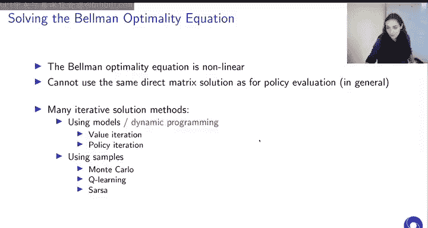

That we're going to be transitioning into dynamic programming。

Dynamic programming refers to a class of methods that try to learn the optimal behavior of the optimal value function。

 given a true model of the world， the true model of the MDP。

The term was actually coined by Richard Belman to describe his research and his reasoning is as follows。

The 1950s were not good years for mathematical research。

 I felt I had to shield their force from the fact that I was doing mathematics。

 what title what name could I choose， I was interested in planning in decision making in thinking。

 but planning is not a good word for various reasons I decided to use the word programming。

I wanted to get across the idea that this is dynamic， that this is time varying。

 I thought let's kill two birds with one stone， let's take a word that has a precise meaning like dynamic。

In the classical physical sense。It is also impossible to use the word dynamic in a pejorative sense。

 try thinking of a combination that would make it possible。To give it a pejorative meaning。

 it's impossible。Thus， I thought dynamic programming was a good name。

 it was something that not even a congressman could object。

 so I used it as an umbrella for all a marketing。Okay， in。Nowadays。

And the meaning of the word that we were going to refer to。

 the dynamic programming term refers to a collection of algorithms that can be used to compute optimal policies or optimal value function。

 given a perfect model of the environment as presented in the markov decision process definition。

And we will discuss here several dynamic programming methods to solve MDPs。

All of these methods actually have a pattern which involves two steps。

One is policy evaluation and the other one is policy improvement。Let's start with policy evaluation。

 So we've seen already the a solution to a policy evaluation problem the。

The exercise you solved before and the matrix manipulation that we've seen just prior to this is still a solution to this problem。

 now we're going to see a different way of computing the value function corresponding to the policy pipe for an arbitrary policy。

And the idea here is to turn this equation， the Belman equation。

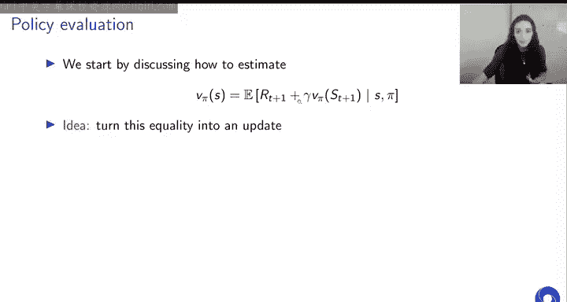

Into an update。And this leads to this following algorithm。

 we just initialized the values for all states in the MDP， and then we iteratively。

Update these values according to this this equation so at。答应吗？

In the iteration at iteration K plus one， the value of a particular state would be updated towards。

The reward that you're going to see in the next step。And the value function。

Computed from the previous iteration。At to the next state。 So this is using。

This this equality that we know holds for the。For the estimate we're trying to get to。

To update towards that estimate。And the stopping criteria here is whenever the value function。

Resulting from this update is the same as the one at the previous iteration for for all states in the MDP。

 then we can stop and。Also， when this happens， we're guaranteed to have found V because。

Let's remind ourselves， the pi is the solution to this equation。So if you plug this in if。

VK and VK plus one are the same that means that Vk respects or obeys the Belelman equation for。

Policy pie thus because this is a unique solution。VK has to be and VK plus1 has to be equal to V pi。

呃。Does this algorithm always converge？The answer is yes。

 under appropriate conditions when gamma is less than one and we will see a proof of dis convergence and the conditions under which this dis convergt is possible in the next lecture。

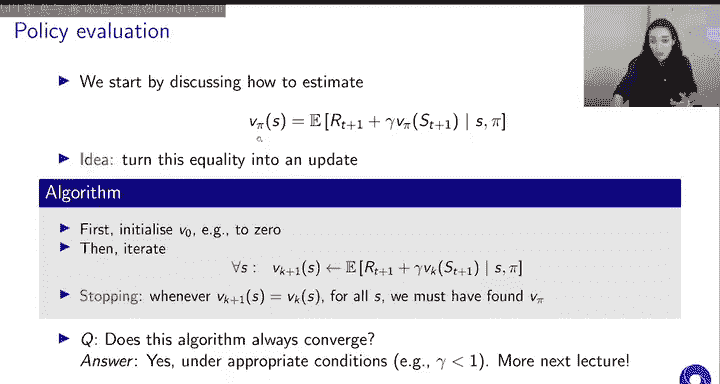

Let's look now at an example。Of how policy evaluation works in this assert setting。

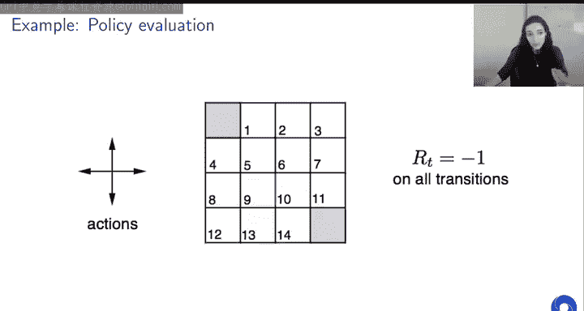

Okay， let me walk you through this example， this is a grid world example where the numbers in the grid represent the number of the states。

And the action space considered are upright left and right。

And for all transitions in the environment， we're going to be given a reward of minus1。

In these states， the gray one are considered terminal states。

That means that if the agents transition to one of these states。

 then the episode terminates at this point in time。

We're going to also be using a discount factor of one because this is episodic。

 we don't have any issues with the infinite returns。

And we're going to see what iterative policy iteration does in this particular example。

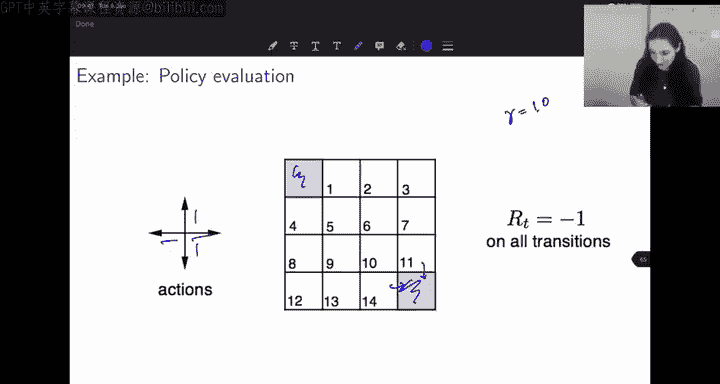

This is just the algorithm that we proposed previously， this one。

And let's go through the steps of updating the values according to this procedure。

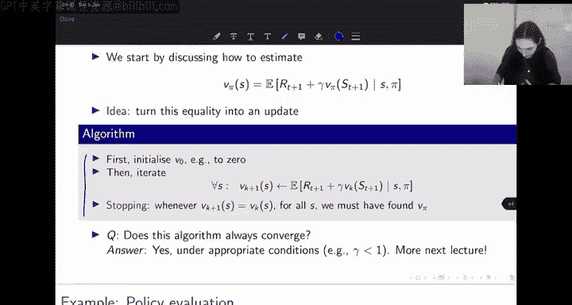

Okay， so first of all， we start by initializing the values。Add zero， for instance， oh by the way。

 we're going to be evaluating the uniform your random policy。For me random。

Which is the policy that assigns equal probability to the four actions we're considering here。

 So this procedure needs to converge to。V pi， which is the value of this uniformly random policy。

 as you。At the first step， we're just initializing。V0 to be all0 and after that。

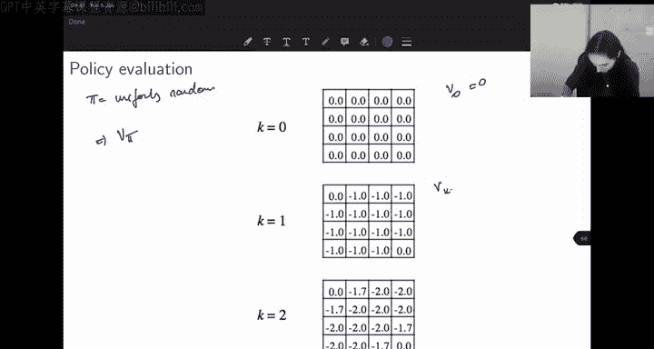

K plus one， we're going to be updating values according to this equation。

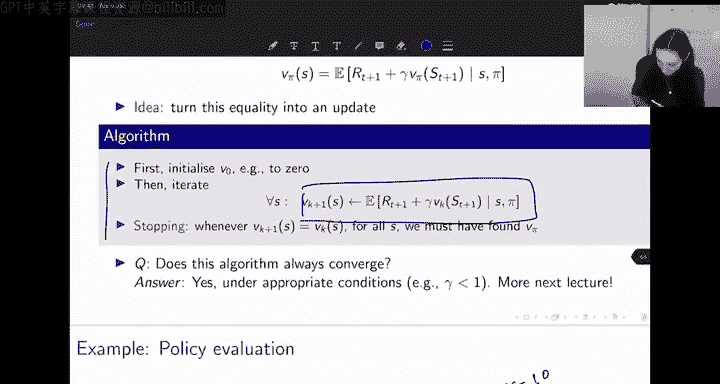

So just writing it here。This is expectation over the next transition。So the next reward plus gamma。你。

The estimate at。Previous step。Value at the next state。Okay。

Now we can simplify things a bit here because。This is one and this is minus1 for all the transitions in the environment。

This is now expectation over minus1。Plusus。Vk。And that means that this is one plus the expectation over the next trend。

Next please transition。steep plus one。For all the values。In particular， for V1。

 this means that this is -1 plus。The expectation of B0。

 We're always using the previous estimate of all of the。The values。Surrounding this state。🤧。

Because all of the values at iteration zero were initialized at zero。

 the expectation over this value would always be0。So d1 for every state would update to minus1 chip is exactly what this matrix says okay。

 let's take this further to the next step。So for B2。We have a similar update again。

 this is the general update that that we're following simplified for this MDP。

 so it's still going to be minus1。Plus， the expected value of what's going to happen in the next state。

And now this K is。Is one okay so for each state we're going to look at the state it can transition to under each of these actions and because it's a uniformly random policy so all these actions or all these states would be reached with the same probability we're just going to average those values so for instance。

 if we consider in this state。In order to compute its value， we're going to look here。

What are its neighbors and where the actions would take it so the right action will give it here and this one will just loop back so the up action will just loop back to the state so the average value of these states would be minus1。

Mus1， minus1 and zero。Wighted by four and this is。L youre at 75。

And the same computation can be done for any of these， these other states in the middle。

 these will have a value of minus-2 because the adjacent states there are all value minus1 and minus1 from the。

嗯。Immediate reward that we're getting。And so on and so forth。

 we can extend this computation further and further。丢。

This particular step where we reach convergence， which means that and you can do this to convince yourself that if you。

Apply this rule again。Which is the update rule。For every snake。

Vk plus1 equals Vk for Vk being this particular matrix。And that also means that decayk has converge。

To B pi， which is the value of the uniforming random policy， which is the thing that we are looking。

Now， another thing to notice here is that。We can act。

Greedily with respect to the values that we obtain in this deciteration in particular if we。

Consider this last iteration， so this one。We've already conged。

 so this is the policy of the uniformly random pop。The value of the uniform a random policy。

And we can see that if we act greedily with respect to the values。Here。

We can get the pretty good policy， actually。We can get to the optimal policy of behaving in this environment。

 so we have a very。Uninformative policy， a very bad policy in terms of behavior because it takes every action。

Randomly， it has no structure to preferring one action versus the other。

 so the value function is not too good。嗯。But based on that evaluation， doing an improvement step。

Based on those values， greed improvement step based on those values gives me a very good policy。

 in this particular case， this is an optimal policy。

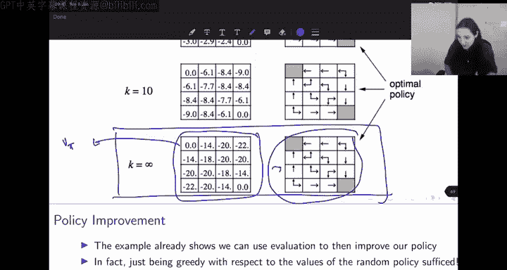

This is actually a very general principle in reinforcement learning and in dynamic programming of evaluating a policy and then taking this gratification step。

Where the new policy that were。We're getting out of this gratification step is actually guaranteed to improve base。

Upon the policy that we started with， so we start with the policy pi， we evaluated that one。And。

We get the policy by new， which is a gratification with respect to these values what we're saying is if we're doing this this step。

 we are guaranteed to。Get the value that to get the policy that improves for each state over the policy on which the improvement was made。

嘿。So， this is the。Actual statement。That。For each state and the same for the value function。

The state value functions。For each state connection。O。

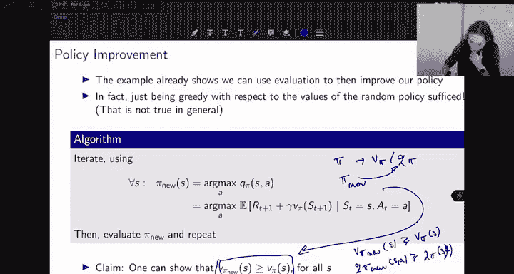

Let's go through the proof of that， but first I'm going to try to give you some intuition why that is the case and why we are guaranteed to improve and maybe then go a bit more into the mathematics of how to prove this。

So first of all， by definition， this new policy is。Gtification is the artrc max of this evaluation。

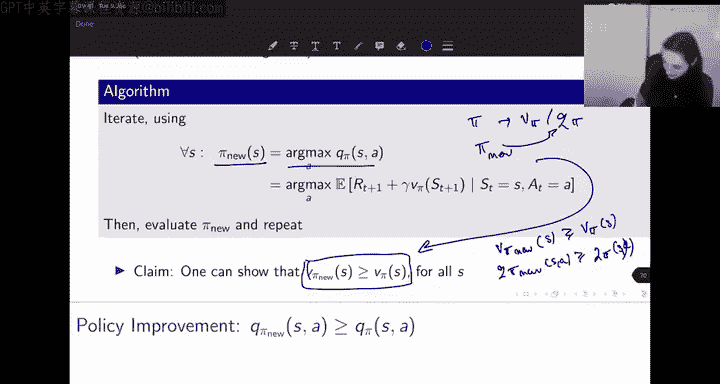

So。Given the Belmon equation。I'm just going to write down the Belelmont equation here for Qpi。

Have this。And by this notation， I mean。那个。Okay， so the action at S prime is selected according to pi。

Now， by the。The way。Actions are selected in by new。We know that this。

Is greater or equal than the max。So the expectation is always。嗯。Greater vehicle than the match。

You still have an expectation where。And this is actually me。没有。So let me rewrite the statement。

And what does this statement actually say it's saying that。It's。At the next state， if at。As prime。

 I'm going to be behaving with respect to this new policy， this gratification policy P new。嗯。

Take an action with respect to that policy and then continue to follow policy pie。

Just remember that this。This expression actually means that I'm taking an action， a prime。

According to this new policy， but after that， I'm still following the old policy。Right。So from。

E plus2。I'm still going to be following Pi。So I'm saying I'm taking an action with respect to the new policy and then I'm following my old policy。

 I know this this combined policy that I'm doing right now is guaranteed to have a greater value than the policy that I started with。

This is the principle here。There's two things， basically that that。Bine new can do either agree with。

The policy。Where。The previous policy， which means that the artrc max there is already what Pi was doing or disagree with that policy。

Wwhich means in that case means that if I'm deviating from that policy。

 I have an opportunity to improve。And deviating only once from that policy as in here。

Already says that I'm even if I don't do any other improvements。And fall back on my previous policy。

 I'm still going to improve so you know schematic。This is， let's say。

 the decisions and the trajectory that I'm going to up under the previous policy that I have。

 this would give me some return。I'm interested actually in the expected return。

Every time I have a decision that disagrees the。Pi Ne disagrees with Pi。

 then I have an opportunity of taking a step that is different from pi and then I'm saying if I've taken that step but still continue after that with pi。

This return， on average， is going to be better than this one。And every time I deviate from this here。

I also have the same property。If I deviate then and still follow the。The previous policy。

I'm still going to improve and I'm still going to improve over this one。

 which is already improving over that one， so every time I'm deviating from this policy that that I've previously evaluated I have an opportunity to improve more and more so the more I deviate from this policy the more opportunity for improvement I have。

Let's try to make this a bit more。Mathematically precise。So we've already seen that。

I'm just rewriting the situation。はい。It was greater the on equalal。对了。P。不是。天吗？

Expectation over the next state。Bye， this is the old policy， just to remind ourselves。And。这边。

So next take， we're just going to see。Any action corresponding to this new policy？啊m sorry。

The inequality here is the other way。It is。Because this is a maxim。

But then we can apply the same principle to。This value function。

And say that this is greater or equal。Less than equal than the reward that we're going to get at。

The state。Given that we've chosen this action corresponding to pi。Plus。你干什么？

Expect over now this denotes the state after S prime。

This is just applying exactly this equation in this reasoning， but now not for SNA。

 but from S prime and whatever action was chosen by mu of S prime。Okay。And actually， we can。

Unfold this even further。And this actually would be an expectation over a trajectory。

They done fault in time。A plus gamma。Plus。And if I unfold this， it's going to be S R of。Prime， prime。

没有。crimeme。Plus so on， so forth。And this。If you remember。

 the definition of the discounted return is exactly the value function corresponding to。I knew。Ssay。

 so were we're in state S， we're taking action A and therefore。

After we're choosing action according to Pioneer。Okay。So this。选30。

The value of the new policy that we've induced by choosing greedy action with respect to this estimate。

If we evaluated that policy， we're guaranteed to get a better value function than the one we started with。

Okay and this is the greedy improvement principle。We can use this。In the。

What we call policy cureration algorithm， which is this iterative procedure between policy evaluation。

Building an estimate of V pi or Qpi。And taking an improvement step with respect to this estimate such as to produce a new policy。

That is better than the one we've seen before。 in one instance of。

Policy improvement step is the gratification step， there are other ways of improving your policy。

 but this is one of the most used principle and wellknow principles in reinforcement learning and dynamic programming and these are just depictions of how to think about this policy iteration algorithm we start with a value function and the policy。

We evaluate that policy。Then we。Greify with respect to that evaluation to get a different policy once we have this policy。

 we are doing this evaluation step again。说。And this is graification。Again。

 the step can be just improvement in general， but the。Most common step of improvement。

 at least for value based methods， is the gratification。And we're。Doing the step till we converge。

till the evaluation problem， basically the greedy with respects to the evaluation problem gives you the same policy back and at that point we've converged。

And at that point， we do have the optimal value function and the graification with respect to the optimal value function would give us an optimal policy。

Okay。

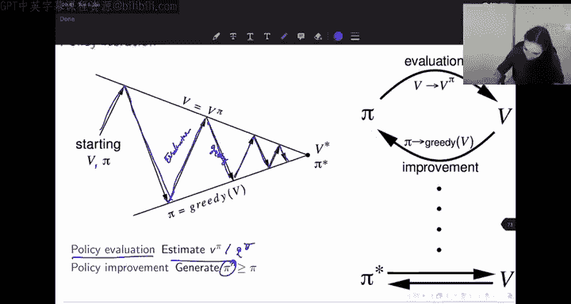

Let's look now at one example， one more realistic example of pulse iteration。

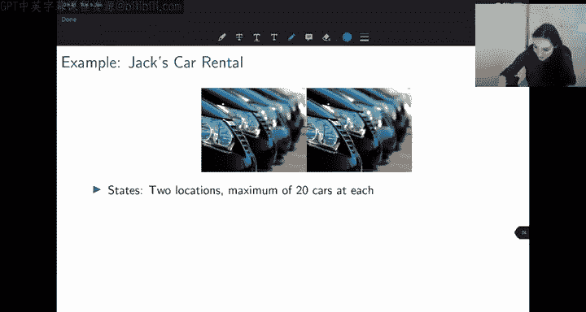

Okay let me walk you through this example， this is a card rental example that has two locations。

 which are the states of the MDP that have 20 cars， a maximum of 20 cars each。

The actions are moving cars from one parking lot to the other， up to five cars。

And this movement of cars incurs a penalty of minus 2 per car。The reward。

 the other reward associated with this MDP is $10 for each available card rented。

The discount pattern that we're going considering is 0。9。Transitions as are。As follows。

 cars can be returned and requested at random according to a Poson distribution。

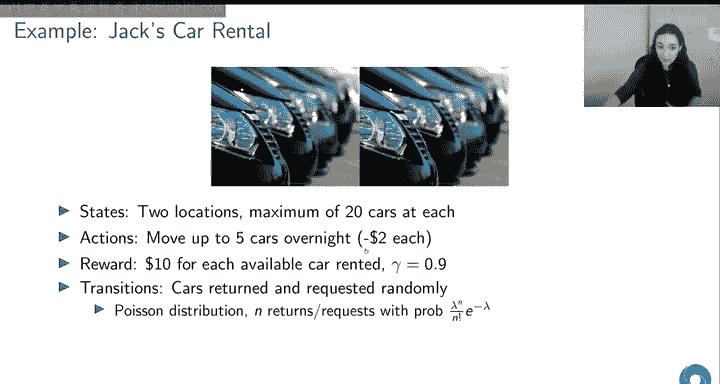

And the two locations have slightly different Poisson processes。

 the first location has on average three requests and three returns per day。

 while the second location has on average four requests per day and an average return。Of course， two。

Okay。So this is a simple enough MDP， it's quite small， just two states and a handful of actions。

 the transitions are quite stochastic， but quite well behaved。At the same time， it's an MVP where I。

 for instance， can't read off what the optimal value function or what the optimal behavior should be as opposed to the。

I guess examples that we've seen so far where just by looking at the MP or computing a bit the the values in between。

 you can weed off kind of what the optimal strategy is here is is a bit more complicating to do that as as a human even even the。

Even the evaluation problem， so for instance， if I'm given a particular policy。

 let's say if you know there are。Five cars in one of the parking lots and 15 cars in the other one。

 any car above 15， I should move to the first parking space。Any policy of this kind。

 I wouldn't necessarily know off the top of my head or with immediate calculation what the return associated with that would be。

 the dynamics of the environment are intricate enough that I can't compute that off the top of my head。

 nor so neither the evaluation problem nor the control problem are that simple or trivial nevertheless if you look into the computations of the values。

 it's actually not very complicated problem in terms of applying policy iteration。

And this is exactly what happens when you do run policy iteration on this example， so as a reminder。

 policy iteration is this process where we start with the policy， we evaluate this policy。

 we take a gratification step or an improvement step with respect to this policy to get another policy。

 in this case， we start with random value function of zero and the policy associated with that。

 we get。Policy pi1。By acting greedily with respect to the value of this uniforming random policy。

And this is the evaluation of that policy， pi1 that was the gratification of the uniform one。

Then we get pi2 by acting greedily with respect to this value and this is the evaluation that we get after that and continue this process and we see that by the fourth iteration or third iteration actually this already has converged and we have。

We have a stable value that is actually both the optimal policy。P3 and pi four。

 but also the optimal value function。Okay。So this is a nice example of how quickly this thing can get to the optimal policy even in。

No trivial example。A couple of more observation on policy duration。

 so again this is the process of evaluating the policy and proving the policy and repeating that process one of these steps is the policy evaluation step and we've seen that this is not a trivial step。

Computing the value associated with a particular policy can be quite a expensive procedure。

 so the question becomes do we really need to run especially this iterative policy evaluation procedure till we converge to the actual B P or Q P？

Or can we stop when we're maybe closer to that estimate and save a couple of iteration？In particular。

 can we simply swap after K durationeration of Feerity policy evaluation？

And if you remember in the small grid example we've seen before in the policy iterative policy evaluation。

It was sufficient to run。Policy iteration for three sets to get to a value that would induce the optimal policy。

Let's go back just for a bit。This was the example that I was talking about。

And we started with random values and by the third value here by the third iteration of policy。

Iterative policy。Evaluation， we can see that the greedy with respect to these values already gives you the optimal policy。

And see that we are actually doing quite recently even after two steps of thiserative procedure。

 but we're not getting all the way to the optimal of policy。After three steps。

 we already have converge in policy space， so this points to the fact that we can use we can save all of these iterations of converging all the way to the to the actual value of the uniformly random policy。

 because if we're using it only for improvement， we can already improve on this。

Intermediate test and get the。A very good estimate of good policy。And an extreme case of this is。

Why not do just one step of this evaluation step and then gratification straight after that？

And this is equivalent to what we call value theeration。嗯。

The way to think about or the way I think about a value iteration is actually from。

Different perspective of taking the Belmont Opality equation and doing the same thing that we did with iterative policy evaluation here and turning this into an update equation。

In this， you will see if you go through the steps that this is equivalent to doing policy iteration with one k equals one in the iterative policy evaluation step。

谁。And this is that the actual algorithm we initialized as before randomly or at zero。

 and then we update now not according to the expected。

A value under the policy we're trying to evaluate because we don't have a policy here that we're evaluating。

 we're just taking the max with respect to what's going to happen in the next step and the topic criteria as before whenever K plus one and K reach the same value so the value doesn't change that means in particular that。

VK。Obes the Belmont Opity equation and by definition that means that we have found the star。

 which is。The value of Vk and Vk plus1。

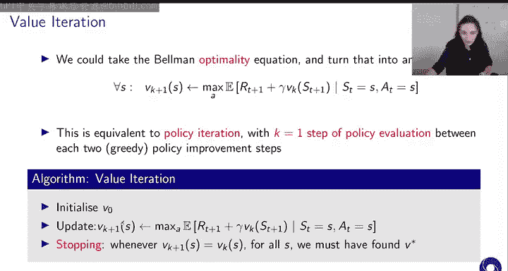

And let's look very quickly at an example of how this。

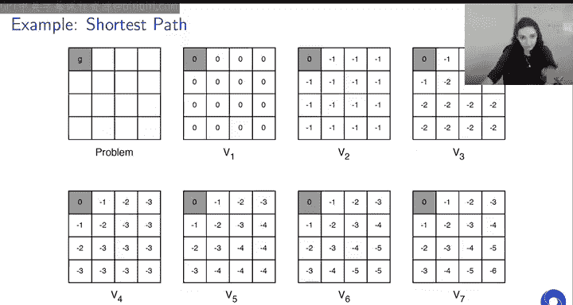

Behaves in practice。Okay， this is an thenP very similar to the one we've seen before。

 just now I only have one terminal state。That we're going to transition to all the rewards as before are minus1。

 so we're encouraging the agent to get out of the NDP as soon as possible。

 get to this state as soon as possible to transition out of the MDDP and we're going to be considering a discount factor of one because this is an episodic setting。

And then we're interested in running this new algorithm value iteration。

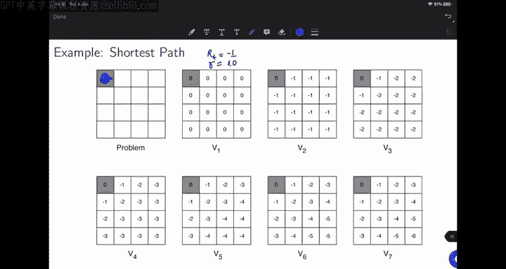

In the in the same。

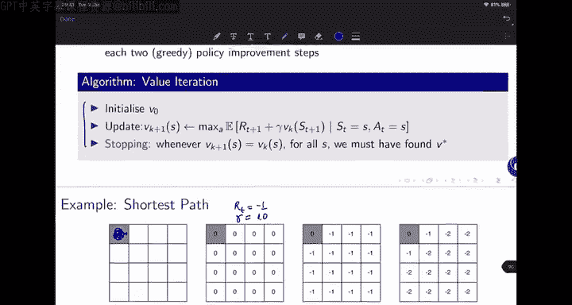

So we're going to initialize at zero。And then we're going to run。K plus one max。Vation over。

Have next。Previous value。Actually， this。Should say a。

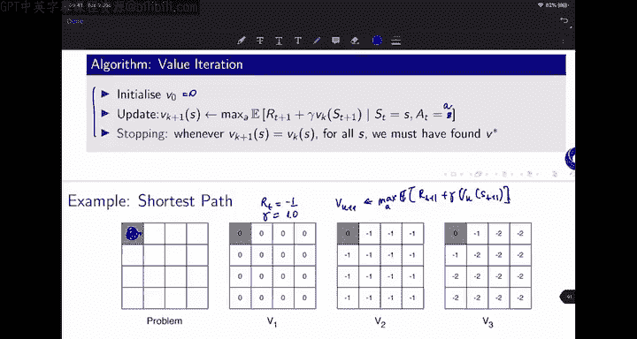

O。So有的。Instaneous reward are all one， so this actually update is minus1 plus gamma max over a。

Expectation of。These values。Okay， so basically what this says is。嗯。I'm going to look。

I'm going to take an action， I'm going to transition to this new state and I'm going to look at the value。

That。has been generated in the previous iteration and I'm going to look at the expectation over all the states that were induced by transition from S given action a considering this is a deterministic NDP this has only one deterministic transition so all actions have deterministic transition to a particular state so for instance for this state this action would get here this action would get here。

 this action would get here this action would get here right so it's not really an expectation so basically what this is saying is that I'm going to look at all the neighbors around the state that I'm estimating value and I'm going to see。

Which of them has the maximum value？And I'm gonna。And this estimate will take to that maximum value。

So the discount also is one so we can ignore that one。Okay。

 the first one is just basically initialization， the second one is trivial to because v0 is0 everywhere。

 so this term will be zero so everything is。Update it to minus1。Now， in the。Second iteration of V3。

It's a bit more interesting that we're going to look at。Let's say this state。Actually。First， look at。

The state。And this state has a transition to。The state， a transition to this state。

 a transition to the state and a transition to back to itself。

 so instead of doing an average over these transitions as we did before under the uniformity random policy。

 we're going to look at which of them produced。The maximum value。And take that one。

So it's going to update the value to minus1， which is the instantaneous reward plus the max over these values。

 which is zero。Okay， so the update to that would be minus1 for all of the others。

 basically any transition would lead to the same minus one reward and a minus one value function from the previous iteration from this。

And this is added to the minus1 from the instantaneous order。And we continue this process till。

Basically， we can see that these two。Are almost converging and if you would estimate now the8。

Then you would have basically perfect convergence。You would see you already see that basically in this step between V6 and V7。

Basically all states， but one， but this one have the right value and everything else hasn't changed。

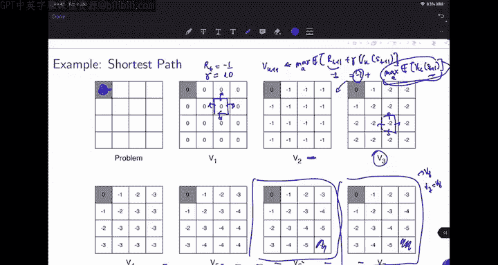

And in this new step， we would just reach convergence and that would give us both the optimal value function。

 but also acting greedily with respect to that would give us the optimal strategy。

That is it or synchronous dynamic programming algorithms and this is just table summarizing the things that we have covered so far。

 so first we started with the prediction problem and evaluation of a policy problem。

Where we took the Belmont Exp equation and turned it into an iterative update leading to the iterative policy evaluation algorithm and then in the last two sections we've looked at。

Tackling the control problem via policy iteration and then。Just just now evaluateeration。

 one relies on this principle of evaluating the policy and improving it and then evaluating this improved policy and improving on that one and so on and so forth。

TheThe last algorithm that we talked about， the value iteration。

 uses the Belmon optimalality equation to go directly for the optimal value function。

Some observations， the algorithm based on。State value functions trying to estimate V or V star have the complexity of number of actions to。

Squared number of states per iteration。This is because if you look at the updates。

 we always have to do this update for each state and always have to look at the action that we're going to take after this step and where we are going to end up after this state and the same。

We are looking at computing action values， this complexity is now magnified by another factor of the number of actions because we're always looking at state action。

 so current state and action take and what's going to happen in the next step as prime and N prime。

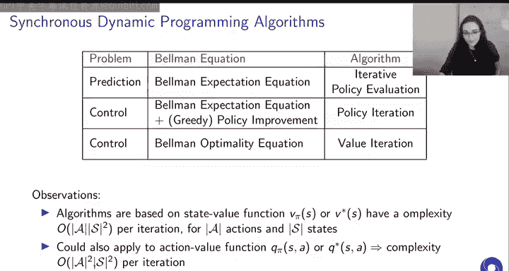

This can be quite expensive， so in the next section we're going to look at extensions to dynamic programming in particular asynchronous dynamic programming that will try to get around these computational issues or alleviate some of these computational issues so the dynamic programming methods that we described so far use synchronous updates which means that。

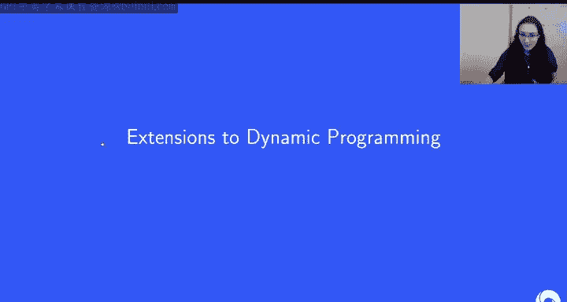

When we've gone through the examples， you've seen that we update all the table all the time。

 so for we're doing these updates。Every time we're doing them。

 we're doing them for all the states in Peril。As inron's dynamic programming suggests that we can back states individually in a particular order or in any order。

 and this can significantly reduce the computational overhead。

And also the nice thing about this is is guaranteed to converge as long as we do visit all the states and we continue to visit all the states with a nonze probability。

A couple of instantiation or simple ideas of asynchronous dynamic programming are in place dynamic programming。

Prioritize see and real time dynamic programming and we're going to quickly go through through them they're really simple so this is the the general idea。

 so in the synchronous version of value iteration we store two copies。

BK and Bk plus one in order to do this update now the in place value theeration stores only one copy and uses that for the updates so all the value that we have already updated。

Those would be used whenever we encounter the next update。

Rather than maintaining the copy of the values at theeration K。Prioritize sweeping。

The principle here is to select states according to this priority function and an instantiation。

 let's say of the priority function can be using the magnitude of the Belelman error and we haven't defined it yet。

 but this is the equation for the Belelman error。The the thing to notice here is that。For the。

Optimal value function。 So if V is we。Star， this thing is zero。

 so when we converge to the optimal value function for each state。

 the priority there it would be zero， so we would not be selecting these states for update anymore。

Okay， and this。ItBa says that the largest error will be prioritized in order to update the state。

This requires knowledge of the reverse dynamic in order to make the update。

But can be efficiently implemented by maintaining a priority。嗯。And real time dynamic programming。

 basically the idea here is to only update the things or the states that are relevant to the agent right now and what's relevant to the agent right now is debatable。

 but let's say as a rule of thumb， maybe things around the agent that the states that it will be using。

 like the current state or the value at future states that could be used for immediate prediction or immediate decision making。

嗯。Another way of reducing the complexity of these updates is to look at sample backups so so far in all standard dynamic programming we do pool with updates so for every state in or every state action pay for the Q function we look at all of the successor states and all of the action that span out of that。

That state。And once we look at all of these transitions， conditions on all the actions。

 we do a full backup for that state。Now。This is。Effective or can be applied to medium size problems。

 but for very large dynamic。ProgramProgramming your problems this might might still be quite expensive or even too expensive to run even one full backup if you have a very。

Large state space or very large action space。Even one full backup might be too expensive。

 so the idea here is to instead of doing this whole backup of。

Looking at all the actions in all the states that follow state S in order to update it。

 we're just going to look at。Sample versions of this。

 so we're going to have only samples of these trajectories。

 maybe a very small set of the transitions that actually come out of S。

 but we're going to use those to make our update。So we would use sample reward transition of this form S A R and S prime。

 just one instantiation of this trajectory instead of using。The full dynamics。

In the full model to update the whole state， the advantage with that is that is model three。

 we don't need to know the actual dynamics and the expected reward in this case because we're just using the information given by the sample and it breaks the curseive dimensionality through sampling。

We will see a lot more of this is especially sampling methods and implementation of versions of dynamic programming in a sampling context next week and a lot more methods of。

Making this more tractable and making this more sample efficient。

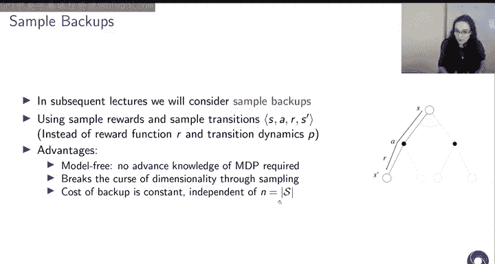

嘿。

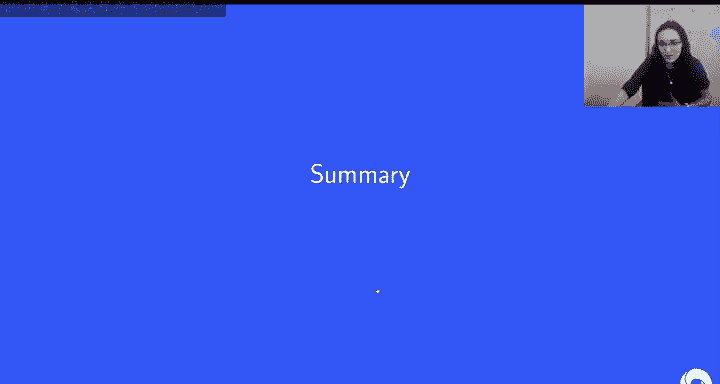

That is it for today， this is just a summary of what we've managed to cover today。

 so we started with Markup decision processes to formalize the RL interaction。

 we've looked at objectives in the MDPs， different notions of return like discounted anddied average year reward。

 we introduced value functions which are expected returns。We looked at optimality principles in。MDPs。

 what our optimal value function， how we can define optimal policies。

We also look at the rich structure that value function have described by the Belman equations。

 and we've seen how to use this equation in order to tackle the two class problems in ourL evaluation。

And control。 And we've seen in the in the last half now how to compute the。

Value associated with an arbitrary policy pie hate solving the prediction or evaluation problem。

By a system of linear equation and or iteratively by iterative policy evaluation and finally how to compute the optimal value function using dynamic programming。

We've seen two algorithms here， policy iteration and policy。Policy iteration and value iteration。

Next lecture we're going to go a bit more deeply into dynamic programming。

 we're not going to cover more algorithms， but we're going to go more deeply into how these work and why this work and when they converge。

Because so far， we've seen only examples of how this work in practice。

 but we haven't theoretically analyzed them。嗯。Questions if you have any questions about this lecture or any of the material presented。

 please use Moodle for questions in the next Q&A session。That is it for today。

 thank you for your attention。

