# DeepMindxUCL《强化学习｜Reinforcement Learning 2021》中英字幕 - P4：[04]Theoretical Fund. of Dynamic Programming Algorithms [4_13].zh_en - GPT中英字幕课程资源 - BV1JssaeVEMp

Hi everybody and welcome back to our fourth lecture on reinforcement learning today we're going to go deeper into the fundamentals of dynamic programming and。

Wevisit some of the algorithms we've introduced the last time we see their theoretical properties。

As a reminder， last lecture， we've introduced the framework of Markov decision processes。

 we also look at the two main problems that arise in ourL policy evaluation and control。

 and we've seen iterative methods under the umbrella term of dynamic programming。

That can tackle some of these problems in particular。

 we've looked at value iteration and policy iteration as a way of doing control。This lecture。

 we're going to be deepening our mathematical formalism and understanding of the NVP and dynamic programming。

 we're going to revisit the Belmont equation and introduce their operators and revisit policy iterative policy evaluation and value iteration and prove their conversionvergent properties based on these operators in the next lectures where you're going to see more approximate versions of this dynamic programming principle mainly in the absence of perfect knowledge of the environment。

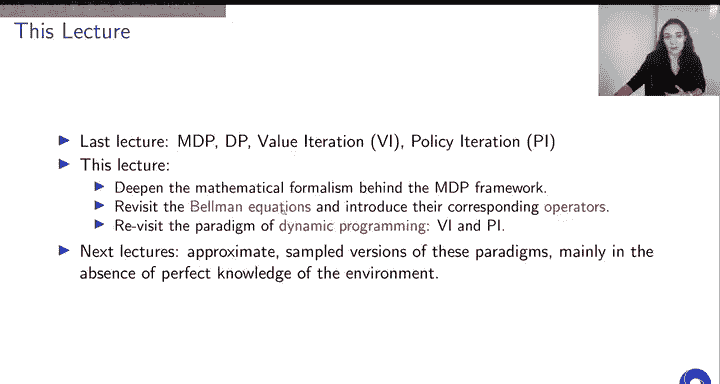

O。Let's get started before we get into the。The actual material。

 I want to cover a bit of preliminary functional analysis that just just the bare minimum to。

To make sure that everybody is on the same on the same page okay so first recap is the concept of norm vector spaces。

 so hopefully you know what the vector space is and a norm is just a mapping from a vector space to R in this case that has these properties it's always positive。

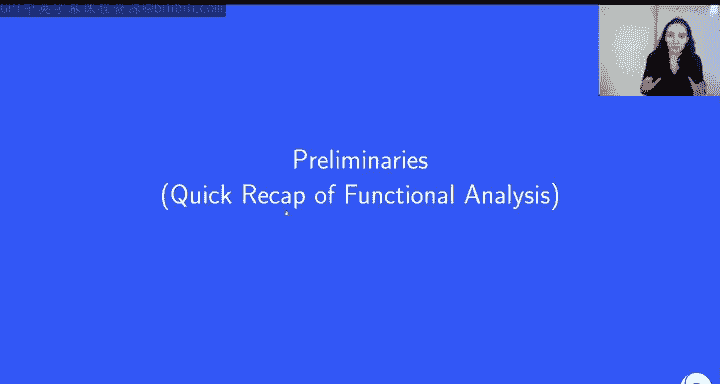

It has homogeneity and it obeys the triangle inequality okay you should have seen this before。

 but just as a reminder okay and for this lecture most of the vector spaces we're going to be seeing are just RD and the norms we're going to be seeing our max norm so the efinity norm。

And。L2 norms sometimes weighted by distribution。second concept here is a contraction mapping。

 and this is the definition of a contraction mapping， so we have a vector space equipped with norm。

Has introduced before and a mapping the。From this vector space into this vector space is a alpha contraction mapping。

 so with coefficient alpha if for any two points in this space in the vector space。

 if you apply this operator， this contraction mapping to this points。

 the distance between these two points shrinks。At least by alpha。

So this is the mathematical equation for that。We say that T is non expanding if alpha is between 0 and 1。

 and it's a full contraction if alpha is less than1。Just a small observation。

 every contraction mapping as defined is this equation is also by definition lipss。

 which also means it's continuous in particular for us that would mean that for any sequence XN。

In the space that converges with respect to this norm to a point x。

We know that if we apply the operator， if we apply this mapping to each element of the sequence。

 the resulting sequence will also converge in the same norm to TX。Okay。

 so you take a sequence that is convergent in that space。

 you apply a transformation T to it and you're getting。

Another convergengence sequence that converges to Theoback， which is the limit of that。

The mapping of the limit of that sequence。Another definition， a fixed point。

 so point or vector in this vector space x is a fixed point if any operator or any mapping。

 apply the mapping to if you apply this operator to this point。

 you get the point back so it doesn't change if you apply the operator to it， it just goes back。干。

And finally， this was kind of all building up to one theory in functional analysis。

 which is the Bannaris point theory。That says that if you have。X a complete norm space。

 so we've saw what a norm space is， a complete norm space basically means that every sequence in that。

Space。If the convergence sequence in that space its limit is still contained the space。

 so another way of saying it is any cosi sequence will converge within x。嗯。

So we have a complete norm vector space and we have a contraction mapping with。

Contraction coefficients， gamma。Then we know that this contraction mapping actually has one unique fixed point。

So there exists a fixed point where if you apply this operator to a vector。X， you get back X。

And this point is unique in the space。Also， we know that if we。

Define this sequence as such xn plus 1 equals Txn。This sequence converges to。X star。

 which is the fixed point of this this operator in a geometric fashion。

 and this is the expression that basically says that this says basically that the distance between。

An element Xn in the sequence and the fixed point。Shrinks。With this rate。Okay。

 and you can see that if you let N go to infinity in this。Equation。

 you get that the upper bound here actually goes to zero。

 so that means that this sequence is actually convert to this unique fixed point。Okay。

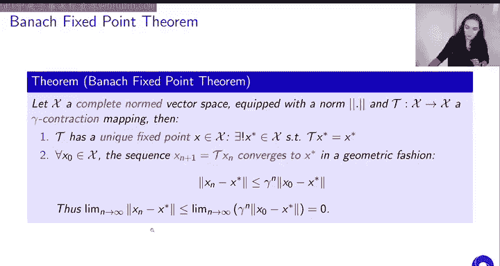

That's the only math that we're going to need。So now we're just going to recap a couple of concepts that we've introduced the last time just for those to be very fresh in your mind one is the definition of Markov decision process and in this particular lecture we're going to use the second definition of the Markov decision process where we have state actions transition dynamic that only codes for the next state R。

 which is the expected reward under that transition。

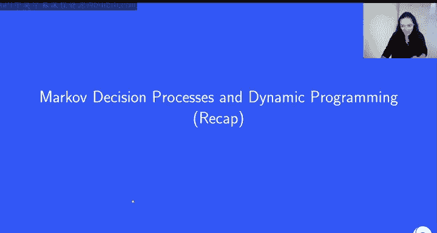

And a discount factor gamma。And we've seen or argued last time that most oural problems can be formalized by NDPs。

 and we've seen several examples of how to do that。Okay。

Now we've also introduced value functions and as a reminder。

 the state value function is the expected。Return。Starting from state S and following a particular policy pie。

In all in。In this lecture， we're only going to be using the discounted return。

The same for the action value。A function for policy apply， this is the expected return。

Knowing that we're going to start in state S taking the action a。

 which might not be according to to pi， but then following policy pi Okay and in terms of the the optimal value functions。

 we've defined the optimal value function as the。嗯。

The function that maximizes over all of these policies。Okay。And will' be introduced。

The Belmant equations， first， the Belmont Exp equations that says that for any policy pi。

 the value function associated with them， the ones that we've just reviewed obey these equations。

And these are just the form without the expectation， just spelled out exactly what the sums are。Okay。

And then for the optimal value functions， we have another set of equations called the Belmont optimalality equations。

And disobey the following equations。

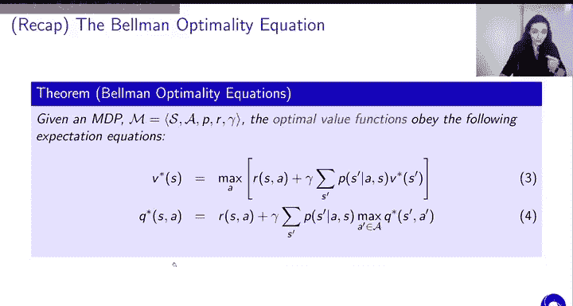

that's the end of the recap and let's dig into the new material and introducing the Belmont operators。

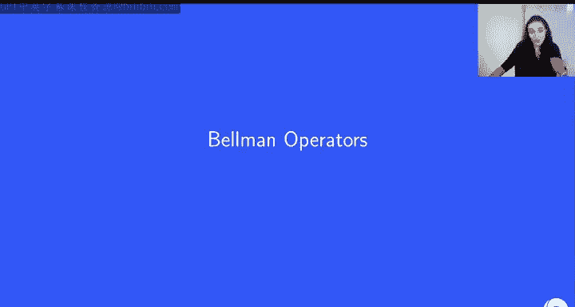

Let's start with the Belmont Opity operator。given an MDP。

We're going to define V or Vs the set of all bounded real value functions over s。

 So this is the space of functions that takes an argument in S and returns a number This is in a sense。

 the space of value functions or the space of value functions that we're targeting is a subspace of this this b Okay and we're going to。

Define the Belmon Opity operator。On this space。So V2 V。According to the following expression。

So this operator takes a function F。And this thing。

 the whole thing returns another function that we're going to be evaluating at state S。

 and this is the definition of that that evaluation and this should look very familiar because this is。

Almost the Belmont optimality equation in particular， if instead of F here， you would have。The star。

This would be the。Right hand side of the Belmont optimality equation。And we know that this one。

 if F equals V， would be equal to P star。Particular， that means that the star is。A。

Is a fixed point for this mapping we've just defined？Okay。Actually。

 it turns out that this operator that we've just introduced has a lot of nice properties。

 one of them we've just discussed that the optimal value function V is。

It's fixed point and it happens to be a unique fixed point。Also， we know that。D star。

The operator we just introduced is actually a gamma contraction mapping with the。

Contraction coefficient， the discount factor of the MDP。With respect to the L infinity norm。

And the other property is that this。This operator is monotonic in a sense of if。

There are two value functions or two functions in this space， U and B。Such that for every state。

US is smaller and equal than VFS， so this is not a partial ordering。

 it's V dominates you in all of the states， then the same relationship is maintained if you apply the operator to these two vectors or to these two functions。

Okay。Note that with as we've seen before with value function and with policies。

 this might be a partial ordering it might be for some states。

The value function is greater for some states it might be lower than another value function what we're saying here is if there are these two points。

For which the relationship， regardless of the state doesn't change， then the same is maintained for。

For the mapping through the operator。So it's okay if you don't see this straight away， this one。

 the first one should be。Quite evident because it really falls out of the definition of the operator and the Belelman equations we've introduced last time。

 so I would spend some time just convincing myself of that and actually we're going to prove property two and three。

O。Let's start with the first property there， the contraction mapping。

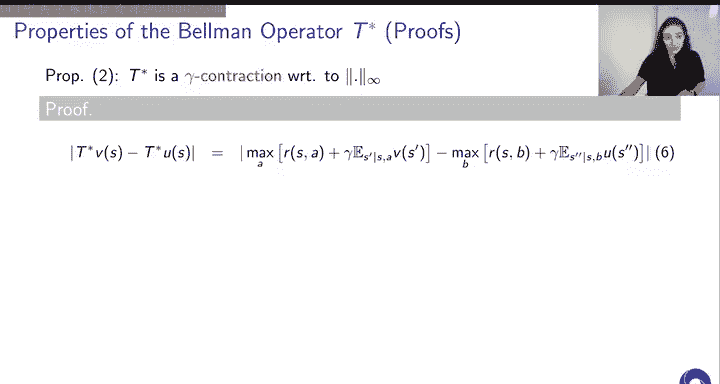

As a reminder， the contraction property basically says if you have two points in the space in E。

Plying the contraction mapping to these points。Distance between these points has to be less than we than gamma。

 the original distance between these two。And in this particular example， we're trying to。Prove that。

D star is a contraction mapping with respect to the L infinity norm。

 so this would be with respect to the L infinity norm。So to start out。

 we're just going to expand based on the definition of T star。What that means for a status？

And this is just the definitions that that we have okay， and once we have this。

 we're going to use the following inequality。For x minus max。X G。This is。Less than equal than。

Smization。Outside the， outside the absolute value， okay。And the way to see this is maybe not trivial。

We can prove it。Sketch of approve。You can start with X。This is less important then。😔，X minus。短し。

Hopefully that's not too controversial。If we take the max。We have mix of。Max。

The absolute value of the difference。Yes。打拍的。Which is less than we goal of。Max。Abs value。Bus。

She effects。Which leads us to。Max effects minus max。就。Less equal than max。s cheap。

And the same proof can be done for exchanging FNG。To get that。I max。难受。

And these two now imply this one。Okay。😊，So we're going to use this inequality。In this equation。

And if we do that， we get the following。The max is now out and we have the in part。And these two。嗯。

Simplify and then we're left with max a。Gamma。Expectation over B。买个1点吗？Aation。

 the same expectation actually over to you。Which。You may written as。This one minus U of S prime。Okay。

And this。Is less than equal than max。Over。S prime of E of x prime。10月。Thatscribe。Which is。U minus u。

Under connect now。Okay， so this is true for any S。Thus， it's true for the maximization over us。

Which leads us to。ビーマイナスヒー。2铁。私一个。Yeah吗。She is exactly what we wanted to approve。

And this is just a type out version of what we've just proven just for your reference in case you don't understand my handwriting。

Now we're going to move into proving the other property， the third property。

The monoity of the Belmon operator and a reminder， this means that if we have two points。

B and U such that。For all points in the state。For all states。

 V is dominated by you then by applying T star。The same ordering is maintained。Or else。So。

First thing to do is to pick an ordering between these two functions and notice that this implies the following inequality。

Actually， it's the。So we're just applying good expectation。

And because this is an ordering for all states， S and S prime。

This doesn't change the ordering and then we're adding a constant。And that's it。

Now let's look at the difference between TV and TU。

 so the mapping through the operator and this is just expanding the definition of T star。

And here we're going to use date。A very similar inequality as the one that we've had before with Max in particular that Max。

F max of。G is less than equal than max。The difference。Okay。

 the proof is very similar to the one we've seen before， so we're just going to apply this。

This leads to the following equation， now the max is on the outside and these inner values are on the inside。

And。And we've already proven just from this inequality that this is less than equal than  zero。

 which implies that。Is less than equal than zero， which means that here。Dyou啊。S。So that DV。

Of S is less than equal than T of U of S for all S。Justhoose exactly what we want。

So now we've proven all these nice properties of the Belmont operator that Win just introduced。

 why is this useful？Well， the way this becomes useful is that we can reinterpret the algorithm when we introduced last time。

 value iteration through the lens of this Belmont operator in particular。

what we can say is that we can reinterpret the updates that this value iteration algorithm was doing as just repeated operations。

 repeated applications of the Belman operator so if you remember。

The value iteration algorithm would start with an arbitrary value and initialization value。

 and at each iteration the value at K plus1 would be updated towards。Max of。スて？ま。对吗？

Expectation over the next state。And value at the next date is given by the previous iteration。

The value iteration ratio。So this now。Is just T star of。B记。Yes。Okay。So compactly。

This is just written here for every state。Now， the nice properties of this operator that we've just proven means that we can prove the convergence of this algorithm。

Particular as the number of iterations goes to infinity。

 we can show that this induced sequence of value function converges in L infinity to the fixed point of this operator。

 which happens to be。Be star。The fixed point of P star is。The star。This is the first property that。

That we've introduced and that falls out of the definition of the。The star。To spellll this out。

 this is actually a direct application of the Banna fixed point theoryorem。And we can。

We can elaborate this， so if we look at the distance between。VK and B star under the L infinity norm。

 this can be rewritten as such。Because Vk is just the application of P star to Vk minus1。

And this because it's the fixed point of the operator。呃。Is。The same as the of。The star。

This is the fixed point property， and then we can apply the contraction property here that。

Applying the operator to two points in the space。decreases the distance by at least gamma to the original distance。

 and then if we apply the property over and over again till we get to v0。

 we get that the distance between VK。And the fixed point。Its less than equal than。Gmma to the K。

The original distance from the initialization to the the fixed bike and this as。K tends to infinity。

But the limit of this is zero。Thus。we。Pants。In this elementfin norm2。一 star。

Which means that we've just proven that the value iterational algorithm is a sound algorithm that will always converge as long as gamma is less than one。

 so it's a full contraction， if not is non expansionpansion， so we can't approve that。嗯。

So for all gammas less than one， this will converge and will converge in an exponential fashion with the geometric rate gamma。

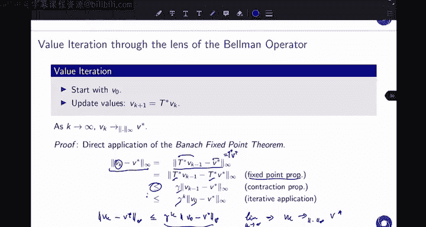

So this is proving that value iteration converges for V。

 a similar argument can be done for Q and moreover。

We can do a very similar procedure for the iterative policy evaluation algorithm that we've defined last time in particular we're going to take the Belman expectation equation now not the optimality equation as before and we're turned it into an operator。

 this operator will be with respect to a policy pi with respect to which the evaluation problem is and we're going to define it as such。

This is equation 13。The thing to note this again here is that if you plug in instead of F。V of phi。

This is the fixed point of this operator， by definition。

 this is VP is the fixed point of this operator。In particular， we're going to see that this operator。

 this new operator， again， this is an operator that is indexed by pi because it depends on the policy we're trying to evaluate it's not a max operator。

 it's not a star operator， this depends on pi。But it has the same properties as T star。In particular。

 it has only one unique fixed point。De pie。A V。It is a contraction mapping with the same gamma contraction coefficient with respect to the Linfinity norm and it is monotonic。

And we're going to go briefly to the proof of。2 and three as before so in particular。

 we're going to prove that V is contraction mapping with respect to the L infinity norm to do that we're just going to start again with the definition of these operators。

And because the expectation here is with respect to or the summation here is with respect to the same A。

 this can be， these terms can be grouped together。In particular。

 we can simplify R in this equation and we're left with just the expectation over the action taken at the S and the transition to S prime。

Okay， and。Now what we're going to do is just maximize over these equations in particular。

We're going to see that。The expectation here。With respect to A and S prime。

 this expectation is less than equal， so it's upper bounded by the max of the difference between U and B。

So， whatever the。what combination of states and actions here will be upper bounded by this max。

 so the whole expression here is upper bounded by the global max of theNU。

And this is an upper bound for all states S， so that gives us that if we maximize on this side too means that the L infinity norm of T V minus T U is upper bounded by gamma。

The Linfinity norm of v minus U， which is exactly the contraction property。

Note that actually property or inequality 14， equalityality 14 also gives us property3。

 which is the monotonity in particular， if there's a global ordering on VNU。

 let's say the is dominated by you， then this。嗯。This difference is always negative。

 which means this difference is always negative， so the sign is maintained。Okay。

 so now we've proven all three properties。And then we can go back to iterative policy evaluation。

 the algorithm that we've introduced last time to the alternativeative algorithm we introduced last time for policy evaluation as a reminder this would start with an arbitrary value of v0 and apply the Belman expectation equation as an update to it。

 and as with the optimality equation， this is just a compact form of a freewriting that equation。

 and because of the same argument as before with the optimality operator。

 this induces a sequence of value functions， and it is a convergence sequence because this operator is a contraction mapping and this sequence will converge。

To this norm under which this contraction operator is a contraction。嗯。

The sequence will converge to the next fixed point of this operator， which is a V by definition。Okay。

 so the other way of saying it， this is a direct application of the Panac fixed point theorem that weve introduced in the preliminary version。

Now， just a summary of what we've discussed and what we've discussed last time in terms of dynamic programming。

 this is just the rewriting of the algorithms introduced last time for the control problem。

Through the lens of the Belmont operator。 So we've seen value iteration as just。

D application of the Belman optimality operator and policy iteration。

 the other algorithms that that we've used the last we introduced last time for control would would have this。

Iterative procedure between policy evaluation and really improvement。

Now the policy evaluation can be done via the iter policy iteration that we've just seen。

 and this is just a repeating application of the policy that we're trying to evaluate at this point in time。

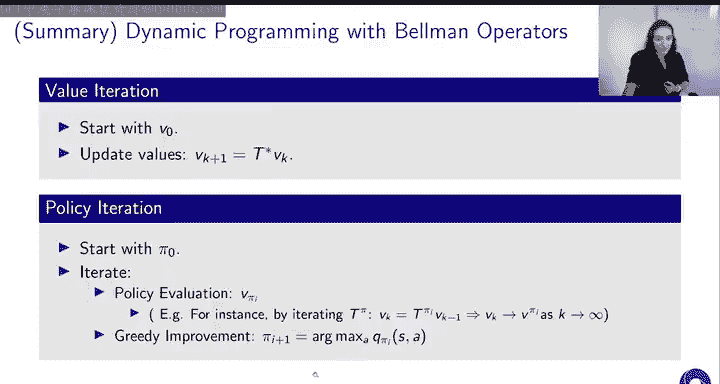

Okay，The last observation here is that we've done all these groupss and we've introduced these operators with respects to computations in the value function space。

 but we can do the same thing and do exactly the same reasoning for Q values。

 the only difference is that these the corresponding Belmon operators。

 both for expectation and for optimality。Will be on the space of Q values。

 so instead of the definition being point wise on S， it's going to be on SA。

But the same reasoning apply and the idea is the same that we are going to come up with these operators now on the Q value space。

 so our space of bounded value real value functions on SNA。嗯。That will have a fixed point。

 either the。Evaluation of a policy。Q evaluation of the policy pi or the optimal value function Q。

And the same properties apply these operators are。Gamma contractions and they are monotonic。So these。

 these are。Just spelling out the definition of these other operators on the Cu space。

We are now going to talk a bit about approximate dynamic programming。

 this is mainly an overview of what's to come in the next three to four lectures and for you to have a mindset or reference point to map those methods into the dynamic programming principles that you've learned so far。

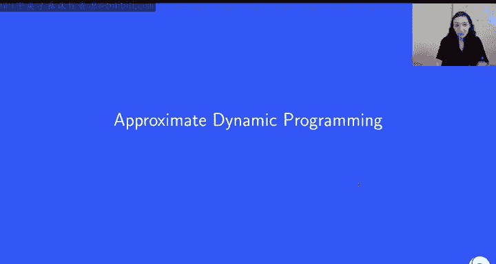

Okay so so far we have assumed the perfect knowledge of the MDP and a perfect or exact representation of the value functions realistically more often than not these conditions would be violated okay。

 we won't have access to the true underlying MDP we won't know the true transition dynamics nor the reward and we'll see in the next two lectures how to deal with that。

But moreover， we won't be able to represent the value function exactly。

 so so far we had the stables where for each state。

We would have a value associated with that or for each state in action。

 we would have a value associated with that if the state space or the action space is very large。

 we won't be able to represent that or it might not be useful to represent it like that because we won't get any generalization。

So more often than not， you would be using some kind of function approximation。Now。

 when we're violating these assumptions， we are introducing some errors in the first case where we don't know the underlying can repeat。

 that means that we won't have access to the true backup operators that we could just introduce either the expectation one nor the optimality one because we just don't have the full model of what the next transitions would be。

That's because we're going to make this step。Approximately by a sampling。

 we would be introducing a sampling or an estimation error here。Moreover。

 when we're using function approximation， we're going to be introducing an approximation error due to the fact that the true value functions might not be in the parametric function we decided to use。

Nevertheless， the objective still remains the same under the above conditions。

 we want to come up with a policy that is optimal or at least close to optimal。

So let's see what that means in practice for the algorithms that we've seen so far。

 so policy value iteration and policy iteration， so we're going to start with value theeration。

And this is just a reminder of the value iteration algorithm in the operator notation。

 and the only thing that remind ourselves that this is guaranteed to converge to the optimal value function。

Now the appxi part here is approximating that step whenever we're doing these updates from iteration K K and K plus1。

 instead of being able to back up the whole operator， the true operator here。

 we're going to have some kind of approximation denoted by a here， where now VK plus1。

 just approximate。Either from samples or and or from in a parametric form。The true value of the。

Optimity one step optimality operator。Applied to Vk。Now the question becomes。

Under this approximation or under which approximation does this sequence still converge to the optimal policy？

Well， it turns out that in general， without any assumptions about the nature of this approximation this thing might not converge at all。

 and the point of converging might not be the optimal value function。嗯。Again。

 I've said that this approximation can come from two sources， one is the sample。

And the other one is the the function approximation class that we are using。

 considering you're going to see a lot more of the sample of version。

Approxiation here in the next two lectures， I'm going to spend a bit of time giving you some intuition of what happens when we're trying to do this。

Procedure with a function approximation， we're still going to。

We're still going to assume that we have access to the true MDP。

 so that that is not the approximation that we're looking at， its just a functional approximation。

And if。In this setting where we're trying to。Approximate the value function with the function appromator paraized here by theta。

Means that the value at each iteration previously denoted by VK is now the theta K。

And using dynamic programming， we still can compute the one step。Application of the Belmont operator。

 we're assuming now that we still have access to the T MDP。So we can still do this backup。

But now in order to still be in the same parameterization family。

 instead of backing this up to Vk plus 1， we would need to find a point in the parameterization class that is closest to this so we've parameterized our vector by theta。

 so we need to find a set of parameters， theta K plus1 such that for the theta K plus1。

Approximates well， this T star Vk。For each state in the environment， and for instance。

This can be done with respect to a square loss over the whole state space。

 and this is just spelling out that equation。Now the bad news here is that。

even in this particular scenario where we're not introducing the other kind of approximation via the samples。

 just from pure moving to a function approximation setting， we still could diverge。

And this is just an example that was introduced by Siiccleus and Broy。

 where we have a linear appromator。And a very small MDP and in this example you can show that the value function that we're trying to estimate can actually diverge。

 so let me quickly go through this example with you。So this this MDP has only two states。

 this one and this one， and the function approximation that that we're using is just one parameter and we're going to parameterize the value function at the first state by theta and the value function at。

The second state bar a two theta。对。And this is。An MDP where all rewards are zero。

 this is a terminal state and there are no decisions。

 so this is a deterministic transition to the second state and then the second state with loop on itself with probability one minus。

Epsilon and with epsilon probability with transition to this terminal state。

And if we initialize the value function， this approximation of the value function away from the solution。

We can show that there are cases where this whole system。

Can diverge by approximate dynamic programming。

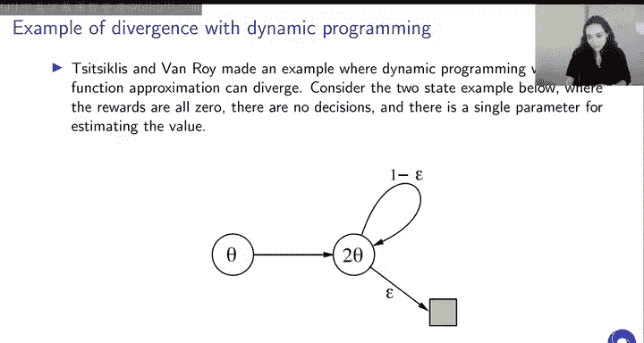

To see this， let's go quickly through the computation。Let's see what happens at iteration K plus1。本绳。

不 you。Okay， so usually in pure dynamic programming。We would have Bk plus one， take the value of the。

みけ。Now， in the approximate setting， Bk is。V。嗯。Deたけ。For some。呃，迪刀。And then。T， BK is。Now。

The reward at the state。State yes we don't have any actions in this example。

 so it's just the reward that that state plus gamma expectation of what's going to happen in the future。

手逼。嗯。S prime。This is zero， or all of the rewards in this MVP are0， so it just simplifies tune。

Equals to。Yamama expectation of。Basically， what's going to happen at the next？Okay。

 and because we are in an approximate setting。We're trying to find。Gitar， T plus one。

VK plus one is actually now theta Vta K plus one。Such that。Vk plus one。Approximateimate。第。い。

And the approximate version of this would be with respect to the square plus。Actually won that。嗯。

Theta a K plus one is the artrc max。Aman。我。Now we have a sum over the states。啊，比滴当。Mイus。

Expectation over。好的。谁。This one。き分だと。This is just the weekend。This is just coming from this equation。

And this is over the whole states in the environment。Okay， and let's spell this out。

Over so for the first state， the value。Vta has。value data。Minus。Now this expectation。

 because from the first state， we're going to transition deterministically to the second state。

 so there's no other possibility here。This is just going to be the value at the state。

At the second state。So this is me。停。At S2， which is。S。2。뒤たけ。Okay， that's。

For the first state and then for the second state， the value。For the second state， the theta S2 is。2。

嗯。Theta， this is the parameterization we've chosen， and then there's two things that can happen here。

Yamma and with probability epsilon， we transition to the terminal state。

And with one minus theta probability， we transition back to。S you。Just just。

Just value and this one again is2。呢딱企。Okay， so this is the a min。Of theta minus2。Okay。

Plus to theta minus。1 minus。Excellent。And note that this is a quadratic equation so we can find its minimizer by just taking the gradient。

It's called this F。So午。I with the respect。叮当。And we get the following。中たらし。Plus。秋。9。ピタマイ。

Gamma1 minus epsilon。Two feet。And。This has to be。以こ。Equal to zero for this to be a minimizer。

 so you get that theta minus。To呃。你点吧。ピたけ。Plus。Hope I don't mess this up。嗯。For pizza。Mus。For。呃，Gma。M。

 minus。Exllent。Eals 0。Which means that pihi theta equals。2 gamma。Detaけ。1 minus。Plus。就。マイナス？Okay。

Which means that。デタ equals。Dta equals2。Yeah吗。3-2。嗯。Epsilon。Over5。Okay。Cool， so this is。

Tta K plus one。Now， the interesting thing to notice here is that if this term。Is less than one。Then。

Theta plus one and the sequence converges to0， which is the actual solution of the MDP because all the values are0。

 so theta equals 0 would give us that。嗯。That solution， but if。This is。Greater than one。Then。

 this sequence。Actually diverges。And you can show that there are actual values of。

Epsilon such that this is a divergent sequence。For instance。Epsilon， I think equals one minus。

1 over eight is such a value for which the sequence is a divergent one。

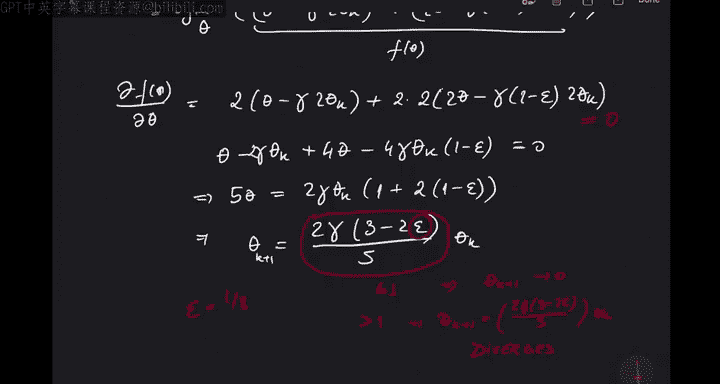

Now let's go back to the approximate value iteration formulations that we had before and what we've seen so far is that this approximation a。

Can lead to problems， even if only one of these sources of approximation。

 the one coming from the function approximation is in place， things could go wrong。

So is this hopeless， is this strategy of？Using value the or one of the principles in exact dynamic programming and trying to approximate to this update is this hopeless recipe。

Well， not quite。So it turns out that sample version of these algorithms。

 as you will see in next week。Can be shown to converge on the very mild solution。

 so this is without the constant approximation in the tabular case。

And even for the functional approximation setting， the theoretical danger of divergence is rarely betterized in practice。

Even though we don't have guarantees anymore in most of the function approximation cases。

 whether or not this would converge in to what value this would converge， we rarely see divergence。

But as the。The previous examples show this can happen。Okay。

 and the the last point I want to mention here is that there are there may be many functions that would use an optimal policy or a very good policy。

 so we don't need to nail down exactly the。V star or a very small ball around V star in order to be able to derive a good policy。

So。Just to exemplify this， this is the example from the last lecture of policy evaluation and you。

See that the intermediate values here that we computed。

Spart of policy evaluation already give us the optimal policy。 So all of these values。

 if we would act greedily with respect to these values。

 we give you the optimal policy and note that none of these values are actually the optimal policy。

 which is the one that we are guaranteed to get the optimal policy if you acting greedily with respect to to it。

 So there might be many values。That we can compute。

That that are part of the evaluation problem or part of the iterative procedure in value iteration。

 those intermediate values to the convergence that would still give rise to very good policies so we don't need to complete the process altogether in order to to get a good policy so or at least there's hope of。

Getting a good policy before we reach convergence。But。This is a bit hand wavy。

 so we're going to try to formalize how much we can expect to get out of the greedy policy。

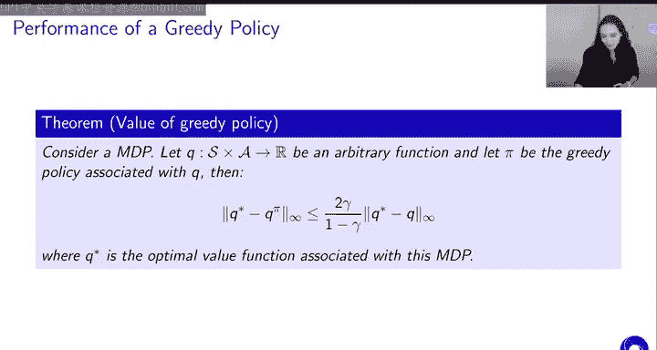

Let's consider the following scenario， you have a Q value。You。

This can be an estimate you've arrived at via an intermediate step of value iteration or one of the evaluation of the policies you had in policy iteration or any other value function。

 we have no constraints over that one。From this value function。We're going to drive a greedy policy。

 we have Q， and from that one we're going to drive pi， which is the greedy。

Policy with respect to these values。Okay， and we're interested in what we can say about the quality of this policy so in particular。

WhatQ。I is or how close is this to the optimal value function？So this is what the。

Theorem says basically it upper bounds。How far you are。

 how far this policy is from the optimal value function in terms of how good the approximation theq that you started with is so if theq。

 the approximation that you're using for the optimal value function is very close to the optimal value function。

 then this would be a small factor， so this with the upper bound by a small quantity。

 the quality of the greedy policy induced by this estimate。哎。That makes sense。Let's prove this。

The stum。就来吃啊。Let's start with。What we want to prove。This is here and I'm just going to rewrite。

cute star。自拍。And I'm going to first expand this into a couple more factors。We will see why。So。

 I'm gonna。Add them subscribetract。T pie cube。哎。And this is by triangle inequality。

 less than equal then。I'm just grouping the terms。Okay， this is just。As I said。

Triranangle inality and now I'm going to rewrite a couple of things here so this one。

I can rewrite it as T star Q star because。Q star is。嗯。

The fixed point of T star so these are equivalent and this can also be rewritten as T star Q and this is because just there as a reminder。

 pi is the greedy。With respect to Q。So T piq equals。You can， you can。

Expand this expression to convince yourself of that。

And then I'm going to do the same trick here with the fixed point。OfOf T pie。

 So Q pi is the fixed point of T pie operator， so I can I can。Replace it with T pi Qpi。

So this is actually inequality here of。思いまし。まして。Now I'm going to use the contraction property of both of these operators。

And the contraction property says that this difference is less an equal than gamma。Q star minus Q。

And the same here， this is less than equal than gamma Q minus。You by。Okay。

And the last thing I'm going to do here is expand this。By the。Triangle inequality into。Q。Q star。Blu。

2 star minus。给。This is just the trend of inequality again。

 so this gives me that the whole expression here。你什么是离婚？Then to。天吗？

So there's one from here and one from here。Plus。点吗？And now。This term。

I can pull it on the other side with this one。And I'm getting that one minus。Gma。Is less than equal。

Then two gamma。Qstar。Q。And if you rearrange these terms， you get just this inequality。Again。

So this is exactly what they。

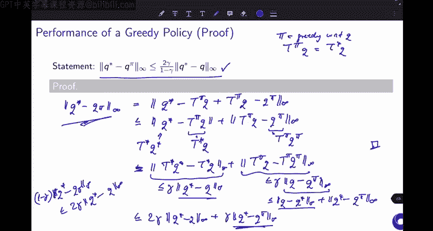

Let's go back to the statements of the theorem now that we've prove it。

And it's usually a good idea whenever we have a theorem like that to go through。

A couple of edge cases to see what the statement of the theem actually implies。

 and these are a couple of observations or edge cases that I divide just to guide your process through。

So for instance， for small values of gamma。You you get better or smaller upper bounds。

 so this this term here for small values of gamma is small。So another way of saying this is that。

You might get away with coarser approximations of Q。

 so if you're approximating the value function the。

The optimal value function Q star and Q is an approximate version of that you might get away with the course of approximation because the term is small and still be guaranteed to get the policy that is close to optimal as opposed to the。

A case where gamma is close to one。Then the term is quite large， so the potential loss in。

The potential loss in。In performance induced by taking the greedy with respect to this。

The system might be quite large。Another way of saying this or interpreting this is that for problems where gamma is small。

 we can get away with course estimates and still be very close to the optimal value function。

On the other hand， for。呃， large呃。Values of gamma， this term is quite high。

 which means that even if we have a very good approximation of the optimal value function in terms of pure values。

 this still can induce greedy policy that can be quite far away from the optimal value function and the optimal performance。

嗯。A couple of more of these questions， so we've seen that。

Smaller values of gamma makes the problem easier， what happens when gamma is equal to zero？

You can see that this term goes to zero， how do you explain that？And here's another one。

 what if cute？The value function we're drivingriving the greedD policy with respect to is already Q star What does this bound imp？

Moving on， the last point on our agenda today is to revisit the policy durationeration paradigm in the lens of approximation。

So just a reminder， the policy iteration algorithm still computes the optimal policy and the optimal value function。

But it does so by itating this process between policy evaluation and improvement in our case。

  greedD improvement， and this is guaranteed as the number of iterations go to infinity to converse to the optimal value function and the policy to converse to the。

Opttial， optimal。呃 policys。Now in the approximate setting think。

The policy evaluation step is the one that would incur the approximation。

And that means that this greedy improvementr step will be done now。Under an approximation。

 not under the actual value of our previous policy。The question that arises， of course。

 is as we iterate this process does。The sequence of value functions still converge to Q star and as you can imagine by now and as the。

Example。In the function approximation case has shown that this might not be the case。So in general。

 this is no， but depends on the nature of the approximation here。For instance。

 for sample based methods under mild conditions， this will still go through。

The other question that arises is。Even though the， the value functions might not converge to the optimal value function to the。

Policies actually converge to the optimal policy。And。

We've seen previously that we don't need to have the true optimal value function in order to derive an optimal policy from that。

 so there might be a hint that we can get very good policy even from approximate values。

But in general， we don't have any guarantees on you know the。

If we don't make any assumption about the approximate。

Approximation nature here and the quality of the policy the quality of the approximation。

 how good is actually。How far away is it from it's actually a target for evaluating the policy and the previous iteration？

If we don't have that discrete greedy improvement step basically is not guaranteed to improve。

 we've seen in the last lecture that if we do have the true evaluation of policy piI。

 we are guaranteed to get by thisretification step of policy。

 which is value is greater or equal than the one that we've seen before。

This for an approximation value is not necessarily the case。

 and I would refer to you to the the bound that we just proved the theorem on the value of the greedD policy to。

To give you an idea of why that might be the case， so whenever we have an approximation here the problem is that this is not a strict improvement step if somehow we can get a strict improvement。

Over the policies that we've seen in the past， this is this whole procedure is still sound in the sense that at every point in time we would still be improving our policy。

And。In finite cases， we would still converge to the optimal of pal。Okay。

 so even though this might not all be good news。It's just hopeless。In some cases， no。

 so it highly depends on the nature of the approximation that we're seeing here。

And more about which approximations are safe， we'll see in the next lecture。Okay。

 so this is just a summary of the approximatexima dynamic programming paradigm and this is kind of what I want you to have in mind moving into the next lectures。

嗯。Try to picture those algorithms or try to map those algorithms into exactly these these two paradigms。

 either value iteration or policy iteration。And think about the nature of the approximation that you're inbucing via samples or via function appmator whenever you encounter these algorithms。

that is all for today， if you have any questions， please post them on N Moodle and show up to the next Q&A session to discuss them。

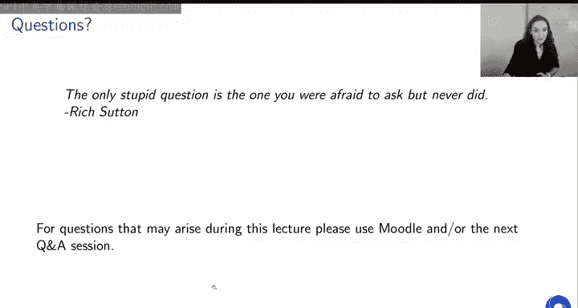

Thank you for your time and see you next time。