# DeepMindxUCL《强化学习｜Reinforcement Learning 2021》中英字幕 - P5：[05]Model-free Prediction [5_13].zh_en - GPT中英字幕课程资源 - BV1JssaeVEMp

Hi and welcome to this fifth lecture on this course on reinforcement learning。My name is Har Hzt。

 and today I will be talking to you about model free prediction。

There's a lot of background material on this slide and this is a fairly long lecture。

 you don't have to worry about reading all this at once。

The most important chapters for this lecture are chapters 5 and6 and we will cover some material from these other chapters as well。

 but some of that will be shared with the subsequent lectures so this is actually background material for a couple of lectures in a row。

We will just not exactly go through these exactly the same sequence as the book does。

 this is why we list fairly large chunk record material here。

Feel free to defer somewhat at reading until later。

 in fact it might help the understanding to go through the material not all at once。

 but to revisit it later。

Also don't forget to pause during the lecture I mean sometimes I will ask you a question。

 ask you to think about something and of course that's a good occasion to actually pause for a second and actually reflect。

 maybe write some stuff down but also like I said this is a fairly long lecture so feel free to make use of the fact that this is a recording and therefore even pause and maybe even take a break or maybe even consuming the lecture over more than one day if that works for you I do encourage you to not wait too long between looking at different parts of the lecture in order not to forget the beginning when you get to the end。

First I'm just going to recap where we are， we're talking about reinforced planning which we defined as being the signs of learning how to make decisions in which there is an agent interacting with an environment and the agent takes actions and the environment will be observed by the agent。

And then internally， in the agent， we will have a policy， a value function， and or a model。

Where in any case we should have a policy because the agent should pick its action somehow and the general problem involves taking into account time and consequences because these actions can change not just the immediate reward。

 but also the agency's state and also the environment state。

 which means that subsequent rewards might be affected by actions that you've taken that you've taken earlier。

To recap a little bit where we are in the course right now in these last two lectures we've seen planning by dynamic programming。

 Dina told you a lot about this， which is all about using computation to solve a known problem。

 so we have a mark of decision process or a model if you want to call it that and then dynamic programming is a mechanism to be able to infer。

Accurate predictions or optimal policies for such a problem。This and in the subsequent lectures。

 we're basically going to relax this assumption that you have access to this true model and instead we're going to use sampling。

 so we're going to use。Interaction with the world and we call that model free and at first we'll talk about model free prediction in this lecture。

 which is the process to estimate values when you do not have the Markov decision process。

 You don't know what it is， but you can interact with it。 This of course。

 is the case when your fors in the real world。 You could imagine that the world maybe has some sort of a really large mark decision process underneath it。

 but you don't have immediate access to that。 So instead all that you can do is interact。

After model pre prediction， we can talk about model free control。

 which is the process to optimize values rather than estimating them so please keep in mind that this lecture is about estimating so we're not going to talk about policies much。

And then we will also talk a little bit about function approximation and some deep reinforcement learning in this lecture and then a little bit more in subsequent lectures。

 and especially deep reinforcement learning will be deferred quite a bit。

 we'll briefly touch upon it。Finally， we will also talk in these upcoming lectures on about off policy learning。

 which is also。A prediction task， but this term refers to making predictions about a policy different from the one that you're following。

More on that to follow later。Also in later lectures。

 we will talk about model based learning and planning。

 policy gradients and aritic systems and of course more deep reinforcement learning。Finally。

 we will cover some advanced topics in current research， but only much later。

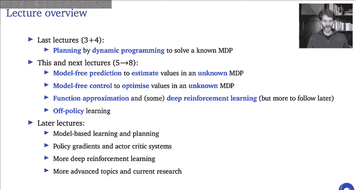

Okay， so let's get started。Our first topic will be Monte Carlo algorithms。

 and I'll explain in a moment what that means。

So the point here is to use sampling， we're going to interact with the world and this will allow us to learn without a model。

If for sample and complete episodes in reinforcement learning we call this Monte Carlo。

 so that's a specific use it just the term Monte Carlo's sampling is also used to refer to other things in machine learning in general in reinforcement learning when people say Monte Carlo。

 they typically mean sample complete episodes。An episode is a trajectory of experience which has some sort of a natural ending point beyond which you're not trying to predict any further。

 we'll see examples of that in a moment。This is a model free approach because you don't need any knowledge of the mark decision process。

 you only need interaction or samples。To make that concrete。

 let's start with a simple example that we've actually seen before in lecture2， the multiarn bandit。

So in the multiharm band， we have a bunch of actions and we're trying to， in this case。

 just estimate the action values In lecture2， we talked about optimizing these action values by picking a smart exploration policy for now we're just talking about model free predictions。

 So for now we're only interested in estimating these action values。

 So the true action value here is given on the right hand side。

 which is the expected reward given an action and then the estimates at sometimes step T is。

It's written somewhat verosly here， but it's basically simply the average of the rewards。

 given that you've taken that action on the subsequent time steps。

And we can also update this incrementally， we also briefly discuss this in lecture2。

 where you have some sort of a step size parameter alpha and you add to the action value estimate that you have right now。

 so QT of AT， you add the step size parameter times an error term and this error term is simply the reward if you've just observed。

 minuss our current estimate。All the other action values stay unchanged。

 and then if you pick this subsize parameters to be exactly one over the number of times you've selected that action。

 then this is exactly equivalent to the flat average that is depicted above。

You may have noticed that there's a slight change in notation。

 we've now moved to the notation that is more common when we talk about sequential decision processes。

 so markov decision processes and such。Where we typically increment a time step immediately after taking the action。

In the bandit literature it's more conventional to denote the reward as arriving at the same time step as taking the action。

 but in reinforcement learning in a more general case。

 we typically increment a time step immediately after the action。

 which basically means we interpret your reward to arrive at the same time as your next observation。

That's just a small notational note to avoid confusion between this letter and the earlier lecture on magnet。

Now we're going to extend slightly to make this more general and we're going to consider bandit with states。

For now， the episodes will still remain to be one step long as in the bandit case before。

And this means that actions do not affect the state transitions。

Which means that if you take an action， you will receive some reward and then you will see a new state。

 but this new state actually doesn't depend on your action so there are now potentially multiple different states so that's a difference from before。

 but they don't depend on your actions and that means that there's no longterm consequences to take into account。

And then the goal is to estimate the expected reward condition， not just on action。

 but also on the state。 So this is in some sense， a slight extension from the。

Normal B is case that we discussed before。And these are called contextual bands in the literature。

 where the state is often called a context， so state and context in that sense are interchangeable terms。

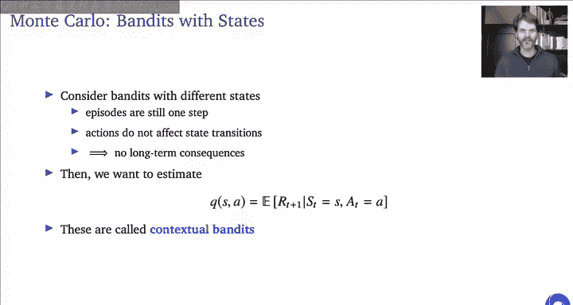

Now we're going to basically make an orthogonal step in this lecture and we're going to talk about function approximation a little bit。

 and then we're going to return back to these bandits with states and talk about how these things are related before we then go to the sequential case。

So we're talking about value function approximation to be more precise。

 so far we've mostly considered lookup tables。Where every state has its own entry。

Or every state action pair has its own entry， so think of this as a big table stored on your in the robots brain or in the agent's brain and for every state and action you might see you just have a separate entry that you might update。

But of course， this comes with some problems because there might be way too many states and their actions to actually store this effectively in memory。

But even if you could store in memory， that might not be the best idea because it might be way too slow to learn the value of each state if you're going to do that completely independently and individually。

In addition， individual states are actually not often fully observable if you talk about these environment states at least so so far I've just said state I didn't actually say specifically what I meant with state。

 I'll talk about that more in a moment， but in the simplest case you could consider that the environment state is fully observable so that the observation maybe is the environment state and then you could also use that same state as your agent state in that case the agent state。

 the observation and the environment state could all be the same， but even if that's the case。

 then it could be very large， but of course often it's also not the case。

Now you could still have a finite agent state and maybe store these separately。

 but then you still suffer from this other problem that it might be very slow if you have many different agent states。

So our solution for those problems is to use function approximation。

So we write VW or QW where W is now some sort of a parameter vector。

 and we're going to update these parameters instead of updating cells in a big table。

So the primary vector W will be updated using Monte Cardo or temper difference learning。

 which are two algorithms that we're going to talk about in this lecture。

And the idea would be that we can hopefully then generalize to unseen states because this function should be defined everywhere。

 and the idea is that if you pick a suitable function。

 then if you update a certain state value in some sense。

 you update your parameters that are associated to that state that then the values of similar states would also automatically be updated。

 for instance you would be in a state， you could identify that states by looking at certain characteristics。

 certain features。And then you could update the values of those features。

 and then maybe if you reach a different states， which is different in some ways。

 but it chairs a couple of those features， maybe we can make a meaningful generalization and learn something about its value before even visiting it。

Now here's a note first on states what do I mean with states so we're not going to necessarily assume the environment state is fully observable so I'm just going to recall that there's an agent state update function which takes the previous agent state ST minus1。

 the action 8 minus1 and your current observation Ot where the reward could be considered part of that observation Ot or we could also spell that out explicitly and we can write it as an inputs to this as agent update function。

And then our subsequent agent states ST is just a function of these previous inputs。

We talked about this in the first lecture you might recall。So henceforth。

 we will use S whenever werite S or SDT to denote the agent state。

You can think of this as either some just a bunch of numbers inside your age in the vector or in the simplest case。

 it could also simply be the observation。And indeed， it could be， as I mentioned before。

 that the environment states if the environment is fully observable。嗯。

I is observable in every step so that the a state could be equal to the environment state。

 but that's a special assumption that won't be the case all the time。

So we're just going to talk about agent states whenever we say state。

For now we're not going to talk about how to learn this agent state update function。

 as you can imagine this can be quite important to have a good agent state update function。

 sometimes you can hand construct one， sometimes maybe you're much better off if you can learn this。

 we will cover that in later lectures but for now we're just going to set that aside and we're just going to assume we have some sort of an agent update function。

If you think that's easier to understand the algorithms。

 feel free to consider state whenever you see this in one of the equations just to be the observation for simplicity。

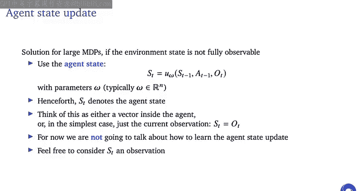

Okay now we're going to talk about linear function approximation there's a couple of reasons for this first this makes things a little bit more concrete if we can talk about a specific function class。

 in addition there's things later that we can say for the linear case that we can't actually completely say for the nonlinear case it's easier to analyze theoretically we won't do that yet for now but we will do that later and it's good to have this special case in mind。

So it's a useful special case in which we have a linear function。

 and basically what we're going to assume is we're going to have some fixed fixed feature vector。

So note we already assumed that we have some sort of a fixed agent state update function so we're going to set that aside where the stay come from and in fact now we're even going to set aside states themselves and we're going to just say well in addition to that we have some sort of a feature mapping that turns the state into a bunch of numbers so it's just a vector with a bunch of elements。

And we're going to consider that for now to be fixed later we might consider learning it。

 but for now it's used to fixed mapping。We're also introducing a little bit of shorthands where we simply write Xt whenever we mean the features of state at time step T。

And please keep that in mind。For instance， features could include the distance of a robot from different landmarks。

Or maybe some trends in the stock market， or maybe the piece and p configurations in chess。

 you can come up with these features by hand sometimes or later we will discuss ways to find to automatically。

Then the linear function approximation approach takes these features and simply defines our value function to be the inner product。

Or do product between our parameter vector W and the features at a time step X。

Of the state S that we see。Probably unnecessary， but the slide is also reminding you what the inner product looks like。

 it's just a sum over the components and it's multiplying each of the features with the associated weight。

Now we can talk about how to update those weights and for that we have to pick some sort of an objective。

In this lecture， we're talking about predictions， our objective will be to minimize this loss。

Which defines a square distance between our current estimates in this case。

 according to this linear function and a true value function V pi， obviously we don't have V pi。

 but so we're going to replace this with things that we can use， but for now。

 keep this objective in mind。If we could then compute stochastic gradient for this objective。

 this would convert to a global optimum of this loss function because this loss function is。

 as they say， convex。And there's only one optimal solution which will so this uniquely defines the optimal parameter vector w that does not mean that we can reduce this loss all the way to zero。

 it could be that the features are not good enough to be able to accurately predict the value for every state。

If we do stochastic gradient descent， the update rule is very simple。

We first note that the gradient of our value function with respect to our parameters W is simply the features we see here on the left hand side。

So at time step T， if we see state S， the gradient of our value function on that state will simply be xt。

And then our stoastic gradient updates， if we would have the true high function v pi would simply be to add this term。

 which is the step size parameter alpha times the error term。

 the prediction error times the feature vector。And we can use this to update this parameter vector W on every step。

 but of course we have to replace V pi with something that we can have because we don't have VP I'll get to that in a moment。

First， I wanted to say that the table lookup test that we've considered。For instance。

 for the bandit lecture earlier。Is a special case？We can enumerate all of the states， of course。

 in order to store these in a big table， you need to finite amount of states。

 otherwise you can't start them separately。And then we could consider the feature vectors to simply be a one hot feature that has zeros on almost all of the components。

 except on the component that corresponds exactly to the state that we see。

So that means we have exactly as many states as we have sorry exactly as many feature components as we have states。

And then we notes that this means that the value function estimates。

Under linear function approximation， we then simply pick out the weight that corresponds to that state。

 so that means that the weight for that state will essentially be your value estimate for that state。

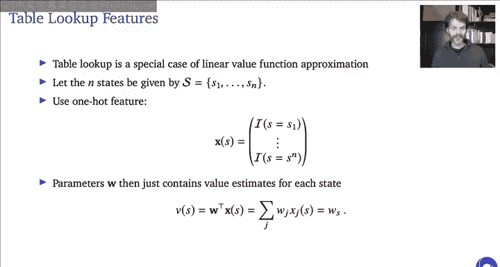

Okay， now we're going to go back to the reinforcement training case。

 so that was kind of like more generically about function approximation。

 and we're going to go back to these Monte Cardo algorithms basically continuing from before。

So note that we were dealing with bandits with states。

 and now we're basically going to make Q a parametric function。

 for instance a neural network or a linear function。

 and we can going to use this square root loss which we now also multiply by a half that's just for convenience。

And then we could consider the gradient of this。So similar to before。

 we're going to update our parameters W。So our new parameters Wt plus 1 will be our previous parameters WT minus a small step size times the gradient of this loss。

 We can then write out the definition of the gradient of that loss， which we do。

Here on the second line and then we note that this expectation doesn't actually depend on our parameters so we can just push the gradient inside。

 we get this update which is our step size， times an error term， reward minuss our current estimates。

 times the gradient of this action value， and then we can sample this to get a stochastic gradient update as we saw before。

And the tabular case will just be a special case， which is indexes into the corresponding cell for the state action pair。

So we basically just use the exact same things that we've seen before for the bandit with state setting。

 and we can use a stochastic gradient updates to do the prediction in these cases。

This also works for very large state spaces， this is just regression， you could do linear regression。

 you could do nonlinear regression， which we've probably covered in previous courses。

So we won't go into a lot of detail on that， but it's a valid update and it will converge to the right。

Estimates where these estimates are， I'm reminding you limited in the sense that you can't actually expect all of your values to be perfect because it might be that your function class is just not rich enough to actually get all of the values completely accurate in every state。

 but this process will converge under suitable assumptions to the best parameter factor that you can find。

So again， for linear functions， we basically now are going to extend the action value approach also to linear functions where we're going to assume that we have features for each state action pair。

And then we can just multiply rates parameter parameter w with these features。

 which means that the gradient of our action value function will simply be the features for that say action pair。

Which means that this stochastic gradient descent updates for our weights will then look like this。

 where we've simply replaced the gradient with those features。So for the linear update。

 this update corresponds to a step size times your prediction error times a feature vector and for the nonlinear update。

 you have very similarly your step size times your prediction error times the gradient。

And a lot of our next algorithms would look exactly the same。

 they will just change certain aspects of this， for instance here we're still considering the case we're just considering learning expected reward so there's no sequences yet。

And that's where we're going to go next， now we're going to consider sequential decision problems。

So we're still doing prediction， our goal is just to predict the value of a policy in subsequent lectures where I will be talking about control。

 optimizing the policy， but for now we're sticking to prediction。

 and now we're just going to sample trajectories under our policy and of course not shown here on the slide but of course the probabilities of these trajectories also depend on the underlying dynamics under the underlying mark of decision process。

Then maybe somewhat obviously we can extend the banded approach to full returns by simply just samplinging a full episode and then constructing a return。

 I'm reminding you that a return is simply the accumulation of rewards。

 so we have GT the return from time step T into the future as defined as the immediate reward。

 Rt plus1 and then the discounted next reward Rt plus 2 and so on and so on until in this case the end of the episode which arrives at sometimes step big T。

 which is in the future。A return will only stretch as far as the episode。

 and then after the episode is done， we imagine we will be reinitialized in the states and we can go through this whole process again。

And then the expected a return， which is our goal， is defined as simply the expectation of these returns。

So similar to the bandit with state setting， we can sample this and we can use this instead of the expected return as a target in our updates。

This algorithm that does that is called Monte Cardo policy E。

And it's covered in chapterer 5 from Cimbarto。

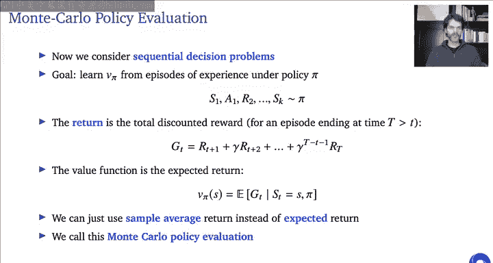

Now I'm going to walk you through an example to give you a little bit of more of intuition of how that algorithm works in practice。

This example is in the game of Blackcheck and a Blackcheck is a card game in which the goal is to get more points than an opponent called a dealer。

We're going to go first and we're going to try to accumulate as many points as we can。

But look more than 21。 So if you get more than 21 points， you go bust， as they say。And so therefore。

 basically your goal is to get us close to 21 without going beyond it。

To do so you're going to draw cars and each of these cards is going to be worth a certain amount of points。

 The number of cards are simply worth how however like large the number is。

 so a card with three or four is worth three or four points。All of the picture cards。

 the Jack queen and King are worth 10 points and the ACce is a special card。

 it's worth either 11 points or you can pick it to be worth one point。

 this is useful for when you draw a card and you go above 21 if you then had an ACce you can say a no my ace is now no longer worth 11 points now I'm going to make it worth one point instead and now you're below 21 again。

We're going to formalize this problem in the following way where we're going to enumerate states or so we're going to go for a tabular approach。

And this state will consist of our current sum and this current sum is the sum of the cards you have so far。

 and this will be between 12 and 21 for reasons that I'll explain in a moment。

 I've already said if you go beyond 21， you have already gone bust so then the episode ends so that state is unimportant。

But we're going to start with any number between 12 and 21。

And in addition to that we can also see the dealer's card so the dealer's card we're only seeing one of them。

 the dealer is going to play after you so they are going to draw more cards after you're done。

 but you can already see one of these cards and this is informative to tell you whether you maybe should continue or not。

And then。In addition to that， we also have an additional state variable which tells us whether we have a usable ACce。

 which basically just means do we have an ACce？And can we make that Ace worth 11 without going above 21？

So say you have 16 points， let's say you have an eighth and a five。

And let's say you then draw a 10 this would bring you to 26 points。

 which as I explained would make you robust bus， but then you can say I no my ace is not only worth one point and I'm back at 16 points and that can go again but the state will have changed because now you no longer have a user a。

In terms of the action space， there's two different actions you can do。

 you can either stick at which point it's not a dealer's turn and they will resolve。

 this will then terminate your episode， or you can draw which means you just take another car if you draw you can draw again in the next step or you could stick in the next step。

When you stick， the episode always terminates and you get a plus one if then the dealer doesn't get a higher sum than you or if the dealer goes bus。

 which is also possible so if the dealer goes above 21。

 they lose if they don't go above 21 but they have fewer points than you。

 they also lose and you get plus one。If you happen to arrive at exactly the same number。

 you get zero。But if the dealer manages to get more points than you without going above 21。

 then you get minus1。If instead you draw， if you go above 21 and you didn't have a usable a。

 you cannot avoid this from happening， then you get minus1 and the episode terminates immediately。

 the dealer has now won。Otherwise you get zero and then the game continues so you could draw again or you could stick。

As I mentioned you start with at least 12 points， this is simply because if you have fewer than 12 points。

 you should always draw more cards because you can never go bust and therefore if you say have 11 points。

 there is no card that could bring you above 21 because even if you draw an ace you could always choose it to be worth one so you can always get more points so you can basically think of this as a process a stochastic process that brings you to the initial state of your episode。

Note that the state description here is slightly partially observable because we're just giving you a number。

 so you don't actually know what that consists of。And even knowing whether you have a usual ace or not doesn't actually give you all the information that you could have because for instance you could have two aces and then that would be hidden formula So there's some slide partial of deability here。

 but that turns out not to be a big factor。Then what we do is we run Monte Carlo learning。

 so we're going to generate a whole bunch of episodes and we're going to sample the returns for those episodes for some fixed policy。

And then we're going to generate these plots， and I'm going to explain these in a second。

Which show your value estimates for that policy。And then of course， in later lectures。

 we can talk about， oh， how should we then maybe improve our policy to do better？

But this is a reasonable policy in which I believe you draw if you have fewer than 17 points and otherwise you stick。

 or it's something similar。嗯。And whats shown is four plots and I'll explain what these are first I want to draw your attention to the bottom right where we see what the axes are on this plot。

So one axis is which card the dealer is showing， which is either an ace or a two or a3 and so on or a 10。

 where we merge all of the picture cards just into a 10 as well because they're all worth 10。

And on the other axis， we see the current sum that we have， it's out of 12， 13 and soon， or 21。

The Z X， the height is basically the estimated value。 we see it's always between 1 and 1。

 This is because the maximum reward you can get during an episode is plus one at the end or the lowest reward is -1 at the end。

 all of the intermediate rewards if there are any are always 0 because if you draw but you don't then't go bus。

 you just get zero So the total return for each episode is between minus1 and1 or it's either -1 or0 or one。

And now I want to draw your attention to these plots and I want to go I'm going to ask you a couple of questions that you can think about。

 so feel free to pause a video if you want to think about these things and in particular I want to draw your attention now to the top left plot。

The left column here corresponds to having seen 10，000 episodes。

The riot column corresponds to having seen half a million episodes。

Now the top row corresponds to having a usable A and the bottom row corresponds to not having a usable A instate。

So the first question I want to ask you is why does this top left plot look so much more bumpy than the plot to its right？

And then the second question is， why does it look more bumpy than the plot below it？

So feel free to think about that for a second and then I'm going to give you my explanation。

So maybe the first one was maybe somewhat obvious， so after 10，000 episodes。

 we don't have a lot of data for each of these states yet。

 but after half a million episodes we have accumulated by now quite a bit of data for each of these states。

 so our value estimates have improved。So maybe the difference between the left and the right was somewhat obvious。

 maybe the difference between the top and the bottom is a little bit less obvious。

 but the reason for that is I'm going to argue that the states at top in the top row are actually less common than the states in the bottom row in a normal deck of cards there's 52 cards out of which only four are aces so states in which you have an ace are actually comparatively rare so even though on the left we've seen 10。

000 episodes in total that doesn't mean that every state has seen the same amount of episodes and in fact the states in which you have an ace may have been visited much less often in some cases。

Now finally， I just want to draw your attention to the shape of the value function where we see maybe。

Some would expectly that if your own sum is high， then the value function becomes higher。And in fact。

 if your sum is 21， then it's quite close to plus1， except if the dealer is showing an A。

 because if the dealer is showing an A， it's actually not that unlikely that the dealer will also get to 21 at which point your return will be  zero rather than plus1。

Okay so this is just an example of Monte Carlo learning and how you could use that to find the value of a policy and maybe somewhat obviously we can then later use this information to then improve our policy。

 but we won't go into that yet。So what we've seen here is that Monte Carlo algorithms can in indeed be used to learn value predictions。

Unfortunately when episodes are very long， learning could be quite slow。

 so the example for Blackjack was an example in which episodes are actually very very short。

 they only take like maybe one or two or three actions。

 but they won't take hundreds and hundreds of actions or maybe even more than that。

But if they do and you have to wait all the way until the end of an episode every time before you can start updating。

 that might be tedious。So we have to wait until an episode ends before we can learn why do we have to do that well because the return is not well defined before we do right so we're using the full return of an episode to update towards and that means we have to wait until the episode ends before we even have the thing that we want to use in our update。

In addition， these returns can have very high variances in some cases。

 especially if episodes are long。So are there alternatives。

 are other things we could use other algorithms that maybe don't have to use downsides。

 and of course I wouldn't be asking this question if there wasn't an affirmative answer？

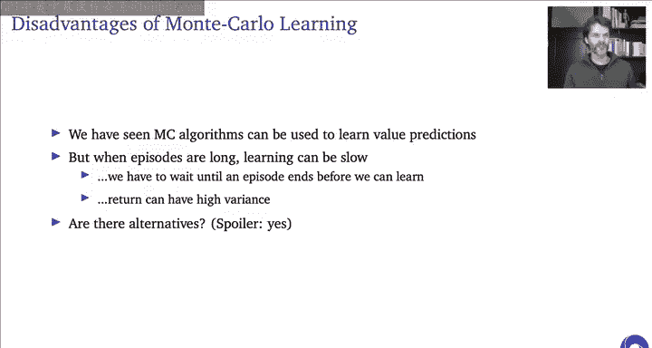

So this brings us to one of the most important concepts in reinforcement learning called temporal defense learning。

So I'm just going to start by reminding you of the Bellllman equation that we've talked about or Dena actually talked about at length in the previous lectures。

 the Bellllman equation relates the value of the state with the value of the next state or the expected value of the next state。

 and this is actually the definition of the value of a policy。

So the value of a policy is defined as the expected return。

 but turns out to be exactly equivalentence to the expected immediate reward Rt plus 1 plus the discounted true value of that policy in the next state。

 ST plus1。We've seen that you can approximate these values by itating basically turning the definition of the value into an update。

 so the difference here is now that the V pi within the expectation has been replaced with our current estimates VK because we're doing this in iterations maybe across all states at the same time so we denote this iteration with some number k。

And then we update our value function by replacing maybe all of them at the same time。

 you could do this for all states at the same time with a new estimate VK plus 1。

 which is defined as immediate reward Rt plus1 plus the discount at the current estimate of the next state value of VK。

And we've seen that these algorithms actually do learn and they do find the true value of a policy。

Now we can see there there's on the right hand side an expectation。

 but we could sample that so maybe we can just plug that in and we can just say oh maybe we just see a sample Rt plus1 plus the discounted value of the next state st plus1 and then use that Well maybe you don't want to update all the way there so instead we're going to argue that's going to be too noisy so instead just take a small step。

So this this now looks very similar to the Monte Carlo learning algorithm。

 but instead of updating towards a return， full return。

 we're going to update towards this other target。Which is the reward plus the discounted estimate for the next state。

So the change here between Monte Carlo learning and this algorithm is that we've replaced a full return with something that uses our current value estimates instead。

Note that I've written down the tabular update here。

 but you can extend this in a similar way as we did for Monte Carlo learning to function approximation。

 or actually did for the banners with states， but the banner with states could be replaced with Monte Carlo learning by simply swapping out the reward for the return and then similar here we could swap out that return for this new target。

So just to recap in the prediction setting， we're learning V pie online from experience under a policy Pi and then the Monte Carlo update looks like this。

 the tabular Monte Carlo update， we have some state some value estimates， maybe VN or VT。

 you could also call this。I'm calling it N here。I could have also used K as before because these updates cannot actually happen at time step T because the return is not yet known completely at time step T right。

 we only know the return at the end of the episode， which might be some data time step。

 So instead of saying which time step that actually is， I'm just saying oh， there's some。

Iterative procedure here and we're updating our value function。By using your return。

Temple difference learning， which is that new algorithm which we just talked about。

 instead uses this new target， which just enrolls the experience one step。

And then uses our estimates to replace the rest of the return。

And this is called temporal difference learning because the error term here is called a temporal difference error。

 which looks at one step into the future and looks at the difference in value from what we currently think and comparing that to one step into the future。

This temporal difference error， which is simply defined as Rt plus1 plus the discounted value of the state ST plus 1 minus our current estimate of the value at ST is called a temporal difference error and we typically denote this with a delta。

So keep that in mind， Delta t is the temporal difference error。And it's defined as this。

So now we can talk about these algorithms and maybe get a bit more intuition by thinking about them how they work with the problem at hand。

 so dynamic programming works like like this， there's some three possibilities here in some states。

And you consider all of the possible possibilities that might happen next states here already noted by these white nodes。

 actions are black smaller nodes， and then what we see here is effectively that sorry that dynamic programming looks at all possible actions in this case too。

 and then also at all possible transitions for each action So in this case each action can then randomly end up in two different states so there's four states in total that you can end up in after one step。

And dynamicy programming considers all of these， which of course requires you to have a model that allows you to consider all of these possibilities。

Conversely Monte Carlo Learn takes a trajectory that samples an episode all the way until the end。

This terminal state denoted here with a green box with a T in there。

And then it uses that trajectoryy to construct the return and updates the value of that state at the beginning towards that return。

 and of course you could also update all the other states along the way towards the return from that state。

And then this new algorithm， temporalor difference learning， instead only uses one sample。

 so we see some commonalities here with dynamic programming in the sense that we're only doing one step。

But it does sample， so it doesn't need a mo， so there's some commonality with dynamic programming in the sense we're only doing one step deep and there's some commonality with Monte Carlo learning in the sense that we're sampling。

So we call this usage of our estimates on the next time step of bootstrapping this is different from the use of the term bootstrapping as the statistical bootstrap。

 which refers to taking a data set and then resampling from the dataset as if it's the underlying distribution。

 it has nothing to do with that in reinforcement during bootstrapping typically refers to this process of using a value estimate。

To update your value estimate。This is。Indicative of pulling yourself up on your own bootstraps。

 essentially。And it's good to keep that in mind that that's just the term for doing that。

 and that means that under noticeotic terminology， Monte Carlo learning does not bootstrap。

 it does not use value estimates to bootstrap upon to construct its return its targets。

But dynamic programming does， and temporal difference learning also does。

 these both use our current value estimates as part of the target for their update。

And then additionally， we can think about sampling， where we similarly see that Monte Carlo samples。

 but dynamic programming does not sample， it instead uses the model。

 and temporal difference learning does sample。So we see we have these three algorithms with different properties。

And of course， we can apply the same idea to action values as well， where we have some。

Action value function Q and we simply do exactly the same thing we did before where we take one step and now we also take the subsequent action immediately8 plus1 and we can use that distance then construct a temporal difference error exactly in the same way as before all that I did here is essentially replace every occurrence of a state with a state action pair index on the same time step。

This algorithm is called SARSA because it uses a state's action reward， state and action。

This name was coined by Richard Saan。Now in terms of property。

 temporary difference learning is model free， it doesn't require knowledge of the mark optimization process。

 and it can therefore learn directly from experience。And interestingly。

 it can also learn from incomplete episodes by using this bootstrapping。

 This means that if the episode is really long， you don't have to wait until all the way in the end of the episode before you can start learning。

And this could be quite beneficial。Because then you can also learn during the episode now the extremist case of this that you could consider is maybe what if your lifetime is one big episode right what if there is no termination and some models are in need effectively formalized as such and then it becomes essential to be able to learn during the episode you can't just wait until the end of the episode because there's only one episode。

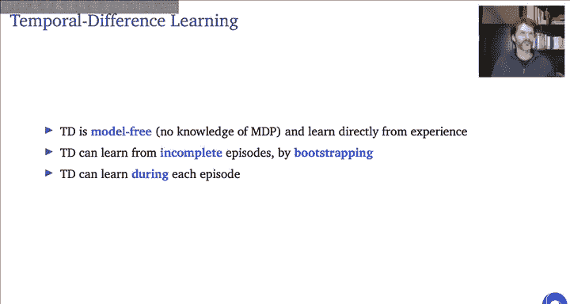

Now to illustrate the differences between these algorithms， Monte Carlo anddience learning。

 I'm going to step through an example， which is called the driving home example。

 and this one's also due to Sus embarto。

So how does that look？We're going to enumerate a couple of states， a small number of states。

 and the ideas that we started at the office and we want to go home。

Now at first we are going to talk about the columns here。

 so the first column shows the state we're in， the second column shows the elapsed minutes so far。

The difference in each step on these last minutes， you can consider your reward。

 So between leaving the office and reaching the car。

 we could say five minutes have passed and we could call that our reward。 We could basically say， oh。

The reward on this transition was5。And we're just predicting here。

 so we don't actually care about the sign of the reward， whether it's minus5。

 if you would like to maximize the speed， you might want to minimize the minutes or something like that。

 we don't have to worry about that because we're just doing predictions。

 So we're just saying there's a reward of five along the way。Then the column after that。

 the third column， the predicted time to go is our current value estimate at the state that we're currently in。

 so when we're in just leaving the office， we predict it's 30 minutes in total to get home。

 this is the accumulation of the rewards along the way。Then just as a helpful mental helper。

 there's a final column here to predict a total time。

 and this is simply a sum of the previous two columns。

This adds together how many minutes have already passed with the predicted time still to go。

 because this will give us a feeling for how that total time is changing。

So remember we're leaving the office， as I mentioned。

 so by definition zero minutes have passed from leaving the office and we're predicting it's still 30 minutes。

But then when we reach the car， we notice it's raining and maybe that's bad because maybe that means that it tends to be busier on the highway and therefore even though five minutes have already passed。

 maybe we were also a little bit slow to get to the car， we still predicted still 35 minutes。

 so more than before。Which means our total predictor time has actually gone up to 40 minutes。

So the way to interpret this is that the reward along the way was 5。

 and then the new prediction is 35。Then in our next state we exit the highway。

 the total amount of time elapsed as far as 20 minutes。

 so you can think of this as the reward along the way was 15 minutes because it was five minutes when we reached the car and now it's 20 minutes。

And from now， we predict it's another 15 minutes to go。

Which means that it predicts the total time has actually gone down a little bit。

 maybe it was less busy on the highway than we thought and things were a little bit more smoothly than we thought。

But then we exit the highway we only find ourselves behind a truck10 minutes later。

 So another 10 minutes have passed， the reward could be considered to be 10。 and from this point。

We consider it another 10 minutes to go， so the total predicted time has gone up again to 40。

Then at last we arrive at the home street， 40 minutes have already passed。

 so another 10 minutes have passed and we predict its still three more minutes to go so our total period time has gone up again a little bit to 43。

 but our current prediction turns out to be completely accurate and we arrive home after 43 minutes。

 so another three minutes。Now what do these different algorithms do but the Monte Carlo algorithm would basically just look at a total outcome and therefore it would then update all of these states that you've seen so far to take into account this new total outcome。

 it basically just looks at the whole sample and it says。

 well when you were leaving the office you thought it was 30 but it was actually 43 when you reached the car 5 minutes had passed。

 you thought it was still 35 minutes more， which means our total prediction was 40。

 this should have been 43 so that means that instead of predicting 35 you should have predicted 38 perhaps when when reaching your car。

And similarly， when exiting the highway or when reaching the secondary road when we got stuck behind a truck。

 we have to update these predictions upwards， that's what Monte Carta does。

If we then look at the right hand plots for temporal difference learning。

 it looks a little bit differently。When leaving the office。

 we then reached a car and it was raining and we predicted it was still more time to go there。

5 minutes had already passed and we thought it was 35 more minutes。

 so when we said oh from the office it's just 30 minutes now we're thinking when we've reached our car no actually it's more like 40 minutes in total。

 so we should update that previous state value upwards to 40。And you can immediately execute that。

 you can immediately update that state value update。

But then when we reached the car and it was raining， we thought it was 35 minutes。

 but then when we exited the highway，15 of those minutes had passed， and then we thought， oh。

 actually， from this point onwards， it's it's not that long anymore。 I can go back a slide。

 We're here now we were predicting from reaching the car that it was 35 more minutes。

 but then when we exit the highway。We notice it's actually only 15 minutes later than it was before。

 and we think it's another 15 minutes to go。 That means that it's a 35。

 this should have maybe been 30 instead， so it tells you to actually update that one down。So the。

Purpose of showing you this is not to say that one is right and the other one is wrong。

 but it's to show you the differences between these different algorithms， how do they operate？

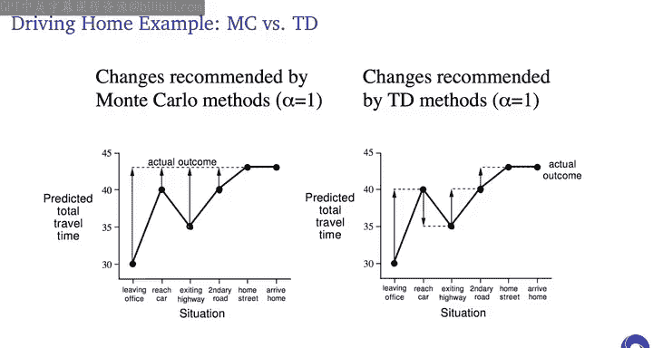

We will see more examples later on as well。So now we're going to compare these algorithms a little bit more。

 and we're going to talk about the advantages and disadvantages of each。

So as I mentioned， temporal difference learning can learn already before on the final outcome。

 it can in fact learn online after every step that has seen。

 whereas Monte Cardo learning must wait until the end of the episode before the return is known and before it could actually execute this update。

In addition， simple distance learning can learn without the final outcome。

 this is useful for when you for instance， only have incomplete sequences。

It could be the case that you have a database of experience that you want to learn from somehow。

 but the database is corrupted or is missing some data。

 and then temporal difference learning could still be used on the individual transitions that you do have。

Monte Carlo cannot do that and it really needs the full return in order to be able to do its update。

In addition， the ability to be able to learn without knowing the final outcome means that temporal difference learning can also work in continuing environments in which there are no episode terminations。

 whereas of course Monte Carlo needs full episodes in order to redo its updates。Finally。

 well not finally， there's one more after this， temporal difference learning is independent of the temporal span of the prediction。

 So what do I mean with that， That's a whole mouthful。

 I mean with this that the computation of temporal difference learning is constant on every time step。

How many steps you want to do in an episode does not matter in terms of the computational of complexity on each time step for temporal difference learning so why is that not true for Monte Carlo well Monte Carlo needs to store everything so T can from singles but Monte Carlo must store all the predictions you've seen in an episode。

In order to be able to update them at the end of the episode。

 so that means that the memory requirements for once a cargo actually grow when the episode becomes longer and longer。

This is a pure computational property， it has nothing to do with the statistical properties of these algorithms。

But on the flip side， temporal defense learning needs reasonable value estimates。

 if these value estimates are very bad， then obviously if you're going to construct targets using these。

 then maybe your updates won't be very good。And that means that actually there's a little bit of a bias variance trade have going on there。

The Monte Carlo return is actually an unbiased estimate of the true value。😊，This is。

 in fact how the true value defined as the expectation of these returns。

But the temporal difference target is a bias estimate， of course。

 unless you already have accurate predictions， but that's in edge case because we don't assume that we have them in general。

Now the temporal difference target does have lower variance。

Because the return might depend on many random actions， transitions and rewards。

 whereas the temporal different target only depends on one random action transition and reward。

But in some cases， temporal difference learning can have irreducible lies。 For instance。

 the world might be partially observable， and the states that we're pluglging into these value estimates might not tell us everything。

😊，That's already a problem for Monte Carlo learning because it means that the states that we're updating don't have all the information maybe to give you a complete accurate description and therefore your value estimates will be a little bit off。

 but you can imagine that this can get worse and indeed you can show this theoretically as well that this can get worse if you're additionally using these value estimates which are a little bit off because your state doesn't tell you enough in constructing the target for your update。

Implicly Monte Carlo learning a different way to think about this would account for all of the latent variables happening along the way。

 So even though you can't observe exactly where you are， the return itself would just。

Take it into account because the return itself does depend on all of the environment variables that you can't maybe observe。

Similarly， but a little bit different， the function used to approximate the values might fit poorly。

 and this might also be true in the limits。 it might be that your function class。

 let's say a linear function， can't actually hold accurate predictions for all states。

If that is the case， then temporal difference learning has irreducible bias in its target and therefore also in the values it eventually learns。

In the Tular case， however， both Monte Carro and temporalative concerning will converge to the true value estimates。

We will talk more about these properties and especially about the function approximation part in later lectures。

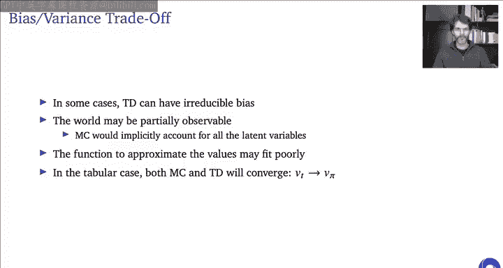

So now to build even more intuition， let's going to another example。

Call a random walk。So how does that look， we have five states， it's a small example。

 it's meant to be an intuitive example， and we have in each of these states two actions。

So we start in the middle stage denote that C here and we either left or right with equalco probability。

The initial value estimates are a half for every state。

 and above these transitions you see the reward depicted， which is zero in almost all transitions。

 except if you take the right action from state E， then the episode terminates with a reward of one。

Additionally， if you take the left action from state A。

 the episode also terminates with a reward of zero， all the other transitions are worth zero。

The true values happen to be 16 for state A，2，6 for state B， and so on， and so on until 5。

6 for state E。It might be an interesting exercise for you to go through this and to actually prove that this is the case using dynamic programming。

 you could write down the probability of each transition and you could write it on the reward function and you could do dynamic programming to find these value estimates。

So we put that market transition process here on the top and then we're going to talk about updating the values and first we're going to show you what TD does。

So there's a couple of lines in this plot and these lines correspond to our value estimates for each of these states。

After a certain number of episodes。So the line demared with zero is foody horizontal。

And that's because we've initialized all the state values at one half。Then there's a line mark1 here。

 and it's actually completely the same as the line mark0 on most states， except for state A。

 the reason for that being that apparently thispers episode terminated by stepping left from state A with a reward of0。

All the other transitions， this is an uncount of problem solving all the other transitions。

 basically when we， for instance， maybe steps from state B to state C。

We would have seen a reward of0 along the way， and our temporal difference error would be reward plus next state value in this case undiscounted。

 there's no discount factor or equivalently the discount factor is one。

And that next stay value at C would be12 because that's where how they are initialized。

So our target would be12， but our current estimate that state B would also be12。

 so the total temperature difference error would be0。

 so we wouldn't update the value of state B on this intermediate step。

But eventually we reach state A and we take this step into the terminal states。

 the terminal state by definition always has value0。

 so the temporal difference error for this last transition was actually minus a half。

Because it's zero reward plus zero next state value minus our current estimate for state A。

 which was a half。And then we see that we've updated the state value of state A in a tabular way。

 slightly down， and in fact， roughly 10% of the way down or maybe even exactly 10% of the way down。

 it started at 0。5 and now it seems to be roughly around 0。45。So from this。

 we can infer that the step size parameter to learning rate was 0。1 for this T algorithm。

Then we can see that after say 10 episodes， all of the values have by now been updated a little bit and after 100 episodes we're very close to these true values depicted here。

As a di animal。So this is just stepping through this problem step by step。

 and it can be quite informative if you implement these algorithms for the first time to actually really take take it easy and go step by step and look at every update to also make sure。

 of course， that there's no errors in the implementation。

 but also to better understand these algorithms。And then we could run these different algorithms from Monte Carlo learning and temporal difference learning on this problem and look at the root mean square error。

 so this is the prediction error which we've now condensed over all states。

 so we're looking at the total root mean squared error across all states or the average error。嗯。

We can see here that on the X Xs we have the number of episodes we've seen so far。

 so learning proceeds when we go from left to right and on the y axis we see the error of the state predictions。

 state value predictions。So first I want to draw your attention to the darkest line in both these plots。

 the black line， this corresponds to the lowest step size that we've tried， which is 0。

01 We see that both for Monte Carlo learning and for temporal defense learning we see the smooth progression where the error goes down as the episode number goes up。

But it's fairly slow right， so the error at either after 100 episodes it's not that low yet。

 and we can see it can clearly go down farther if we can leave it running longer。

But if we wanted to learn faster， so if we wanted to only have maybe we only had 100 episodes and we had to stop here。

 it maybe makes sense to make a higher learning rate or higher step size。

 and we can see in that the brown curve which corresponds to a 3 times larger step size， 0。

03 indeed has a lower error。Not just at the end， but actually at every episode along the way。However。

 then we start seeing a trade off， so I'm going to draw your attention again to the Monte Carlo plot and let's now consider the brightest line。

This corresponds to a fairly high step size of 0。3 and we can see that learning and need is very fast at the beginning。

 but then almost immediately stabilizes， it doesn't go much below 0。45 roughly。

And we could see that the variance isizzles are quite high。 Now， why is this the case。

 this is the case because the Monte Cardo update itself has its high variance。

And we cannot reduce the variance further because we don't have a decaying subsize here。

 which means that the total error of this algorithm after a couple of episodes will be just the variance in the updates。

Similarly， if we reduce the peptide size slightly to 0。1。

 we see that the learning is slightly slower at the beginning。But then goes lower。

 the arrow does go lower， but then also stabilizes around in this case slightly above 0。3。

We can see something similar happening for TD where there's this trade off。

 you can learn very quickly at the beginning but maybe the error stabilizes at a higher point。

 but if we compare temporal difference learning to Monte Carlo learning。

 we can see that temporal difference learning allows you to set the step size higher and also has a different trade off and indeed a lot of these errors are smaller than for Monte Carlo。

So if we look at， for instance at the midway point at 50 episodes。

 we can see that temporal difference learning then prefers a step size of 0。

1 if you had to pick one constant step size， whereas Monte Carlo learning prefers a lower step size of 0。

03 because it has higher variances， and also the error from Monte Carlo will be higher。

 even if we tune the step size among these four options。

Now obviously you could also extend this and consider step size schedules which start high and maybe go lower when you learn more。

 that's not the point here necessarily I just want to show you these properties of these algorithms where you can kind of clearly see from the plots that Monte Carlo simply has a higher variance than temporal difference learning and in this case that leads to higher errors for any constant step size essentially if you want to tune over on your constant step sizes。

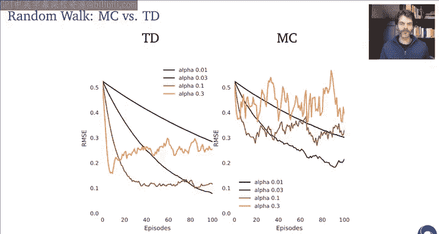

オ。Now we're going to look even more in depth at these properties of these algorithms by considering batch updating。

So we know that tabular Monte Carlo and temporal difference learning do converge to the true value estimates。

 so if we store all of the values separately in the table。

 we can update those them independently to eventually become accurate。

Under the conditions that your experience goes to infinity and your step size decay slowly towards0。

But what about finite experience， of course in practice we won't actually have infinite experience where we're going to learn for some time。

 it might be a long time but it won't be infinitely long and we won't actually decay our step size all the way to zero perhaps。

So what we're going to do now is we're going to consider a fixed batch of experience and specifically we're going to consider having collected K different episodes。

And each of these episodes will consist of a number of steps。

 so these number of steps per episode can differ， but they might all have a large or small number of steps。

And then we're going to repeat just sample from these episodes and apply either Monte Carta learning or temporal difference learning。

It says here TD0， reasons for calling this algorithm td0 will become clear later。

 but this is just the standard temporal difference learning algorithm that we discussed so far。

You can view this as basically similar to sampling from an empirical model where we talk about in the dynamic programming lecture having a model and then being able to use it to learn。

 in this case you could also consider having the data sets which in some sense defines frequencies of observed frequencies of transitions。

 which is similar to having a model but it's an empirical model and it won't exactly fit with the real underlying model because you only have a finite amount of experience。

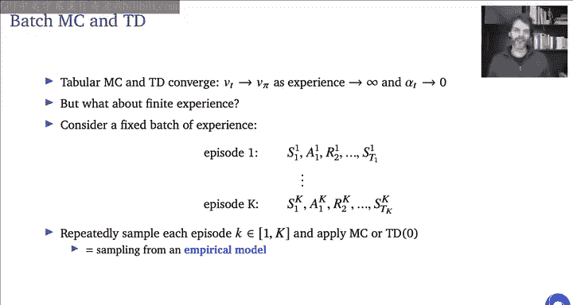

And then we're going to apply this idea of batch learning to a specific small example in which we only have two states where the purpose is for us to be able to reason through this all the way。

So the two states as you call them A and B， there's not going to be any discounting and let's say we have eight episodes of experience。

Here each line below denotes exactly one episode so one of these episodes starts in a state A and then gets a reward of0 then proceeds to a state B and then another reward of zero and then the episode terminates。

The next episode on the next line， we started in state B instead of A。

 and then we got to reward of one and terminate it。

That happens more often so six out of these eight episodes are of that form where we start in B and then terminate with a reward of 1。

 and then we also have one episode that did start in B as well， but it terminated with a reward of0。

Now I want you to think about， maybe even without thinking about these algorithms at all。

 I want you to think about what are the values of states A and B。

 what do you think these values should be？If this is all the information that you have。

 you have absolutely no information apart from this data set。

So I encourage you to pause the video perhaps and think about this for a little bit。

 and then I'm just going to proceed and going to tell you what I think are maybe plausible values。

So it could be that you came up with。Maybe even more than one answer。

 or it could be that some of you came up with one answer and some came up with a different answer。

 so let me motivate two different answers here。First let me start with state B。

 maybe that one somewhat obvious， so from state B we've seen eight episodes that were ever in state B and six out of eight times we saw a+1。

And two out of a times we saw a zero， so maybe the appropriate value for state B is 0。75。

We've also seen one episode that was in state A， and in that episode， we got a total return of zero。

So one could reasonably say maybe the value of state a is always zero or that maybe is our best guess that we could do。

Now when I say that some of you might actually object and say no no。

 no that's not the right way to think about this， the right way to think about this is that whenever you were in state A。

 sure it only happened once， but like whenever you were in state A。

 you transitioned to state B and there was a reward of zero along the way。

This implies that state A and B must have exactly the same value。That is also a reasonable argument。

 but that means that the value state a will be 0。75， which is quite different from  zero。

If you were using that second line of reasoning， effectively what you're arguing for is that the underlying model maybe looks like this。

 that maybe this is the suitable way to think about this A goes to be 100% of the time as far as we know。

 and then B gets plus 1 75% of the time and0， 25% of the time。So what is the right answer here？

That's actually a little bit unclear， and I'm going to explain why both these answers are actually in some way reasonable。

So Monte Carlo learning cons to the best mean square fit for the observed returns。

 so you can write this as follows where we sum over the episodes K from one to big K。

 and then within each episode we look at all the time steps。From1 to Tk， big Tk for that episode。

And then we could look at all of the returns that you've seen and compare that to our current value estimates and then we could say we want to minimize this squared error between these returns and that we observed any these value estimates and that the need sounds like a very reasonable approach right we're just minimizing the difference between the returns we have seen and the value estimates that we have。

In the example that we've just seen， this would imply that the value of state A is zero because the only return we've ever seen in state A was zero。

Instead temporal difference learning converts to the solution of the max likelihood markov model given the data that's what we saw on the previous slide。

 this is the most likely model given the data that we've seen so far and then temporal difference learning turns out finds that solution that corresponds to this model So if you agree with that approach if you say well that's what you should be estimating and then you should be solving that that's what temporal difference learning does。

So this will be the solution of the empirical Mark process。

 assuming that the empirical data that you've seen is actually the true data。So in the example。

 this is what gives you the same estimate for both states A and B。

Now you might find one better than the other， but why would you take one or the other。

 that this actually is a little bit of a subtle argument。

And turns out you can think about it as follows， where temporal difference learning exploits the mark of property。

 and this means this can help learning in fully observable environments。

What I mean with that is that the assumption essentially when we build that model that an empirical model in the previous example。

The assumption there is that if you're in state B。Then it doesn't matter that you were in state A before。

 we can just estimate the value of state B separately。

And this will tell us all that will happen from state B onwards。

That's basically making an assumption that state B is Markovian。Instead you could also say。

 and this is what Monte Carlo exploits， well what if we don't assume that。

 then we could say well whenever we were in state A。

 it turns out that our second reward was zero and this could be related。

 it could be that whenever we are in state A that we already know that all of the rewards in the future are going to be zero。

If we then reach state B， it might be that this is still true， but we just can't see it。

 it's a latent variable， it's a hidden variable， this means that the world is not fully observable。

If that were true for the problem that we were in， that would be the better estimate perhaps。

 and indeed learning with Monte Carlo can help impartly observable environments because it makes less of an assumption that the states are useful to construct your value estimates。

So we mentioned this before， so in some sense， you can view this example with this two state batch learning as an example of this difference in terms of how they deal with fully observed versus sparsely observed environments。

Important to note is that with finite data and also with function approximation。

 the solutions even in the limit might differ between temporal difference learning and Monte Carlo。

 these are two different statements we saw just we've seen it just now for finite data。

 it's also true for function approximation I haven't actually shown you that but we'll get back to that in later lectures。

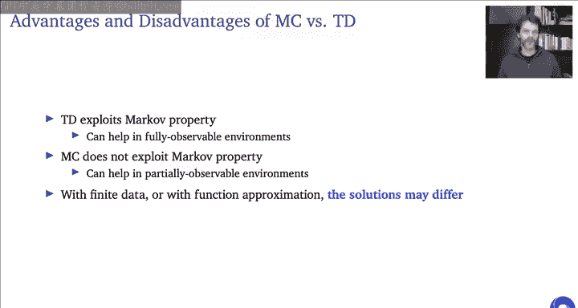

So now， of course， maybe a natural question is， can we maybe get the best of both？

First， I'm just going to show you a unified view where we put dynamic programming in the top left。

And the reason why it's there is that lefts corresponds here to shadow updates where we just look one step into the future。

The top versus bottom in the top we look at mechanisms that look full breadth， of course。

 in order to do that， you do need to have access to the model。So that means that， for instance。

 if we look both full breadth and full depth， this would give you exhaustive search。

I'm just showing that to complement into the other approaches I'm not saying that it's an algorithm that you should be using。

 it's computational quite expensive and of course you also need a model。

 but it clearly fits in a figure in terms of like comparing breadth and depth of these algorithms。

Then if we go down， we go to these algorithms that only look at one trajectory and these can be used when we only can sample and we only deal with interaction。

 so we see temporal difference learning sorry in the bottom left。And Monte Carlo in the bottom right。

Where we can think now about temporal learning as having a breadth of one。

 but also only a depth of one， so we can just take one step in the world and we can use that updated value estimates。

First Monte Carlo makes a very deep update， it rolls forward all the way until the end of the episode and uses that full trajectory to then update its value estimates。

Now as discussed， T difference learning uses value estimates which might be inaccurate。

 and in addition to that which we haven't quite talked about so much yet。

 the information can propagate quite slowly， I'll show you an example of this in a moment。

 this means that if we see a reward that is quite useful it's a surprising reward。

 T difference learning will a by its nature， only update the state value immediately in front of it。

If in that episode， you never reach that state again。

 that means that all of the other state values don't learn about this reward。

Whereas Monte Carlo would update all of the previous states that you visited in that episode eventually to learn about this new reward。

So that means that temporal difference learning has a problem in the sense that information can propagate quite slowly backwards and therefore the credit assignment could be quite slow。

No。Monte Carlo learning does propagate information faster。

 as I just said if you do see surprising reward， Monte Carlo learning will at the end of the episode tell all the previous states about that。

 but of course the updates are noisier and it has all of the other properties that we talked about before。

Now we can actually go in between these and one way to do that is as follows。

Instead of looking exactly one step ahead as temporal difference learning does。

 we could consider looking two steps ahead or three steps or generically and steps ahead。

Then we could consider Monte Carlo learning to be at the other end of other extreme。

 essentially where Monte Carlo looks infinitely far into the future up until the end of the episode。

Wri in equations you can write that as follows where maybe we can introduce new notation where we use superscript with brackets。

 so superscripts it's G with one between brackets is now a one step return which takes exactly one step in the world Rt plus1 and then bootsts at our current value estimates of S plus one so one step。

A one step return corresponds exactly to temporal difference learning as we defined it before。

An infinite step return shown in the bottom here would correspond to Monte Carlo learning because if you take infinite steps。

 you always reach the end of the episode before you choose to bootstrap。But then in between。

 we could consider for a two step approach， which takes not just one reward but takes two reward into account and then bootsraps under the value of the state at times step T+2。

In general， we can say the end step return， so oftentimes I say multistep returns here in the title of this slide。

 but colloquially people often refer to these mechanisms as a using end step returns。

And it's defined by simply taking N rewards into account and then appropriately discounting them。

Please note that the last reward reward that T+ n is discounted only n minus1 times。

 which is consistent with the one step approach。But the value estimate is then discount at n times。

And then we can just use this in our updates So does that mean that we have to wait a little bit of time before we can actually execute this updates and we do have to store some estimates or states along the way。

 but only as many as we want， so if we have 10 step return we have to weigh 10 steps every time before we can update the state value and we have to store 10 states along the way every time in something of a buffer so it has these intermediate properties that are both statistically and computationally a little bit between temporal difference learning on one extreme and multi carva learning on the other extreme。

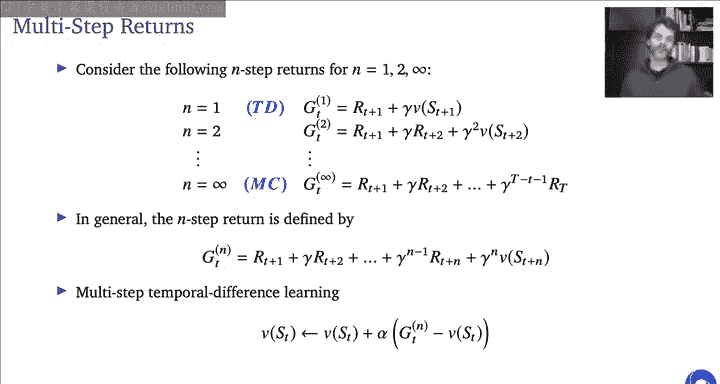

So now I'm going to show you some examples to make that a bit more concrete。

First we're going to talk about an example to illustrate essentially this property that TD doesn't propagate information for backwards。

 and for that we're going to use SArsRSA I'm going to remind you that SARSSA is simply temporal difference learning for state action values。

So if we look on the left， we see a specific path that was taken。

 we started apparently over here and we went right， right up， right up and s。In the end。

 we reached a goal。If we would then do one step TD in this case， one step SArsRSa。

 we would only update the state action value for the action that led immediately to the goal this is of course assuming that all of the other intermediate steps have no information。

 maybe the rewards are zero， maybe your current state estimates are also zero and maybe you only to get a+ one when you reach the goal。

If we could then instead consider a10 step update， it would actually update all of these state values appropriately discounted along the way。

 so it would propagate information much further back and then if we considered the next episode。

 this could be beneficial because in the next episode it could be that you start maybe here again and then if you only one step TVD or SArsA in this case。

 it could be that you just meander around without learning anything new for a long time。

 whereas if you would have done a 10 step return at least you're more likely to more quickly bump into one of these updated state values and then information could start propagating backwards to the beginning where you start。

So we can apply this to a random walk just to see and get bit of a more of intuition so we see the same random walk that we talked about before here at the top。

 but now let's consider giving it 19 states rather than five but otherwise it's the same there's a starling state in the middle。

 there's a plus one reward on one end and there's a zero on the other end。

And then we can apply these n step r algorithms and see how they fair。

 So what you see here on the slide is something called a parameter plot because on the x axis we have a parameter in this case。

 the step size parameter and on the y axis we see the root mean squared error over the first 10 episodes So we're not looking at infinite experience here we're just looking at a finite amount of experience and then we see how do these algorithms fair。

 if you then look at all of these different step sizes。 So for instance， let's look at n is1 n is1。

 I remind you corresponds exactly to the normal temporal difference learning algorithm that we discussed before。

We see that the best performance of the lowest error。

 if we only care about the first 10 episodes and we have to pick a constant step size is for a step size around maybe 0。

8。 If you set it higher or lower the error is a little bit worse。

This has been averaged over multiple iterations so this is why these girls looks so smooth。

 this is of course a fairly small problem so you could run this quite often to get very good insights on what's happening。

 very precise insights， I should maybe say。And what we notice here is if n is2。

 so we consider a two step approach， we see that if the step size is really high， if it's one。

 that it actually does a little bit worse， and this is because the variance isn't in some sense higher。

But you can actually tune your step size around， in this case， 0。

6 to get lower arrows than were possible with the one step approach over the first 10 episodes。

Then taking n is4 is maybe even a little bit better。

 but notice again that the preferred action sorry the preferred step size parameter is again a little bit lower this is because if we increase n as we do here。

The variance goes up more and more and more。And that implies that we need a lower and lower step size to make sure that we don't have updates that have two high variances。

 which would make our error higher。Then if we go all the way up here。

 we see a line that is marked with the number 512 that is a 512 step temporal difference learning algorithm。

 which in this case is essentially Monte Carlo， because there are very the probability of having an episode that is more than 512 steps long is very small。

And we can also see that by the fact that the 256 step temple differ learning algorithm is actually quite similar because both of those are already quite similar to the full Monte Cardo algorithm。

For these algorithms we see two things first， they prefer very small step sizes of much。

 much smaller than temporal difference learning， one step temporal difference learning。

And in addition， even if you tune the constant step size very well。

 the error will still be quite small， quite high， sorry， and if you set the step size too high。

 the error will be much much higher， they go off out of the plot here。

So we clearly see a trade off by variance trade off here， essentially。

 where an intermediate value of n helps us learn faster and helps us get lower error in over the first 10 episodes。

For a well tuned step size parameter and the best values are not the extreme so it's not n is is one and it's also multi n is infinity。

 so it's not TD， it's not Monte Carlo， but it's some intermediate N step TD algorithm。

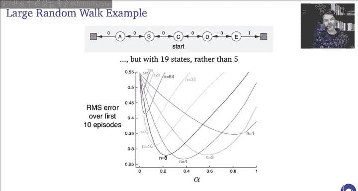

Okay， so make sure that you understood that last bit because now we're going to go on to a next very related bit though。

 which is on multi mixed multi step returns。

So we've just talked about NSstep returns， so as I said。

 make sure you understood that part before continuing here and these NSstep returns。

 they bootst after N steps on a state value ST plus。One way to write down these returns is。

Almost recursively， they don't quite recur， but you could look at them these returns as doing the following where if you have an end step return。

 you take one step Rt plus1 and then you add an n minus one step return right so every step you lose one step until you only have one step left and the one step return will then bootsciling your state value。

So why am I writing it like this because you can then look at these different cases and we could basically say well。

 on some of these steps， we fully continue with the random sample with the trajectory。

 whereas another step we fully stop， we just say， okay， that's enough。Booottstrrap here。

And now I'm going to argue that well you could do that， but you don't have to do that。

 instead there's a different thing which you could do， which is to say you could bootst a little bit。

For instance， you could have a parameter， which we're going to call Lada。

So we're going to take one step as always， and then we're going to take the discount factor。

 but then instead of either continuing or bootstrapping fully， we say let's bootstrap a little bit。

 so this is a linear interpolation between our estimated value and the rest of that labda return as we call it。

This is defined recursively so this Lada return is at the next time step for the same Lada。

 so this thing will also take one step。And then again， bootstrap a little bit before continuing。

 and then again， it will take one step and then again bootstrap a little bit before continuing even farther。

Turns out if you do the math， this is exactly equivalent to a weighted sum of NS step returns。

 in fact of all of the N step returns from one to infinity。These weights do sum to one。

 so it's a proper weight at average of these and we can note by just stepping through few examples if n is one。

 then this quantity here goes away， this is just one。

 so the one step return will be weighted exactly with a weight of 1 minus Lada then the two step return will be weighted by a weight of Lada times 1 minus Lada so slightly less。

Typically Labda it's a number between0 and1， and typically it's a number that is maybe closer to  one than to zero。

But if we set Lada to say a half for simplicity， that would mean that our Lada return would。

Basically take a one step return with weight a half， a two step return with weight， a quarter。

 a three step return with weight，1，8 and s and so on。

Then we can consider these special cases where if Lada is 0。

 we can say that see that this term would completely disappear and this term would just get weight 1。

 that means that Lada0 corresponds exactly to the standard TD algorithm。

Whereas if we consider the case where Lada is one， then the recursion is full。

 we just have one reward plus discounted next labda return， but if Lada is one。

 this would also just take the full next reward n1 and1 so that would be exactly the same as Monte Carlo。

So we can see we have the same extremes as before for the Nstep returns where Lada is0 now corresponds to temporal difference learning。

 one step temporal difference learning and lab as one corresponds to full Monte Cargo This is why on a previous slide you saw TD0 pop up that was actually referring exactly to this algorithm where we say there's a more generic algorithm called TD Lada。

 but you can set labda to0 and then you have your one step TD algorithm。

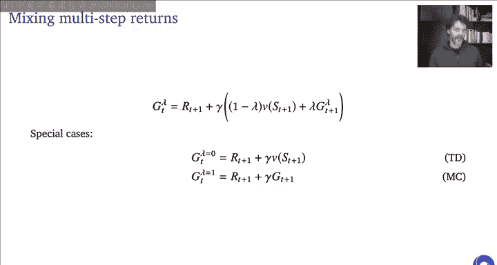

We can compare these to these end step approaches and we here we plot them side by side for that same multistep random walk。

And we see some commonalities first let me draw your attention to Lada is0。

 which is exactly the same curve as for n is1 this is true by definition because these are both the oneceptD algorithm。

And then similarly， we can see for lab is one， I promise you that that was exactly Monte Carlo。

 and you can indeed see that that's very similar to the curve here for the 512 and also for the 256 step TD algorithms。

Intermediately the curves look slightly different， you can see that these curve。

 for instance branches are slightly differently than that one。

 and they also don't exactly correspond to each other because these end step approaches always choose exactly one time step on which to bootstrap。

Whereas the Labda approaches， they boost up a little bit on multiple times stepss。

But you can see the curve actually looks somewhat similar and there is a route of thumb that you can use to think about how these relate to each other。

 maybe you think while these NS approaches I find a little bit more intuitive because I can reason about two steps。

 but I find it harder to reason about this lab that。Well。

 one way to think about this is that there's a rough correspondence where we can think of one divided by one minus Lada as roughly being the horizon of the lab return。

So for instance， if we set Lada to be 0。9， then this would be this one minus Lada would be 0。

1 and then one divided by 0。1 would simply be 10， so we could say that Lada 0。

9 roughly corresponds to an n step of 10 and we can see that corresponds here in the plots where we can see that Lada 0。

8 which would correspond to a  five step method is indeed quite similar to this four step method over here and 0。

9 which corresponds to roughly10 steps is indeed quite similar to this8 step。

A temporalemp difference learning method here。 and they're even colored the same way that maybe makes it a little bit clear in this correspondence as well。

 They're slightly different。 You could look， for instance， at the Lada 。4。

 which is presumably quite similar to labda 。5， which was correspond to this two step approach and especially for higher learning rates to do look a little bit different。

But there is a rough correspondence and this is one way to think about these algorithms。

And now we're going to talk about some benefits， so we've already alluded to this。

 so multi step returns have benefits from both temporal difference learning and Monte Carlo。

And the reason to consider them is that bootstrapping can have issues with bias。

 so one step TD is not always great and Monte Carlo can have issues with variants and typically we can think about intermediate values as being somewhat good because they trade off bias andvari in an appropriate way。

In addition， I talks about this information propagation， which has a similar flavor to it。

So intermediate values， what do I mean with that， well typically we see things like ns5 or Ns10 or something as a form or a labda 0。

9 is somehow always magically a good value， so these are intermediate values that tend to work quite well in practice。

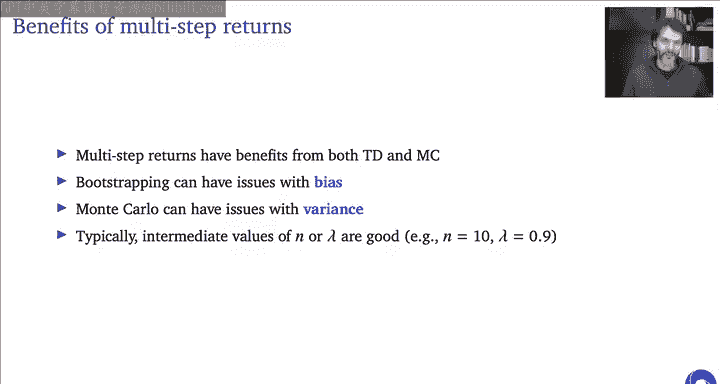

Okay， now make sure that you understood all of the things I was talking about before。

 before continuing to the next section。 In addition， I want to。

Basically attend you to the fact that the next part is more advanced and you don't need it to continue with the rest of the lecture。

 so you could also pause here and maybe return to this later if you wish。嗯。

Or you could just continue now， of course， because it's quite related to the things we were talking about before。

 but I just wanted to draw your attention to the fact that this is going to be in some sense a little bit orthogonal to some of the things that we'll be discussing later。

Okay， so having said that， let's continue。

So we talked a little bit before about this dependence on the temporal span of the predictions。

And maybe you've already realized that these multi step approaches， these mixed multistep approaches。

 especially that we talked about， are actually not independent of span。

 which means that similar to Monte Carlo， you actually will have to wait all the way until the end of the episode before you know your laboratory return。

The lab betrays off statistical properties of the updates。

 but it still has the same computational update that you actually can only construct your full lab to return when you've reached the end of the episode。

Now that doesn't seem very desirable and indeed you might also sometimes want to do Monte Carlo learning and then that might also not be desirable。

And conversely temporal difference learning can update immediately and is independent of the span of the predictions so before maybe you took this to be an argument that we should be using temporal difference learning。

 but here I'm going to make a different argument and we're going to ask can we get the best of both worlds。

 can we use these mixed multistep returns or like other flavors of that including maybe even Monte Carlo but with an algorithm that doesn't have computational requirements that grow indefinitely during the episode？

And turns out， of course， I wouldn't be asking this question if it wasn't the case。

 so I'm going to explain to you how that works。For concreteness。

 let's recall linear function approximation where we have a value function that is a linear function。

 so we have a value function defined as an inner product of a weight vector W with some features x。

And then Monte Carlo and T difference learning， the update to the weights can be written as follows for Monte Carlo learning its step size times your return minus current estimates。

 times features and for temporal difference learning iss your step size times your temporal difference error。

 times your features。And then for Monte Carlo learning。

 we're going to talk about Monte Carlo first for a bit。

We can update all states in an episode at once， so this is typical because you have to wait for the end of the episodes for all states anyway to know the return。

 so it's quite typical for Monte Carlo learning to then just update all of them at once in one big batch。

Here we're going to use t from zero to big t， or in this case。

 big t minus1 to enumerate all of the time steps in this specific episode。

 so we're restarting the time to count from zero in every episode essentially。And now。Oh yeah。

 first I just want to record that tab just a special case where the x vector is just a one whole factor。

And now I'm going to argue that we can look at these individual updates here。

 so here we have an update on every time step。Then we just suming over time steps。

I'm going to argue that you can define that update as follows， I'm going to prove this in a moment。

 but first I'm just going to give you the update to build some intuition。

This update is a very simple update that takes an alpha file step size parameter times for one step TD error。

 This is not your Monte Carlo return。 This is the one step TD error times some vector E。

This E is called an eligibility trace and it's defined recursively by taking the previous trace。

 decaying it according to gamma and Lada， and then adding our current feature vector or more generally a gradients xt。

Note， special case， if lada is zero， we do indeed get one step TD back。

So there's a choice here whether you want to do online Td， which means you update during the episode。

 you could also consider for conceptual simplicity。

 you consider offline Td where you still just accumulate。

These wait updates until the end of the episode。But then this algorithm would just be TD。For Lada a0。

The intuition here is we're basically storing a vector that calls all of the elicilities of past states for the current temporal difference error。

And then we're going to add add that to our update to the weights。 So when Lada is not zero。

 we have this kind of trace that goes into the past。 It's similar to momentum。

 but it has serves a slightly different purpose here。

 which will hold recursively this E T minus-1 will therefore hold the X t minus-1。

 the features from the previous state。And but appropriate decayed and also xt minus2， and so on。

 and so on， each decay even more。So this is kind of magical。

 I haven't yet shown you why it works or how it works， but this means that if this works。

 we can update all of the past states to account for the Neot temporal difference error with a single update。

 we don't need to recompute their values， we don't need to store them so this would be an algorithm if it works that will be independent of the temporal span of the predictions We don't need to store all of the individual features Xt xt minus1 xt minus2 n so n s instead we just mergese them together by adding them into this vector and we only have to store that vector。

This idea does extend to function approximation， I mean this is already the linear function approximation case。

 but the so in general Xc does not have to be 1 H， but it can actually also be a gradient of your value function for a non nonlinear case。

How does that look here we're just going to show a kind of intuitive again so there's a mark of decision process here in which we only ever step down or to the right in the end we reach some goal states from which we get a reward of plus one and this then we transition all the way back。

To the top。So the trajectoryor here will be somewhat random， the true values are there's discounting。

 so the true values are larger the closer are to that goal。

 if we didn't imagine doing only one episode， TD0 would only update the last state so the state in which we saw that one reward。

TD Labda would instead update all of the state values along the way less and less so with Labda this is true if you do the version that we had before with the Lada return。

 but turns out the exact same thing is also true if you use this eligibility traces and the way to think about that is that at some point we see this temporal difference error where we finally see this reward of plus1 that we've never seen before。

And then we multiply that in with all of these taking it account all of these previous features that we've seen in this case it's tabular so although the features are1 hole。

 but so basically we're storing all of the states in this vector and we're updating it in onego。

Now I'm going to show you how it works and why it works。

So we're going to consider Monte Carlo first and later I'll put the Lada parameter back in。

So we're just going to take the Montecarddo error， and we're first going to rewrite this as a sum of temporal difference error。

So to start， let's first write it out one step。So we get our first step， our reward t plus one。

 and then our discounted next。Return， next step， return。

And we're just taking along the minus v parts from the left hand side。

Now this already looks similar to a temporal difference error but it's not so for a temporal difference error。

 we should bootstrap， so what we can do is we can just add that in so we basically add gamma times v。

Of the next state in， and then we also have to subtract it， so we're basically adding zero。

 but this allows us to write this as a temporal difference error plus a different term。

And this term notice that this is exactly the same term as before， but just at the next time step。

 so now there's a t plus1 rather than a T。So then we can write this as an immediate simple difference error plus discounted Monte Carlo error at the next time step。

Of course we can repeat this， so Monte Carlo error at the next time step will just be the TD error at the next time step plus the discount of Monte Carlo error at the time step after that。

So I repeat this over and over again and we noticed that we can write。Excuse me。

 we can write the total Monte Carlo error as a sum of temporal difference error of one step temporal difference error。

And I'm just going to put this basically aside for now and I'm going to use this on the next slide。

So now we're going to go back to this total update， so at the end of the episode。

 we're going to update all of our weights。According to all of these Monte Carlo returns that we've seen constructed so far。

 which we only were able to construct at the end of the episode。

Now I'm going to plug in this thing that we derived in the previous time step， sorry previous slide。

 where we' were replacing this Monte Carlo error with this summation over time of temporal difference errors。

Note that the summation only starts at time step T。

 which is the time step from which the Monte Carlo return also starts。

And now we're going to use a generic property of double sums。

 we have an outer sum that sums from t0 to t minus1 to big t minus1 and an inner sum that starts at this variable T and then continues to the same endpoint。

Turns out if you have a double summation like this where the inner index depends or the starting point of the inner index depends on the outer index。

 you can turn them around and you could first sum over all of the outer indexes instead and then sum over the what used to be the outer index。

 sorry so over sum over all the what used to be the inner index K。

And then we sum of what used to be the outer in Xt， but only up to k。So instead of starting at T。

 starting K at T and then going up， we do all of the K， but then we only do the T up to K。

 this turns out to be exactly equivalent， it's a generic property of these double sums and I'll show you this intuitive in a moment as well。

And then we notice that the temporal difference error。

Delta K does not depend on this variable of the inner sum， it doesn't depend on T。

 so we can pull that out。And then we just say， oh， this rest thing that we have here。

 this summation from T is0 to k， it's a discounted sum of feature vectors， and we give that an A。

 we just call that E。Where we notice that E actually only depends on on time step K and before。

So this means we can write this down as follows where we now。

Swap K for T because we only have one variable that we're summing over now so we can just rename K to T。

 and that means that the original summation can be rewritten in this form。

 so originally we had for every state。We had this update of a return looking into the future right this is why we had to wait all the way until the end of the episode because we have to wait for GT to be completely defined。

And we've swapped this around to a summation where we have our same step size and our temporal difference error Dlta T。

 and then this wave vector， which kind of looks into the past。

 it stores all of the feature vectors that we've seen in previous states。

And we just kind of went through this mechanically right we haven't actually taken any magical steps you can just do this step by step。

 of course coming up with this derivation is maybe a different matter。

 but you can now follow this step by step and see that this is indeed true。😊。

So that means that our total update can be written as this where this a trace vector was is defined as the summation up to time step T of our discounted feature vectors。

This we can also inspect a little bit more and we can， for instance， pull off the last time step。

 which is just Xt note that when J is equal to T， then this discounting goes away because it would just be your discount to the power 0 which is1 so we get this term that we pull off and then the summations only to t minus1 rather than to T。

Now we can also pull off one discount factor exactly one， so there will be now a minus1 here。

 and then we can notice that here E T was defined of a summation of something that goes a T and insert aside as's a T。

 and now we have something that only sums up to t -1 and inside as a t -1。

 but otherwise it's exactly the same。 So this thing must be by definition E T -1。

Which means we can write this recursive via summation as a discount of previous ET minus1 plus the current Xt。

And then ET， we're going to call that an eligibility trace。

So the intuition here is that every step it decays according to the discount and then the current feature is added because we're doing full Monte Carlo。

 so discounting here is a appropriate for propagating information backwards because you shouldn't propagate the information more than it is used in these Monte Carlo returns which came in earlier states and that should take into account a discounting。

So then summarizing， we have this。Immediate kind of like update for every time step。

 which is completely well defined on time step T。 We have all these quantities available for us at time step T。

 then the Monte Cargo update would sum all of these deltas over all of the time steps in the episode and then apply。

This is the offline algorithm， so in this case， even though we can compute these things along the way。

 we can now compute this sum incrementally as we go， so we don't have growing memory requirements。

But then in this specific algorithm， we're still applying them at the end。Of course。

 you might not already be thinking， but that feels unnecessary come we just applied them during the episode。

Yes， indeed you can， so this is indeed an interesting extension that you can now start doing something that would be equivalent to Monte Cardo if you would wait all the way until the end of the episode and only then apply these differences。

 but you could already start learning journey during the episode so we haven't just reached an algorithm that has the property that is independent of span。

which is a computational property， but we've actually also arrived in an algorithm which is now able to update its predictions during long episodes。

 even though we started with the Monte Carlo algorithm。

The intuition of this update is that the same temporal difference error shows up in multiple Monte Carlo errors。

 in fact in all of the Monte Carlo errors for states that happened before this time step。

And then what we do is basically we group all of these states together and apply those in one update。

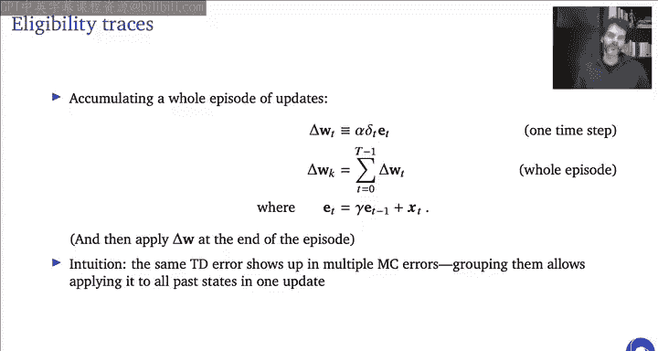

You can't always do that， but you can do that here。

Now I'm going to look at that double summation thing a little bit and show you why that works。

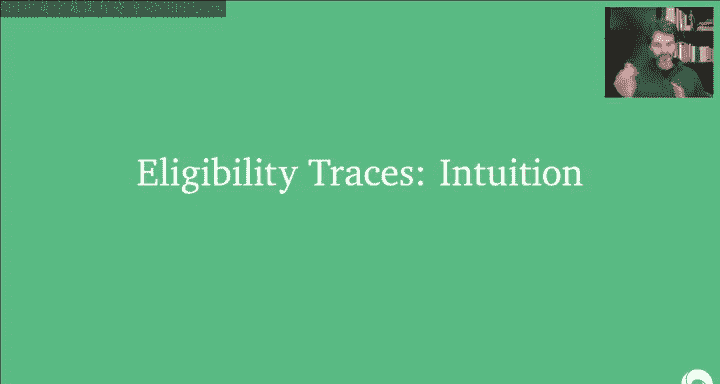

And for doing that， we're going to concretely consider an episode with four steps。

So it says Delta V here， it should have written Delta W there。

 so we've noted before that Delta W for an episode is just a summation of all Monte Cardo errors with their feature vectors。

And we've also noted that we can write each of these as a summation of appropriately discounted temporal different errors multiply with that same feature because we're just pulling out this part Monte Carlo error。

And then essentially all that we're doing is instead of summing across these rows。

 we're going to sum across the columns， which willll look。Like this。

 where basically we noticed that across the columns。The temper differencearrow is always the same。

So instead we're going to merge all of these appropriately discounted state feature vectors。

 and we're going to merge it into a vector called the eligibility trace。

Feel free to step through that， of course， much more sloty than I'm doing right now。

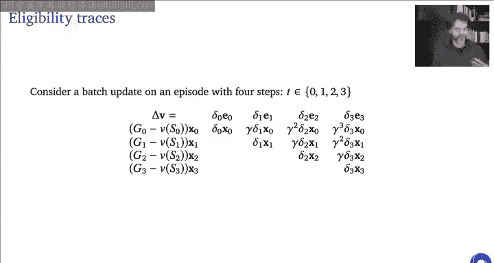

And then we can do mixed multi step returns as well by putting the lada parameter back in。

How that works is we had our mixed multistep return， G Lada。

 and it turns out if you write this as a sum of temporal difference error。

 you can go through that yourself in a similar way that we did the Monte Carlo returns。

 it turns out you get this summation， which now no longer just says your discount factor but it has a quantity Lada times gamma。

Otherwise it's exactly the same thing， so it turns out we can write these Labda returns as also a summation of one step temporal difference error。

 but with gamma times Lada where we had gamma before。

 and that means if we go through all of those steps again that we did before from the Monte Carlo case。

 we will get exactly the same algorithm except that the eligibility trace now has a trace decay gamma times Labda rather than just gamma。

So feel free to go through all of that yourself to convince you or yourself that this is actually the case。

 and that means that we can then implement this algorithm and actually also maybe apply these updates online as we go。

This is called an accumulating trace because every time we add this X。

 there turns out in the literature， there's a couple of other traces as well which I won't cover now。

 but they are mentioned in French instance Su andbartto in the book。

The equivalence is here between the Monte Carlo updates。

And then doing this with these traces is only completely exact if we update offline。

 that means we wait， we store all of the weight updates， we can add them together already。

 but we don't actually change our weights yet。But there are also trace algorithms that work and are exactly equivalent in some sense for online updating。

So these traces look slightly differently， as I mentioned it won't go into that。

 but I just wanted to make you aware that they exist。

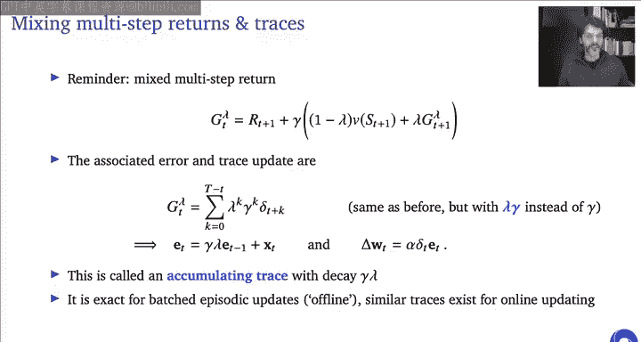

Okay， that brings us to the end of this lecture in the next lecture we will be talking about applying these ideas to control to optimize our policy。

Thank you for paying attention。

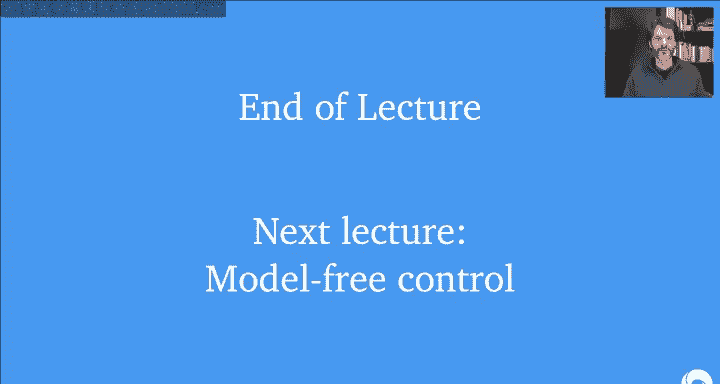