# DeepMindxUCL《强化学习｜Reinforcement Learning 2021》中英字幕 - P6：[06]Model-free Control [6_13].zh_en - GPT中英字幕课程资源 - BV1JssaeVEMp

Hi and welcome to this sixth lecture in this course of reinforcement learning。My name is Adam Hled。

 and today I will be talking to you about model free control。

The background material for this lecture is chapter 6 from Southern Embarto。

 you might recall from the previous lecture that I said there were a bunch of chapters background material。

 56，7，9，12。But this lecture specifically will be focusing mostly on the contents of this one chapter 6。

Just to recap again， here's the interaction loop of an agent interacting with the environment and then reinforcement learning can be taken to be the signs of how learning how to make decisions。

And the agent can internally learn a policy a value function and role model。

 this lecture will be focusing on value functions again like last lecture in the last lecture we were focusing on predicting value functions and now we're going to focus on additionally using those value functions to then come up with a policy we won't yet talk about models。

This general problem involves taking into account time and consequences so we have to make predictions about long-term futures because actions cannot just influence just the reward。

 but also the age state and the environment state， and this means that actions can have long-ter consequences。

Now in a previous lecture as I mentioned， we covered Mo free prediction。

 which is all about estimating a value function in an unknown park of decision process。

 so we imagine there are some reward， for instance this could be taken part of the observation or this could be taken as part of the agent where the agent has a certain preference over different observations。

And then value functions are defined as the expectation of the accumulation of these rewards。

 and that's what we try to optimize。But in previous lecture we didn't talk about optimizing those。

 we just talked about predicting them and then this lecture is about model free control in which we try to optimize these value functions。

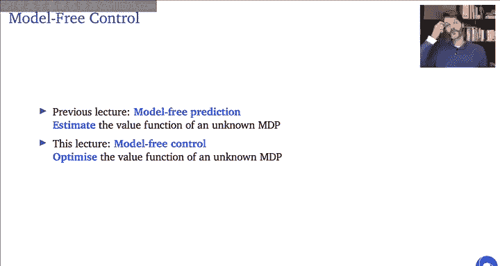

The first topic that will'll touch upon is Monte Carlo control。

So before introducing Monte Cardo algorithms， I'm first going through。

Recap policy iteration。So policy St was described in the lectures on dynamic programming taught by Dina。

And just to remind you， Paul situation refers to interleaving two separate steps。

Which are called policy evaluation and policy improvements， and that's depicted here on the left。

When we start with some arbitrary initial value function， for instance。

 they could all be zeros and some arbitrary policy， for instance， uniformly random。

 and then the first step could be to evaluate this policy。

So we depict it here with this arrow going up and then when we reach this line。

 that means that the value function is now fully accurate for the value of that policy。

 actual high of that policy。That will be the policy evaluation phase。

Then when we've reached this value function， we can do a policy improvement step， for instance。

 we can make the policy greedy。And this policy improvement step will change the policy。

In such a way that we get a new policy pi prime， such that the value of that policy in every state is at least as high as the value of the policy that we were just evaluating and picking a degree policy is one way to achieve this。

But because we're changing the policy， that means that our value function will become inaccurate because it's an evaluation of the previous policy。

 but we've now changed our policy， which means we can do the evaluation phase again for this new policy and again find the true values for that policy。

And then because the value function has changed， gratifying the policy retrospective。

 that new value might also change the policy and so on and so on。

We see that depicted here as well where these arrows mean that we're basically overwriting so first we start with some policy。

 let's say random， we evaluate that policy that as a value function。

 then we consider a new policy which for instance makes the greedy action in every state and then we can do the evaluation and and so on and so on when this ceases to change anything that means that by definition we must have found the optimal value function because it means that the true value of the policy is equal to when you then consider a greed D value and that by definition will be the optimal value function。

So this has all been discussed in lectures three and four we're going to use this as an intuition to build model free algorithms because before with dynamic programming for for instance。

 the policy evaluation phase， we consider dynamic programming algorithms which can draw upon knowledge of the precise mark of decision process。

But we are not wanting to make that assumption anymore。

 so instead we'll come up with approximate methods that sample and then do this evaluation phase approximately and turns out this will still be okay。

 this can still need to converge into algorithms。So to recap for the policy evaluation in the previous lecture。

 we talked about ways to do this model free。So here at the top we see an update which could be taken to be a Monte Cardo value update where for instance in some episode maybe depicted n and at the end of that episode there was a time step T inside that episode in which we saw a state ST and from that state on what we saw a return GT and then we just incrementally update the value of that state towards that this is showing the update of one state of course we normally when using Monte Cardo algorithms we would have to wait until the end of the episode to update all states so instead of just updating one we would actually maybe update all of the states in onego。

But now I'm going to draw your attention to this target GT and I'm going to make it explicit that Monte Carlo is one choice。

 this was all discussed in the previous lecture where Monte Carlo would use a full return so the reward plus the discounted next reward plus the dubly discounted reward after that and so on。

 which we can write on recursively as well， where the return is the first reward plus the discounted rest of the return that would be our Monte Carlo target and we discussed that this is a fine target used although it might be quite high variance in some cases。

We also talked about alternatives which might have lower variance like td0 td0 I reminding you is exactly the same algorithm which we could also call one step TD and this refers to the fact that we're taking one step in the world。

 we see one reward and then we use bootstrapping which refers to the usage of the value function estimate itself to take the place of the random return so if we compare it to Monte Carlo we sign in Monte Carlo we are using the random rest of the return whereas in temporal difference when we replace that with our current estimate of the expected return。

This tends to be much lower variance， it can suffer from bias in some cases。

 so we also discuss intermediate approaches that one can use。For instance。

 end step approaches where we just take a fixed number of steps， in this case， n different steps。

 which means we look at n different rewards and then we bootstrap the state end steps in the future。

Whi can be written down semi recursively as well， where the end step return takes one step and then looks at the n minus one step return。

And additionally， we also looked at well， if you're doing that。

 that kind of end steps kind of means you're either continuingtium or you're not continuing and then we said we could also do that partially so we could also on every step decide to bootstrap a little bit with weight one minus Lada and then continue to the rest recursively with Labda because this is defined recursively this means that little next step if you would roll this further out。

 you would again bootstrap a little bit and continue and then bootstrap a little bit and continue and so on。

For Lada0， this is exactly the one step TD algorithm， for Lada1。

 this is exactly the Monte carto algorithm， and that's also why the one step approach is sometimes called TD0。

So this is just to recap that there's different mechanisms you could use to do model free policy evaluation。

And in each of these cases， the goal was as in previous lecture to estimate the value of the current policy。

 So there is some policy pi that is used to generate these transitions to generate the behavior。

 and we're just estimating the value of that policy。Now。We can consider then improving the policy。

 we didn't consider that yet last yet lecture， but in this lecture we want to improve the policy and one way to do that。

 as I mentioned， is to make it greedy。However， greedy policy improvement over state value functions does require a model of the mark of decision process because the greedy policy would then be something like this where we take the arc max over this expectation of the transition。

That's a bit cumbersome because we are not model free anymore。

 so now the policy improvement step seems to require a model。

 but fortunately there's a way around that， we can just instead of estimating state values。

 we could also choose to estimate state action values。

And then we can much more easily find a greedy policy by picking just the highest valued action in every state。

This would give us a new policy， so Q here could be an estimate of Q pi to the true value of the policy。

And then pi prime could be a greedy policy with respect to these estimates。Then， of course。

 having a new policy， we could try to estimate that one instead。

So this is why we're considering action values essentially because it makes it so convenient to then inspect the values of different actions and then infer a policy from this。

So now basically the whole idea is to plug in these monetary estimates into the policy evaluation phase of policy iteration。

So essentially what we're doing here is we're depicting the same pictures as before but we replace the V's with Qs so that's a small change right we're just considering state action values rather than state values but for now we're going to do the exact same thing as before we're going to estimate the value of the policy and then go greedy the greedy step is facilitate it by using these action values it's very easy to then if you have these action values construct a greedy policy and this can be done model free。

Now in order to make the full algorithm Model free。

 we also want this evaluation step to be model3 and one way to do that is to use Monte Cardo policy evaluation。

So we could just consider following a certain policy and maybe do that indefinitely long many。

 many samples and we all the way converse to these through action values in a moment I will relax this assumption greatly and we'll see we can even learn from single samples and still do some version of generalized policy iteration but for now concepts you just keep in mind oh we're just going to do maybe exhaustive like evaluation of that policy and then we just consider a greedy policy so every so often after a lot of learning we change our policy become become greedy。

However， there is a problem if we go fullymolar free。

 which is that if we really pick the greedy policy， then we wouldn't explore。

Which means we wouldn't actually sample all state action pairs when learning by interacting。

So wise is this a problem， but it's a problem because it makes the policy evaluation susceptible to problems。

 essentially if you have a fully greedy policy and you're trying to evaluate that with a Monte Carlo algorithm。

 that means that you should be following that greedy policy。But if you're following the Gry policy。

 it might simply not select certain actions in certain states。

 and that means that we don't have a reliable estimate of the state action value from those actions。

 which means that then if we consider the evaluation phase。

 this will be maybe severely hampered and that means that then the improvement step could be wrong。

Because we don't have accurate state action pairs， state action values for certain state action pairs。

 this means that the improvement set could wrongfully pick a different action。So that is a problem。

 but it's also not that hard to fix fortunately， so instead of doing full gratification。

 we could also consider an epsilon greedy policy where we still allow with some probability epsilon to pick any action。

Turns out this is okay this is why this procedure called generalized policy iteration recall that for the policy improvements that we just needed。

 well just needed that the policy， new policy was better。

 but we don't need it to be foody greedy so it turns out epsilon greedy can be plugged in here as well and we depict it now and to figure that we're also not doing a fully evaluation phase。

So this new line at the bottom is no longer greedy， but it's epsilom greedy。

 and in addition we're only going to move partly in the way of the evaluation。

 so we're no longer going to assume we're going to fully evaluate。Every policy that we have。

 instead we're just going to do some evaluation， let's say a couple of episodes and then we consider absolute greedy policy with respect to these new action values。

So now we have a full model free algorithm that can use for policy duration。

And now you might question， well， sure， but you're not doing the full evaluation anymore。

 you're not doing full gratification。 iss this algorithm still sound。

 Does this still converge to the actual optimal value function and the optimal policy。So first。

 we're going to just make it very clear what we're doing in terms of the algorithm。

So we're going to sample episodes。According to our current policy。

 then we're going to just do policy evaluation， so we're going to more free learn the value of that policy。

And for instance， we could pick a step size that decays over time。

Because otherwise we might have irreducible variance， right。

 which might make our action values to be quite inaccurate。

 although you can also use this algorithm with a fixed step size and in some cases it might still be fine。

 but maybe it's better to consider a decaying step size。

 for instance that decays with one over the number of episodes that you've seen so far。

And then in addition to that， it might also be useful to decay the greediness。

 sorry the uniformness of the policy in the Epstinon greedy policy。

 so this will make sure that eventually you're selecting the greedy policy。

So this is basically a small change to the epsilon greedy policy where we're just allowing the epsilon to be dependent on the number of episodes you've seen so far or on the time steps if you prefer。

So we see that the evaluation and the expiration are both time dependent here。

 but on every time step we're doing this approximate version where we have some policy right now。

 we're evaluating that with some step size and some samples。

 and then we're going to go partly greedy。And then the reason to pick this epsilon is that it's actually。

Has a certain property which is desirable for these theoretical properties。

 and we call that property greedy in the limit with infinite explorationiration。

So what does that mean Well， greeding the limit mean that eventually you will become fully greedy and this is important to actually converse to the optimal policy。

 Eventually you should just pick all always pick the right action and you shouldn't have this epsilon probability of picking a wrong action indefinitely So what we want essentially is eventually should become fully greedy。

 but you should also explore infiniteitely often。 So what does the second thing mean well essentially we can formalize that by saying the counts for all state action pair should go infinity as time goes to infinity。

 This ensures that we are going to evaluate everything properly。

 So if you continue to select every state action pair indefinitely often。

 that means you eventually have enough data to have a good evaluation of the value of the current policy。

And then this means that the gratification step can be trusted。

The greedy in the limit can be formalized quite simply as this， where we just say the policy。

 our stochastic policy， for instance， epsilent greedy。

 as time goes to infinity should eventually become fully greedy with respect to whatever the current action values are then。

So note that these two conditions， they kind of pull in opposite directions。

 greedy in the limit can for instance， be achieved by being immediately greedy from the beginning。

 but then you wouldn't explore infinitely often。Likewise。

 you could explore it infinitely often if you just kept a fixed epsilom but then you wouldn't be greedy in the limit。

So are there exploration policies that do both of these at the same time and the answer to that is yes。

 for instance， if you have an Epsilon greedD policy that decays the epsilon with one of the number of episodes or one over the number of times steps in total。

 this would actually have both these properties， if you're careful about decaying the epsilon properly。

So you shouldn't decay too fast because then you won't be exploring infinitely often。

 but you should also decay eventually。And this can actually be seen by just sum overall episodes。

 one over K would be proportional， the summation of that over time would be proportional to the logarithm of K。

 which is a growing function， So if k is K goes to infinity。

 this will also go to infinity albeit very， very slowly。

 you could also decay your epsilon a little bit slower than this and that would also be fine。

So there's a theorem and I'm not going to prove that here I'm just going to state that basically to reassure you that this is fine。

 so if you have a reading in the limits exploration policy which also explores infinitely often so a Gee policy。

 then more free control with Monte Carlo estimates converges to the optimal action value function in the limit。

We'll see a variation of this shortly， which has also been proven in which you can do this even with shorter evaluation phases。

So that's reassuring we've kept the optimality that we had for our dynamic programming algorithms。

 but we can do this now in a fully im model free approach。

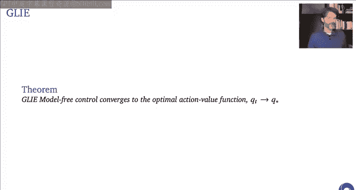

Of course， that was for the Monte Carlo case and we' talked a lot in previous lecture about。

Benefits of doing temporal difference learning rather than Monte Carlo。

 so now maybe somewhat obviously we're going to turn to that same question and we're going to see if we can use temporal difference learning for principle。

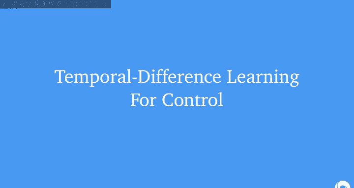

So to recap temporal difference learning has several advantages over Monte Carlo learning。

It has lower variance in the updates， it can be used online and it can also learn from incomplete sequences。

 which also means that for instance， if the episodes are really long。

 or if you only have exactly one episode in your whole lifetime。

 temporal difference learning can still learn or as Monte Carlo would not be able to learn during the episode。

So an natural idea would be to use method temporal difference methods instead of multicardial methods to do control。

 so basically we wanted to apply temporal difference learning to the action value functions to have this same convenience of being able to easily pick a greedy or an Epsil greedy policy。

And then for instance， we could use Epum greedy policy improvement as before。

But we could also continue to update every time step because temporal difference learning can learn from individual transitions。

 it doesn't need complete episodes。So one way to do that is the SARSA algorithm I briefly talked about it in the previous lecture。

 SARSSA is just simple difference learning for state action values and one way to depict this is to look at this diagram where we start at an action which corresponds to some action A taken from some state S which is not in the diagram and then we see some reward R and we reach a new state S prime。

And then we consider already what the next action will be under the policy a prime and then we use this to construct an update so our target here will be the immediate reward as always。

 plus a discounted next state action value of ST plus180 plus1 and we're just going to compare this target to our current estimate as usual half a small step size to get rid of the variance or the noise in this update and then we just update our action value functions incrementally using this update。

SarRSA comes from the name， SARSA comes from the usage of state action reward state and next action。

 so that's state action rewards take action SASA。Now this is a very natural extension for the temporal difference learning algorithms。

 and we briefly touched on it last lecture， but then maybe somewhat obviously you can use this in place of Monte Carlo learning。

So this is the proposal we're just going to do generalized policy iteration again。

 but now we're actually going to consider instead of taking full episodes or maybe even multiple episodes。

 we're actually just going to do this time step by time step。

 so each evaluation phase will be exactly one time step long and then we immediately consider the absolute degree policy with respect to our new action values。

Now， if you think about this， when you do this epsilon greedy policy。

 the greedy action might not have changed on a single update。

 so it might be that your policy actually remains fixed for a couple of time steps。

 which means that the policy evaluation will also last for a couple of time steps。

 but occasionally or sometimes maybe fairly often， it might be that the identity of the greedy action does change。

And that means that the policy evaluation step can last as short as a single step。

Before you immediately apply this gratification step， this epsilon gratification step。

But then the next time step youll evaluate this new policy and we are still doing a version of generalized policy iteration。

 it might not be immediately obvious that this algorithm is sound and will converge。

 but actually this has been proven This is not trivial to prove。

And I can give you pointers to papers in which this is proven， but for now。

 I would just assure you that this is a sound algorithm。

So this is how that then looks if you want to write it down a little bit more explicitly emso code。

 this is from certain embarto and this is for the tabular algorithm。

 so we're going to use a capital queue to refer to a specific cell in the table corresponding to some state and action and then for each state action pair is going to arbitrarily initialize this。

 for instance at zero。And then we have this double loop where the outer loop is on episodes and the inner loop is on steps within the episode。

 so each episode starts by initializing the state。Here。

 think of state as the initial state of your episode， which is given to you by the environments。

 for instance， the state could simply be the observation。And in the simplest case。

 the observation could be the full environment state。If you're in a fully observable problem。

 that would be the case， and then as agent state， you could use just use that observation。

More generally， when we say states， this should be the agent states。

So the initial agency could also be due from the first observation in the episode。

Somehow inferred from that。Then we immediately pick an action according to our policy and the policy is derived somehow from the action value typically。

 although it doesn't have to be for this algorithm。

 we could also be using SARSa for pure prediction as we talked about in the previous lecture。

 but in this case， if we're wanting to do a control。

 for instance the policy could derive from our action values and could be epsilon greedy。

And then in the episode， we just repeat the following steps where we actually execute action in the environment。

 which means we can then observe a reward in a next state or a next observation that helps us construct a next state。

And then we immediately pick the action that we're going to execute in that next state。

And then again， this is from a policy for instance， derived from the action values。

 and then we use that action to update because we're going to update the state action value by adding this temporal difference error。

 which is the reward plus the discounted state action value at the next time step minus is our current estimate and then we just replace S with S prime and a with a prime and we start to loop against on the next step we'll actually execute this a prime that we've just chosen so we picked the action here and then on the next loop we'll actually execute in the world。

And then it this just continues until the state is terminal， so if its to final step of the episode。

 and then we repeat the next episode， we start again in a new state。

So this would be the SARSSA algorithm it's not too complicated to implement。

 although you should be careful to get the details correct because otherwise there will be no learning。

And this algorithm， as I promise， there is a theorem that is also convergs and specifically we need the same condition that we needed for Monte Carlo control。

 which is that the policy should be readinging the limit with infinite expiration。

The greed and limit part is to ensure that the action at the next time step will eventually become the greedy action so that we're actually evaluating the greedy policy。

Instead of evaluating whatever policy we currently happen to follow， that will be a different thing。

And the infinite expiration is just to make sure that we actually update all state action values indefinitely often。

 because otherwise we might have irreducible uncertainty about some of these state action values。

 which might lead us to draw the wrong conclusions about which policies are preferred。

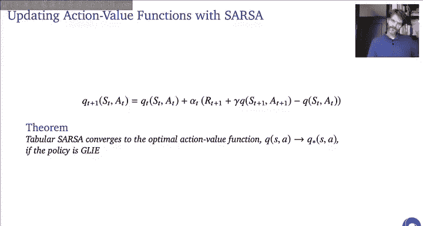

Okay， so that's one way to go Monte Carlo learning and SAA learning and in both cases what we're doing is we're interleaving this policy evaluation and this policy improvement step。

Now we're going to turn to a new topic which is off policy learning。

 which is about learning about a policy different from the one that we're following。

 and there's a specific very popular algorithm that is an off policy algorithm called Q learning。

 which we'll also talk about here。

Before we go to explain what of policy TD and Q learning are。

 I'm first going to recap briefly from the dynamic programming lecture that there's different ways to find the value of the。

Optimmal policy， and specifically we talked about these four different algorithms essentially that are on the slide。

Where there's two algorithms here for policy evaluation。

And we've just discussed how we could use policy evaluation in policy iteration if we interleave the policy evaluation with a policy improvement step。

There are also algorithms in dynamic programming which we can use to immediately estimate the value of the optimal policy in a more direct way。

 and one way to think about this is that we're basically interleaving the gratification very tightly with the evaluation So this is what value iteration does and if we look at this equation here。

 the second equation what we see is we basically immediately consider the greedy action。

With respect to one step。Look ahead according to our model。 This is dynamic programming。

 Well go for We'll turn to the model free approach in a second。

 So here we're just assuming that we have a model。 So we're just going to consider it a maximum value if we roll a model four at one step and then bootstrap on our current estimates that we have。

So basically you can view this as immediately doing a gratification of this estimate in one tight loop and value iteration。

 as we have discussed， ora has discussed will also converge and it will converge to the optimal value function and hence you can infer the optimal policy。

And then for both these categories， policy evaluation and value iteration， there are two variants。

 one for state action values or sorry for state value learning and one for state action value learning。

 so we see these V state values and Q state action values。

We notice that the policy evaluation for state action values looks a lot like SARSA and indeed there's a strong relationship to those。

And indeed， all of these algorithms can be well not all of them。

 many of them can be turned into model free algorithms， which is what we're going to do here。

So we' already talked about temporal difference learning in the previous lecture and SARSA in the previous lecture and also just now。

 which can be viewed as sampling the policy evaluation algorithms going back to the previous slide。

 where there's an expectation here， which we can sample according to our current policy。

 and then we can use this as a target to update slightly towards。In doing so。

 we introduce a step size to only make a small step because we will have a noisy target。

 unlike in dynamic programming and hence we want to somehow average out the noise and for this we use a small step size to make sure that we don't。

Jump too far and at the others it become too noisy。

 And then we can see that TD corresponds to sampling this first one。

 where such corresponds is sampling this third one。

But there's a third algorithm and that algorithm is called Q learning and it corresponds to sampling this last equation。

 where there's also an expectation outside， but there's a value iteration equation here which has a maximization over the actions inside。

I talked a little bit about value creation here on the second line where we immediately go for greedy in this last line because we're considering a state an action。

 we're actually already conditioning on that first action so that one can't be taken to be greedy。

 that's just for any action you can do this evaluation。

But then we can still roll forward one step and consider in the next states the greedy action。

 the one that maximizes your action values。This is still a value algorithm and it's one that we can sample which we've done here。

 so we see that Q learning takes our state action value and updates very inegantly to SArsRSA where the only difference is is how we bootstrap instead of considering the next action in the next state。

 we would consider best action that we could possibly take。According to our current estimates。

 and then use that as our estimates for the greedy value of our currents。

Value function and back that up。Note that there's no trivial analogous sampled version of this algorithm。

 which is the value algorithm for state values。And I want to encourage you to briefly think about that。

 why would that be the case， why are there four dynamic programming algorithms and only three mo free algorithms on these slides？

So feel free to pause the video when whenever you want to take a second to think about these things。

 I will now immediately give the answer to that， which is that it's in some a convenience thing where out of these dynamic programming equations。

 three of them have the expectation on the outside so it's very convenient to sample that but the value tu for state value functions has the maximization outside the expectation and that means that it's no trivial to sample this it's not immediately obvious what the more free algorithm should look like if you wanted to do this。

So that's why we don't have an atat a small free algorithm here。Okay。

Now I want to make a distinction between on policy and off policy learning in some generality。

 and I will connect this to this new Q learning algorithm。

Home policy learning is about learning from a behavior。

About a behavior policy from experience evidence from that policy。

 that's what we've been discussing so far for the Monte Carlo control algorithm and for SARSSA and also in a previous lecture on policy evaluation。

 we always considered there was just one policy and that policy would be used to generate your behavior because you want to make predictions about the value of that policy。

We call that on policy learning because we're learning about the policy that we're following。

We could also consider of policy learning which refers to everything else so on policy learning is in some sense a specific case and of policy learning is everything else。

 which means that we're learning about a target policy pi but the experience sample is from a different policy which we could call mu sometimes in the literature the termmin knowledge is slightly different sometimes people use B instead of mu that's kind of not to relevant well try to consistently use mu for the behavior in the coming upcoming slide and m pi for the target policy so please keep that in mind that mu is also just a policy to select actions it's a distribution of actions in each state it could be deterministic if you wish。

And then we want to learn about a potentially different policy， a target policy pie。

This refers essentially to learning counterfactual about what if about things you could be doing。

So to give you some examples， for instance， you could have a question。

 this is a valid predictive question， what if I will turn left。

 maybe you're not turning left all of the time or maybe you're turning left occasionally in some cases but not in others。

 like consistently，It could also be that you have a random policy that turns left stochically every so often rather than occasionally。

And then we could have a question that is， but what if I return left all the time？

So that could lead to new observations， new rewards。

 or we could have a question when we were playing a game。

 what if I would have played more defensively would this change my win probability？

Or we could just for instance， ask what if I would continue to go forward。

 let's say you're a robot and you may continually you make predictions about how many steps until that bump into a wall。

 that could be a value function where the reward could to just be the number of steps in the episode term could be when you bump into the wall。

 that's a valid predictive question， but if we don't follow that behavior all the time。

 then we might still want to make this prediction。So I haven't told you how to make those predictions。

 how to use your data to learn these things， but I just want you to realize and think about these as valid predictive questions that could be helpful for an agent in the world and maybe even want to ask multiple of these questions these are off policy questions because they refer to asking questions about what if behavior that I'm not currently maybe doing all the time。

So in general， we want to evaluate a target policy to compute the estimated value of that policy。

 either the safe value or same action value。And we're using a different policy mu to actually generate the actions。

So why is this important well， one reason why you might want to do this is you might want to learn from a database。

 let's say you have some stored experience， for instance。

 from observed from human behavior or from other Asians， from for instance。

 data that was logged somewhere。The behavior is not under your control。

 so there is just some frequency of actions being selected in the data。

 and maybe you have what if question， what if we would have instead followed this strategy？

Of course that strategy should be supported by the data there should be some samples in the data that will support and give you data about that question。

 otherwise you can't learn， but this is a valid question that you could have where the experience might differ slightly。

 for instance all actions might be selected under the database but not in the same frequencies as you want to consider them。

And then learning of policy is kind of a natural thing to be doing。Somewhat similarly。

 you might want to reuse your old experience。😡，So far we've considered algorithms that learn online so they basically consume data and they update themselves or they wait until the end of the episode。

 like Monte Carlo does and they update everything at the end of the episode。

 but then the data is thrown away and you move into the new episode and you only use the information from a new episode to update your policy from that point onwards。

Now arguably this is potentially a little bit wasteful and indeed it's a fairly popular approach to store the data that you've seen and try to reuse that to learn more。

But that means if we're doing control， your policy may have changed in the meantime。

 when you were collecting the data， you may have had a worse policy， for instance。

 or just a different policy， or you could have been exploring more at the beginning。

So that means that in general， the behavior policy。

 the probabilities of selecting certain actions might be quite different in your old data than it is currently。

 but you might still want to learn about it， you might still want to use it。

Separately in addition to these other cases， you could also want to learn about multiple things at the same time。

 so this is related to these what if questions that I showed on the previous slide。

 where even if we're following one policy and we're not trying to learn from past data or from other sources of data。

 we might still want to learn about many things， many what if questions because this is a way to accumulate knowledge about the world。

So that refers to learning about multiple policies and then therefore all but one of these policies should be of policy at most one can be exactly your behavior policy。

 so any other policies would be you would require of policy learning to learn about them。

And finally now we're going to turn towards this one a little bit more in detail。

 you might want to learn about the greedy policy while following an exploratory policy。

 this one is maybe obvious in the context of policy a where we're always interested in this policy improvement step which can be implemented by making your value functions or your policy greedy with to your value functions。

So it's a valid question to ask， what is the value of the greed policy。

 because that's the policy that we're going to consider next。

But we might not just want a sample from that greedy policy because of reasons I mentioned before that you might not explore sufficiently often。

This brings us back to this learning algorithm。Q learning estimates the value of the greedy policy。

It's conditioned on the state action pair oh sorry this S and A should be ST and A。

 so we're considering a specific state and action pair and then we're taking one step the reward and then in the next state we consider acting greedily。

So we are learning about the value if you take this action， but then in the next step。

 you would be ready。And that's a valid target to update。

 and it would be learning about greedy policy。But you don't want to necessarily act all the time according to that policy because that wouldn't explore sufficiently。

Now， fortunately， it turns out。If you do this Q learning algorithm。

 if you do the tab you a version specifically， then you will converge to the optimal action value function as long as we take each action in each state infinitely often。

Now this might sound similar to what I said about SArsRSA。

 but there's an important difference here which is that you don't actually need your behavior to become greedy。

 in fact Q learning can learn the optimal value function eventually even when you explore uniformly at random throughout your lifetime。

Of course to have actual convergence because this is a random process and you'll have random data。

 this is only through in the limits， so you do need to get infinite data in the limit。

 but you don't actually have to make your policy query anymore that's a big difference between Q learning and SARSA。

So this works for any policy that eventually selects all actions sufficiently often。

 the uniform policy is one example， Epsilon greedy will be a different example。

 but we no longer have to decay the epsilon。You do require appropriately decaying step sizes。

 this is true for all of these algorithms including SARSSA。

 but also for policy evaluation with temporal difference learning。And for instance。

 the Robbins Monroe conditions， as they are called suffice to have that。

 and these conditions are that you're a step size。Is chosen to be such that if you sum over all time steps until infinity。

 that in total your step size will be infinitely large。

 this ensures that from any state action value estimates that you currently have。

 you can always move far and off to find new estimates that are more optimal。

And then in addition to that we want that the sum over all time steps of the squared step size is less than infinite。

 it's a finite number， this essentially ensures that eventually your step size becomes small enough。

 that eventually you cancel out all the noise that you eventually start averaging enough data in that you can get rid of all of your uncertainties。

These two conditions together ensure convergence of the Q learning algorithm。

If you also explore indefinitely， and for instance。

 a specific choice that you can consider here is one divided by the time step to the power omega where omega is somewhere between half and1。

So the extremes here are1 over t or one over square root of T on the other hand。

 if you would pick anywhere between those， you would have these conditions so that would be a suitable step size parameter and we can see that basically these step size would then decay over time and eventually you make smaller and smaller updates。

So that kind of tells us that Q learning is a good algorithm that we can use。

 and now I'm going to step through an example a little bit in more detail to show you the differences between Ke learning and SARSA。

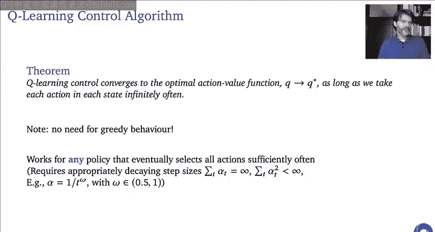

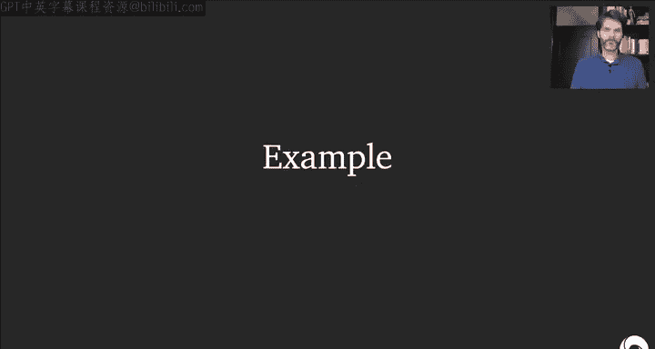

So for the example， we'll go to the。Blackboard。那先し。And let me just depict some state。

Which you could call S。And maybe there's some action you could take and there's some other action you could take。

And let's say， for instance that we've taken this action below here， let's call that a。

And then from this， we transition to the next state。Maybe for argument sake。

 let's say we transitioned deterministally， but there could be multiple states。

 of course that we end up。And then we consider。Another step。

And there's also some reward along the way here， let's say that the reward was plus one or something of the form。

And that's considered this one transition here where we were in a state， we took an action。

 we saw a reward and we saw a next state。Now let's arbitrarily say that here initially our action value function was。

Let's say for this arrow pointing downwards was say。1。

Then we could consider what happens if we use SArsRSA or Q learning to update this action value function。

Now in order to for the update， we have to establish a little bit more。

 so let's say that discount factor is a half。For concrete and arguments。

And let's say that we have some estimates。 So here。

Let's say that our Q estimate of S prime for the up action。Might be， for instance。

Let's say plus four。And then we also need some sort of an estimate for the year down action。

I haven't yet told you which action we're going to take。We'll get to that in a moment。

 And let's say the。Down action is only worth two， according to our current estimates。

 now these are not the true values， these are just our current estimates。

Then we could consider what the targets are that Q learning or SARSA would use。Now。

 let's say that we've actually selected。This action to go down， then Q learning。

Doesn't actually care too much about which action you've actually taken。

So the target there would be reward plus discounted。Maximum action in the next state。

Which in this case would be。Plus one for the reward。Plus。A half， which is our discount factor。

And then we look at this max action in the next states， which in this case would be plus four。

So in total， this would give us a target all。3。So depending on our sub size。

 we had had an estimate of one to start with。And then depending on our estimate。

 we or depending on our step size， we would update this estimate some portion upwards。

 but it would be updated in any case upwards towards three。Prase differently。

 our temporal difference error will be plus 2， and then we add whatever our step size is times that temporal difference error to our estimates。

So for instance， to make that very concrete， if our step size would be 0。1。

 our new estimate would be。1。2。You can you can calculate that yourself if you want wish。Now， SArsRSa。

Needs the actual action that we selected。So let's say for argument's sake。

So first let's write on the SARSSA update， it takes the next state and the next section in into account。

Let's say for argument's sake， that it's selected the action to go。D。Then。

Everything else is the same， the reward is the same， the discount is the same。

 but the next value would be plus 2， it's the value of that action of taking down。

 which would mean that SArsSA would only give you a plus 2。Or。Alternatively。

If the up action was taken， it could also have generated a target all plus three。So if。A prime。

Is down。 This is what happens。 And if a prime is up。This is all the same。

But the update is slightly different。So we can see that SARS would perform the exact same update if it would happen to pick degree action。

 but there's some probability that it would select a different action and then the update would be different。

That's okay， it doesn't mean that one is necessarily better than the other and in fact in both cases here the target would be higher than our current estimate。

 so we would update our estimate value a little bit upwards。

 but of course if we see a plus two as a target we would update it upwards less than if we would see a plus3。

One could also say that if， in fact our policy was uniformly at random。

 let's say it would pick both of these actions with the same probability。Then in expectation。

 the search of target will be two and a half。Instead of two or three。Okay。

 so I want to conclude the example for now there。

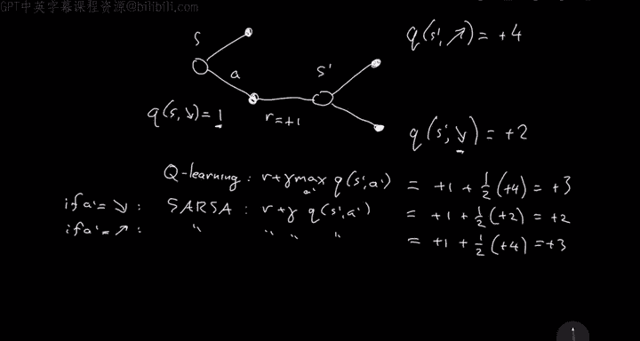

And we'll go back。To the slides。

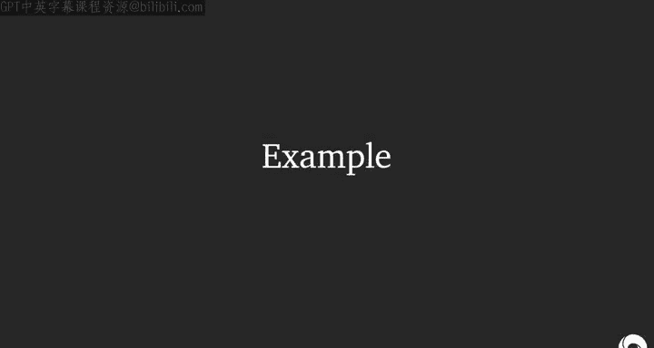

So I actually want to show you another example that would illustrate differences between SARSA and Q learning and now we're going to use both these algorithms for controls so we're trying to optimize something and this is called the Cl world or it's just a cliffwalk example as it says on the slide and I'm going to explain the example to you and then I'm going to explain the plots that you can see below。

So the example is quite simple， it's kind of a great world where you start in state S and on every step you get a reward of minus1。

 there's no discounting so your total reward in an episode will simply be the number of steps you've taken and then there's a goal all the way on the right hand side。

And if you reach that goal， you end your episode。This is beneficial because it means that the minds once stop。

 so you're actually encouraged to find to go as quickly as possible because the maximum value would be attained if you're minimizing the number of steps you take in an episode。

Now there's an additional important thing happening here。

 which is that there's this region here at the bottom called the cliff and if you step into that。

 you get a reward of minus 100 and you transition back to the starting state。

UI believe this also terminates your episode， so the episode would then end with a minus 100。

So what would be the optimal thing to do here well the optimal policy is shown in the figure and it would actually start here in the start set as always。

 we've go up one and then walk right past the cliff。And then it would go down onto the goal。

You could also consider a safe path you could go a couple of steps away from the cliff and then walk according to the safer path。

Now。We want to learn the optimal value function in this problem。

 perhaps and we want to have the optimal behavior， but we know we can't not explore because we don't we're assuming here that the agent doesn't know the structure of the problem otherwise we could do dynamic programming。

 so instead we're just going to learn from experience and we're not going to assume that the agent knows everything so it has to try each action in each state。

And we'll try these two different algorithms， SARSa or Q learning to learn in this example。

And we're going to use an Epsilon greedy policy here。

Now what you see here at the bottom quite interestingly is the actual rewards per episode， sorry。

 that these different algorithms attain throughout learning。

 and we can see that after less than 100 episodes maybe after even 50 episodes or so the algorithms have both stabilized to a certain。

 apparently to a certain policy， which gives us them a certain amount of reward per episode。

Interestingly， SARSA has stabilized around minus25。

 which means that it takes roughly 25 steps to reach the goal whereascu learning has savedized around minus50。

Does that mean that Q learning also takes minus life roughly around 50 steps， no， actually。

 it means that cure learning regularly falls into the cliff。So why does this happen。

 why does Q learning perform worse here than SARSa。

 didn't I explain that both of them are optimal in the sense of theverse optimal policy？And in fact。

 I didn't say that we're decaying the epsilon here， which we're not。

 and didn't we say that coing can con to the optimal value function？When we don't decay the epsilon。

 whereas SAA cannot， so what gives you， why is SAA performing better than Q learning？

The reason is that SARSSA is an own policy algorithm and being an own policy algorithm。

 this means that SASA will evaluate the policy that we're actually following。

And will give us valid estimates， accurate estimates for that policy。So at first。

 the policy is changing， right， but at some points it will kind of stabilize。

Even though we still have an epsilon， so there will be some randomness to the policy。

 but the policy will be stable。Because the ebstinence are changing。

 but also because the action values won't change that much anymore。

And that means that even though the Epson greed policy depends on your action values。

 if your action values don't change that machine anymore order， the policy can become quite stable。

But this policy does explore， and that means that there's some non zero probability that the policy will actually fall into the cliff and that's captured here in these average rewards per episode。

嗯。So what does SARSA do， SArsRSA being on policy algorithm accurately estimates that if you have this epsilon。

 if there's a probability to explore， then if you would be very close to the cliff。

 there's a pretty high probability that you'll fall in it。Let's say the apsilon is 0。1。

 that means that 10% of the time we pick a random action from this state。

So this could mean that you either go back or you go up or you go right or you fall into the cliff。

So if you try to walk along this optimal path， there are many opportunities for the algorithm to step into the cliff。

And get this reward of minus 100。Sar says estimating these values so basically SAar says saying well if I have a choice。

 maybe I shouldn't walk so close to the cliff because I know I will explore。

 I know that there will be some randomness in my policy。

 I know what the value is all that policy and turns out maybe then if I'm very close to the cliff。

The higher value action is to actually step away from the cliff first。To the safer path。

 which is a couple of steps away from the cliff in which you can reliably get to the goal。

Because if on the safe path， you pick a random action， you could step down。

 but then you have an opportunity to step up again on the next step。Of course。

 occasionally it can happen that you explore twice in a round could be that you step down randomly and then step down again。

 but then if you're on the safe path， at least you can recover again immediately。

 whereas if you're immediately next to the cliff， just one exploratory action will tos you。

So why then is Q learning performing worse， well what we're evaluating here is the actual rewards per episodes。

 which does include this expiration， this means that Q learning is actually has estimated maybe by now accurately the values of the optimal policy and maybe the values of the optimal policies will tell you or actually quite likely the values of the optimal policy will tell you to walk along this optimal path。

But then if you execute an Epsilon greedy algorithm around this。

 the Epsil greed algorithm will try to walk along the path。

 but occasionally it will be bumped back or up。But then occasionally will also fall into the cliff。

So on average， because tutor is not taking into account that it's actually exploring。

 it will do worse。If however you would take both these algorithms。

 let's say here at the end of learning， and then you would look at the action values and then execute the greedy policy according to both these algorithms。

 then Q learning would actually have found a shorter path and it would actually walk very reliably next to the cliff without any explorationir towards the goal。

So it really depends what you're after here SArsRSa。

Does better because it takes into account of exploration that we're doing。

 but Q learning has actually found a more optimal policy if we would only execute that policy instead of the exploratory one。

This is more meant to illustrate differences between on and off policy learning than it is to say SARSA is better than cur learning or vice versa。

 but it's important to appreciate these algorithms have different properties and this is meant to illustrate one of these properties。

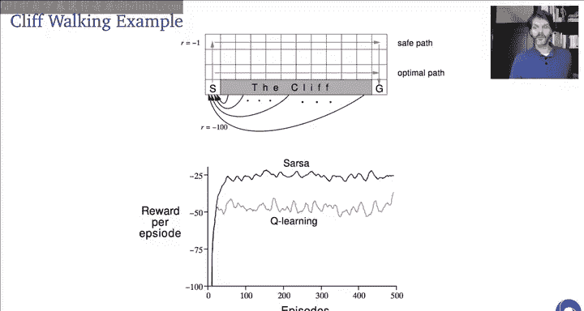

Okay， now we're going to turn towards a different topic。

 which is a different failure mode for Q learning because it is known that Q learning can overestimate the a values。

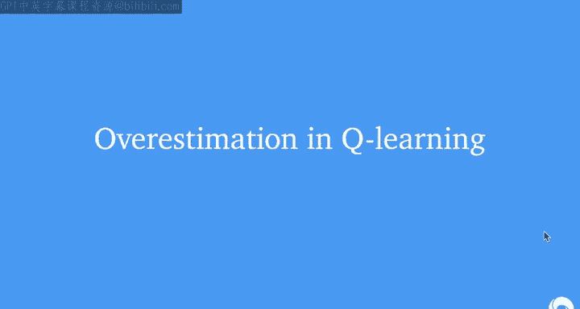

So this is about classical cur as discussed before and the issue that we're going to talk about is related to the following so first we're just going to write out this bootstrap target that is used in curing。

As mentioned before， we're just looking at the action values。 We're picking the highest one。

 We can actually write this on differently as done on the slide， where we consider the。呃。Arg max。

 which means the maximum elements of our estimate at S plus one。

 and we could consider that basically to be a policy， right， we're picking a policy and specifically。

 we're picking the policy that is greed with respect to the action values。

 and we can write it down a little bit verly， a little bit like。

More explicitly over here by saying there's a policy that picks the highest valued action。

 maybe breaking ties equity or something like that。

 and then we consider evaluating the value of that action。

This is equivalent that just taking the maximum action value， but writing it out like this。

 we can notice that we're actually using the same value function to select this action。

And then to evaluate the action。But these action values are approximate。

This in particular means they could be wrong。And what this means in practice is that you're actually more likely to select an action value that happens to be high。

Then you are just left one that happens to be low。So。

What this means is if these values have some noise。

 they're wrong because you only have finite samples or because you're doing function approximation or all sorts of reasons why your action values might be wrong。

Then in fact， some will be estimated slightly too high by accident。

 others will be estimated slightly too low by accident。

 but this this phase here where we're selecting the action will。

Very likely pick an action that is overestd， much more likely than to pick one that is underestimated。

 especially if the true values are fairly close together。

 Let's say our true action values and is said are actually all 0。

But so far we've seen limited data and we don't have accurate estimates for all of them yet。

 you don't know yet that they're actually all zero。 so you think some of them are positive。

 some of them are negative。But then picking exactly according to the same function to evaluate it。😊。

We are picking an action that has a high value and then we're saying。

 I picked that because it has a high value and now the value is high。

 that means we have an upward bias。So let's illustrate this with an example。

 so consider the game Roulettes， this is a gambling game played in casinos and I'll briefly explain the game。

 details are not too important， but we're going to formalize the game as follows where we have one state which is that we're at the table and we're playing and in this state we're going to consider 171 different actions。

This is because there is actually 170 different options of plays you can do on the re table。

Relettete is a game in which a number is drawn at random by placing a little ball on the spinning table and then the ball will fall into a slot and the slot will correspond to some number。

The number will also have a color so of number could be a red number or a black number。

 and I believe the numbers go from 1 to 36 or something of the form。

In addition to just being able to pick a number or a color。

 you could also pick whether the number is odd or even or whether it's in the first half of the numbers are 1 to 18 or in the second half。

 19 to 36， so there's all sorts of different bets you can place。And then in addition to all of these。

 there's a number zero which doesn't actually have a color。

 so it's not covered in any of those and it's not considered old or even。

So if number zero is green and you can bet on zero。

 but it won't actually pay out if you have chosen either red or black as a bet。

Then these bets they will pay out and what they will pay out is associated to the likelihood of it happening。

 so if you bet 1 on red and a red number comes up， you get $2。

If you bet $1 on specifically to number 17 and then 17 comes up， you get $36。

So that means that the wind probabilities are random， obviously， and on average。

 you'll actually lose on every action a little bit。Because the zero could come up。

Now our actions here， as we formalized it not to make it too complicated is we're always just going to bet exactly1。

This is to avoid any issues with also having to pick a betting amount。

 which would blow up the action space potentially enormously。 In addition to this。

 we're not going to take into account your current funds。

 So we're not going to consider you being able to go bankrupt。

 So instead the action will just will just be you pick。A play to make。

 you bet $1 and you get your reward associated with that。

 and then you can can transition back to exactly the same state again so then you can play again。

And then there's one additional action which is to stop to play， which will pay as out zero。

So you either play a betting action and then you can play again and again and again。

 or on every of these earth times set you could always choose to walk away。

So all the other actions that don't stop the play will have high variance and will have a negative expected value because the existence of this zero on the reette board。

Betting actions do not end the episode， so you can continue to play indefinitely。Okay。

 I hope that's somewhat clear， so the idea here is that this is a fairly high noise environment。

 which means that our action values will be fairly inaccurate for a while at the beginning。

But it's a valid market physician process and we can consider doing Q learning and Q learning is known to convert to the optimal values even eventually。

 so it's an interesting question to see how well it fars here。

And then what we find is that it actually performs rather poorly。

So what we see here is the expected profit according to the Q learning algorithm so we're basically just looking at the values that it's estimating。

 so the action value estimates。And what we see here is。

There's some discount factor here at play as well I think it's probably 0。

99 or but I should look it up， but we can see here that Qe learning essentially thinks that even after updating all of the actions 100。

000 times， so we've seen 70 million samples in total for a tabular Q learning algorithm with just one state。

We see that tu learning is nowhere near the actual values。

 it still thinks it can actually win more than $20 as long as it just keeps on playing。

So that's rather bad because it means that Q learning is in some sense。

 something of a gambling addict here。And the actual values is much。

 much lower and also curing doesn't seem to be getting much closer。

So that's in the picture a little bit misleading， it seems curing has fully stabilized。

 it hasn't fully stabilized， this is actually using a decaying step size and curing is actually guaranteed to converge。

But the convergence will be extremely slow， that's what's happening here。

 So eventually cur we'll get there， but much slower than is practical。

We've avoided any issues with explorationiration just for this example。

 just to make it sure that we're not conflating anything。

 and therefore we've just selected every action simultaneously on every time step。

So instead of just picking one action， we're just picking all of them at once。

 sampling the reward for each of these actions at once。

 and then updating the action value function for each of the actions at once。

And then we just do that 100，0 times。So that's pretty bad And this you could imagine this showing up in larger problems as well。

 Of course this is a small contrived problem of specifically betting problem。

 but you can consider this to be part of a much larger MDP。

 let's say you're literally trying to learn a robot how to act in the world and maybe the robot has some sort of a money amount which is maybe somehow part of its reward function。

And then there's a casino in this world， so at some point the robot could walk into the casino could start playing and could find itself in a little subslice of the real big problem which corresponds to the smaller problem。

 then if robot will be doing queue learning， it would still stay at the table and think it would win if only it could play longer and longer and longer。

So that seems problematic， so there's a question here， can we fix this？Fortunately。

 there are ways we can go around that and we can go back to the main source of the problem here。

So cur learning essentially overestimates because it uses the same value function to select an action to evaluate the gradient action。

 and then to use the same value function to actually evaluate that action。

So the solution here is to decouple those two， so in Roulettes to make it concrete。

 it's quite likely that some of the betting actions that you've done so far will have one on average。

 maybe slightly more often an even number has come up than an old number or maybe the number。

14 has popped up slightly more often than would be expected on the average。

 there's always going to be some actions that will have one more than they will do in the long run。

But that means that on every step， Q learning transitioning back to that same state thinks a and now I played an action that didn't quite win。

 but on the next step I could play an action that does win。

 there's always an action left that does look good or at least for a very long time。😊。

So Q will then update as if this state of re transition back to actually has a high value because it literally picks the maximum that it could。

And therefore maximizes over all of the noise in the estimates。And the solution， as I said。

 is to decouple the selection from evaluation， which we can do as follows。

 and this algorithm is called doublele Q learning。So the double here refers to the effect that we're going to actually maintain two different state action value functions。

And we're going to basically introduce a new action value function Q prime。

So in equation1 here we see that we have our standard thing with the one step reward and then discounted value of the next state。

 but the value of the next state is defined by picking an action according to our normal action value function  Q。

 but then evaluating the value of that action with  Q prime。We could also do the inverse。

 we could pick according to Q prime and then evaluate according to Q。What we can use。

 do then is we can use each of these as targets for these2 different action value functions。

 So on every time set what we'll do is we'll pick one of the action value functions to be updated。

 so either Q or Q prime。And then if we pick Q， we use equation 1 to update it。

 and if we pick Q prime， we use equation 2。But we never update both at the same time because this would correlate them and then we would just be doing Q learning again。

 but if instead we pick either one or the other， this derelates the action values。

 they see similar data， but different subss of the data。

 and this means that we can get a somewhat unbiased estimate of the greedy action according to one of them。

So we're still picking greedy， this greedification step。

 this selection process is still likely to pick an action with a high value。

 but insmuch as that value is purely high because of， for instance random noise。

 then having a separate evaluation learn on different data might help us to get an unbiased estimate for the value of that policy。

So that's the whole algorithm essentially， but we don't have to actually throw away data so we don't have to only consider one of these action values when we actually wanted then infer a policy。

 let's say we want to act epsilon greedily or eventually we want to select the greedy policy with to these data。

 then we can use both action values， so the policy itself the way we select our actions can be based for instance on the average of the two value estimates。

So we're not losing any data in the sense that we might need double the amount of data or something like that。

 no that's not necessarily true， we can still merge together together our estimates as we use it for the policy。

We can also actually prove that Q learning double Q learning does converge to the same optimal policy under the same conditions as Q learning。

 which is nice， this tells us that we can trust this algorithm that asymptotically in the tabular case。

 at least it does converge under the same properties that Q learning does。

So that means that the algorithm is sound， but this is defect。

 doesn' it do what we want it to do so obviously we can apply this to Q sorry to the Letx example that we seen before and we find that indeed it does much much better by decoupling the selection and evaluation we see that it's much more accurate in its value estimates and indeed this also means that the optimal thing to do according to the estimates learned by double Q learning is to walk away from the table。

Actually， it turns out this is not specific to this tiny example。

 and we've seen previously a video of an agent playing Atari games。

I mentioned briefly that this algorithm was using something called DQN DQN is short for deep Q network。

 essentially what's happening there is we're using the Q learning updates with deep neural networks。

And that's very effective and it was actually also using Epsilon greedy。

 so you now know most that you need to know to implement a DQN algorithm。

 but we'll go into more detail in a later lecture。And then we can apply this idea of double Q learning to this algorithm because they're choosing Q learning。

 and therefore it might be susceptible to these otherestimations。So double DQM。

does something very similar to the double curtoring algorithm as I explained just now with a slight difference because something I haven't explained yet is that DQN uses something that is called a target network。

 which is already a separate network， so DQN already used a separate network to bootstrap on。

 but this was used more as stability thing where this separate network is just a slow movingov copy of your Q function that you're updating as you go。

And then because we already have a separate network。

 this makes implementation of W Q learning quite simple because we can just use that separate network to evaluate the actions。

 but we could still pick the actions according to the online network that we're updating all the time。

These details might be a little bit fuzzy for now because we haven't fully explained DQN yet。

 That's okay。 The main purpose for this slide is to show that if you apply something like double Q learning at skill to these Atari games。

 then indeed we also see a large gain in performance So the red here on the on the right hand side would be Q learning how well it performed across all of these different Atari games and then the blue is double DQN which is。

Basically like a one line change in terms of the full algorithm。

So what does this mean this means that double cu learning might be important in practice。

 and indeed it's quite a common component these days of many deepP algorithms。

And the reason why it's important is because these of estimations they do actually happen。

 They don't just happen because of random noise as in the relateette example。

 they also happen because of function approximation inaccuracies。

 So there is various reasons why your value estimates might be inaccurate and then double learning can be quite useful to help。

見げれた。It's more general than doubleQ learning and it can be generalized to other updates for instance if we're doing SARSa。

 you might think you're safe because there's no max in the SARSa updates we're just looking at the actual value of the next action。

 but turns out that's not quite sufficient to be safe because we're still actually picking that action because it has a high value if we're doing something like greedy or epsilon greedy。

So that means that SARSA can also overestimate， and then therefore we can also think about using the same solution。

 this could lead to something we could call double SARSA where we still use two action value estimates。

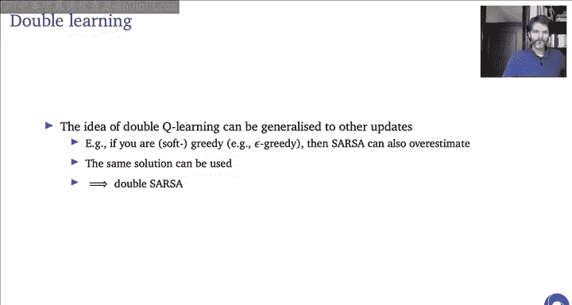

So now let's go back to the example that we've seen before and look at what double learning would do in that case。

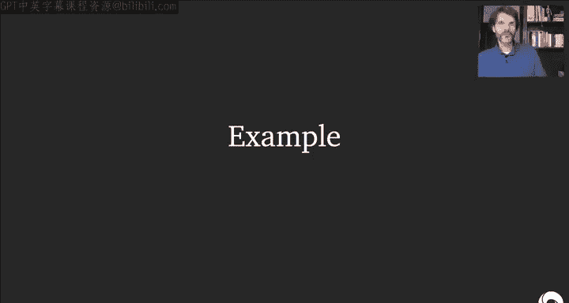

So let's go back to the example and let's maybe pick a different color， let's say yellow。

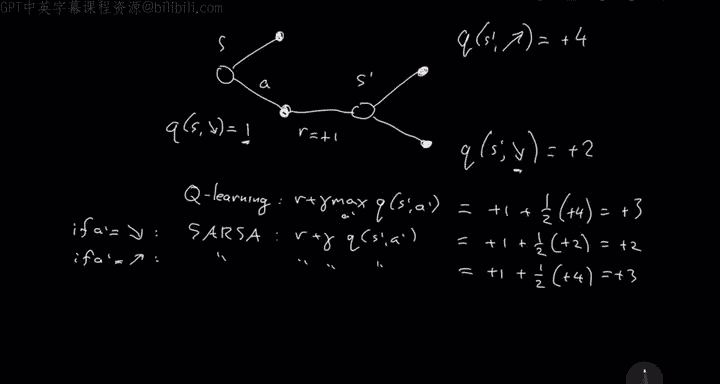

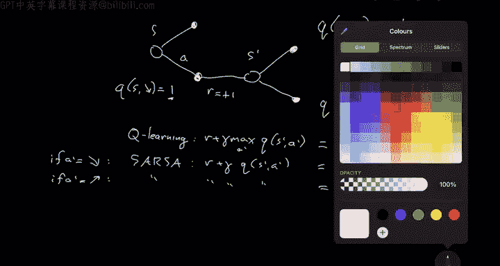

And what we need for double learning is we need a separate value function estimate。

 So let's say that these estimates here at the next stage。

They were just random and we could have maintained a separate estimate in that state。

For both these actions。And for instance， maybe this plus four was actually a little bit randomly chosen and maybe it could also have been zero。

And maybe in this。Other action for going down。Maybe we could have had an estimate。So maybe also zero。

 let's say just randomly， we pick two values here。 So what we're alluding to here is that this estimate of plus 4 was actually quite random and it could have been anything else。

 And similarly， this estimate of plus 2 that we had could also have been anything else。

And maybe we could also have had an estimate of zero in both these cases。

 I'm not saying one is necessarily more accurate than the other or anything like that。

 I'm just saying okay， this is another estimate that could have been the case just to go through the update a little bit。

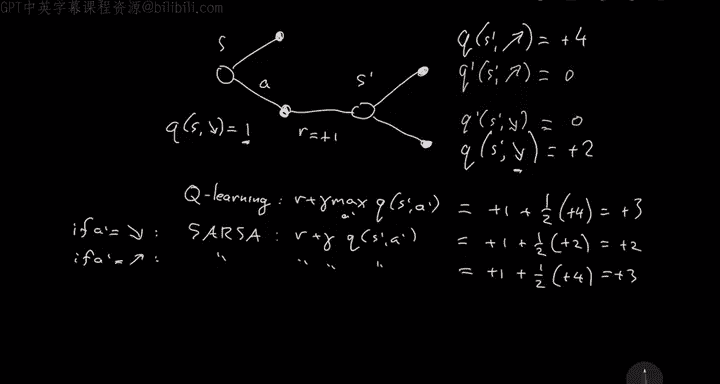

So if this is the case， then we can look at the double Q learning update and we can just look at what it does。

 So let's write down double。

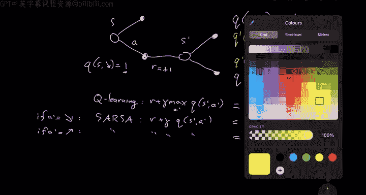

If you learning here。And let's remind us of the update。

 let's consider that we're also still interested in updating the action value for Q so we randomly depict pickeded between Q and Q prime。

 we randomly picked Q now and then we would have the same thing where we have the reward plus the discounts。

 but then in the next states we would have the A。Max。哦。Over action values and in fact。Let me use the。

Eser an amiga is a different color。Let's just pick that one。We're going to use Q prime to estimate。

 so that's the difference between Q learning and double Qing that we're using Q prime there。

And this would then。Be equal to plus one again， that's the same everywhere plus the discount it's the same everywhere。

 Okay， so what does this look like， This is the going to evaluate the greed action according to our online queue。

 so the greedy action would be up。Because it has a higher value according to that online value that we're updating。

 but we're going to evaluate with this other value。

 and that means that we're going to actually evaluate it at zero。

Which means that our update would tell us go to plus one actually。

 that means that our estimate won't change。So we can clearly see here the double Q constructs a target。

 which is not just different from Q in this case， but it's actually also lower。

 that's a little bit by chance because it could have been of course that these evaluations were different。

Like this zero over here could have also been7 or something else。

 but by and large it is true the WQ learning tends to pick lower values because Q learning does this selection so for instance it could also have been if both these action actually have the same value it could also have been that this one was plus2 and this one was plus4 so the other way around from Q learning in that case WQ learning here would update towards plus2 rather than towards plus4。

Get rid of those for simplicity。Now， we could also consider updating Q prime。

 I didn't say what Q prime was on the。Starting states， so we could also pick something random here。嗯。

Sorry。So we could also prime of this state of going down。Maybe this was， let's say for simplicity。

 that is also one。And then let's consider what happens if we're updating Q prime。 So this would be。

です。Updating。Q， and then if updating。Q prime。Double Q learning would do R plus gamma Q。S prime。

 and then we take the arg max。Both and see Chicagogo again。Q prime。Revo is the same。

 discount is the same。But now we're going to pick greedy according to Q prime well they both actually have the same value。

 so maybe we could also consider the policy to be uniform across these two。

 We could either break tie randomly if we consider the values to be exactly the same。

 but we could also just say let's do it 5050。 So let's just average both these values。

 So this would then be。Plus 3。Which means we'd get something that is one plus one and a half would be 2。

5。So if we happen to choose to update Q， we would actually keep it the same。

 the target will be the same as a current estimate。But if we happen to update Q prime。

 Q prime is estimated at one and seems to be a little bit low compared to the estimation according to Q in the next state。

Again， I'm stressing here that we're actually not saying that necessarily one of these updates in this example is better than the other。

 This is just to show that the mechanics of the update， this can be quite useful and in fact。

 if you implement these algorithms， it can also be quite useful to actually just go through a couple of steps and print a lot of stuff so just look at what the actual updates are that you're doing like how are the values changing。

 does it make sense how they're changing。You can do this in the long term。

 you could plot all sorts of statistics， but it can also be helpful to actually really go into the small little details and look at this step by step。

Okay， so this is just to show you the mechanics of the updates and now let's go back to the slides。

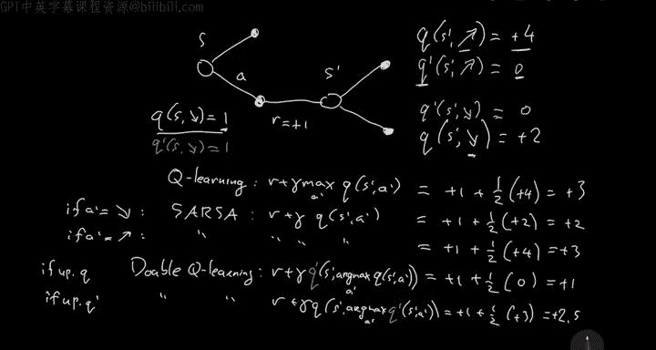

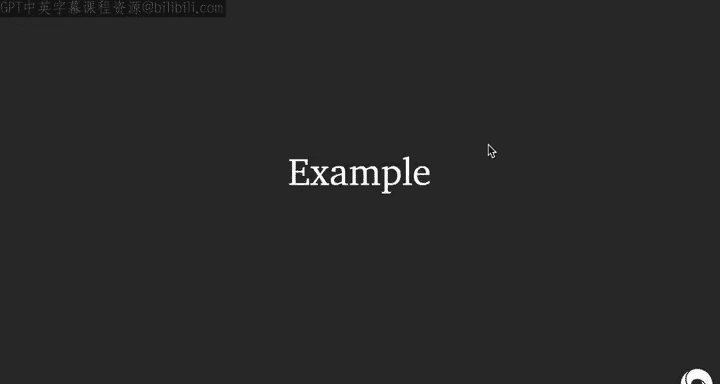

We're going to move on to more generically off policy learning。

 we talked before about different reasons through off policy learning and then we went into some detail to talk about off policy learning。

For the greedy policy， because this is useful for value iteration and policy iteration style algorithms。

 now we're going to talk more generally about off policy learning and specifically we're going to talk about how to use important sampling corrections to do this。

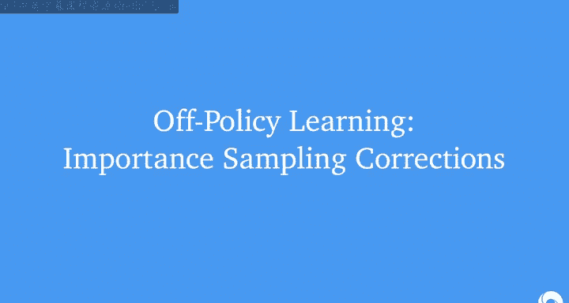

So just to recap to recall of policy learning means learning about one policy pi and we call it the target policy from some experience generated according to a different policy mu Cu learning is one example where pi is the greedy policy according to your current action value estimates and mu can be any exploratory policy。

But there are other options as well， and fortunately。

 there are some general tools that can help us with this。

But there's one important caveat you just basically keep in mind throughout。

 which is that you can never expect to learn about things that you never do right you can't expect to learn about a policy if this policy contains actions that you would literally never take according to your behavior policy。

 then you simply don't have the data to support this。

So we're first going to say this a little bit more in general。

 so the goal is to find some function F with random inputs X and a distribution D prime。Sorry。

 given some function Fs with random inputs X as and distribution D prime。

 we want to actually estimate the expectation of f of x under a different distribution。

And the solution to this is to reweight the function so the idea is that this function is going to shortly be the update to our weight。

 so we have some sort of an update to our weights so some sort of a distribution and we want to reweight this as if we're doing the update under a different distribution。

So that's very briefly step3 these steps they're not complicated。

 We have some expectation of this function of X under some data distribution D in this case。

And what we this is what we want， right， we want to actually sample Fx under some distribution D。

But we don't have D we don't have that distribution。

 we'regene the data under a different distribution， so let's first write out what this thing means。

 it's just the summation over all x or the integral if it's a con space。

 but we're just going to merge all that into this one notation of all x of the probability of x and then times the function of x。

What we can do is we can rewrite is in a form that looks a lot like an expectation under D prime by just simply multiplying by D prime and also dividing by D prime。

 and this we can write again as an expectation and we notice that the thing inside is now D divided by D prime for every x times f of x。

What does this mean， this means if we sample this final thing。

 we would actually get an unbiased estimate of the thing that we were looking for on the left hand side。

 These are all just equations， so these are just all equalities， sorry。

 so that means that we can actually do this， we can sample this thing and get actually an unbiased estimate for this thing that we started off with。

There is an assumption here， of course， which is that the。The data should support。

 as I mentioned before， which we can also see here in the ratio。

 you never want to actually divide by0 right This means that whenever D is non zero。

 D prime also needs to be nonze otherwise this is not well defined and you can't actually do this and this is related to this caveat which sounds maybe much more intuitive。

 but here's the mathematical side of this and the intuitive explanation was well if you never actually do anything if you've never actually sampled a certain x under D prime。

 you can't expect to learn from it。So this is the generic strategy that we're going to use。

And the intuition is that we're going to scale up events that are rare under D prime。

 but common under D because then D prime will be small， but D will be large。

And that's appropriate because we're going to basically。Have D prime， right。

 that's our sampling distribution。And if things only very rarely happen。

 they're only very rarely sampled in your data， but they would be very common on the distribution that you care about。

 then obviously you should scale them up in some sense right and of course。

 conversely if they're very common on your data distribution。

 but they would be very uncommon or maybe even would never occur D can be zero， that's okay。

 then you would scale them down。So basically， we're just going to average all of the events that we see。

 these random events， and we're going to reweight the averaging so that the distribution that results from a reweight is appropriate。

That's the generic idea。And now we're going to apply this to reinforcement learning and we're going to start simple so we're first going to apply this to one step reward。

 let's say you are doing policy evaluation for a bandit。

 but you're sampling according to a different policy than the one you're interested in。

So our behavior will be mu as before， and we're just going to consider the expect reward and the expect reward only we'll get to value functions in a moment。

So we can again write this out as an explicit expectation by summing over all the possible actions and writing under the reward as an explicit function of the state action pair。

I'm using this notation here， RSA is the expected reward given that you both have the stay and the action。

 it's just shorthand。If you have both stated in the action。

 the expects that reward itself doesn't depend on your policy anymore。

Then we're going to do the same trick again， we're going to multiply with the behavioral probabilities and divide by them。

 which means we can write this as an expectation under our behavior policy mue。

Which means if we sample this quantity， we get an unbiased estimate for this quantity that we're actually after the expect reward under policy Pi。

So。In short， when following a policy pi， we can use this reweighted sample as an unbiased sample for the expected reward under policy pi。

 So in following mu， we can sample according to the policy pi。

Note that we're not changing the sampling distribution。

 so important sampling sometimes refers to actually picking mu in a specific way here we're just using the corrections mechanism。

 so we're using this reweighting of the samples to make sure that the resulting estimates are unbiased samples。

And now we can， of course， apply this to estimating value function estimate。

So we're going to generate some trajectory， we're going to use tau here to refer to the trajectory。

 generated with our behavior policy mu。Now we want to use the return。

That we generate it because that's all that we have。 We have our behavior。 We have some return。

 and the return is a function of the trajectory。 so we can write that down quite explicitly。

 So note here， we define we overload notation slightly by saying ge could also be interpreted as a random function of this random trajectory。

And specifically the function that it is， is it just picks out the rewards and adds them together with the appropriate discounting。

Now we can use the exact same trick that we just used for the bandit case for the one step reward case and applied this to the Monte Carlo case。

 and in order to do so， we should have the probability of the trajectory of that flu trajectory under our policy pi divided by the probability of the trajectory under our policy mute。

 this would be the appropriate reweighting in order to get an unbiased estimate of the return under policy pi。

For instance， buy could be our greedy policy and U could be our behavior policy and we want to estimate the value of the greedy policy。

Now this is somewhat of an unwieldy thing， so I've started writing it out here on the slide。

 so feel free to look at this in a little bit of detail。

What is this probability of a trajectory under a policy Pi？Well， I didn't。

Maybe make it very explicit in this notation， but the trajectory is meant to start at some state ST right So first we're already conditioned on being an ST。

 So the very first step is to consider the probability of the specific action that we've seen。

Given that states and this policy。We could also initiallyly consider the probability of being in that state that doesn't really matter as much。

For instance， we could think of this at the beginning of an episode。

But for now let's just consider S to be given and then we consider probability of selecting action A This will be different under our target policy than it is for our behavior policy。

 so we're doing the same process on both sides here so we're expanding this probability of the trajectory into its components。

And then we also consider given that we now have selected this action。

 so under the probability of selecting this action there will be a probability of the reward and the next state that we see。

 and then there will be the probability of selecting the next action and so on and so on。

 so the probability of this one trajectory will be maybe somewhat obviously fairly small because there's this probability of selecting specifically that action then transitioning specifically to that state。

 selecting specifically the next action， and so on and so on。This is normal。

 the probability of a full trajectory will generally be quite small because the trajectory could be quite long and random。

And then we do the exact same thing for the behavior policy as well as we do for the Ta policy。

Now weve notice that there are some terms that overlap and we can cancel those。

Particularly the transition dynamics are the same for both the target policy and the behavior policy。

 given that we've selected an action， the probability of then transitioning to the next state matches below and above the dividing bar。

That means that the ratio of this this subquity is just one anyway。

 and we can just cancel them out against each other。

That means that we're left with this just the probabilities of selecting the actions so probability is selecting the action or that policy and then an next action or policy and so on and so on for both these policies。

 but these these are just by definition the policies themselves so what we see here is that we get these ratios of policies on every time step。

And then we just divide them with each other， so we divide the target policy by the behavior policy。

 we multiply all of those together， and then we can multiply those with the return。

 and this will give us an unbiased estimate。All of the value。On under pi。

It can be a noisy estimate and again， we do need this condition that the behavior policy will have some probability of selecting all of the actions that the target policy does because we never want to divide by zero。

 but if that if we have that， then we can use this as an estimate， so for instance。

 if we want to estimate degree greed policy。And we have a uniformly random policy that we're acting with。

 We could reweight the samples that we get， and then we could use those as an unbiased estimate for our。

Target policy or greedy policy in fact， if we consider a greedy target policy。

 we can see that if any of the actions selected along the way were not greedy。

 then this total sum would just be zero， basically we're just going to ignore returns that don't correspond to the greedy policy in that case。

And then additionally， anyone where all of the target policies are one。

 so in the case where we are considering estimating degree D policy， the value degree policy。

 and we have actually found a trajectory where we always select that action corresponding to degree policy。

 then we would upscale this return so that on average。

 compared to all those zeros that we also accumulate on average， we get an unbiased estimate。

So this is a generic technique for off policy learning。

 we can generate data under some policy and then evaluate any other policy。

Now this might be a bit unwieldy， as I mentioned for the greedy policy。

 you would actually have to select all of the actions exactly right in order to learn value for greedy policy。

 and that might not happen that often a different way to say that is that this is a very high variance estimate。

So what do we do when we have high variances， we turn to temporal difference learning。

And we can use this to construct temporal difference targets that will also do the same thing。

 So what we're going to do is we're going to use our temporal difference target where V is now going to be an estimate of the value of policy pi to the one that we're interested in。

 and we're going to reweight this target with important sampling， but then we only need one step。

 we only need one ratio of the probability of the target policy divided by the probability of the behavior policy。

This of course has much lower here in Monte Carlo important sampling。

 this is even more sort the case when we're doing important sampling than it is for the standard difference between own policy。

 temporal difference learning versus Monte Carlo， so this is even maybe more in favor of temporal difference learning than if we do the on policy case。

Because we can learn now even if the policies only match a single step。

 so whenever you happen to select degree gradient action。This Td algorithm can learn about that。

 can use this to update its value functions。Whereas the Monte Carlo algorithm needed a full trajectory to be greedy。

For that special case， when we're interested in a greedy target policy。

Now let's step through that this is accurate， so we've already done this for the one step reward case and we've done it for。

The more generic case with a generic F， let's just verify that everything's still fine。

 so what we're interested in， we have this estimate where we've reweighted it and we've sampled according to this behavior policy mu。

And now we're just going to check that everything works out。

 so we're first going to write out this expectation explicitly。

 we'll keep the expectation on the inside， which is the expectation given now that we have a state and an action and we're just expanding that the first action so the expectation we're just expanding in terms of the action selection which is according to this behavior policy mu。

And we're in some state S， so we're just going to replace A and S now with this a that we're summing over and that S that we were conditioning on。

 this means that v of ST is just VS， and additionally these probabilities are now just for A and S rather than AT and ST。

And then we have the summation on the outside， which is just the probabilities of selecting each of these actions。

And then we noticed that we can push this summation inside this bracket， so inside the TV error。

 and this gives us the following where the mu now cancels with the other mu。

And therefore we get a summation over a pi of this first bit。

 and we've also pushed this sum into the minus parts where it remains for now。

But then we notice this is just a summation over actions。

 but the state value doesn't depend on actions。 Hence this summation is just something that sums to one。

 then we can replace with anything else that sums to one。

 So we just replace pi here at the end with mue because if this is a valid policy。

 both these sums just sum to one and they're multipied with the state value So these are exactly equal。

Now we know that we have the summation over。The probability of target policy pi in both these cases so we can merge them together again。

 pull the pi outside of the deep temporal difference error。

And then we noticed that we're actually all the way back into a form that we can write as an expectation again。

So we do that and we notice that we now have an expectation under policy pi of the unweighted temporal predictionarrow。

So feel free to step through this yourself carefully to convince yourself that this is true。

 so just doing this one correction can give us an unbiased estimate for the temporal difference error under artar policy。

 hence using this for learning means that V would start to approximate V Pi。

Now that is useful but we can actually do something interesting which is a little bit different。

 we can also consider off policy learning for action value functions and interestingly no important sampling corrections will be necessary。

This is because we can directly we are already conditioning on the first action so we don't need anything to do for that。

 but on the next step we can just choose not under the behavior policy。

 but we can choose under a target policy that we're considering so the actual action we pick might be under behavior policy but we can use bootstrap under the probabilities under the target policy and that will look like this。

So we have our state estimate， state action value estimate Q of ST8。

 and we're going to update that by considering a temporal difference error which takes the first reward。

And then discounts。The next state value under our target policy pi and then turns out it doesn't matter how we select A。

 it doesn't matter how we select A plus 1， which doesn't even show up in this equation。

And we can learn about this target policy。For whatever behavioral policy we have。Obviously。

 the same caveat as always applies， if you don't ever actually select certain actions under your behavior policy。

 you won't actually learn their values。Which means that if you don't use them， bootstrapping。

 these values might be inaccurate， but if your behavior policy is for instance some exploratory policy。

 which does eventually select all of the actions， then we could still learn about a different target policy So for instance。

 again the target policy could be greedy and a behavior policy could be uniformly at random and this would still be a added algorithm。

This algorithm is called expected Tsite in Csanimbarto。

When Exp SArsSa was first introduced in the paper a couple of years ago。

 well it was actually first introduced in the first edition of Southern Abara， but it wasn't named。

 and then in the paper it was called Exp SArsSa that refers to the on policy algorithm and a more generic version where pi could be any policy is sometimes also called general Q。

Because this turns out curing is a special case of this algorithm。

But the point here of the expectation is that we don't necessarily have to pick the behavior policy。

 but we could pick any target policy。However， a special case is when you do pick pi to be equal to your behavior policy mu you could still do expected SARSa for on policy learning。

 and then turns out this update is exactly the same as the SArsSA update except it has lower variance。

 so it is unbiased compared to SArsSA， but it has lower variance and therefore in some sense it' strictly preferable to SArsSA。

Cue learning happens to be a special case， and we can just consider that by considering pi to be the greedy policy with respect to our action value functions。

And if that is the case， then this summation over policies will just basically pick out the max and then we can see this this full update becomes exactly key learning。

 so we can see that this algorithm is actually a slightly more general version of Q learning。

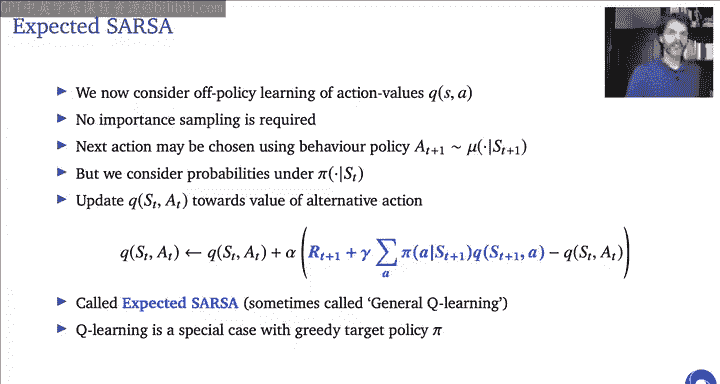

Okay， this brings us to the summary of this lecture。

Now we're just going to briefly recap basically the whole lecture and we're going to start with a model free policy iteration。

And recall that the point there was to learn action values to predict the current policy because that's how policy evaluation works and policy evaluation is a sub componentonent of policy iteration。

And then we can do the other part， which is policy improvement， for instance。

 make the policy food ingredienty or epson greed。And we talked about how we could extend this idea of false situation to be model free。

 where both the evaluation step and the improvement step can be done model free。

Then we talked about Q learning and noted that this iskin to evaluate iteration。

 where instead of having a separate phase where we maybe evaluate the policy over some time and then make a greedy or improve it。

 we could also do this in a very tight loop where we immediately make the policy greedy on every step。

 so when we update our action values maybe the policy can change immediately。

And then Qe learning is a model free algorithm that is very akin to this value idea。

We've also talked about SArsSA and just now about expected SArsSA。

 and these can be used more similarly to policy iteration where we could also keep the policy that we're evaluating fixed for a while and on policy estimate that behavior and then do an improvement step。

Or we could also immediately update the policy as we got。

 so SARSA can also be used online with an Epsilon query policy where every time step we are just reevaluating what are the actions that it should be taken and we talked about the converence properties of these algorithms as well。

But sometimes we're also just interested in maybe estimating a completely different policy this in general is called off policy learning。

Where expected SArsSA could for instance be used to pick any target policy that we're interested in and then trying to learn about the values of that。

Learning about the greedy policy is in a special case of policy learning。

 which is the one that is used by Q learning。In general。

 we want the behavior and the target policies to improve。

 that's what it means when we say that we want to do control。And if the target policy is greedy。

Behaal policy could still be epsilon greedy or some other type of behavior policy。

 and then we could construct this target for Q learning， as we saw earlier。

 where we just take the first reward as always， this is a temporal difference method and then we bootstrap on the state value which is defined by taking the greedy policy in that state written out here quite verly and this is equivalent to just considering taking the maximum action value in that state。

So a conceptual view what Q learning is doing is it's imagining that in the next state。

 it would pick greedly according to its current estimates and then trying to use that as an estimate for the value and backing this up。

In SArsRSA， similarly but slightly differently the target and behavior policies are the same。

 and we're actually considering the actual action that was taken on the next time step before we update our state action values at time step T。

Then if we want this to converge because it's an on policy algorithm。

 we need the additional requirement that the policy becomes greedy。

 so cur learning is an off policy control algorithm that doesn't need this requirement。

 but SARS says on policy so for this to actually converge the policy itself。

 the behavior itself should eventually become greedy。

One way to do that is to use epsilon greedy or a different type of softm。

 which is a generic term referring to algorithms that are not quite greedy。

 but they're close to greedy， so we're taking a soft maximization of the action values and then using that two inferro policy。

And then if you decrease the expiration， you get this property， which you called glee。

 which is greedy in the limits， but it does explore infinitely often if you decay slowly enough。

So in summary Q learning uses a greedy target policy to learn about。

 SARSA uses a stochastic sample from the behavior as a target policy which means its' own policy because the behavior is used as a target。

And in expected surgery， we can relax this assumption and we can use any target policy。

So both SARSA and curing can be seen in special cases of expected SArsRSA where for SARSSA the actual sample is stochastic。

 so the actual policy will be stochastic and for curing is greedy。But you can pick anything you want。

 and then we also talked about double learning。Where we use a separate value function to evaluate the policy。

For any policy。Now double learning is actually not necessary if there's no correlation between the target policy and the value function。

 let's say we're doing pure prediction， you could use expected SArsSa， for instance。

 to learn about a target policy which we were keeping fixed For instance。

 you could have the policy that says what would happen if I always walk forward an expected SArsSA could use there to construct a bootstap target which would in the next state for any transition in the next state would consider only the action that moves forward。

This action wouldn't depend on the action values， and therefore therefore there will be no correlation between selecting the action for the policy and then evaluating it。

 Then you will not need double learning。 It won't be any bias， but of course， in general。

 there can be correlations and specifically when using a greedy policy like in Q learning there are quite strong correlations。

 The whole reason to pick an action is because it has a high value。

And then we evaluate that using the same values， and this creates an upward bias。

 Then double learning can be quite useful more generally， if there's correlations。

 double learning can be quite useful and it can be quite useful to track these action value estimates。

Just to see whether you might be suffering from all estimations or unrealistic action value estimates。

And then if you are， you could consider doing something like double learning to mitigate that bias。

That brings us to the end of this lecture。 please continue to use Moodle to ask questions。

 thanks everybody who has been asking questions there and we we will try to always。

Get back to and answering these on a regular basis。And for now。

 then I want to thank you for your attention and I'll see you in the next here。

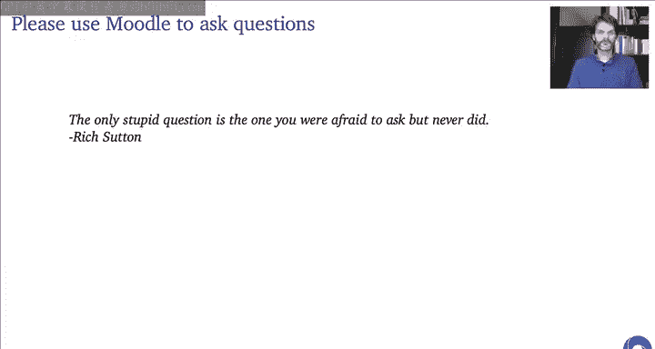