# DeepMindxUCL《强化学习｜Reinforcement Learning 2021》中英字幕 - P7：[07]Function Approximation [7_13].zh_en - GPT中英字幕课程资源 - BV1JssaeVEMp

Hi and welcome to the seventh lecture in this course on reinforcement learning。

 my name is Hadel and Huusts and today I will be talking to you about function approximation in reinforcement learning。

In terms of background material， chapters 9 and 10 from Cbarto are highly recommended and we'll cover some material that's captured in chapter 11 as well。

And in terms of context， we are always considering this interaction loop。

 where there's an agent interacting with the environment by picking actions and observing the environment and then reinforced parenting can be considered the signs of how learning how to make those decisions。

 How can this agent deal with this interaction stream and somehow pick actions that give it larger and larger rewards。

 The rewards not depicted in the figure could be inside the agent head or they could be part of the observation depending on how you want to mo your problem。

Inside the agent in any case there will be some sort of a policy that determines the actions。

 and in addition the agent might have value functions or potentially models as well。

The general problem involves taking into account time and consequences because the action influences the immediate reward。

 but also potentially the agent's state and also potentially the environment state。

 which means that certain actions might have very long-term consequences， in addition。

 these consequences might not be immediately obvious。

 for instance an action might change some internal state variable in the environment。

 and it might not be immediately observable what that means or what that matters。

 but it might influence later observations or rewards。

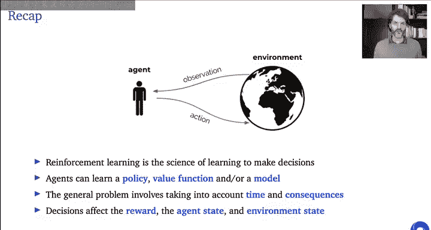

Now in this lecture， we're going to talk about function approximation and first we're going to talk about why we need that。

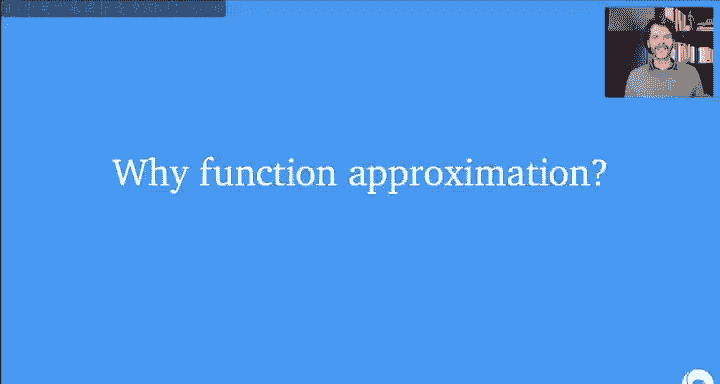

So first， we're just simply pointing out in some sense that the policy to value function。

 the model in the agent state update and all of these things that are inside the agent can be viewed as being functions。

 For instance， a policy maps the agent's state to an action or to a stochastic policy from which it an sample an action a value function maps a state to a value which is an estimate of the cumulative reward into the future。

 the agent state update itself maps the previous agent state and the observation into some new agent state So these are all functions and we want to learn these from experience。

 Why do we want to do that， Well multiple reasons， one of which is flexibility。

 as we talked about in the very first lecture， I quoted a paragraph from a paper about a tuuring there where he argues that maybe it's easier to program something akin to the mind of a child than it is to program something akin to the mind of an adult。

 because maybe it's actually easier and also maybe better actually more flexible to write something that can learn from experience then try to。

Ls all of the rules you may have learned from experience。In addition。

 if there are too many states we will need some sort of approximation。

 this is a separate point because this is no longer just about learning。

 but this is really about function approximation that this is important。

And when we use neural networks to represent these functions。

 then this subfield is often called deep reinforcement learning these days。

That term is actually relatively novel， it's like  seven to8 years old。

 but the combination of reinforcement learning with neural networks is in some sense a quite natural one and is actually very old and has been suggested at least in the 70s already。

So in this lecture we'll concretely consider predictions so value functions including some valuebased control so using these predictions to come up with policies in upcoming lectures we'll talk more about off policy learning。

 approximatema dynamic programming which is the term we used to refer to this more generic like field of study where we're not necessarily sampling but we're just considering what if you have approximations in your dynamic programming algorithms。

 this could include sampling this could include function approximation。

 but it could also be from other sources potentially and this will allow us to talk about these updates in a theoretical sense and analyze what they are doing。

This will also be in an upcoming lecture we'll also talk about learning policies directly so as I mentioned the policy itself can be considered a function so you could consider updating that function with policy gradients we briefly talked about those in lecture two we'll come back to that in a later lecture。

And we'll talk about model based URL as well。In this lecture we're focusing on predictions because it's nice to be able to focus on something when we talk about this approximation。

 but a lot of the insights they do transfer to these other cases as well as we will see。

And in terms of motivation， well， why do we want to do that because we're ambitious。

 we want to solve real problems， we want to solve large problems。

 and actually even small problems are large problems because the game of begamin one could argue it's not particularly large compared to the real world。

 it's just a game， but turns out begamin already has 10 to the 20th different possible states。

 So if you try to enumerate all of those in a large table in memory。

 you quickly run out of space if you try to do that for these type of problems because if we don't go to a different game like the game of go。

 we notice that this actually already has 10 to the 170 states that's an enormous number。

 you can't feasibly store that in memory in a computer and then try to learn a value function for each of these separate states。

Actually it can even get worse because for instance let's consider helicopter flying in which the stage spaces could arguably taken to be continuous so you could view the stage space could for instance。

 be the position of the helicopter in space so there's this three-dimensional space location。

 but in addition maybe there's other inputs as well like there might be a wind sensor that tells you from which direction a wind is blowing and how fast it is blowing and these inputs could all be real value numbers which means that the stage space is inherently continuous。

 which means that if you would like to enumererate them， theres infinitely many states。And of course。

 maybe as the ultimate example， you could think of a robot world in the real world where the environment is actually equally big as the real world is。

 and in that case it's obviously impossible to enumerate all of the states because any computer that would have to do that would have to live in the real world and hence should be necessarily much。

 much smaller than the world is。😊，So this is a common thing that we have in mind when we think about reinforcement learning。

 we want algorithms that can be applied to this setting where this environment is just humongously large and the agent must be necessarily a lot smaller。

 so the mind of the agent including its memory capacity must be necessarily smaller than the environment。

😊，There are of course small problems， small le problems in which you could still enumerate all of the states。

 and in that case maybe you could try just doing doing tabular res。

 but in general we want these algorithms to also apply to these larger problems。

So this is our motivation for y want to consider function approximation and the intent is。

 of course to apply the methods that we've already been talking about for prediction and for control。

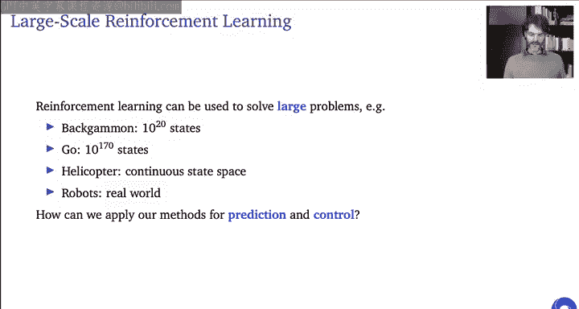

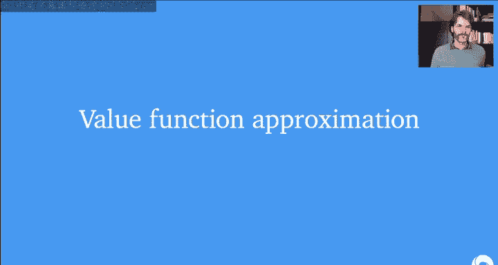

So let's talk a little bit about value function approximation now。So far。

 we've mostly considered lookup tables although though I've already mentioned the near function approximation and other things in earlier lectures。

But in the tabular case， each state has a separate entry and we just update that or each state action pair has a separate entry。

But the problems with that is that there are too many states， as I mentioned before。

 so you cannot fit that in memory that turns out it's not the only problem。

 a different problem its also too slow to learn the value of each state individually。

So think of it this way so if you have a problem that is not too large。

 let's say there's a million different states we can store a million numbers in modern computers。

 that's not a problem at all， but then still if we would update each of these state that is individually and separately。

 then it would take quite a bit of experience to learn reasonable value estimates for each of these states。

And indeed， this feels inefficient if these states have some commonalities。

 which we would then completely be ignoring， so if these states can instead be viewed as being similar to each other。

 then maybe you would expect or maybe you would want the value of a certain state to be updated when the value of very similar state is updated。

 This is called generalization。In addition to those two points。

 individual environment states are often not fully observable。

 so the environment might not just be big， it might also not be fully observable from your observation stream。

 so we need to summarizefer what's going on in some sense or at least up to the point where we can make meaningful predictions or pick meaningful actions。

So our solution for all of these problems essentially will be to introduce function approximation。

For now we're just considering the predictions as mentioned at the beginning。

 we're going to consider value prediction in this lecture and what that means is we're going to introduce some parameter vector of w as before。

 where now the value function is parameterized with this W。

 it's a functional state somehow where the state is the a in state and we're either approximating the value of a certain policy or maybe of the optimal value function。

 the algorithms we'll get to in a moment， but the ideas that we're going to approximate these。

And then update the parameter， for instance using Monte Carlo algorithms or TD learning or any other similar algorithm that you might want to use。

And then hopefully if we pick our function class correctly and we'll talk about that more。

 we will be able to generalize to unseen states。 So in any case， if you have such a function。

 the values of these unseen states will be well definedfin， you could of course。

 also have this for a table， you could just if you know all the states you could possibly end up in you could at least initialize the values to be for instance。

 zero arbitrarily but if you just have a function class that automatically maps every possible input to a valid outputs。

 then you automatically have this mapping and you have a valid state estimate for every state。

In addition， I just want to briefly talk about the Asian states。

 but actually not going to a lot of depth in this lecture。

 I'm just going to mention it because it's really very important but we'll get back to that in a subsequent lecture。

So I mentioned that one of the problems might be that the environment state is not fully observable。

 so essentially the environment state is not equal to the observation。

Then as always we're going to rely actually on the agent state instead。

 and we're going to consider the Age state update function here briefly。

 which we could also consider to be a parametermetric function of its inputs which are the previous agency say。

 the action and the observation and potentially the reward as well if that's not part of the observation。

And it has some parameters here， de noted it omega。

Now we already discussed you could pick this to be something， you could pick this just to be。

 for instance， the observation， the8 states， at which point the omega is maybe not relevant。

 maybe there are no parameters for that function。But maybe in general that's not very particularly useful right if you look at just the observation。

 you might not see everything that you need to see So this agent states which you here toote with a vector notation。

 but we will continue to use the random variable notation as well。

Should contain everything that's useful for you to make value predictions or to pick your policy and that means that the agent update function is actually quite important and might need to capture things like memory。

 for instance it might be that you have to remember what you've seen before we talked about an example in the first lecture where maybe a role has a camera can only look in front of itself can't see what's behind it but maybe it needs to remember what this behind it to pick suitable actions this would be captured in the agent state and maybe we should think about learning that in this lecture we won't go into that but I just wanted to remark it also to be clear that in the subsequent slides whenever I have a state it's always going to be the agent state and this is basically just going to be some vector。

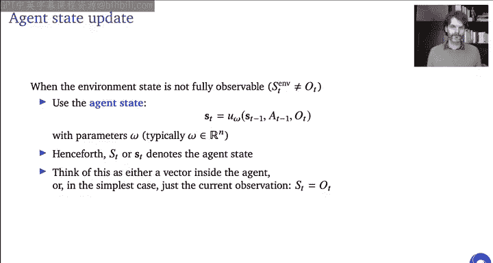

Already observation。Okay， now we're going to talk about a couple of different function classes in some little bit more detail。

Just to talk about the differences between them。

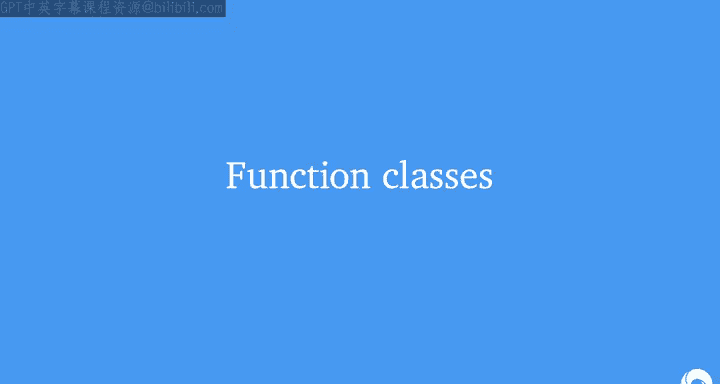

So we started by talking about the tabular case right where we just have a table。

 so our function class here is tabular。And then one step up from that would be state aggregation。

 So in a table， we have an entry for every single state。 For instance。

 let's consider for simplicity that it's fully observable。

 So you literally observe the environment state。 and you should have an entry for every environment state。

😊，In state aggregation， you would instead have an entry that merges the values of a couple of states。

 so basically we just partition the states based into some discrete small set potentially so that we can maybe learn the values of these partitions instead of learning them for every individual state and then indeed we would get some generalization because all of the states in the same partition would then be updated with the same algorithm and hence would obtain the same value so if you reach a new state in a certain partition that you hadn't seen before then it would automatically already have a value and it might be a suitable value。

Now one step up from this would be linear function of approximation and I want to for now consider a fixed Age set update function。

And then a fixed feature met on top of that。So this is why things will be linear because we're going to assume that the agency say update function。

 for instance， you speak the observation or do some other fixed function there。

 doesn't have any parameters， the feature map doesn't have any parameters and instead all that we're going to learn are the parameters of the value function which uses those features as input。

So there is student an agent update function， it might be a simple one。

 but we're just going to ignore that in terms of the learning process。

Now note that state aggregation and tabular are actually special cases of this more general class。

 because in the tabular case we could just consider the feature vector to have as many entries as there are states and then have the entry of the current states。

Would be one whenever you're in that state and all of the other entries would be zero。

 so it's a one H representation as they sometimes call this where the state is kind of picked out by the feature vector。

Now state aggregation is very similar except that the size of the feature map is no longer necessarily the same size as the number of states。

 so N what we call that here on the slide， the number of outputs of this feature mapping。

 so the number of features in your feature mapping would not be equal to the number of states would typically be much。

 much smaller and you could indeed even apply this to continuous state spaces。

But then it would still be a1H representation when we do state aggregation So there's some mapping that says。

 oh， if you're in this states， then this entry must be one then everything else must be zero and if you're in similar states。

 maybe the same entry will be one and everything else will be zero。

 but if you're in a different state， then a difference further away。

 for instance right then a different entry will be one So it's still a1Ht representation but it's a smaller feature effective than if you would do the fully tabular approach。

And both of those are special cases， you don't need to have a one health feature and presentation。

 you could consider much richer function classes here。Now one step up from that。

 if we're going to be even more flexible， would be to consider differentiable function approximation。

In this case， our value function will be a differential function of our parameters with W。

 and it could be no nonlinear。For instance， it could be a convolutional neural network that takes pixels as input。

You don't need to know right now what a convolutional neural network is if you don't know what that is。

 it's just some nonlinear function and one way to interpret this is that you can consider the feature mapping now no longer to be fixed so we take whatever the agent status as input and for instance the input could just speed the observations could the pixels on the screen when we're say playing an entire game or something like that and then instead of having a fixed feature mapping you could consider this to be a learned feature mapping where something maps it into features and then there's an additional parameter on top of that that maps it into values in a notation we're going to merge all of those features into one big vector W but it won't be a linear function it will be some nonlinear function where these parameters are used in different ways。

So what we're require in here， why we call this differential function approximation is that we can still compute gradients because we're going to consider gradient- based algorithms。

 that's a little strict requirement， but it is one that we're going to use here and it allows for very rich function classes such as deep neural networks。

Okay， in principle， any of these can be used， but it's good to acknowledge that reinforcement learning does have certain specific properties or maybe often have certain specific properties which might interact with the function class。

 so it's good to be aware of those。The first one that I'm going to mention is that the experience is not identical and independently distributed。

With which I mean that if you're going to learn online from a stream of experiences that is coming at you。

 then successive time steps are actually correlated。This is not necessarily a problem。

 I'm not saying it because it's necessarily a problem。

 but I'm saying it because it's slightly different from the case in which many of these functions have been developed。

 for instance deep neural networks were originally often developed and tuned in cases of classification。

 for instance Mist， the digit classification， and then some choices that were made there and might not be completely appropriate for reinforcement learning because we're breaking some of the assumptions such as that we can sample each of these learning examples independently。

In addition to this， the agent's policy affects the data receives What I mean with this is that the reinforcement coding is an active problem and this is multiple consequences including that actually one benefit of this is that you can maybe actively sample data in a way that is useful for learning your function you could literally have an exploration technique that maybe seeks out certain parts of the state space in order to improve your value estimate specifically over there。

You can't actually it's not active learning。 you can't just sample any sample that would be within the field of active learning。

 That's the typical assumption that you have a database and you want to indeed actively pick which samples。

 but you can pick from all of them， that's not typically the case of reinforcement learning because the way we're interacting with the world。

 So if you want to sample a certain situation， you actually first have to go there but it is an active process and that's interesting。

 but it also causes some issues， for instance， the regression targets are often nonstationary This is。

 for instance， because we're doing control like we might be changing our policies as we go。

 and this might not just change the targets for our regression our value targets。

 for instance if we bootstrap， but it might also change the data So it's actually nonstationary in more than one way。

In addition， like I said the bootstrapping is important， so even if the policy is fixed。

 so even if your policy is not changing， the targets might change because your value estimates that you're using to construct your targets could be changing so in TD we're using our value estimates and those initially are not very good but later they might become more accurate。

In addition to this， the world itself might be nons stationary。

 for instance there might be other learning agents in the world and maybe we also want to deal with those cases。

And similarly but differently， the world might just be very， very large。

 So this might mean that you're never actually quite in the same state and these last two points are quite closely related because if we allow for the world to be partially observable and if the world's sufficiently large。

 it might appear nons stationationary to you because you might think， oh。

 I'm going to that room I'm going somewhere else I'm going back to that room。

 things have slightly changed， maybe the sun is now setting whether where it wasn't setting before or maybe all of a sudden there's a different agent in the same room and this is not。

Maybe literally non stationary， maybe the actual underlying say physics of the world are not changing。

 but you don't know all the the latent variables that are in the environment states that make these things change So in some sense。

 non stationary and very large are in some sense similar， but of course。

 they have different connotations you could have a very tiny non stationary problem as well。

So which function approximation should you choose we covered a couple of function classes Well the kind of depends on your goals and one distinction to make is that for for instance the tabular case we have really good theory we understand these algorithms really well We know when they converge。

 we know where they converge they' are quite stable。

 the assumptions for converges are not very strict so you can fairly easily apply them and be pretty certain that they will learn something In addition I didn't put this on the slide。

 but they actually also tend to learn relatively well and fast if the state space is small enough。

But they don't generalize， they don't scale， you can't apply into very large problems as discussed。

Now in the linear case， we're already a little bit more flexible on our function class。

 we still have reasonable theories， so we understand these methods quite well。

 we know when they converge and where they converge in many cases。But of course。

 we are dependent on this fixed feature mapping， so we do require very good features Now this is a bit of a subtle point because the people are like people are still debating this in some sense。

Because there's multiple aspects to this One is that of course you're going to be limited by the features that you have and maybe that would be a good reason to learn these features most people these days are in that camp but you could also argue that maybe it's okay to have some poor features as long as you have sufficient of them So the other alternative would be to have linear function approximation。

 but with a very， very rich set of features and then maybe you still have a good enough set of features that you can pick out the ones that you really can use in the context that you require them。

And then of course there's not linear function approximation， which is less well understood。

 but it scale really well and it tends to work quite well in practice until it doesn't and then sometimes we don't really understand what's going on in some edge cases。

 but of course our experience with this and our understanding of this has been growing quite a lot over the recent years。

And it's really flexible， and importantly， it's much less reliant on picking good features by hand。😊。

And I personally find this to be a very convincing point and a very good point。

 because one thing that this means is that you can apply these methods to problems that you don't really understand that well。

 but as long as you have a well formulated reward function that you are certain is the right reward function。

 you could apply these reinforcement methods and then still get better find good policies for these domains without really needing to understand what appropriate features would be。

And in fact we see more often these days， over and over， not just in reinforcement learning。

 but also in deep learning and related fields， when applied these algorithms that don't try to hand engineer features。

 but instead try to learn them from data tend to outperform methods in which these features are hand engineered。

So that's interesting and it relates again back to that point that Evan Turing was also trying to make。

So deep neural networks are typically used in this last category of non nonlinear function approximations and in some sense。

 depending on how you define these things， some people would argue that maybe any nonlinear function could be argued is in some sense some sort of a neural network。

 it might be a weird one， a very strangely structured one。

 but in some sense these are somewhat similar。So sometimes neural networks are used almost synonymously with nonlinear function approximation。

 and these tend to perform very very well in practice and therefore remain a very popular choice and there's also lots of research of course happening trying to understand these methods better。

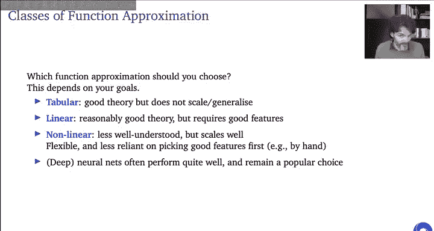

Okay， now this brings us to our next topic where we're going to talk about gradient based well be gradient based algorithms first label in general。

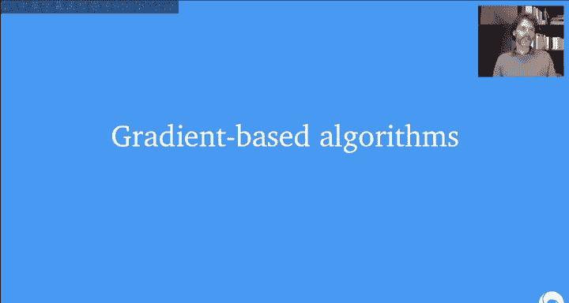

So we're going to talk a little bit with just a very brief primer on gradient descent and seastic gradient descent and we're going to talk about this because of course。

 we're going to use that for value learning in a moment。

So for now let's consider some arbitrary function J。

 this is just some function only of the parameters。

 right there's no state input there's just parameters as input。

we're going to consider its gradients just as a reminder。

 a gradient is a vector and it contains as its elements each of the partial derivatives for this function J with respect to that one parameter out of W So J here is a scalar function with which I mean that the parameter vector can be large。

 but the output is just a number， and we're considering the gradient of that function J with respect to the parameters。

Which we， of course， should evaluate at certain parameters， right。

 The gradient depends on where a W is at this moment。And the goal could then be to minimize J。

So one way to do that is to move our parameters w in the direction of the negative gradients。

And one way to do that would be the algorithm on the slide。

 there's actually different ways to do that as well that are similar but slightly different differences is how they pick the step size or exactly how they move or the direction they move。

 but a lot of the algorithms derive essentially from this main algorithm。

 which is the gradient descent algorithm， where we have some step size parameter and we just move slightly in the direction of the negative gradients。

The one half here is optional， maybe I should get rid of that this is kind of assuming that there's a square lost J some sort of a square and that therefore the one half will cancel out with that。

So this step size parameter should be in some sense small because then if we take a small enough step。

 we're in some sense certain that we're going to decay as long as this function J is smooth enough。

So what I mean with smooth is that the function cans have a very big discontinuity。

 So if you know your function is somewhat smooth， then you know if your step is small enough that the gradient will have pointed in the right direction and indeed it will go down。

Now， of course in practice， there's a bit of a trade of happening here because you don't want to make alpha too small because then learning is very small。

 so instead you typically tune this to get good performance。Now， if we plug in value function。

 So here we have the square loss that I promised， for instance。

 we could consider this one where we are simply interested in this one number。 right Again。

 J doesn't take say as input。 It's just the number that depends on your parameters W。

 and the way it depends on that here， we define it to be the expectation over some distribution of states。

 for instance， due to your policy。 and of course， the MDP dynamics。

 and we want to consider the square difference between the actual true value of your policy。

 So we're doing prediction in this slide and our current estimate。

 And that's something that we might want to minimize this will be a predictive loss。

And then we can just consider this gradient the sense algorithm here。

 the one half comes in handy because it cancels out with the two that comes from taking a derivative of the square。

 We note that the distribution in this case does not actually depend on our parameters so we can just push this gradient into the expectation and then we get this algorithm this update if you will。

 or update to the weights delta W would be small step size alpha at times the expectation under that distribution over states of the target which is our true value function for that state。

Mines are current prediction times the gradient of that current prediction。

This is an expectation so we can't actually typically use that until unless we really have a distribution over states。

 but if we want to use this in practice， we can sample this and that means that we're going to sample the state we're in and we're also going to sample this true value of the policy and one way to do that would be to plug in Monte Carlo return which is indeed an unbiased estimate for the true value of the policy So this update。

 this s the gradient descent update on the slide here is an unbiased estimate of the gradient descent algorithm one line above it and that means that if we take our step size to be small enough and we take enough of these steps that we will on average move the direction of the gradients and we will also。

Reach the same basically conclusions， we reach the same solutions as。

As' the full gradient algorithm and wood。So in that sense to cast the gradient de is fine and it's just another reason to pick a small step size。

 so not just because then the gradient is valid， but now also to average out the noise in our estimate of the gradient。

So were often a little bit sloppy with notation this is just kind of a warning for that so whenever we drop terms so let's say we for instance write the gradient of V and we don't have w's anywhere and we don't specify where we're taking this then typically we mean when we have a gradient we mean with respect to the parameters so we have gradient of V just means with whatever the parameters of V are so if those are wed and this would mean the gradient with respect to W。

And then we're also typically taking that at whatever the current value of these parameters are。

So this is something that you would actually have to be explicit about the gradients itself outputs in some sense of function。

 and you still don't have to plug in the parameters where you're evaluating that gradient and this is typically done the notation with this bar where the subscript tells you where we're evaluating the gradients but people are often very sloppy with the notation in this and there's lots of shorthand。

 for instance people might write instead the gradient with to WT of the value functions of WT instead of having this bar notation and that's fine as long as from context is clear what we're talking about So I just wanted to highlight that here so that you have a feel for oh if there's something that gets dropped from a notation。

 how should we interpret it。It should be clear from context。

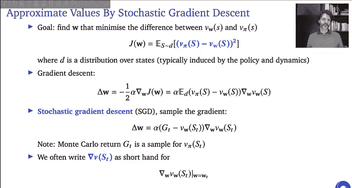

Okay， and now we're going to go and talk a little bit more in depth about linear function approximation。

 which is going to be useful to understand the algorithms and also some of the limitations of the algorithms。

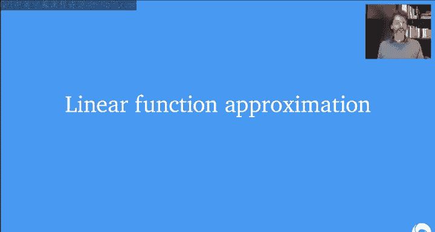

So we talked about this pre， but I'm just going to reiterate a couple of things that we said before。

 we're going to represent the state by some feature vector where this state of sorry this feature mapping X is going to be considered fixed。

So we have n elements here， n different features， these are just numbers and they are functions of state。

And it might for instance state the observations as input or more generally your agent state。

 and output some feature vector of a certain size。And we also introduce some shorthand where if we apply this function to state at STT。

 so at time T， we can also just write XT， and we can kind of pretend that these are just our observations as far as the algorithm is concerned。

 the algorithm only gets access to XT， it doesn't actually get access to ST anymore。

 it just gets access to these features instead。So for example。

 these features could include distance of a robot from some landmarks or it could be trends in the stock market。

 or it could be peas and palm configurations in chess or whatever you can come up with which might be useful for the problem that you're trying to solve。

And I'll also show you an example where you can somehow。

Find ways to kind of automatically pick reasonable features for some problems。

So this is that example， this is called coarse coding and it's one way to come up with a feature vector it's a little bit related to that said aggregation that we talked about before。

 but in this case we're not going to actually subdivide the space into thisjo chunks so what you see here in the picture is that we've actually subdivided a two dimensional space for instance you could think of this as a location if you want to make it concrete I didn't make it very concrete here。

And we're going to subdivide this space， but into overlapping regions。

 and then whenever we're in such a region， So we're here at this x say。

And then we're going to have a feature that is associated with each of these circles。

When you're in the circle the feature will be one and whenever you're outside of the circle it might be zero if you do that with this representation in this case。

 three features will be equal to one and all the other features will be equal to zero so this is no longer a onehold representation as we discussed for the state aggregation or the tabular cases In this case it will be a few shot representation in some sense。

 the features are still binary near either zero or they're one。

But it's some sense already a richer representation because as we can see here from the figure。

 if you get these free。Regions in some sense to light up。

 we actually know we must be in the intersection of all three of them。

 and that can be useful information， but in addition to that we will still have some generalization if we're going to update the value associated with a state in this very darkest region over here that means that a different states say at Y will actually also be updated a little bit because it shares one of the features with this state that is going to be updated So if we think of the linear function that is going to be applied to this it'll have a weight associated with each of the features so if we change the weight of that feature that means that any position that shares that feature or where that feature is one will also experience a slight change in its value。

Now I describe the binary case for simplicity where you're either in a region or you're out and your associated features either one or zero。

 but of course that's not the only option， you could instead also do something like over here where you have some sort of a distance function that might be。

 for instance， Gaussian and instead of saying you you're in a circle or you're out。

 we instead have a bunch of center points of these circles and we just measure how far you are from each and every one of them。

 which means that in this case for instance we might have this feature light up a little bit。Well。

 actually quite a bit because we're a little bit closer to its center and this one died up a little bit less because we're farther away from the center。

 maybe even the feature over here still lights up very brief， very lightly。

 but very much less so than the feature is much closer。Now， of course。

 you would have to similar with the circles， you would have to consider how far do you want your feature to be sensitive。

 but it would be provide a way to be a little bit more continuous with your value functions。

Whatever you do there are， basically the idea is， then you have your representation and you expand that into a whole bunch of different features and then you compress press that with your weights。

 which are here to know that Theta， but you can think of this as being the same as theW from a previous slide into a single number。

Why do we say expand here， well， in this case note that we had a two dimensional representation。

 we could have also maybe had say an Xy location which would constitute two numbers and we could have fed that to the agent。

But maybe it's really hard for the agents to turn those two numbers with a linear function into a valid value estimate right The only thing you can do then is some sort of a linear linear function over the state space。

 you can't have any nonlinearity in terms of your location and how to value react to your location if you would only feed in the actual location numbers。

 the X Y coordinates。So what we're doing here instead is we're turning those two numbers of this two dimensional space。

Into very many numbers， as many as we define these circles。

So in some sense we're actually blowing up the representation in order to then be able to apply a linear function to that。

 this is a common technique it's also used in for instance support vector machines。

 doesn't matter if you don't know what those are， but if you do then you might recognize this principle where we're basically just blowing up the feature space into something large in the hope that then the feature representation will be rich enough that a linear function suffices that if you then apply linear function to these features you still have a good enough approximation。

Now it might immediately be obvious that there are some limitations to this approach or if not。

 then maybe let me point at some， for instance it might be quite hard so if you only have two dimensions。

 maybe you can define the circles and you're good to go， but what if you have many many dimensions。

 what if you have 10 dimensions or maybe even 100 dimensions and this is not very fictional because of course if we think of locations in the world maybe we'll think like two dimensions。

 three dimensions maybe that's enough， but as I mentioned for the helicopter example a helicopter might not just be in a location in three dimensional space。

 but it might also have other sensors it might have。Some audio sensors， it might have wind sensors。

 it might have other sorts of sensors， it might be measuring I don't know air pressure or humidity。

 so these would all be dimensions and it might actually be very hard to somehow figure out a good subdivision of that space without making the feature representations extremely large。

This is sometimes called the Cur' dimensionality。Which is actually termed due to Richard Bellman。

 also known from the Belman equations。Okay， so this is just meant to be an example of how you could somewhat automatically construct features because you could imagine if you do have fairly small dimensional space like two dimensions。

 that you could just sprinkle a couple of these circles in there and you maybe don't have to think very carefully about where they are。

 maybe don't need to understand the domain that well for you to get a reasonable function a reasonable feature representation。

But， of course， there is a choice here。 And here's a couple of examples。

 So on the left hand side in a， we see narrow generalization。

 We've picked these circles to be fairly small。And what this does is it allows you to be quite specific。

 So if the value function is updated only in this region that lights up and then maybe mostly updated in the smallest region because of your representation。

 that means that you have narrow generalization， if you update these states。

 states fairly near to it get updated as well， but states further along or not and that's both good and bad。

 this is double edgeched sword， if you narrow generalization this means the narrower it becomes。

 the more specific your value function can be， and the more precise it can be if you need very like higher resolution in some sense in your value function because the actual value function micro for instance be quite bumpy or weird。

 then it might be useful to have very narrow generalization。

 but it does mean that learning might progress quite slowly because there' is very little leaking from the state information from states further away。

So instead you could consider having broad generalization where the overlap is much larger。

 the circles are much larger， then updating just the state in the middle would actually update a fairly large region of your state space。

And this can be useful。Because it might speed up learning。

 but you lose out in terms of your maybe your resolution at the limit when you've learned your value function。

 there's a limit to how precise you can make it at every situation。Of course。

 depending on your dimensions here， like we don't know what X and Y are here in terms of dimensions。

 it could be that you actually want to pick something more custom that the best representation would be asymmetric。

 so this already shows alludes to the fact that it can be quite tricky to pick these things in general。

The other thing I want to know is that we're actually aggregating multiple states and this means that the resulting feature vector and hence like what the agent observes in some will be nonmarkovian what I mean with that is if you're in this little region here in the middle and let's say the agent moves right。

 but it only moves a little bit。tThen you would end up in the same region。

 the same features would light up， so from time step to time step while you remain in this small little region in the middle。

 the feature representation would not change while you're moving within that region。

And then at some point， you actually step out of the region into the next one。Now。

 this is why that's。Nonmarkovium because the time step at which that happens as far as the agent is concerned is can tell right so there is actually some probability distribution happening here where the underlying state。

 of course， there is a certain moment which you actually transition lets let's say the effect of the actions are deterministic so when you move right you actually move right。

So maybe there's like a true transition which is completely deterterministic。

 but the agent doesn't know when it happens。😊，So what happens here instead is that as far as the agent is concerned。

 at some random point in time， you'll transition from one region to the other。

This is the common case， this non Markoviness is the common case when using function approximation。

 it's not specific to this， it's just very easy to visualize in this representation。

 but whenever you use function approximation including deep neural networks and so on。

 you should count on the fact that in some sense as far as the algorithm is concerned。

 there might be some partial observability。Because the function approximation will。

 if it's a good function approximation， it will in some sense generalize things。

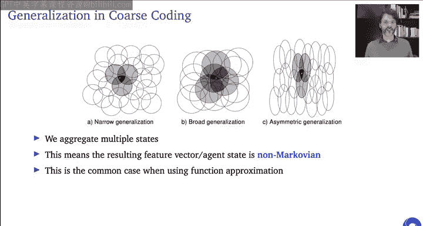

So for the linear case specifically， we do want to consider when good solutions even exist。

 So it's good to kind of do this mental checks So if if you're given a certain feature representation or if you're considering a certain feature representation。

 if you're picking it yourself， it's good to imagine well if I would have the best possible weights。

 what would it look like is it good enough is my generalization say narrower enough that I can have good enough resolution or is it broad enough that I can have fast enough learning So it's good to just think that throw for your feature representation and then sometimes you might catch things So oh。

 there's no way you could learn this value function because it simply cannot be distinguish between these two different important states。

 for instance。Neurural networks tend to be much more flexible in that sense。

 so if you just give pixels to the neural network， it could itself figure out how to maybe subdivide the space in some sense。

 and come up with some sort of an internal feature mapping。

That is maybe more suitable to the actual problem that you're trying to solve because you could imagine that if you wanted to make these feature mappings flexible。

 if you could make them flexible that this could be a lot stronger where maybe you have asymmetric generalization in some part of the state space。

 broader generalization in another part and very narrow generalization in some part where it's really important to get the values right a neural network and in some sense automatically find that。

Okay， now we're going to move on to linear model free prediction。

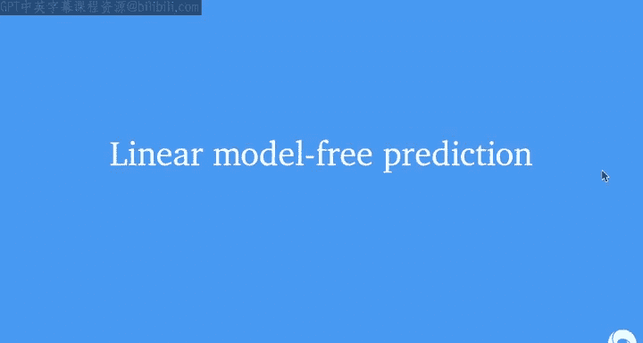

So we're going to talk about how to approximate the value function with a linear function approximation。

 we talked about this before， but just to be very explicit。

We're going to approximate the value function by having this parameter vector W multiply with this feature vector x。

 which we can write out very explicitly by just having a summation over all of the components of both of these vectors that's your adult product。

And then we could define our objective to be as before a quadratic objective where we compare to the true value VP for now let's just assume that we have that true value and we'll plug in real algorithms in a moment。

 but for now we just consider that we have those regression targets and there's going to be some distribution over states Dis is called D here and for instance it could be due to your policy or maybe you have some different way to sample the states。

Then this algorithm can converse to the global optimum if we do stochastic gradient descent。

If we would regress towards this through value function。

 even if we use a stochastic update where the stochasticity here comes from picking the value function。

 so you see the update here and the update rule in this case is somewhat simple because in the linear case。

 the gradient of our value function will simply be our feature vector。

So that means that our update to the weights， our stochastic gradient descent update will be step size times prediction error。

 the true value minus our current prediction， where the true value is v pi and our current prediction is a VW times the feature vector the feature factor here is just a gradient of your value function in the linear case those are the same。

Now we can't obviously update towards the true value function if we don't have that yet。

 so instead we're going to substitute of targets， this is similar to what we talked about before when we talked about prediction and for instance。

 for Monte Carlo we could plug in the Monte Carlo return。

 but of course we could also do temporal difference learning and then we could plug into temporal difference target which is just in the one step case it's just the immediate reward plus the discounted value at the next state。

So this is now a placeholder for the true value of this state and we can use that to have data dependent updates where we don't have any hidden information anymore。

 we don't have any privileged information about the true value of the state。

Of course we can also go in between these with TD Labda as discussed before。

 where G Lada is a labda return， which bootsts a little bit on every step and continues a little bit on every step and then this Lada trades off between these two algorithms。

 TD and Monte Carlo。As mentioned earlier， we're not going to go into there now。

 but in an earlier lecture we then turned this into elicligibility traces where we could still have a causal algorithm that can every step can update rather than having to wait all the way until the end of the episode。

 so this is just a reminder that TD lab that can be implemented to not have to wait all the way until the end of the episode and in fact to Monte Carlo。

Now， the return is an unbiased sample of the true value。And therefore。

 we can kind of view this supervised learning where we just have a data set of states and returns。

And then the linear Monte carlo pulsesy evaluation algorithm which uses that return。

 but then instead of the gradient has its feature vector will converge to the global optima。

 this is known because we're basically trying to find the minimum of a quadratic function which is convex and then sastic gradient descent with an appropriately decaying step size will find the optimal solution。

So that's nice under some mild assumptions One of the assumptions is that we sample IID。

 but it turns out we can relax that assumption and it will also find the right solution if you don't sample fully IID as long again as as your step size decays sufficiently and of course there's some other conditions as well just to mention one of those you can only find a global solution of course if your data supports that so one thing that you need for instance is that you can never make an irreversible decision if there's one state where you make a decision and you can never go back that means that the information before going into that state won't have been visited infinitely often which means that convergence then for those states at least is off the table。

This is an assumption that's often callederroggoicity there' are similar other named assumptions as well。

 but it basically means that your MDP is connected in the sense that you can always eventually at least return to Sta you or visited before。

So this actually conges also in using nonlinear value function approximation。

 although then it can convert to a local opt， what we mean here is that if you have a nonlinear value function。

 your lost landscape。Might have multiple hills and valleys。

 stochastic gradientite descent on that lost landscape is still guaranteed to go down。

 but it's a local algorithm so it could go down into some valley get stuck there even though there is a lower valley so a way to have lower loss somewhere else。

But it's still nice to have that convergence because it turns out we can't always guarantee convergence and sometimes you might have parameters that divert that go to infinity。

 for instance， we'll see an example of that later in this lecture。

So of course we can also consider TD learning we know that the target here is a biased sample of the true value。

 but we can apply the same trick where we can consider this to kind of be training data where we have states and we have the associated targets for those states and we could update towards those in a very similar way so this is very similar to Monte Carlo this is basically just doing regression in some sense。

But using detect TD error rather than a multi carly error。

So this nowkin into a non stationary regression problem。

Because we're using the value function itself to construct the targets。

 that's good to note that theres something that is different here from the Monte Carlo case。

And the target depends specifically on our parameters。

 so it's not just even just any non stationary regression problem。

 it's one where we're actually updating the parameters ourselves and that makes the targets non stationary and that's something to keep in mind because this turns out to be important for the stability think of these algorithms。

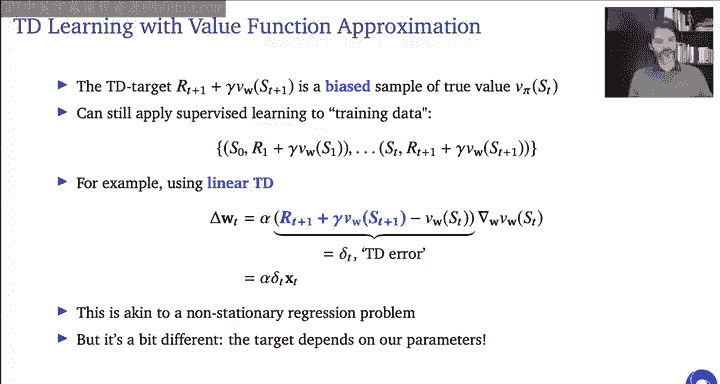

So now we're going to very briefly touch upon control with value function approximation。

 this will be relatively straightforward because we've talked about these things before。

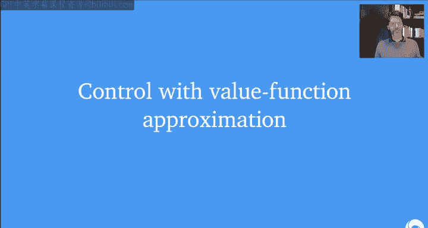

So just as a recap we're going to do some version of policy iteration in some sense and policy iteration depends on two steps。

 one is policy evaluation and the other one is policy improvement to start with the latter for policy improvement we could consider something fairly simple so if we estimate action value functions we can just use epsilon greedy policy improvement or greedy policy improvement but then you wouldn't explore sufficient but we can just consider something fairly simple there but then the approximation step is a difficult one if your state space is really large and therefore we're going to plug in value functions approximation for that step。

So we're basically just going to approximate the value function for the state action pairs in a very similar way as before。

 and if we use a linear function， we could for instance define our feature vectors now as dependent not just on state but also on action。

 and then they have this shared parameter vector W which is applied to this feature vector and then gives you to a suitable value estimate。

The update is， as before， this is extremely similar to what we had before except everything now depends on states and actions rather than just states。

And in the linear case， it turns out there's actually multiple things we could be doing。

So a different way to approximate the action value function is as follows where。

Instead of defining a feature vector that depends on state in action。

 we could have a feature vector that only depends on state。Now。

 the action value function is now no longer a scalar function， which is why I bolded it here。

So this is a difference between the previous slide let me go back to the previous slide first here we're doing the same thing as we're doing for value functions for state value functions where we now have a feature vector that depends on both states and action and then the Q value is just a number right so we have our feature vector X which is the same size as our parameters W and the inner product will just give you a number now we're going to do something different where now we have a feature matrix W。

And we're going to multiply a feature vector that only depends on state with this feature matrix。

And the feature matrix is shaped in such a way that and the output of this will have the same number of elements as we have actions。

A different way to write down the same thing would be as follows where we still have this scalar function for state and action and it's going to be defined as indexing this vector that we get from this first operation with the action so we have a matrix that has size number of actions by number of features so when we multiply it with the number of features we get vector of size number of actions and then we just index in there to get the action value for this action that we're interested in。

This can also be written as follows where we basically have a separate parameter function upper per action。

 but we have a shared feature vector。So let me again go back previously we had one share parameter for all actions and we had separate features for each action now we have one share feature vector and separate weights per action。

This is a slight difference， but it might be important in some cases。

The updates are very similar to before， so we can just update the parameters now associated with just the action that we're interested in and we can just not update the parameters of all the actions that we are not interested in because they correspond to different actions。

So B here is just any action that's different from the one that we're updating a。And equivalently。

 we can write this down as follows， where I here is an indicator vector that indicates the action。

 So it's a1 hot vector that has as many elements as there are actions。

And then only the element corresponding to the action that we've just selected。

has a value of1 and all of the other elements has a value of zero。

 and then we take the outer product with the state features。

 and this will give us the update to our parameters。

Now this might look a little bit complicated feel free to step through all of this fairly like much slower than I'm doing right now。

 but I also before you do that， it might be good to recognize that actually a lot of these things can be automated。

 there's a lot of software packages these days that use auto differentiation that allow you to basic compute derivatives without doing them by hand So I want to make you aware of the differences between these methods because they are a different these different ways to represent an action value function。

But then in terms of computing these updates， we don't actually have to manually compute these outer products。

 for instance， by hand， instead we can just call a gradient function from auto differentiation package and use that。

Examples of those include Tensorflow， pie torch， and I like jacks these days to do that。Okay。

So this raises a question， should we use action in where the action is part of your feature representation or action out where we just have a state dependent feature representation and then just compute all of the action values for all of the different actions。

So the action in approach is when your feature vector depends on state in action。

 you have this shared weight vector W， the action out approach is when you have a weight matrix W and you have features that only depend on state。

One reuses the same weights across actions， the other one reuses the same features across actions。

 It's unclear which one's better in general， but they do have some certain other properties， Fri。

 if we have continuous actions， it does seem easier to have an action in approach because you can't have an infinitely large matrix so the action out approach seems much more troublesome if you have continuous actions。

A different way you could deal with that is to parameterize your policy differently。

 not have literally a separate value for every action if you have infinite actions that might be hard。

 you can do that by having any action in network， or there are other ways you could do that if you want to do something similar to an action out network but we won't go into that here I just wanted to be aware of these choices essentially which are in some sense representation choices now we're picking our function class in a sense and even if we restrict ourselves to a linear function class。

 it turns out there's already designed decisions that you have to make and these might matter for the performance of these algorithms。

For small discrete action spaces， the most common approach these days is action up。 So for instance。

 the DQN algorithm， which I'll come back to at the end of this lecture that was used to play these Atara games did this approach where there was a neural network。

 a content in this case， which would take the pixels as inputted and go through a couple of layers of convolutions and in a couple of fully connected layers if you don't know what those terms mean that's okay but then in the end it would output a vector with the same number of elements as there are actions in Atari。

 there is up to 18 different actions so this is a fairly manageable size so it would just output a vector of size 18 and the semantics of this vector would be that for each of the elements。

 this was corresponds to the value of that specific action。For continuous actions。

 it's much more common to have the action in the approach where the action is somehow given as an input to the network。

 so you have to represent it， of course， somehow so that the network can easily use it。

 but then you can do that。Okay， now we talked in the previous lecture about SARSSA as TD applied to state action pairs。

 so it inherits the same properties what we're doing now is moving towards TD algorithms， right？

But it's easier to do policy optimization with SASA than this with TD because we have these action values and therefore we can do policy iteration。

 so kind of obviously we might want to do SArsSA to learn these action values with function approximation。

And indeed， you can do that， for instance， for this small example here。

 it was done for this small example， which is the game of well， it's not really a game。

 it's more like an example of a benchmark of mountain car。So how does this work， let me explain。

The car here starts at the bottom or somewhere maybe randomly in this valley。

 depending on which version of this environment you look into。

 and the goal is to drive up the hill and the hills to its right。There's only two actions or three。

 depending on the version of this setting and these actions corresponds to going full force in one direction。

 full force in the other direction or not doing anything at all。

 And this is literally applying force。 So if you pick to go right。

 that doesn't mean that you'll drive with a fixed velocity to the right Now it means you're applying a certain acceleration to your car。

 So there's a momentum here to the car and also， of course。

 if the cart happens to be driving downhill， it will speed up。 if it happens to be driving uphill。

 it will slow down。's a very simple physics simulation in some sense。

 And then the goal is to go up that mountain to your right。

 but it turns out the car is not strong enough to do that。 its engine is not strong enough。

 So what the actual optimal policy is is to go left first then start driving down and use the momentum from going down to then drive up the other hill。

And this is sometimes used because it's a somewhat tricky explorationir problem if you don't know there's any goals to be had or any like rewards to be attained at a norm zero。

 it could be quite hard for the car to figure out it should leave this ravine at the bottom。

And what we see here now is a value function。After a number of episodes and we see that the shape of that value function changes over time as we add more episodes。

 the interesting thing that I wanted do to basically look at here is not just the evolution of this value function。

 but also its shape at the end， which is quite special。 It's not a very simple value function。

 This is because。It depends where you are if you're far enough up the hill to the left then the optimal value would be to go the optimal choice would be to go down and then up the other end。

 but if you happen to be slightly further down， you're not high up and high up the hill enough yet then it could be better to go up further and it also depends on your velocity if you're here and you have a certain velocity or let's pick it down like the bottom part of the valley if you're here and you happen to have no velocity then you should be going to the left because we should be driving up this hill first and then down and up the other but if you're here at the bottom but you do have a velocity at some point you have enough velocity that your optimal policy switches from going to the left to going to the right straight to the goal。

So you can see these discontinuities kind of showing up in the shape of this value function here where you can see these ridges and these are indeed the differences between am I already going fast enough that I should be going right and will I then reach to go very quickly or am I too far away and should it be going to the other end and eventually I'll get there but my reward will be lower or my values will be lower because of discounting。

😊，So this is a discounted problem and this is why you can see that the agent basically wants to go as quickly as possible。

 alternatively， it's not just because of discounting， you could also for instance。

 give a reward of minus1 on every step and you would see similar discontinuities as well。

So what was the representation here for this mountain car it's using tile coding and I'll briefly explain what tile coding is without going into too much detail Basically what was happening here is there's these two inputs。

 there's the velocity of the agent let we go back to this one and there's its position。

And this was basically cut off into small little tiles by discretizing them。

Now what tile coding does， so the simplest version of tile coding is just state aggregation。

 you just cut up the whole space into little squares and you're done like this is your feature representation。

Alternatively， you could also cut it up into larger squares。

 but then have multiple of those overlapping。 This is similar to what we talked about for course coding。

 where now， instead of being in one of these squares。

 you could be in multiple squares at the same time。 one such discretization of the saved space。

 we could call a tiling of the state space。 an entire coding could apply multiple tilings that overlap。

But they don't exactly overlap， so they're kind of offset from each other so that you could be in one tile from one tiling。

 but in a different tile， from a different tiling， and if you move slightly。

 you transition from one to the other tile in one of the tilings， but not in the other necessarily。

 this is very similar to the circles we saw before for course coding。

 So it's basically the same idea， but with squares rather than circles。And then if you have that。

 you have some sort of a feature wrap。 you can apply linear function approximation to this。

 And this was applying linear sarsa to that。 And here's a plot showing the。嗯。

Performance of the algorithm where the Y axis is the steps per episode。 So this is not your reward。

 but it's very related to the reward， except that low is better。

 fewerew steps per episode means you're doing better。

 So this is a measure of performance where low is better。

 And this is averaged over the first 50 episodes。 and then also over 100 runs to get rid of some of the variance in the results。

 And we can see here an end step approach where there is an n of one or two or three or what three is not there。

 but4 or8， And we can see something similar to what we saw before， where depending on the step size。

And the end step in your return， you get a slightly different profile where larger ends tend to prefer smaller step sizes。

 but then for intermediate ends you get the best performance， we saw this before for pure prediction。

 it turns out to also work for control that these intermediate values tend to work well。

 especially if you're interested in limit amount of data。

 note that the x axis is actually our step size times the number of tilings in this case8。

So this is a common thing because what we often do if we do something like tile coding know that all of your features are binary right they're either one or0 because you're either in a tile or you're a all so the number of features that are equal to one in your feature representation is equal to the number of tilings and then it turns out it's convenient to basically。

Pick your step size in such a way that takes it into account because the magnitude in some sense of your feature vector now depends on the number of tilings。

 This is more generally a useful thing to keep in mind that the magnitude of the features might matter。

 and if you're just doing the STD algorithm， you might actually want to adapt your step size to take it into account。

 for instance， if you know the average magnitude of your features。

 maybe you want to somehow adapt your step size to be lower if that magnitude is higher or vice versa alternatively a similar but opposite approach would be to normalize the feature vectors maybe you don't want to do that on a case by case basis because that might change the semantics of the feature vector。

 but you could have some sort of global normalization。

 which basically means that the average feature vector。

 for instance it has unit length and that might make it easier to pick your step size。

If you don't do this maybe somewhat obvious in hindsight。

 if you just consider the same algorithm but you don't take into account the feature vector。

 then you could consider the exact same algorithm but with different features where the only difference between the features is that there's some constant scaling and then turns out the performance is different if you don't take it into account by picking your step size。

So that's like a little subtlety that's good to be aware of。In practice。

 what people often do is they tune the step size to get good performance， for instance。

 by just running it a little little bit of time or running it on some similar problem if you're doing something。

where you need to do well immediately on the real problem。

 but often we do these things in simulator so you can run these multiple times and you could just find out what good values are。

 and then it's very useful to plot these plots like we have here。

 which is called a parameter study where we're basically just not looking at what's the best performance that it could tune。

 but we're actually looking at how sensitive are these algorithms to different step sizes and step parameters and so on。

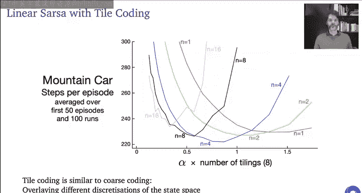

Okay， that concludes that example， now we're going to talk more generally a little bit about convergence and divergence of these algorithms。

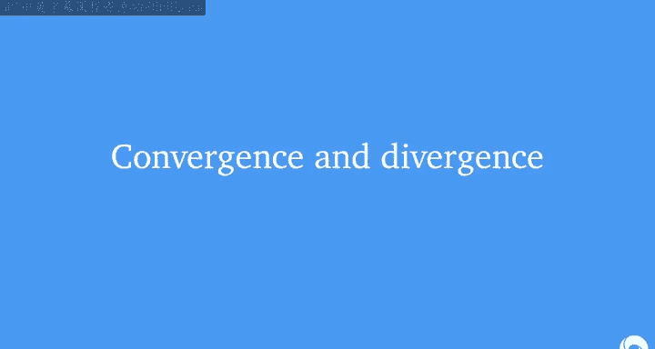

So when do these algorithms converge， what do we mean with convergence。

 we mean that they find a solution reliably， that they find some sort of a minimum of something。

So do they converse when you bootsottrap when you use function approximation。

 when you learn off policy and turns out it's a little bit subtle， it's not always the case。

 ideally we want algorithms that conversionver in all those cases。Or alternatively。

 we want to understand when the algorithms converge and when they do not so we can avoid cases where they do not and we'll talk about this at some length now。

So let's start with the simplest case， which is the Monte Carlo sitting。I talked about this already。

 I mentioned that this is this is like a sound algorithm。 it will converge。

 So the Monte Carlo algorithm， if we're not considering the stochastic case。

 we're just going to consider like the the loss there first， you can see there an equation which has。

An argument over something， but let's first focus on the thing inside there。

 there's an expectation over the policy， this is similar to what we had before。

 instead of having a D there I now put pi there to basically illustrate that the distribution of states。

 but also the return depends on your policy in this case。

And then we consider the squared loss which is our Monte Carlo loss essentially。

 and we want to find the parameters that minimize the squared error。

 we're going to call that WMCW for Monte Carlo。And I'm arguing here。

 I'm basically just stating that the solution to this will be this equation there on the right。

This is a linear like this basically linearly square solution。

 so if you've seen that before this would be very familiar and what we see here that is essentially it's the expectation of the outer product of your features。

And that expectation is then inverted， this is a matrix。

 so this is an inverse matrix times the expectation of the return time tier features。

 and that turns out to be the solution that Monte Carlo finds。We can verify this。

 So let's just step through that when， when are we done Like， when is the algorithm converge， Well。

 it's a gradient based algorithm， So we are converged to when the gradient is 0 because then or I should say if the expected gradient is 0。

 because we're doing stochastic gradient descent because if the expected gradient is 0 of our loss essentially to think that we're optimizing。

 that means that an expectation we're no longer changing the parameter vector。

 So when this is the case， then we have reached what is called a fixed point。So we can just state。

 okay， well we're going to be at some sort of a fixed point。

 let's assume that we don't know what WMC is yet， we're going to derive that here。

 so we're just going to take the grade it with to those parameters and we're going to say well。

 that's going to be equal to zero or at the fixed point。

So then we can just write that thing out so first thing to do is to write up the value estimate explicitly as this linear function that it is。

And then we're going to move things around。 So first。

 we're going to pull the feature vector outside of the brackets inside。 We noticed that this。

Inner product times a feature vector can also be written by putting the feature vector in front of this inner product because this is just a number right so we can basically move this one around but then we can consider this to also be kind of like an outer product timessha weight vector instead because the order of products here doesn't matter right we could put brackets around the inner product here or we could brackets put brackets around the outer product here that's the same thing。

TheOtherwise， the x just gets moved next to the return。

So we've just pulled that feature vector inside a bracket sttzel。

Then we rearrange and we basically note that this expectation it's just one expectation minus is a different expectation。

 so let's move the minus bar to the other side and then we see that this should be equal to that when the gradient is0 now all that's left to do is to take that inverse of that matrix on the left hand side which therefore is assumed to exist otherwise this step is not valid。

And then we get our solution。So when is that step valid。

 well so there's a distribution over states there right and there's an inner sorry outer product of feature vectors。

 so when is this typically valid， it's typically valid if your state space is large and your feature vector is small。

 that's like one case in which it's valid because then assuming at least that your features are nondegenerate。

 so you have different features for different states。

 then if there's at least as many different feature vectors that you can encounter as there are numbers in your feature vector as there are like components in your feature vector。

 then this inner product typically exists。So this is the common case， essentially。

 like typically you will have many more states and you will have features that do change when you go to different states。

And then in a sorry this outer product， the expectation of that will typically be invertible。

 but it is a technical assumption otherwise you're not guaranteed to converge。

 it might actually still be that the algorithm still converges， but it might not converge to a point。

 it might instead converge to a line or a plane if you can't invert that matrix。

It depends a little bit on the technical details。So the agent state here does not have to be Markov。

 this is fully defined in terms of the data that's kind of interesting right so we don't have to have a Markov in feature vector or anything like that basically the fixed point here is defined fully in terms of the X Ts it's not even defined in terms of the agent state it's defined in terms of the feature state you observe。

So that's kind of interesting， we didn't need that property。

Now we can maybe see if we can do the same for TD， so let's consider the TD fixed point。

 so I'm going to argue here that this converges to this different thing。

Look at it for a second and I'll go back to the previous slide。So the Monte Carlo thing。

Was this outer products， the expectation thereof inverted times to return times sure feature。

 This looks quite a bit different。 There's a different outer product here。

 This is still an outer product， But instead of being the outer product of the feature with itself。

 it's the outer product of the feature with itself minus the next feature。

That matrix it is inverted if it exists under similar assumptions。

 as I just mentioned before it would exist， it typically exists but doesn't have to。

 and then times the reward times your feature vector， not the return， but the reward。

 so this is a different fixed point， it doesn't just look different。

 it typically actually is different from the Monte Carlo fixed。

So now we're going to verify again as we did from the Monte carlo case。

 that this is indeed the fixed point， so we're going to consider the TD update and we're going to assume that the expected update is zero where the expected update is given as this。

This is similar to what we're doing from Monte Carlo。

 where basically it's considered me updated we' saying oh， when is this update zero？

And then we're just going to manipulate it in a similar way here。

 we're again going to pull in this feature vector first。And we put it next to the reward on one end。

 the steps like say here is actually not that important， but I'll get rid of it in a moment。

 so we're going to put it next to the reward， and we're also going to put it next to these two scales。

 but we're going to put it on the lefthand side， which we can just do because these are just numbers。

And then having put that on the left hand side， we notice that on the right hand side。

 we have these WTD， so we can also pull that outside of the brackets。

Which means we are left with this gamma at times xt plus 1 minus xt。

 both of which are transposed because they were multiplying with this weight vector。Right。Okay。

 so now we can again rearrange things， so let's pull this thing to the other side。

 So there's a plus here， so to put it to the other side that must become a minus。

 but we actually fold that minus inside this little term over here So note that the order has changed that's because there used to be a minus in front and we just pushed it inside and instead flip the order。

In addition， let's just pull out the transpose here。

 let's pull out the transpose outside of the brackets。

 so we just first subtract one vector from the other and then transpose it to come up with this outer product。

And now finally， we move this part to the other side by multiplying with its inverse again。

 assuming that that exists。And we notice that because the learning rate is inside the expectation and we're inverting。

 for simplicity， for instance， consider here a constant step size， just for arguments sake。

 but you can get rid of it in other ways， we can see that this step size will actually cancel out with that one because moving this one to the other side but multiplying with the inverse kind of means we're multiplying with one over the step size which cancels out with this step size so we get that the fixed following becomes this one。

So this is kind of just verifying that the fixed point is indeed the one that is listed above。

 and we have。Like substantial proof these days that this is indeed where a TD converges if it converges。

It's important to note that this differs from the Monte Carlo solution and typically the Monte Carlo solution is actually the one that you want。

Why， well， because the Monteta solution is defined as minimizing that thing that we actually want right。

 this is actually minimizing the difference between the return and the value。

 This is sometimes called the value error or the return error。And this is an unbiased。

 the gradient of this is unbiased withs to the using the true value in self temperature return as well。

But actually one could also argue that we don't even care about a true value。

 we just care about having a small error with respect to random returns， that's also valid。

So this seems to be exactly what we want in some sense， and then if TD converges somewhere else。

 this might be undesirable in some sense， and this I think in general is quite true that Monte Carlo typically converges to a better value than temporal difference learning does when you start using function approximation。

 however temporal difference learning often converges faster。And of course， we can trade off again。

 We can pick an intermediate labda or an intermediate n and kind of get the best of both worlds。

 You could even consider changing this over time。 You could start with a small end and then slowly increment it over time。

 And in the end， in the limit maybe still come up with the Monte carlo solution if if you'd like。😊。

So there's a bit of a tradeoff here bias variant trade off again similar to what we had before。

 but now TD is biased asymptically as well in the tabular case。

 this is not the case in the tabular case both Monte Carlo and TD find the same solution。

 but if we add function approximation even just for linear function approximation， TD remains bias。

 which means that it actually finds a different solution in the limit。

So it does converge if it converges to this fixed point。

And we can actually characterize it a little bit further by considering the true value error。

 which is defined as this difference between the true value and our current estimate weighted according to this distribution of states。

 where here we use D pi to denote that this distribution depends on our policy。

And then Monte Carlo actually minimizes this value error completely， but TD doesn't。

 but we can say something about what TD reaches and we can say that the true value error of TD is bounded in the following way where it's smaller or equal to one divided by one minus gamma times the value error of Monte Carlo。

 which is equal to the minimum value error that you can get。Under any weight。So what is this saying。

 well， this is basically saying that TD is doing maybe a little bit worse as Iki than Monte Carlo is doing。

Something different， right， It's biased， but we can bound how bad it is。 Now， how bad is that。

 Well there's this term  one divided by one minus gamma。How big is that Well。

 this depends on gamma obviously， and there's this useful heuristic that we briefly talked about earlier in the course as well。

 where you can kind of view this as a horizon where if gamma is 0。9， for instance。

 then1 minus gamma is 0。1 and then  one divided by 0。1 is 10。 So if your gamma 。

9 roughly corresponds to on the horizon of 10， so that means that in that case， if your gamma is 0。

9 the Monte Cardo error can be 10 times smaller then the TD error。

But at most right it can be at most 10 times smaller because this says that the error that TD reaches is smaller or equal to this thing right So it could be。

 of course， in some cases， you can have feature representations， for instance。

 for which TD actually happens to find the same solution as once car This is just saying in the worst case。

 if for instance your gamma， your discount factor is 0。

9 in the worst case it could be 10 times larger， doesn't mean it necessarily it is 10 times larger。

Now you may have noticed that I already said a couple of times if it convers。

 so there is a slide well， but potentially big problem here。

 there's a fundamental problem and it's a really interesting one and it's related to the following fact that the temporal difference learninging update is not a true gradient update。

And this is due to this， it's highlighted lightly in the slide here to this bootstrapping。

 because the bootstrapping uses the same parameters as the parameters that we're updating with this update。

But we're kind of ignoring that in the updates， we're basically just plugged that in as a proxy for the real return and hope for the best in some sense。

But I'll show you an example where this can go wrong。Normally， this is okay。

 it's okay what I'm when I say this is okay。 I mean， it's okay that it's not a gradient update。

 sometimes people。People like things to be gradients because we understand gradients quite well we know that stochastic gradient descent converges。

 so if we have something that's not a gradient it sometimes is of some concern。

 so it's good to appreciate that there's this broader class of algorithms called stochastic approximation algorithms which include gradient algorithms。

 stochastic gradient descent as a special case， but that's not the only special case that necessarily converges and indeed temporal difference learning can converge to its fixed point。

So stochastic approximation algorithms are a broader class and there are specific conditions under which these do converge。

Sttochastic gradient sense always converges under fairly light assumptions such as that the noise is bound at the step size decays and your data stationary and so on。

But temporal difference learning does not。And now I'm going to show you an example in which it doesn't。

So this is an example of divergence of temporal defense learning where we have two states。

And our feature vector has exactly one element。😊，And this feature vector has an element equal to one in the first state。

 and this same element is equal to two in the second state。

What this means is depicted above the states is our value estimate in the first state is just W because it's just this number W。

 which is just also a single number because our feature vector also only has one element and we're doing linear function approximation here。

So our value in the first state is w and the value in the second state is 2 w because it's just the same number w times your feature。

 which is2。The reward long the way is zero， it's a simple problem。

But now we're going to consider it's a partial problem。

 right I didn't say what happens after you reach states where the feature vector is too。

Im just I'm just going to consider this one transition and then let's see what happens if we apply TD So let's step through that let's just first write down the TD equation。

 this is our update for the for the temporal difference sorry temporal difference rate an update for our parameters of the value function where the value function gradient in the linear case is just our feature。

And in this case， the reward is0。 the value of the subsequent state S prime is the value of that state on the right。

 which is 2 W for whatever W is currently， and the value that we're updating so the value of the state that we came from is just。

X times w where x is 1， so that will just be w。So you've just filled in these numbers here。

 this0 goes over here， this 2 w goes over here， or maybe more precisely this two goes over there。

 and then the w comes in because we want to value estimates。

 and then this one goes over here so there's 2 w minus 1 w with a discount factor as well。

And we can slightly rewrite this by pulling out the W and getting rid of that zero which we don't really need to consider。

 So then it turns out that this update looks as follows where we have our previous weight estimates plus your learning rate。

 whatever that is， times2 minus discount minus1 times whatever your feature vector sorry。

 whatever your weight factor， your weight number， which only has one number here。

But what does it mean， well， let's consider that your weight is positive。

 let's say you initializes that one。And let's consider a discount factor。

 which is larger than a half。 if the discount factor is larger than a half。

 this term within the brackets will be positive。If your weight is positive and this term within the bracket is positive and again。

 the weight here is positive， all of this。Will be positive and in fact。

 this whole term here on the right will be added to the previous weight。

 which means our new weight will be larger than the previous weight。

But the weight it was already positive， so we're moving away from zero。

 note the true value function here would be zero， like the true value of that first state might be zero。

 at least it's consistent with this transition for it to be zero。

You can expand this example to actually have a fixed point of zero。But in this case。

 it will just continue to grow and your weights in the limit will actually reach infinity。

What it's actually even worse， it tends to grow faster and faster well because your weight keeps going up and this term multiplies with your weight。

So this is an example of a problematic behavior of temporal difference learning。

 and now we can dig into why this has happened， when this has happened。

 how can we characterize this and how can we maybe avoid this？

So what's happening here is that we're actually combining multiple different things at the same time。

 we're combining bootstrapping， we're bootstrapping on that state value on the right。

We're combining off policy learning and I'll explain that a little bit more and we're combining function approximation and when you combine these three things together。

 you can get these divergent dynamics。This is sometimes called the deadly triad because you need all three for to matter。

 for to become a problem。The of policy learning I promise I would say something about that。

 Why did I say this is off policy heres there's no policies here。

 there's no actions here So what's happening here well there's a certain dynamics and your dynamics would give you get you from this one state to the other state。

But then what we're actually doing is we're going to resample that transition over and over and we're never going to sample any transitions that come from the states that we've entered just now right and that is of policy in the sense that there actually in this case there are no policies that would sample the states over and over in specifically that way。

 so what we're doing instead we have an of policy distribution over updates。

This can emerge why this is called of policy is this can emerge if you're trying to predict the value of a certain policy while following a different policy。

For instance， it could be that the value from this state that there are actions。

But we're just not interested in their values。And hence they get kind of zeroed out in your update in some sense。

Now we could also consider on policy updating by extending the example to be a full example。

And now we consider this second transition as well， and let's， for instance。

 assume that this transition just terminates with a reward of0 and then maybe you get transition back to this first state。

 so maybe you just see this episode over and over and over again， but now we sample on policy。

 which means we actually sample the transition going from this second state as often as we sample the transition going to that state。

If that is the case， turns out the learning dynamics in general are convergence。

 T learning will converge also with linear near function approximation if you're updating on policy。

I will show that here just for the example where we can just write out maybe the combined update for simplicity。

 So let's just consider this transition and let's immediately consider that other transition。

 and let's just write down both of those updates right a second transition bootsts on the terminal state with value0 also as a reward of0 along the way。

 So this will then。Bas，ically could only retain that value of that state。

And if we merge these together， we get this update to our weights and note that the term inside here is now negative for any discount factor。

Smaller or equal to one。Which means that if your weight happens to be positive。

 it would push it down， if your weight happens to be negative， it will push it up。

And that is exactly what we want in this case because the optimal weight here is zero。

 just in this example right not generally the case。

 but in this example it's0 and we can see that the dynamics are such that indeed if you're larger than0 you will get pushed towards zero。

 if you're below zero will also get pushed towards zero So this seems to be working and indeed it has been proven in general that on policy temporal difference learning within your function approximation will converge to the optimal policy that's why the optimal values in terms of his fixed point right so the fixed point of TD is still different from Monte Carlo。

 but if we consider that fixed point to be the goal， it will find that fixed point。

In the own policy case。As I mentioned， multiply here is negative for any discount factor between  zero and 1。

O케。So off policy is a problem on policy fixes it， let's dig into one of the other aspects。

 I also mention function approximation as one aspect of this。

 so let's see what happens if we don't function approximation so we can consider a tabular representation where in each state we do have a feature vector。

 I've basically deoteed as a feature vector but it's one halt picking out exactly that state。

If we do that， this is just regression and this will also converge。The answer might be suboptimal。

 but no divergence occurs。So again， TD might have a different fixed point in a tabular case。

 it doesn't actually have a different fixed point in general， it can have a different fixed point。

 but we could but by playing with a representation。

 we could go from divergent dynamics to convert dynamics。 That's the point here。

 tabular being a special case。So we can still updates of policy now importantly。

 right we don't need to update on policy so we can go back to just updating the first state。

If we would do that。😊，Then the value of that state will converse to whatever the discounted value of the next state is。

 and we would never update that value。So this is a different way in which you can have a different answer because we're considering off policy learning。

 of course with function approximations can also interact。

 but even in the tabular case it could be that because you're learning off policy that you simply ignore certain states and therefore never update their values which might have lingering effects in the tabular values of the other states。

So that's just like something to maybe be a little bit aware of that this can still affect where your solution is。

 but you won't divert， you'll circum converge to something。So that was two。

 we had of policyiness onpoliiness， we had function approximation or not。

 and now let's go to the third one， what if we don't bootstrap？

Or what if we bootstrap less because I said over three of policy learning function approximation and bootstrapping now let's look at the bootstrapping and one way to multi bootstrapping is to use multistep returns。

So let's consider now to have a labda return， we're still considering off policy updates right so we're only sampling this one transition over here in some sense。

 but instead of calling it just sampling that one transition that's say it a bit more precise we're only updating this first state。

 we're never actually updating the second state， but now let's consider taking a labda return from that state。

 instead of taking a one step return。This is again something that can happen in some sense in the wild of policy learning。

And then we can just write that out， we have the lab return here。

 which we know bootstrappped slightly on that first states。And also， slightly continues。

But it continues to be。S double prime， which in this case is this terminal state。

 So the sorry S prime here is this second state and S double prime is then this terminal state。

 So now we can fit in all these numbers that we know。 we know that a reward on every step is 0。

 So R is our prime is 0 and also the value of this state after two steps will be0。

 We can just fill in all the numbers that we know and we get this thing。

And now we can analyze that thing， so it's very similar to what we had before。

 but before Lada was basically zero， so before when we were talking about the divergent example we had two gamma minus1 Now we have two gamma times1 minus Lada minus1 we have a parameter that we can play with we can play with this Lada parameter。

Turns out we can always make sure that this multiplier is negative。

 which we need here for conversions， if we pick the Lada parameter in a specific way。

 so what we want is essentially that this whole term is negative。

 which means that we want this term to be smaller than one。Then we just rearrange。

 move things around and it turns out the condition for that will be that your labda is larger than one minus1 over two gamma。

 just to be clear this is not a generic finding， this is just specifically for this example。

 this relationship， we're just going through the example。So for instance。

 we could pick a specific discount， we could fix discount being 0。9。

 then turns out the La parameter that we need to ensure that we have convergence is that you need to pick it larger than4 over 9 you can just figure that out by plugging in 0。

9 here and then just doing the math and figuring out what the discount of sorry what the trace parameter ladder should be。

This is not a hugely large trace parameter， typicallyy people pick things like 0。9 or 0。

8 or something like that， so 0。45 is not an unreasonable value to have If you pick it larger and that you're good to go and you won't diverge。

So these are important things to keep in mind and one thing that I want to highlight by going through all of these things is that it's actually it's not always binary。

 so the deadly tribe might make it sound if you combine bootstrapping function approximation and off policy is that you're always in trouble That's not actually true you can combine bootstrapping function approximation and of policy learning as long as you're not bootstrapping too much you're not too off policy and your function approximation is tabular enough in some sense。

So what turns out to be the case is that people run these algorithms in practice quite a lot and a lot of deepil algorithms actually combine all these three things。

 they combine bootstrapping of policy learning and function approximation。

 where the function approximation is， for instance deep neural networks， of policies。

 for instance because we're trying to predict many different policies or because we're trying to learn about past data。

And things like that， or because we're just doing key learning at scale。

 which is also an off policy algorithm。And then the bootstrapping is also because of for instance doing queue learning or doing something similar。

 but also because of this bias variant straight enough that we typically find that it's better not to bootstrap。

Too heavily， but also not to use for Monte Carlo returns。So we're combining all of these。

 but turns out many of these algorithms are X table and they do learn well because we're still in the triad。

 but we're not in the deadly portion of the triad。An alternative that you could consider is to pick a different loss。

 so let me briefly go into there。So temporal difference learning has a specific update right and I mentioned oh temporal difference learning can diverge if you're doing all these things at the same time。

 but why do temporal difference learning， Can't we find something else maybe？Okay so the problem。

 as mentioned from temporal difference learning， is that it ignores essentially that we're bootsciping on a value that itself depends on the weight。

What was happening in the example that we had just now going from a state with valueW to a state with 2W was essentially that we're trying to update this state。

Closer to the value of that next state， but in doing so we're actually updating the value of the next state more away from us so you're chasing your own till except that your till is running away from you faster than you're running towards it that's why TD in that case diverges。

😊，So an alternative would be to actually define something that is a gradient， a true gradient。

 One example of this is the Belelman residual gradient algorithm where we define a loss。

 which is just our square TD error。 So this is a different loss， right。

 we don't have our normal value loss here。 We don't have a normal value error。 We instead say， well。

 let's just consider the temporal difference error。 and let's see if we can minimize that。

If you push the gradient through that and you calculate that。

 you find something that looks very similar to D， but to TD， but has a different additional term。😊。

Unfortunately， this tends to work worse in practice and one reason for that is it smooths your value estimates whereas Stan difference learning in some sense predicts。

So what do I mean there intuitively， simple difference learning updates the value of the state towards something that is in the future。

 towards this one step estimate of your value in the future。

 the reward and the value of the next state。😊，This algorithm instead， it's a fine algorithm。

 it can be used and it convergenent in as much as temporal difference as stochastic gradient descent is convergent。

But it does something that is maybe a little bit weird in the sense that it updates not just the value of the state that we came from。

 but it also updates the value of the state that we're bootstping on。

So in net sense it's a smoother because what it might do is actually it might pull down。

 for instance， the value of the state you're roof steppingping on just to make it easier to predict it。

 but it doesn't mean that's a valid value for that state so it turns out if you run these algorithms in practice。

Oftentimes it just works worse。That might maybe not a necessity， maybe it's not necessarily worse。

 but it basically seems to be that this loss。Although we can define a gradientd of that loss。

 which looks somewhat similar to the T algorithm， that maybe the loss is just not the right thing to be minimizing。

 it might not be the right thing to look at。So smooth values are not just bad because your value accuracy might be slightly wrong。

 but it might also actually lead to suboptimal decisions。

 This is especially true if your rewards are， for instance sparse because then there might be this one rewarding event and immediately after getting the reward your value function maybe should drop。

Because you've already received that reward， but if you do something like Bellman residual minimization。

 what might actually happen is it tends to smooth over that discontinuity in the value function and hence the states immediately after already taking the reward might be updated to look a little bit like they might still be able to take some of the reward。

 which might lead to wrong decisions。So let's consider a different alternative。

 Let's instead of squaring the TD error inside the expectation。

 let's just take the expected TD error and try to minimize that。

 If we minimize the expected TD error， maybe we're still kind of good to go from a prediction perspective。

And instead of so let me just go back a slide， let me show you one difference here is where the square is right so here in the bemon residual algorithm the square is inside the expectation here when we consider the bemanarrow square is outside of the expectation。

Again， we can take the gradient of this， but there's a catch and the gradient looks very similar to the previous algorithm。

 but theres this weird S prime there。 S prime is a second independent sample of S T plus1。

 So S prime t plus1 needs to be sampled separately。 If you don't sample it separately。

 you're actually doing this other algorithm that we talked about before。

Where S t+1 is the actual next state that you've seen。

 so this algorithm can only be applied if you have a simulator that you can reset。

 you should be able to sample the transition twice essentially。And then you could apply it。

 but that's an unrealistic assumption for many cases。

 if you're a robotd in the real world and you're just interacttering with the world。

 you can't resample it transition twice。 so then this algorithm becomes。Less feasible。

Here's just a brief summary of what we just talking about。 There's a couple of different categories。

 so you have your algorithm could be Monte carlo or it could be TD， you could be on policy。

 it could be off policy and you could pick a certain function class。

 Now in terms of just summarizing the convergence properties of these algorithms。

 if you're on policy， you're mostly just good to go。

 the only thing that's not 100% guaranteed is non nonlinear convergence。

 but even for that one we can say some things actually and in some cases you can guarantee that TD convergence for the non nonlinear case。

 but it requires more assumptions So we can't say in general， it always converges。

If we go off policy we see that linear function approximation also becomes problematic for TD。

 although again， I want to stress that this doesn't mean it's always a problem。

 it just means there are cases in which we can't guarantee convergence。

 doesn't mean the algorithm doesn't work in general。

 just means that there are edge cases in which it could do something wrong。

This has been addressed in more recent work that is too detailed to go into in this lecture where people have dev new algorithms that are slightly different from TV。

 but might be inspired by TV that are actually guaranteed to converge also with function approximation also under off policy updating。

 but those algorithms are beyond the scope of this lecture and this course section。Okay。

 so now let's move towards controls so now that I've maybe。

Expressed some uncertainty about convergence， but also some evidence that it typically does converge。

 so we can extend all of these control algorithms， obviously to function approximation。

 The theory of control with function approximation is not that well developed。

 unfortunately this is because it's substantially harder from a prediction case because now the policies under your direct control。

 this might change over time。 and it might be talk quite hard to reason through。

 maybe the one exception of this will be in a subsequent lecture when we talk about policy gradients。

 which are again， stochastic gradients algorithms and therefore are in some sense fine。

 but the theory of control with function approximation when you use value estimates is much harder in some sense。

In addition to that， actually you might not even want to converse that often or during learning。

 especially when considering this value learning， because you might actually want to continue tracking。

So， for instance， if you're。If you're doing something like value based control。

 you your policy will be changing， so your predictions shouldn't converge because they want to converge to whatever the current value of the policy is。

 But if the policy keeps changing， you actually want to track that rather than converge。

But also more generally， even if we're doing direct updates to the policy。

 it might be preferable to actually not converge， but just to continue to adapt。

That doesn't mean that convergence guarantees are not interesting or not important。

 because one thing that we could still have is if we have a guarantee of convergeence。

 that means that the algorithm kind of updates stably， typically throughout its lifetime。

 whereas if you can diverge， you only need to diverge once for everything to fall apart obviously so understanding when things converge and diverge is still very important。

 even if you can't fully characterize it。

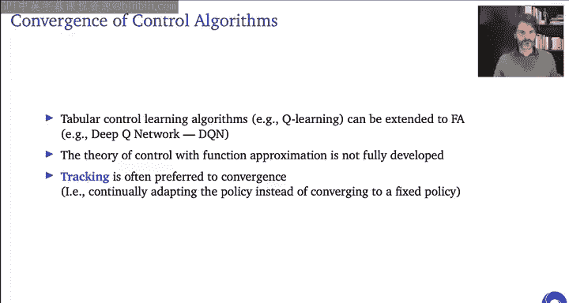

Okay， now moving on， we're going to consider updating these functions in batch settings。

So we've talked about batch methods previously， but there's a different reason we're going to talk about it now previously when we talked about batch reinforcement learning。

 this was basically to highlight differences between temporal difference learning and Monte Carlo learning。

But we weren't proposing it as an approach that you should necessarily follow。

 although we didn't mention that you could do that Now we're going to take the other view。

 which is oh what if we really want to learn with batches of data。

 and a reason why you might want to do that is because gradient descent is a simple and appealing algorithm is's not very samplingly efficient the reason why intuitively is that every time you see a transition。

 you're going to consume that transition and make maybe an incremental update to your value function。

And then you're going to toss the transition away。But there might be a lot that you could have learned from that transition that you can't immediately extract。

 It doesn't play a role immediately in the update that you're doing。

 and then that would be a waste in a sense， So instead we could consider to doing a batch approach where we try to find the best fitting value function for a set of data that we've seen so far。

 So instead of just doing one gradient update necessary on every sample we could try to maybe extract as muching information as we possibly can from the training data。

There are other ways to do that。 I just want to mention that if。

If this seems at odds with our main goal at the beginning where the world is large。

 your lifetime is large。 and you consider a robot walking through the world， maybe you're thinking。

 well that robot can't store all the data。 this is true。 and I agree with that viewpoints。

 So full batch settings are maybe most typically employed when the data is not too huge。

 but turns out you can also employ them in practice by for storing on a limited amount of data。

 or alternatively， this will actually also be related to model based approaches where you can consider storing some of the data to be quite similar to storing an empirical model。

 So now it's just a choice of what your model is what the structure of your models is。

 Is it a parametric model or is it a non-parmetric model that consists only of data that you've seen。

 So there are approaches that feel quite similar to these batch approaches that do scale to really large problems where maybe you couldn't store all the data。

But for now， for simplicity and clarity， we're going to focus on this case where we really are going to consider all the data。

 and we will actually see that there are some methods that don't actually need to store all the data to get the same answer。

 And we're going to start there by considering again， the linear case。

 So we have linear function approximation。😊，And we were considering fitting the best possible fit of our parameters so we talked about this before in the limits for TD so let's consider that TD update again and what we said is oh if you consider the update to have converged so that the expected update is zero。

 then your fixed point will be this weight vector which we called WTD which is as defined on the slide。

 this is the same as we saw earlier。Now， one idea that you could do is， well。

 what if we take that expectation and instead of taking the expectation over all possible states and all possible transitions that could happen。

 let's just take it over the things that did happen。So what we'll do here are at some time step T。

And we're just going to instead of taking the full expectation， which we don't know for this。

 we would need the knowledge of the markov process， instead what we're going to do。

 we're going to take the average of the things that did actually happen。

So this is very similar and in the limit， of course， this average， if time grows to infinity。

 if your distribution is stationary， which needs to be the case for this expectation to even exist。

 then this summation， this equation actually will converge to this equation above。

By law of large numbers， assuming， of course， that the variance of your reward is finite and so on。

So the idea then is to maybe instead of doing this where we just use this for analysis。

 we are going to do exactly the same things on the empirical loss。

 And that turns out this will look as follows where we see something very similar as we did for the。

TD fixed point。 So for the TD fixed point， let me walk you through that first。

 we had the expectation over an outer product of two vectors。

 So the first vector is just your feature vector and the second vector is your feature vector minus the next feature vector discounted。

 and this is an outer product。 So this is a matrix。

And the expectation of that will be a full rank matrix typically under some mild assumptions so we can invert it。

 and then we multiply it with a vector， so we have a matrix number of features by number of features。

 times a vector number of features， and that will give us a weight vector。

 this is also the number of features large， which fits with the linear function approximation of course。

Now here we're going to do exactly the same thing， but instead of having the expectation we have some patients note that we're not taking averages because if we would put like a1 divided by t here and we would put one over here。

 they would just cancel out so we can ignore that we can just consider it of some of these other products and the sum of these vectors over here。

And that will be equivalent to taking the average instead。

So the summation is over exactly what you would expect now。

 which is this outer product of these feature vectors， but it's not for the expected feature vectors。

 it's for the ones that you've actually seen。And then again， here， the same thing happens。

This is called least square temporal difference learning and the solution here。

 this weight vector is the least square solution given some data。So。

We can put that equation here at the top of the slide where I made one change here in the previous slide I call it WLSTD and now I'm just going to call it WT because in fact we can change this as we get more data。

 WT can change because it's just the datadepend weight and indeed we could be interested in these predictions for any time set during learning right so there might be reasons why you might want to extract this prediction for instance for reasons of control。

 you might want to pick actions although that's a bit more subtle to combine with least Western pro learning because in some you don't want to consider all the data then because this is collected over past policies。

So for simplicity， not consider it a prediction case。

 but it could be that you still want to know these value functions as you go。

 so you might want to have this weight vector， you might want to compute it， you get some new data。

 you want to recompute it。Now fortunate we can can do that online， so before we do that。

 let's just give these things names， we call the matrix here inside the brackets a so that this whole thing will be a inverted。

 so A is just the summation of outer products。BT will be the summation of the feature vector times the reward。

 so these are the names we get it and then the weight vector at every time step is defined as the inverse of A times Bt。

Now we can update both of these online， so we're considering actually storing both these separate quantities and we're going to update A separately from BT and then recompute WT whenever we need it。

One way to do that， the naive approach， and maybe the most obvious way to do that would be to update the a matrix by just adding the current outer product。

 the one you've just observed and adding the reward times feature vector to the B vector。

Unfortunately， the reason I call this that naive approach is that it's fairly expensive。😊。

It's not expensive because of the B update， that one's very cheap because that one just has the same number of operations as you have features。

X here is just a feature vector， B is the same size as a feature vector we're just adding two vectors together。

 I discusses our new vector。The update to a is more expensive because we're adding an outer product。

 which is will be outer products of these feature vector will be the same size as a matrix by features by number of features。

And we're adding this to this a matrix which is also the size of the feature squared。

So adding these together and giving us our new a matrix is n squared where n is the number of features。

So that is also not the most expensive operation here。

 the most expensive operation is then that when we want to compute W。

 we need to invert a and inverting a naively will give us a cubic cost because a will be some dense matrix and inverting a square matrix of n by N will be cubic in n。

So that's expensive and we want to avoid that and the reason we want to avoid that is because we want to ultimately consider large feature vectors。

So if you only have 10 features you could apply this approach right then the algorithm would cost like 100 computations to computer weight vector sorry1000 computations updating B would only be like 10 operations order 10 operations updating a would be order 100 operations but an inverting a would be order 1000 operations that's still okay。

 but if you have a million features this becomes very very wild。

 very quickly and it's not very very scalable approach。

So we'd like to do something a little bit cheaper， turns out you can do exactly the same thing cheaper by updating the inverse of the matrix A instead of the matrix A itself。

And this is called a Sherman Morrison update。And Sherman Morrison is a more generic approach where we can take any matrix。

and then add any outer products and then consider the matrix that results from that operation and then turns out the inverse of that matrix can be computed in only squared number of operations if you knew the inverse of the matrix that we had before so we just what we always had is because we're incrementally we keep on updating it so we just start for instance you could start for instance at something simple like the identity and then you could just incrementally keep on updating like this。

So the operations here are as you can see a matrix by another matrix here's an outer product by another matrix。

 but of course you could also first compute the dot product of the vector with the matrix turning that into a vector and then you still have the same happening here。

 so then you still have an outer product left， the thing below the division bar is just a scalr because it's a vector times a matrix times a vector plus one。

So this is it looks maybe a little bit complicated。

 there are many proofs of why Sherman Morrison works online。

 feel free to dig into that if you didn't see this before the update to B remains the same we don't need to invert B it's just a vector you can't invert that and this way we would be able to compute this W。

 this weight vector at the top of the slide by incrementally updating the inverse of a rather than a itself。

This is still quadratic in the number of features and it applies only to linear function approximation。

 but it is an approach that scales at least to some larger numbers than the cubic approach。

It is more computed than TD， so in large applications this is still avoided for two reasons。

 one is that it's limited to the linear case， as I mentioned and the other one is that you might still want to have very large feature vector even if you want to do linear and if your feature vectors are a million size a million then still squaring that is still fairly large。

 so it might still take quite a bit of time on every step。However， it could be that。

This is feasible for application and then it's good to keep it in mind the other reason why we talk about this is because it can mean an inspiration to other approaches。

So in the limits， it's good to appreciate that LCD and TD converse to the same fixed point for LCD。

 this is almost immediate。Let me just go back a couple of slides to show that because as I said。

 by the law of large numbers， this thing will just become that thing。

 which means that the solutions will also become the same。

So SDD kind of immediately will converse to the same fixed point STD under mild assumptions。

And we can extend LSCD to multi separate returns as well。

 we could consider LSCD Lada instead of just considering the one step LCCD data we discussed just now。

It can also be extended to action values， maybe quite naturally you consider you can always almost always extend anything that's defined for state values to state action values by considering saRSa like approaches。

And then of course， we can insulate it with policy improvement if we do that。

 we could have least square policy iteration。😊，Where we just use LSTDQ to estimate action values for the policy evaluation phase and then we gratify the algorithm。

 Of course when we do that when we change the algorithm we need to be a little bit careful that we then shouldn't use all of the data collected so far for computing our value estimates。

One approach， one simple approach could for instance be that you just restart a policy evaluation phase whenever you've made a policy improvement step。

 throwing away the past， values， not trusting them anymore and just recompfusing them for the new policy。

Okay， now we're going to move on to maybe what is maybe a more generic approach。

 but it's similar to LSCD in the sense that we're going to consider the data collected so far。

So we consider that we have some experience， the data set consisting of all of our experience up to some time set T。

Now one thing we could do is instead of considering all of these transitions at once。

 as we were doing with SDTD， we can just sample transitions from this data set repeatedly。

So we sample a transition that's enumerate with a time step N。

 which is smaller or equal to the current time step T， and then we just do a graded update with that。

So if this data was collected under a certain policy and we're interested in evaluating that policy。

 this seems like a fine approach。You can actually also combine it with cu learning。

 and I'll show that in a moment to learn off policy。

The benefit of this is that you can reuse old data。

So you could just store all of the data you've seen so far and keep on updating。

 which means you could take multiple steps on the same multiple gradient steps。

 incremental gradient steps on the same transitions over and over。

 and thereby extract more knowledge that you maybe could do from a single gradient step。

This is also a form of batch learning， it doesn't consider all the data at once。

 it doesn't consider a full batch at once， but instead it considers the batch to be able to sample from it。

Of course you have to be a little bit careful that if your policy changes。

 this might be important because if you're just trying to do prediction。

 you don't want to use transitions for a policy that has now changed or alternatively in a future lecture I'll talk about how to deal with that and how to still be able to use it。

 but to reweight it appropriately。

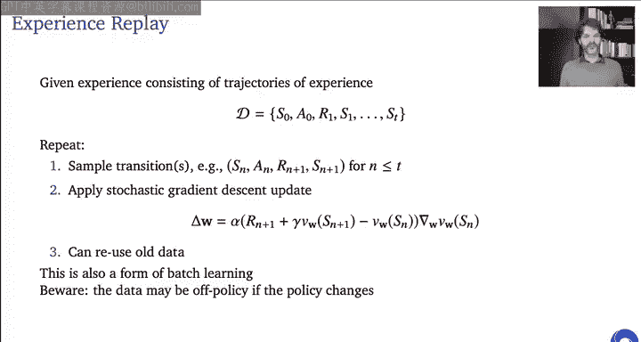

Okay， this brings us to the exciting topic of deep reinforcement planning I will touch upon that only briefly now there will be much more about this in later lectures。

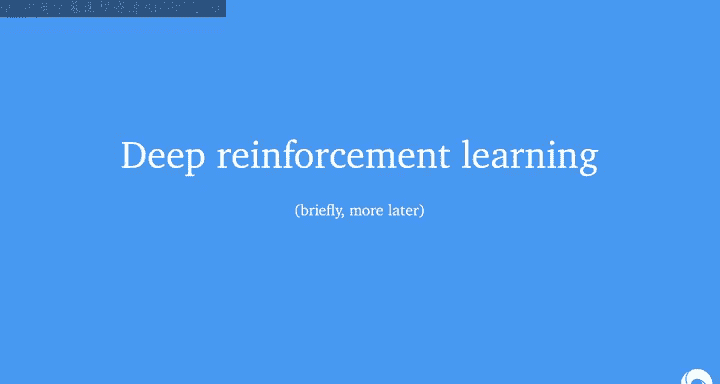

So I'm going to start by just doing a very， very brief kind of a recap。On neural networks in general。

This might be very familiar to many of you already。

 but it seemed useful just to very briefly go into that a little bit。

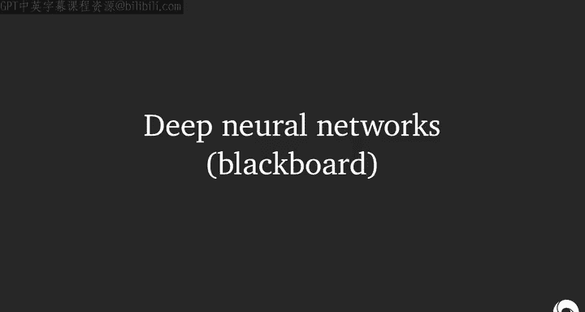

So let's go to the note taking app。That we've been calling a blackboard and let's consider what deep neural networks essentially are as far as we're concerned。

 there's a lot to say about this and of course I won't be able to say anything remotely scratching the surface。

 but let me just give you a very bare minimum that might be useful for us to understand for the purposes of this course。

So what have we've been considering so far， let's first start with a linear case and we were considering to having a value function that is defined as an inner product of some weight vector W with some features of the state。

Now this is a linear approach which has benefits and downss as discussed before what would be a nonlinear approach Well。

 for instance， we could have some function。Let's say F。

That takes some numbers input and outputs a real number。

And we could apply that we could say that any such function actually。

 let me make it clear that these are both these numbers。 So any such function。

 let's just assume that without。Bothering， if we apply this to a vector。

 then it'll be applied element wise， so the idea is that we have some function which is nonlinear。

Popular examples of this include， let me just draw a couple squing functions。 So if this is the。

0 lines。Of the graph， then the squash function might look like this。

Or another popular choice these days is what they call a rectify linear unit。

Which has a discontinuity that looks like this。Where essentially。Its。This。

 this one is just defined as。嗯。W is max。0， y。And the benefit of this is that it's linear in some parts。

But it has no linearity。 So you can use this to add no linearity to your function if you want。

 and I'll show you in a minute， how。This one's often called a sigmoid。Or the one I actually。

This and more general term to one I drew here or I kind of tried to draw here。かいです。This。At1age。嗯。

So that's those are specific functions。 And the idea is that this is some nonlinear function。

 And then one way to make that value functional linear is just to apply that function。

 So we could consider something like this where we have a function applied。

Now this is not particularly useful yet right but it's already no linear and if F is differentiable。

 then we can still compute its gradients with respect to the weight。

Now this is not very useful immediately Why would we necessarily for instance。

 squash the function between0 and1 as we do with the 10h or why would we say。

 oh negative values are not allowed as we do with a rectifier。

 so this one's call a rectifier linear unit so this is not typically what we do so let me immediately correct that instead what we might do is we might say。

 well let's first apply some matrix to our features or inputs。Sorry we don't need to transpose there。

 so I was starting to they're all transpoposed。And then we multiply this again。

 So let me call this matrix matrix1， and then we have maybe a vector。2。

And this could be your value estimate。So now note that if we want to take the gradient。

 So the gradient with one of the components of W2 will be quite simple。

 So if we consider the partial derivative of。VW of some state S withpect to W to I。

This will simply be。The function F。Applied to。This weight matrix。Apply to our feature vector。

Taken at。I so I'll note here that this weight matrix multiplied by a feature vector。

 the feature vector is a vector， the matrix is matrix， So the output of this is a vector。

 So F is applied element wise， and we're basically going to sub this with an I to theote that we're taking the input the I output here。

There's different ways to deny that I could have also written this fors with the。

Index notation like that。So that's very similar to before。

 essentially as far as we're concerned now in terms of the derivative with respect to the weights in W2。

 these are just features， so our features are not defined as some function F applied to some weight matrix W times the feature vector and those are as far as we're concerned just our features。

 but the difference now is that we can also consider as part of our update the gradients so the。

Did partial derivative？With respect to some element in matrix 1。 So let's consider。For instance。

 I and D。 So it's a matrix， right， so we need to。Index twice to get one element。

And this can be computed just by the chain rule。 So what we'll get is essentially that will have the gradient of。

W。And then VW by。The intermediate thing。 So we take the gradient of the intermediate thing being。嗯。

This one take an X。I， and then that thing。Degra in retrospect to that weight。

 but let's do an intermediate step， let's take it first just to the inputs of that function。

And then finally we have。So let's unpack this a little bit。 So this part。

 this first partial derivative。It's just the gradient of our value function with respect to the I feature in some sense。

 this will just be W2。At I。This next part is just the derivative of our function， whatever that is。

 and these functions above they always have some well definedfin derivative。

 the rate doesn't actually have a well definedfin derivative at exactly zero。

 but that's okay we just define it to be zero there so we extend this to have a well definedfin derivative at zero so that the derivative at least is not discontinuous。

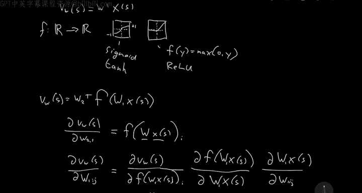

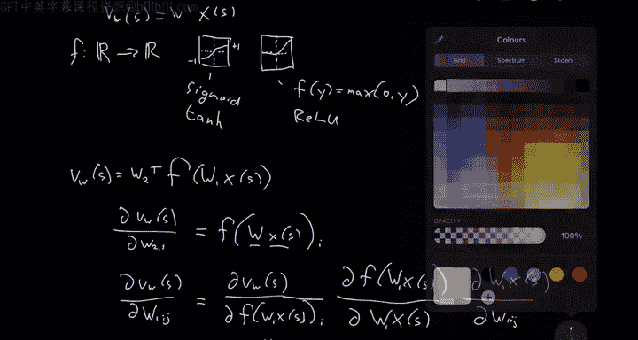

ologies。 sorry， let me move down again。So this will just be the derivative take at whatever those values were。

And then this last bit， the weight matrix times the feature vector by at one elements。

Willll simply be。Feature vector indexed at。That one element。So these are all just numbers now。

 sorry this ones also taken it。A。So note that actually what we're considering here。

 so I've in next here。Let me use a different color to denote that。Here I've indexed with I。

 which I did here as well。I could also have written that as this， like the F is applied to。

The weight matrix。But indexed at I。 So let me just say I do't。 So now it's a vector。

So that's a different way to write that same thing。So essentially whenever I index here。

So let me actually pull that one inside， let me get rid of that one over there and let me instead。

Put it over there。To make it clearer。They were actually indexing the way it made。Now。

 know that the things that we're left with at the bottom， they're all just numbers。 This is a number。

 That is a number。 That is a number。 And we just also come them together to get that one number that we need is for our gradients。

 Then our gradient is just this one big vector， which merges。

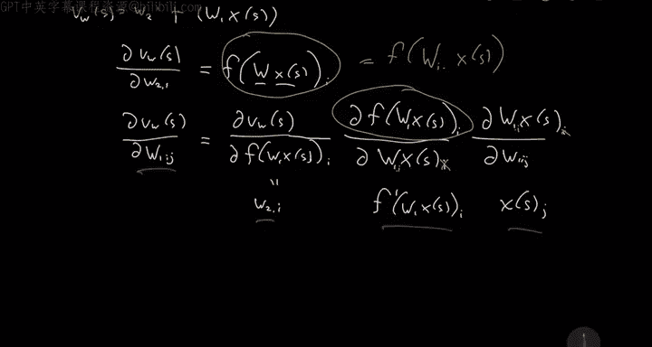

Both the contributions for。

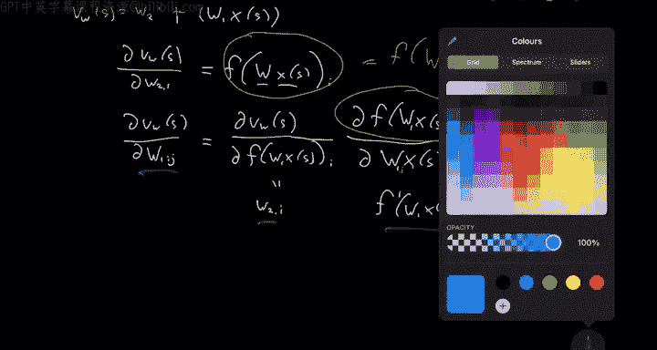

The second weight vector and for the weight matrix。 And we can continue stacking this。

 Now I mentioned before it's useful to go through these steps to apply the chain rule a little bit。

 but you don't have to actually worry too much about that in practice theis because what we instead do。

 we just whenever we need a gradients， we apply a software package which automatically compute that gradient。

 So you can make these functions arbitrarily complex。 So one thing that you could do is。

 for instance， you could have a value function that has some。Wait， let's say at layer L。

Times the feature， sorry so this is just some function which we could also Subscript L where this is a layer index。

And then， this will be。Times the inputs， let's sc those y at layer L。And then we could just say， oh。

 the inputs at layer L are defined as some weight matrix， L， this is a vector。

 so now we have a matrix。Of L -1。times the features。At the previous。

So we can stack this fairly deeply。Just expand it for one specific example。

 let me just write it down explicitly because doesn't hurt。To a。Have that in mind。For instance。

 we could have something like three layers， let's say。And the more layers you add。

 when we use terminology in deep learninging， we say the deeper your network is。

This is because you can denote this this function， you can denote that as there are being in inputs。

X。And then there's a weight matrix here。And then， we get our。

Let's say that like let's gift this a name。Sorry。Ran out of space there on the end。

 let's give this one a name I1， then this could be I2。And then you could do that again。

I3 and then maybe then。So we could note this as well by showing that there's lots of connections here。

This could be a dense matrix operation， and then in the end maybe it goes into a single number。

Right this is weight 3。So the idea is that you can stack these people use all sorts of notations to denote these neural networks sometimes as simple as something like this。

Or sometimes people draw more complicated figures， which show the dimensions a little bit better。

 As you can imagine， you can make these things fairly complex and weird looking as well so you could have all sorts of。

Whered structures which merge in strange ways， because maybe you want to somehow put some inductive biass in the structure for your value function。

 this can be useful in some cases， this is a way to print some more prior knowledge into your function class if that is helpful。

It could also be that you have multiple inputs that maybe come in at multiple places。

 for instance you could have vision inputs and auditory inputs and maybe division vision input has a certain preprocessing necessarily。

 and then the auditory inputs have a different preprocessing necessarily so you could have all sorts of inputs like maybe this is some part of your observation this is a different part of your observation maybe this is yet another part of your observation and they finally all come together to give you your value estimate。

And then old parameters here。

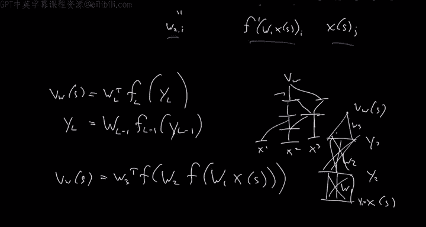

In your network， so actually let me do that in a different color to make it clear that we're not。

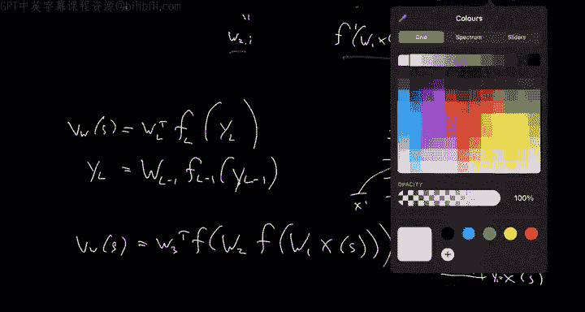

That this is not part of a network now， so oh sorry， that didn't actually change my。

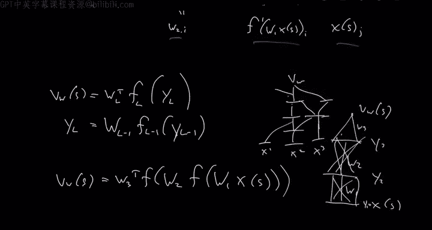

Color。

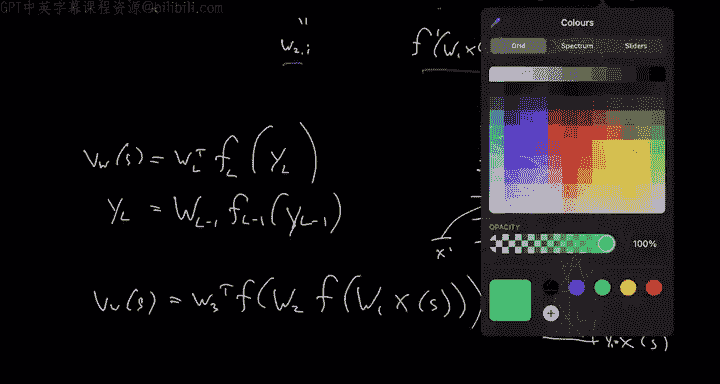

It doesn't seem to want to change my color， so let's go like that。So all of those。

Lines there are there are weights。 So we just compute the gradient with respect to those weights。

 and typically these days， as I mentioned， we use an auto differentiation package to do that。

 So you can basically construct these fairly complicated networks without having to worry about computing all of these gradients by hand instead the software will do that for us and turns out these gradients can always be computed if you're using differentiable functions。

 of course， these can always be computed in a compute that is comparable to the amount of compute it takes to do your forward paths So if you can do that forward paths of this whole network in some limited amount of time and then computing thegradings will take time that is proportional to that。

 so it doesn't take much longer to compute the gradient。Okay， now that's in a nutshell deep learning。

 I want to say one more thing， which is if we then consider a time step to time step。

 you could consider having a state here。This is our Asian states now。

And let's go a time step further to the next agent state。

And these depend somehow on our observations。And maybe agency say is then used in some complicated way。

 maybe they also。Results from your observation in some complicated way and maybe these are used in some complicated way to maybe get our value and maybe to get our policy。

And maybe other things as well。Now this step is agent update function。

Could be considered let me actually put it somewhere else， let me put that here。

Because the agent update function。In some sense。Mges that arrow and this part。

 so it merges the observation in the previous state into a new state。

 That's the definition of the agent update function。

 And here we see how we could structure that in our implementations as a neural network。

Where there is now a gradient that might flow， actually let me use blue to denote the gradient flow so if we want to update a prediction over here。

 the gradient might flow into the parameters here。Into the parameters looking at the observation and also maybe through time。

 maybe even further back。 So there could have been。You you use prime S to know the previous one。

And the gradient could flow all the way back。Through time。

Now this is both nice and potentially beneficial， but it's also potentially problematic because that means that if you want to actually have the gradient flowing all the way through time。

 you need to do something smart about how that gradient flows。

 let's beyond the scope of this course that's more for more advanced deep learning considerations there are mechanisms that allow you to do that for instance by just truncating the gradient flow at some time up in the past and saying well。

 I'm just going to do a couple of steps that's called bulkback propagation through time。

That propagation in general is just a term refers to computing of those gradients going backwards through these nonlinear structures。

Okay， so that's just a brief， very brief explanation of deep learning。

 Some of that might be completely known to you already if you previously took a deep learning course here I just wanted to highlight that this is one way to build these structures and that you can then use them to。

Basically， computer value functions。I want to mention yet one more little thing。

 which is kind of the same as what I said before， which is what confnets are。

 so the structure that we've seen before actually let me highlight it again。

I's an only nonlinear linear network now I'm just going to say a special case of this is when you have vision inputs which are structured sometimes drawn like this。

Where these are kind of the pixels on the screen， so maybe you have some sort of。

A backman thing here， maybe trying to eat the ghost。 so of course， normally you'd see。

Much more of the Pnet screen， but let's just do a simple example。

Maybe there's a dots here let's see as well so these could be the pixels of the screen and in fact typically you could have multiple layers of these because for instance you could have an RGB input where one of these layers contains the red。

 one of them contains the green and so on and then what we can do is we can apply linear layer to this。

And then process this through nonlinearity exactly as before。

 but turns out if you just put all of those into like you could take all these these pixels and just put them into some sort of a large。

Flat vector and then you do the thing that we did before。うふん。

But that turns out that doesn't work that well， so we typically don't do that。So instead。

 what we typically do is we apply a special linear layer， which actually looks at a little patch。

And then typically it looks at that patch。Across the channels， so these are channels。

So then it turns this little patch here that goes through the channels in a sense。

It turns that into a vector and then applies a weight matrix to give us the next patch。

 which then gets turned into。A spatial Pat again。And potentially， again。

 you could have multiple layers of those。And in fact。

 what we typically do is we don't actually turn it into a patch， we just turn it into a。

So actually' going to backtrack that slightly， we just turn it into a number。So a little one pixel。

And then， having。Stacked layers of those。 This is just a vector， but I'm stacking it。

 and then we're going to compose those again into some larger image。The number of layers here。

 the number of sort channels here。Does not have to match with the previous one。

 So we could have more channels here and he。Semi image， in some sense， could be smaller。

 This is called the combsnet。 And then what happens in the Comsnet is that actually the same weights get applied to different patches。

So also over here。That's called weight sharing in general and comess not to use weight sharing。

 so essentially what's happening here is you could consider this to be kind of a filter。

And this filter gets moved across the image。😡，And basically on every patch in the image。

 it gets applied the same filter and it extracts some feature information。

 which passes it into a new feature layer。 And then we get something that sometimes is drawn a little bit like this where as mentioned。

 we could have multiple planes here， and then this goes into。Other planes。We these planes。

Could have a different number， let me just draw three this time。Or four， let me just。

Take it up as it go along and this one patch here。Would show up as a single pixel in this new thing。

 but then there's an overlapping patch， for instance。

 here that would show up as the pixel just next to it。And so on and so on。

And then we just can do the same thing again， and then it could be a new patch here that goes into a layer above there。

So you could apply this multiple times。These are just。Similar to before， these are just。

Linear layers， and then we put non nonlinearities basically just before computing this pixel of here。

So this would still have this nonlinearity on top of this because otherwise it's a linear network and everything kind of collapses to a linear function proximator。

 but nonlinear function approximation can be a richer class。

 so instead of necessarily being linear in the observation this could now be nonlinear observation。

And then you could apply this many， many times and then eventually you could tos it into a vector and then maybe compute your value function on top of that。

So that is all that the content is it's exactly the same except that the linear layer has some certain structure。

 so one way to consider that is that this matrix here at the beginning。

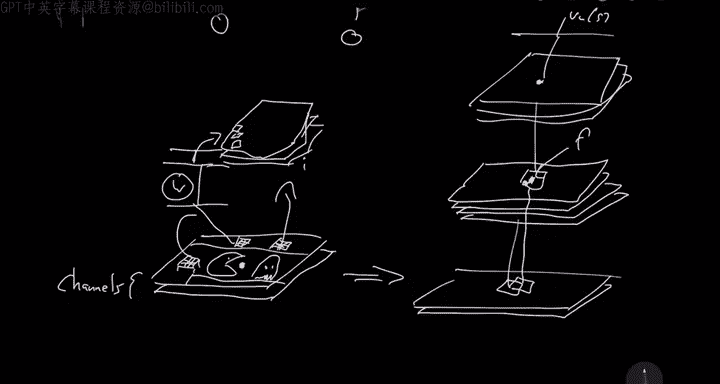

Could be a con layer， and that just means that that matrix has a very specific structure where the same weights show up in multiple places in the matrix there's weight sharing。

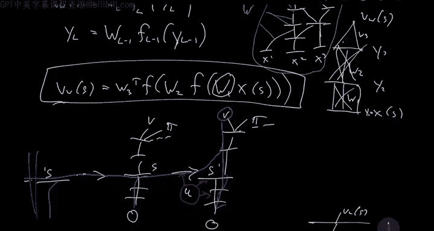

And in addition， there is some sort of specific spatial structure where we're considering onlying these patches。

 Okay so that's just a brief primer。 there's much more to be said about this。

 This is kind of a poor explanation because we're only taking a little bit of time to talk about these aspects。

 So I just wanted to give you a flavor of it if you don't fully understand that there's loads of introductory material on deep learning on the in the wild and there's courses on this。

 there's lots of stuff on the internet So I encourage you if you want to know more please dig into that if you first want to just continue with the rest of this course without food yield understanding of this。

 that's also perfectly okay。

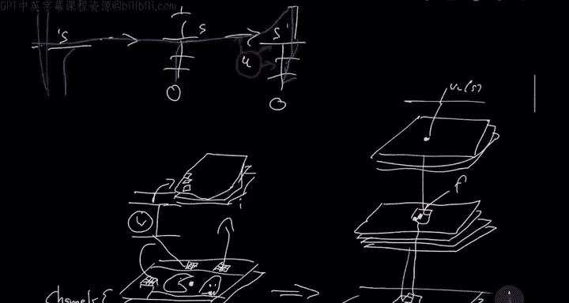

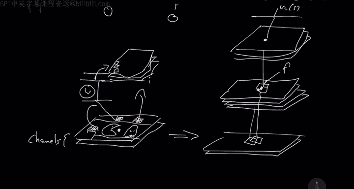

Okay， so then using these networks in reinforcement painting is called deep reinforcement learning。

 for many of the ideas immediately transfer when you're using deep neural networks。

 we can do temporal difference learning， we can do Monte Carlo。

 we just replace place the feature vector with a gradient in our updates。

 we can apply double learning if we need it for instance double DQ and double Q learning。

 we could use experience replay and all sorts of other intuitions and results they do transfer Some things don't。

For instance， UCB is hard to transfer because UCB I'm reminding you that is an exploration method that we discussed in the second lecture and it requires counts。

 so you need to know how often you've seen a certain state or state action pair if you want to use UCB turns out it's very hard to count with deep neural networks。

 or at least in the way that we need for UCB because of generalization so deep neural networks tend to generalize really well and this makes them learn really quickly。

And people are still trying to understand exactly the properties of these networks because it also depends on which optimization mechanism you use。

 because these days people typically don't use vanilla， stochastic gradient descent。

 but they use gradient transformations on top of that。Now， if you。Whether you do that or not。

 it turns out it's just very hard to count with these neural networks in terms of the states and reinforcement learning and therefore it's hard to apply some sort of a bound like UCB does。

 although people have considered extensions that do seem to maybe be somewhat reasonable but it's still active research。

Also， these squares methods don't really transfer that well because they are specifically made for the linear case and then you can analytically compute these these solutions。

But in the generic case for non nonlinear functions it's really hard to compute those solutions because there's no nonlinearities involved That means that we can't just immediately write down what the optimal weight vector is for a specific data set to fit it and instead what people typically do is just use gradient methods to incrementally find them So instead of doing these squares people do experience re。

So let me now walk you through an example where an online neural Q learning agent that combines these approach might include a neural network。

 which takes your observations and outputs say in action out Q value。

 so the idea is that this is just some non nonlinear function that just looks at the pixels of the screen。

 let's say Batman and then has some maybe con layers to first to the spatial reasoning and merges that into effect that maybe has a couple of other layers and then at the end it outputs the same number of elements as you have actions and then we just index that with the action that we're interested in if we want the specific action value。

Now note that I have ignored agent state here， so the agent state is basically just your observation in this case。

 so this wouldn't have memory and maybe that's okay for some games like Ppnum。

Then we need an exploratory policy， for instance， we just do epsilon really on top of this weight vector that we have。

So that our。Action that we actually select will be greedy with respect to these action values with probability 1 minus epsilon and fully random with probability epsilon。

And then we have weighed updates to the parameters of this network where we use， in this case。

 gradient Q learning。Which you might recall the Q learning update。

 Let me just briefly mention it again。 It's going to be your immediate reward， plus the discounted。

Value of the maximum value action in the next state minuss are current estimates。

Times the gradient of that current estimate， that would be a gradient extension of Q learning。

I did mention a couple of downsides like overestimation。

 you could plug in solutions here as well this is just for giving you a simple example。

Then we could use an optimizer， so typically what people do is they take this。This update。

 according to STD， this gradient in some sense， it's a semi gradient actually because of the way it's also being here about being ignored。

But people take this and then they transform it， for instance。

 applying momentum so that you take a little bit of previous updates and you merge that in or using more fancy optimizes like RMS Pro and the atom optimizer those are quite popular these days and then turns out this often works better when using your deep neural networks De are not too important for us right now。

Often when I said we were using these older differentiation packages。

 often these days so what people quite often do what you'll see in code quite often is they implement this weighted update via a loss。

 but it's a little bit of a aware of things I'm mentioning this because it makes it easier to understand for instance other people's code but in some sense it's a little bit of a strange thing because there's this really strange operator here which is called a stop gradient in most software frameworks so basically what people do then is they say oh let's just write it down as if it's a loss but let's ignore the gradient flowing into this part。

And then if you take the gradient of this thing， but you ignore the gradient going into this part。

 you get that update that we had above。This kind of makes it explicit that this is not a real gradient algorithm right we actually have to manually specify oh yeah。

 take the gradient but don't push the gradient into that part and if you do push the gradient into that part。

 you're doing one of these Belman residual minimization algorithms instead and as I mentioned that tends to work slightly worse in practice。

😊，So you could play with this， you could try that out and see if the same holds for you that that's where it works for us。

And then people implement this as a loss so they can say oh just minimize that just applies toto castastic gradient descent on that alternatively。

 of course， what you could also do is you could just compute this temporal difference error。

 this Q learning temporal difference error here and just compute the gradient with to the action values Now you don't need that stop gradient operation and then you could also implement it like that what we're basically doing in some sense there is akin to doing one step of the chain rule by hand。

 the very simple first step of the chain rule by hand。

To construct the update directly instead of first formulating it as some sort of a loss。

It's not real loss， it's not because of the stock gradients， I'm hesitant to call that a real loss。

 although people do call these things real losses even if people call these things losses。

 even if they're stop gradients。I'm desitant to do that because we're not actually following the gradient with respect parameters if there are stop gradients involved。

So this just happens to have the right gradient if your computer is with an auto differentiation package。

That's just for awareness essentially， if you want to implement this。

And now we can finally move to the DQN algorithm， So I showed examples of this all the way at the beginning of the course where we saw this agent playing Atari games and now we finally accumulated enough knowledge that we could actually replicate that。

 So I'm going to explain what it's in that algorithm and it's very similar to what we saw just now So there's an neural network exactly as I said just now the observation here is a little bit special So the observation in DQN is not just depict pixels on the screen。

 it's actually taking a couple of frames， a couple of steps into the past and also doing some operations on that。

 So the original DQN algorithm would downscale the screen slightly for computational reasons。

 it would grayscale it instead of keeping the color information this actually throws away a little bit of information So some reason to approaches people sometimes don't do that anymore。

And in addition to that， it would stack a couple of frames so that it has some slight history and there are two reasons for that。

 one is， for instance in a game like pong where you're hitting a ball from one pedal to the other。

 it was thought that maybe this is important to be able to capture the direction of the ball because if you just know where the ball is that you don't necessarily go whether's going know whether it's going left or right in the game of pong that might not actually be that consequential that might not be necessary to know that for picking the right action but in other games。

 you could imagine that sometimes that information is quite useful but there's a different reason as well。

 which is that India's Atari games。In the simulator at least and maybe in the original games as well I don't actually know the screen would sometimes flicker so certain enemies might sometimes be there on one frame。

 but they wouldn't be there on the next frame， so therefore that was important to consider a couple of frames rather than just one frame because the network otherwise doesn't actually have any memory So a different way to say that is that actually the input here are not the raw observations but there's just a very simple handcrafted agent update function which looks at the observations which could be considered the raw frames and then stacks them and processes them appropriately to give you an agent states but there's still no longter memory。

Of course there's a need for an explorationir policy and indeed in theQN this was literally taken to be Epsilom really with a small epsilom like 0。

05 or 0。01。And there was a replay buffer where you could store and sample past transitions。

 this replay buffer didn't store all of the transitions instead of store like the last 1 million transitions or something like that。

 so at the time when you go beyond 1 million transitions， then it would start throwing them away。

And in addition， there's a subtle other thing， which was called a target network。

 and this was one of the innovations that made DQN work more effectively。

So we're going to define a new weight vector that contains all of the weights of a network of exactly the same shape and size as the neural network that defines our Q value。

And we're going to use that to bootstrap So the weight update function is exactly the same as the online Q learning algorithm that we saw on the previous slide except for this one change where there's a w minus here W minus is just a name The minus doesn't mean it's negative or anything。

 It's just a name to say， oh， this is a different weight vector。

Different from the one that we're updating W。 So then if we're not updating W minus。

 how does that one update， Well， that one is just updated by copying in occasionally the online weight vectors。

So what this means is that during learning， you're basically regressiongressing on a different value function for a while。

While keeping it fixed for say 10，000 steps， and then you copy in the online way so that occasionally it does get better over time。

This makes the learning target a little bit more stable and it was helpful for learning in theQN This might sound a little bit similar and familiar when we talked about double learning for double Q learning。

 this is not quite double Q learning yet because it is still using the same parameters here to evaluate the action and to pick the action it's just using this W minus now maybe something for you to think about oh how would you then implement double learning in this framework what would that look like。

And then there was an optimizer reply to actually minimize the loss in the original DQN。

 this was RMS Pro， so this update would be tossed into the RMS Pro optimizer。

 which also store some statistics of past gradients and then would compute the actual updates by taking all of that into account。

Current day， people still use RMSMS Pro atom typically or variations of this。

The replay and the target networks are designed to make the reinforcement learning look a little bit more like supervised learning and the reasoning behind that was essentially that if you make it look more like superedvised learning it's more likely to work because we already know that deep learning works quite well for supervised learning or for regression and classification for supervised data sets the replay kind of scrambles the data so that the sampling seems more idea then if you would just give all of the samples sequentially and the target network just makes the regression target less than onstary on every single timet。

And this might help the learning dynamics。Neither of those is strictly necessary for good learning。

 but in the DQN setup they did help performance and they are still sometimes used in modern algorithms as well and sometimes too much effect。

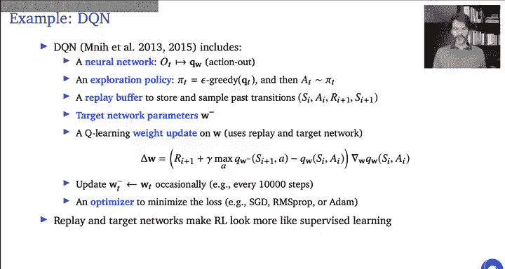

Okay， so that brings us basically to the end of this lecture where these last two things are kind of an interesting。

 intriguing like insight into what makes deep reinforcement building an interesting field。

 So turning the replay and the target networks making help making that make use of that to make the reinforcement learning look more like supervised learning。

 This was done， of course， because we're combining the deep learning part in。

 So in some sense you could say this is deep learning aware reinforcement learning。

 So we're changing the reinforcement learning update a little bit with these target networks。

 and we were using experience replay deliberately here because this makes better use than of these deep networks that we're using。

The converse also exists， there are also things that could be called reinforcement learning where deep learning where sometimes people change for instance the network architecture or the optimizer in certain ways to maybe play better with the fact that we're doing reinforcement learning。

The fact that these exist that there are some important design considerations that could be called deep learning aware reinforceforment learning or reinforcement learning aware deep learning。

 this is exactly what makes deep reinforcement learning a field of its own in some sense。

 the subfield of its own with really interesting research questions that are not pure reinforcement learning questions they're not pure deep learning questions but they're really on this intersection of these two really exciting fields。

Okay， that brings us to the end of this lecture as always。

 please ask questions on Mole if you have any end in our live Q&A thanks for your attention。

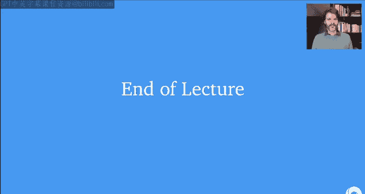