# DeepMindxUCL《强化学习｜Reinforcement Learning 2021》中英字幕 - P8：[08]Planning & models [8_13].zh_en - GPT中英字幕课程资源 - BV1JssaeVEMp

Hello， I'm Matthew Hessel and I'll be teaching their Enment learning module together with Haddo and Diana。

 and today I'll be talking about models and planning。

In the past few lectures， we already covered quite a bit of material。

 So we we started with the bandits， this minimal instantiation of the real problem where we are allowed to disregard the the sequential nature of decision making and focus exclusively on trading off the exploiting existing knowledge versus。

Exploring alternative courses of actions that might seem so optimal now。

 but that might turn out to be even better as we gain experience in the environment and the world around us。

We then discuss dynamic programming and Mo free algorithms as to families of ideas and approaches that allow us to solve both prediction and control problems with and without access to a complete specification of the environment。

Finally， we introduce function approximation as the leading approach to scaling up these families of ideas to settings where we might have very large state spaces or even continuous state space spaces。

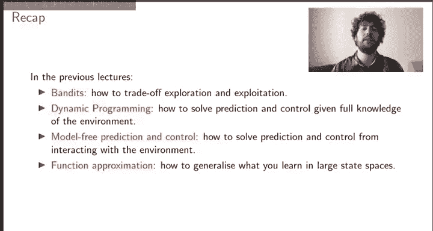

If we look back at dynamic programming and model3 algorithms。

 we can roughly sketch the underlying principles and differences between the two in the following way。

 so in dynamic programming we assume we're given access a privileged access to a complete exact specification of the environment dynamics that includes both the state transition and the reward dynamics。

We then't just need to solve for this perfect model and we don't need to interact with a real environment at all。

In model free algorithms instead， we do not rely on any given form of model。

 instead we learn values and policies directly from interaction with the environment。

In between these two extremes， there is a third prototypical family of algorithms。

 which is typically referred to as model based through reinforcement learning。

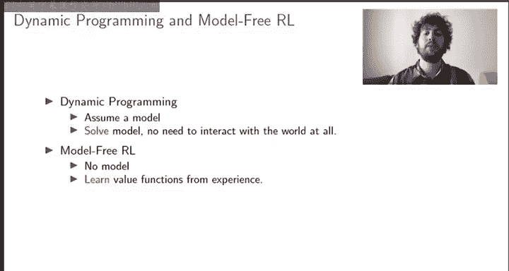

Here we are not given a perfect model， but we do attempt to learn at least an approximate model while interacting with the environment。

And then we use this learned model to derive values and policies。

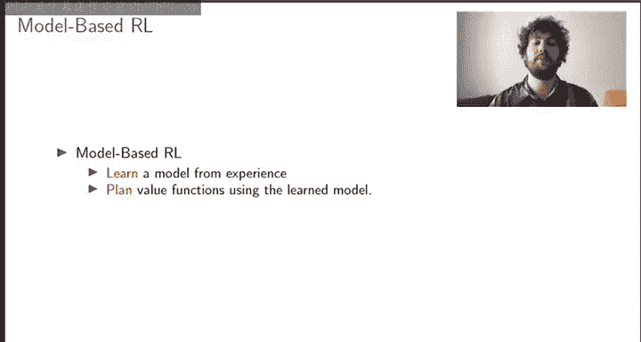

A visual depiction of the model free algorithm would be seen as implementing this loop where we act according to our current value estimates and our policies。

To generate experience， but then we use this experience to directly update our values and our policies。

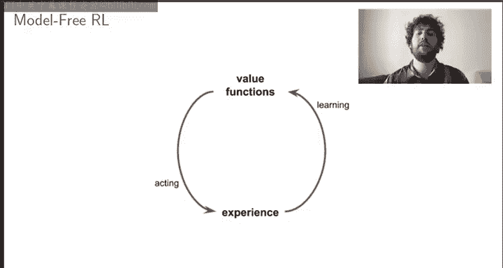

And instead， the model based algorithm would add a step of indirect in this loop。

 whereby we act according to our current value estimates and policies， just like in model 3RL。

 but we use the resulting experience to learn a model of the state transition and the reward dynamics。

Then we can use the learn model instead of the experience directly to update the values and policies。

Thereby closing still the loop。And of course， boundaries between these two families of algorithms though need to be extremely rigid and we can perfectly imagine to combine the two ideas and use experience to both update values and to learn the model。

 we can still then use the model to perform additional updates and to refine our value estimates and today we will actually discuss the popular in of this idea which is the Dyn algorithm。

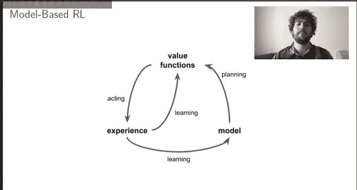

But whatever we delve into a new topic， I think it's always good to stop a second and reflect on the motivations that underlie a family of ideas。

For instance， there is obvious disadvantages to this slide of attack。If we first learn a model。

 then we use the model to plan a value function， there are two sources of errors because whatever model we learn from data is likely not to be perfect。

 it will incorporate certain approximations or certain errors。

 and these will compound with additional errors that arise when planning with the model to estimate values。

In contrast， if you consider model three algorithms。

 they use real data that is always correct to update the values。

 and therefore there is only one source of approximation which is the value estimation process itself。

Despite this， though， there are reasons to believe that model based reinforcement learning could be quite effective。

 The first of these reasons is that models can be learned with supervised learning methods。

 which are very well understood and very powerful and effective。Additionally。

 explicitly representing models can give us access to additional capabilities。

 we could use them to represent uncertainty or to drive exploration。And finally。

 but not less importantly， in many real world settings。

 generating data by interacting with the environment is either expensive or slow or both of these。

And instead， computation is getting cheaper and cheaper by the year。

 therefore using a model to perform additional updates could allow us to trade off compute for a reduction in the number of interactions that we need with the environment。

 and this will make our algorithms more data efficient and therefore extend the range of problems we can successfully apply them to。

We will start now with a bit of due diligence in a sense。

 so we'll start by discussing different types of learn models and how to train them and only then we will delve into concrete algorithms for planning。

But before we go there， if you need a moment， before jumping in， this is a good spot for a break。

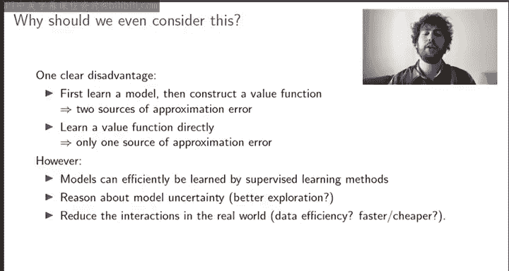

If we're going to learn a model and use a model for planning。

The first thing to discuss is what constitutes the novel in the first place。

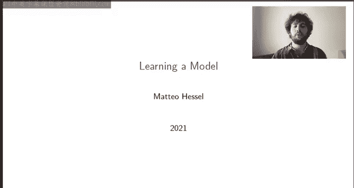

And in this course， a model will be an approximate representation of an MDP。And for now。

 we will assume that the dynamics of the environment of the MDP will be approximated by a parametric function with some parameters datata。

And that states and actions in the model are the same as in the real enemy。And also。

 we will assume that given states and actions sampling from the model will estimate the immediate successor states and the immediate rewards that we would get by executing those same action in those same states in the real environment。

And it's good to realize that this is not the most general characterization of the model。

 there are other types of models we could consider that are quite related to this but different。

 and we will actually discuss a few of these in following lectures so for instance we will consider and discuss nonparmetric models where we use the data directly to sample transitions in the environment。

And also backward models， that models， for instance。

 the dynamics of a miniverse MDP rather than the MDP you're directly interested in。

NoA jumping models where the actions do not directly map on the set of primitive actions in MDB。

We will discuss some of these later， but for now let's focus on the simplest scan model because this is already sufficient to discuss quite a big range of ideas and the support of a good range of planning algorithms。

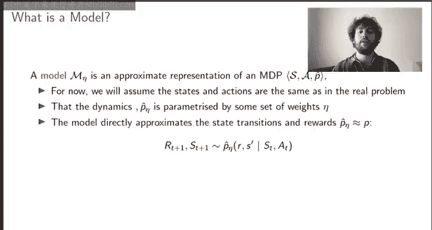

So with these premises， the problem of learning model from an experience basically can be formulated as a supervised learning problem where our dataset contains a set of state action fairs。

And the labels of these are the true states that we end the rewards that we will observe when executing those actions in those states。

And the parameters of the model will then have to be chosen as in standard supervised learning so as to minimize some prediction error on this data。

Defining a procedure for learning a model will then amount to picking a suitable parametric function for the transition and rewards functions。

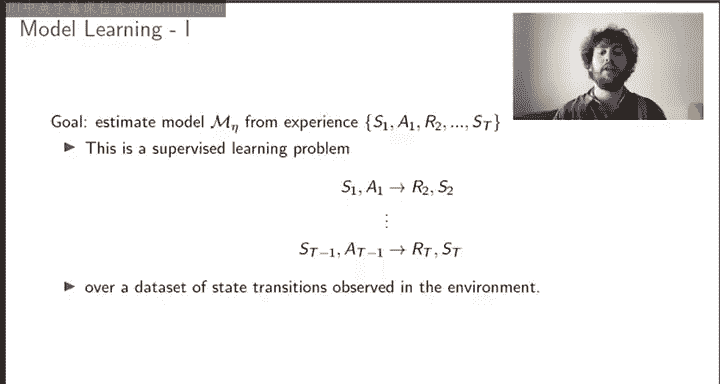

Picking a suitable loss to minimize。And choosing a procedure for optimizing the parameters it also as to minimize this loss。

So for instance， we could choose to parameterize transitions and rewards using some linear mapping from a suitable encoding of states and actions onto。

 for instance， the rewards and some encoding of the successor state。

And then minimizing the parameters could be achieved by using least squared。

This would give us an expectation model， for instance。

And specifically will give us a linearer expectation model。

Note that this is not the only kind of expectation model we could consider， for instance。

 using the same kind of loss， the same mean squared error we could。

 for instance parameterize the model itself， both the reward and transitions using a deep neural network and maybe use gradient in the sentence instead of least squares to optimize the parameters。

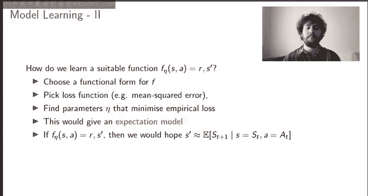

Regardless of the specific choice of the parameterization though。

 it's good to understand what are the pros of cons of expectation models in general。

 so some disadvantages for instance are quite obvious。

Suppose you have some macro action that randomly puts you either to the left or to the right of some wall。

 well an expectation model would for instance， put you inside of the wall。

 which might not be a physically meaningful thing to predict in the first place。Interestingly。

 though， they values。Could still be correct。 So if the values specifically are a linear function of the state or of the encoding of the state。

 then actually the linear transformation will commute with expectation， and therefore。

 the value of the the expected value of the next state will actually be the same as the value of the expected next state。

 even though the expectedness state might have some。

Peculiar features like placing you in the middle of the wall。And。

This actually applies regardless as to the parameterization of the model itself。

 so it only requires the values to be a function， a linear function of their state representation。

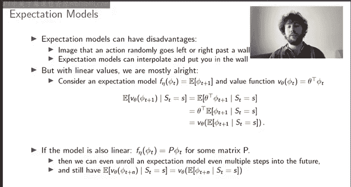

But additionally， if both the value and the model are leaner。

 then this save even applies to enrolling the model multiple steps into the future。

Which is quite powerful and interesting property。It might still be that we are not willing to accept this tradeoff。

 so it might not be possible to make either the value or the model in。And in this case。

 maybe expected states might not be the right choice because the values that we can excimate from the expected states might not have the right semantics。

 we might not be able to derive the expected values from expected states。And in this case。

 we could consider a different type of model so we could consider what is called a stochastic of generative model。

So generative model generates not expectations， like an expectation model， but samples。

So it takes as input， a state an action， and a noise variable。

 and it will return you a sample of a possible next state and a possible reward。

And if we can effectively train a generative model， then we can plan in our imagination so we could。

 for instance， generate long sequences of hypopothechical transitions in the environment and compare them to choose how to best proceed。

And this could be done even if both the model and the values are not linear。The flip side， of course。

 is that generative models add noise via the sampling process。

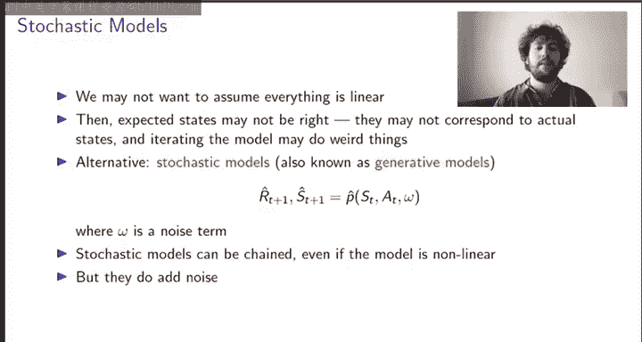

There's also a third option， which is to actually attempt to model the complete transition dynamics。

 to model the full transition distribution and full reward distribution。And if we could do so。

 actually both expectation and generative models and even values themselves could be all derived as a subproduct of our model。

 of our full transition and reward model。The problem is that it might be hard to model the complete distribution。

And or it might be computationally intractable to actually apply it in practice due to the ranching factor。

So for instance， if we were to try to estimate the value of the next state。

 we'll one step look ahead。This would still require to sum overall all actions and for each action。

 some over all possible success or states， and things get exponentially worse if we even want to look multiple steps ahead。

And as a result， even if we had this full distribution model。

 some form of sampling would probably be needed for most problem of interest， and in that case。

 the advantage of the complete distributions compared to， for instance。

 just a generative model might be smaller。

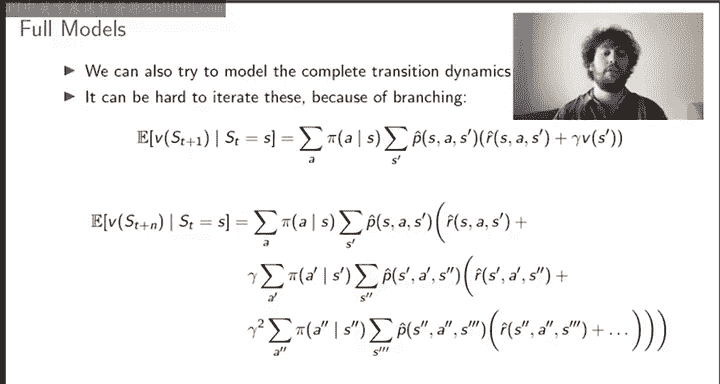

In addition to the type of model we might want to train。

 there is the second additional important dimension， which is how we parameterize the model itself。

So a very common choice is to， first of all， they compose the dynamics of the rewards and the transitions into two separate parametric functions。

And then for each of these， we can choose among many different parameterizations。In this correspond。

 we'll consider table lookup models or linear expectation models。

 and finally also deep neural network models。In the table lookup case。

 the model is an explicit representation of an IDP， where for instance。

 we may estimate the probability of observing a given successor state for a given state action pair as the empirical probability based on past experience。

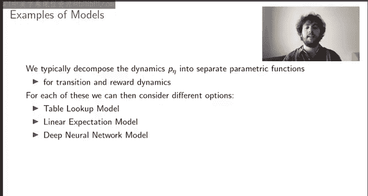

And similarly， we could parameterize the reward function as an empirical mean of the rewards that we did actually observe in practice when executing a given action in a given state。

In this case， we would actually get a mixed model because our table lookup model would use a full distribution for the transition dynamics and an expectation model for their rewards。

This is， of course， possible also to model the complete distributions for the awards themselves。

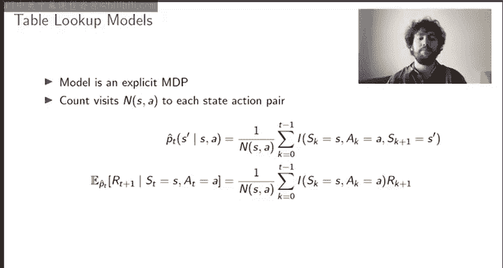

So let's consider， for instance， our minimal reinforcement learning example where we have the usual two state MDP with no discounting and we' serve eight episodes of experience。

So once in one of the episodes we start in A， we transition to B and weve observed no reward。

In all the other episodes with startton B and we terminate immediately。And in all but one。

 we will serve a reward button of one。And in one of them， we observe a reward of zero。

A table lookup model would model the complete distribution of the environment dynamics as in the picture on the slide。

 so in state A with probability 1 we transition to B and we absorb the reward of 0。

 and in state B with probability 1 we' terminated， but with probability 0。

75 we observed the reward of1， well with probability 0。25， we absorb no reward at all。

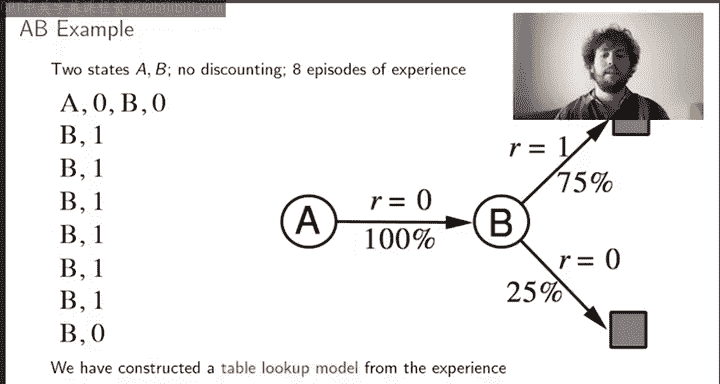

If instead we consider a linear expectation model， it's good to remember that first of all。

 we need some feature representation to be given to us because the linear model doesn't have the capability to build an its own state representation。

But given this sum feature representation， we could encode any state s as some feature set。

 for instance， a vector， and then parameterize separately reward and transitions as two linear functions of the features of the state。

So for instance。

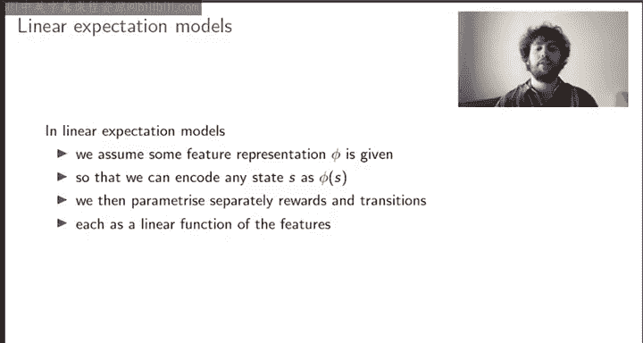

Expect next state could be parameterized by a square matrix， T， one for each action A。

In such a way that the matrix times the features of the current state give us the expected next state。

 and similar rewards could be parameterized by vector WA for each action A。

 so that the dot product between the vector and the current state representation gives us again the expected reward。

If we do so then on each transition， on each transition where we execute some action A。

 some state S and observe some reward R and next state as prime。

 there we can apply a gradient in the sense step， for instance。

 to update both WA and T so as to minimize the mean squared error on both the reward and the expected safe。

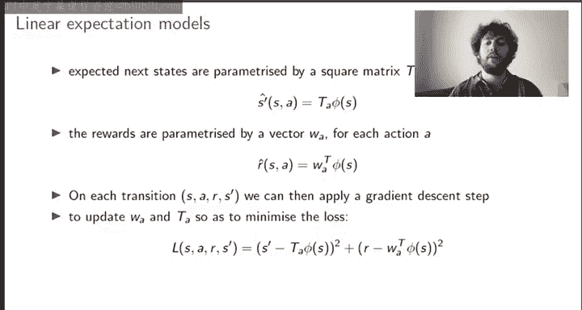

We are now ready to delve into the true heart of this topic which is how to actually use models to plan and specifically in this sections how to do so for the purpose of improving our value function estimates and our policies。

So。The core， let's say， value proposition of planning and in general of model basedRL is the capability of improving such value estimates and these policies by absorbing compute but without requiring actual interactions with environments。

As you might remember， dynamic programming is actually a good example that we have already seen of a process that allows us to do justice。

The problem is， of course that in dynamic programming we're given privileged access to a perfect specification of the environment。

 but in reinforcement learning in general， we are actually interested in planning algorithms that do not make this assumption and instead perform planning。

 for instance with learn models， such as any of the ones that we discussed in the previous section。

In this case， the simplest approach to get around this limitation of dynamic programming is maybe to just directly mirror dynamic programming algorithms。

 but plugging in a learn model in place of the privileged specification of the environment。

If we do so， then we can just solve for the approximate MDP with whatever dynamic programming algorithm you like。

 so you could use value duration or policy duration。And by doing so。

 we still require some interactions with the environments because we will still need to learn the model。

 but at least hopefully we can reduce quite a bit of reliance on real interactions and therefore be more data efficient。

So this approach actually can work and it's a reasonable things to consider。

 but it's also not the only option so for instance there's another route we could take so we could combine learn models not with dynamic programming。

 but instead with the ideas and algorithms that we discussed in the context of model free agents。

 so this is also herd to as sample based planning。

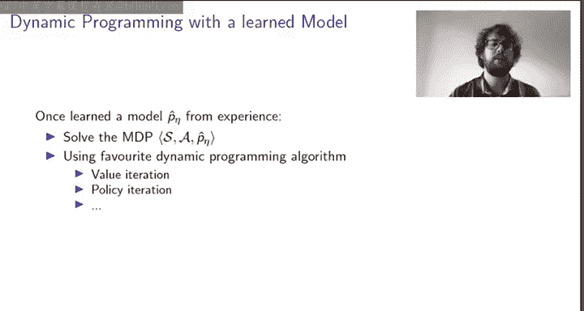

And very simply， it works by using the learn model to sample， imagine transitions。

 imagine trajectories， and then applying your favorite Model three algorithms to the Imagine data。

 just as if it was real data。So for instance， you could apply Monte Carlo control SArsRSA or Q learning and just apply the same updates on the imagined data as sampled from the approximate NP that you have learned as if it was real data sampled from the environment。

And let's consider a concrete example to make this clear。

 so this is the same example that we discussed in the previous section。

 so on the left we have the real experience we have access to so eight episodes。

 most of them starting in a state B and then observing either a zero or one reward and one actually starting a state A in the first transitioning to B。

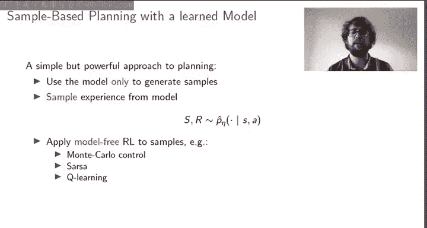

And in the middle is actually the Learn table lookup model that we had learned from such data。

 this gives us 100% likelihood of transitioning from A to B and 100% likelihood of terminating it be。

 but with a 75% probability of getting a reward of1 and 25% of getting a reward of zero。

Daily of sample based planning would be take this model and then sample trajectories episodes from this model。

And this could be， for instance， the data that we report on the right so all of this data is sampled from the model that we have learned。

 and for instance we have now two episodes that s in A。

 both which transitioned to B because this is forced by the model and then in this case。

 both episodes were sampled their word of one when they were in B。

 plus the number of episodes startinging in B and terminating immediately again consistently with the model。

So what happens if we apply Monte Car learning to this data well we will get， for instance。

 the value of a is1 because in both episodes， when we start in a。

 we collected a award of1 at the end and the value of B that is equal to 0。

75 because the sample episodes that we cost from our model， three quarters of the time。

 we've served our word of 1 and B， so in this case is' perfectly in line with with the learning of probabilities from the model。

So。

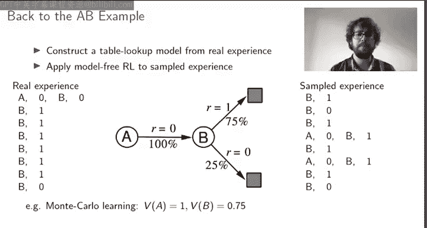

This is a cool idea and also using dynamic programmingming directly with the lower model could be a very interesting approach。

 but what are the potential limitations with both of these ideas？

As always the great concern is that the learning model might not be perfect。

 actually in general we know it will incorporate some errors and some approximations and and in this case the planning process may compute a policy that is optimal for the approximate NP。

 but that is suboptimal with respect to the real environments。

And so our presentation couldn't be complete if we didn't discuss how to deal with these limitationss and there are many ways we could go for this。

 so one approach would be very， very simply whenever the model is not good enough。

 it's not reliable enough， just use model free algorithms。

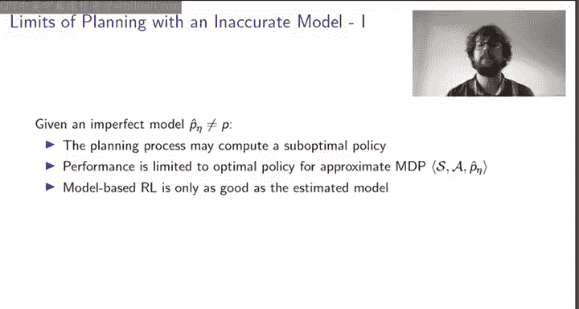

Another idea would be let's strike to reason explicitly about our uncertainty over our estimate of the model。

 so for instance， this would lead us more towards the Bayesian approach。And finally。

 the third approach， which is what we will delve more in today。

 is actually to combine model free and model based methods。

 integrating learning and planning in a single algorithm。

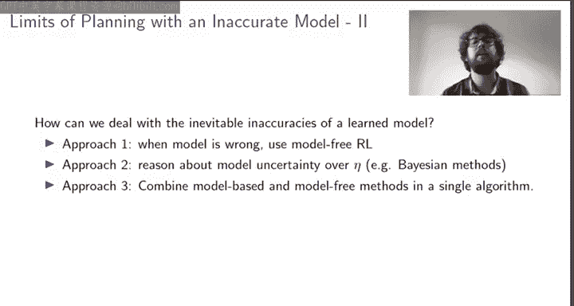

How can we do this Well， in the previous discussions。

 somewhat implicitly we already discussed that there are two potential sources of data。

 two potential sources of experience， so one is real experience， This is data transitions。

 trajectories that you generate by actually interacting with the environment。

And another source is simulated the experience where the data is sampled from a model for instance learning model。

 and therefore is sampled from some approximate MDB。Well， the core idea behind Dynina。

 which is a powerful approach to integrate learning and planning。

 is let's just treat the two sources of experience as if they were the same thing。

 So while in Model3， we learn values from real experience and in sample based planning we plan values from simulated experience。

 well in Dina， let's do both so let's apply the same updates to values and policy。

 regardless as whether data comes from real or simulated experience。

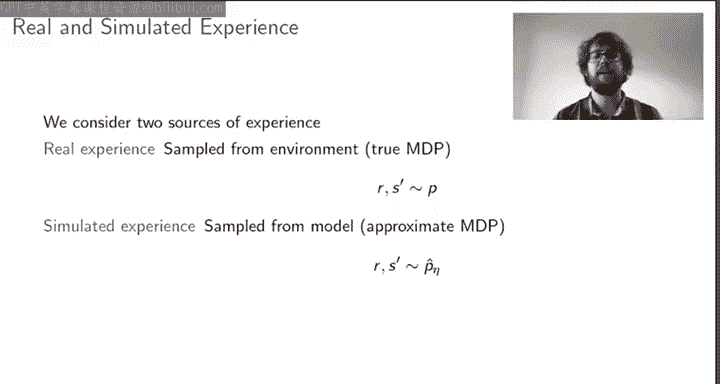

AndThis very directly implements the picture I have also shown at the very beginning of the chapter。

 so where I suggested we could maybe act according to our value estimates or policies to generate experience。

 and then then this experience could be used both to update the values and policies directly。

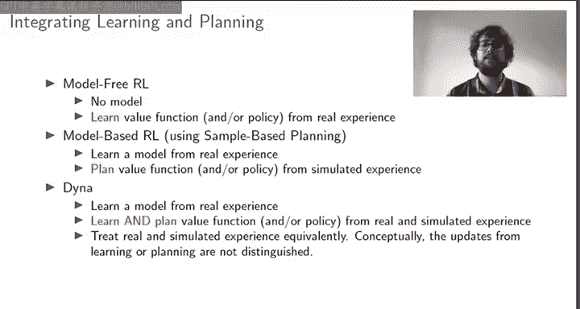

But also used to learn a model that could then generate additional simulated updates。

 simulated experience。So let's now discuss concrete instantciiation of Dner because this idea is very general。

 but of course we could plug many different algorithms to this and apply very different updates to both assimilated and real experience。

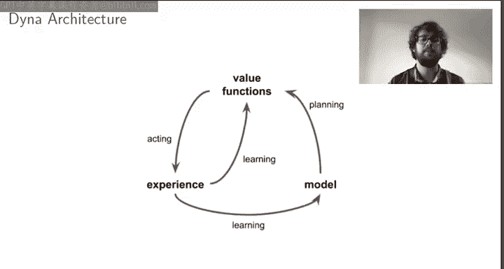

So what does this actually mean in practice Well a popular version of the city is what is typically be referred to as DQ where we use Q learning on both the real and simulated experience。

 and this is what it looks like。First， we of course need to initialize now both value function。

 like in Q learning， but also a model because we will be training it alongside。And then on each step。

 we can select actions using an Epsilon Ready policy， for instance， like in standard key learning。

And after executing this action， we of course get from the environment。

 a successor state and a reward。With its real transition， we can directly apply Q learning。

 for instance， by updating the current Q values towards the usual target constructed by summing the reward and the discounted max Q value in the next step。

But we can also update now the model in a supervised fashion， for instance。

 in a tabular detererministic environment， this would just amount to storing the next state and the reward。

The next point is where the secret sauce in some sense of di comes in。

So basically for each real step in the environment。

 we now perform any planning updates where we take some past state action pair that we have encountered during training。

 and we use the current model to sample a possible next state and a possible subsequent reward。

And we use this imagined transition to perform an additional key learning update。And of course。

As we increase the number of imagined steps that we do。

 we can basically reduce our reliance on the real transitions and become more data efficient as we were hoping。

Interestingly， of course， there are many different ways of extending or implementing this idea。

 so for instance， we could use a different model free algorithm instead of key learning。Also。

 the algorithm rights in the slide is written for the tabular setting。

 but of course we could use linear functions or deep neural networks to represent both the values or the models。

AndAlternativelyly， we could also vary the amount of planning that we do over time。

 so very intuitively the model typically is improved and updated along the way so it's hopefully getting better over time。

 so maybe we could imagine to perform more planning updates as training progresses and we become more confident in our model。

Ideally， we would actually even have some form of uncertainty estimates that we can use to choose how much planning to perform。

 how much to trust our planning updates， depending on the accuracy of our learned models。

But regardless of the details and potentials and enhancement。

The important thing is that even this basic algorithm already in some states are the most fundamental properties that we were looking for。

 so we can sink in more compute to learn more efficiently。Which I just want to recall again。

 it's really critical if the data is slow or expensive or unsafe to collect and this。

 I can say this enough， it's really often the case in many real world applications。

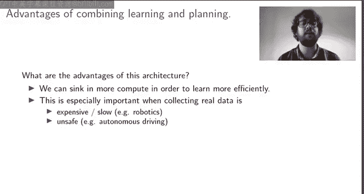

So let's take a look at what。What happens when we actually run these algorithms are not a simple problem just to gain more understanding and intuition about planning for a credit assignment？

To do so， we will consider a simple maze， which is drawn on this slide on the top right。

 where on each episode we the agent starts on the cell marked to the S。And from any cell。

 agent can take one of four actions， which correspond to moving up down left and right respectively。

The dark swells instead are walls， meaning that if we try to move into one of these asll。

 the action will have no effect which is bang on the wall and stay where we are。

The reward is zero everywhere， except for a single positive reward that you collect when you reach the goal cell。

 which is the one marked with a G in the top right corner。Under this setting there。

 it's fairly obvious that the optimal policy for any discounts more than one is going to be a policy that leads you from S2G following the shortest path。

 because any choice of actions that will take along the longer path will basically result in the final reward be discounted more strongly。

And this means that we can evaluate the quality of the policy learned by an agent， for instance。

 by plotting the number of steps that the agent takes in order to reach the goal as a function。

 for instance， of the number of episodes that it has experienced。

And this is what is shown in this plot on this slide。

 this plot is taken from the Suton embarter book， so you can also read there about more details about how exactly this was instantstated and run。

But fundamentally， this plot just shows three instantiations of the algorithm that I showed in the previous slide that were ran with different amounts of planning。

Specifically， it was ran with zero steps of planning。

 meaning that the algorithms just revert to many lucky learning or with five steps of planning or with 50 steps of planning。

And what' is really apparent already from this plot is that vanillailcular learning takes many tens of episodes to actually converge to the optimal solution。

😊，And instead， by just adding a tiny bit of planning。

 so just doing five additional updates on for every real update。

 the agent manages to converge to the optimum much quicker and less than 10 episode。

And as we increase， for instance， to 50 planning steps。

 the agent actually converges in just a couple of episodes to the optimal policy。

 which is really impressive。

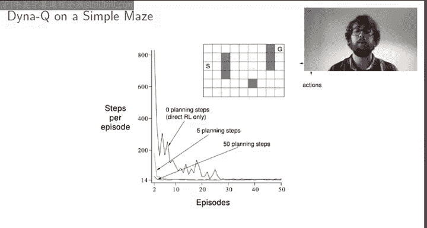

might even seem too good to be true in sense， like what is actually happening behind the scenes。

In this slide， I'm trying to give you basically an opportunity to peek behind the scenes and see what happens to the Q values estimates as we run this algorithm。

And specifically， let's consider what happens on the very last step of the first episode。

 so this is when is basically the first time the agent observes their awards。So for simplicity。

 we will also assume that Q values were initialized as zero everywhere。

Under this assumption without planning the first episode is actually fairly boring。

 so on all intermediate steps， the values were0 when the agent enters the cell and actually stay at0 because the TD error is always0 our estimates are0。

 their awards are0， the value of max Q value we boot strap on is also0 so no update is done throughout all the first episodes。

Only a single Q value is updated right on the last transition。

And this is the Q values corresponding to moving upwards from the cell immediately below the goal。

 immediately below that top right corner cell。And when the agent is doing this final transition of the first episode。

 that Q value is correctly updated towards the goal reward。

And this immediately makes a greedy policy optimal in that one cell because all the other action values stay at zero。

 but this action value of moving up from the state just below the goal becomes actually has a nonze value。

So。All other states that we have seen throughout the first episode have not been updated。

 Q values stay all at zero and for the behaviors stay random。

 assuming we are breaking ties at random， but this very last state that was shown in the bottom left in the maze shown on the bottom left。

 well that one gets updated to the correct policy。On themas shown on the bottom right。

 we show instead the state of our estimates of the cube values。

When we run the same algorithm with 50 steps of planning。And again。

 we freeze the algorithm at immediately after we have done runnets for just one episode。

But suddenly you can see that the Q values now have been updated throughout the maze。

 so it's not just the final state that has realized what the optimal action is but actually the model。

 the estimate of the Q values that the agent has updated throughout this first episode show a meaningful direction for many。

 many the different other states and basically the information of how to move from the state to the goal has propagated almost all the way to the start。

Wwhichch is quite impressive and the reason is that when you do update that first that last cell in the episode。

 you then start sampling 50 more updates on imagine transitions from the model。

 which means that on each of these other 50 planning updates we will be able to propagate information from the new updated Q values backwards in the state space and this means that well in this case it doesn't quite solve the problem in a single episode。

 but it will just take just a couple more episodes to correctly propagate all information for the state space and figure out what the optimalmal policy is。

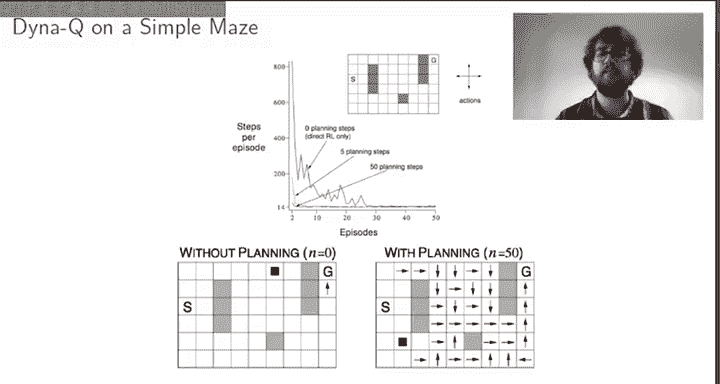

Of course this is。This is not all roses， right there are always certain critical issues with model basearl。

 including the fact that in some cases our model will be wrong。And in this experiment。

 I'm try to give you some intuition of how wrong models can affect learning in a model based orL system。

So to gain some intuition of this， let's use again the same algorithm to investigate how an incorrect model may affect training and we will do so by simulating this model being wrong by having a sudden change in the dynamics of the problem this means that the model learned from the agent in the first half of training will suddenly be wrong because the world itself has changed。

But the effect of this on learning will be quite different depending on this type of error。

Let's see what I mean by this。In the first setting， we assume that at the beginning of training。

 the environment looks like on the grid on the left。

 where there is a short path between the state marked with S as usual and the goal marked as G in the top right corner。

And once the DynaQ agent has learned this policy correctly。

 which is shown in the plot by the cumulative reward becoming linear in the number of steps。

 well at that point we change the environment to the one on the right。which is very similar。

 very similar grid， but now the optimal policy is not anymore to move to the right to reach the goal。

 but rather the agent needs to take a detour to circumnavigate that wall that is now blocking the path。

When you do this change environment， suddenly the cumulative reward collected by dying a queue flattens because at the beginning。

 the agent will try to continue move through the same path that it had learned at the beginning。

 but of course that path is now blocked because the walls have shifted。

This means that for a few steps， the agent will be unable to collect any rewards。

But if you look at the plot for dying in a queue after a while。

 the agent does start collecting more rewards because the agent will update the model to now correctly understand that it cannot move through that cell because it's now a wall。

 and through planning， it will then reroot the policy of the agent through by updating the Q values in order to take a different route。

 which now results in the reward again growing linearly with a number of steps。Yeah。

There are several specific agents on this plot and again this plot is taken from the something Martin book。

 but that correspond to slightly different instantiations of Dynah and the middle one is DnaQ which is the canonical one I described while DnaQ+ add some smaller exploration box which means that it actually is able to reroute slightly faster。

 but the core message remains that。If the model is inaccurate in this way where the world actually is harder than the model was initially assuming。

The behavior of the agent is such that it will actually lead the two trend transitions that will correct for the model error and the。

 in some sense the learning dynamics is overall quite benign。

But it's good to realize that this is not always the case。

 So let's now consider a very similar setting with a slight difference。 So now again。

 the world changes。

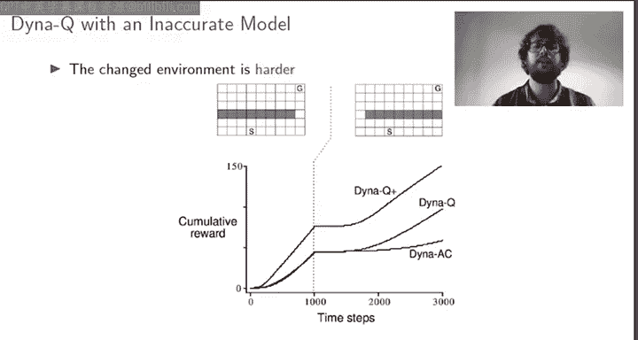

But the change environment is actually easier， in some sense。 So at the beginning。

 you have the situation on the left where the agent needs to take this detour around the wall in order to reach the goal。

 But after changing， there is now a the。The detour is still available to the agent。

 but another path has opened up， so the agent could take paths to the right of the wall。

 which is a slightly shorter path which would result in higher reward。

What happens is that once Dang the King agent has learned to correctly take this detour。

 long detour around their world in order to reach the goal。

There is nothing that pushes the agent to explore this other path。

 the way in which the model is incorrect， the fact that there is actually a small is a shorter path is not reflect in the data that the agencys because the error in the model doesn't result in data that can correct for the model error itself。

 So what happens is the once the agent has converged on this solution of taking the long beat or it actually might stay just stick with this behavior and will take a very。

 very long time in order to realize that there was actually an error， and this is why in this plot。

 the dnoQ algorithms which is exactly the one I described in the pseudocode before。

 will actually continue learning at the same speed the slope is the same because it's still taking always the same long path in order to reach the goal also after the world itself has become easier。

And here you can see actually the DynnaQ+ that adds this exploration bonus is actually able to figure out this additional path。

 and I don't want to go into much details about DynnaQ+ because the details are not important here。

 but the important thing to understand is that thinking deeply， for instance。

 about exploration is still important， even model baseL。

 because certain types of errors in your model might not necessarily be discovered unless you have something that pushes your agent to execute a behavior that results in useful data。

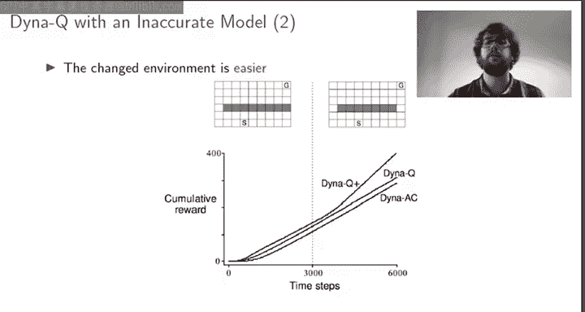

The Dyn algorithms I described in the previous section is a beautiful instantciiation of a system that integrates learning and planning。

 so model free and model based updates， but it's not the only one and in this section I want to discuss experience replay and its connection to more conventional model based algorithms such as Dina。

Traditionally， array algorithms did not explicitly store experience。

 so it was trivial to place them in one of two groups。

 so model three methods that do not attempt to explicitly model the dynamics of the environment and directly update values and policy online with the latest data。

And model base methods that learn transitions and reward model and then plan value functions using such a model。

But this kind of sharp distinction is blurred not just by algorithms like Dina that do both。

 but by other developments， for instance， in the space of model3 algorithms。

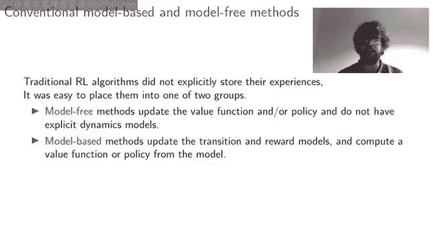

And indeed， many modern neural systems now store transitions in an experience replay buffer and then apply model free algorithms not just to the latest transitions。

 but also to past transitions in the buffer。And this is actually a fairly common technique for a model for agents。

 but it also can be seen as just instant eating Dner。

 but with an experience replay playing the role of a non parametric model。

And this is not just a superficial similarity because both systems actually share a fundamental property。

 like which is their ability to sink in compute， as I said many times。

 with no additional environment interactions to improve values and policies。And in this case。

 the experience replace systems would do so by making many updates on past experience for every new real steps in the environment。

In the。In this plot here， I can show that how this property of this scalability property of planning algorithms is instantiateated by both Dynina and a replay Q learning agent in the case of a simple grid world。

 so this is a simple grid world where as usual you start in the state S and you need to reach the goal G as fast as possible because there is some discount strictly smaller than one。

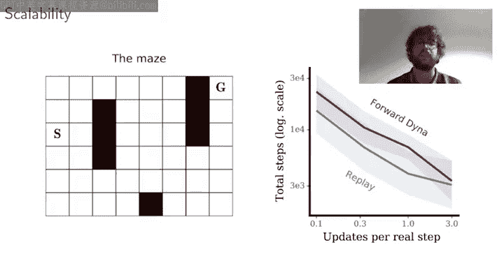

And what I show on the right side is basically the total number of steps required to reach the goal on the top right 25 times if every time you start from the cell S on the left。

As a function of the amount of planning， so of the amount of updates that you do for each real step in the environment。

And you can see that regardless as whether the entire transition is replayed like an experience replay system or whether a model is used to infer the subsequent rewards and state given a state action pair。

 the profile actually looks very similar， the more additional updates you do for every real step in the environment。

 the more the performance improves， and so the faster you reach the goal which is basically the lower the total number of steps that are required to reach the goal 25 times。

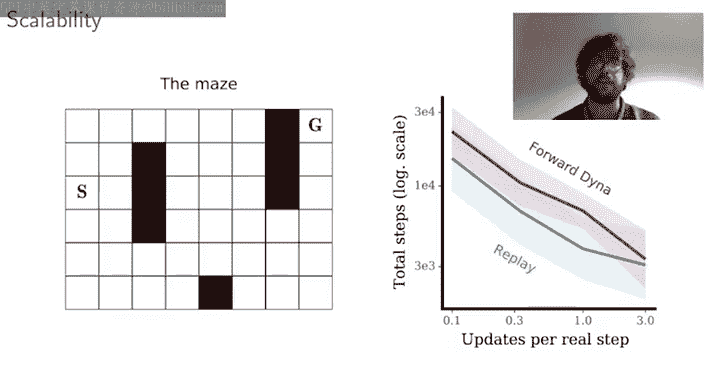

And you might be even tempted to take this to the extreme。

 so are experience replace system and algorithms based on learn parametric models completely equivalent？

And well， in ar settings， we can actually derive exact equivalences between certain model based and model three algorithms。

And even more in general， somewhat trivially， if we had a perfect model that outputs exactly the same true reward and successor state as the non parametric replay system。

 well the two would be exactly equivalent by construction。In general， though。

 of course any model that we use will not be perfect。

 so one question that you might ask is will this ever be better？

Could the inaccuracy that almost certainly come from using a parametric model provide benefits on top of a non parametric replay system？

This seems unlikely and it's I think it's fair to say that if we only use the model to reconstruct their rewards and successor states corresponding to an absurd state action pair。

 it seems hard for a parametric model to improve over just replaying those transitions。

But the reason that algorithms like Dna and Model BarL that use parametric learn models are so important is its actually a parametric model that has flexibility that goes way beyond that。

So for instance， we could use the model to plan for action selection and this is something we'll discuss in great detail in the next section because if you can query a parametric model for actions that you could want to take in the future。

 then you can use this to construct a plan to decide how to act and this is something that you cannot do if you're just have a non-parmetric replay system that can only tell you which action you took in the past in a given state。

Additionally， with a parametric model， you could do things like counterfactual planning。

 so query models for actions that you could have taken in the past， but did not。

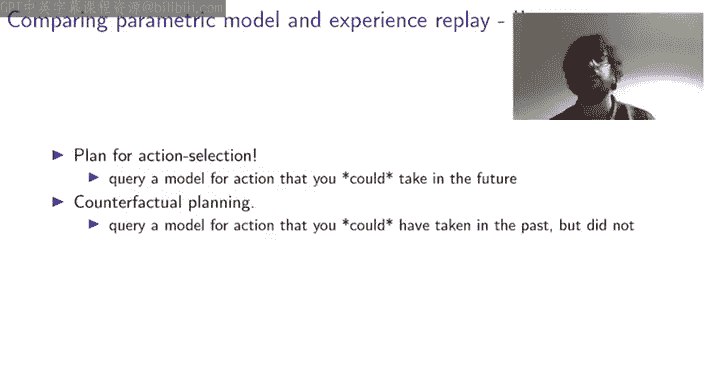

And related to counterfactual planning you could do what is called backward planning。

 so if instead of modeling the actual dynamics of the problem you model the inverse dynamics。

 so given a state and an action the model tries to predict what was the previous reward and previous state。

 well then you can use this to assign credit to states that could have led to a certain outcome in addition to assigning credit as in standard Arl to the states that actually preceded that outcome。

And finally， if you have a parametric model， you could train this model at different time scales。

 like an algorithm like Dina doesn't need not to be restricted to train a model exactly on one step transitions and on the true native timescale of the environment。

 you could train a model to do jumpy predictions and therefore support what is called jumpy planning。

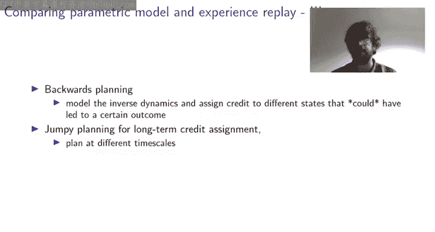

And in conclusion， it's actually worth noting also that there are computational differences between the parametric model and experience replay。

And this might also actually play an important role in choosing between the two so for instance。

  querying a replay buffer is very cheap， given a state action pair it gives you immediately what was the reward and what was the successor state that you observed in the past。

 well given a state action pair generating a subsequent reward in state using a learn model could be very expensive if the learn model。

 for instance， is parameterized by a big neural network。And if you look at memory， of course。

 things change and for instance， the memory requirements of a replay buffer can be quite harsh because the memory will scale literally with its capacity。

 while a parametric model could achieve good accuracy with a fixed and comparably smaller memory footprint。

And overall， I think the key takeaway that I would like you to get is that。😊。

Both are important and powerful ideas that implement this core principle of planning。

 this capability of thinking and compute in order to improve our learning and our algorithms and regardless of the labels that we want to attach to them。

 it's really，More important to just think deeply about the problem that you want to solve and whether a parametric or an non parametric model can be the best fit for that specific problem。

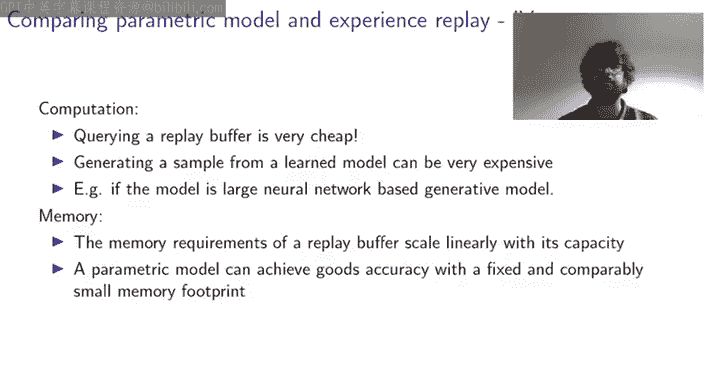

So far we discussed how planning can be used to improve our estimates of a global value function or a global policy that is applicable in all the states of our MDP。

But now I want to tell you about a different form of planning where we think it compute as usual without requiring additional interactions with the environment。

 but for the purpose of just selecting a single action in a single state。

This is something that is also called the planning in the N。

 and it may seem a special case of the previous problem and of course in a sense it is because。

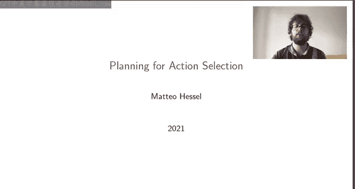

If we could get perfect values and perfect policies everywhere。

 then we could just use these perfect values in any one state。

But the motivation for investigating planning for action selection is that sometimes it's actually easier to make a very accurate local value function than it is to actually fit a global value function。

 and the reason is that in planning a value function for the current state we only need to take into account a distribution of states that are reachable from the current state and that might be a very small portion of the overall MDDV。

And additionally， planning for action selection has a few other appealing properties。

 like the fact that。Suppose you have some inaccurates in your model in some states， well。

 that will only affect the local throwaway values that you're using to select an action right now。

But it won't pollute like a shared global valuefunction that is going to be reused everywhere。

 so it might result in sure selecting a suboptimal action in certain poorly understood states。

 but maybe that just leads to reasonable exploration and for instance。

 behaviors that can help you correct the model itself。

The simplest form of planning for the purpose of action selection is what is called forward search。

 so this approach。It allowss you to select the best action in any given state by basically building the entire search tree that has the current state as root and then follows all possible trajectories from the current state onwards until E terminations。

Basically， this approach is amounts to representing as a tree。

 the entire submDP of reach states from the current one。And in some cases。

 this subMDP might actually be fairly tiny and then you can maybe solve that in full every time you need to select an action。

In general， of course this might not be the case， so in general the number of the states in the tree will actually grow exponentially。

 for instance， with the depth and so even with a fairly small action space。

 it might be computationally intractable if the horizon that you need to look to goes beyond a few handful of steps。

ま。This is still a reasonable thing to consider， at least from a conceptual perspective because then sure we have a problem with branching。

 but we have dealt with branching in the past so similarly to how we did for learning global value functions we can again use sampling also for solving these local MDPs just for the purpose of action selection and this actually results in what is called simulation based search。

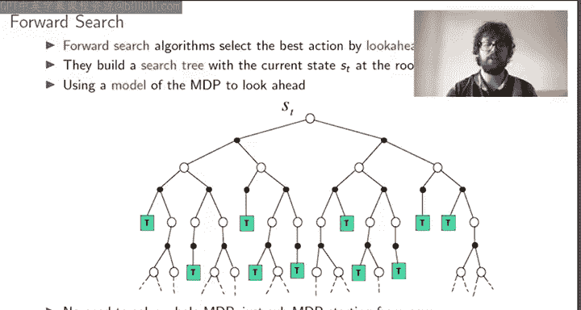

Here we construct a partial tree， so basically we start as usual from the current state as the root of some tree。

 but then we construct a subset of the full tree by simulating multiple episode of experience that all start from the current state and then use the model to roll forward possible sequences of actions。

If you construct such a partial tree， then you can just for instance apply model3Rl to the simulated episodes to estimate the values in the root。

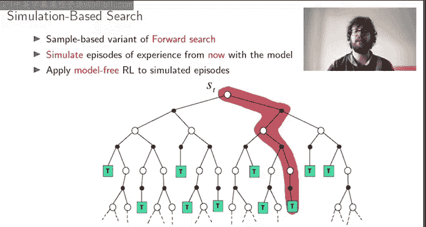

So for instance， you can instant say simulation based search by using Montecar prediction to estimate the state value of a root node by using just two components。

 you have some learned model and some simulation policy。

And then the state value and the root will just be estimated by sampling using the model and the policy K episode referred。

 and then just averaging this to estimate the state value of the root。

Of course if we're interested in planning for action selections and we are just the state the value in the root might not be that useful。

 so often we will want to actually construct action values。

 but the same principles apply very very naively just also to plan the local action value functions in this case we will need K times the number of actions episodes to ensure we sample each action k times in the root but apart from that then we can use the same mechanism to generate complete episodes from the model and thesimation policy and then just again use averaging to estimate the value of each action in the root as the average of the returns that did execute that action immediately in the root and then follow the dissimation policy afterward。

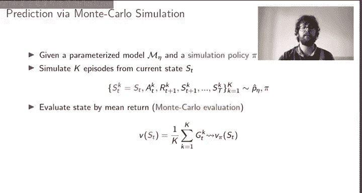

If we construct such a local action value function。

 then it's trivial to turn this into a mechanism for action selection because we could， for instance。

 in each state always pick the action with the highest value according to our local search。

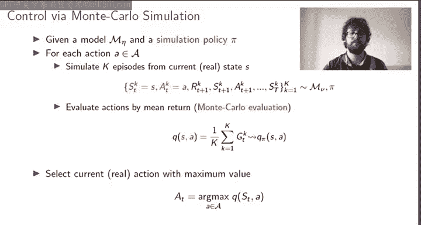

In the simulation based search algorithms that I just described。

 each simulation is independent of the previous ones。

And this means that we might not actually be making the best use of the available compute so it has some computational advantages because it's fully parallelzizable。

But at the same time， we are not using what we have learned by rolling the model forward until the end of the episode to guide our behavior in the next simulation。

So in this second part， I want to discuss a different approach where we build a tree incrementally so that we can leverage knowledge from previous simulation in order to focus our computational resources where they matter most。

So the algorithm is called the Monte Carlo Research and was for instance。

 at the heart of the famous Alpha Ze system and Alphago and more recently the muzero system that showed that they could literally learn at the level of world champions games like go。

 chess， Sggy， and even video games。And the algorithm is fairly simple because it's just based on repeating the following four steps until you have exhausted the computational time or computational resources that you have allocated to the action selection。

And on each step， for each simulated episode， what you do is just you start from the root。

And you use your current estimates of the Q values based on the previous simulations to walk all the way from the root to a leaf node industry tree。

Then what you do is you add the node to a tree by expanding the action with the highest value in the leaf node。

You then use a rollout until E the determination using a fixed stimulation policy to get a complete evaluation of that path in the tree。

 and then you walk backwards all the way to the root。

 updating all the key values of all the ancestor ancesstrtor nodes in the tree。

And once you have exhausted available time and resources， you just， as in the previous algorithm。

 just select the action in the route that has the highest value。

The important feature of this approach is that effectively we have two policies。

 we are not always expanding nodes and building the tree using a fixed simulation policy。

 instead we have a tree policy that we use to navigate from the root to a leaf that is based on all the previous simulations so it's guided by all that we have learned in the previous simulations in the state。

 and then we have a rollout policy that this indeed fixed that we use to get the Monte Carlo estimate of the return from the leaf one words。

And often the advantage is that the rollout policy might be very cheap。

 so for instance we could just have a random policy， even that can be surprisingly effective。

 but because we are iterating on the tree policy that we use to navigate all the way to the leaf。

 the system actually allocates resources and compute quite effectively and can result in very good value estimates。

Of course， at this stage it might still feel a bit fuzzy。

 so as usual let's try and walk through a concrete example so we can understand how the algorithm works in practice。

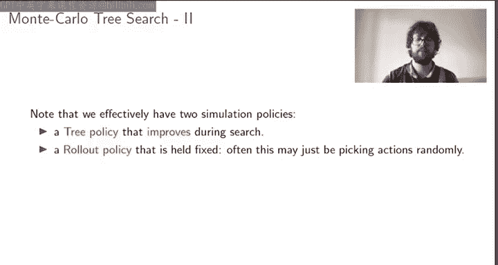

And let's consider a situation where we have some state that we are interested to select an action in。

 and we have always two actions in every state。So at the beginning， the tree is empty。

 so what we do is we just。The initial the state is a leaf itself。

 and we just use a default policy to roll out until an app is of termination。So this will。

 for instance， give us if we roll out the policy and the model until the model tells us that the episode has terminated。

 maybe we get a reward， a return of one。Then we update our value of the root and node to be one because it's the average of the existing simulations。

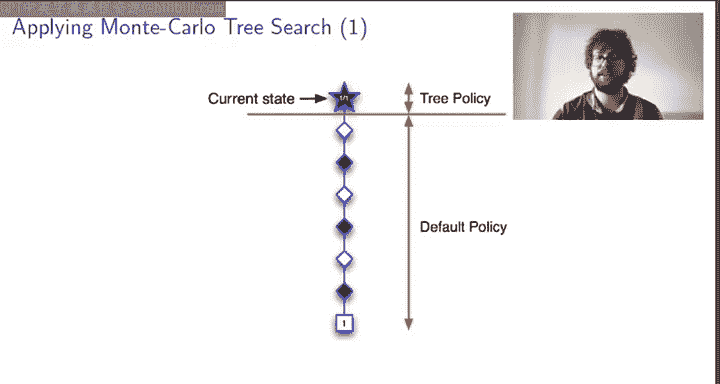

Then we expand。OneNot。So for instance， we have no additional knowledge of say we simply randomly choose to pick the right action。

Then what we do is again we have've reached a leaf。

 we use the leaffold rollout policy to get an entire episode dev Ovation。

This time we observe that we get an absolute return of zero。

But now we go back and we update not just the node we had just expanded， but all the ancestors。

 which now included the root node， so the evaluation of the nodedu we just expanded will be zero。

 but the evaluation of the value of the root will have been updated to1 half。

Since the value in the route is higher than the value of the actions that we have selected。

 then let's try to expand the different action。

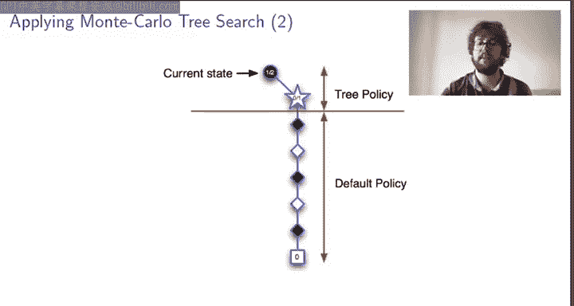

And again， after reaching this leaf node， we used the rollout policy to get an evaluation This time we serve a return of one。

 so we updates the value of this node we just expanded。

 but also the root so the root is now has the value of two thirds and each of the actions in the root have estimates of one and zero respectively since the。

The value in the on the left side is higher， let's now again we navigate until the leaf。

 we expand one node。

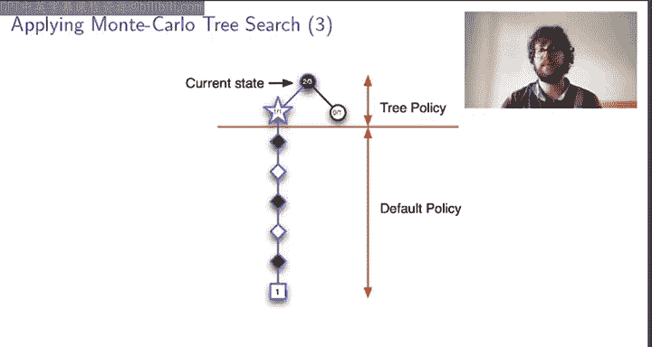

We do an evaluation this time we observe a zero， we back up all the updates。

 so the newly updated node has a value of0， His parent has now a value of one half and the root node node have also a value of one half because two out of four the episodes that started in the root had the reward of one and the other two had no reward at all。

Again， we navigate until the leaf， we pick the action with the highest value。

 and we expand that node， we roll out until the end， we get an evaluation of one。Now， again， we have。

We have to update all the values in the parent nodes to include the latest information that we have generated with this rollout。

Again you start in the node， you follow the Q values to reach the leaf by always selecting the highest value and then expand again。

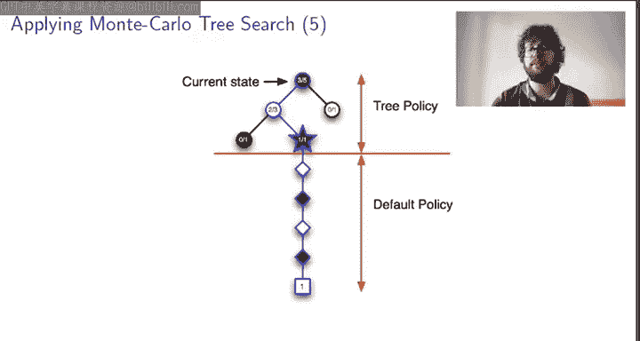

And if you entererate this process， you basically get a very highly selective best first search。

Where states are evaluated dynamically。And we are using sampling to break the cursor dimensionality。

And while still being computational efficient because the algorithm is any time。

 so you can basically iterate until you have computational resources until you have time to think。

 and then at any point you get a best estimate of what the agent can assume the values in the root to be given the policy and the model that it have available。

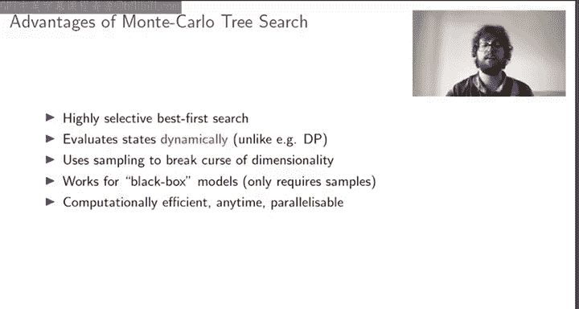

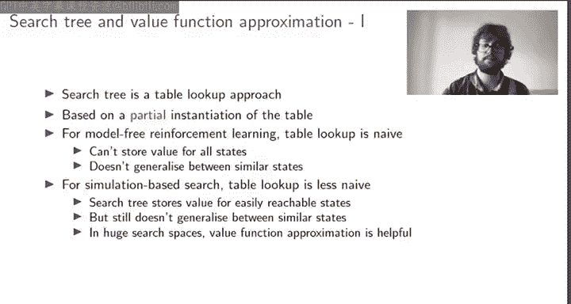

An important thing to realize， though， is that。Mtic Carral search。

 but actually basically all the simulation based and an even forward search are essentially table lookup approaches。

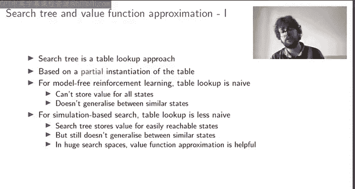

But based not on instantiating the table of all possible state。

 but instantiating a partial table that only includes the most likely state that are directly reachable from the current state。

So we discussed quite extensively that for Model 3RL， table lookup is maybe a bit naive。

 so you cannot possibly store values for all states and because you don't get any generalization。

 you will likely not have trained the value or a policy for any new state that you encounter when interacting with the environment。

But for simulation based search， the table lookup is actually less negativeive because you only need to store values for the easy reachable states that are likely under the policy and under your Q value estimate。

So even if you don't have extensive generalization。

 this can actually be a system that works quite well in practice。

At the same time there are lift so it is still a partial instantiation of the table and that could grow to be very large。

 so for very big search spaces it will still be useful to combine these ideas from MCTS with for instance value function approximation this is for instance what actually the alphago system did it actually used value functions and policies to guide the search and in its later iterations even to replace the rollout。

 the rollouts to get Monte Carlo evaluation by rolling a leaf all the way to the end。

 replacing that would just learned value function to basically make the process more efficient。

