# DeepMindxUCL《强化学习｜Reinforcement Learning 2021》中英字幕 - P9：[09]Policy-Gradient and Actor-Critic methods [9_13].zh_en - GPT中英字幕课程资源 - BV1JssaeVEMp

Hello and welcome to this ninth lecture in discourseur reinforcement Learn。

My name is Harol and Huusts and today we will be talking about policy gradients and Act critics。

In terms of background material， I recommend that you have a look at chapterer 13 from the book by Rich Sutton and Andy Barto。

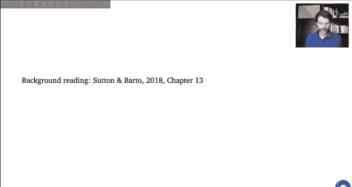

And in some sense， the motivation for today's talk can be captured in a quote by Vladimir Vpni， who。

Famously wrote in a book about learning theory that one should not solve a more general problem as an intermediate step。

So what does you mean with this， well if you are going to solve a more general problem and sometimes this is tempting。

 then this is going to almost necessarily be harder。Not always， but typically。

 especially if it's truly more general， but that means that you're actually spending maybe data。

 compute resources in whatever way on something that is harder than you need and maybe it's better to solve the thing that you actually care about directly。

It's a rule of thumb， it's not always the case that this is generally true。

 but it's a good thing to keep in mind and if we apply this reinforcement learning。

 there's a question that we could ask ourselves。If we care about autumn behavior in the end。

 why do we not learn a policy directly？So in this lecture， we will be talking about this。

But to dig in a little bit further into this high level view。

 let's first compare to other approaches to AI。

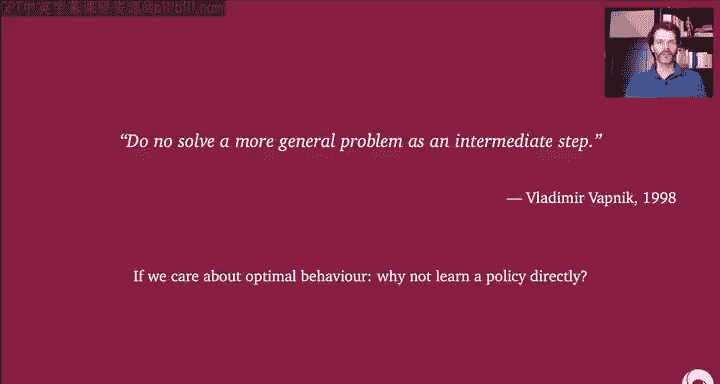

Where we've talked about model based reinforcement learning and this has some benefits。

 including the fact that it's relatively easy to learn a model in the sense that this is a well understood process。

 it's supervised learning。So when you learn a model typically we learn either an observation to observation or a state to state model and we learn a reward model and at these the mechanisms with which we could use to learn these are fairly well understood because this is basically just supervised learning Of course the model itself could be very complicated and this can be a problem。

But the other benefit from learning a model is that in some sense you are going to extract all that you can from the data。

 you could imagine that if you see a transition in which nothing too exciting happens in terms of rewards and maybe there's not too much to learn about your policy directly。

 it could still be useful to condense some information from that transition into some structures in your head。

 some knowledge， and if you learn a model about if you're trying to learn about everything。

 then at least you're extracting this information。But of course there's also downside。

 including the fact that you might spend quite a bit of computation and capacity on irrelevant details。

Classic example of this could be， well， if say you're playing a game， let's say Baman。

And now consider learning a model for the game of Pman。

 so you could imagine having a frame and maybe we're literally just learning a model from observation to observation。

 so you have a frame you're trying to predict the next frame。

Now that might already be quite difficult， but now let's extend the example and now let's imagine that instead of the normal black background that you have in the game of Pethman。

 let's assume that there's an irrelevant video playing。

Maybe just some television program is playing in the background。

And let's assume it's not too distracting so you as a human playing packman could still just play the game and you would basically fairly quickly learn to kind of tune out the video in the background。

 but if you are training a model and you're not telling the model which parts are important because maybe you don't know in advance you're just supervised learning from frame to frame most of the capacity of the model might be focused on trying to learn the pixels associated with the background video。

 rather than the pixels that are important for us to play the game this is what we mean when we said it might spend compute and capacity on irrelevant details。

 things that do not matter for your policy do not matter for the reward but if that's not known to the model learning。

 then it might still focus on that。In addition， even if you have a very good model and you were able to learn maybe even a perfect model from the environment。

 you would still have to compute a policy。This we could call planning。

 and this is typically non trivial and can be quite expensive in terms of computation。

Because especially if you want to have a very accurate model of a very complicated world。

 you could imagine that this internally also will be quite a complicated thing and therefore even computing one step into the future。

 one imagined step can be quite computationally heavy。

We talked a lot about value based around in thiscourse。

 so let's also list on the properties of this pros and cons。So first。

 it's a lot easier to generate a policy。 if you have a value function in particular。

 if we've learned an action value function and in the case where we have a discrete set of actions。

 then picking the。Greedy action with respect to these action values is very easy and that this is a valid policy。

 a greedy policy， we could also of course consider a soft greedy policy or other things。

 but generally tends to be relatively easy to generate a policy we don't need to have as very slow planning process to extract the policy from the values。

In addition， this is fairly closer to the true objective， closer than the model。

 because at least when we learn values， well that's what we were wanting to optimize with our policy right so learning values is。

lessss likely to capture all sorts of irrelevant details。

 and maybe it's close to aligned with the true objective。

It's also fairly well understood because there's been lots of research in value- based reinforcement learning and very good algorithm do exist。

 although sometimes there's caveats or things that are a little bit less well understood or even understood not to work very well and then sometimes solutions for this are proposed as well。

 but it's still fairly well understood， it's maybe a little bit harder than supervised learning in general。

 but we do have good algorithms。However， it's still not a true objective and you might still focus on capacity only relevant details。

 for instance， if you're trying to learn value function。

 you might see quite a bit of function approximation capacity in learning the accurate values for one action versus another action。

Whereas maybe the difference in values could be huge。 and so for the optimal policy， its。

Clear March earlier that one action is strictly better than the other one。

And then syncing in more data and compute and function approximation capacity and figuring out exactly how much the difference is might be irrelevant in terms of which policy you're going to follow。

In addition to this， because the objectives are although they're aligned， they're not truly aligned。

 fully aligned， a small value error can sometimes lead to a larger policy error。

 this is particularly the case when you have value function approximation errors for instance because your capacity is limited or because your data is limited。

 so that means what if we can't actually accurately model the policy values for all actions。

In that case you're going to have to have some trade offs and these trade offs。

 these function approximation errors might sometimes lead to a different action seeming to have a higher value。

But in fact， it might be that that is really not a good action and it's just because of generalization or function approximation error that you think that has a good value。

 and this might lead to a fairly large policy error。

So in this lecture we're going to talk about policy Ba for ocean planning。

 which at least is the right objective， let' if we're interested in finding the best policy。

 maybe we can optimize this exactly。But we'll talk about more properties， pros and cons。

 this approach on data slides。In general， it's good to keep in mind that all of these different approaches generalize in different ways。

 if you learn a model， it might generalize in some ways。

 but maybe worse so in others as in the video in the background example。

 value based reinforce burning again will generalize in some ways。

 good sometimes bad in other ways and policybased reinforcement burning as well will generalize in different ways sometimes learning a model is easier for instance itss dynamics are particularly simple。

 you could think for instance of let's say a very simple game in which you just move in a grid and it's very predictable what will happen if you pick a certain action。

 it might not take you a lot of data to figure out， oh in this grid if I move right。

 if my action is to move right， I will literally move right a step unless if there is a wall then I'll just say where I am that might be a model that is relatively easy to learn and it could be very local in some sense where you only need to know a little bit about the immediate vicinity of where you are in order to accurately model what will happen next and then maybe you could learn a model that is easy。

Learn and you could use that to plan very deep into the future。But of course。

 sometimes learning a policy is easier， like you can imagine instead， if we consider a real world。

 well， that's hard to model， right we find it very。

Hard to predict exactly what will happen and it's a very messy stream of observations that you get through your eyes say or a robot could get through its camera and there will be some noise。

 perhaps and Indian it's very hard to model the whole real world obviously but the policy could still be very very easy in some cases at least it could be that you just always need to go forward your robot you just need to go forward and maybe that's the optimal thing to be doing and maybe that you could learn that quite easily without having to worry about all of the intricate details of the world。

So now formalizing these things a little bit farther in previous lectures we've approximated value functions parametrically。

 so V pi and Q pi hereote the true values of a policy pi and VW and QW then denote the approximations。

So in this case， we can then generate a policy， for instance， by picking it greed。

 but now we're going to do something different， we're going to have a different set of parameters。

 theta， and these will be used to directly parameterize the policy So in the previous lectures we still had a policy because you always have to pick your actions in some way。

 but the policy was inferred from your value function and now we're just going to basically have some sort of a function that will output the policy parameters。

For instance， this could be a neural network or a linear function or something as a form where these could then be the weight of the neural network or the parameter social linear function。

We will focus on a model free reinforcement learning， policy directs。

 policy search or learning policies can of course be combined with models as well。

 but we'll just not go into that topic in this lecture。So in terms of terminology。

 it's good to be aware， it's a little bit of a so you see a Venn diagram here on the side and there's a little bit of terminology that people tend to use for these things。

 quite obviously value based reinforcement learning will use values but typically when people say value based。

 they mean that the policy is implicit。Instead， if you just have a policy， of course。

 you can then call that policy based reinforcement learning。But then if both of those are there。

 there's and the value function and the policy， people typically use the terminology of act the critic。

And this is somewhat older terminology where the act and refers to the policy and a critic refers to the value function。

 the reason to use that word is that the value function is then used to update the policy to critique the policy in a sense。

 so this is where those terms come from。So we will touch upon actor critics in this lecture as well。

So enumerating the advantages and disadvantages of poly based reinforcement learning。

 I already mentioned that one of the prime advantages is that it's the true objective if we really try to optimize the policy。

 why not tackle it head on？It's also turned out relatively easy to extend the algorithms that we' will talk about to high dimensional or even continuous action spaces。

 So for instance， if if you think of a robot， a robot doesn't pick between say three different actions or five different actions Now instead it could send electrical signals to its motors and maybe in an almost continuous fashion right so you could。

Exert a certain amount of power to something， but maybe the amount of power that you can exert is really a real value number。

 it's not just one discrete choice， you can not just pick one or two or three。

 but maybe you could also pick 1。2 or 3。7 or something like that。In addition。

 another benefit from parameterizing to policy directly is that we can parameterise this in such a way that the policy is stochastic。

 which means that it's a random policy rather than a fully deteristic one。

We saw the stochastic policies before the greedy policy is an example of a deterministic policy。

 Abpsilon greedy is an example of a stochastic policy where there are some randomness in which action you pick。

And in addition， I already mentioned that sometimes policies are very simple。

 while values and models are complicated。And this has multiple benefits。

 one is sometimes this means that learning the policy can be a lot easier， and in addition to this。

 it's sometimes also much easier to represent the policy。

 You could imagine that a value function could be really complicated。

Because maybe it matters a lot how close or far you are from a certain goal。

 and then even if you have a lot of data and you learn really well， you have really good algorithms。

 it could be that if you pick a certain function class， it just doesn't fit。

 you can't actually represent the whole value function。

But it could be that in exactly the same problem that the policy is relatively simple。😊。

And that you can pick a function class that is relatively simple and still fitted exactly the optimal policy。

😊，It's not always the case， but it's can be the case and then it's good。To basically calculate hell。

 as I mentioned before。So examples include when the dynamics are very complicated。

 but the optimal policy is， for instance， always to move forward or maybe just always to spin around or something like that。

There's also disadvantages for one if we do policy search， well there's different ways to do that。

 but typically what we do is we do some sort of hill climbing。

 we use gradient algorithms or even when we use something else like for instance evolutionary algorithms。

 if you don't know what those are， that's not a big problem。

 but also those tend to be local in the sense that you're considering certain policies and you're searching around those policies for better ones。

And then it turns out you could get stuck in a local optimum。

 which means that then you find a policy that is relatively good。

 but there could have been much better policies， but they're too different for you to incrementally move towards from your current policy。

In addition to this， the update knowledge can be very specific。

 which means it doesn't always generalize well， this is related to the point I made earlier about model based reinforcement planning capturing everything that you possibly can about the environment。

Policcy based reinforce funding doesn't do that。 In fact， it tries to reduce the data to the most。

Narrow thing that you could need for optimizing your behavior， which is the behavior itself。

But that means that if， say up until now， in all of the situations you were。

 it was always optimal to move forward。And then suddenly。

 it isn't because you maybe move into a new room。 And now you have to do something else。

 It could be that by that time， the policy has basically learned to completely ignore its observations and just move forward。

 And then it can be hard to unlearn this。 It might not generalize well， in that sense。

And this is related to this property that basically at high level， if you learn a policy directly。

 you're not extracting all the useful information from the data。

And that means that it might be harder to adapt to new situations。

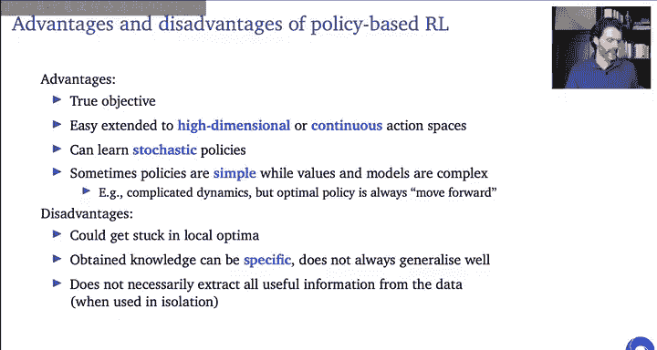

Okay， and now we're going to talk a little bit about stochastic policies in particular and why we might care about learning those。

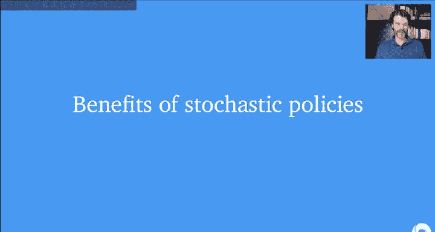

🎼So why would we need stochastic policies you might recall or you might know that in Mark of decision process。

 there is always an optimal deterterministic policy there it always exists such a thing。

But turns out most problems are not fully observable。

 I talked about this even in the very first lecture where we talked about for instance like consider a robot with a camera。

 robots toping in front of it， it can see what iss in front of it but it cannot see what's behind it that would be a not fully observable mark of decision process or a partially observable more mark of decision process。

 especially if it matters what's behind it it might see something or that might matter for what I'm going to do now turn around。

 you you don't see it anymore， but the best thing to do might still depend on this。

And this is the common case and in fact， even if you have a mark of decision process。

 if you could say， well， the world is the mark of decision process， it's just a really。

 really complicated one。Sure， but if you're using function approximation。

 then the agent can still maybe not distinguish between states。

 which basically means you're still in a partially observable setting。

 even if the world itself is moreovviian doesn't mean that the learning algorithm can fully exploit this。

And if that is the case， then the optimal policy itself might actually be stochastic。

In addition to this， the search space can be smoother for stochastic policies because you can imagine for a deterministic policy in every state you basically have a choice do you pick this one or you pick that one and that might be hard to opt space because you basically have this discrete choice of either doing this or either doing that so there's a big combinatorial search problem there if you're only searching within deterministic policies if however you're thinking about smoothly changing the probability of selecting one action above the other。

 that couldn't be a much smoother surface and that turns out to be important for optimization in particular we can then use gradients which are very successful at optimizing deep neural networks and similar structures and these tend to lead to successful and impactful learning algorithm。

And then finally having a stochastic policy can be beneficial because you automatically get some expir I put explorationir between quotes here because maybe this is not exactly the right type of exploration just picking actions a little bit randomly might not actually give you enough coverage。

 it might not seek out important information about the world。

 but still in many cases it's better than nothing and it might still lead you to reasonably explore。

 especially if your policy is stochastic in some states and less stochastic in others this might be reflective of the fact that you don't really know yet which actually are correct in this one state。

 but in the other state you've seen enough data that you now know or now in this state I need to do this and then that might sometimes lead to an appropriate amount of explorationir。

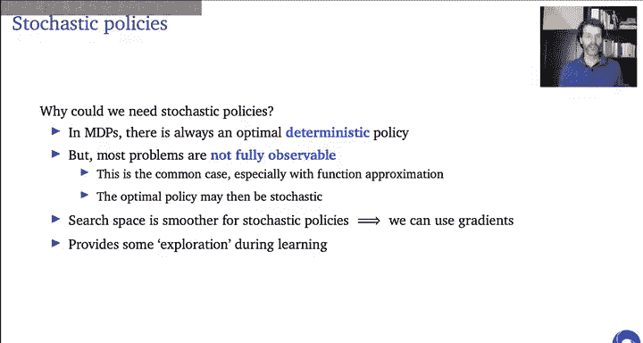

Okay， now I'm going to show you an example of an alia grid world to show you that the stochastic policy can be optimal in a partial observable setting。

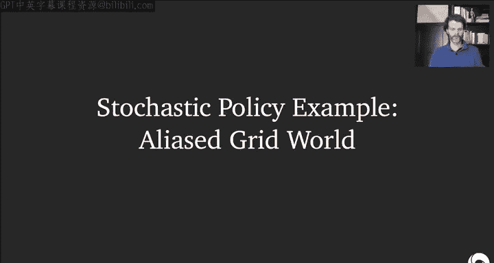

So consider this。Let's say that you're in this tiny little bit world where we start somewhereing the top corridor。

And the gray states look the same， for instance， it could be the case that you have features that represent the states and these features only look at where are the walls。

Now in the top left， for instance， the feature for the wall。

Above you and a wall to your left would both be on and the features for a wall to your right or a wall below you would be off。

And if we would have this feature representation notes that these two gray states would indeed have exactly the same features and therefore be fully the alias。

 they would look alike。Now in the top corridor you can just move back and forth。

 you can move left and right and you could move up。

 but you would just bump into the wall and you could move down if there's a wall there you would bump into it。

 you would stay in the same place， but if you're above one of these three other states。

 you would go into a terminal state and either you die or you get the money for simplicity we could assume that in either case the episode ends so you either die or you get the money and you still maybe die。

 the episode still ends but maybe then you are happier。

Now in this setting we could imagine doing learning。

 but we don't even have to think about a specific learning algorithm here。

 we're just going to consider what the policies should be。Now in particular。

 we're going to compare deterministic and stochastic policies。

Now here's an example of a deterterministic policy。If you're above the money you go down。

 if you're above the skull and bones， you basically can see by looking in which corner you are。

 in which direction you should go， you should always move away from the wall， obviously。

 if you're in a corner， never go down because that's bad。

You don't need to go up because that doesn't help， you also don't want to bump into the wall。

 so instead you move the other direction。If you're in the top right in this specific case。

 this will be the optimal thing to be doing and in fact。

 let me point with the mouse you would maybe start here that you would move over here and then you could move over over here and then move down so this would be an optimal path right if you would start at the top right corner you'd move left。

 left down and you win the game。However， let's say that you either begin in this corner or in the other corner randomly every episode。

If this will be your deterministic policy， because it's a deterministic policy。

 and because these two states look exactly alike as far as the policy is concerned。

 if this is all that it knows， it cannot distinguish between these two states。

 so the policy must be the same in both cases。So this means that if we start over here in the top left corner。

 you move right， but then immediately move left again under this same policy。

It could also of course be the case that in this gray state you would move right instead of left。

 but that means that in the other gray state you'd often also move right and you'd have the same problem over here。

So you can see here that essentially understate aliasing and as I mentioned， this is the common case。

 right if you do function approximation and if the world is complicated。

 you cannot assume to have a fully observable representation。

And then we can see that an optimal deterterministic policy will either move left in both gray statess or will move right in both gray statess。

 and neither policy is optimal because there are episodes in which you get stuck indefinitely。

And then you will reach money and your average reward wouldn't be very good。

So what else could we do Well， what if we would have a stochastic policy that randomly moves left or right？

With equal probability in each of these gray states。

Then what would happen is let's say that again we started the top left corner and we move right。

 It might be that here you move left again。But then you can just try again。

 you could move rights again， and eventually youd pop out at the other end and you just go and grab the money。

So with this stochastic policy。If you start in one corner or in the other。

 it doesn't matter in expectation， it'll take you the same number of steps to get to the gold and reliably every episode ends by getting you to the gold in the middle。

And you would never enter any of the bad states， but you would also never get stuck indefinitely。

 and you could calculate you could assign you could actually assign rewards to this for instance you could just assign a plus one to when you grab the money and maybe or maybe a minus one per step and then you could calculate that this stochastic policy has a much higher average return than the other one。

So this is just an example to show that sometimes having a stochastic policy can be beneficial because even the optimal policy could be stochastic。

So importantly， the last two points here is that this stochastic policy can be learned if we learn the policy parameters directly instead of just learninging value functions。

And in addition to this note that this is just an example in which we happen to have equal probability across actions in some of these states。

 but the example can be extended to having non- equalal probability。

 so I'm not saying you need uniform policies in some states necessarily。

 that's just in this example where uniform you move left or right。

 but know that even in this example the policy is actually not completely uniform because you move up or down with zero probability in those states。

You could also have situations， problems in which it's optimal to pick one action with say 75%。

 a different one with say 12% or whatnot， and it could be that the stochastic policies arbitrarily。

Stochastic where it could be almost greedy or it could be very uniform or anything in between。

So this is important to note because this is different from random tie breaking with values if certain actions would just have exactly the same value。

 you could still break ties randomly then and have stochastic policy。

 this is different because you don't in that case you could only pick between deterministic or random randomly picking uniformly randomly picking between actions here you could have different tradeoffs。

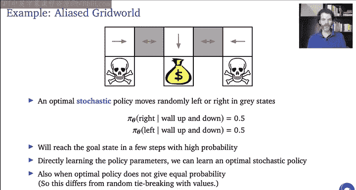

Okay， and now we're going to formalize the policy learning objective。

 which will allow us to then derive concrete algorithms that can help us solve these problems。

So the goal at high level， of course， is just to a policy。

And if we parameterize the policy with just some parameters theta， then of course。

 this translates into the goal of finding these parameters theta。

But how do we measure the quality of the policy？Well in episodic environments。

 we can use the average total return per episode， we can basically just look at all of the episodes we've ever seen right。

 average all of those returns and say， well， how good the policy was was。

The average return sell episodes if we would have kept policy fixed。

In continuing environments that do not have terminations， we could use the average reward per step。

 and though that seems a reasonable choice where this is a well defined quantity。

In a continuing environment， notes that the。Episodic value could be infinite because you basically are in one very long episode that might never end。

 but the average reward is still well defined。So let's formalize that and let's first start with the episodic return。

So we're going to introduce some function J， which we subd here with G where G corresponds to the return。

And that's why there's a little G there and the definition then not the objective could be this expectation。

Where the expectation is taken over a potentially random distribution on the start states。

 so we sample some S0 from some random distribution D。D0 and then from that state onwards。

 we take actions according to our policy。So the actions are random maybe because the policy is random and of course。

 in addition to that， but implicit in the notation。

 there will be some randomness due to the markov decision process so the transitions themselves might be random。

The expectation just folds all of that into one， so know that the expectation is not conditioned on anything else。

 it's conditioned on the distribution of start states， implicitly on the MEP and then on the policy。

And then our goal is just to maximize the discounted return。

From the starting state right so we basically only look at this initial state and then we are going to roll forward throughout the whole episode until it ends。

 there's a summation there to infinity because we're basically just going to assume that whenever you hit a terminal state all of the rewards from there on N are0 or equivalently that your discounts might be time varying so here we have a constant discount which is just to the power T alternatively you could write it down with a time varying discount and then a discount on termination could be taken to be zero。

And those would be equivalent， so the summation is into infinity。

 but a lot of that time is spent in an absorbing terminal state where the rewards are just zero。

So alternatively， you could also just think of this as a finite sum。

 but for mathematical convenience or writing it as an infinite sum。This can， of course。

 be rewritten as the expectation of the return from time step  zero where we。

Consider every episode to start at time zero for convenience。

Now we can write this up maybe a little bit more explicitly by splitting out the expectation。

 so let's now as an outer expectation， just consider the expectation。

 which is due to speaking the starting state。And then the inner expectation is already conditioned on net starting states。

And so basically we're writing here that S0 is not a random quantity and we're saying well。

 if we're just going to imagine a different random quantity ST that is equal to S0。

 when that is the case， the return from that time step onwards， so from ST onwards。

Whi is GT won't be due to the distribution for Starley state anymore because that once already is barely conditioning on that state。

And instead， it's just the return that is due to your policy and the mark of the decision process underpins it。

 but this quantity is a familiar one that is actually the value of state zero。

So that is the definition of the value that if you consider an arbitrary time step T and you consider the expectation of the return condition on ST being whatever state you're interested in。

 and then the return GT that will be exactly the definition of the value function。

 so this is the value of this random state as 0。Where again， D0 is the start state distribution。

So we can see that we can write this objective in multiple different ways。

 but effectively what we is doing is saying， hey， we want to optimize our parameter theta in such a way that the actual value v of the policy that is parameterized with theta。

 will be maximized under the distribution that generates a starting state distribution for simplicity we could consider a special case here where the starting state distribution is a direct。

 it's a deterministic process which basically always picks the same state。

 then our objective is just the value of your starting state。Feel free of course， as always。

 to pause the video whenever you want to reflect on this a little bit and I'm going to move on。Notes。

That if we want to write on the average reward objective。

 this at first glance looks a little bit simpler， but there's some subtleties here。

So we're going to expand this a little bit as well。

 see the expectation here is no longer over a start say distribution because we're considering a continuing setting now where we're just going to take actions indefinitely long and it's never going to stop you're never going to start a new episode and we're just interested in the average reward。

Long term average reward。This can be considered an expectation where the state is now drawn from a different distribution。

 which is the distribution that you're in a state under this policy and implicit again in the Markov decision process。

This is the long term probability of being in a state， so basically think of it this way。

 even in a continuing setting， you might still start in some states right according to some distribution or maybe determinististicically in some state。

But if it's a continuing setting and you're going to be in there indefinitely long under some mild assumptions。

 there's going to be some frequency in which you visit states and this frequency in the long term won't depend on where you started。

 it will just depend on your policy and the dynamics of the markov decision process。Often。

 so people will assume things such as that the markov decision process is mixing orergoic as it is called。

 which essentially means that this distribution exists。

And that you basically always can recover states that you visited before that the MDP is in some sense。

 connected。And if that is the case， then is if a distribution is well defined。

 and it will basically just be the frequency of how often you are at each date。

So we can consider this expected reward， this average expected reward。

 we can consider that to be an expectation where the starting state is drawn or the state you're in is drawn according to this what they call steady state distribution。

And then in that state， conditional that states， we're going to draw in action according to our policy and observe the immediate reward。

 and that's the thing that we're interested in now。

We can write this differently with a explicit summation where we are summing over states and we're looking at the probability of being in each state。

Under this stationary distribution， of course， if the spaces continues。

 we could just write an integral there and everything would be similar。

And we're sum over action so in each state we're looking at how likely are we to be in that state。

 and we're going to look at how likely are we going to pick each of these actions given that we're in this states and then we're going to look at the probability of picking after picking this action of getting each reward。

And then you basically just multiply it with the reward。

So this is just writing out this expectation very explicitly in a summ。

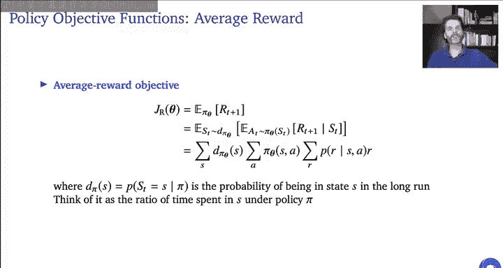

And now we're going to talk about how to optimize our authority' objectives and to do so we're going to use gradient based algorithms。

 which are therefore called policy gradients。

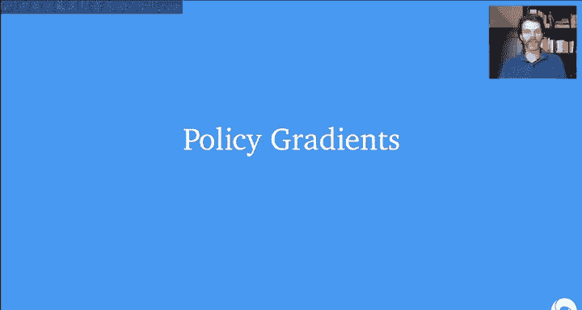

So policy based reinforcement learning is an optimization problem， we want to optimize something。

 we want to find the theta that maximizes this J Theta。

 or J Theta is one of the two objectives that we just defined before。

 or maybe you could come up with other variations that you might like。

We will focus on stochastic gradient descent because this is a powerful method。

 which is often quite efficient and it's easy to use with deep neural networks。

 which are also a very good tool in this context。There are approaches that do not use gradients。

Like hill climbing or simulateimulating andneing or genetic algorithms or evolutionary strategies。

 but where we want to consider them now， we're going to consider gradients。

And the policy gradient is then simply defined as。Updating your parameters T。

In a way that corresponds to the gradient。 So we have this gradient here of J。

 and I'll talk more about how hard that looks， Where do you get this。 What does it look like。

 And we're basically going to update theta。 So Dellta theta here refers to the change that we're going to do to theta with some small stepsized times this gradient You could more use more advanced mechanisms。

 I mentioned this in some earlier lectures as well。

 you could imagine using newer optimizes like ours prop or atom or agrad instead of using vanilla stochastic gradient ascent。

 In this case， not decent， but ascent。But it's very similar and we won't talk about those specific things。

 these are choices that you could always do whenever you have a gradient you can always transform this gradient in a way to make the optimization more efficient。

But first of this， we're just going to focus only on the。Do a pure gradient based algorithm。

Here on the right you see some pictures of how the lost landscape might look and how then the gradient algorithm might work It traverses these lost landscape which are typically implicit so you basically get some local information of what the gradient looks like and then you're going to move up or down according to that the gradient will always point in the direction of steepest descent locally where you are right now。

Now this gradient is just a vector which takes the partial derivative of J with respect to each of the components within a theta。

 so theta are the parameters of our policy so the weights of a neural network that represents that policy for instance。

 and this will just be a vector with partial derivatives with respect to each of these individual weights。

An office is step size parameter typically a small number， so that we make small incremental steps。

 but we will take many of those and eventually we'll get to in this case higher values of G。Again。

 I mentioned this before， but here it this becomes important。

 stochastic policies can help ensure that J Theta is actually smooth。

This is the case because the way J depends on your parameters。

 we want this to be smooth because then the gradient will point。Reliably in a good direction。

 maybe more reliably so than if it's discontinuous。

 and if the policy itself is parameterized with probabilities。

 that means that a small change to your parameters will actually also mean a small change to the value because we're not switching all the way from one action to the other instead we're just switching slightly with the probabilities of selecting one action rather than the other。

But now we're going to compute this， we didn't really answer this question yet。

 so now we're going to go into there。So we're going to assume first。

 this is important that the policy itself is differentiable almost everywhere。 for instance。

 it's a neural network。 I say almost everywhere because oftentimes these days people use neural networks with slight discontinuities like rectifier linear units。

 and that's not too bad that doesn't really matter too much but you basically want a differentiable function。

 something that itself is smooth。And for the average reward， then we want this gradient。

But this raises a question， so how does the expectation of R actually depend on theta？

It's not immediately obvious and we'll dig into this a little bit more in this lecture。

So we're going to start for simplicity in the contextual bandit case。

So consider now a one step episode。嗯。such that the average reward is well defined。

 and we are talking about the average reward， but we're basically going to only be interested in the reward because we can assume now that the distribution of states does not depend on your policy。

This is why we go for the contextual band， it makes some things a little bit easier because of course。

 normally our distributional states will depend on our policy。

But if we're in a contextual bandit and if in addition。

 the state itself is a pure function of the observation。

 so it's not a parameterized agent update function， but for instance。

 the state could just be the observation。Then the distribution of those states does not depend on your policy。

 that's a property of the contextual band， so it's a more limited case and we're starting there because it's simpler to reason about。

So the expectation here is over actions and overstates， but the distribution D does not depend on pi。

 and that's important。Later， we will consider the case where it does depend on pi。

 so this is just a temporary assumption to make it a little bit easier to understand。

So what will happen is we'll see some context， S this will be out of our control。

 but then we want to pick an action and then we'll see a reward R which depends on the state and the action。

 and then we want to optimize the policies such that the rewards become higher。

We can't just sample the reward and intake the gradients because the reward is just a number and doesn't depend on theta。

 and we saw this before in the second lecture， but we're just going to step through this again to make sure that we fully understand this case。

So we're going to use this following identity which we've derived and I'll derive again on the next slide。

 where the gradient of the expected reward turns out to be equal to the expectation of the reward times the gradient of the logarithm of the policy。

I'll prove this on the next slide and the importance of this equality is that so this is a true equality is that the thing on the right hand side can be sampled。

 whereas the thing on the left hand side， you can't diss samplele the reward as I mentioned and then take the gradient because the gradient of a number is to zero so that doesn't work because we're not taking into account how the expectation depends on the parameters。

But if we can rewrite this as an expectation of a gradient。

 then we can just sample this expectation and get an unbiased estimate for the gradient that we're actually interested in。

And this will give us concrete algorithms。This idea was introduced in the context of reinforcement learning by Ron Williams and he called the algorithm reinforcefor。

Okay， so now let's reprove again， introduce a little bit of notation， let's call little RSA。

 the expected reward， given that you've taken action A in state S I see there's a slide typo on the slide there。

 big A equals small S should be big A equals small A。But。

Otherwise it should hopefully be clear and then we're just going to write out this expectations first to derive that this is equality on the previous slide is true。

So the gradient of the expected reward will just be the gradient of the sum over all states。

Let me point。And then the probability of in being in that stage， which I mentioned again。

 where in the contextual band this case here， this probability does not depend on our policy at all。

Times the summation of actions， the probability you've taken each action and then the expected reward。

 given that you're in that setting and you've taken that action。

Now we can just push this gradient in through the summations all the way until it hits the thing that does depend on our parameters。

 which is our policy。And I've just rewritten it in a way to pushed it all the way to the right hand side to make clear that the gradient only applies to this last bit。

😊，And then we're going to do the score function trick。Or the log likelihood trick。

 as it is also known， we're going to multiply。By the probability of picking the action according to our policy and also divide by this。

 So we're effectively just multiplying by one right so this is exactly equal。

 There's no approximations happening here。 We're just multiplying by one。

 but we're writing out this one so that we can write out this as an expectation again because now we have the probability of selecting the action back which means we can rewrite this again。

 let's reshuffle at first。 and we see something very similar to what we had before here。

 a summation over states with the probability of being in that state。

 and then a summation over actions with the probability of picking then that action and then some term behind there。

 which depends on the state in action。This means we can now rewrite this as an expectation。

And it'll be the expectation of the reward RSA times the gradient of the logarithm of the policy。

We have arises before in lecture number two， and were just rederiving it here for clarity because it's an important step and it's important to understand where this comes from。

So we've proven this equality on the previous slide。

 so I'm just putting it here on the top of the slide and now we have something we can sample and then our stochastic policy gradient update can be this update where we update our parameter theta by adding a small step size times the lower times the gradient of the logarithm of the action that we selected 80。

In expectation， this is an unbiased algorithm， and therefore this is pure unbiased stochastic gradient ascent。

 we're going up， we're not going down， right， We want to increase our values。

 we don't want to decrease them， but it's very similar to stochastic gradient descent。

 we're just going in the other direction。The intuition， if you look at the update。

 is if the reward is high， you will change the parameters such that the policy goes up or actually more specifically so that the logarithm of the policy goes up。

 but the logarithm is itself。An increasing function， it's a monotonically increasing function。

 so increasing the logarithm of the possible probability of selecting an action is equal to increasing the probability of selecting that action itself。

So it's good to stop there for a moment and to think that through whether you see why that is the case。

 I mentioned before in lecture number two as well， if all your rewards are positive。

 this means that whatever action you select， you will make that action more likely to be selected。

 whenever you actually perform this update it'll actually turn out that most of the time increasing the probability of one action means decreasing the probability of the other actions right？

So if the rewards are all positive， if you perform this specific update。

 you would always push up the probability of selecting the action that you selected， however。

 if the rewards are not equal for all actions you would push up the probabilities of actions with high rewards more so than the probabilities of actions with low rewards and in the limit then you would still find the actions with the highest rewards。

However， that maybe is a little bit unintuitive and now let's introduce a little trick to reduce the variance and this will also make intuitive sense in a moment。

 but let's first define it mathematically， we can pick any B which doesn't depend on your actions。

 and then we can note that if you multiply B with the gradient of the logarithm of your policy。

 we could go through these steps。Where we can first write out。

That this is an expectation over actions and states。

 so let's first pull out the expectation of the actions， the state is still random here。

But the action is now just written out。 this this， this part of the explanation is now written out explicitly。

 And then we just notice then that we can。Do the inverse of the log likelihood trick。😡。

And basically note that the gradient of the logarithm of something is via the chain rule the same as。

1 divided by that something times the gradient of that something。

 So that means there is basically a way to rewrite this as the gradient of pi divided by pi。

 which will cancel out with this first pi。 And then that means we get this。

 We just get a gradient of each pi。Feel free to step through that more carefully by yourself on paper。

 but it's exactly the inverse step of the thing we did before with the score function trick we're just using that same trick in the opposite direction it's good to convince yourself that this is true this step from this one to this one。

But then we notice that pulling the gradient outside of the summation now that the summation is by definition equal to1 because it is a policy it's a well definedfined probability over actions。

 but that means that we're just taking the gradient of one， the gradient of a constant is 0。

 so whatever B is doesn't matter we're going to multiply with 0。

 this means that this whole expectation is0。It's good to convince yourself that this is true。

And we're going to use this fact now in later slides and this is true when B does not depend on the action。

 but it can actually depend on the state， so in the derivation above here I just had any B。

 but it doesn't depend on state necessarily， but actually if you make B depend on state。

 you can still do the exact same steps， everything goes through so B is allowed to depend on state。

 it just is not allowed to depend on actions for this to be true。

This implies that we can subtract the baseline to reduce the variance。 So what would this mean well。

 effectively what we're going to do is we're going to allow something to be part of the update。

 which won't take change the expected value of the update， but it's allowed to vary per state。

 and that's important it's kind of a covariate I'll talk more about this in the next lecture。

 but by picking this smartly you can pick something that actually reduces the variance of the updates。

 and we have already derives above here on this slide that it won't change the expectation。

 so we're still doing a valid scastastic gradient ascent algorithm。

 The only difference is that the variance might be lower。Which is， of course， a benefit。Now。

 intuitively， this also makes sense because as I said before， all your rewards might be positive。

 right？Or let's do a different example， let's say that the reward is plus one if you win a game and it's zero otherwise。

The algorithm on the previous slide， and I put it up。Would actually only update when you win。

Because if the reward is zero， your parameters will not be updated。This is kind of okay。

 but it means that if you lose a lot， you will basically not learn anything from those losing games right it's only whenever you win that you learn to change your policy in the direction that will help you improve。

What is effectively happening there is that this is a very high variance thing if you only win very occasionally like 1% of the times。

 you're only ever going to update your policy parameters1% of the times。

So this is an example of a high variance update because most of the time you're not doing anything and every once so often you're doing an update。

If you would introduce a baseline， you could do something else where for instance you could pick the baseline to be equal to say a half if it's equal to a half。

 that means that whenever you win you update or whenever you lose。

 you also update but in the opposite direction。And this means you can now also learn from the games that you lose。

We haven't actually changed the expected value right in expectation we're doing the exact same thing。

 the only thing that we've changed is the variance of the updates。

 but it makes a real practical difference。We will use this fact about the baseline more often in Prope。

 it's a generic fact it's useful to be aware with。And now to make that a little bit more concrete。

 let's consider an example， we consider the softm policy on some action preferences where similar to the book by Rich Sussin and And Bartto I'm going to use H to refer to some preference of an actions just a number I'm using H rather than Q to make it clear that these are not predictions those don't correspond necessarily to a prediction of some return it's just a preference。

And then we can define a policy we can parameterize this policy by basically parameterizing H。

 although I've suppressed this from the notation in this updates and a parameterized policy could just be the exponentation。

Of each of these preferences and then taking the one corresponding to the action and dividing it by the normalization term。

So note that the division here by the summation of the expentiated action values implies that the total sum of this thing overall actions will be equal to one。

 this is a well definedfin policy， the thing that we're dividing by is simply a normalization term to make sure that we sum through one。

Then if we take a gradient and I encourage you to go through this yourself and to check that this is true。

 It turns out that the gradient of the logarithm of this quantity will look like this。

 where we will have the gradient of the preference for the action that we've selected。

 So this is for a gradient。Of logarithm of the policy of A in ST。

 and this will be equal to the gradient of the preference for ST8。

Minus basically the expected gradient under the policy。

 so this is the gradient of all the other actions， including the 180， but also all the other ones。

And this just turns out to be the Grlock pie term for the Somax。

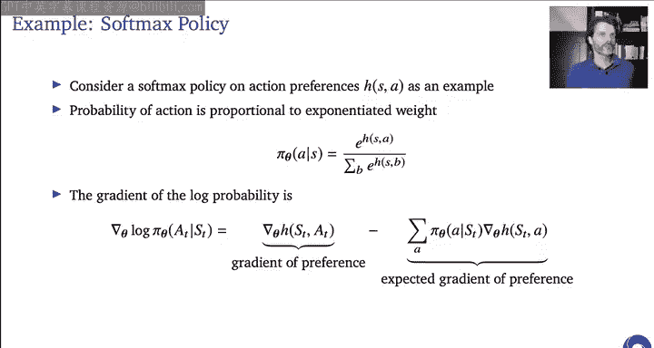

Okay， and now we're going to go into this sequential case and we're going to look at the policy gradient theorem。

 which is a generic theorem that proves what policy gradients can look like and how you could use them as an update。

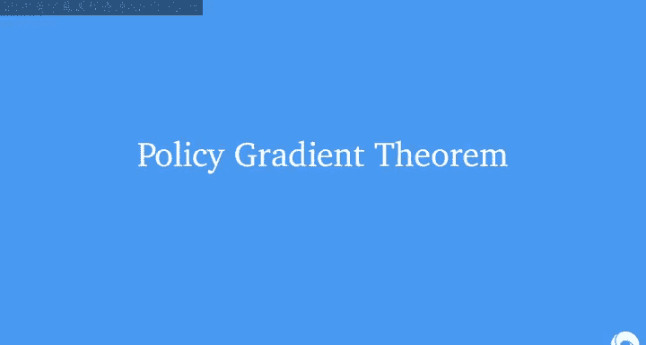

So basically we're going to go now to the modeled mark sorry the multi step mark of decision setting and the difference is now that the state distribution of the states we actually end up in will now also start depending on our policy。

 this was different from the contextual bandit case。

And we're basically not going to consider the immediate reward anymore in the contextual bandit case。

 only the immediate reward depends on your policy， but the next state doesn't so you can basically simplify things a bit。

 but now we're going to go back to the full case in which not just immediate reward but also your next state depends on your。

Action and therefore in your policy。And this will make things slightly more complicated。

 I'm reminding you that there's these two different objectives。

 the average reward return per episode and the average reward per step。

The average return per episode is applicable to episodic problems。

 so whenever you have an episodic problem that's basically the one you should be using。

 but if you have a nonepsodic problem in which there are no terminal states。

 there are no terminations， then the more appropriate objective is the average reward per step。

Because then the return per episode is simply undefined。

You shouldn't use the average reward per step for an episodic task。

 and then we give you a very simple example for why it might be the case。

 let's consider you have a maze and you're get a minus one reward on every step。

Now your goal is to exit the maze as quickly as possible the minus one reward is basically get a penalty for every step。

 and that means that the optimal policy according to the average return per episode would be to exit the maze as quickly as possible。

 so a policy would be better if it exits the maze faster because the episodic return would then be higher。

So if you can exit the maze and say three steps， that will be better than exiting in five steps because the return in the first case is minus3 and the return in the second case would be minus5。

However， if in this setting we would consider the average reward per step， nothing matters。

 none of your policies will differ， you will always just have a minus1 per step because we've literally defined a reward to be minus1 on every step。

So that is an example to show that you shouldn't use the average reward as an objective for an episodic task。

 the inverse is also true， if you have a continuing task with no episode terminations。

 then you shouldn't use the average return for episode because you will only ever be in one episode it's not welldefined objective for that case and instead then you should use the average reward per step。

We're going to start in the Eola case and here is the policy gradient theorem for the Esolic case。

 so now we're in a full MDP setting。And the theorem states the following。

 so were going to have some differentiable policy pi with parameters theta。

We're also going to have some initial starting state distribution D。

 so every episode starts somewhere where the episode starts does not depend on your policy right the trajectory during the episode depends on your policy。

 the actions you select along the way depending on your policy。

 but when you terminate you transition back to some starting state distribution or maybe a deterministic starting state and that state does not depend on your policy because you haven't yet taken any actions in that episode。

So do we have this D0， which needs to be given？And our objective will be。As written here。

 the expected return。Where the expectation is hidden from the notation。

 but the expectation depends on the MDVP dynamics and on your policy。

And its conditions on the starting states being samples from the starting state distribution。Now。

 if we have this objective。😡，Then it turns out that its gradients can be written as follows。

 where we're going to slowly impactpack this， so we have an expectation here under your policy。

And it's also conditioned on the starting state being sampled from the starting state distribution。

And then we have a summation over the whole episode。 So T here。

 big T is the last step in the episode， So we have an episode here that lasts at big T plus one steps because we started at zero and we ended big T。

And then we。Some of these terms in the episode。Where there's a gradient to the power T。

 I'll get back sorry， ignore the gradient， a discount to the power T gamma to the power T。

 I'll get back to that in a moment， but you can ignore that for now。

 and what we see here is the value of the action that you took on that time step T。

Times the gradient of the logarithm of your policy， so this looks familiar。

 this looks similar to the contextual case， but we're summing now over the whole episode and there's this weird gamma to the power T thing。

 which I'll get back to in a moment。The value here， Q is just defined as usual。

 it's your discounted return from that point in time。So this is the policy gradient theorem。

 it basically says that if you would walk through an episode and you would accumulate all of these terms within the sum。

 and then at the end of the episode you apply these to your parameters。

 this would give you an unbiased estimates to the policy gradient。To the actual policy gradient。Now。

You might think okay but it's a long episode maybe I don't want to accumulate everything and wait all the way until the end of the episode and only then apply it。

 so what people often do is instead of summing it over the whole episode and then applying this thing at the end。

 you could also just look at every single step within the episode at this term and just use that to update your parameters。

Then you get a slide bias to your gradients because it might be that you end up in a certain state because your policy was a certain way。

 but then you update your policy in such a way that you would actually never run up in that state in the first place。

And then if you continue updating from that point into policy。

 you would have a slightly biased gradient with respect to your current policy。

 but it's kind of okay， people do this all the time and it's quite common to update during the episode I just want you to be aware that then your policy gradient estimate will be slightly biased。

Similarly， this term here this discount to the power T。

 this basically means that the further you are in the episode。

 the less you're going to update your policy， and this makes sense because if you're an episodic task。

 but you also still have a discount， in some sense the further you are from the starting points。

 according to this objective， the less it matters because we are considering a discounted objective。

So one could argue that maybe in the episodeic case。

 the most natural thing to do is not to discount at all because your episode is going to end in finite steps anyway。

 and then this term would also disappear in practice people do discount because the algorithms they tend to work a little bit better if you have a discount factor it's easier to estimate the values and things like that。

 but people often drop this term discount to the power T。

It turns out the algorithms typically still work well。

 but I do want you to be aware that that will give you a biased gradient and then sometimes it can actually point in the wrong direction in some edge cases。

I am going to prove this that this is true the statement。But first before we do。

 we're going to point out that actually the policy gradient does not need to know the mark of decision process dynamics。

 She don't need to know the transition dynamics and that's actually a little bit surprising。

 Shouldn't we know how the policy influences the states。And actually you should。

 but it's captured and it's captured implicitly here in this value estimate。

 so this value estimate does capture how your policy influences state。

 but I will now also prove this statement so we can go through this and we can see how this drops out to why we don't need the dynamics。

So before we do let's introduce a little bit of notation。

 we're going to introduce tau to be a random variable which captures your whole trajectory。

 so tau is defined as it's just notation as the initial state and then the action in that state。

 the reward， then the next state and so on and so on， and then we can write a return as a sum。

 sorry as a function of this random trajectory。Now， I will pause it without proof。

 but it's fairly easy to prove this that the。Graadient of your objective。

 which is defined as this termed， the gradient of the expected return。

Will be equal to the expectations of the return times the gradient of the logarithm of the probability of the full trajectory This is just using score function trick。

 feel free to write it out step by step for yourself。

But we're basically just considering the whole trajectory in one go and we're just saying， okay。

 so how can we write this expectation here， we could write it as an integral over all possible trajectories or some over all possible trajectories。

And then in that sum， we could have the probability of each trajectory times the return if you saw that trajectory。

 and then we can just use the score function trick as we did before or the log likelihood trick if you want to call it that。

And we would get this term on the right hand side。But we're not done yet because now we have this complicated element there。

 this probability object of the trajectoryy， so what is that let's impact that a little bit。

So the gradient of the logarithm of the probability for trajectory will be equal to the gradient of the logarithm of。

This probability written out so what we've done here we've basically just taken the probability for the trajectory and we're going to look at what this means。

So the probability of a specific trajectory happening is equal to the probability of the initial state in that trajectory happening。

Times the probability of the action that you took in that state。

Times the probability of then transitioning to the next state that you actually saw in this trajectory tau。

 given that you took that action in that state， and so on and so on and so on。

So note that these are all probabilities for the all values between 0 and1。

 this means that this total multiplication of things is probably a very small number。

 but that makes intuitive sense because the probability of any specific trajectory is also probably going to be very very low。

 there's many different trajectories that could have happened you happen to see one specific one。

 this is the probability of that specific trajectory happening。

Now we notice that we have a logarithm of a product。

We know from the rules of how the logarithm works， what the definition essentially of the logarithm。

 that a logarithm of a multiplication of things is equal to the summation of the logarithms。

 so we can basically push this logarithm inside this multiplication and turn the multiplications into summations。

And are we inspecting this thing， and we can see that it's basically the gradient of a big sum。

So the gradient of logarithm of our products is equal to the gradient of a sum of logarithms。

But now some of these terms interestingly do not depend on the parameters of our policy。

 the very first term is just the probability of starting in the state S0。

 which we call d0 before and that does not depend on our policy parameters。

 so the gradient of that will just be0。So the gradient of this thing will be relevant。

 this one stays around because pi does depend on our policy parameters。

 but then next the probability of transitioning to a state S1。

 given that we were in state zero and to action zero does not depend on our policy parameters because we're already conditioning on the action。

So interestingly， there's a couple of these terms like the initial star distribution and each of the transition terms that do not depend directly on our policy parameters。

 so the gradient with to those will be zero。Degrading with respect to the next policy step。

 so the probability of selecting actually A1 in S1 does depend on our policy parameters again。

 so that one sticks but we can。Get rid of all the other terms of which the gradient is zero anyway and just write it like this gradient of the summation of the policy parameters。

 sorry gradient of the summation of the logarithm of the policy。So we just。Plugged that in。

 we had this equation up here， which was the expectation of the return for that trajectory。

And we just replaced this the gradient of the logarithm of the probability of the trajectory with this summation of the logarithm of the probabilities of taking each action along the way。

 so we see that the dynamics of the NVP do not have to be estimated here directly because they drop up。

 we don't need them for the policy gradient。We're going to continue a little bit further。

 so this is the same equation as at the bottom of this slide。

And now we're going to write it out even farther by first pushing the summation to the left hand side。

 So outside of the whole term， and we're going to plug in the definition of this return。

 what is this return， Well， the return is just。A discounted sum of rewards， right。

 This is used by definition， the return of the trajectory is just a discounted sum of all of the rewards within that trajectory。

Now we notice that we basically have a nested sum， we have a summmatation from T0 to big T and the summmatian insider from K0 to big T。

And we have to this gra log pie term。But now I'm going to recall。

 we talked about baseline earlier and we said that if something doesn't depend on your actions。

 then actually this thing times grad log pi， the expectation of that will be zero this means。

That all of the rewards that happened before for each of these time steps。

 all of the rewards that happened before that time step are uncorrelated with this probability of taking that action。

 the action can influence。Those rewards， because they happened。In the past， essentially。

 and it turns out the expectation of all of the rewards on all of these previous time steps will just be zero according to a very similar derivation as we did for the baseline。

So you can write this out step by step if you wish and convince yourself that this is true。

 but it basically means that the inner sum， we can start this at t rather than zero and the expectation will be exactly the same。

And now we notes that we can then pull out maybe the discount factor。

Because there's something here that looks a lot like the return from time step T。

 but there's too much discounting happening So instead we can start basically the summation at time step T。

 but only start discounting at that time step so note we start now the summation is now starting at time step little T K is little T and the first reward we're not going to discount and the second reward we're going to discount once and so on and so on in order to do that we need to pull a term out which is equal to gamma to the power T。

And then we can finally rewrite this。This summation is just equal to the return GT。

Because we pulled out the discount to the power T， this serving side is just your reward from time step t plus 1 plus the discounted reward at t plus 2。

Plus the twice discounted reward at T plus 3， n1， n so1， which is by definition the return。

 so by doing these steps， we can rewrite the thing that we had at the top。

Do something that has this discount to the power T and the return at times step T。

And the reason to do this， why would we do it like this。

 why didn't we just stick to the original thing， which was the return at time step0 is that this is also possible。

 but it could be higher variance because we've basically got on rid of some terms on this step。

That would just maybe just add to the variance， but not necessarily help us get a better estimate。

So it's just a rewrite for the thing at the top， and then we get basically the equation back that we had before。

 except that we now have GT rather than a Q。But。Because we're within the expectation。

 we can just replace the random return GT with the expected return couponpi。

And this is going to be in expectation equal， Of course， if we would have Qpi。

 we should just use that because it's much lower variance than G in practice。

 we could estimate G a Q pi and use that instead of G but then you do under risk that you are going to buy your policy gradients because your estimation might be a little bit off and then you're not guaranteed anymore to follow the true policy gradient So instead of using Qpi in practice you might actually prefer to use G because then at least you get an unbiased estimate for a policy gradient as was's proven here。

So this brings us back to the statement in the theorem and now we can sample this if we have a whole episode and turn it into an algorithm。

 but as I mentioned， people typically pull out the sumation and you split it up in separate gradients for every time step so you basically get some term on every time step and if you would add all of those together。

Like this， then you'd get an unbiased estimates for the policy gradient。

 if instead of adding them all together for the whole episode and then applying them。

 if instead you apply them on every step， you don't get an unbiased estimates for the policy gradient。

 but it's typically said okay and it allows you to start learning during the episode already。

And as I mentioned， people typically ignore this gam to the power T term。

 similarly this will biass your policy gradient if you just scrap that term。

 you can prove you can come up with counteramps in which this then does the wrong thing。

 but in practice discounts are typically quite close to one anyway and it turns out that this is also kind of okay。

 you can interpret it as an algorithm that does something a little bit weird。

 but it's not fully unreasonable。And in practice， this is nice because if you have very long episodes。

You actually do also want to learn about the later part of the episode you don't want to eventually zero that out。

 especially because we typically generalize， so for instance， you might have a very long episode。

And you might occasionally bump into states that are extremely similar to the starting state or maybe even equal to the starting state if you would have this gamma to the power T。

 at some point you would just stop updating， even though there might be very useful information data during the episode that you should just maybe be using and this might be a motivation to drop the discounted to power T in some sense it will be much cleaner we would just drop the discount altogether and consider as the objective。

 the undiscounted returns， but unfortunately in practice that doesn't work that well because the variance is so high。

So view the discount here as in some sense， just biasing the objective。

And then doing something slightly simpler， but it's easier to optimize and maybe it's not quite what you want because maybe you're actually interested in the undiscounted episodic return。

 but it's easier to optimize in the algorithm tends and work a little bit better。

So basically this is O， we just partially pretend on every step that we could have started the episode there instead as well。

 that's one way to interpret it， or you can indeed just view it as a slightly biased gradient without interpreting it otherwise。

Now there's a different policy gradient theorem which looks quite similar。

 but it's actually slightly different in several ways for the averageatory Earth case。So again。

 we're going to assume that there's a differentialable policy pi。

And the policy gradient of the reward given pie， and this is the long term reward where we are assuming that our policy does also change your state distribution。

This can then be written as follows。As the expectation of the Q value， but let me get back to that。

 it's not the normal Q value turns out times the gradient of the logarithm of pi。

 So it looks quite similar。 There's no summation here。 we're do just do it on step by step basis。

But there's a difference in the definition of this Q value， it's the average reward value。

 so what is the average reward value， it's undiscounted。And then basically。😊。

Ands rewards together and subtracts the average reward。 This is a little bit weird。

 So it's good to just stop a moment and think about this。 So what is this， Well。

 row here is just the average reward under your policy。Q here is defined as the summation of rewards。

😡，Over time， but on every step also were subtracting the average reward。

So you might think well doesn't that mean that this is just zero because aren't we just subtracting the expected reward from the expectation of the reward。

 so isn't this just zero， no it's not zero because in the Q value re conditionitioning on a specific state in action and row is across all states and actions under the steady state and distribution。

So the difference here is that basically your Q value captures if I'm in a specific state or action。

Is my average reward conditioned on being in that Sa in action is it going to be a little bit lower or a little bit higher than the overall average for a little bit so your action value can actually differ first for different states and actions because for instance you might just be just in front of like a big reward given that you've taken that action or you might be considering an action that actually has low probability under the policy and this might have a different average reward than the total average。

Slide technical node you can forget if you want after I've said it。

 but the slight technical node is that these equations together do not necessarily actually define a specific value。

 but they do define relative values。 So the relative values are well defined。

 but the system of equations actually has。A line of solutions rather than a point。That's okay。

 it's okay for the updates， it's okay for the learning algorithms。

 but it's a slight technical point that the lack of discount factor actually means in this case that the value is not 100% well defined。

You can easily make it well defined if you want， but that's kind of like out of scopepe for this lecture。

Okay。So alternatively， we can state the same theorem that we have here in a different way。

 and this might be slightly more intuitive in some cases。So。This is exactly the same objective。

 We're still considering a differentiable policy and the policy gradient will still be defined as the expected reward。

 given that policy and all of the consequences that this policy has。

 including on the state of his distribution。Now， if you have the same objective。

 then you can rewrite the thing that we had before as the instantaneous reward times summation into the past of the gradient of the logarithm of your policy。

Where the expectation is again， over states and actions。

The difference here is that previously we had this value。

 which is essentially a summation into the future。So we have a summation of rewards into the future times the gradient of the logarithm of your policy。

 here we have a single reward and an a summation into the past。

If you remember the eligibility traces which we discussed earlier when we were talking about value learning。

 this book might look a little bit familiar， and indeed Ron Williams called this term the characteristic eligibility trace。

 where the characteristic eligibility is just a name he gave to this gradient of a logarithm of pi。

 and then the fact that we're summing into the past makes it a trace。

So this is just an equivalent and a different way to write down the average worth case。

And before going to X credit， let me give you one intuition of why this is the case。

 in some sense this trace captures the steady state distribution。

 this trace of these policies going into the past basically captures how does my state visitation depend on my policy parameters。

So you can view this as similar to this probability of the trajectory we saw。

 essentially we have here， the gradient of the probability of the trajectory up to that point in time。

 and that turns out to be via a similar reasoning as we had before。

 you can write this as a summation into the past。Okay。

 so that brings us to the end of talking about these policy gradient theorems。

 and now we're going to talk a little bit about aritic algorithms。

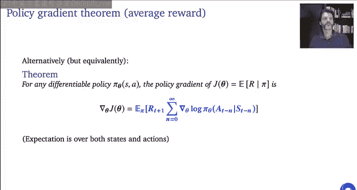

So what is an actor critic， Let's first recall what the term meant， right。

 an a a critictic is just an agent that has an actor， a policy， but it also has a value estimate。

 a critic。 And we're going to talk about some concrete reasons for why you might want test and what the could look like。

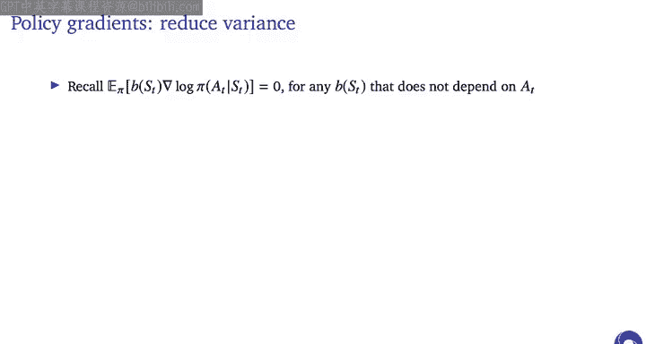

So first， we're going to basically reduce variance。

And we're recalling this property that I mentioned before that if you have any functional state B。

We are calling a B for baseline。Then the probability， sorry。

 the expectation of this B of function of state s times the gradient of the logarithm of phi will be zero for any B that does not depend on the action。

And now we're just going to reduce that use that to reduce variance and a very common choice for B is just the value of your policy。

 so we can estimate the value of the policy， we can just subtract that in the equation。

And the expectation will remain unchanged。This is useful because it means that you can reduce the variance of the updates by picking this smartly because it will vary with states。

 but it doesn't vary with actions， and this allows you to covari with Q in such a way that you can actually reduce somewhat of the variance in the updates。

So typically we just estimate this explicitly， and then we can sample the Q value。

 as I mentioned before， S multi to Cardo return。But of course， since we have V now anyway。

 we can also minimize variance further by instead picking a target at itself bootstraps。

So instead of filling in G sorry sorry instead of replacing Q pi with the full return from that top moment onwards。

 we can also do the normal thing where we take one step or multiple steps and then bootserp with a value this will bias our gradient slightly potentially especially if you bootserp after only one step。

 but it does reduce variances quite a bit and it can still be a win。

We'll talk more about techniques to reduce variance in the next lecture more generally and also especially when doing off policy learning。

 which is going to be important。For policy guidance algorithms in practice。

For now just keep in mind that this is a normal thing that people do all the time。

 they estimate value functions and these serve a double purpose。

 first you can use them as a baseline， second you can use them to Boottrapap。

So a critic is just a value function learned via policy evaluation which we've covered at length。

And we've considered Monte Carlo policy evaluation temporal difference learning andceptTD。

 you could use any of those in combination with the policy gradient algorithms to obtain an extra critictic so then the extra critic is quite simply you update the parameters W of your value function with TD or Monte Carlo and you updates your policy parameters theta with policy gradients。

But then bootsrapping for den。 So here's an example of a concrete algorithm which is a one step extra critictic。

Sorry this first line should have also initialized W rather than just theta and the state so we are in some state S and then we're going to step through time。

 we're going to sample an action accordingd to our policy。

 we're going to sample a reward and an next state we can then compute a one step TD error doesn't have to be one step right This is just a concrete instance of the algorithm which is a one step after the critic we could also have a multistep a simple difference error here order something else。

Sometimes this one se difference error is called an advantage because you could argue that this is in some sense the advantage of taking the action or a random instantiation of the advantage of taking the action that you took compared to all other actions because the temporal difference error does depend on the action that we took。

Then to update our critic， our value function， we can update the parameters thereof by adding a step size to your TD error times the gradient of your value function。

 and quite similarly， we can update the policy parameters by adding a different step size which we hear call alpha times the same temporal difference error times the gradient of the logarithm of your policy。

And this is a valid policy gradientd update except for the fact that we're updating during the episode and we're ignoring this gamma to the power T term。

 which as I've mentioned before， are two ways that you will slightly bias your policy gradientd updates。

 but they tend to work okay in practice and they're just a little bit easier to use You don't have to keep track of this gamma to the power T term and in addition by just updating online you can always update your policy already during the episode which can be beneficial if the episodes are really really long。

So this is a concrete instance of an a critictic algorithm where we have the actor。

 which is our policy with explicit parameters theta， and we have our critic。

 which is the value function with parameters， a W， which are both learned at the same time。

There are many variations of these algorithms， and there's many ways to extend them in various ways。

 but actually this。Main gist of this algorithm in some sense underpins a lot of the current day algorithms that people use。

 so a lot of deep reinforcement learning in terms of applications uses algorithms that are remarkably similar to this one。

 but just extended in various different ways。So as I said， many extensions and variations exist。

And there's one thing to be very particularly careful about。

 which is that bad policies might lead to bad data， reinforcement learning is an active endeavor。

 the actions we take don't just influence our rewards。

 but they actually also influence data that you get。

And that's a little bit different from supervised learning where we typically consider the data to be given。

 you can make bad classification mistakes or bad regression mistakes。

 but this wood won't influence the quality of the data that you can use to learn later。

In policy gradients， this can happen where maybe you make a bad decision on how you update your parameters and all of a sudden all of the data that you get is garbage。

So we have to be a little bit careful and one way to do that is to increase stability by regularization。

And a popular method to do so is to limit the difference between subsequent policies。

 we basically want to make sure that we don't update the policy too much because then we might break it and all of a sudden your agent is just in the coroner bumping its head against the wall and the data is not good enough to learn to do us anything else anymore。

So a popular thing here is to use basically this is a difference between policies and one popular choice is the COtliar divergence。

 but you could use other things here as well if you're unfamiliar with this divergence is not too important。

 the main thing to keep in mind that it's basically in some sense a distance between the old policy and the new policy and the nice thing about using a COt Liveblar divergence or something similar。

 often just called KL divergence is that it's differentiable。

It's an expectation over states of basically summation。

 or in this case I've written it as an integral because it applies to continuous actions as well。

 but you think of it as a summation over actions of the old policy。

 so this is the one that you used to have。Times the logarithm of the new policy according to your parameters divided by the old。

 so what is the old policy， it could just be your current policy。

 but in terms of computing the gradient of this regularization term we're going to ignore that the old policy is also a function of your parameters。

So that means if you're going to move your theta too much。

 then this code like library origins will grow and it will basically if you use this as a regularizer。

 it will try to keep you close， it will try to avoid changing your policy too much。

The main purpose of this slide is not so much to understand the exact technicalities here。

 but more to get the gist of the idea here， the idea is to keep your policy from moving too much and this can avoid bad policy updates。

😊，A divergence in general is just like a distance between the distributions and you could pick a different one。

 and the idea is then to simply define our objective。

With this regularization term where we have some hyperparameter Eta which determines how careful do we want to be。

 if we said ETta to zero， we're back at a normal thing that we had before。

 if we said Eta really really high， your policy will not want to change it at all。

 and for anything in between， you're just changing your policy as normal。

 but you're regularizing yourself not to change it too quickly。There's a lot of algorithms。

 modern algorithms that use this or variations of this， including TrRPO。

 which stands for trust region policy optimization by John Schulman and others。PPO。

 which is a variation there of MPO， and there's a bunch of other algorithms in this space that do similar ideas。

Sometimes directly based on the KL diversion， sometimes on variations thereof。

But the idea is basically just， oh， if you regularize yourself。

 maybe you'll be a little bit more careful with the policy updates and this might help you get enough data so that when you do make your policy updates。

 you are confident that they are moving in the right direction。

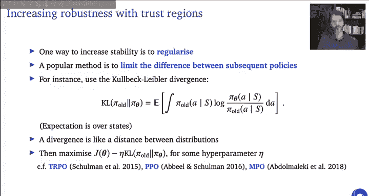

Okay， now we're going to switch gears a little bit and I'm going to talk about continuous action spaces and we can see how these algorithms that we talked are actually quite natural to extend to continuous action spaces。

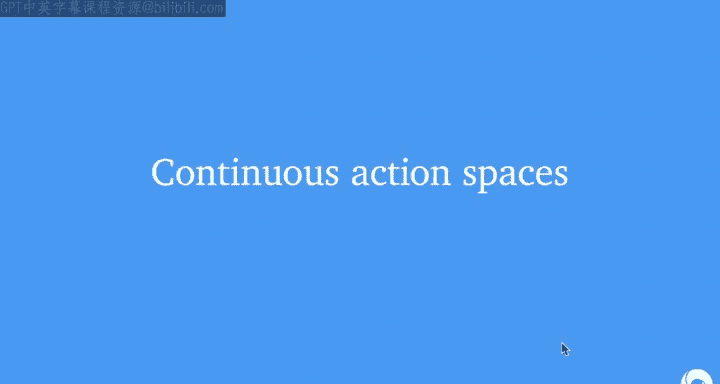

So pure value based Rl， which we talked about in the previous lecture of the law。

 can be a little bit nontraal to extend to continuous action spaces because how do we approximate the action value if the state space and the action space can both be continuous if they can just be real valued numbers or maybe even vectors。

What if your action is a bunch of motor controls for a robot， which can have real valued numbers？

And how do we then compute if even if we could approximate this， how do we compute this maximization。

 how do we maximize our actions if we can't just select from a limited set？

So there's a couple of practical problems if you will consider continuous actions。But actually。

 when we directly update the policy parameters， they are somewhat easier to deal with。

And most algorithms we discussed today， these policy gradient and acratic algorithms can actually be used for both discrete and continuous actions。

 The only difference is how do we parameterize pi。 How do I parameterize our policy。

 So let's look at an example in a moment。 But first， before I do。

 I do want to know that exploration in high dimensional continuous spaces can just be challenging。

 This is nothing to do with specific algorithms in some sense。

 But if you have a very high dimensional space that are searching in searching in that high dimensional space in general is's just hard。

 But note if your high dimensional space corresponds to actions that you're taking。

 Expation can be quite tricky。 How do you pick an action from this high dimensional space。

 That's just something that I want to mention， we're not going to go into low depth here。

 but it is an interesting research problem and an interesting issue that we' are going to have to deal with when we want to apply these algorithms that's kill。

Okay， so as an example， let's consider a concrete instance of a continuous action algorithm。

 and to do so we're going to parameteritize our policy as a Gaussian policy。

Which means we're going to define some function of state which will represent the mean of our Gaussian and for simplicity for now we can keep it at that and we can say there's some fixed variance so for if this is a single dimensional policy so we have a real valued number and that will be our action。

 the mean will just be a number， but it depends on state and it depends on our policy parameters theta and the variance will just be a number but we're going to consider it fixed but I'm just noting we could parameters this as well。

 we could have policy parameters that are not just the mean of the Gaussian。

 but also the variance of the Gausian and then you could just update them with policy gradients as well。

If we do that， the policy will now just pick an action according to the Gaussian distribution centered around that mean with the variance that we gave。

And notice I'm using muu here for the mean which is conventional。

 but in previous lectures sometimes we use mu for the behavior policy。

 so just beware that I'm overloading notation here。

 unfortunately at some point we'll always run out of Greek letters。

But mu in this case means the mean and that's just what the actor is explicitly representing。

 but note that the policy itself is random because of this fixed variance which can be larger than zero。

 so the action you pick is a random random quantity。Then what does this gra log pi look like。

 what is the gradient of the logarithm of our policy。

 well we can just calculate that for the Gausian policy this is not too difficult and if you do that turns out it will look like this where we basically see the action that we picked。

And the difference between that action that we picked and the mean divided by our variance times the gradient of the mean。

So what does this mean Well， if we multiply this later on in a policy vein algorithm with the return。

 for instance， if the return was positive。Then this would update your meanme towards the action that you actually took。

If the return was negative， it would move away from the mean first from the action you actually took。

 so we're going to sample this random action and then depending on whether our signal from the critic or from the sampling。

 the return， depending on whether that's positive or negative。

 you would either move towards or away from the action you've taken。And we can just plug this in。

 we can plug this into a policy algorithm into reinforce or into an actor critic。

And that looks like this where for the Gaussian policy， let's say we have a Monte Carlo return G。

 we're using that， we're not bootstrapping， we could also bootstrap。

 but let's just say we use Monte Carlo return， we have a baseline V because you could always use that that doesn't change and then we just have this specific term which for the Gaussian policy it becomes this as I showed on the last slide。

And then we can see that basically now， instead of just looking at whether the return is high。

 we're basically just looking， that we have a good surprise。

 right because we're subtracting this baseline。Again。

 the baseline does not change the expectation of the update。

 but it maybe makes it in this case a little bit more interpretable or easier to interpret。

That if your return happens to be higher than you expect it according to your value function。

 then you moved the mean towards the action， that's what this would be doing。Now。

 policy gradient in algorithms， they work really well and like I said。

 they underpin many of the current algorithms that people use in practice。

 but they don't actually exploit the critic all that strongly。And if you have a good critic。

 so if your value function is very accurate， can we maybe rely on it more， can we do something else？

So we're in to continuous action space， right， remember， so we can estimate our action values。

 We can still do that with， for instance， SARSa。But we can also then define a deterterministic actions so the action here is either a real valued number or it could even be a vector so it could be a multidimensional output of this function。

 so our policy is now a deterterministic policy。You're just like basically you're just plugging in your state and out comes your actions that you're going to select。

Now， theres a thing you could do， which is if you can estimate the value of each action in each state。

 which we can basically do by using SArsRSA or something like that。

 we can do policy improvements by moving the。Policy parameters in the direction of gradient ass on the value quite directly。

Because now we don't have to estimate this J function that we had before。

 which was the expectation over all states and so on and so on。

 Now we're just saying within this state。Can we improve value by taking the gradient withs of this critic with respect to our policy parameters but how does this critic depend on our policy parameters well you can do the chain rule and we can just look at how this value depends on our policy and then how the policy depends on your parameters and this algorithm basically performs gradient as on the value and it's known on various different names。

Maybe the oldest names name for this algorithm is。Perhaps slightly awkward named action dependent juuristic dynamic programming。

 It's quite descriptive but it's mouthful because the idea is that you're doing policy improvement。

 So in some sense we're doing dynamic programming， but we're not doing dynamic program exactly so maybe we could call that heuristic dynamic programming and this is the action dependent version where we have an action value function that we'reestimating This algorithm is maybe as old as 1970s。

 and it's been described and maybe invented by Paul variabless there's a nice paper by Pho and hunch from 1997。

 which also talks about this algorithm in many variations。

 one little bit of warning if you're going to look at that paper。

 The notation there is quite different from the notation that we currently use so it might take a little bit of effort to parse the paper。

 but it is a really nice paper。I personally also investigated this algorithm in the context of other algorithms at some point and Ierra just called this gradient and sent on the value in 2007 these days most people call this algorithm deterterministic policy gradient which is also quite descriptive and that term comes from a paper by Dave Silver from 2014。

And know that this is a form of policy iteration， so going back to dynamic programming。

 it's kind of an app name in some sense， because we do have this notion here of doing policy evaluation。

And then using that to do policy improvements。 But instead of doing a gratification step。

 we do a gradient step。 We can do this gradient step because our policy is。In this case。

 just outputting an action which is directly an input to this action value function。

 and that means that we can just pass the gradient all the way through the action value function into the policy parameters。

Of course， in practice， if we're going to estimate this quantity。

 if this is actually QW rather than Q pi， which we're going to have to use because we don't know Q pi。

 if we plug in QW here， then this gradient could be biased and indeed that is an important thing if you want to make these policy graded algorithms work these deseministic policy graded algorithms。

 you have to take some care that you make sure that your critic estimates the values well。

 and that this gradient is well behaved because otherwise it sometimes might just update your action into some weird situation because the critic just thinks oh if we make my action higher and higher and higher。

 I get more and more value which is not actually true， but it might be what the critic thinks。

So you have to be a little bit careful and maybe you think about some stabilizing steps。

 regularization steps， if you want to use these algorithms， but then they can work quite well。

Now I want to talk about yet another algorithm， so why am I talking about different algorithms here。

 well， partially just to give you an intuition。And also to show you that there's actually many ways you can implement these algorithms and many ways you can use them。

 and there's not one right way or one only way you could define an algorithm。

So here's an algorithm called continuoustin Actcritical learning momentumminton or capla for short。

And in this case， we're going to do something very similar to what we were doing before。

 but instead of defining the error in parameter space。

 we're going to define it in action space so how does the algorithm work。

 we're going to pick an action， this is just the output of an actor， which is again deterministic。

But now we're going to explicitly take into account exploration and we're going to sample。

 for instance， from say Gaussian policy around the action。So this is similar to before。But here。

 this is just purely considered a basic an exploration step。

Where we in some sense add a little bit of noise but we could also add very deliberate noise。

 it doesn't have to be a Gaussian， it could be anything else。

 you could just change your action in some way to deliberately pick a different action。

Then we can look at our temporal difference error similar to what we did for the a critictic。

And then we can update our value function using this temporal difference error。

 or maybe we have a multistep error， maybe we're doing Monte Carlo or something else。

 we just define our temporal difference error in one way or the other and we update our value function as in normal X critics。

But then to update the actor， we're going to do something slightly different。

If the action value was positive。We update the action a towards the action that we took。

So this is quite similar to what we saw before with the Gaussian policy。

 there is just a slight difference that we're not dividing by the variance of the expiration in a sense。

 and the other difference is that the update does not depend on our values。There's no delta here。

 there's no TD error here。And the intuition behind this is that maybe in order to decide how much you want to update your action。

 you don't want to look at how big the value is because the value will be in completely different units from your actions and if you're going to scale up。

Your values or scale down your values or maybe in some states the values are just higher than others and maybe your actor will be updated less faster or faster in some of those states than than others here instead we're just going to look at was the action a happy surprise was it a good thing was my temporal difference error positive and if so just update towards that action？

So it's a slightly different algorithm， and if the temporal difference error is not positive。

 you simply don't update， that's another difference。And why do we do that？ Well。

 the intuition here is that if you saw， let's say that you're close to optimal and you have an actor that outputs very good actions。

 but you explore around that。 then actually most of the things you could explore around that would be bad a lot of the actions apart from the all the way at this top。

 we've done gradient sense we're at the top of some some mountain in value space。

 and then we're considering an action that is a little bit away from that action。

 This will most likely be done。 This will most likely be less good than the action that you're currently than your current proposal from the actor But that doesn't mean you should move in the other direction because then you'll just walk of the mountains in any other way。

 So instead of doing a gradient in some sense here， we're doing hill climbing。

 We're just looking at which actions work。 And if they work， we move towards them。

 If they don't work， we don't know that moving away from them is a good idea We don't actually know that that will be up。

 We're just saying， well， if they're not good， we're not going to move。

And the update of then therefore doesn't depend on the magnitude of the values。

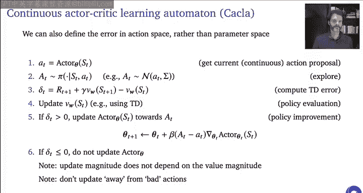

Okay， and now I'm going to quickly show you a video of this specific algorithm that's not a reason why I wanted to explain it that shows you can use this algorithm to do interesting things。

So let's go over here。Here you can see also the authors source of paper that this is associated with。

 the algorithm is not exactly the capital algorithm they've extended in various ways。

And you can see that you can thentrain these simulate it。Animals essentially running around。

Lookickets。They visualize something here you could see it could deal with several types of terrain。

 let's skip ahead a little bit。And you can see it jumps over things。Their slopes goes up or down。

It can even deal with。Gaps and such so this has been trained。

 This has been learned to do that's it's reminisccent of the video that I showed earlier as well。

 which was a different video with a different algorithm。

 but we can see these aritic algorithms can be used and very different algorithms can be used to do things like this and to learn them and it's completely not obvious how to do this yourself right if you would have to write policy。

That does this in continuous actions， that's actually very tricky。

And because it's a learning algorithm， it can also generalize to different body shapes。

 different terrains。 So that's quite cool。 This is the benefit of learning right that you can generalize in this way to things you haven't seen before。

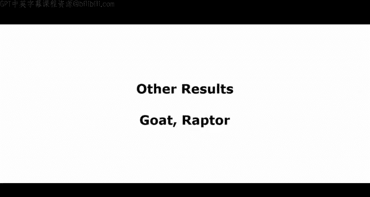

Okay， it's a longer video， but I'll stop it short there。

To the last slide， that's the end of this lecture。So as always， if you have any questions。

 please do direct them to Moodle。And I will see you at the next lecture。

 which will be about reducing variance and of policy learning and multistep learning。

 which will turn out also to be important for policy gradient algorithms in practice。

Thanks for your attention。