# EPFL《机器学习｜Machine Learning Course CS-433 fall 2020-2021》中英字幕（deepseek - P10：[10]EPFL Machine Learning Course 2021 - Week 4 part 1.zh_en - GPT中英字幕课程资源 - BV14SwyeNEvW

哎。😊，好。So hello， everyone。 My name is Nicholaas Fmario。 I'm a professor GFL。😊，In machine learning。

 my lab is TmL， It's about the C of machine learning。

And so I'm the second professor of the class with Martin。And for the next6 or seven weeks。

I will do the course。 Okay， and so today， we will talk about generalization and validation。Saurrsday。

 we will talk about bias violence tradeoff。Then we will move a bit to classification。

Then to neural networks。And at the end， we will do a bit of robust machine learning and maybe some。

Relevant question about ethics and fairness in，So I started two years ago， but you know。

 because of the Pos， this is actually my first。I'm in class， like in person at TFM。So， kind funny。

Okay， so today's， the question will really be about this three terms， you know， generalization。

 model selection and validation。 And so we will start by motivating them a bit。😊。

So what do we mean by generalization and validation？

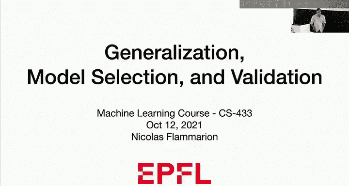

So imagine that you have a friend。 Okay， hey it is Mike。

With telling you that you have some prediction function F。And magically。

 you says that this function is very nice。 Okay， it works so well。

 you will really want to use this prediction function F。😊，And so now your question is。

 how can you trust your friend， you know？Or can you cert that this function will work well？

And what does it mean that the function will predict well？

So that's really raise a question of generalization and the question of validation。😊。

How can you validate that the prediction function will work well， will have some good performance。

And even， what does it mean to have good performance， you know？Like in machine learning。

 how can you show that you will generalize beyond your only observations that you will generalize to new observation？

So that's this question of generalization and validation we will try to answer today。

And then the second question is about model。Selection。

So you have seen in the curve that the hiificationcation problem， so which is the hiification。😊。

You know， you have like this。诶李 square。Hgression， when you went to。To fit your observation。

But you can also add an extra Ha regularization so you can add lambda times the two nu and so why would you like to add this regularization。

 it's in a way to tune the complexity of the model。Okay， you know that if lambda。

 if the I parameterta lambda is equal to zero， then you have no regularization。😊。

And you can select some very large number。 Okay， you are not constraining the complexity。

But if you take some large numberda。Then when you will try to minimize the sum。

Of your less function on the data plus the hybridization。

You will penalize the large value of W and so you would to select some I guessia W with small norm。

 okay so you have this Pahammeta lambda， you can tune to play with the complexity of your model class。

And so it will define， you know， for one lambda， you will get one solution to value U lambda。

 but if you are considering several lambdas， it will define a whole family of solution。

And so you have the question， who should you select which number that to use？You know。

 how can you pick the number。So in practice， for example。

 you can just decide you want to try between several lambda lambda 1 to lambda k。

You are using one algorithm。😊，And it will give you some prediction W1 to WK。

 and you want to find a way to decide which prediction you should use， maybe W 10。

So how can you select the good parameteretlumda？This is really the question of the model selection problem。

 Okay， you want to select which model to use。And this is not only for heat regression。

 that's also when you are doing， for example， prenomial feature expansion。😊。

I think we have seen that in the exact。If you are doing some basic inner regression with two features。

 x1， x2。This will only give you linear prediction， but maybe you want to enrich your class of problem。

By augmenting your features with some polynomial。So， for example， you can consider x1， x2。

 x1 square plus x2 square。Also you can consider x1， x2，5 x1 square plus2 x is square and so and so。

We have a lot of different augment you can consider。 And then the question is。

 which augment should you select。And so here， the I parameter can be the the degree of the polynomial we will consider okay。

But you really see that in these two problems， that's exactly the same question you want to solve。

Which is， how can you select the IP parameter of your model。And maybe you can think that， okay。

 this is not so interesting because that's only about retro regression or polyomial feature expansion。

 but like in modern and machine learning， this will not be useful。😊，And that's not true at all。

So if you consider neural networks today， and I mean， we will talk about them in a few weeks。😊。

When you are trying to train a neural network， you will have to decide for a lot。Of is。

We will have to decide which algorithm we want to use。Are you using stochastic gradient descent。

 Are you using Adam， which step size you will use， which batch size you will use。

Are you adding some momentum？And which architecture of neural network you can use。

 we will see all of them， but you know which depth， which I mean， which widths。

Do you want to add batch normalization， And even do you want to add some extrareization。

All this question will have to solve them and they arere related to the model seduction problem。

And so what we will see today is， you know how theoreticalically you can define a framework in order to reply to this question。

😊，But in order to reply， I mean to this question， we have to， you know。

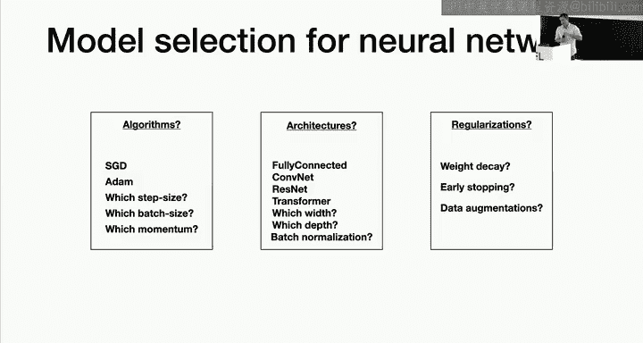

To define like a data model， I mean， a probability6 setup。And so it's important to have in mind。😊。

That you know in practice what you will have is that you will have some observation and then we will put a model on this observation。

 we will do some assumptions， and then we will dehive some result under these assumptions。😊。

But maybe in practice， this assumption won't be verified。

 and so you have to be careful about this fact。Okay。

So what is the model we are considering is maybe like one of the simple one。😊。

Is that you're assuming that it exists Some description D。Which is unknown。 Okay。

 that's very important。 You don't know D。But you are observing some samples from D， okay。

 you are observing a data set。X 1， Y， I mean， X， N， Y， N the n between1 and n。

And what you' are assuming in the data set is that the data set is independent and identicalally distributed according to D。

O。So that's really a very simple model。 but what you have to。To keep in mind。

 what are the important fact is the first one is that you don't know the， Okay， you assume it exists。

 but that the only knowledge。I mean， the only knowledge edge you have。

 but D is who the samples you are observing。ok。Then D is with the hand x。Times y。 So for example。

 x can be a vector and can be a mattress， It can be a picture。 It can be movies。 It can be， you know。

 anything you want。And you know that why can either be， for example。

 some real number if you' are doing some regression。

It can be maybe minus one and one if you're doing classification。手机是。You have already seen it。

And so it's very important to have in mind， you know that this assumption。

The fact that the samples are independent and I mean，ticity distributed according to D。

 these are very strong assumptions。But in practice， maybe they will not be very。O。

It's not obvious that all your observation are independent。

 is it's not obvious at all that they are following the same law。For example。

You could have some distribution shift。And like the evolution， I mean， the distribution D can ever。

 I mean， can changendrick along the time。You know， if you look at some pictures from the 70s。

 they won't look at the same as picture from today。So this is a strong assumption。

And you have to take it into account。ok。And in addition of that model。

 we are assuming we are also assuming that we have access to a learning algorithm。Dode by a。

 And so what is a learning algorithm， It's something which will take an input to data set S and as output it will give you a predictor function F of S okay。

So， for example， in a hidden regression， you have seen that an algorithm can be the least qua solve where you are directly。

😊，I mean， minimizing your function， it can also be the output of optimization algorithm。

 it can be the output of running gradientn descent on your square loss or running stochastic and in descent on your square less。

So this is what we call the learning algorithm。And just for a notation， when this learning algorithm。

 when the problem depends also on a parameter， we will add this lambda。

As a substrate in order to define the function。Learn on the dataset set S with spanda。

So that's the probabilistic setup and with this probabilistic setup。

 we will be able to reply to the first question。

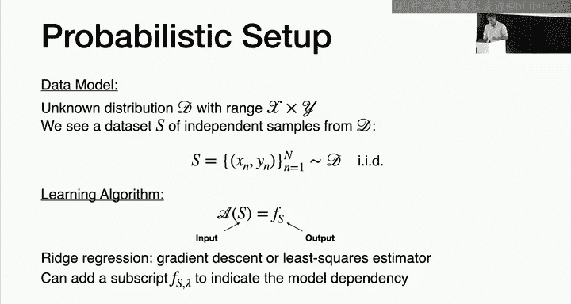

Which is， hook can I。What does it mean to say that a function is doing some good prediction？

And this will be the concept of the generalization error。Okay。

 so the generalization of is really how accurate will be your predictor FS in order to do some prediction。

😊，So what is the definition of this expected is very simple。😊，You take a less function L， okay。

And so your last function will take。To real in input y and y prime。And what， you know what you。

 what I mean， how it will work is that。If y and why prime are closed。Since the lu would be small。

And if y and Y prime are very far away， then the loss will be very large。Okay。

 so you have some example， by example， the squareless。You see that if y and Y prime are very close。

 you will suffer a low square loss， But if y and Y prime are very large。

 then you will suffer very largeness。 Okay， and you have also O S function。We are using for。

Okay great， I mean， for classification， such as the logistic loss， the inch loss。 I mean。

 we will talk about them later。 And also for regression， I mean。

 you can use other loss functions as a square loss。 You can use like the absolute value。

 You could use some robust loss。 You have a lot of。嗯，配的配。Okay。

 so when you have defined your last function。What you will like to compare is that how your prediction F of x differ from the true value Y。

 Okay， so this will be you will consider the loss。Of y and F of x。If you are doing a good prediction。

 if F of x is close to y， then the lu between y and F ofx will be very small。

And if you are doing some very bad predictions， then this will be very large。O。

And then what are you doing you are taking the expectation。😊，According to your distribution D。

 according to your distribution of the samples。O。So you see that the expected there。Is really。

 I mean， the expected that is like。How much you will suffer in average age。

When you are considering samples。Coming from the two distribution。

Something else you have in mind which is very important。Is that the expected error is a number。

 You see， it's really like。Something like 0 to 5。To， I don't know， but it is a number。

We will see why it's important later。Okay， and also in the literature。

 you have a lot of different name。 You can call it like the two race。

 You can call it the expected race， the expected a expected less， so you can。

Play with all this world together。 I mean， always refer to the same concept。

But you have to keep this in mind。And so what is important is that really you see that this object to the expected loss。

😊，Will really help you to measure how accurately an algorithm is able to predict。And that come。

Then this is really what， I mean， what we're interested in。

So who you would like to find a good function F。You will just like to minimize this quantity。

I it care for you。Like the best F you can offer will be the prediction F。

 which will minimize the expected error。But there is one major， I mean， major issue。

 There is one problem。 you know why， why， why why are we doing？All these curves。

 why do we have all this algorithm， why aren't we just minimizing this expected loss？Yes。😊，Exactly。

So as I told you， you don't know D， so it's not possible to compute this expectation。ok。

You just have access to some samples。So that's a major problem。 You don't know。So instead。

 what you will do， do you have an ID， you don't know D， but you have access to some samples。

How can you approximate this expectation。哎，好。Yes。So that would be to test。

 but no you just want to know， you don't know how to compute this true expectation。

I give you some data x1 to XN， Y I to YN， and you want to find a way to approximate this expectation。

So what can you do？喂。Exactly。So that will be what we call the MPical。😊。

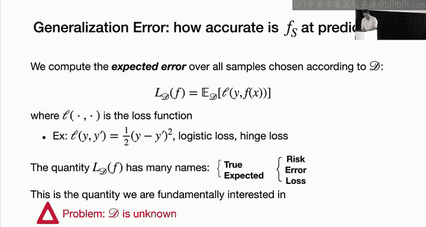

And that's exactly that you will approximate the2 year， I mean。

 you can't compute it because you don't know the distribution D。

 you will just take the average age of your loss on your data set。😊，Okay。

 and so this is what we'll call the O co。 You see that's exactly the average of my loss on my dataset。

So here also you have a lot of different name。 you can call it。

And what you hope is that this will track well your approximation error。

And so you see one first major difference with the two risk。Is that this is not anymore a number。

The NP error is a honda variable because it is depending。On your data set S， which is honda。Okay。S。

 your data set is honda。So when you are taking the average age over the Hom samples， you。

 you obtain a hom variable。ok。And so when we have a hom variable and we can say that what we hope is that this Honda variable will be close to the two risk。

😊，The first thing we can try to compute is we， we can try to stack the expectation of this random variable。

And when you take the expectation of the ho variable。😊，If I'm taking here。It expectation。

So expectation， you know， is linear， so when you have expectation of the sum。

 it would be the sum of the expectation。😊，And then since all the Y N and the X N。

distributed according to D。This will exactly be。When you' are taking the other will be exactly yourha。

 Okay， so you see that the on Kha is really what is called。😊，N bias a of your2。

And so since it is an unbi seimator， if you take more and more samples， okay。

 if the number of samples you have access to is going to infinity。😊，Then。

The empiricalical risk will conge to the two risk。And so what we will have to do during the course is today is really to control the fluctuationration。

😊，In expectations， the Opera is giving you a good result。😊，But then we want we will， I mean。

 we want to control the fluctuationration， we want to control quantitatively。

Who far away they together。Okay， so we have seen the twoyhu。Which is the expectation of the loss。

 According to your distribution。 you don't know。 You can't compute it。

 You will approximate by the empirical vehicle error while you are doing the average of your data。

But there is still one problem。So in practice， you have a data set。

And you are using this data set in order to construct。Your prediction function， F F S， okay。

And now you have this prediction function F， which depend on your data set。😊。

And you want to approximate your error for this prediction function。Do you see why it's not possible。

To use directly the， What is the problem。Okay， so you have your function F， it depends。N S。

And then you will take the other age。Over the same data set S。Where is the problem。Exactly。

So it will not be any beyond earned by aimator。Okay， because you see that if。he。

Your prediction is depending on S when you take the expectation。

It will not give you the2 because you will have some dependency。And so this is what is called。

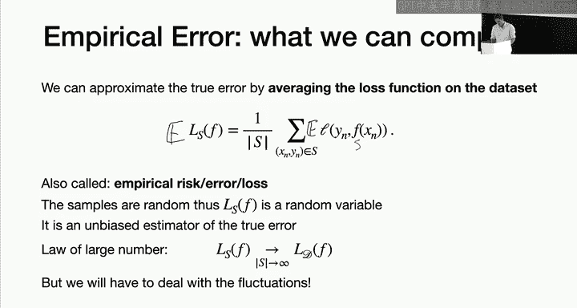

It's tiny也好， okay。So。When your prediction function， F of S is itself a function of the data。

This is and we take the average over the data， this is what is called a training error。😊。

And this will not be an unbied estimator of your tool error。

 but in practice what you will do with this training error is that it is the objective that you will minimize in order to find your prediction function。

 Okay， so the training error is really what you are mini I mean， mini。You are taking your data。

 you compute the train， you handle an algorithm， which will minimize this train how。

 and it will give you。A prediction function。ok。But the problem is that you see that this train error error。

It will not be a good approximation of your tour。And often， that's a poem of overfitting， you know。

 I mean。If you'd fit too well， if you really drive this training error down to zero。

 it does not mean that your that your prediction function will general as well。

It does not mean that your prediction will have a good tour。

So these two object training error and two errors are really different。Okay。

 so that's very important to have in mind。 It's not representative of the error you would see on fresh numbers。

Okay， and why the reason is because of of refuge。So just to start again a bit。 So we have。

Since three objects， the first one。一是涂伟豪。That's the expectation of your loss over the data。

That the object you really care about。That's the object you want to minimize that the object which which say how well you are predicting。

But that the object you can't compute， you don't have access to it。And so instead。

 what you will do is that you will use。😊，Some data in order to approximate。呃This2 by the号。

So in practice， if I give you a function F。You can compute this generalization performance using some data。

By computing the imppe layer of this prediction X。But the problem is， if the function F。

As been compute using S。 Okay， if the function F has been compute minimizing the training error。

You will not be able to use the same data in order to evaluate the performance。

So do you see what we can do， what will be like maybe the most basic ID yeah？Exactly。

So what we will do， we will just split the data set into。

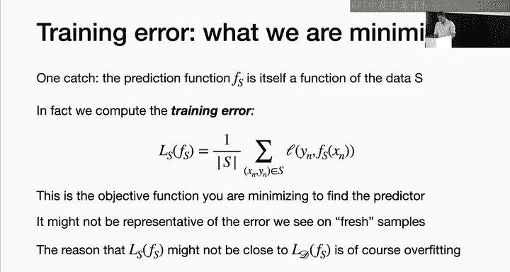

ok。😊，So I give you some data can be anything some you know pictures and you have some cats and you have some dogss and you want to do a classification problem。

What you will do。You will split your data set in two， you will use one part of the data set。

Which we call the train set in other。To learn your prediction function。

And then you will use the second part of the data set in order to validate。Your prediction。

So what is important is that you are splitting the data set。😊，In two independent parts。 Okay。

 you need to have。As trained and S test to be independent together。And the。So so that。

You have a training set， a strain， and you will be able to learn some function F of a strain。

And this function will be totally independent of your test set。

And so you will be able to validate this function FFS strain。

Using your testing set and computing the OI Caliher。And the test。O。So since this， I mean。

 this is what I'm telling you since the test set and the train set are independent。在安边嘅你好。

Of your function， learn using the train set。Will be close to the two好。It will be earned by a。

 and we will be able to control the fluctuationration。ok。

So you see that by splitting the data set in two independent parts。😊。

Were able to solve the previous problem。You have some question？哎。

What do I mean by controlling the filtration？So we would sit in fruit style。

 what I mean is that you won't。Not only to say that these two objects are close。

 but you want to be able to say how close they are pretty easily， okay？So we'll have， I mean。

 some quantitative result， which will tell you that if you have enough data。

This number and this number will be close together。Those our questions？行。

Why do you need the independency and the sample。And not only the same。

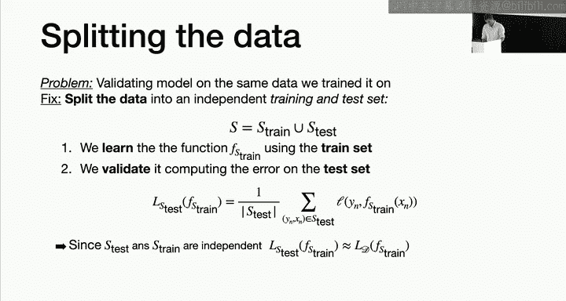

Distribution。

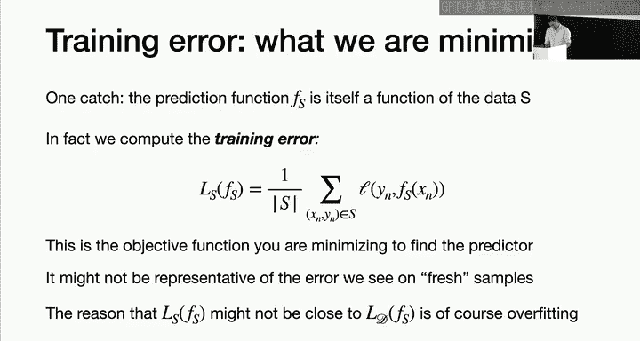

I mean， that's， I mean， that's very important。 That's a。By commodity， but I mean。

 that's so that right now we are not seeing it exactly。But we will come back to it later。

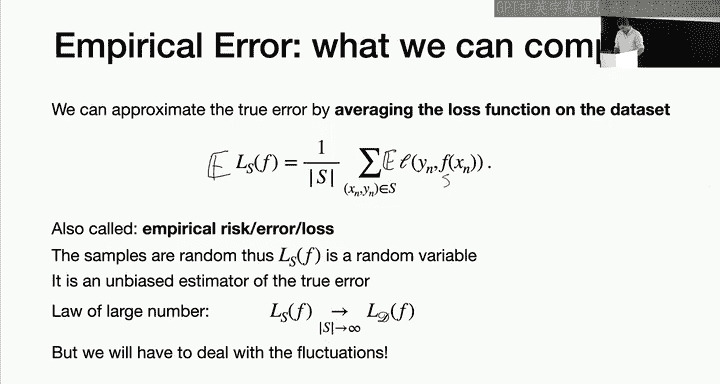

ok。So but you see there is one also issue here since you have split your data set in two。

You have no less data both to train your function。And to learn。ok。If I give you 1000 pictures。

And you split it in two， you will only learn on 500 of them and you will only test on 500 of them。

 okay。And also you will have a trade off， you know， I mean， you don't have to split it in two。

 maybe you can split within different numbers and you will have to decide how to split。

so this is also something you will have to decide。Okay， so now what we will try to do。

 we will try to dehive some precise quantitative result and to control the ftration。

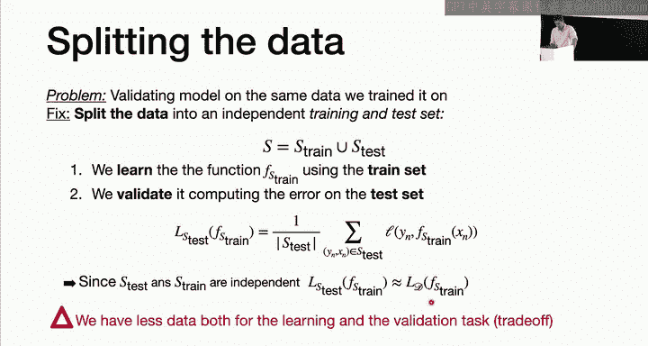

So this is what we are doing here。So guess we are。Getting back to our original question。

 you have a function F， I give you a data set a。😊，You suppose that F is independent of S and what you want is that you want to assert how good is your prediction F。

ok。So you want to。Computer啊。But is2， I mean， you have does do know that it's not possible to compute。

 so you want to get a bound on your2， okay。What you can compute is your MP callele。

 so you want to be able to say a far away as a2 from the MPele。But， as I told you。

This on col it is a ho variable。 So it will not possible just。Do you have a bound？

What you will need is that you will need some probabilistic statement。

And so you could have up for some almost your statement， but it will be a little bit too much to ask。

 so what we will get is a probabilistic statement， we will control the probability that the two L Honda variable close up far away。

😊，Okay， and byes。What we will get is that we will get a upper bound。案这拖了。

So this is really what we are looking about， okay。对。Okay。

 you don't understand why we need this assumption。Okay， I will， I will come it。Okay。

 so what is your result？😊，We will be able to prove today is that if I give you a function F。

And I give you a test set as test coming from D， and which is independent and identicalally distributed from D。

😊，And also， you are not using S test in order to learn the function F。

And I give you a less function L。And it is very important， this last function。

It has to be bounded in A B。 So you see that， for example， it will not directly apply to the squares。

Without any additional assumption。But I mean， you will be able to use this for the square less because you could assume that your x and your y are bounded and it will go to the same。

And so what you are able to prove is that you are able to control what is called the generalization error。

 So what is the generalization error that the distance between the toolsrs。😊，And the Tela。

And so you will be able to show that。😊，With high probability， the generalization error is small。Okay。

 you will show that the probability that the generalization error is larger than some constant will be smaller than some constant。

Okay， so this is a probabilistic bound。So what， I mean， in some sense， what does it mean。

 it means that。This is another age。And this is a mean。Of each1 variable。 And so you see。

 it's really like a concentration result。 It is saying that。So I mean。

 the O could average age concentrate around this mean。So this is what we call concentration。Okay。

So now， let's try to analyze this bound a bit。 So first one。Is how many samples do we need。

 So what you see is that。The number of samples， okay。So for example， if we call it n。

It will depend as one over square root of n。So that's mean that if you take four times more samples。

 then your bound will goes down by a factor of two。So that's not too bad。

And then the second question is how small you want the probability to be okay。

 so in practice you want you know Dlta to be kind of small because you want this probability。

To be small because you want the probability that your generalization and how it small to be very close to one。

And here you are very lucky because you see that the dependency on data and Delta。😊。

Is only in the lockdown。And you know that logarisms are very small。😊。

So you can take delta to be very small and still this logarismm will be very small。😊，O。

So it's really easy to get some very high probability bound。So we see that we， I mean。

 we had to do some assumptions。 The first one are the I1， which would be， I mean， needed here。

And the second one。Is that the loss is bounded and you see that the bound of the lu really appear。

In the bound。所以。远的太平。This assumption。Or if A or B is going to infinity。

 you see that the bound becomes vac。Okay， so it's really like a strong as I'm but you will need it。

And so N what is really kind of like the conclusion is that the more of data you will use in order to compute your test set。

 I mean， to compute your empirical Ks。😊，The more confident you will be that you have a small generalization error。

对。是。You choose Delta， imagine that you want you know to certify that with probability smaller than 0 do01。

The generalization loss is will be larger than something。You pick Delta。

And then you compute Ken of your certificate。ok。So Delta is really's up to you。

 but you see that if you take Delta， there is small。

Then this quantity will be larger and if you take delta to be a little bit larger。

So if but you can take Delta since it's only dependent on the log array。

 you can take delta to be exponentially small。O。So for example。

 you can take Delta to be exponential minus D， which will be like almost0。

 and then you will only have to pay。呃啲 here。对。Okay。当别必须。For a data set and 70% folks， 30% cat。

Should we make it how or should we just use that one as。I mean， this is。Now， they have to train。Yeah。

 you can always try to。Yeah， there's a data set， but you can， we have to try both， I means that。

Easy to answer Jackie。Okay。😊。

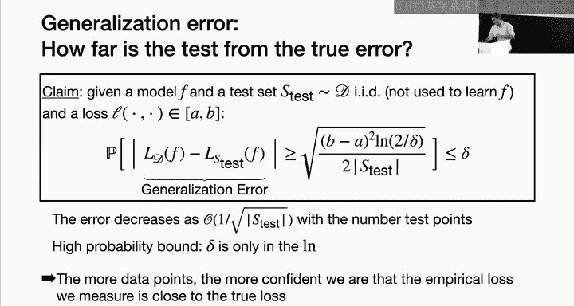

So no， yeah， I think what is important is like， why do we care about such a bond， really， like。

 how can you use it， How can you use this。Concentration bound。 So the first way to use it is。

If you have a predictor function F and you have a data set S。

So what you want to do is that you want to。Compute， you know the tools。

So this is what you are caring about， LDF F。But this object， you can't compute it。But instead。

 you have the O Ls， L S of F。And that one， it is totally possible to compute it， okay？

And so what you will do is that you will use the previous result to say that it is possible to control the probability。

That。The toolsrs will be larger than this， which you can compute plus deviation。

 you can also compute。So using the previous results would be possible really to obtain a probabilistic power bound on the true risk。

And you can also do exactly the same if I give you a data set。You will split the data set in 2。

You take one train set， one test set， you will learn the function on the train set。

 and you will validate on the test set and you can get the same result。

So what is important to have in mind here is that you will use less function， I mean。

 less samples to train and less samples to validate。So in that case。

 the deviation will be larger because you have used less samples and often it will be less tight。

So how can we prove these results。So what we， I mean， we will kind of simplify the problem。

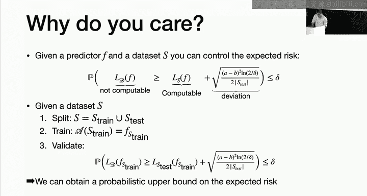

So we are taking our samples Xn and Yn， and Z independently。

 and so what we will do is that we will denote the loss between Yn and f of xn to be theta n。

And so what you see is that theta n is some independent Ho variables with value in A and B。ok。

And so what we want to control， we want to control the distance between the ammbicalus and the Tuluus。

And you see that in fact， the Obe loss is just the average age of this datata n okay？And the tool is。

 it is the expectation of Tita n。So what you need is that you need some mathematical result which will control the distance between a numericalical expectation between the average age of ho variables and themin。

😊，And this is really what is called some concentration inequality。😊，Okay。

 and so using some concentration in equality， we will be able to control the probability that。

The NBA calls deiate from the rulers。

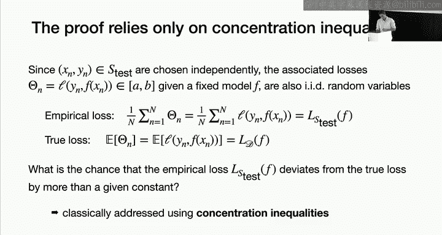

And so the concentration inequality we will use， it's called the E inequality。😊。

We will maybe prove it at the end of the lecture if we have enough time or I don't know。

And so what is telling you of Ding is that you just。😊，Something very honda is。 I mean。

 very general is totally is not directly related to a problem。

 If you have a sequence of I D hom variables， Tita I to tita n， Tita1 to tita n。😊，So just。Okay。

 they have some mean expectation of Tita。And you assume that。The range is A B。 Okay。

 they are between A and B。You can prove that。Sportability。

That's the distance between the average age。And the expectation is larger than Epsilon。

This probability will be smaller。Then this constant， which will depend on n， the number of samples。

 epsyon， which is your precision。B and A， which is a range of your Ho variables。Okay。

 and this is too for anyil。So this is what we called， as I told you， a concentration bound。

It's really telling you that the empirical code mean。Is concentrated around the to。

And you see that using these concentration results。It will be possible when you apply it to tita I。

 which is equal to the loss between Yi and F of X I。Then you just have to。

Equates this two quantity delta to say delta will be equal to this。

And this will give you the value of Epsilon。ok。So you get this value of Epsilon。

 and that's exactly what you wanted to prove。😊，So you see that the previousous result I show you。

 iss a very direct co of the inequality。😊，Is it clear how you go from adding to the consultation。

 I mean， to the previous results。这是。Simple。Computation。Okay， so everything。一次。

You fix Epsilon and it gives you the probability。What we wanted。Is that you fix the probability。

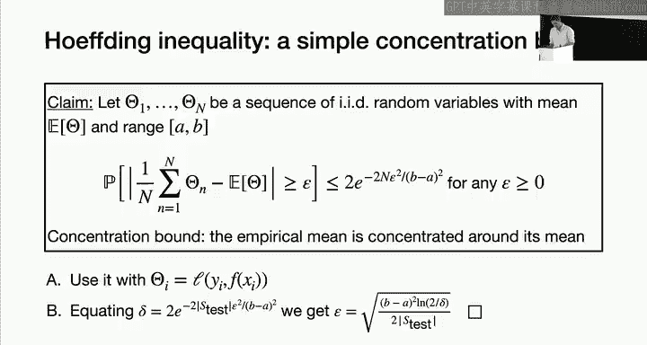

And it give you the Eilon。

So， this is exactly。What we are doing。You fix Delta。To be equal to this。

And this gives you the deviation。ok。So that's really answering the first question we had at the beginning。

Which is。No。If I give you a function， F and a data set has。

And you want to be able to certify how good is your prediction？

You use the previous results and it will give you a certificate。You will be able to say that。

 with high probability。You will be able to compute the toolrs without probability。 Okay。

 you will be able to say the toolrs is smaller than some number with some probability。

We will be able to say that the tools will be smaller that I don't know，0。5 with probability 0。

9 something。But we also had a second question。

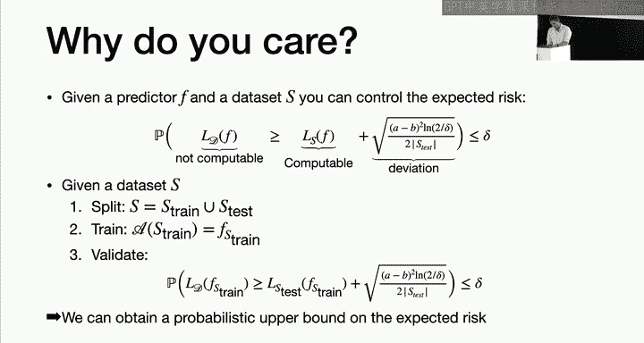

Which was about model selection。O。

So you remember is that you have some IP parameters for your model， for example。

 lambda for it regression。You have a lot of freedom how to pick Lada。 You can try civil values。

 Lada 1 to lambda K。 and you want to find a way。To pick the best one。

So that is a model selection problem。Which is really。You know which IP parameter you want to select。

So we have a set of value lambda k from k equal 1 to k。And you want to find a way。

To pick the best one。So what you will do。Again。You will split your data set into a train set and a test set that's the first step。

Okay， and S strand and S test are both generated independently from G and are independent together。

So now what you will do is that you will learn your learning algorithm K times on your train set。

So you will learn W1 to WK on the same train set， Okay。

 you are using the same train set and you are using， I mean。

 and you are learning K different prediction function。And then what you will do to okay。

 we have all this function。😊，F S strain lambda 1 to F S strain lambda K。

And now what you will do is that you will use your test set。😊。

In order to compute the MPA on the test set。So for each of this function。

 you will compute the empirical， I mean you will compute the testla。

So you see what is important is that。😊，You are using the same trainet to learn all your function。

And you are evaluating this function on the same test set。ok。

So you take some samples to train some samples to test， but these are the same for every long decade。

And so then how do you select the best value Lada？You will take the one。With the smallest。Dday好。ok。

So let's do it again before the， the break。You have K parameterta da 1 to lambda K。

 you want to pick the best one and I give you a data set。First， you split that to。

You take a train and you take a test set。On the train set， you will learn K difference functions。

F S train numberda one to F S train numberda K。And then you use your test set in order to compute the empiricalical expectation on this test set。

 the same test set for all your function。😊，You look at your can on birth。

You take the parameter with the smallest。呃，戴是对话。Okay， after the break。

 we will see why this makes sense and how we can derivehi some theoreticalical results。Okay。

 so we do a break of 15 minutes， I think Okay， we will start again。Please， everyone。Okay， so。

During the break， I really add like。Two questions， two important questions。The first one。Was about。

You know， when we split the data set between the train set and the test set。How do you decide。

 how you split it， How do you decide if you do 50，50，2080， you know。

Then that's also another I parameter。 So what you can I mean intuitively see is that the more data you have for the train。

 the best function you will get okay。You know that， you know， if you want to train on something。

 this has to be large in order to get some good results。But on the other hand。

 if you want to be sure of your prediction， if you want to be sure of your validation。

 you also need a lot of data in order to test。So that's a trade off。And I mean。

 you will see in the exercise you will have to play with it， and that really depends on the problem。

Then the second questions， which seems to be very problematic。

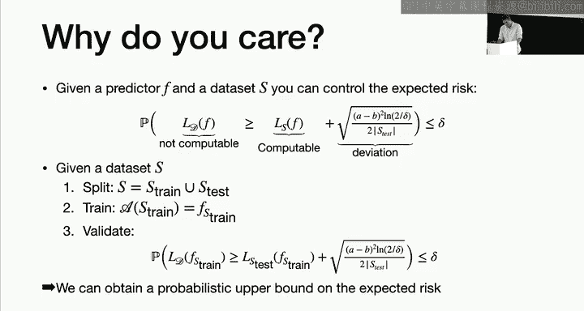

We have a lot of few was。This assumption on the loss。

What does it mean that we assume that the loss L is bounded between A and B？O。

So what does it mean first？For some case， we can assume that maybe the function L will be bounded。

 okay？For every y and every y pine。L of y and Y time will be smaller than some quantity。Okay。

 imagine that it was like the classification loss and this is always0 of1。

 then this is bounded and you are fine。😊，Then for some other problems。

 maybe this loss will not be bounded。 So as I told you if L。

Of y and y prime is equal to 1 over 2 times y minus y prime squared， so if the loss is a square loss。

 then this is not bounded。If y is equal to0 and y prime is equal to 10000。

 then this will become very large， okay？And so what you can do。

Is that you can see that when you are looking for。Creation problem。So the lu between why。

An x transpo beta。Okay， so this is1 over two times y minus x transpose beta squared。

And so this will always be bounded by。Y squared plus the norm of beta times the norm of x。

That's some basic inequality， I'm just using kish spots。

So now if you're assuming that your features are bounded， for example， you know。

 these are some pictures。Typically， it will be bounded and you will be able to compute。啊喂。

You will be able to compute。OK， to这个表。😔。

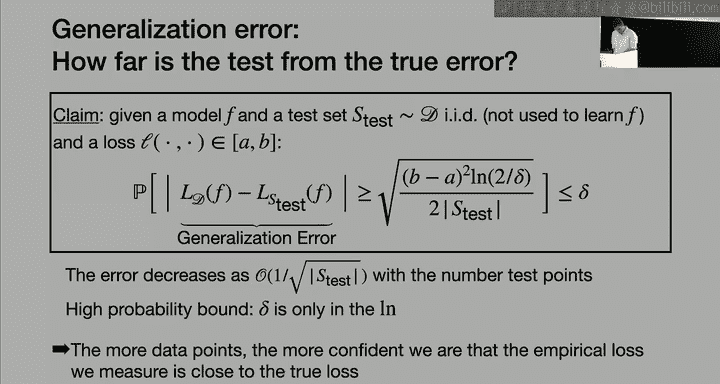

You will be able to compute。Ts are sorry。 so we say that the lu will be smaller than y square plus nu of beta times the norm of x。

😔，So typically x will be bounded， you will be able to compute it。Beta， that's a prediction。 You know。

 you know it。 It will be bounded also， and maybe Y are bounded to。 So in practice， it will be able。

 it will be possible to compute this A and this B。O。So okay。

 beta I was considering I was doing some millna regression。

 so F of x was equal to some beta transpose x。Okay， Peter is a vector。真的。What。😮，Yeah。

 I give you a function F， So I give you beta。And if you want to train your problem。

 you will learn be， that's the navigation。ok。😊。

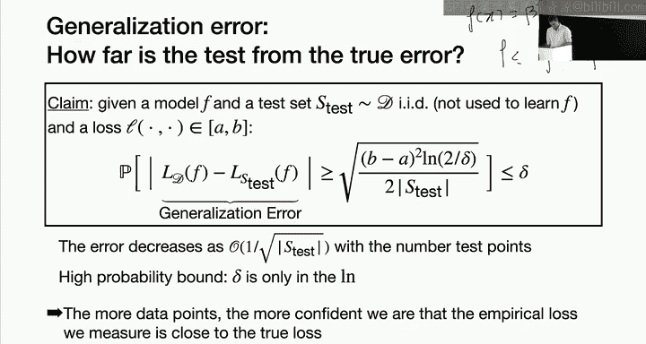

So yeah， so we were talking about model selection， so we have some parameter lambda， for example。

 the parameter for hydro regression。😊。

Tunning lambda will help you to， you know， select the complexity of your model class。

 You want to pick which lambda you should use。 You have multiple parameterham。 This will give you。

I mean， you have a multiple way to do。 So what you will do is that you will。Split a test。 I mean。

 we split S between a train set and a test set。We have seen all this before the break and so now the question is why you know why this will work。

So first we can see some example。So here this is a classical irification problem。

 and I'm approaching two different curves。😊，The first one in blue。Will be the trainer， okay。

So that's what you are minimizing。For every parameter long down。

You will compute the best W lambda K by minimizing the train error。

 and this is you will be able to compute this numbermda。And then you have the test here。

So this is the number you are computing on your test set， so for every pahamme Lada。

You will compute the average age of the loss of w lambda k and your test set。

And so there's a question you want to do。I， I mean。

 the question you want to solve is which Pahamme Alamnda should I pick？😊，And what you will do。

 you will pack the parameterhammeter with the smallest test， So I think here it could be maybe。

This one， okay。再 tell you温。And what is kind of interesting is that you see that this parametera。

Is not the one which obtains the slowest， I mean， the smallest train error。O。So you see again。

 that's not a good ID if you want to select， I mean， if you want to do model selection。

You should not use your train in order to select the model。Because you see that。

 if you are using the。Tinet， you will take lambda is equal to zero。

Whereas when you are using a test set。You can pick a good loandown。

 which will give you a higher train set， but。With the hope that it will give you a better forever。

And we can do exactly the same when we were doing some polynomial feature expansion。

For every degree of the polynomial， you can compute both the train。And the test and here again。

 you will take the value， I think will be maybe three。Of the poum。Pomil， who has the smallest。

Thats still， okay。So you see this is what you will do in practice。You will split mean。

 you will split your data set between the test and the train。

 you will learn your function on the train， you will then compute the test。

And you will pick the parameter with the smallest value on the test。Is it clear。也。😊，Oh。

 that's the wrong title。 we will talk about it Thursday。O。

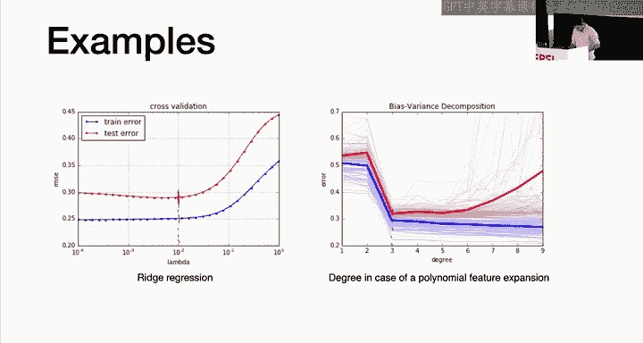

So now the question is does model selection is working on I mean is it working on that。

 so here you have two questions。So the first question is， how do you know？

You know that the function X strain of lambda with the best lambda。

How do we know that it is a good approximation。How do we know that it is a function。

This is a good approximation of the best model in our class。😊，And this。

 we will talk about it Thursday。Know what we want to see。Is that how can I be sure that。My test her。

Is close to my close to my to for every of the F S strainer from that。So previously。

 we have seen that in the case of a single model。But now I'm using the same test set for Kdian models。

So we， I mean， we need to have a new bound， we need to have a bound which will control the probability that for every k。

The two， I mean， the test will be close to the two way。Okay， so we will try to， I mean。

 to provide some justification that。If I'm taking。The lambmbda said that the test is the smallest。先。

I want to be sure that this will give me。A long does that。这是图，你在我做什么？Because at the end。

 this is what you care about。Did itK。Maybe I can do it again。

What you would like to do is to be able to compute the test to compute the test error for every of your Pahammeta lambda1 to Lada K and to take the one with a smallest test。

 I mean， with a small smallest2 error。 Okay， this is what you would like to do。

But you can't compute the to。What you can do instead is approximate the 2 error by the on period。

So now you have all this approximation and you can take the one which is smallest。Ter。

 So what we want to be sure is that how can I show that the parameter， which we have the smallest。

这嘢好。Will be also the same or will be close to the parameter。With the smallest three。

 which is really what you care about。So let's see how we can prove this。

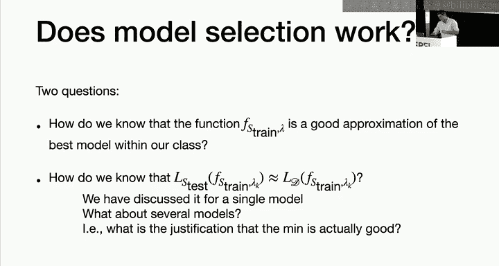

So the question is how far？it。Of the test they half for every of the pame。From the25 of the Paham。

 Okay， this is really the quantity we want to control。We want to control for every parameter。

就质ization那会。So what does it mean does means that we want to have a bound on the maximum generalization error。

We want to say that the maximum generalization error。😊，Won't be too large。I mean。

 the maximum generalization therefore will be larger than de。 I mean。

 thats some deviation with a small probability。And so what we see。

I's really that we have the same bound as before。The only difference now is that。

So K is inside the log。So that's very importantPrevious。

 you were testing only one parameter and you were able to control the distance between the toolsrs and the testla for one parameter。

Now， you are able to control the distance。Between the two and the testless。

So the generalization error have forK defense parameters。And you do so only by being lucky。

So you see that it will be possible to test。A lot of A parameter。Without being too much。

 and that's very， very important。O。K can be very large。

 then the deviation will still be small because you're only paying log of K。

And in the lecture or not you can read， you will see also that you can extend this to infinitely many。

Models not only2 k finite， but it's possible to extend this 2 k and finite。Okay。

 so you want to call the maximum deviation。Because this results。Will give you that。

 with high probability。So maximum deviation will be small。And if the maximum deviation is small。

 that means that all the deviations will be small。😊，So that means that with I probability。

 you will be able to control that for every k between1 and capital k。😊，The generalization error of。

 I mean， compute for all of your parameter will be smaller than some deviation with eye probability。

I it个。Okay， I mean， that's the same assumption as before， we need to have a bound on the loss。

We need to have a independence。

So how do we prove this。That would just be like a simple application of the previous proof。

So let's do it。What we want to prove is that the probability that the maximal deviation is larger than epsilon。

So， you see that。If the max。Is larger than eilon。Then， I mean。

 this is a smaller event at the fact that。All the deviation are larger than epsilon。

So the probability that the max is larger than Epsilon is。

 of course smaller than the probability that all the deviation are larger than epsilon。😊，就在这个里。

And then what you will do is that you will do what is called the onion bound。

 You have some independent event。 So the probability of the onion。

Is smaller than the sum of the probability。Okay， this is what is called the union bound。

And now we only have to control this probability。😊，But this is what we have done。喺院室里。

We have already compute， we have already compute bound and the probability that the deviation。

Between the two and the Tela is larger than Epsilon。So you see that。Each of these them。

Will be smaller than two times。This quantity。And since you are sending K of them。

 you just get okay fact O。O。So then it's possible to show that the probability that the maximum deviation is larger thanyon。

Is bounded by this quantity。And what you have to do is just you are。

Doing Delta is equal to this quantity。You are invering and it gives you a good appilon。

So you see that the proof is exactly as before。You are just using。He in you un帮。So what is important。

 I mean， for you to be clear。Is how you go from here to here。And then this is。Simple。

Is it clear for everyone that the probability of the max is smaller than the probability of the union？

爱民。搜索破ability机。You know， the max to be larger than epsilon。SoThat means that it exists 1k。

 let's say k0 said that the generalization error for k0 is larger than epsilon。😊。

So you see that this event is strictly include in the event that for every key。

 the generalization a is larger than eachil。😊，So since this event is included in this event。

 the probability of the event will be smaller than the other probability。ok。

The event I is included an even B then probability of R is smaller than probability of B that'。

啊另外涂押对应下。And then you are just using that the probability of an union of independent event。

It是 equal就这 some of the probability。嗯嗯嗯嗯嗯嗯。都给着。What I was saying is not two。

All these events depend as test， they are not independent at all。ok。They are not independent。

 but you do not need independence。 You just need that the probability of in is smaller than the sum of the probability。

Okay， so that's why we have inequality I was wondering why。So no independence。

So why we don't have any independence because all this events depend on the same S test。O。😊。

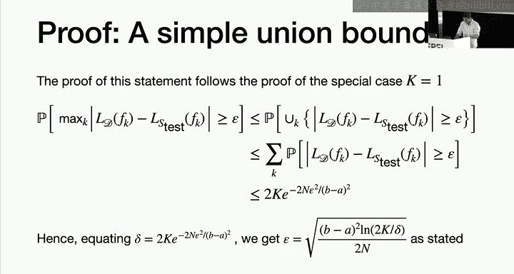

Okay， so now let's try to。Oh。就师。Why， in a why it does work， why by doing this？We can compute。

 you know， we can really。ピ theグパメ。So what do I do？I have some。Value lambda 1 to lambda 5。Okay。

And for each of these value。I can compute。The O Calarriski。You see that like the blue dot。

And what I am doing， my algorithm， I'm telling you， I will take。I will select the parameter。

With the smallest。On behavior risk。So for this problem， which parameter will I choose？

Lmb industrytry， exactly。And。You know。Imagine that。You know， everything。 and， in fact。

 was possible for you to compute。就拖回次。Which Pameel would you have to choose？Number two。

So then what you would like to you know to check， you would like to be sure。That。

By picking Londonnda street。My two risk for longernda three is not too far away。

From the best true risk。O。So this is what we will try to compute。

So what we know using the previous bound。Is that for every Pahammed。I can， you know。

 I know with high probability in which interval。My two his is。ok。I know that with probability Delta。

A。Of my two risk。Will be in this screen interval。Because I know that the distance between the two risk and the own vehiclehicular risk。

Is always smaller than ayon。Okay， well Eilon is equal to。This quantity given by the bound。ok。

So for every parameter。It's possible to control。In which interval。I the two。

So know what you want to check。I that。In fact。Okay， so if I compute。Ksta。

 which is here will belong that2， so that the Amin of the tourist。And K at here will belong as three。

 which will be aing of the test。你好。What I want to check is that。My test is a。

Evaluated for the parameter with its best。A Tatejo will not be too far away from the bestjo for the Pameter with the best。

退好了。Okay， so I really wantt。To show that this quantity might too risk for F ofK at。

Is not too far away from the two risk ofta。So this is， I mean， we will show how to prove this。😊。

But you show that it is possible。To show that this quantity will be larger。

And this plus only a small deviation。So just to say it again。

If you are choosing the best function according to the MBA galarris。

Then the two risk of this function will not be too far away。From the， I mean。

 from the best risk in your class。And that's exactly what you。Wanted。

So how can we prove these results？会会事 here。So what what is the worst case scenario？

So what we know is that K at。Is a function， which。I mean， it a parameter for which， I mean。

 is's a parameter with the smallest。Destless。So we know that if we take another Bahammet of ph in particular forlamda Kista。

😊，So test loss evaluated in Lamda Keta has to be above the test loss of Lamda。Okay。

 and so what would be the worst case， it could be that exactly equal。😊，哦，就是。一对比对不。

And then what is really like the worst case， the worst case will be that in fact。For Casta。

 you were very unlucky and the you know。The testless。Was not too bad， but in fact。

 the toolrs is really smaller。So how small it can be。It can be up to the Tela minus epsilon。Okay。

 because you know using our previous result that the distance between the test。

And the two cannot be larger than epsilon。Okay so。And on the other side。

 you have been also very unlucky for Kat。In the sense that， in fact， the testless。

Is really smaller than the tools。And how small it can be。

It can be up to the toolsers is equal to the test plus epsilon。ok。😊，But even in that case。

 which is really the worst case。You see that what is the distance between the twos evaluated or F of Casta？

And the tool is evaluated for F of K art。What is the max distance between them。

 it can be at most too epsilon。So this is exactly what we wanted to prove。Okay。

 is it clear for this proof。别。是。对。喂。So who can， you know， why are they all of the same？Thanks。

Exactly， because my result， I， you know。

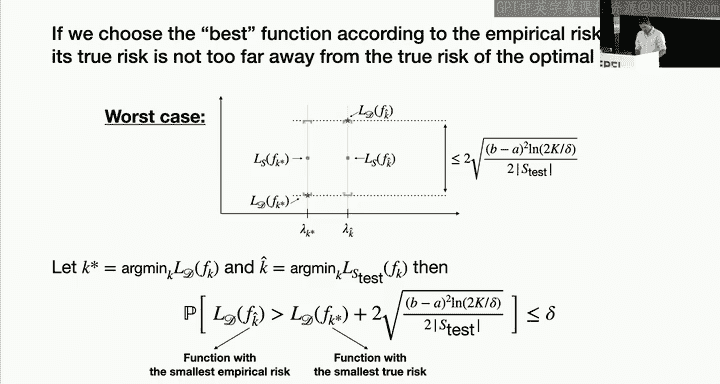

This is the length。So what can I certify with this result？

Is that the maximum deviation will be smaller than this quantity I call epsilon with high probability。

And this is a maximum deviation for all the case。😊，So。For every key1 to K， I mean。

 to long that one to learnda K， I will have the same length of my interval。That's really important。

Do you have other questions？对。I saw you have to。不他们。Why do we care about infinitely many models。ok。

I mean。In practice， you know， what do you want to。

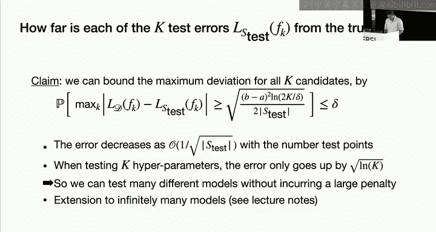

What do you want to be able to say， you want to be able to say what is the best parameter alongda。

 That's the problem you want to solve。You are doing rate regression。 You have to pick one numberda。

 you would like to be able to say。Can I say something about the best Bahamme Arand？Right now。

 what we are doing is that， okay， I will take some values， maybe 1000 of them， maybe  one， you know。

 10000 I don't know。And I will be able to say something about the best value amongst this 10。

000 parameters。But in some case， maybe you would just want to be able to say something about just the best value。

And for this， you will have to be able to consider some infinite number of an numberda。Can you喺边。

Exactly， when you are doing Ri regression， what is the space where Alumnda is living？All positives。

 So it's totally infinite。I mean， of course， it makes no sense to consider too large Lada。

 but even if you consider that Lada is living between 0 and 10， it's still an infinite space。

Which maximum are you talking about？

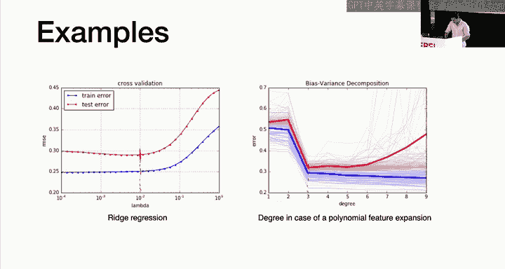

That maximum。But that maximum is independent of the number of lambda。So我。

You have several whole lambda here， it's finite from lambmda 1 to lambda k。

And you want to be able to control the generalization error for every of these。谂唔得。

So if you want to control the generalization they have for all of the lambdas。

 that's the same as controlling the deviation for the maximum one。Okay。

So we can do it again what you would like to prove is that for every k。

 so generalization error is smaller than some quantity with a high probability。😊。

That's what you want。ok。Then maybe you have to take some time and to think again to say that this is exactly the same as saying that。

With probability smaller than deelta。So maximum one is larger than the deviation。

Because if I have this probability， okay， if I have the probability that the maximum deviation is larger。

 then Eyon is smaller than Delta。😊，That means that the probability that the maximum deviation is smaller than ailon will be larger than 1 minus delta。

ok。😊，And now the probability that the maximum deviation is smaller than epsilon。

That's the same as saying that the probability that all the deviation will be smaller as than eilon。

😊，I it clear样。So that's exactly what you want to prove。

You have a max here because the I mean the result you are interested about is a probability that for every k。

😊，Griization how evaluated in Noda K is smaller as than exilon with some probability delta。ok。

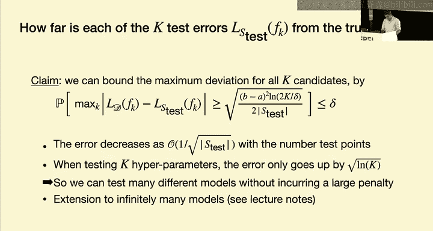

Okay， so is it clear for this proof？Exactly。哎，没有人。I mean， then you， you know。

 you can do like the grid search。It a bit in a clever way， but otherwise， yes， I mean。

 you will just try for say， I mean， in Pakistan， this is what you will do。On the 아이 Pahammeta。Okay。

 that's possible， but that's totally out of the scope of the course。This is what is called， I mean。

 you can do。 Yeah， You can do optimization on the IP parameter space， but。一谢。😔，Mar complex。

I was that questions？对。啊。But the prediction function is over oh， exactly。

 does that a very good question？😊，Exactly， so。You will pick K ads on the test set。

And so then your test set depend。I mean， your function depend on the test set。

 So now if you want to certify the quality of this function。You can't do it。

So that's why like in practice， in fact， what you rely have is like a train set， a validation set。

 and a test set。😊，But's a little bit more complex。You will train on your train set。

 you will validate on your validate set。And then at the end， you can certify on your test set。

That's a very good point。What was your other question。Oh， you see。Good。Okay。

 so as for the last 10 minutes， what we will see。

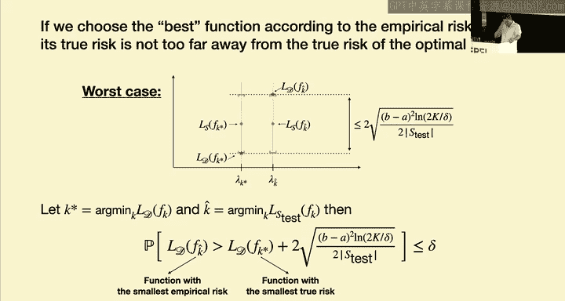

O， so外 to you I mean。When we are splitting the data set in two is a little bit like a waste of data。

 you know， it's not really efficient。So we will just briefly talk about what is called cause validation。

 which is the most efficient way。😊，To split your data。

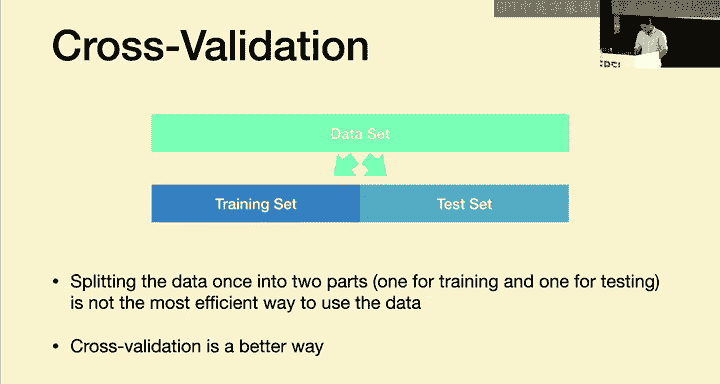

So what is cause validation and in particular， what is Kfold cause validation？😊。

So it will also be a little bit more complex。So first you will do a honda partition of your data into K defense groupss。

Okay， you take your， I mean， you take your data set S and you split it in KD fan groups。

So that will be the。 we have the first one， the second one， and so on and so。

And then what you will do is that you will do。😊，嘅体人。

So each time what you will do is that you will train on k minus1 groups。And then。Yeah。

 and then you will test on one group， okay， so you split in K groups。

 you train on k minus one of them and you test on the last one。

And you do that K times for all the possibility。And at the end。The estimate。呃呃，有 quantity唧。

You will do another edge of the keyhess。ok。对。No， the average of the of the Tela。No， no， okay， so。

You have one model， you will train it K times K different training set。So， for example。

 in the first run， you will train it here。That will give you one function。And you will test it here。

And that will give you one。Estimate for the Tesla。So a second time you will train it here and you will test it here that will give you a second estimate for your test class。

😊，那的有。Forget about this way， for， you just have the， you just keep in memory that say the loss。

And at the end， what you will do is that you will do the average of the K testla。😊。

And what we are saying is that this average of this。Okay， that loss will be a good estimate。说是。Tools。

 you know， I mean， you will be able to use this。In order to pick your good parameter。O。嗯。那原当推慢吧。没没有议。

You could even do the empire in power if you want。But what is nice is that you see that。At the end。

You have used all the data for training and you have used all the data for testing。In some sense。

 it's really more efficient。But you also see that the complexity will be worse。ok。

Can you repeat your question， please。We use the same initialization。I mean。Depen on your algorithm。

 you know， I mean， depend， I mean， you are using again the algorithm。

 it's the algorithm as the same miniization。 Yes， it algorithm as a ho miniization。

 you can use a ho miniization。So that's a good question， I mean at the end。If you are doing this。

To take your models， and you can。呃 he again。With the best parameter on old。

 or maybe you have some way to average the models。 I think you have a several way to do it。

But I mean， that's really like something more complex， you I'd just like to briefly talk about it。

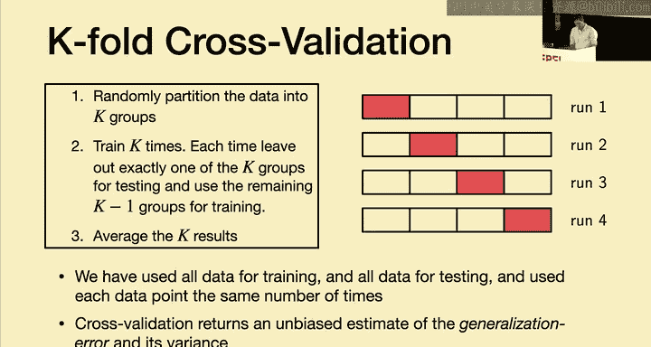

So in the last five minutes I you just want， we would quickly try to do the proof of this。

If we don't have all the time， that's okay。So let me remind you it's ofing inequality。

 that's a concentration result。We have a sequence of tita 1 to tita n with a mean expectation of tita。

They are all in the range A and B， and we want to prove these results。

So what we will do is that we will assume that the expectation of tta is equal to zero。

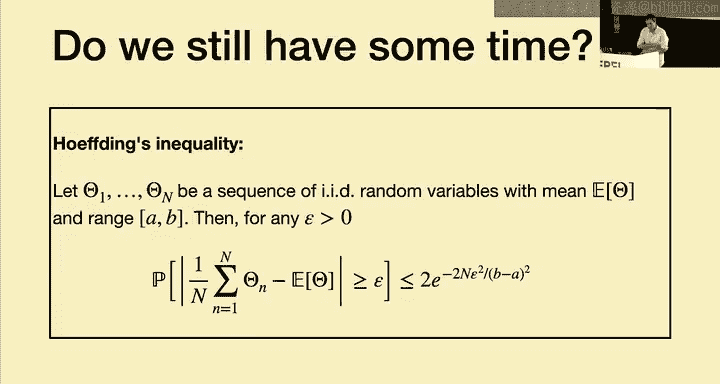

And that does not change anything。 And what we will prove is exactly this。 We will prove that。

The probability that the average age is larger than I saylon is smaller than this quantity。

And then you will be able to do exactly the same proof to show the other bound。

 the fact that the probabilitybabil at the average height is smaller than minus epsilon will be smaller than this quantity。

 it will add the two bound and it will give you the result。So the first thing we will prove is that。

I can show， I mean， that for every S， this probability。Is exactly the same as this probability。This。

 I think you all agree。 I mean， I'm changing nursing。 I'm just multiplying by S。

Both side of this inequality and as is positive。Okay， so if all know， I' have done nothing。

And now I'm doing exactly the same。 I'm still doing nothing。I'm taking the， I mean。

 the exponential of this quantity， and I say that this。Is larger than exponential of S Eilon。

Still doing nothing。And know I will use what is called the Markov inequality。

 So you know that the Markov inequality is that the probability of something have known variable larger that some。

 I mean， some quantity。Is smaller than the expectation of this ho variable。Over the quantity。

大 get this。This is a mark。And now I will use the fact that all the Tita and are independent。收。

You know， the expectation of the sum is equal to the product sorry。

 the exponential of the sum is equal to the product of the exponential。

And I will have the expectation of a project of independent ho variables， so this is equal。😊。

To the project of the expectation。O。Okay。And now what I will use is that all the Tita N in fact。

 have the same low。So all these number， in fact， are exactly the same for all small M。

So this is exactly equal。To the expectation of。Exponential of s times theta divide by n。And I。

Take the power of this expectation。Well and okay it's important。The burn is outside your expectation。

O。And in fact， it's what is possible to show that this is。This kind of expectation。

Is something we can。咁t。So this is what is called the Evding lemma we tell you it after。

 and I can believe me。Cize expectation。It's bounded。V this quantity。

And so this give you exactly the proof。Because you have these results。放 a p s。So what you prevent问。

Is that for every s， the probability that the average age is larger than epsilon is smaller。😊。

Then this term， which depend on S。So you see here it would be a very nice trick。😊。

This term is independent of S。But this term is dependent on s。So what can I do？I will take the S。

So that this term is as small as possible。Because I want to get the best。Up albumborn perci。

 so the best U album will be the smallest one。So I will take this bound evaluated for the S which minimize this quantity。

And you can do the computation。 This will be exactly。It's a about given。Bs。So now if you plug back。

 if you take this quantity for this S。It will exactly give you what we wanted。O yeah。这。

But let's finish it。 But hopefully we take the question again。Okay， so is it clear with the proof。

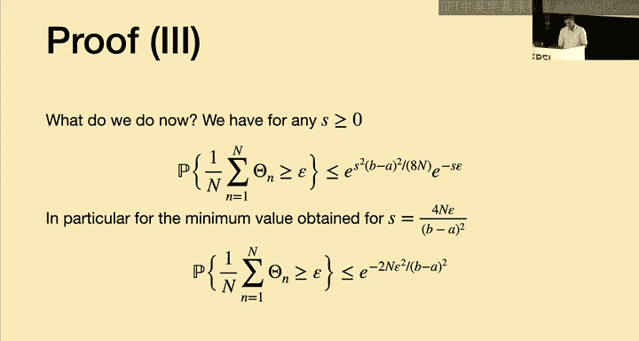

And so the only remaining。😊，对。😊，隔川。哎。Yeah， in the lecture or not that what they are doing is that。

They are directly taking the the minimum。That's the same。 I mean， we can talk about it offline。 Okay。

 so at the end， what is important is that we are just using this editing lemma。I mean。

 then you have the proof in the lecture or not， or you will be able to see the proof in the slide。

And at the end of today， I think。

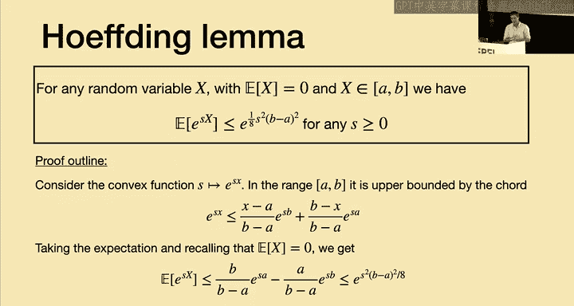

So we are each Saturday。