# EPFL《机器学习｜Machine Learning Course CS-433 fall 2020-2021》中英字幕（deepseek - P11：[11]EPFL Machine Learning Course 2021 - Week 4 part 2.zh_en - GPT中英字幕课程资源 - BV14SwyeNEvW

Welcome everyone and welcome to this new lecture of the machine on incl PFL CS Fo History。

 my name is Niicola Famao and today we will talk about the bias violence decomposition。

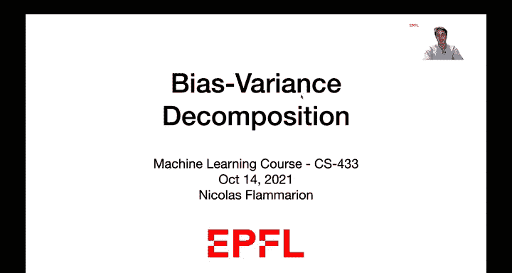

So last time。We saw that it was possible to assess if a given function was a good predictor or not。

And we also discuss how it was possible to choose the best。Out of a finite number of modes。To do so。

 we saw that it was possible to bound the difference between the total risk of the function and the empirical risk。

And this led us to the idea of splitting the data into a train and a test set。

We were learning with a trainet， and then we were testing on the test set。

And the main motivation for all this was the problem of the hyperpar search。😊，So for example。

 we saw that for regression。It was possible to control the paraization lada in front of the regularization in order to control the model complexity。

But we haven't investigated so far the whole of the complexity of the class of the model。

But if we really want to find the best function in our class。

We will need to take into account this complexity， and this is what we will do today。

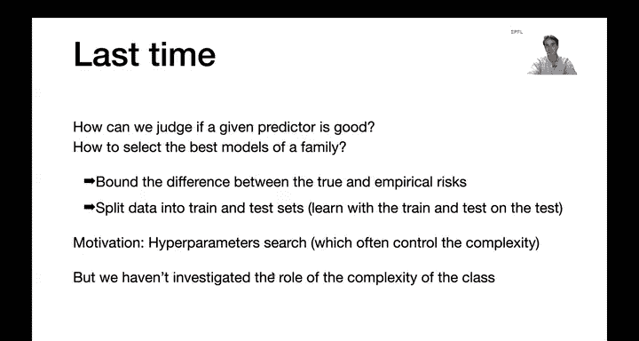

So today we will focus on how risk。These there the two risk or theアン risk。

Behaves as a function of the complexity of the model class。And this will lead。

As to the important concept in machine learning of the biased bias trader。

And so it will help us when we are performing modern selectionion to decide how complex and rich we should make our model。

Not as a small disclaimer， L no and the value structure， we are dehived quantitative tool。

We havejihyved some tools which was possible to compute today the analysis and the result will be more qualitative。

 it will be more conceptual when we make home for interpretation to just to have a feeling of what is happening in practice。

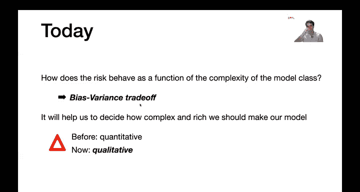

Okay。So let's start with a simple example。 We will look at a one dimensional regression program。

So we have a Canrous underlying function in blue。We would like to pick over。

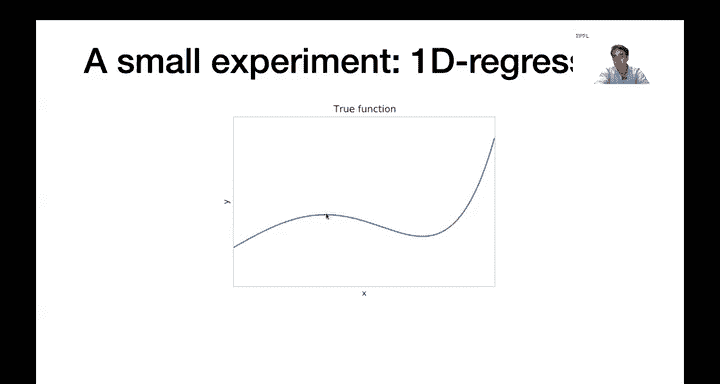

However， we are not directly observing this function。

 we are only observing some haization of this function at some point plus seminars。

We are observing these O points。And so in order to recover the gun whose function。

 only whose observation is orange， what we will do is that we will do earlier linear regression。

But we won't only do a linear regression， we will do a linear regression。

Using some polynominial feature expansion， so we will not only consider as a feature of x。

 but we will also consider x x square x over 3 up to x over T。And the question would be really。

 what is the maximum degree D you want to consider？

And you see that the maximum gravity DVD reveals the complexity of the class。If D is small。

 you are only considering low degree polynomial， and the class of function will be very simple。

 for example， if D equal one and will only be linear function。And if D is very large。

 you will consider high degree polynomial and the class of function you will consider will be very complex。

And so the question you want to solve is how far should you do good。

 what is the maximum degree D you have to consider？

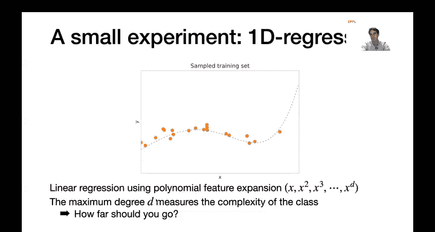

So what we can observe is that if you take D to be small， for example， if we take d is equal to1。

 so we restrict ourselves to simple models to linear function。Then of course。

 not enough function will be a good predictor of this function。Because this function is not linear。

 so it's not possible to represent with a linear function。So simple noodle。

Will give you a bad fit on your data。 It won't predict well the come。

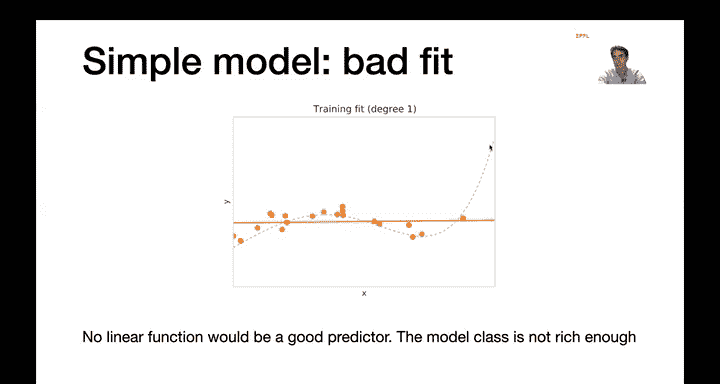

On the other end， if you are considering a very complex model。For example， high degree degree2。

You see that you obtain a model which is able to fit very well in your data。

You see that the training levels would be almost equal to zero。ok。

But you can directly see that in some sense， this model is overfitting to the data。

You see that this prediction does not seem very right， does not seem very close to the good one。

So what will happen， why it is not a good idea why this prediction function？Is not。

Very good to predict the true value。

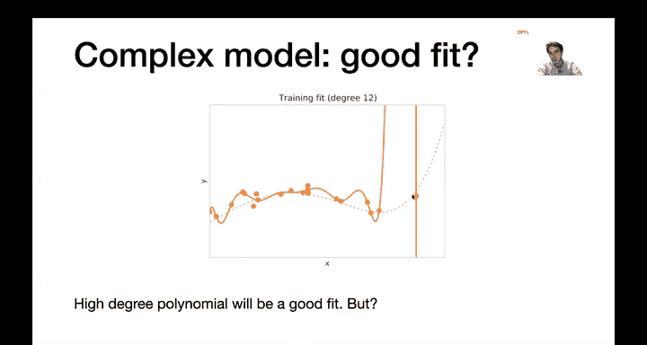

Even if the timing loss is very small。And so this is because in fact。

 there is some homness in the data。

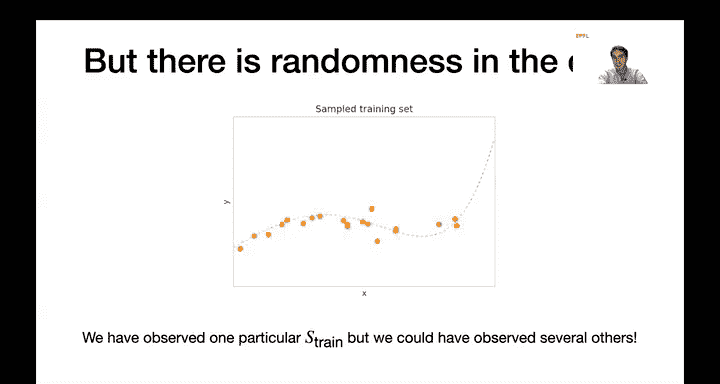

Previously， we were observing only one particular training set。

But we could have observed a lot of different timing set， as you see in this animation。

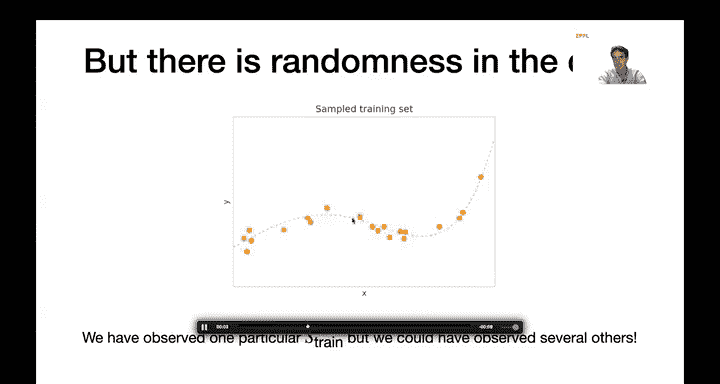

And even if you were fixing the same features X I XN。

 but you will still have some viability in the output Y I to Yn。

 So you see that here I'm fixing the X， but still。

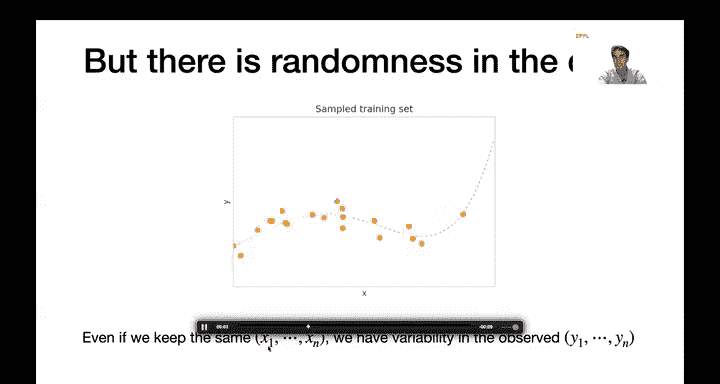

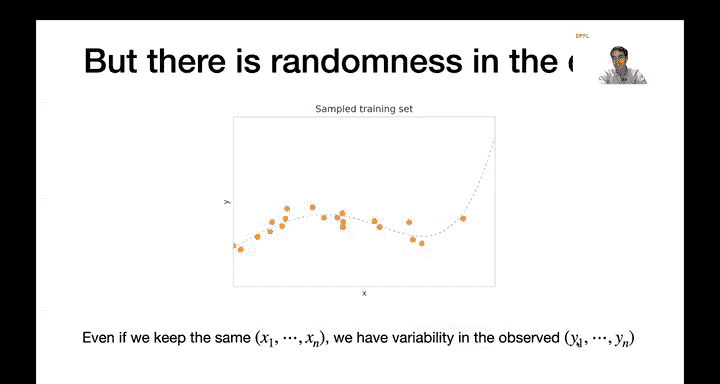

If I observe new realization of my distribution， I will have some new noise and I will observe new output why。

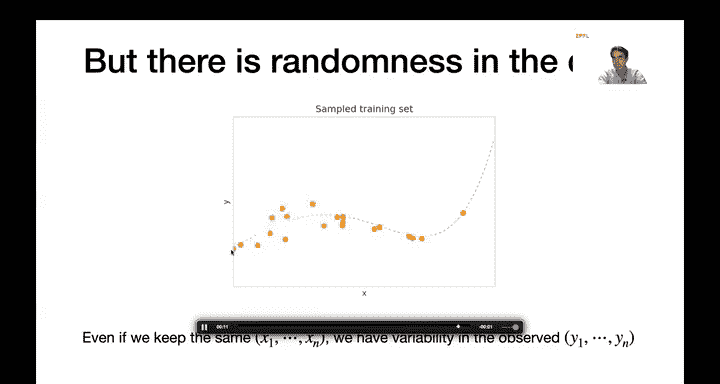

So that is' some homeness。Inずだた。And so what is happening， in fact， is that the linear is square line。

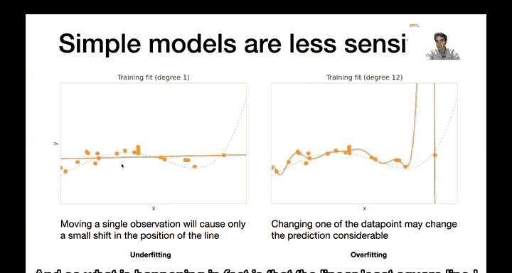

I obtained my only fitting an model。Is relatively inflexible if I pet yourrb ba a lot， I mean。

 if I petrbate a little bit by training set。😊，You see hands ins animation when I'm only changing slightly the output y of this bond。

The linear fit is not changing too much。Okay， so moving any single observation will likely cause only a small shift in the position of the line。

And this is because in some sense， this model is underfitting the training data。On the other hand。

 you see that for a very complex model。

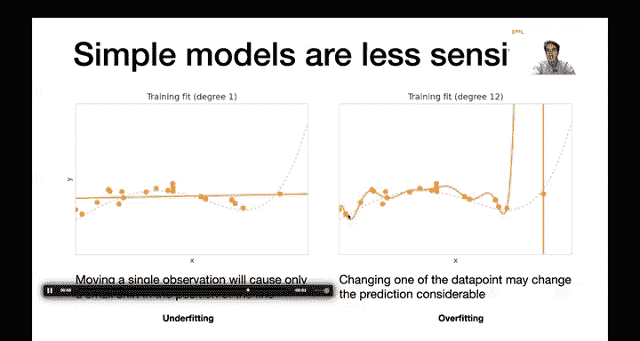

Then。It is really following the observation very closely。😊。

And so you see that you obtain some high variances because if you are only slightly changing a point here。

 for example on this point。

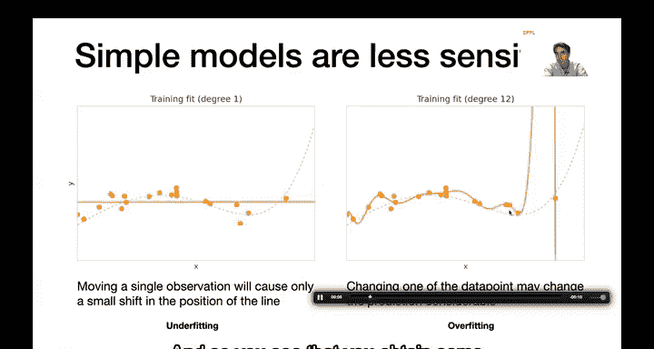

Then， you estimate F。Your prediction function will change considerably。

We are really overfitting the data and in order to overfi this data。

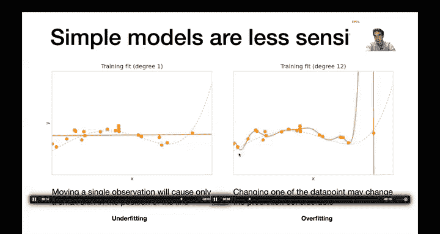

Each time you would change a little with the training point， then your model。

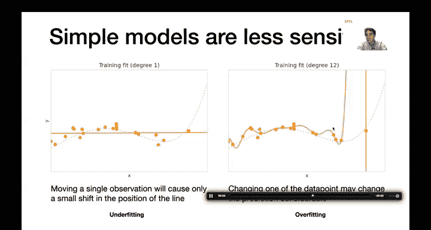

We have to change a lot。

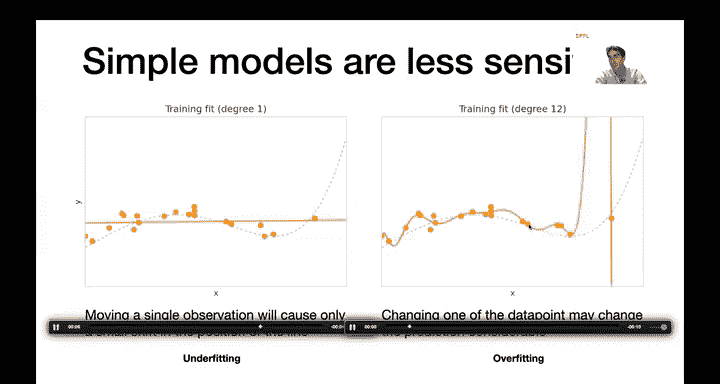

And so we see that now if we are not only considering one。

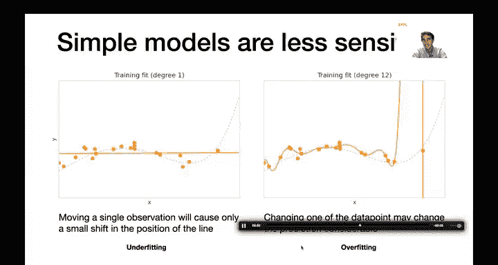

Experiments， we are not only concerning the prediction we obtain by concerning one training set。

But we are considering the case where we are running the experiments with a lot of different trainings。

So we are considering different training set and from each training set because they are one prediction function。

And then what we will do is that we will do the average of this prediction function。

And so what we observe for simple model is that。You never age。

All this function will not predict very well。And you see in blue。

 this is exactly the average of all my linear fit。You know。

And so you see that this average prediction。Does not feed well the data。

This is what we called to have a large bias。But on the other end。

 you see that the variance of the prediction is very small。You are doing some bad prediction。

 but this is consistently bad。For every new training set， I will get a realization， which is， I mean。

 I will get a prediction， which is not too far away from the other one。

And this is what we say to have a small volumes。The prediction F S， they have a very small value。

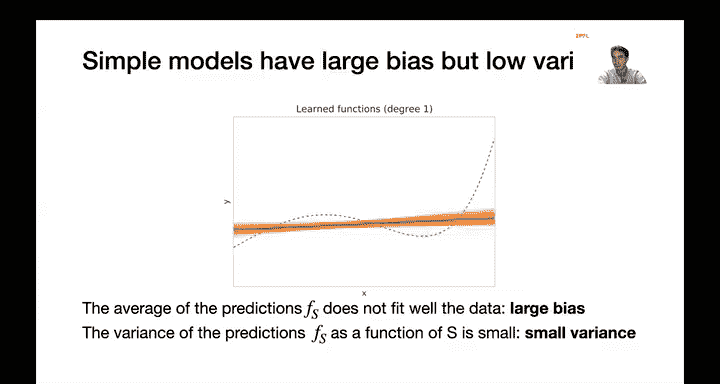

But if we know， consider as a very complex model。What do we see？We first see that in expectation。

 so if you are doing the average of all the prediction for all this creditor。😊。

So let me remind you you are considering different training set for every training set you take you learn on a predictor and then you are doing the average age of all the prediction and so what you see with very complex model here polynomia of the grade9 is that the average age。

It's very close to the guns。We have done a very good job。

The problem is that you are not predicting using the average age。

 you are predicting using only one realizationization， you are predicting only using one。系年得た。唔安平色。

And so what you observe for a very complex model is that the prediction has a very high variance。

Maybe。In average， it is working well， but when you are looking only one of this curve in orange。😊。

The tool would be very large。So complex model。I have a small buyers， but a very large buyer。

So in every age， you are predicting very well， but you are not consistently predicting。

And this is exactly what we want to study today。

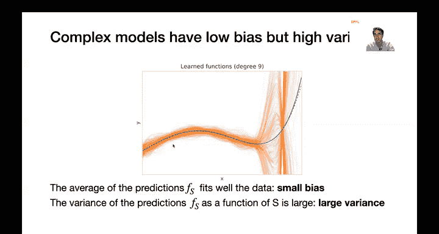

And so what you directly see， which is two extreme example of very simple model and very complex model。

 is that what you have to do is to perfectly balance both the bias and the bias and to consider model with a middle complexity。

 so for example， the preno of the gray。Which will obtain a very good bias。In average age。

 you are crediting very well， you are very close to your gun who's in blue。

And you have a very few fluctuationtration。If you look at all this realization corresponding to all different training set。

 they are very consistent， they are not too far away from each。

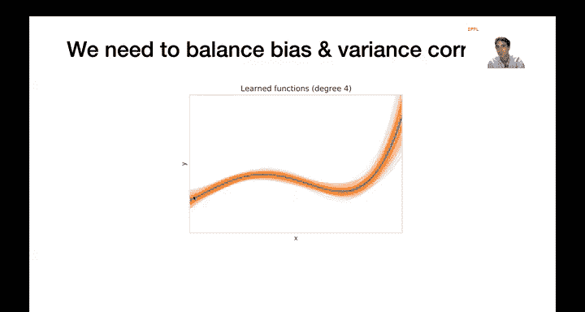

So let's try to understand this。So first we will consider。At that time of it。ok。

So what is the data model， the data model is that the output will be。

The true value perturbated by some noise。So what do we have？

We have some input x which follow low G of x， which is fixed but unknown。

And then we have a two model F。Which is a function we want to learn。So this function is am。

It is a mill， you don't know it， you want to recover it。

And we are not assuming that we know that in a hazy boat。That means that the model is not visible。

And so what is the definition of this is that F is not in our model class。😊。

The function we will learn with our learning algorithm。It's not。And this is and does not end。

F does not belong to the class of function we can learn with our learning algorithm。

So we have some input x， we apply the function F， so we obtain this value f of x。

But we are not directly observing F of x， we are observing F of x plus some noise。

What are the assumption we are assuming in the noise？The noise follows some distribution deep exon。

 which is II okay for each new observation X， I will have a new noise。

Eデ independentdepend from00 one。And what is very important is that we are assuming that the knowledge is independent of the features x。

 okay， so eilon will be independent of x。And also we are assuming that the noise is zero mean。

 the expectation of the noise is equal to zero。And so this is giving you the output y。

 the output y is equal to F of x plus eon。So the output is a2 mod f of x perturb perturbbed by some node Epsilon。

 and we will dinner by D the joint distribution of x and y。And so this data model。

 what we will do is that。We will consider a squares and we will come up with the decomposition of the2 error for the squares。

And we will analyze this decomposition。

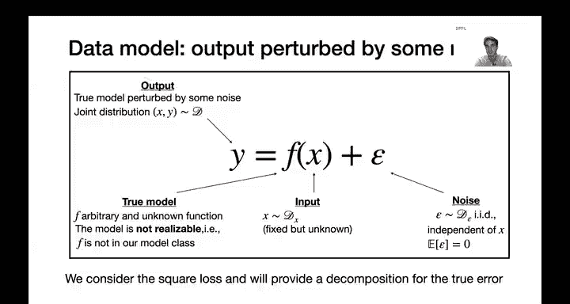

So let me remind you that you have a training set S。So here the training set is called S。

 it's not called Strain， which it is really your training set。

 so I give you a data set S you will use for timing。You have your regular learning algorithm， a。

 it can be anything， it can be the least square， it can be some cars and it can be some cominization algorithm。

 it's the typical learning algorithm。And using your learning algorithm A and your training set S。

 you will learn the prediction function FS。And what you want to understand today。

 what we are interested in。Is how the expected error of this prediction function you have learned using your training data？

Her expected error behaves as a function of the trans S。

And how it behaves at a function of the complexity of the model class。😊。

This is what we will try to solve today。So you do you look at the expected they。

 let me remind you that you expected they how it is the。Expected yeah， it is。

Exactly the error you will do。When you are predicting F S of x with the true value was y。

 and you are suffering the square loss。Of the two and then you just take the average height over all the x and the y possible distributed accordingly to your distribution D。

 so this is expected error。As we say， last time is like a number。

Which will tell you how good or how bad is your prediction。But you see here that this number。

 it is not exactly a number， it is a hom variable， it is a hom number because it is depending on your Hom planning set S。

So for every training set， you compute a prediction function F of S。

And fact this prediction function， you compute the2L。

And you want to look at house whoever is behaving as a function of the time set as。Okay， but in fact。

 we will not do it for。

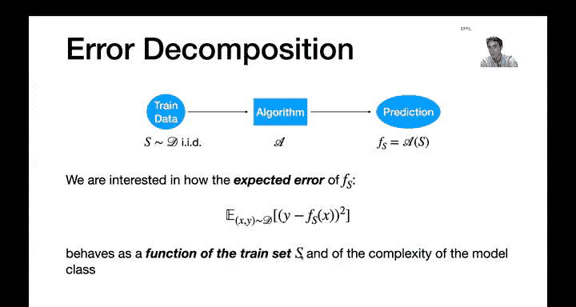

The average age of all the x， because the decomposition we will derivehive today will be true from every single point x。

😊，So what we will do is that we will。Just to simplify the computation。We will fix an element X 0。

And we will look at the expected error。I am suffering when I predict。At a point x0。

So this is what we will denote by L of FS， and you see that this is just the expectation over the noise。

Because the2ra was the expectation over x and y， but here we are fixing x。

And when I fix x。Y is equal to f of x0 plus some node， so the only Hondaness come from the node。

 so the two expectation is exactly equivalent as concerning this expectation over the noise of my observation。

And if I would like to recover the3 half for every x。

 I just have to take the expectation of this number over x0。

And so you see that this L of FS is a homem variable because it depends。On the ho training setで。

そレ's進です。I had a fixed distribution D on my observation X and Y。

And I have a fixed learning algorithm A。😊，And I can sample some training data from the。

 I call it this data set S。And then I would give it to my algorithm A。

And this algorithm is giving me a prediction。And now I am checking the performance of this prediction。

Not on average age， but on a fixed data point x0。This is exactly this quantity。

And so now what we are interested in is how this quantity differs if we run the experiments multiple times。

We want answer as the following question how consistently we will get the same result if we are running the experiment several times。

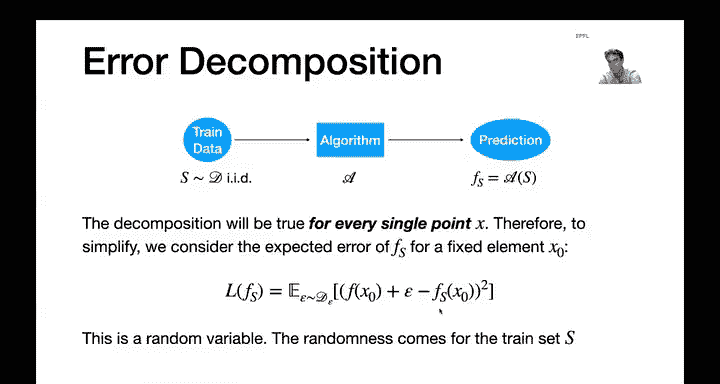

So this is what we are doing。We are running multiple experiments。

Well do it the first time with the first Ho training set， I will get a prediction function F of S1。

 then I will do it again with a new training set S2 and I will get a prediction function F of S2。

 I will do the same for a new training Hom training set at3 and I will get a prediction function F of S3。

Until as of Sk， and I will get to prediction function F of SK。Okay。

 and so what we are interested in is really like the average and the variance of the prediction Fs1 to F Sk of other multiple。

If we are only getting the same， then this credit can be bad。

 but there will be no variance enough prediction。But on the other side。

 sometimes we get something which is really good， sometimes we get something which is really bad。

 then maybe in another age your prediction will be good， but you will still suffer from an eye value。

我们还 vulnerability of the prediction。So this is what we want to understand。

How consistently you will predict if you are doing the experiment multiple times。

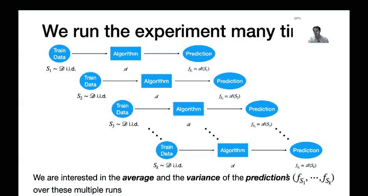

So to do so， we will dehive the decomposition。Of the risk L。F O S。But not only for one。

Hnda training set， we will take the average over all the training set S。

So we will take the average over all the training set。Someper。So since we already say that。

The average loss L of F of S is equal to the expectation of other noise。

Of the square of f of x0 plus epsilon minus f of x x0。

 you see that you can take only one expectation， so you will look at the expectation over s and epsilon of this quantity。

哦。So what does it mean？This quantity is really。So average age of the risk。The average of the lu。

 you will suffer over all。Possible prediction working。 So this is your risk。You have a function。

 you have learn F of S。How good or how bad are you predicting on a new observation？

X Y is so how good or how bad are youre predicting when you're observing a new noise？

So this is this quantity。And now you want to see how this behaves when you take the average age over all the possible training sets。

You could have consideredd。Because in order to learn this function。

 you have used only one training set。So now you want to see hows the loss。

Is behaving when you are taking the other edge of all the possible training set。

This will tell you how in another age， your method will be a or every possible training set。

And so what we will do is that we will decompose this quantity in three non negative terms。

And it would be possible to provide an interpretation for each of these terms。

So just to clear and let's do it again。If you are considering only one training set yes。

You are using your learning algorithm to learn the function F of S。

Then you can look at the expector they have of this function。It is prediction function。

So this will be the average age loss you are suffering when you are using this prediction function。

To predict the value。I feel new points。Okay， so this is telling you how good is your predictor F。

The G number depend on your training set S。And now you are taking the average over all the possible trainings that S you could have seen。

To see that。How good or how bad you will predict if you were observing a new training set。

 if you were computing a new。A predictor using a new honda things。

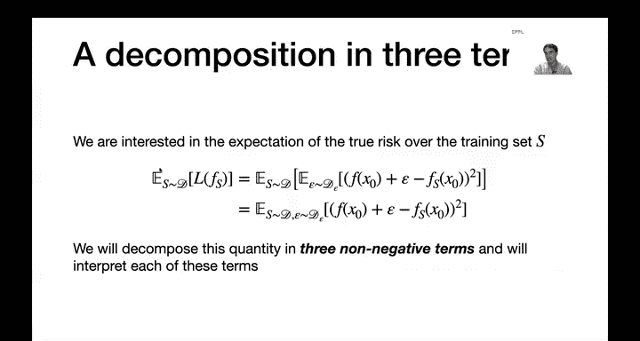

So， let's do。It's a decomposition， so we will only use the fact that it is a squareless。

So this is the square loss， this is the loss between y my observation and Fs of x0 my prediction。

And know I will just expand the squared very easily， so I will obtain three terms。

 I will obtain the expectation of Epsilon squared。I will look then across them the expectation of Epsilon times。

F of x0， my gun whose minus my prediction， F of S x0。Plus， the expectation of。

The squared of F of x0 minus。Make prediction， F of S， X U。

You thenally see here that I have been a little bit fast。即。The expectation of S and epsilon here。

 it is only the expectation of an epsilon because this eilon is not depending on S。

 it is independent。So this expectation disappear。Here I have the two expectation because this quantity is depending both on Epson and S。

And。This quantity is only depending on S。The expectation of your epsilon。还是手机在变。

And what we will first do is to see that since the expectation of epsilon is equal to zero。

The expectation of Epsilon squared is exactly equal to the variance of Epsilon。😊。

Because variance of epsilon， it is equal to the expectation of Xilon squared。

Min is expectation of it none。不要 to。And since expectation of head China is equal to 0。This。

We get thisequ。Expectation of its ion squared is equals the variance of the noise。

No we will also use a effect。That epsilon。Which correspond to the noise of my new observation is independent of my training set S。

Which is the data， which are the data I have used in order to learn my prediction。

So when I'm looking at the custom， I'm looking at the expectation over S and itsxyon of this product。

What I can observe is that this eilon。Is totally independent of S。

And the difference between my groundus F ofx0。And。By prediction F of S x 0。

This difference is also totally independent of Eilder。So I can rewrite。

This as a project of expectation。This will be the expectation of the epsilon of epsilon。

 it will be just a mean of epsilon。And this will be the expectation of my training set S of the difference between F of x0 and my prediction FSx0。

Okay here I really have crucial use the fact that Epsilon and S are independent Epsilon is a noise corresponding to my new observation on which I'm computing my expected error。

😊，And S is the training set I have used in order to learn my predictor F of S。

 and I'm doing the expectation over all the possible training set I could have used。

But both Epsilon and S are independent， so when I'm computing the expectation of S and Epsilon。

I can split it in two， and here it will only depend on Eon， and here it will only depend on S。

And know what I will use， I will use the fact that epsilon is zero min。

 so this quantity is equal to zero， and so this project will be equal to zero。

So the custom is equal to Z。And so when I'm looking at the expectation of my tools over all the possible training set。

This will be equal to the variance of the noise plus。

The expectation of the square of the difference between the count is f of x0 minus F of S x0。

Now we will try to study this term。

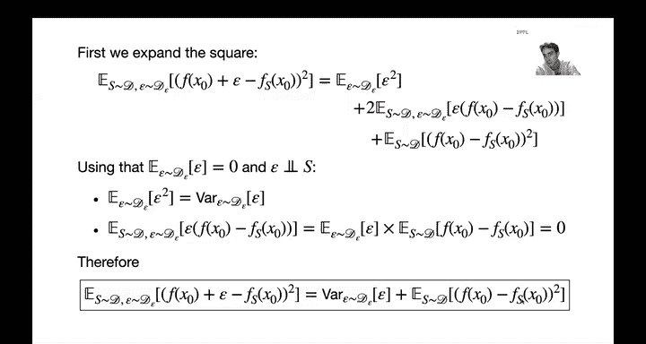

So what is the trick？What we will do is that we will add and we will subtract some constant term。

It will maybe change anything， you can always add and subtract something。

And so what we will add in subtract。This is this constant。This is your expectation。Of F of S x0。

But not of s of S prime， where S prime is just like a ser hang set。Which is independent from S。

And I'm taking the expectation。Over S。So this is a number， this is the expected prediction。

 and you will add this number and subscribe it。So what I want to compute is the expectation over my training set of the square of the difference between my ground truth f of x0 and my prediction F of S x0。

 and what I will do is that I will subtract。This expectation， and I will add this expectation。

So I have done nursing here， I have just abstracttract a number and add a number。

 this is exactly these two numbers are exactly the same。But now I can expand this square。

So what I get。I get this first term squared plus the second term， squared plus the cost them。

And the expectation is over all this step。And now what we will do is that we will show that this cost is equal to zero。

So the cost term is equal to the expectation over my training set s of the product of two term。

the of the difference between mygan whose F of x0 minus the average expectation。Times。My ever。

Prediction minus the prediction I have done when I used S。And so what do you see。

 you see that this term is totally independent of S。This is F of X0， my account tools。

Minus to average age。Of all the prediction I've done when I'm using S prime。

So my average prediction is independent of this particular training set S。So this number。

 I can take it out of the expectation。 if you prefer， you can take the expectation in。

 And so you get exactly this。Equation。So this number is equal to。The difference between myan tools。

And the expected prediction times， the expectation over every training set S。

Of the difference between the average prediction and the prediction。F you have learned using S。

And you see that this term I already told you is independent of S。

And so you can take byity of the expectations， the expectation inside。

And you really get the difference between。미 toな는데。And now what is important to be convinced is that these two numbers are exactly the same。

This is the expected prediction you are doing under the 0 x0 when you are using the training set Spi。

Okay， so this is a prediction， so you have a point x0， you are using your training set as prime。

To learn the prediction function f of S prime。You look at the prediction FS prime of Xxi hole。

 and you are taking the average over all the possible training set。E spine。

You see that this is exactly the same as this number。I'm considering a honda planning set。

I learn my prediction function and I take the advertise prediction。

The fact that here is the S or here is the S prime does not change anything。

Both are the average prediction when S of S prime is the horum trans set。

And so you see that this number and this number are exactly the same。

 and so the difference of this two are equal to zero， and so the cost term is also equal to0。So。

 we got that。The expectation over my training set of the squared of the groundtro F of x0 minus。

My prediction F S of x0 is exactly equal to these two terms， which we will analyze soon。

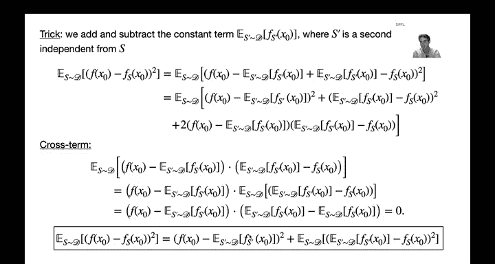

So what have we shown？We have shown that it was possible to decompose。So， expected。

T where the expectation is coming is taking bus。On the training that I said。

You use to learn your prediction function。And the noise， okay。

 so this is the expectation over all the possible training set。Of my toolsrs。So， this。

Plusus can be decomposed as a sum of three terms。So if I hang on themselves in those。The squared。

Of the difference between the ground truth and my average prediction。

And the variance of my prediction。So the first term is called the noise variances。

 the second term is called the bias term， and the last term is called the V stem。

And what is very important is to。Note that。These three terms are positive。AVance is always positive。

 this is a squared so it is positive， and this is the expectation of a squared。

 so it is also positive。So my toolsrs， my average rulers is equal to the sum of three positive terms。

So that's mean that all of the stem is lower bound。嗯。My通s。Okay。

 each of these them always lower bound at2。And this is exactly what we call the bias vines decomposition。

And we will。Try to inter it right now。Also， something which is important to note is that this first term is totally independent。

Of your learning algorithm。So in order to find a method， which will minimize your rulers。

This is exactly what you want to do you want to find a learning algorithm which will help you to learn a prediction function which will obtain a low to。

 so in order to minimize this quantity， you will have to minimize the sum of this and this so you will have to minimize simultaneously a low I mean you will have to minimize the bias and the variance。

 so you would have to find a method which achieve at the same time a low bias and a low variance。

Try to see if this is possible afterward。

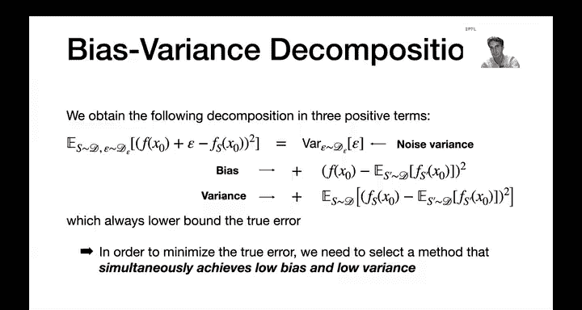

So what is the first stamp we have， this is a nice stamp。

And so the nice term is really giving you a strict lower bond on thera， which is possible to achieve。

Even if you knew the gun tools have。You will still serve further nights。You can check this。

 that's a loss。Not of a hom prediction， F ofS， but the loss of the true function is still equal to the expectation of the noise square。

 it is still equal to the variance of the noise。So even if you knew the true function F。

 you would still suffer。From expectation of Epsilon squared。

And so the noise stem really provides a strict lower bone on the radar， which is possible to achieve。

Okay and it is important to have in mind that it is not possible to predict the noise from the data because the noise is independent of the data set S。

So when you are observing your training set， you will never be able to predict to learn the noise of the model。

 that will always suffer from this noise。

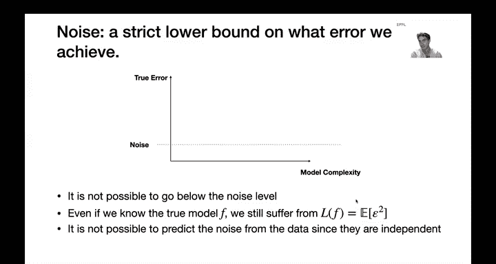

Then the second term is a bias term。So why did Jesus about yesterday？

It is the square difference between F of x0， which is the actual value of the groundtros。

And the expectation over your training set。Of the prediction you have learned using this training set。

So let me remind you why do we have an expectation because you are using your Hom planning set S。

To learn your prediction， Fs of XL。And now you will consider your average prediction。

 you will do the average of all the possible training set。ok。So this is exactly the two value。

We would like to take minus。Which we get by doing the experiment repeatedly。😊，Okay。

 so the bias can of is telling you if you are doing the experiment many times。

Do you get it right in averageval age？So the bias really measure you how far off in Jenhan。

So Mo prediction are from the co value。😊，And so why is it called bias？

So it is called bias because in some sense it really refers to the error that is introduced by approximating a real life problem。

Which may be extremely complicated。But you much mode。So for example。

 when you are doing linear regression， you're assuming that you have a linear relationship between the output y and the input X。

But in real life， it is very unlikely。That you have such a simple relationship。

And so when you are performing linear regression to model some real life phenomena。

You will get a bias in your estimate of the counters because you are using a two simple model。

If the grounds was function is substantially nonlinear。

No matter how many training observation you are using。能 matter在后面に。Information you are using。

It will not be possible to produce accurateate prediction。Using only。So we see。

 and this is exactly what we see in these pictures is that。Lal。We suffer from a high bias。ok。

Because the complexity is too small and so it will not be possible to model this nonlinear behavior。

So when I am considering the average of all this prediction。

 I get the blue line and I will get a bad。So if the complexity of the model is small。

 then often you will suffer from a high bias。On the other hand。

 when you are considering a model which is more complex， which is more flexible。

 then it would be possible to fit very well your training data。And。In average age。

You will get a very good prediction。So this is why Tpy Kelly。

When you look at the evolution of the bias in function of the model complexity。

If you have a two simple model， then。This model will not be able to get。

A good prediction for many poem。Okay， so you will suffer from a high bias。

But if you have something where your rich。Then you will be able to model some complex phenomena and you will have a low bias。

But let me call you that's really something which is typically and it practice it will depend on the learning algorithm you will use。

But for a lot of algorithms we will see during the course。

 this is the typical behavior you would observe。Simple model will suffer common a eye bias。And。High。

 complexity model will have a very low bias。And it's important also to have in mind that in some sense。

 the training a can be treated。As the amount of bias in the model。

If the mode that is unable is not able to fit the training data。

Then it's very unlikely that it will be possible to fit and to explain the countriess。

And so it's very likely if you have a low training error that you will have high bias。The So again。

 it is。Gypical， it's not always true。Okay， so this was for the bias。

 which really let me recall you the bias term。It is a squared of the difference between the actual value FFx0 and the expected prediction。

 so it's still in you in average age are you predicting well。

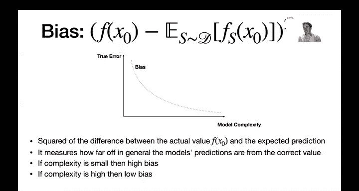

And then the second term， it is a bind step。So the variance then is really like the variance of the random prediction。

It is how close are all the different prediction you get by doing the experiments many times。Okay。

 so the variance really refers to the amount by which F of x0 will change if you estimate it using a different training data set。

ok。So what we have seen is that if emititted。Has a high variance？So for example are complexa then。

Then。Onlyly a slight change in the training data will result a very large change in the prediction function F。

 and this is exactly what we are observing。With high complexity。Okay， so in general。

 flexible statistical method will have a higher variance because they will be able to fit exactly all your turning point。

But then if you are just likely changing one of this training points。

 then you will have to change a lot the shape of your prediction in order to still be correct on all the point。

So this is what you are observing。In this curve， all this O curve are very different。好嘅。

So the prediction is very sensitive。就是 actual training that。In contrast。

 if you are considering low complexity model。You see that。Typically。

 they will have a low variance because as。We saw in the previous experiment。

If you are just slightly moving one of the training point， then the curve， I mean。

 then the line will not be too much shift。ok。So。Typically。

 low complexity mode then has a low variance because moving any single observation will likely cause only a small shift in the position of your prediction。

ok。So kind of the general goal is that when you are。

Increasing the complexity of your model will increase the variance also。

So low complexity model will have a low variance and high complexity model will have a very high variance。

So this was for the interpretation of these three terms， the noise stem。

 the bias term and the B stem， but what we saw was that the to was equal to the sum these three terms。

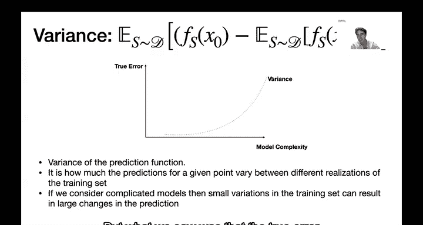

And so this is exactly the bias Im afraid of。衣服。I wanted to get the to with her。

I would have to do the sum of these three curvebs and it will really give me something like this。

So what we have seen。If the complexity is too low。Then it's not possible to approximate well my problem。

 and I will suffer from a high bias。If the complexity is too large。

Then they will have a problem with a very larger variance， and they would suffer from a high volumes。

And as a gen whole。As you are using more flexible methods。

 the variance will increase and the bias will decrease。But what is important？

Is the whole rate of change of this two quantity。Because this sees what will determine whether there's a total2。

 which is equal to the sum of these three terms。Will increase our decrease。Okay。

 so imagine high as you increase your complexity。So， bias。Tends initially to dig his。

And he tends to dig his。Faster than the vis。Is in increasing。And so therefore。

 the sum of the bias and of the violence。😊，Is first decreasing and so therefore the To is first decreasing。

However， at some point。Increasing the complexity of your model。Has little impact of the bias。Okay。

 you will your model would be complex enough in order to model to。To model you gunmpost。

 and so you can still add more flexibility， it will not help you。

So the decrease of the bias will kind of saturate。But then。

You are adding too much in degree of freedom so the variance will blow up。

 and at this point the variance is increasing at a faster pace than the bias is decreasing。

So after some time， when you are looking at the sum of the bias and of the bias。

The two start to increase。Okay， so you see that we have a U shape curve when we look at the sum of this tree。

And the question would really be to find a Sws post。Where the退合 will be minimum了。Okay。

 and this is really like the point with a perfect complexity。😊。

It will be rich enough in order to more your countriess， but it will be not too rich。

So that you will not suffer from too much bias。And so this is what we call the bias bias threatoff。

And so what do we call it a trade off？We call it a traitor because it is really easy。

To find a predictor， to find a method。ウ theハバです。I mean， with a very low value。

But we will get a high base， for example， with a linear model。Okay。

 so it's really easy to find a method with a very high bias and a low bias。Yeah。

 just using a lot of clip polynomia。And on the opposite。

It's really easy to find a method with a high variance。And thelobi。

We just use a high degree polyovia。But what is really challenging is to find a method for which both。

 the bias and the variance are low。And this is。Exactly the bias by instead of。

 and this is one of the main questions of the machine learning and we will talk a。Again。

 but this question knowing the course。

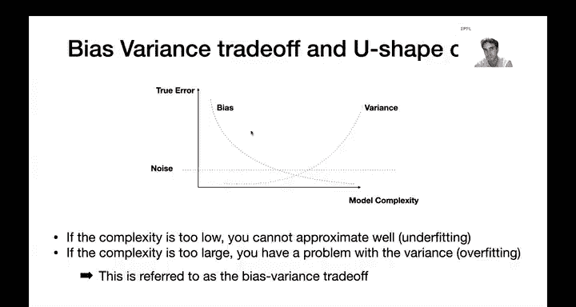

So this is an illustration of the producer example we have seen。If we are using。

Function which are too simple， for example， a linear function。Then。

You will predict in average age quite badly。But you will consistently predict better。

All your prediction will be equally bad。No， if you are using。A word， which is too complex。Then。

Maybe in average age you will predict very well when you are doing the average of all this orange care。

 you will obtain a very nice prediction， this will be very close。Do your感透 blue。

But when you're only doing one verization， when you are using one training set S。두려요 캐릭터。

So how are you willing to get？Can be quite bad and why it is because we are suffering from a very high balance。

有 prediction。And so what you have to do is you have to trade off between a low bias， sorry。

 a low variance and a low bias by finding mode of average complexity。

 which is here a polynomial of degree4。Through which you have ghosts a very small bias。

You see that your average prediction is very good， it is very close。To your accounts。

But you are also consistently predicting quite good。If you look at the different orange curve。

Which correspond to the prediction。Otain。Using。One training set。 So I give you one training set。

 you learn one prediction function， F of S， and you look。As the prediction。

 this is exactly one of this orange curve。Then you see that。

Here you will have a low variance you will predict。Consistently good。 Okay， so。

Here you have exactly your mood in。Which obtains both。The low bias。And a low variance。Okay。

 and that's really like a challenge。Which is to find such a method where you are both the variant and the bias。

 which are no。

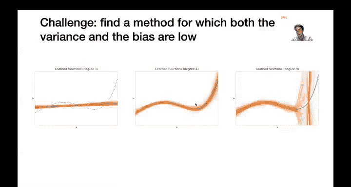

So to conclude。We can look at this nice illustration of the bias bias instead of。

Which is really you have this target。And what you want is to be as close as possible from the center。

 Okay， so if you are at the center， you really have。I the who risk。And就。

Furtherther和 way of the先 youは the high is。And you have four different cases。

 you can have a low variance or a high variance， and you can have a low bias or a high bias。

So this is the best case， this is what we want， this is a tradeoff you want to obtain。

 you want to have a low variance。And a low bias。That means that if you look at the average of the prediction。

 it will be very close to the center。We will have no bias at all。

And if you look at each prediction individually， you will predict consistently well。

 you will have something very consistent， you will have a low variance。Then， we have。

Another side of the spectrum， which is， I have a high bias but low variance。

Which means that if I look at the average of my prediction， it will be bad。

 it will be far away from the center。But if I look at the violence， it is very consistent。

 this is not too much played away。This corresponds to the case of low complexity mode， like a linear。

I will。Feedback in my data， I will not really observe。

 I will not be able to explain my nomin behavior， I will have a high bias。

 but I will do it consistently。And we have a low variance。Then we have the case。Of the high variance。

 the to low bias。If I was able to do the average of all。My different prediction。

 I will get something very good， very close to the center。Unfortunately。

When I'm looking at individual prediction， it can be good， but it can be also quite bad。

So in every age it is working well。I have a low bias。But all this realization are very spread away。

 I have a large vi。And this is a case of the high complexity model。

And here we are also like the worst of Bo one， which is have a high bias if I'm doing。

The average age。I would get something really bad。And off top of it。I have a high volume。

 this is non consistent at all。So that's the end part two day lecture， but as I told you。

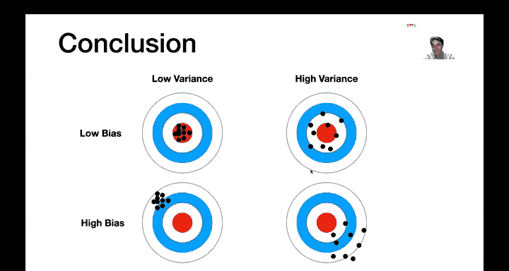

All these bias， bias， behavior were only typical and were really depending on the algorithm we are considering。

For example。This quest solve of rich location。Or I go exam。

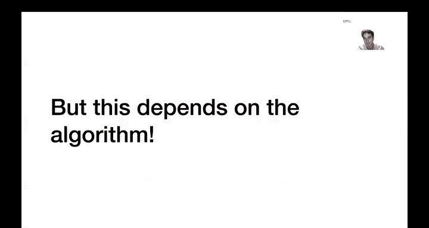

And what is happening is that today we are kind of in a new regime with machine learning and deep learning。

Which is that in fact， we have a paradox， we are learning with some model with a very high complexity。

We are learning with modern。With no network， which are highly over parameterhamid heights。

 So you have a lot of parametershammed we will talk about it later during the course。

But the complexity。It's really high。And this is what we call overpomic high model because in fact。😊。

You have thermal more parameters than number of observation。

 and so for every training set it will be possible to exactly fit your data。

And this is what we call the model interpoum regime。And so。In this regime。

 whereas the complexity is very high。If we were replaying what we learned today。

 what you will say is that， okay。I have something very complex， so the bias would be very small。

But I will suffer from a very large volume。And so what you would expect from today' lecture is that the total risk。

 the total risk will be very high， will be here。But in fact， what you will observe in practice。

That actors going the tourist stuck to dig his again。ok。So in some sense。

You have some very complex model class。For which you have a very low bias。

But also from which you have a very low variance。So what I wanted to say is that what we saw today was kind of in this regime。

 in the underpower regime it was very typical of this regime。

Where low complexity has low complexity model。Has a high bias and a low variance。

 but so a high test risk， high complexity model has a high variance and a low bias。

 so a high risk and in between you have to find a Sws。But it's also possible that for very。

 very complex model， then the variances start to decrease again。

And even you can find a point here which will be lower than the risk， so you can find with a very。

 very complex model a lower risk。That a risk you will classically obtain。

But here also it is important to have in mind that it is not something which is genuine。

 it is not true for every mod， it is not true for every learning algorithm。

 but it is typically what we look at。When you are training some very large。The whole network。

With one particular algorithm， which is cardio descent of stochastic hydrogen descent。

And this double decent curve and also this related phenomenon of benddding overfitting。

 okay where you are overfitting the training set。You see that your time risk is going to 0。

So here you are exactly fit your training data。But still you are generalizing very well。

 so this is why it is called bin ofography fitting and it is the object of intense research recently by a lot of cops。

If you are interested， you can look at both double decent care and benign over。Okay。

 thank you very much， I hope you have enjoyed your class and I will see you next Tuesday where we will talk about classification。

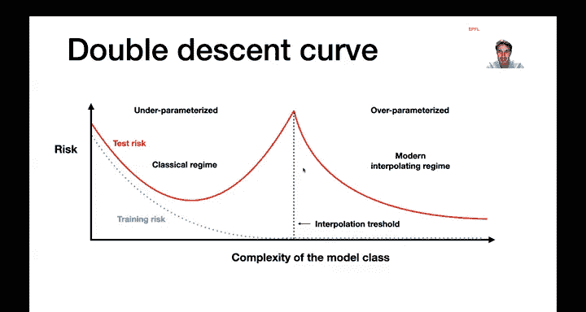

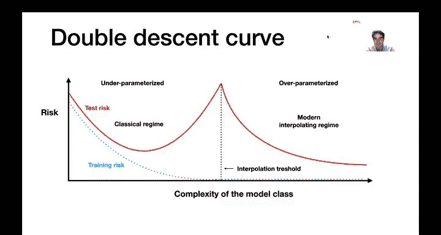