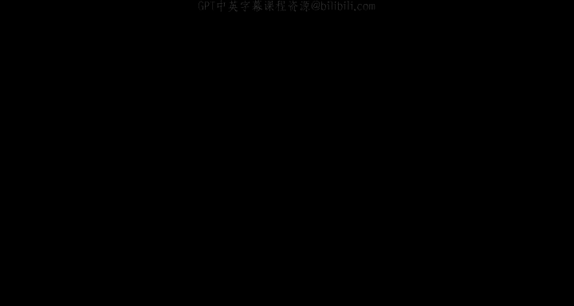
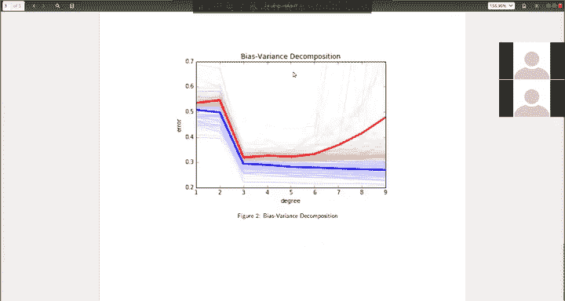

# EPFL《机器学习｜Machine Learning Course CS-433 fall 2020-2021》中英字幕（deepseek - P12：[12]Exercises 4 - getting started video.zh_en - GPT中英字幕课程资源 - BV14SwyeNEvW

Hi， everyone。 In this exercise， we are going to see how to perform cross validation and use it to select the best model。

They're also going to investigate a phenomenon called the virus variance decomposition。

But before we begin。You should copy your code， which you have wrote in your previous exercise2 and exercise 3。

You should copy the least squares function， which you wrote in exercise2。Into this function here。

Similarly， you should also copy the functions you wrote。For rich regression。

 as well as the split data into these two files。Now， to start off。

You have to fill in the code here in this function。

 This function computes the is supposed to compute the test and the train error corresponding to one subgroup。

Ccross validation。So this means it takes the y values as well as the x values as input。

 this is the entire training data。It also takes in a set of indices， decay indices。

As well as well as the regression parameter lambda and the degree which you should use for running the polynomial regression。

So these key indices correspond to the。Kate subgroup， which you should use as your test data set。

Everything else， so all the other indices which are not in the scale indices should be used as your trained data set。

So using this test and train data set。You should run a polynomial rich regression using degree and Lambda as parameters。

And then。You should compute your train and test data loss。And return these as outputs。

In this function， we will basically repeatedly call this cross validation function。So。

We will run a polynomial rich regression with degrees7。

And the regularization parameter changing in 10 from 10 from minus4，10 to the minus4 to 1。

For each of these prolonged rate regression problem， we will perform K fold here four fold。

Cross validation， this means that we will split the data set into four parts and in each and run the cross validation and call the cross validation function four times。

Each time， using a different。Part as they train suggest test data sent。So， you should copy your。

You should store the train and the test dataset set。

 which here computed for each of the Lada into this array。

And then these will be later used for visualization。IfOn correctly implementing the code。

 you should see a plot which looks something like this。Yeah。Of course。

 depending on the exact way you've coded， you may not match this plot exactly because cross validation performs a random split of the data and depending on your Ny version。

 the split may not exactly match。In the second part。

 instead of varying the regularization parameter lambda。

 we will vary the degree of our polynomial regression and see how it affects。The code， how is。

Pretty much the same as before。 And we will repeatedly call。This cross validation function here。

To compute the mean。Cross validation， a mean of the RsC train and the RC test。

We will run this100 times with 00 different splits of the train and of the cross validation data set。

And plot how。Each of these the train and the test error changes as we increase the decrease of the prolonged regression。

You should look， You should get a plot， which looks something like this。So。Sure， in the tick。

Lines represents the mean across these0 repetitions of our cross validation。Where does the。

Wash out lines represent all each individual runs。So， the word。

Of this of each color represents the variance。And the thick line represents the mean。

Notice how the variance changes as we increase the degree here。走。

You can also the exercise also has a lot of bonus questions which ask you to not just compute the cross validation to compute the mean errors。

 but also to compute the variance of these errors。Hope to see you all on Thursday。

